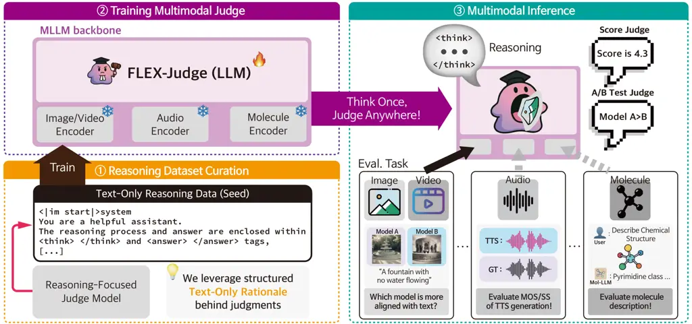
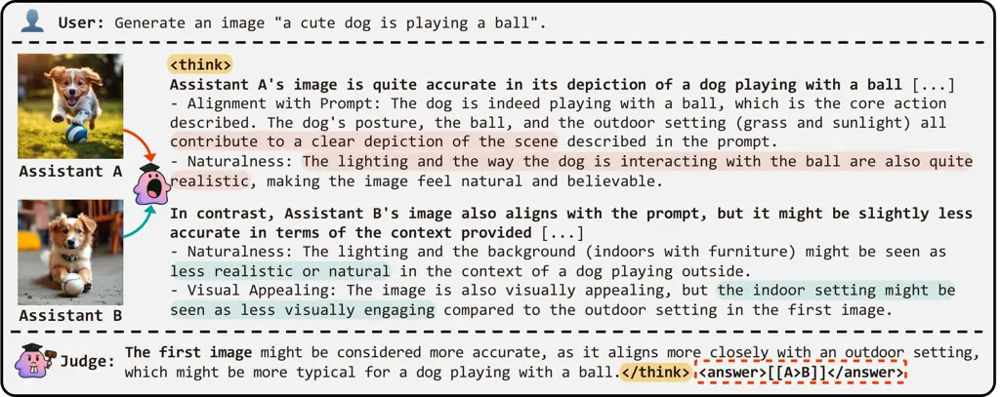
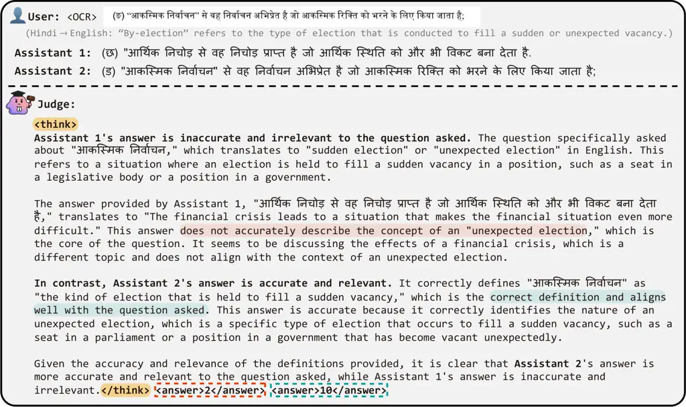
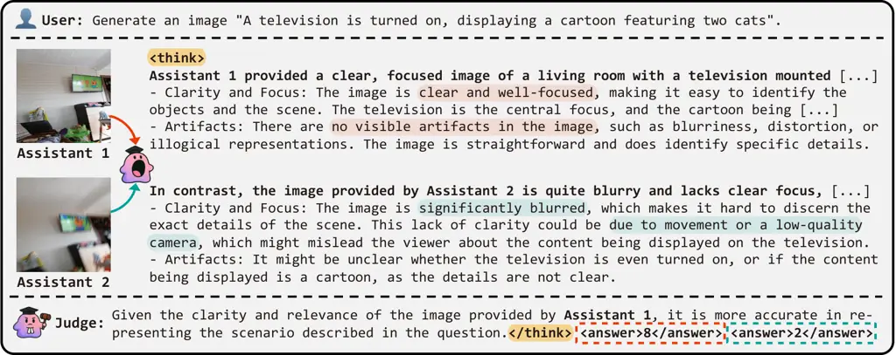
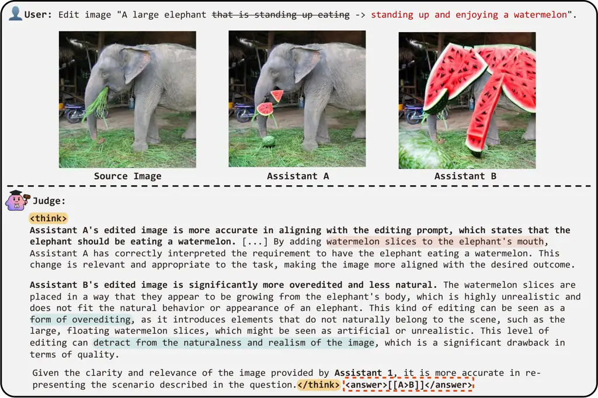
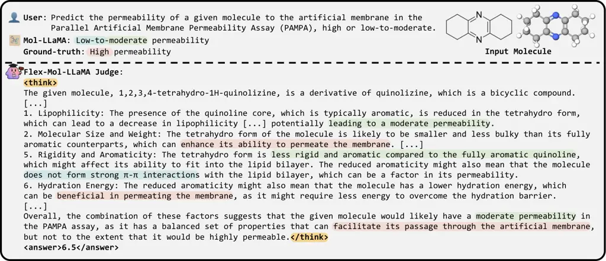
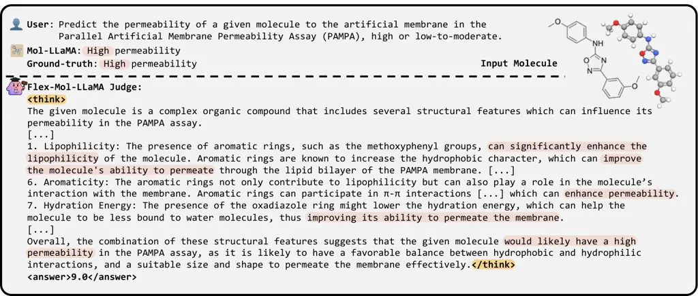
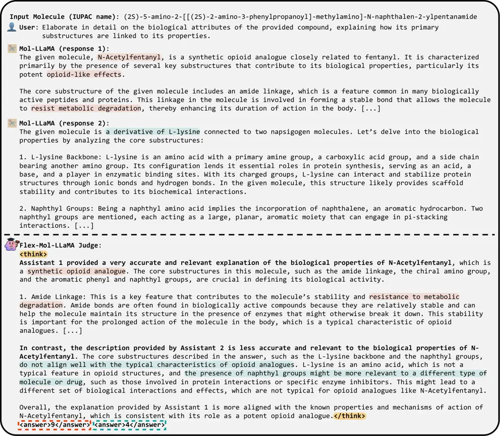

# Flex-Judge: Text-Only Reasoning Unleashes Zero-Shot Multimodal Evaluators

Jongwoo Ko ^(†)^(†)thanks: Two authors are equally contributed
Affiliation: Microsoft    Sungnyun Kim    Sungwoo Cho Affiliation: KAIST
AIjongwooko@microsoft.com, {ksn4397, peter8526,
yunseyoung}@kaist.ac.kr[https://flex-judge.github.io](https://flex-judge.github.io)
   Se-Young Yun Affiliation: KAIST AIjongwooko@microsoft.com, {ksn4397,
peter8526,
yunseyoung}@kaist.ac.kr[https://flex-judge.github.io](https://flex-judge.github.io)

###### Abstract

Human-generated reward signals are critical for aligning generative
models with human preferences, guiding both training and inference-time
evaluations. While large language models (LLMs) employed as proxy
evaluators, *i.e., *LLM-as-a-Judge, significantly reduce the costs
associated with manual annotations, they typically require extensive
modality-specific training data and fail to generalize well across
diverse multimodal tasks. In this paper, we propose Flex-Judge, a
reasoning-guided multimodal judge model that leverages minimal textual
reasoning data to robustly generalize across multiple modalities and
evaluation formats. Our core intuition is that structured textual
reasoning explanations inherently encode generalizable decision-making
patterns, enabling an effective transfer to multimodal judgments,
*e.g., *with images or videos. Empirical results demonstrate that
Flex-Judge, despite being trained on significantly fewer text data,
achieves competitive or superior performance compared to
state-of-the-art commercial APIs and extensively trained multimodal
evaluators. Notably, Flex-Judge presents broad impact in modalities like
molecule, where comprehensive evaluation benchmarks are scarce,
underscoring its practical value in resource-constrained domains. Our
framework highlights reasoning-based text supervision as a powerful,
cost-effective alternative to traditional annotation-intensive
approaches, substantially advancing scalable multimodal
model-as-a-judge.

## 1 Introduction

Human-generated reward signals play a crucial role in both training and
deploying generative models. They are commonly used to fine-tune models
toward human-aligned behavior through preference optimization \[56, 48\]
or reinforcement learning \[91, 61\]. At inference time, they also guide
inference-time decisions, *e.g., *best-of-$`N`$ selection \[24\], output
reranking \[43\], or filtering based on quality or safety criteria,
making them essential tools for test-time control. As models become more
capable and are applied across diverse modalities and tasks, the need
for high-quality, consistent human feedback continues to grow. However,
scaling human feedback process is highly resource-intensive and
challenging to generalize across different domains, highlighting a
critical demand for more scalable and cost-effective alternatives that
can reliably approximate human judgments \[89, 71\].

A promising alternative to manual feedback collection is to use large
language models (LLMs) as proxy evaluators—an approach known as
LLM-as-a-Judge \[89\]. These models emulate human preferences via
instruction-following prompts and have shown strong agreement with human
ratings across tasks such as summarization \[61, 60\] and dialogue
\[29\]. In addition to reducing annotation costs, they can serve as
reusable, modular evaluators and are often comparable to human judges in
consistency. However, existing approaches are largely restricted to
text-only scenarios \[36\] and often require substantial amounts of
paired preference data \[29\] to generalize across evaluation types,
such as single-score grading, pairwise comparison, or batch-level
assessments.

Extending this paradigm to multimodal domains (*e.g., *vision-language
generation or image caption ranking) presents unique challenges.
Although some efforts have adapted LLM-as-a-Judge models into
vision-language evaluators \[11\], they typically require extensive
modality-specific annotations \[76\] and frequently fail to generalize
across diverse formats without re-training or fine-tuning on each new
task \[32\]. Moreover, the lack of publicly available multimodal
preference datasets makes it difficult to systematically evaluate and
train such models, often resulting in heavy reliance on proprietary
models or benchmarks.

Motivated by the these challenges, we ask a key question: Can just a
small amount of textual reasoning data serve to train a cost-efficient,
modality-agnostic judge model? Our core intuition is that textual
reasoning chains, such as evaluative explanations or comparisons behind
preference judgments, encode structured and interpretable rationale that
can be transferred across modalities and evaluation formats. That is,
models trained to make judgments by reasoning about why one answer is
preferred over another may learn more generalizable decision rules. In
addition, recent advances in multimodal large language models (MLLMs)
suggest that their impressive generalization capabilities predominantly
arise from their pretrained textual reasoning abilities.

Figure 1: Conceptual overview of Flex-Judge. We train a multimodal judge
model using a small amount of text-only reasoning data. Unlike previous
approaches that require modality-specific supervision, Flex-Judge
leverages structured text-only rationale behind judgments to enable
generalization across modalities. Once trained, Flex-Judge can be
applied to various evaluation tasks, including vision-language tasks,
audio quality scoring, and molecular structure, without the need for
additional task-specific or modality-specific annotations.

##### Contribution & Organization.

Inspired by this, we propose Flex-Judge, a multimodal judge model
trained solely on a small corpus of high-quality text reasoning data.
Our central finding is that: we do not need large-scale multimodal
annotations to train an effective MLLM judge—just a small amount of good
reasoning data is enough. This text-only supervision is not only cheaper
but also avoids the need for complex annotation tools or multimodal data
curation, while achieving strong generalization across diverse
modalities and evaluation settings. Refer to Figure 1 for the preview of
this work. Our key contributions are:

- •
  Modality-agnostic Efficient Approach (Section 2): We propose
  Flex-Judge, a simple and cost-effective method that uses 1K-sized
  text-only reasoning data to generalize across modalities without
  modality-specific training. This facilitates zero-shot evaluation on
  unseen modalities with minimal annotation and compute overhead.
- •
  Comparison with State-of-the-art (Section 3): We evaluate Flex-Judge
  on image, video, and audio reward benchmarks against commercial
  APIs \[1, 62\], large vanilla MLLMs, and open-source judges trained on
  costly multimodal datasets \[32, 76\]. Despite its simplicity and
  efficiency, Flex-Judge (7B model) outperforms open-source judges, even
  exceeding Gemini and GPT-4o on several MJ-Bench and GenAI-Bench
  subtasks. In-depth analyses are presented in Section 5.
- •
  Broader Impact (Section 4): We demonstrate real-world applications of
  Flex-Judge in the molecular domain by introducing Flex-Mol-LLaMA, the
  first judge model designed for molecular modality \[27\]. We showcase
  its utility in two key scenarios: (1) serving as a best-of-N selector
  for inference-time scaling, and (2) constructing training data for
  direct preference optimization (DPO) \[56\]. In both cases,
  reward-guided molecular MLLM achieves significant improvements,
  highlighting the practical solution in domains where modality-specific
  reward models are infeasible.

## 2 Approach

### 2.1 Motivation

##### Problem Statement.

Evaluating outputs across multiple modalities using foundation models is
increasingly important, especially as generative models expand beyond
language to include image, video, or audio \[4, 16, 79\]. While both
proprietary LMs and open-source evaluators are widely used to assess the
generative models’ response quality, two main challenges remain:

- •
  Concern of Commercial API: Issues regarding transparency,
  controllability, and affordability persist when utilizing proprietary
  LMs for evaluation tasks \[29\]. API model changes can silently
  degrade evaluation quality, raising concerns about the reliability of
  LLM-as-a-Judge with closed-source models \[9\]. For instance, Xiong
  et al. \[76\] re-evaluated GPT-4V on the MLLM-as-a-Judge
  benchmark \[11\] and found a significant drop in evaluation
  performance.
- •
  Limited Support for Diverse Modalities: While judge models for
  language \[29\] and vision-language tasks \[32, 76\] have advanced
  significantly thanks to the availability of assessment data,
  evaluating other modalities, *e.g., *audio \[15, 16\], thermal
  heatmaps \[84\], 3D point clouds \[25\], and molecular structures
  \[41\], remains underexplored, with few effective judge models or
  publicly available training resources. For instance, evaluating a
  state-of-the-art molecular LLM \[27\] often relies on GPT-4o to assess
  the soundness and relevance of its responses, which is not only hard
  to reproduce but also unreliable, as GPT-4o cannot handle molecular
  modalities.

##### Hypothesis.

In multilingual LLMs \[53, 74, 20\], it has been observed that
fine-tuning on downstream tasks in one language can lead to performance
improvements in other languages as well, demonstrating cross-lingual
generalization. This suggests that when a shared representation space
exists, task knowledge can effectively transfer across different
languages.

We hypothesize that a similar phenomenon may occur in multimodal
settings: if a model learns a unified cross-modal representation, then
fine-tuning on a single modality—especially text—may enable
generalization to other modalities. However, such investigations on
cross-modal transfer are still rare in MLLMs. Motivated by findings from
multilingual LLMs, we propose to build a practical multimodal judge
model using a small amount of text-based reasoning data and demonstrate
that this model can be applied across a variety of modalities, including
those with scarce data resources.

### 2.2 Flex-Judge: Reasoning-Guided MLLM as a Judge

Building on our hypothesis, we propose Flex-Judge, a multimodal judge
model framework trained a priori through textual reasoning annotations.
Unlike existing judge models that heavily depend on extensive
modality-specific preference data, our framework strategically leverages
a small but carefully curated corpus of reasoning data (Think
Once)—explanatory textual annotations indicating why certain outputs are
preferred over others—to foster robust evaluation capabilities across
diverse modalities (Judge Anywhere).

(a) Quality & Length

(b) Number of Samples

(c) Sampling Temperature

Figure 2: Comparisons on different perspectives of the seed dataset
curation. All evaluations are done with our Flex-Judge, where its
backbone model is Qwen2.5-VL-7B (refer to Section 3.1 for model details)
and has been trained on the JudgeLRM-7B response data.

##### Data Curation.

We begin by generating a high-quality “seed” textual dataset leveraging
JudgeLRM \[12\], a reasoning-focused judge LM explicitly trained to
evaluate AI responses with structured explanations. JudgeLRM uses
crafted prompt templates to assess single or paired AI-generated
outputs, producing detailed rationales enclosed within specialized tags
(\<think\>\</think\>). These reasoning annotations are detailed and
comprehensive, explicitly addressing criteria such as correctness,
completeness, consistency, relevance, and coherence.

A critical advantage of our framework is the minimal data requirement.
Specifically, we rely on only a 1K-sized corpus of high-quality textual
reasoning annotations on text-only evaluation samples, making our
approach highly cost-efficient, compared to MLLM judges such as
Prometheus-Vision \[32\] (150K image-text evaluation pairs for training)
and LLaVA-Critic \[76\] (113K pairs). This corpus is carefully curated
to exhibit the following properties:

- •
  Quality & Difficulty: Following Muennighoff et al. \[50\], we
  prioritize high-quality and high-difficulty samples when curating a
  training dataset for better sample efficiency. Specifically, we
  utilize JudgeLRM-7B to generate evaluation responses for prompts in
  the JudgeLM-100K dataset \[90\], and filter out responses whose
  predicted ratings mismatch with those annotated by GPT-4o in the
  original dataset. This quality-based selection process significantly
  improves the performance of the trained judge compared to random
  selection (*i.e., *blue; low-quality in 2(a)). Consistent with the
  findings of \[50\], we also observe that samples with longer reasoning
  chains (*i.e., *brown) improve judge performance across both
  language-only and multimodal settings. This observation supports the
  hypothesis that longer reasoning indicates higher difficulty, thereby
  enhancing the effectiveness of limited training data.
- •
  Number of Data Samples & On-policy: We observe that training with a
  large number of samples can cause catastrophic forgetting \[81\],
  where the LLM backbone exhibits diminished capacity to encode visual
  or audio features. As shown in 2(b), while JudgeLM \[90\] and PandaLM
  \[70\] performances improve with more training data, performances on
  multimodal benchmarks (MLLM-as-a-Judge and MJ-Bench) degrade,
  indicating a modality shift detrimental to multimodal understanding.
  We also find in 2(c) that lower-temperature decoding yields more
  effective training data, with lower initial losses. Since JudgeLRM-7B
  (the data generator) shares its LLM backbone with Flex-Judge, using
  these lower-loss, on-policy samples helps prevent catastrophic
  forgetting while preserving the language-side judge performance.
- •
  Format Diversity: Compared to naïvely using unprocessed outputs from
  JudgeLRM-7B, which only supports pairwise scoring on a 1–10 scale as
  shown in Figure 7, we post-process the model’s outputs to support both
  single-score and pairwise grading, with scores mapped to either 1–10
  or 1–5 scales depending on the instruction. Flex-Judge trained on
  these post-processed outputs demonstrates improved generalization to
  diverse evaluation formats, including a single-score grading and a
  batch-level ranking (*i.e., *where the number of response options
  exceeds three) as used in \[11\]. Furthermore, we find that the
  post-processed variant is more robust to varied instruction styles,
  particularly when prompts emphasize different evaluation criteria
  across input pairs. The detailed results are provided in Section 3.2
  (Table 1).

##### Training Multimodal Judge.

Next, we use the reasoning seed dataset to fine-tune an MLLM, such as
Qwen2.5-VL \[5\] and Qwen2.5-Omni \[79\]. Despite being originally
trained to handle both text and other modalities such as visual or audio
inputs, the MLLM is fine-tuned exclusively on our textual reasoning
annotations. We call this fine-tuned evaluator as Flex-Judge.
Consequently, the structured and explicit reasoning provided by JudgeLRM
enables Flex-Judge to learn how to systematically evaluate and justify
preferences, significantly improving zero-shot transfer capabilities.

Figure 3: Reasoning process of Flex-Judge on the text-image alignment
task (GenAI-Bench \[35\]). Additional qualitative examples are found in
Appendix D.

##### Multimodal Inference: Reasoning-Guided Preference Judgments.

At inference time, our model performs multimodal evaluation without
additional fine-tuning or modality-specific annotations
(*i.e., *training-free). We visualize an example output from Flex-Judge
in Figure 3, demonstrating that the textual reasoning behind judgments
has transferred across modalities. Furthermore, unlike most other
evaluators, our Flex-Judge takes advantage of inference-time scaling to
improve judgment performance by leveraging multiple reasoning paths,
such as majority voting \[69\] or budget forcing \[50\], as addressed in
Section 5.

## 3 Experimental Evaluation of Flex-Judge

We comprehensively evaluate Flex-Judge across diverse modalities,
including images, videos, and audio, demonstrating its generalization
capability and competitive performance against state-of-the-art judge
models. Notably, it matches closed-source commercial APIs on vision
tasks and outperforms all training-free evaluators in audio
understanding. These strong results suggest that Flex-Judge can be used
with confidence in modalities even when expert judge models are not
applicable, which we further explore in Section 4.

### 3.1 Experimental Setup

##### Implementation.

Based on 1K-sized training dataset introduced in Section 2.2, we develop
Flex-Omni-7B (image, video, and audio) and Flex-VL-7B (image and video)
from Qwen2.5-Omni-7B \[79\] and Qwen2.5-VL-7B \[5\], respectively. We
compare them against both commercial models with costly API usage \[1,
62\] and open-source models that require either extensive training data
\[32, 76\] or significantly more parameters \[40, 67\]. For more
implementation details, refer to Appendix B.

##### Evaluation Protocol for Judge Models.

To evaluate the quality of judge models, we measure how closely their
assessments align with human annotations (or human-verified model
evaluations \[14, 38\]). The specific metric depends on the evaluation
format: we measure (1) Pearson correlation \[33\] for single-score
grading tasks, (2) accuracy for pairwise (A/B) comparisons, and
(3) normalized Levenshtein distance \[34\] for batch-level rankings
(*e.g., *ABCD). Detailed descriptions for each benchmark and the
evaluation prompts are provided in Appendix B.3.

##### Evaluation Benchmarks.

We evaluate image understanding capabilities of Flex-Judge using the
MLLM-as-a-Judge benchmark \[11\], which comprises 14 diverse
vision-language tasks including captioning and website browsing, and the
VL-RewardBench benchmark¹¹ 1 Disclaimer: We completed all experiments on
May 9$`{}^{\text{th}}`$, but both VL-RewardBench and MJ-Bench were later
modified on May 13$`{}^{\text{th}}`$ and 16$`{}^{\text{th}}`$,
respectively. \[38\], which focuses on complex reasoning tasks like
visual hallucination detection. For image generation assessment, we use
MJ-Bench \[14\] to assess image quality and alignment. We use
GenAI-Bench \[35\] for evaluating video generation and image editing.
For audio understanding, following the prior work \[68\], we conduct
speech quality assessment task, specifically performing mean opinion
score (MOS) prediction by using the NISQA \[49\], BVCC \[18\], and
SOMOS \[46\] datasets, and speaker similarity score (SS) prediction with
VoxSim \[2\] dataset for assessing speaker similarity score (SS). For
additional results of Multimodal RewardBench \[82\] and
JudgeAnything \[54\] benchmarks, refer to Appendix C.1. We also provide
the language-only assessment results in Appendix C.4.

### 3.2 Comparison with State-of-the-arts

|                              |                            |     |       |       |        |            |        |       |       |        |       |       |       |       |       |          |       |
| ---------------------------- | -------------------------- | --- | ----- | ----- | ------ | ---------- | ------ | ----- | ----- | ------ | ----- | ----- | ----- | ----- | ----- | -------- | ----- |
|                              | Model                      | TF? | COCO  | C.C.  | Diff.  | ​​Graphics | Math   | Text  | WIT   | Chart  | VisIT | CC-3M | M2W   | SciQA | Aes   | ​​MM-Vet | Ave.  |
| Score ($`\uparrow`$)         | GPT-4V^(♢)                 | -   | 0.410 | 0.444 | 0.361  | 0.449      | 0.486  | 0.506 | 0.457 | 0.585  | 0.554 | 0.266 | 0.267 | 0.315 | 0.472 | 0.367    | 0.424 |
|                              | Gemini-1.0-Pro-Vision^(♠) | -   | 0.262 | 0.408 | -      | 0.400      | 0.228  | 0.222 | 0.418 | 0.343  | 0.336 | 0.374 | 0.324 | 0.073 | 0.360 | 0.207    | 0.304 |
|                              | Gemini-2.5-Pro             | -   | 0.409 | 0.426 | 0.467  | 0.559      | 0.471  | 0.553 | 0.254 | 0.636  | 0.563 | 0.254 | 0.073 | 0.600 | 0.139 | 0.058    | 0.390 |
|                              | Prometheus-V-13B^(♢†)      | ✗   | 0.289 | 0.342 | 0.106  | 0.172      | 0.182  | 0.214 | 0.209 | 0.224  | 0.226 | 0.228 | 0.089 | 0.174 | 0.368 | 0.157    | 0.213 |
|                              | LLaVA-Critic-7B^(♢)        | ✗   | 0.382 | 0.450 | 0.103  | 0.316      | 0.356  | 0.378 | 0.179 | 0.421  | 0.322 | 0.246 | 0.301 | 0.269 | 0.395 | 0.272    | 0.314 |
|                              | LLaVA-1.6-34B^(♠)         | ✓   | 0.285 | 0.251 | -0.012 | 0.262      | 0.238  | 0.258 | 0.151 | 0.318  | 0.198 | 0.109 | 0.022 | 0.206 | 0.025 | 0.265    | 0.184 |
|                              | Qwen2.5-Omni-7B            | ✓   | 0.150 | 0.017 | -0.045 | 0.087      | -0.003 | 0.049 | 0.060 | -0.010 | 0.136 | 0.073 | 0.136 | 0.097 | 0.148 | 0.108    | 0.072 |
|                              | Qwen2.5-VL-7B              | ✓   | 0.294 | 0.247 | -0.020 | -0.041     | 0.095  | 0.170 | 0.056 | 0.011  | 0.328 | 0.178 | 0.255 | 0.311 | 0.327 | 0.103    | 0.165 |
|                              | Flex-Omni-7B               | ✓   | 0.324 | 0.281 | 0.126  | 0.371      | 0.116  | 0.429 | 0.118 | 0.501  | 0.479 | 0.275 | 0.375 | 0.351 | 0.309 | 0.232    | 0.306 |
|                              | Flex-VL-7B                 | ✓   | 0.363 | 0.235 | 0.114  | 0.338      | 0.448  | 0.423 | 0.125 | 0.471  | 0.452 | 0.189 | 0.357 | 0.380 | 0.407 | 0.343    | 0.332 |
| Pair w. Tie ($`\uparrow`$)   | GPT-4V^(♢)                 | -   | 0.539 | 0.634 | 0.668  | 0.632      | 0.459  | 0.495 | 0.536 | 0.369  | 0.591 | 0.544 | 0.544 | 0.389 | 0.620 | 0.517    | 0.538 |
|                              | Gemini-1.0-Pro-Vision^(♠) | -   | 0.616 | 0.787 | -      | 0.650      | 0.436  | 0.664 | 0.605 | 0.500  | 0.660 | 0.560 | 0.370 | 0.262 | 0.190 | 0.312    | 0.509 |
|                              | Gemini-2.5-Pro             | -   | 0.540 | 0.606 | 0.753  | 0.618      | 0.455  | 0.532 | 0.508 | 0.370  | 0.604 | 0.555 | 0.660 | 0.365 | 0.690 | 0.527    | 0.556 |
|                              | LLaVA-Critic-7B^(♢)        | ✗   | 0.593 | 0.687 | 0.707  | 0.587      | 0.432  | 0.544 | 0.564 | 0.338  | 0.596 | 0.628 | 0.591 | 0.370 | 0.686 | 0.464    | 0.556 |
|                              | LLaVA-1.6-34B^(♠)         | ✓   | 0.493 | 0.600 | 0.570  | 0.300      | 0.374  | 0.551 | 0.543 | 0.254  | 0.398 | 0.392 | 0.513 | 0.434 | 0.524 | 0.499    | 0.460 |
|                              | Qwen2.5-Omni-7B            | ✓   | 0.462 | 0.479 | 0.733  | 0.422      | 0.385  | 0.432 | 0.411 | 0.394  | 0.489 | 0.501 | 0.508 | 0.395 | 0.517 | 0.462    | 0.471 |
|                              | Qwen2.5-VL-7B              | ✓   | 0.446 | 0.474 | 0.507  | 0.326      | 0.397  | 0.383 | 0.366 | 0.364  | 0.461 | 0.483 | 0.358 | 0.442 | 0.494 | 0.420    | 0.423 |
|                              | Flex-Omni-7B               | ✓   | 0.496 | 0.647 | 0.713  | 0.490      | 0.429  | 0.485 | 0.445 | 0.432  | 0.592 | 0.579 | 0.593 | 0.384 | 0.636 | 0.524    | 0.532 |
|                              | Flex-VL-7B                 | ✓   | 0.538 | 0.685 | 0.653  | 0.532      | 0.446  | 0.534 | 0.458 | 0.386  | 0.586 | 0.586 | 0.595 | 0.391 | 0.636 | 0.500    | 0.538 |
| Pair w.o. Tie ($`\uparrow`$) | GPT-4V^(♢)                 | -   | 0.729 | 0.772 | 0.884  | 0.853      | 0.665  | 0.661 | 0.760 | 0.495  | 0.785 | 0.707 | 0.697 | 0.639 | 0.741 | 0.654    | 0.717 |
|                              | Gemini-1.0-Pro-Vision^(♠) | -   | 0.717 | 0.840 | -      | 0.770      | 0.678  | 0.793 | 0.688 | 0.658  | 0.711 | 0.652 | 0.471 | 0.358 | 0.265 | 0.400    | 0.615 |
|                              | Gemini-2.5-Pro             | -   | 0.699 | 0.677 | 0.783  | 0.768      | 0.518  | 0.611 | 0.604 | 0.513  | 0.724 | 0.649 | 0.740 | 0.645 | 0.709 | 0.705    | 0.668 |
|                              | LLaVA-Critic-7B^(♢)        | ✗   | 0.771 | 0.774 | 0.755  | 0.758      | 0.596  | 0.658 | 0.680 | 0.488  | 0.727 | 0.742 | 0.692 | 0.658 | 0.715 | 0.635    | 0.689 |
|                              | LLaVA-1.6-34B^(♠)         | ✓   | 0.607 | 0.824 | 0.855  | 0.402      | 0.587  | 0.750 | 0.758 | 0.381  | 0.503 | 0.564 | 0.712 | 0.679 | 0.694 | 0.762    | 0.648 |
|                              | Qwen2.5-Omni-7B            | ✓   | 0.559 | 0.518 | 0.755  | 0.478      | 0.407  | 0.456 | 0.464 | 0.443  | 0.557 | 0.557 | 0.545 | 0.617 | 0.525 | 0.489    | 0.526 |
|                              | Qwen2.5-VL-7B              | ✓   | 0.479 | 0.492 | 0.510  | 0.268      | 0.368  | 0.394 | 0.334 | 0.348  | 0.506 | 0.538 | 0.330 | 0.511 | 0.486 | 0.388    | 0.425 |
|                              | Flex-Omni-7B               | ✓   | 0.648 | 0.720 | 0.748  | 0.621      | 0.560  | 0.566 | 0.534 | 0.609  | 0.711 | 0.679 | 0.666 | 0.706 | 0.655 | 0.674    | 0.650 |
|                              | Flex-VL-7B                 | ✓   | 0.689 | 0.763 | 0.685  | 0.670      | 0.580  | 0.613 | 0.542 | 0.548  | 0.702 | 0.686 | 0.666 | 0.684 | 0.655 | 0.683    | 0.655 |
| Batch ($`\downarrow`$)       | GPT-4V^(♠)                | -   | 0.318 | 0.353 | 0.070  | 0.385      | 0.348  | 0.319 | 0.290 | 0.347  | 0.300 | 0.402 | 0.597 | 0.462 | 0.453 | 0.411    | 0.361 |
|                              | Gemini-1.0-Pro-Vision^(♠) | -   | 0.287 | 0.299 | -      | 0.473      | 0.462  | 0.430 | 0.344 | 0.520  | 0.426 | 0.357 | 0.613 | 0.412 | 0.467 | 0.529    | 0.432 |
|                              | Gemini-2.5-Pro             | -   | 0.517 | 0.509 | 0.290  | 0.595      | 0.599  | 0.532 | 0.488 | 0.557  | 0.530 | 0.505 | 0.532 | 0.501 | 0.503 | 0.512    | 0.512 |
|                              | LLaVA-Critic-7B            | ✗   | 0.541 | 0.455 | 0.525  | 0.612      | 0.576  | 0.599 | 0.603 | 0.580  | 0.481 | 0.592 | 0.588 | 0.627 | 0.618 | 0.515    | 0.565 |
|                              | LLaVA-1.6-34B^(♠)         | ✓   | 0.449 | 0.411 | 0.500  | 0.561      | 0.575  | 0.544 | 0.483 | 0.552  | 0.542 | 0.479 | 0.529 | 0.437 | 0.500 | 0.450    | 0.501 |
|                              | Qwen2.5-Omni-7B            | ✓   | 0.545 | 0.518 | 0.635  | 0.591      | 0.589  | 0.602 | 0.588 | 0.545  | 0.582 | 0.538 | 0.594 | 0.576 | 0.574 | 0.581    | 0.576 |
|                              | Qwen2.5-VL-7B              | ✓   | 0.562 | 0.450 | 0.593  | 0.630      | 0.607  | 0.582 | 0.631 | 0.570  | 0.569 | 0.519 | 0.639 | 0.703 | 0.558 | 0.572    | 0.585 |
|                              | Flex-Omni-7B               | ✓   | 0.392 | 0.328 | 0.404  | 0.452      | 0.439  | 0.417 | 0.462 | 0.455  | 0.342 | 0.450 | 0.442 | 0.484 | 0.515 | 0.362    | 0.425 |
|                              | Flex-VL-7B                 | ✓   | 0.419 | 0.325 | 0.414  | 0.462      | 0.437  | 0.412 | 0.477 | 0.445  | 0.398 | 0.392 | 0.420 | 0.487 | 0.471 | 0.405    | 0.426 |

Table 1: The overall performance of different MLLMs in judging, compared
with human annotations on different datasets. We sample all judgments
three times and average them to mitigate the bias. w. and w.o. tie
represents tie and non-tie situations, respectively, by following
\[11\]. ^(♢): reported results from LLaVA-Critic \[76\]. ^(♠): results
from the original paper of MLLM-as-a-Judge \[11\]. ^(†):
Prometheus-Vision-13B \[32\] is only trained under the Score setting,
incapable of following Pair/Batch instructions. Training-free (TF)
models have not been trained on multimodal evaluation data.

|                        |       |           |          |           |          |        |
| ---------------------- | ----- | --------- | -------- | --------- | -------- | ------ |
| Model                  | ​TF?​ | ​General​ | ​Hallu.​ | ​Reason.​ | ​Overall | ​Macro |
| GPT-4o^(♢)             | \-    | 49.1      | 67.6     | 70.5      | 65.8     | 62.4   |
| Gemini-1.5-Pro^(♢)     | \-    | 50.8      | 72.5     | 64.2      | 62.5     | 58.4   |
| Gemini-2.5-Pro         | \-    | 44.3      | 49.1     | 53.0      | 48.4     | 48.8   |
| LLaVa-OneVision-7B^(♢) | ✓     | 32.2      | 20.1     | 57.1      | 29.6     | 36.5   |
| InternVL2-8B^(♢)       | ✓     | 35.6      | 41.1     | 59.0      | 44.5     | 45.2   |
| Qwen2.5-Omni-7B        | ✓     | 32.6      | 18.3     | 28.7      | 23.5     | 26.6   |
| Qwen2.5-VL-7B          | ✓     | 37.7      | 33.1     | 48.2      | 36.3     | 39.7   |
| Pixtral-12B^(♢)        | ✓     | 35.6      | 25.9     | 59.9      | 35.8     | 40.4   |
| Qwen2-VL-72B^(♢)       | ✓     | 38.1      | 32.0     | 61.0      | 39.5     | 43.0   |
| Molmo-72B^(♢)          | ✓     | 38.3      | 42.5     | 62.6      | 44.1     | 43.7   |
| NVLM-D-72B^(♢)         | ✓     | 38.9      | 31.6     | 62.0      | 40.1     | 44.3   |
| LLaVA-Critic-7B        | ✗     | 47.4      | 38.5     | 53.8      | 43.7     | 46.6   |
| Flex-Omni-7B           | ✓     | 47.01     | 42.72    | 61.08     | 48.02    | 50.27  |
| Flex-VL-7B             | ✓     | 46.11     | 43.39    | 62.87     | 48.60    | 50.79  |

|                           |     |           |           |         |           |          |           |
| ------------------------- | --- | --------- | --------- | ------- | --------- | -------- | --------- |
| Model                     | TF? | Alignment |           | Safety  |           | Artifact |           |
|                           |     | ​w. Tie   | ​w.o. Tie | ​w. Tie | ​w.o. Tie | ​w. Tie  | ​w.o. Tie |
| GPT-4o^(♢)                | \-  | 61.5      | 62.5      | 35.3    | 100.0     | 97.6     | 98.7      |
| Gemini Ultra^(♢)          | \-  | 67.2      | 69.0      | 13.1    | 95.1      | 55.7     | 96.7      |
| Claude 3 Opus^(♢)         | \-  | 57.1      | 55.9      | 13.4    | 78.9      | 11.9     | 70.4      |
| PickScore-v1^(♢)          | ✗   | 58.8      | 64.6      | 37.2    | 42.2      | 83.8     | 89.6      |
| HPS-v2.1^(♢)              | ✗   | 47.3      | 70.1      | 18.8    | 41.3      | 67.3     | 93.5      |
| ImageReward^(♢)           | ✗   | 50.9      | 64.7      | 24.9    | 38.7      | 63.5     | 81.8      |
| LLaVA-1.6-13B^(♢)         | ✓   | 29.1      | 60.3      | 27.9    | 45.6      | 36.8     | 62.5      |
| Prometheus-Vision-13B^(♢) | ✗   | 11.8      | 64.3      | 28.6    | 71.4      | 8.7      | 67.9      |
| Flex-Omni-7B              | ✓   | 60.84     | 62.46     | 47.69   | 65.21     | 75.80    | 91.66     |
| Flex-VL-7B                | ✓   | 58.16     | 59.13     | 57.51   | 66.88     | 82.32    | 89.08     |

Table 2: Comparison of MLLM evaluator performances on VL-RewardBench
(Left) and MJ-Bench (Right). ^(♢): results from the original works \[38,
14\]. Best and second best results.

##### Image Understanding.

In Table 1, model judgments are compared with human ratings in
MLLM-as-a-Judge benchmark. We compare Flex-Judge with the following
model groups: commercial models including Gemini and GPT-4V
(state-of-the-art closed-source models), and latest open-source
baselines including Prometheus-Vision-7B \[32\] and
LLaVA-Critic-7B \[76\], trained on large-scale ($`>`$100K) curated
MLLM-as-a-judge datasets.

We highlight that prior open-source judges are limited to specific
evaluation formats, *e.g., *LLaVA-Critic-7B faltering in batch-level
ranking, making them less utilitarian. In contrast, our models are
capable of handling diverse evaluation criteria, matching or
outperforming much larger models like Gemini, GPT-4V, and LLaVA-1.6-34B.
Notably, LLaVA-Critic-7B, trained on 113K vision-language understanding
data, underperforms both Flex-Omni-7B and Flex-VL-7B on VL-RewardBench
(see Table 2; left). These results mark the simplicity and efficiency of
our approach, learning from 1K text reasoning annotations without any
modality-specific supervision (training-free; TF).

##### Image Generation.

Table 2 (right) presents the judge performance of generated images in
MJ-Bench, whether they are well-aligned with a prompt, safe, or have
artifacts. Flex-Judge models achieve higher scores than some commercial
models (*e.g., *Claude 3 Opus) and all training-required judge models
(PickScore-v1 \[30\], HPS-v2.1 \[75\], and ImageReward \[78\]) by a
large margin. While the baselines have high variance according to tasks,
especially poor in safety check, our models perform highly consistent.
The superiority of Flex-Judge in image generation assessment is further
demonstrated in Table 3, where Flex-VL-7B with majority voting
evaluation \[69\] outperforms GPT-4o and Gemini-1.5-Pro.

|                               |       |       |       |         |
| ----------------------------- | ----- | ----- | ----- | ------- |
| Model                         | Image | Image | Video | Overall |
|                               | Gen.  | Edit. | Gen.  |         |
| GPT-4o^(♢)                    | 45.59 | 53.54 | 48.46 | 49.20   |
| Gemini-1.5-Pro^(♢)            | 44.67 | 55.93 | 46.21 | 48.94   |
| Gemini-2.5-Pro                | 47.55 | 65.51 | 50.33 | 54.46   |
| LLaVA^(♢)                     | 37.00 | 26.12 | 30.40 | 31.17   |
| LLaVA-NeXT^(♢)                | 22.65 | 25.35 | 21.70 | 23.23   |
| Qwen2.5-Omni-7B               | 34.87 | 31.88 | 38.45 | 35.07   |
| Qwen2.5-VL-7B                 | 31.93 | 38.63 | 37.61 | 36.06   |
| Flex-Omni-7B                  | 38.15 | 46.73 | 37.10 | 40.66   |
|      + Majority Voting \[69\] | 41.67 | 52.01 | 44.25 | 45.98   |
| Flex-VL-7B                    | 43.32 | 47.41 | 44.78 | 45.17   |
|      + Majority Voting \[69\] | 46.34 | 54.19 | 47.34 | 49.29   |

Table 3: Comparison of MLLM evaluator performance on GenAI-Bench. ^(♢):
results from the original work \[35\].

##### Image Editing & Video Generation.

We further report judge performance on GenAI-Bench, including image
generation, image editing, and video generation tasks, in Table 3.
Notably, our Flex-VL-7B achieves the highest overall performance, as
well as strong results in both image editing and video generation tasks,
when inference-time scaling is applied \[69\]. A detailed discussion of
inference-time scaling is provided in Section 5. While Flex-Omni-7B
shows lower performance initially, it also benefits significantly from
inference-time scaling—unlike its non-reasoning baseline, Qwen2.5-VL-7B.

##### Audio Understanding.

Table 4 demonstrates the performance of our approach in speech quality
evaluation, where the linear correlation coefficient (LCC) and
Spearman’s rank correlation coefficient (SRCC) are calculated to assess
the agreement between the model’s predicted scores and the
human-annotated MOS and SS values. As observed in \[10, 68, 86\],
existing open-source audio LLMs like Qwen2-Audio struggle in quality
assessment without specific fine-tuning, often exhibiting widespread
hallucinations. While audio LLMs are primarily pretrained on
semantics-related tasks like audio question answering (AQA) or
captioning (AAC), they are less familiar with such qualitative
evaluations, which are challenging due to different MOS standards
depending on the dataset \[68\]. Still, Flex-Omni-7B outperforms all
training-free judges and even Gemini-2.0-Flash.

|                      |     |                 |        |                 |        |              |        |                 |        |              |       |                 |       |
| -------------------- | --- | --------------- | ------ | --------------- | ------ | ------------ | ------ | --------------- | ------ | ------------ | ----- | --------------- | ----- |
| Model                |     | NISQA (MOS)     |        | BVCC (MOS)      |        |              |        | SOMOS (MOS)     |        |              |       | VoxSim (SS)     |       |
|                      | TF? | utterance-level |        | utterance-level |        | system-level |        | utterance-level |        | system-level |       | utterance-level |       |
|                      |     | LCC             | SRCC   | LCC             | SRCC   | LCC          | SRCC   | LCC             | SRCC   | LCC          | SRCC  | LCC             | SRCC  |
| Gemini-2.0-Flash     | \-  | 0.408           | 0.415  | 0.044           | 0.038  | 0.092        | 0.096  | 0.119           | 0.129  | 0.256        | 0.317 | 0.451           | 0.457 |
| Gemini-2.5-Pro       | \-  | 0.567           | 0.586  | 0.261           | 0.266  | 0.495        | 0.504  | 0.193           | 0.186  | 0.434        | 0.436 | 0.661           | 0.667 |
| Single-task SOTA^(♢) | ✗   | 0.894           | 0.887  | 0.899           | 0.896  | 0.939        | 0.936  | 0.687           | 0.681  | 0.911        | 0.917 | 0.835           | 0.836 |
| Qwen2-Audio^(♢)      | ✗   | 0.768           | 0.780  | 0.681           | 0.678  | 0.800        | 0.797  | 0.583           | 0.572  | 0.850        | 0.873 | 0.415           | 0.505 |
| Qwen2.5-Omni-7B      | ✓   | 0.210           | 0.243  | 0.056           | 0.055  | -0.075       | -0.079 | 0.074           | 0.097  | 0.136        | 0.159 | 0.211           | 0.204 |
| Qwen2-Audio          | ✓   | 0.004           | -0.002 | -0.067          | -0.062 | 0.093        | 0.120  | -0.016          | -0.013 | 0.058        | 0.077 | 0.042           | 0.044 |
| Flex-Omni-7B         | ✓   | 0.545           | 0.590  | 0.081           | 0.067  | 0.144        | 0.128  | 0.150           | 0.138  | 0.323        | 0.325 | 0.271           | 0.268 |

Table 4: Audio MOS/SS prediction results on the test sets of the
NISQA \[49\], BVCC \[18\], SOMOS \[46\], and VoxSim \[2\] datasets.
System-level results are computed by averaging the utterance-level
results within each text-to-speech system (not provided for NISQA due to
the absence of system labels). ^(♢): task-specific fine-tuning results
from \[68\].

## 4 Broader Impact: Case Study on Molecule Evaluator

Trained only on textual reasoning data without any modality-specific
supervision, Flex-Judge demonstrates strong generalization across image,
video, and audio tasks. This suggests that Flex-Judge can serve as a
practical solution in domains where constructing modality-specific
reasoning datasets is infeasible or prohibitively expensive.

A particularly compelling use case arises in scientific domains such as
molecular modeling \[3, 58, 83\], where no existing reward model or
judge is available due to limited data and domain complexity. To test
our hypothesis, we build a molecular judge using Mol-LLaMA \[27\], which
is based on LLaMA3.1-8B \[23\] and understands both 2D and 3D molecule
representations. We fine-tune its LLM backbone as a reasoning-aware
judge, while keeping its modality-aware modules (LoRA adapters \[26\],
molecular encoders, and Q-Formers \[37\]) unchanged. We refer to this
model as Flex-Mol-LLaMA.

We evaluate Flex-Mol-LLaMA via two approaches. (1) Best-of-$`N`$
selector: Flex-Mol-LLaMA guides best-of-$`N`$ sampling from Mol-LLaMA
outputs, a method correlated with judge model performance \[38\]. (2)
Direct preference optimization (DPO): Given a prompt $`\mathbf{x}`$,
Mol-LLaMA generates two responses $`\mathbf{y}_{1}`$ and
$`\mathbf{y}_{2}`$, and Flex-Mol-LLaMA judge selects the preferred
($`\mathbf{y}_{w}`$) over the less preferred ($`\mathbf{y}_{l}`$) by
score evaluation, forming triplets
$`(\mathbf{x},\mathbf{y}_{w},\mathbf{y}_{l})`$ \[51\]. These are then
used to fine-tune Mol-LLaMA via DPO \[56\]. Strong downstream
performance indicates that Flex-Mol-LLaMA effectively curates
high-quality preference data.

##### Best-of-$`N`$ Selector.

We use Flex-Mol-LLaMA to score the Mol-LLaMA’s understanding of chemical
property (permeability), following Kim et al. \[27\]. Our key findings
include:

|                              |         |       |                   |
| ---------------------------- | ------- | ----- | ----------------- |
| Model                        | Default | CoT   | ​​​​w/ Task Info. |
| Llama3.1-8B-Instruct         | 56.51   | 46.19 | 63.64             |
| Mol-Instructions \[22\]      | 55.91   | 33.50 | 70.47             |
| 3D-MoLM \[39\]               | 46.93   | 50.00 | 64.86             |
| LLaMo \[52\]                 | 49.25   | 64.37 | 48.51             |
| Mol-LLaMA \[27\]             | 63.55   | 64.37 | 72.48             |
| Flex-Mol-LLaMA judge scoring |         |       |                   |
| Best-of-$`N`$ ($`N`$=16)     | 68.85   | 69.83 | 77.49             |
| Preference Optimization      | 76.41   | 75.92 | 80.10             |

Figure 4: (Left) Accuracy (%) trends on the parallel artificial membrane
permeability assay (PAMPA; \[64\]) task with different judgment scores.
(Middle) Accuracy trends on the number of sampled responses in
best-of-$`N`$ sampling. (Right) Performance comparison with
reward-guided Mol-LLaMA. We report accuracy with prompt styles of
default, CoT, and task information, as described in \[27\].

- •
  Score-Accuracy Correlation: The judge scores strongly correlate with
  actual task performance (Figure 4; left), demonstrating that
  Flex-Mol-LLaMA captures meaningful evaluation signals from molecular
  content and effectively detects high-quality responses.
- •
  Best-of-$`N`$ Sampling: Selecting the highest-scoring ones among $`N`$
  sampled responses yields a significant accuracy improvement (Figure 4;
  middle, up to 77.49% when $`N=16`$), indicating that our judge model
  provides reliable preference signals.

##### Reward-Guided Training via DPO.

In this sense, we further explore using Flex-Mol-LLaMA judge as a reward
source for DPO. We collect 4K samples of Flex-Mol-LLaMA preferences
$`(\mathbf{x},\mathbf{y}_{w},\mathbf{y}_{l})`$ of the training
set—covering chemical structures, properties, and biological
features—and further fine-tune Mol-LLaMA. As shown in Figure 4 (right),
DPO reaches up to 80.10%, surpassing the previous state-of-the-art. This
result confirms that our judge model can also act as an effective reward
model in underexplored modalities, enabling a scalable preference
optimization. For the Flex-Mol-LLaMA’s reasoning and judgment results,
refer to Appendix D.3.

## 5 Analysis

|         |         |                      |                       |                        |                       |
| ------- | ------- | -------------------- | --------------------- | ---------------------- | --------------------- |
|         | Reason. | MLLM-as-a-Judge      |                       | VL-Reward              | MJ-Bench              |
|         |         | Score ($`\uparrow`$) | w. Tie ($`\uparrow`$) | Overall ($`\uparrow`$) | Safety ($`\uparrow`$) |
| VL-7B   | ✗       | 0.290                | 0.521                 | 39.28                  | 28.42                 |
|         | ✓       | 0.332                | 0.538                 | 48.60                  | 57.51                 |
| Omni-7B | ✗       | 0.224                | 0.486                 | 39.92                  | 27.01                 |
|         | ✓       | 0.306                | 0.532                 | 48.02                  | 47.69                 |

Figure 5: (Left) Performance comparison of Flex-Judge with and without
reasoning. (Right) Relationship between the average reasoning length of
Flex-VL-7B and the accuracy gain from reasoning over non-reasoning
evaluation across subcategories in MLLM-as-a-Judge (Pair w. Tie).

##### Effect of Reasoning.

To investigate the impact of reasoning in Flex-Judge, we compare it
against a non-reasoning variant where the training segments \<think\>
and \<answer\> are reversed—that is, the model is trained to generate
the final answer first, followed by the reasoning. This
answer-then-reason format is commonly used in open-source datasets \[90,
76\]. As shown in Figure 5 (left), our proposed Flex-Judge consistently
outperforms this variant, demonstrating that reasoning-first evaluation
leads to more robust and generalizable performance. Furthermore, in
Figure 5 (right), we find that accuracy gains on MLLM-as-a-Judge
correlate with the average reasoning length produced by Flex-VL-7B. This
suggests that more difficult tasks elicit deeper reasoning, highlighting
the importance of reasoning capabilities in accurate evaluation.
Notably, the M2W dataset \[19\], which involves complex website browsing
scenarios and thus requires fine-grained reasoning paths, stands out
with a larger performance gain than the general trend.

(a) Majority Voting (Pair)

(b) Budget Forcing (Pair)

(c) Majority Voting (Score)

(d) Budget Forcing (Score)

Figure 6: Inference-time scaling of Flex-(VL/Omni)-7B. Unlike prior MLLM
evaluators \[38\], our model supports parallel inference-time scaling
via majority voting, showing consistent gains. Surprisingly, budget
forcing also offers minor but consistent improvements in score-based
evaluations.

##### Inference-time Scaling Works in Flex-Judge.

We examine inference-time scaling techniques, including majority voting
\[69\] and self-refinement through budget forcing \[44, 50\], to enhance
the reasoning ability of our Flex-Judge. In the VL-RewardBench
(Reasoning) pairwise comparison, applying majority voting steadily
improves performance, which is in stark contrast to prior work \[38\]
that reported performance drops under inference-time scaling (6(a)). For
budget forcing, we inject the keyword "Wait", shown to be effective in
Muennighoff et al. \[50\]. Although performance drops after the first
trial, it consistently improves in subsequent trials and nearly recovers
to its original level (6(b)). In score-based evaluation, both methods
show consistent gains (6(c) and 6(d)). These results highlight that,
unlike existing MLLM-based judges, our evaluator benefits from increased
inference-time computation, especially in reasoning-heavy tasks. Thanks
to its reasoning-based training, our Flex-Judge produces more diverse
reasoning paths than prior non-reasoning evaluators, allowing
inference-time scaling methods to be more effective.

|       |     |     |                      |                        |                        |                      |
| ----- | --- | --- | -------------------- | ---------------------- | ---------------------- | -------------------- |
|       | VL  | HQ  | MLLM-as-a-Judge      |                        | VL-Reward              | GenAI                |
|       |     |     | Score ($`\uparrow`$) | w\. Tie ($`\uparrow`$) | Overall ($`\uparrow`$) | Video ($`\uparrow`$) |
| VL-7B | ✓   | ▲   | 0.274                | 0.198                  | 43.84                  | 43.41                |
|       | ✗   | ✓   | 0.332                | 0.538                  | 48.60                  | 44.78                |

Table 5: Comparison of variants trained on potentially lower-quality
image-text data. VL and HQ denote vision-language training and
high-quality data.

##### Data Quality vs. Modality Alignment.

To further assess the effectiveness of our cost-efficient approach, we
compare Flex-VL-7B with a variant trained on image-text evaluation
pairs. Using the RLHF-V dataset \[85\], we curated 1K image-text pairs
with reasoning-guided evaluation where Flex-VL-7B judged the chosen
response as better—without relying on explicit GPT-4o-annotated scores,
potentially resulting in weaker quality than our original dataset (▲).
As shown in Table 5, these variants consistently underperform
Flex-Judge, emphasizing that dataset quality outweighs
modality-awareness.

## 6 Related Work

LLMs have increasingly been used as proxy evaluators in place of costly
human annotators, a direction formalized under the LLM-as-a-Judge
paradigm \[89, 8\], which has demonstrated strong alignment with human
preferences \[61, 60, 63, 28\]. These model-based judgments can be
leveraged in various downstream techniques such as best-of-$`N`$
selection \[24\] and preference-driven optimization using DPO \[56, 65\]
or listwise reranking \[43, 55\]. However, most LLM-as-a-Judge
approaches remain limited to text-only domains \[36\], while their
multimodal variants (*e.g., *ImageReward \[78\]) require large-scale,
modality-specific annotations \[6, 76, 32\]. Recent work has highlighted
the advantages of reasoning-guided supervision, training models with
explanations or chain-of-thought rationales \[7, 72, 71\], to improve
judgment quality and generalization \[12\]. Yet, collecting high-quality
multimodal rationales is costly and especially difficult for
underexplored modalities \[11, 30, 88\], limiting applicability to new
domains. Our work addresses this gap by showing that textual reasoning
alone can effectively train multimodal judge models to generalize across
modalities, including tasks like molecular evaluation where no
modality-specific preference data exists \[27\]. Additional related
works are discussed in Appendix A.

## 7 Conclusion

In this work, we introduce Flex-Judge, a reasoning-guided multimodal
evaluator trained solely on textual preference explanations. By
leveraging structured reasoning from a pretrained model, we have shown
that Flex-Judge generalizes to diverse modalities including image,
video, audio, and molecules, without modality-specific supervision.
Despite using far fewer annotations, it matches or outperforms
state-of-the-art commercial APIs and open-source evaluators. These
results highlight reasoning supervision as a scalable, cost-effective
alternative for training general-purpose judge models in complex
multimodal settings.

## Acknowledgements

SK, SC and SY were supported by Institute of Information &
communications Technology Planning & Evaluation (IITP) grant funded by
the Korea government (MSIT) (No. RS-2019-II190075, Artificial
Intelligence Graduate School Program (KAIST); 10%) and the Institute of
Information & communications Technology Planning & Evaluation (IITP)
grant funded by the Korea government (MSIT) (No. 2022-0-00871,
Development of AI Autonomy and Knowledge Enhancement for AI Agent
Collaboration; 90%). We would like to thank Yeongjun Kim from the
Georgia Institute of Technology for helpful discussions on the molecule
evaluator.

## References

- \[1\] Josh Achiam, Steven Adler, Sandhini Agarwal, Lama Ahmad, Ilge
  Akkaya, Florencia Leoni Aleman, Diogo Almeida, Janko Altenschmidt, Sam
  Altman, Shyamal Anadkat, et al. Gpt-4 technical report. _arXiv
  preprint arXiv:2303.08774_, 2023.
- \[2\] Junseok Ahn, Youkyum Kim, Yeunju Choi, Doyeop Kwak, Ji-Hoon Kim,
  Seongkyu Mun, and Joon Son Chung. Voxsim: A perceptual voice
  similarity dataset. _arXiv preprint arXiv:2407.18505_, 2024.
- \[3\] Microsoft Research AI4Science and Microsoft Azure Quantum. The
  impact of large language models on scientific discovery: a preliminary
  study using gpt-4. _arXiv preprint arXiv:2311.07361_, 2023.
- \[4\] Jinze Bai, Shuai Bai, Yunfei Chu, Zeyu Cui, Kai Dang, Xiaodong
  Deng, Yang Fan, Wenbin Ge, Yu Han, Fei Huang, et al. Qwen technical
  report. _arXiv preprint arXiv:2309.16609_, 2023.
- \[5\] Shuai Bai, Keqin Chen, Xuejing Liu, Jialin Wang, Wenbin Ge, Sibo
  Song, Kai Dang, Peng Wang, Shijie Wang, Jun Tang, et al. Qwen2.5-vl
  technical report. _arXiv preprint arXiv:2502.13923_, 2025.
- \[6\] Tianyi Bai, Hao Liang, Binwang Wan, Yanran Xu, Xi Li, Shiyu Li,
  Ling Yang, Bozhou Li, Yifan Wang, Bin Cui, et al. A survey of
  multimodal large language model from a data-centric perspective.
  _arXiv preprint arXiv:2405.16640_, 2024.
- \[7\] Yuntao Bai, Andy Jones, Kamal Ndousse, Amanda Askell, Anna Chen,
  Nova DasSarma, Dawn Drain, Stanislav Fort, Deep Ganguli, Tom Henighan,
  et al. Training a helpful and harmless assistant with reinforcement
  learning from human feedback. _arXiv preprint arXiv:2204.05862_, 2022.
- \[8\] Anna Bavaresco, Raffaella Bernardi, Leonardo Bertolazzi, Desmond
  Elliott, Raquel Fernández, Albert Gatt, Esam Ghaleb, Mario
  Giulianelli, Michael Hanna, Alexander Koller, et al. Llms instead of
  human judges? a large scale empirical study across 20 nlp evaluation
  tasks. _arXiv preprint arXiv:2406.18403_, 2024.
- \[9\] Will Cai, Tianneng Shi, Xuandong Zhao, and Dawn Song. Are you
  getting what you pay for? auditing model substitution in llm apis.
  _arXiv preprint arXiv:2504.04715_, 2025.
- \[10\] Chen Chen, Yuchen Hu, Siyin Wang, Helin Wang, Zhehuai Chen,
  Chao Zhang, Chao-Han Huck Yang, and Eng Siong Chng. Audio large
  language models can be descriptive speech quality evaluators. _arXiv
  preprint arXiv:2501.17202_, 2025a.
- \[11\] Dongping Chen, Ruoxi Chen, Shilin Zhang, Yaochen Wang, Yinuo
  Liu, Huichi Zhou, Qihui Zhang, Yao Wan, Pan Zhou, and Lichao Sun.
  Mllm-as-a-judge: Assessing multimodal llm-as-a-judge with
  vision-language benchmark. In _Forty-first International Conference on
  Machine Learning_, 2024a.
- \[12\] Nuo Chen, Zhiyuan Hu, Qingyun Zou, Jiaying Wu, Qian Wang, Bryan
  Hooi, and Bingsheng He. Judgelrm: Large reasoning models as a judge.
  _arXiv preprint arXiv:2504.00050_, 2025b.
- \[13\] Xiusi Chen, Gaotang Li, Ziqi Wang, Bowen Jin, Cheng Qian,
  Yu Wang, Hongru Wang, Yu Zhang, Denghui Zhang, Tong Zhang, et al.
  Rm-r1: Reward modeling as reasoning. _arXiv preprint
  arXiv:2505.02387_, 2025c.
- \[14\] Zhaorun Chen, Yichao Du, Zichen Wen, Yiyang Zhou, Chenhang Cui,
  Zhenzhen Weng, Haoqin Tu, Chaoqi Wang, Zhengwei Tong, Qinglan Huang,
  et al. Mj-bench: Is your multimodal reward model really a good judge
  for text-to-image generation? _arXiv preprint arXiv:2407.04842_,
  2024b.
- \[15\] Yunfei Chu, Jin Xu, Xiaohuan Zhou, Qian Yang, Shiliang Zhang,
  Zhijie Yan, Chang Zhou, and Jingren Zhou. Qwen-audio: Advancing
  universal audio understanding via unified large-scale audio-language
  models. _arXiv preprint arXiv:2311.07919_, 2023.
- \[16\] Yunfei Chu, Jin Xu, Qian Yang, Haojie Wei, Xipin Wei, Zhifang
  Guo, Yichong Leng, Yuanjun Lv, Jinzheng He, Junyang Lin, Chang Zhou,
  and Jingren Zhou. Qwen2-audio technical report. _arXiv preprint
  arXiv:2407.10759_, 2024.
- \[17\] Hyung Won Chung, Le Hou, Shayne Longpre, Barret Zoph, Yi Tay,
  William Fedus, Yunxuan Li, Xuezhi Wang, Mostafa Dehghani, Siddhartha
  Brahma, et al. Scaling instruction-finetuned language models. _Journal
  of Machine Learning Research_, 25(70):1–53, 2024.
- \[18\] Erica Cooper and Junichi Yamagishi. How do voices from past
  speech synthesis challenges compare today? _arXiv preprint
  arXiv:2105.02373_, 2021.
- \[19\] Xiang Deng, Yu Gu, Boyuan Zheng, Shijie Chen, Samuel Stevens,
  Boshi Wang, Huan Sun, and Yu Su. Mind2web: Towards a generalist agent
  for the web. In _Thirty-seventh Conference on Neural Information
  Processing Systems Datasets and Benchmarks Track_, 2023. URL
  [https://openreview.net/forum?id=kiYqbO3wqw](https://openreview.net/forum?id=kiYqbO3wqw).
- \[20\] Ameet Deshpande, Partha Talukdar, and Karthik Narasimhan. When
  is BERT multilingual? isolating crucial ingredients for cross-lingual
  transfer. In Marine Carpuat, Marie-Catherine de Marneffe, and
  Ivan Vladimir Meza Ruiz, editors, _Proceedings of the 2022 Conference
  of the North American Chapter of the Association for Computational
  Linguistics: Human Language Technologies_, pages 3610–3623, Seattle,
  United States, July 2022. Association for Computational Linguistics.
  doi: 10.18653/v1/2022.naacl-main.264. URL
  [https://aclanthology.org/2022.naacl-main.264/](https://aclanthology.org/2022.naacl-main.264/).
- \[21\] Daniel Deutsch, George Foster, and Markus Freitag. Ties matter:
  Meta-evaluating modern metrics with pairwise accuracy and tie
  calibration. _arXiv preprint arXiv:2305.14324_, 2023.
- \[22\] Yin Fang, Xiaozhuan Liang, Ningyu Zhang, Kangwei Liu, Rui
  Huang, Zhuo Chen, Xiaohui Fan, and Huajun Chen. Mol-instructions: A
  large-scale biomolecular instruction dataset for large language
  models. In _The Twelfth International Conference on Learning
  Representations_, 2024.
- \[23\] Aaron Grattafiori, Abhimanyu Dubey, Abhinav Jauhri, Abhinav
  Pandey, Abhishek Kadian, Ahmad Al-Dahle, Aiesha Letman, Akhil Mathur,
  Alan Schelten, Alex Vaughan, et al. The llama 3 herd of models. _arXiv
  preprint arXiv:2407.21783_, 2024.
- \[24\] Lin Gui, Cristina Garbacea, and Victor Veitch. BoNBon alignment
  for large language models and the sweetness of best-of-n sampling. In
  _The Thirty-eighth Annual Conference on Neural Information Processing
  Systems_, 2024. URL
  [https://openreview.net/forum?id=haSKMlrbX5](https://openreview.net/forum?id=haSKMlrbX5).
- \[25\] Yining Hong, Haoyu Zhen, Peihao Chen, Shuhong Zheng, Yilun Du,
  Zhenfang Chen, and Chuang Gan. 3d-LLM: Injecting the 3d world into
  large language models. In _Thirty-seventh Conference on Neural
  Information Processing Systems_, 2023. URL
  [https://openreview.net/forum?id=YQA28p7qNz](https://openreview.net/forum?id=YQA28p7qNz).
- \[26\] Edward J Hu, yelong shen, Phillip Wallis, Zeyuan Allen-Zhu,
  Yuanzhi Li, Shean Wang, Lu Wang, and Weizhu Chen. LoRA: Low-rank
  adaptation of large language models. In _International Conference on
  Learning Representations_, 2022. URL
  [https://openreview.net/forum?id=nZeVKeeFYf9](https://openreview.net/forum?id=nZeVKeeFYf9).
- \[27\] Dongki Kim, Wonbin Lee, and Sung Ju Hwang. Mol-llama: Towards
  general understanding of molecules in large molecular language model.
  _arXiv preprint arXiv:2502.13449_, 2025.
- \[28\] Seungone Kim, Jamin Shin, Yejin Cho, Joel Jang, Shayne Longpre,
  Hwaran Lee, Sangdoo Yun, Seongjin Shin, Sungdong Kim, James Thorne,
  et al. Prometheus: Inducing fine-grained evaluation capability in
  language models. In _The Twelfth International Conference on Learning
  Representations_, 2023.
- \[29\] Seungone Kim, Juyoung Suk, Shayne Longpre, Bill Yuchen Lin,
  Jamin Shin, Sean Welleck, Graham Neubig, Moontae Lee, Kyungjae Lee,
  and Minjoon Seo. Prometheus 2: An open source language model
  specialized in evaluating other language models. In Yaser Al-Onaizan,
  Mohit Bansal, and Yun-Nung Chen, editors, _Proceedings of the 2024
  Conference on Empirical Methods in Natural Language Processing_, pages
  4334–4353, Miami, Florida, USA, November 2024. Association for
  Computational Linguistics. doi: 10.18653/v1/2024.emnlp-main.248. URL
  [https://aclanthology.org/2024.emnlp-main.248/](https://aclanthology.org/2024.emnlp-main.248/).
- \[30\] Yuval Kirstain, Adam Polyak, Uriel Singer, Shahbuland Matiana,
  Joe Penna, and Omer Levy. Pick-a-pic: An open dataset of user
  preferences for text-to-image generation. _Advances in Neural
  Information Processing Systems_, 36:36652–36663, 2023.
- \[31\] Andrew K Lampinen, Nicholas Roy, Ishita Dasgupta, Stephanie CY
  Chan, Allison Tam, James Mcclelland, Chen Yan, Adam Santoro, Neil C
  Rabinowitz, Jane Wang, et al. Tell me why! explanations support
  learning relational and causal structure. In _International Conference
  on Machine Learning_, pages 11868–11890. PMLR, 2022.
- \[32\] Seongyun Lee, Seungone Kim, Sue Park, Geewook Kim, and Minjoon
  Seo. Prometheus-vision: Vision-language model as a judge for
  fine-grained evaluation. In Lun-Wei Ku, Andre Martins, and Vivek
  Srikumar, editors, _Findings of the Association for Computational
  Linguistics: ACL 2024_, pages 11286–11315, Bangkok, Thailand,
  August 2024. Association for Computational Linguistics. doi:
  10.18653/v1/2024.findings-acl.672. URL
  [https://aclanthology.org/2024.findings-acl.672/](https://aclanthology.org/2024.findings-acl.672/).
- \[33\] Joseph Lee Rodgers and W Alan Nicewander. Thirteen ways to look
  at the correlation coefficient. _The American Statistician_,
  42(1):59–66, 1988.
- \[34\] Vladimir I Levenshtein et al. Binary codes capable of
  correcting deletions, insertions, and reversals. In _Soviet physics
  doklady_, volume 10, pages 707–710. Soviet Union, 1966.
- \[35\] Baiqi Li, Zhiqiu Lin, Deepak Pathak, Jiayao Li, Yixin Fei,
  Kewen Wu, Tiffany Ling, Xide Xia, Pengchuan Zhang, Graham Neubig,
  et al. Genai-bench: Evaluating and improving compositional
  text-to-visual generation. _arXiv preprint arXiv:2406.13743_, 2024a.
- \[36\] Haitao Li, Qian Dong, Junjie Chen, Huixue Su, Yujia Zhou,
  Qingyao Ai, Ziyi Ye, and Yiqun Liu. Llms-as-judges: a comprehensive
  survey on llm-based evaluation methods. _arXiv preprint
  arXiv:2412.05579_, 2024b.
- \[37\] Junnan Li, Dongxu Li, Silvio Savarese, and Steven Hoi. BLIP-2:
  Bootstrapping language-image pre-training with frozen image encoders
  and large language models. In Andreas Krause, Emma Brunskill,
  Kyunghyun Cho, Barbara Engelhardt, Sivan Sabato, and Jonathan
  Scarlett, editors, _Proceedings of the 40th International Conference
  on Machine Learning_, volume 202 of _Proceedings of Machine Learning
  Research_, pages 19730–19742. PMLR, 23–29 Jul 2023. URL
  [https://proceedings.mlr.press/v202/li23q.html](https://proceedings.mlr.press/v202/li23q.html).
- \[38\] Lei Li, Yuancheng Wei, Zhihui Xie, Xuqing Yang, Yifan Song,
  Peiyi Wang, Chenxin An, Tianyu Liu, Sujian Li, Bill Yuchen Lin, et al.
  Vlrewardbench: A challenging benchmark for vision-language generative
  reward models. _arXiv preprint arXiv:2411.17451_, 2024c.
- \[39\] Sihang Li, Zhiyuan Liu, Yanchen Luo, Xiang Wang, Xiangnan He,
  Kenji Kawaguchi, Tat-Seng Chua, and Qi Tian. Towards 3d molecule-text
  interpretation in language models. In _The Twelfth International
  Conference on Learning Representations_, 2024d.
- \[40\] Haotian Liu, Chunyuan Li, Yuheng Li, and Yong Jae Lee. Improved
  baselines with visual instruction tuning. In _Proceedings of the
  IEEE/CVF Conference on Computer Vision and Pattern Recognition_, pages
  26296–26306, 2024a.
- \[41\] Yuyan Liu, Sirui Ding, Sheng Zhou, Wenqi Fan, and Qiaoyu Tan.
  Moleculargpt: Open large language model (llm) for few-shot molecular
  property prediction. _arXiv preprint arXiv:2406.12950_, 2024b.
- \[42\] Zijun Liu, Peiyi Wang, Runxin Xu, Shirong Ma, Chong Ruan, Peng
  Li, Yang Liu, and Yu Wu. Inference-time scaling for generalist reward
  modeling. _arXiv preprint arXiv:2504.02495_, 2025.
- \[43\] Xueguang Ma, Xinyu Zhang, Ronak Pradeep, and Jimmy Lin.
  Zero-shot listwise document reranking with a large language model.
  _arXiv preprint arXiv:2305.02156_, 2023.
- \[44\] Aman Madaan, Niket Tandon, Prakhar Gupta, Skyler Hallinan, Luyu
  Gao, Sarah Wiegreffe, Uri Alon, Nouha Dziri, Shrimai Prabhumoye,
  Yiming Yang, et al. Self-refine: Iterative refinement with
  self-feedback. _Advances in Neural Information Processing
  Systems_, 2023.
- \[45\] Dakota Mahan, Duy Van Phung, Rafael Rafailov, Chase Blagden,
  Nathan Lile, Louis Castricato, Jan-Philipp Fränken, Chelsea Finn, and
  Alon Albalak. Generative reward models. _arXiv preprint
  arXiv:2410.12832_, 2024.
- \[46\] Georgia Maniati, Alexandra Vioni, Nikolaos Ellinas, Karolos
  Nikitaras, Konstantinos Klapsas, June Sig Sung, Gunu Jho, Aimilios
  Chalamandaris, and Pirros Tsiakoulis. Somos: The samsung open mos
  dataset for the evaluation of neural text-to-speech synthesis. _arXiv
  preprint arXiv:2204.03040_, 2022.
- \[47\] Kenneth Marino, Mohammad Rastegari, Ali Farhadi, and Roozbeh
  Mottaghi. Ok-vqa: A visual question answering benchmark requiring
  external knowledge. In _Proceedings of the IEEE/cvf conference on
  computer vision and pattern recognition_, pages 3195–3204, 2019.
- \[48\] Yu Meng, Mengzhou Xia, and Danqi Chen. Simpo: Simple preference
  optimization with a reference-free reward. _Advances in Neural
  Information Processing Systems_, 37:124198–124235, 2024.
- \[49\] Gabriel Mittag, Babak Naderi, Assmaa Chehadi, and Sebastian
  Möller. Nisqa: A deep cnn-self-attention model for multidimensional
  speech quality prediction with crowdsourced datasets. _arXiv preprint
  arXiv:2104.09494_, 2021.
- \[50\] Niklas Muennighoff, Zitong Yang, Weijia Shi, Xiang Lisa Li,
  Li Fei-Fei, Hannaneh Hajishirzi, Luke Zettlemoyer, Percy Liang,
  Emmanuel Candès, and Tatsunori Hashimoto. s1: Simple test-time
  scaling. _arXiv preprint arXiv:2501.19393_, 2025.
- \[51\] Long Ouyang, Jeffrey Wu, Xu Jiang, Diogo Almeida, Carroll
  Wainwright, Pamela Mishkin, Chong Zhang, Sandhini Agarwal, Katarina
  Slama, Alex Ray, et al. Training language models to follow
  instructions with human feedback. _Advances in neural information
  processing systems_, 35:27730–27744, 2022.
- \[52\] Jinyoung Park, Minseong Bae, Dohwan Ko, and Hyunwoo J Kim.
  Llamo: Large language model-based molecular graph assistant. In _The
  Thirty-eighth Annual Conference on Neural Information Processing
  Systems_, 2024.
- \[53\] Telmo Pires, Eva Schlinger, and Dan Garrette. How multilingual
  is multilingual BERT? In Anna Korhonen, David Traum, and Lluís
  Màrquez, editors, _Proceedings of the 57th Annual Meeting of the
  Association for Computational Linguistics_, pages 4996–5001, Florence,
  Italy, July 2019. Association for Computational Linguistics. doi:
  10.18653/v1/P19-1493. URL
  [https://aclanthology.org/P19-1493/](https://aclanthology.org/P19-1493/).
- \[54\] Shu Pu, Yaochen Wang, Dongping Chen, Yuhang Chen, Guohao Wang,
  Qi Qin, Zhongyi Zhang, Zhiyuan Zhang, Zetong Zhou, Shuang Gong, et al.
  Judge anything: Mllm as a judge across any modality. _arXiv preprint
  arXiv:2503.17489_, 2025.
- \[55\] Zhen Qin, Rolf Jagerman, Kai Hui, Honglei Zhuang, Junru Wu,
  Le Yan, Jiaming Shen, Tianqi Liu, Jialu Liu, Donald Metzler, et al.
  Large language models are effective text rankers with pairwise ranking
  prompting. In _Findings of the Association for Computational
  Linguistics: NAACL 2024_, pages 1504–1518, 2024.
- \[56\] Rafael Rafailov, Archit Sharma, Eric Mitchell, Christopher D
  Manning, Stefano Ermon, and Chelsea Finn. Direct preference
  optimization: Your language model is secretly a reward model.
  _Advances in Neural Information Processing Systems_,
  36:53728–53741, 2023.
- \[57\] Nazneen Fatema Rajani, Bryan McCann, Caiming Xiong, and Richard
  Socher. Explain yourself! leveraging language models for commonsense
  reasoning. _arXiv preprint arXiv:1906.02361_, 2019.
- \[58\] Shaghayegh Sadeghi, Alan Bui, Ali Forooghi, Jianguo Lu, and
  Alioune Ngom. Can large language models understand molecules? _BMC
  bioinformatics_, 25(1):225, 2024.
- \[59\] Amanpreet Singh, Vivek Natarajan, Meet Shah, Yu Jiang, Xinlei
  Chen, Dhruv Batra, Devi Parikh, and Marcus Rohrbach. Towards vqa
  models that can read. In _Proceedings of the IEEE/CVF conference on
  computer vision and pattern recognition_, pages 8317–8326, 2019.
- \[60\] Hwanjun Song, Taewon Yun, Yuho Lee, Jihwan Oh, Gihun Lee, Jason
  Cai, and Hang Su. Learning to summarize from LLM-generated feedback.
  In Luis Chiruzzo, Alan Ritter, and Lu Wang, editors, _Proceedings of
  the 2025 Conference of the Nations of the Americas Chapter of the
  Association for Computational Linguistics: Human Language Technologies
  (Volume 1: Long Papers)_, pages 835–857, Albuquerque, New Mexico,
  April 2025. Association for Computational Linguistics. ISBN
  979-8-89176-189-6. URL
  [https://aclanthology.org/2025.naacl-long.38/](https://aclanthology.org/2025.naacl-long.38/).
- \[61\] Nisan Stiennon, Long Ouyang, Jeffrey Wu, Daniel Ziegler, Ryan
  Lowe, Chelsea Voss, Alec Radford, Dario Amodei, and Paul F Christiano.
  Learning to summarize with human feedback. _Advances in neural
  information processing systems_, 33:3008–3021, 2020.
- \[62\] Gemini Team, Rohan Anil, Sebastian Borgeaud, Jean-Baptiste
  Alayrac, Jiahui Yu, Radu Soricut, Johan Schalkwyk, Andrew M Dai, Anja
  Hauth, Katie Millican, et al. Gemini: a family of highly capable
  multimodal models. _arXiv preprint arXiv:2312.11805_, 2023.
- \[63\] Weixi Tong and Tianyi Zhang. Codejudge: Evaluating code
  generation with large language models. In _Proceedings of the 2024
  Conference on Empirical Methods in Natural Language Processing_, pages
  20032–20051, 2024.
- \[64\] Alejandro Velez-Arce, Michelle M Li, Wenhao Gao, Xiang Lin,
  Kexin Huang, Tianfan Fu, Bradley L Pentelute, Manolis Kellis, and
  Marinka Zitnik. Signals in the cells: multimodal and contextualized
  machine learning foundations for therapeutics. _bioRxiv_, 2024.
- \[65\] Bram Wallace, Meihua Dang, Rafael Rafailov, Linqi Zhou, Aaron
  Lou, Senthil Purushwalkam, Stefano Ermon, Caiming Xiong, Shafiq Joty,
  and Nikhil Naik. Diffusion model alignment using direct preference
  optimization. In _Proceedings of the IEEE/CVF Conference on Computer
  Vision and Pattern Recognition_, pages 8228–8238, 2024.
- \[66\] Peiyi Wang, Lei Li, Liang Chen, Zefan Cai, Dawei Zhu, Binghuai
  Lin, Yunbo Cao, Qi Liu, Tianyu Liu, and Zhifang Sui. Large language
  models are not fair evaluators. _arXiv preprint arXiv:2305.17926_,
  2023a.
- \[67\] Peng Wang, Shuai Bai, Sinan Tan, Shijie Wang, Zhihao Fan, Jinze
  Bai, Keqin Chen, Xuejing Liu, Jialin Wang, Wenbin Ge, et al. Qwen2-vl:
  Enhancing vision-language model’s perception of the world at any
  resolution. _arXiv preprint arXiv:2409.12191_, 2024a.
- \[68\] Siyin Wang, Wenyi Yu, Yudong Yang, Changli Tang, Yixuan Li,
  Jimin Zhuang, Xianzhao Chen, Xiaohai Tian, Jun Zhang, Guangzhi Sun,
  et al. Enabling auditory large language models for automatic speech
  quality evaluation. In _ICASSP 2025-2025 IEEE International Conference
  on Acoustics, Speech and Signal Processing (ICASSP)_, pages 1–5.
  IEEE, 2025.
- \[69\] Xuezhi Wang, Jason Wei, Dale Schuurmans, Quoc V Le, Ed H. Chi,
  Sharan Narang, Aakanksha Chowdhery, and Denny Zhou. Self-consistency
  improves chain of thought reasoning in language models. In _The
  Eleventh International Conference on Learning Representations_, 2023b.
  URL
  [https://openreview.net/forum?id=1PL1NIMMrw](https://openreview.net/forum?id=1PL1NIMMrw).
- \[70\] Yidong Wang, Zhuohao Yu, Wenjin Yao, Zhengran Zeng, Linyi Yang,
  Cunxiang Wang, Hao Chen, Chaoya Jiang, Rui Xie, Jindong Wang, Xing
  Xie, Wei Ye, Shikun Zhang, and Yue Zhang. PandaLM: An automatic
  evaluation benchmark for LLM instruction tuning optimization. In _The
  Twelfth International Conference on Learning Representations_, 2024b.
  URL
  [https://openreview.net/forum?id=5Nn2BLV7SB](https://openreview.net/forum?id=5Nn2BLV7SB).
- \[71\] Yufei Wang, Wanjun Zhong, Liangyou Li, Fei Mi, Xingshan Zeng,
  Wenyong Huang, Lifeng Shang, Xin Jiang, and Qun Liu. Aligning large
  language models with human: A survey. _arXiv preprint
  arXiv:2307.12966_, 2023c.
- \[72\] Jason Wei, Xuezhi Wang, Dale Schuurmans, Maarten Bosma, Fei
  Xia, Ed Chi, Quoc V Le, Denny Zhou, et al. Chain-of-thought prompting
  elicits reasoning in large language models. _Advances in neural
  information processing systems_, 35:24824–24837, 2022.
- \[73\] Chenxi Whitehouse, Tianlu Wang, Ping Yu, Xian Li, Jason Weston,
  Ilia Kulikov, and Swarnadeep Saha. J1: Incentivizing thinking in
  llm-as-a-judge via reinforcement learning. _arXiv preprint
  arXiv:2505.10320_, 2025.
- \[74\] Shijie Wu and Mark Dredze. Beto, bentz, becas: The surprising
  cross-lingual effectiveness of BERT. In Kentaro Inui, Jing Jiang,
  Vincent Ng, and Xiaojun Wan, editors, _Proceedings of the 2019
  Conference on Empirical Methods in Natural Language Processing and the
  9th International Joint Conference on Natural Language Processing
  (EMNLP-IJCNLP)_, pages 833–844, Hong Kong, China, November 2019.
  Association for Computational Linguistics. doi: 10.18653/v1/D19-1077.
  URL
  [https://aclanthology.org/D19-1077/](https://aclanthology.org/D19-1077/).
- \[75\] Xiaoshi Wu, Yiming Hao, Keqiang Sun, Yixiong Chen, Feng Zhu,
  Rui Zhao, and Hongsheng Li. Human preference score v2: A solid
  benchmark for evaluating human preferences of text-to-image synthesis.
  _arXiv preprint arXiv:2306.09341_, 2023.
- \[76\] Tianyi Xiong, Xiyao Wang, Dong Guo, Qinghao Ye, Haoqi Fan,
  Quanquan Gu, Heng Huang, and Chunyuan Li. Llava-critic: Learning to
  evaluate multimodal models. _arXiv preprint arXiv:2410.02712_, 2024.
- \[77\] Guowei Xu, Peng Jin, Li Hao, Yibing Song, Lichao Sun, and
  Li Yuan. Llava-o1: Let vision language models reason step-by-step.
  _arXiv preprint arXiv:2411.10440_, 2024.
- \[78\] Jiazheng Xu, Xiao Liu, Yuchen Wu, Yuxuan Tong, Qinkai Li, Ming
  Ding, Jie Tang, and Yuxiao Dong. Imagereward: learning and evaluating
  human preferences for text-to-image generation. In _Proceedings of the
  37th International Conference on Neural Information Processing
  Systems_, pages 15903–15935, 2023.
- \[79\] Jin Xu, Zhifang Guo, Jinzheng He, Hangrui Hu, Ting He, Shuai
  Bai, Keqin Chen, Jialin Wang, Yang Fan, Kai Dang, et al. Qwen2.5-omni
  technical report. _arXiv preprint arXiv:2503.20215_, 2025.
- \[80\] Senqiao Yang, Jiaming Liu, Renrui Zhang, Mingjie Pan, Ziyu Guo,
  Xiaoqi Li, Zehui Chen, Peng Gao, Hongsheng Li, Yandong Guo, et al.
  Lidar-llm: Exploring the potential of large language models for 3d
  lidar understanding. In _Proceedings of the AAAI Conference on
  Artificial Intelligence_, volume 39, pages 9247–9255, 2025.
- \[81\] Zhaorui Yang, Tianyu Pang, Haozhe Feng, Han Wang, Wei Chen,
  Minfeng Zhu, and Qian Liu. Self-distillation bridges distribution gap
  in language model fine-tuning. In Lun-Wei Ku, Andre Martins, and Vivek
  Srikumar, editors, _Proceedings of the 62nd Annual Meeting of the
  Association for Computational Linguistics (Volume 1: Long Papers)_,
  pages 1028–1043, Bangkok, Thailand, August 2024. Association for
  Computational Linguistics. doi: 10.18653/v1/2024.acl-long.58. URL
  [https://aclanthology.org/2024.acl-long.58/](https://aclanthology.org/2024.acl-long.58/).
- \[82\] Michihiro Yasunaga, Luke Zettlemoyer, and Marjan Ghazvininejad.
  Multimodal rewardbench: Holistic evaluation of reward models for
  vision language models. _arXiv preprint arXiv:2502.14191_, 2025.
- \[83\] Botao Yu, Frazier N Baker, Ziqi Chen, Xia Ning, and Huan Sun.
  Llasmol: Advancing large language models for chemistry with a
  large-scale, comprehensive, high-quality instruction tuning dataset.
  _arXiv preprint arXiv:2402.09391_, 2024a.
- \[84\] Shoubin Yu, Jaehong Yoon, and Mohit Bansal. CREMA:
  Generalizable and efficient video-language reasoning via multimodal
  modular fusion. In _The Thirteenth International Conference on
  Learning Representations_, 2025. URL
  [https://openreview.net/forum?id=3UaOlzDEt2](https://openreview.net/forum?id=3UaOlzDEt2).
- \[85\] Tianyu Yu, Yuan Yao, Haoye Zhang, Taiwen He, Yifeng Han, Ganqu
  Cui, Jinyi Hu, Zhiyuan Liu, Hai-Tao Zheng, Maosong Sun, et al. Rlhf-v:
  Towards trustworthy mllms via behavior alignment from fine-grained
  correctional human feedback. In _Proceedings of the IEEE/CVF
  Conference on Computer Vision and Pattern Recognition_, pages
  13807–13816, 2024b.
- \[86\] Ryandhimas E Zezario, Sabato M Siniscalchi, Hsin-Min Wang, and
  Yu Tsao. A study on zero-shot non-intrusive speech assessment using
  large language models. In _ICASSP 2025-2025 IEEE International
  Conference on Acoustics, Speech and Signal Processing (ICASSP)_, pages
  1–5. IEEE, 2025.
- \[87\] Lunjun Zhang, Arian Hosseini, Hritik Bansal, Mehran Kazemi,
  Aviral Kumar, and Rishabh Agarwal. Generative verifiers: Reward
  modeling as next-token prediction. In _The 4th Workshop on
  Mathematical Reasoning and AI at NeurIPS’24_, 2024. URL
  [https://openreview.net/forum?id=CxHRoTLmPX](https://openreview.net/forum?id=CxHRoTLmPX).
- \[88\] Yi-Fan Zhang, Tao Yu, Haochen Tian, Chaoyou Fu, Peiyan Li,
  Jianshu Zeng, Wulin Xie, Yang Shi, Huanyu Zhang, Junkang Wu, et al.
  Mm-rlhf: The next step forward in multimodal llm alignment. _arXiv
  preprint arXiv:2502.10391_, 2025.
- \[89\] Lianmin Zheng, Wei-Lin Chiang, Ying Sheng, Siyuan Zhuang,
  Zhanghao Wu, Yonghao Zhuang, Zi Lin, Zhuohan Li, Dacheng Li, Eric
  Xing, et al. Judging llm-as-a-judge with mt-bench and chatbot arena.
  _Advances in Neural Information Processing Systems_,
  36:46595–46623, 2023.
- \[90\] Lianghui Zhu, Xinggang Wang, and Xinlong Wang. JudgeLM:
  Fine-tuned large language models are scalable judges. In _The
  Thirteenth International Conference on Learning
  Representations_, 2025. URL
  [https://openreview.net/forum?id=xsELpEPn4A](https://openreview.net/forum?id=xsELpEPn4A).
- \[91\] Daniel M Ziegler, Nisan Stiennon, Jeffrey Wu, Tom B Brown, Alec
  Radford, Dario Amodei, Paul Christiano, and Geoffrey Irving.
  Fine-tuning language models from human preferences. _arXiv preprint
  arXiv:1909.08593_, 2019.

Flex-Judge: Text-Only Reasoning Unleashes  
Zero-Shot Multimodal Evaluators

Supplementary Material

## Appendix A Additional Related Work

### A.1 (M)LLMs as Judges

Large language models (LLMs) have recently been explored as a
cost-effective alternative to human raters, a paradigm referred to as
LLM-as-a-Judge \[89\]. By encoding human-like reasoning and leveraging
instruction prompts, these models can approximate human preference
judgments in tasks such as summarization, dialogue, or code
generation \[61, 60, 29, 63\]. Because human annotations are expensive
and time-consuming to scale, the LLM-based evaluation promises a
reusable, modular approach that can reduce reliance on direct human
supervision. For instance, BoNBoN Alignment \[24\] explores using
best-of-N selection guided by LLM-generated scores, while LRL \[43\]
relies on LLM-based ranking signals to optimize model outputs at
inference time.

However, most LLM-as-a-Judge approaches have focused on text-only use
cases \[36\], and extending these models to multimodal content
(*e.g., *vision-language or speech tasks) remains challenging \[10, 11,
68\]. While multimodal variants do exist \[78, 76\], they often rely on
large-scale, manually crafted, and modality-specific annotated datasets
for training or fine-tuning \[6, 88, 77\], which becomes overly
expensive at scale. For example, LLaVA-Critic \[76\] curates 46K images
and 113K evaluation data by using GPT-4/4V on 8 multimodal datasets, as
well as manually crafted prompt templates. Prometheus-Vision \[32\]
involves a number of data processing steps, with 5K images and 15K
customized score rubrics, and GPT-4V generating 150K response-feedback
pairs.

Furthermore, the lack of high-quality, publicly available multimodal
preference benchmarks makes it difficult to develop MLLM judge
models \[11, 30\]. Our work addresses this gap by demonstrating that an
MLLM can effectively judge multimodal outputs without requiring
extensive modality-specific preference supervision. This approach
suggests that LLMs as judge models can be extended to a wider range of
modalities (*e.g., *3D point clouds \[25\], LiDAR \[80\],
molecular \[27, 83\]) that have not yet been explored due to limited
resources.

### A.2 Reasoning-Guided Reward Models

A growing body of research suggests that equipping reward models with
the ability to reason—often captured through chain-of-thought prompts or
explicit textual rationales—can significantly improve alignment with
human preferences \[61, 7, 72\]. Rather than learning only from binary
or scalar labels, these models benefit from learning how humans arrive
at a decision, providing a more interpretable and generalizable internal
mechanism for preference modeling \[57, 31\].

Recent advances in this area have shown that training on textual
explanations can improve zero-shot and few-shot performance in
downstream tasks requiring nuanced judgments \[60, 29\]. For example,
Zheng et al. \[89\] find that when LLMs articulate the rationale behind
their preference for one sample over another, they achieve higher
consistency with human annotators. Building on the success of
reasoning-based models in other domains, Zhang et al. \[87\] and Mahan
et al. \[45\] introduced generative reward models, which significantly
outperform non-reasoning judge models. More recently, JudgeLRM \[12\]
demonstrates that reinforcement learning with reasoning-annotated data
leads to substantial gains on reasoning-intensive evaluation tasks,
significantly outperforming standard SFT-trained models. Concurrent with
JudgeLRM, models such as J1 \[73\], DeepSeek-GRM \[42\], and
RM-R1 \[13\] also adopt reinforcement learning frameworks to enhance the
reasoning capabilities of reward models.

Despite these benefits, most reasoning-based reward modeling remains
constrained to text-only applications, due in part to the higher cost
and complexity of collecting multimodal rationales \[76, 11\]. In
contrast, our work shows that _textual_ reasoning supervision alone can
be leveraged to enable robust multimodal evaluation. By training models
on a small set of high-quality textual explanation data, we demonstrate
an effective cross-modal generalization without the need for
domain-specific preference labels. This approach reduces annotation
overhead and paves the way for more scalable, modality-agnostic judge
models.

## Appendix B Experimental Details

### B.1 Dataset Description

Figure 7: System prompt for JudgeLRM \[12\].

We first describe our training dataset (seed): To generate
reasoning-based judgments, we use JudgeLRM-7B \[12\] to sample responses
based on the given contexts from JudgeLM-100K \[90\], using the prompts
shown in Figure 7 with a temperature of $`0.1`$. Among the 100K samples,
we filter out those with rating mismatches compared to the GPT-4o
evaluation results provided in Zhu et al. \[90\], resulting in
approximately 20K samples remaining after this process.

To construct the single-score format, we post-process 500 samples by
truncating the reasoning and answer of Assistant 2, selecting cases
where the reasoning length of Assistant 1 exceeds 375 tokens. For the
pairwise format, we use the 500 longest reasoning samples where the
combined length of both assistants’ responses exceeds 750 tokens. For
both pairwise and single-score formats, we randomly transform the
grading scale from 1–10 to 1–5 by dividing the score by 2. We provide
our final training dataset in the supplementary material.

We also describe all the benchmarks used in our experiments:

- •
  MLLM-as-a-Judge: The MLLM-as-a-Judge benchmark \[11\] is introduced to
  specifically assess the judgment ability of MLLMs in the domain of
  image understanding across diverse scenarios. The benchmark consists
  of 14 datasets covering tasks such as image captioning, mathematical
  reasoning, text recognition, and infographic understanding. In total,
  it includes 4,414 image-instruction pairs, curated to evaluate whether
  MLLMs can generalize their evaluative abilities across different
  modalities.
- •
  VL-RewardBench: VL-RewardBench \[38\] is a diagnostic benchmark for
  evaluating vision-language models on multimodal understanding,
  hallucination detection, and complex reasoning. It comprises 1,250
  high-quality examples curated through an AI-assisted pipeline with
  human verification.
- •
  MJ-Bench: MJ-Bench \[14\] is a benchmark designed to evaluate
  multimodal foundation models in the role of a judge for image
  generation tasks. It includes preference data across four key
  perspectives—text-image alignment, safety, image quality, and
  generation bias—each further divided into detailed subcategories. Each
  example consists of an instruction paired with a chosen and rejected
  image, enabling fine-grained assessment of model judgment.
- •
  GenAI-Bench: GenAI-Bench \[35\] is a human-curated benchmark for
  evaluating image and video generation models across diverse
  composition skills. It includes 1,600 prompts from professional
  designers, avoiding subjective or inappropriate content, and covers
  over 5,000 human-verified skill tags. Unlike prior work, each prompt
  is annotated with multiple fine-grained tags. Specifically,
  GenAI-Bench supports image generation, image editing, and video
  generation tasks.
- •
  Audio MOS/SS Benchmark: There is no unified, structured benchmark for
  audio evaluation tasks. Instead, Wang et al. \[68\] assessed speech
  quality and speaker similarity using four datasets: NISQA \[49\],
  BVCC \[18\], and SOMOS \[46\] for speech quality (712, 742, and 3,000
  test samples, respectively), and VoxSim \[2\] for speaker similarity
  (2,776 test pairs). All datasets include human-annotated scores. For
  the MOS prediction task, auditory LLMs are asked to assign the MOS
  score on a scale from 1.0 to 5.0 for a given speech input. While Wang
  et al. \[68\] designed dataset-specific prompts to help models account
  for each dataset’s unique standards, we evaluate models using a
  unified prompt format without dataset-specific tuning. For the SS
  prediction task, models rate the similarity between two speech samples
  on a scale from 1.0 to 6.0, where higher scores indicate greater
  speaker similarity. Since the human annotations of MOS and SS are
  averaged over multiple individuals, they are predicted in the form of
  floats.

### B.2 Training Details

Here, we describe the hyperparameters and implementation details for
training Flex-VL-7B and Flex-Omni-7B. Using a 1K-sized training dataset,
we fine-tune Qwen2.5-VL-7B and Qwen2.5-Omni-7B with learning rates of
$`1\times 10^{-5}`$ and $`7\times 10^{-6}`$, respectively. For both
models, we use a batch size of 2 and a maximum sequence length of 4096
for a single epoch. Training is conducted on 2 NVIDIA A6000 GPUs, taking
approximately 1.5 hours per run, which highlights cost-efficiency of our
Flex-Judge. For Flex-Mol-LLaMA, we use the same hyperparameters as for
Flex-VL-7B.

### B.3 Details of Evaluation Protocol

|                 |                      |                            |                                           |
| --------------- | -------------------- | -------------------------- | ----------------------------------------- |
| Benchmark       | Eval. format         | Metric                     | Bias handling                             |
| MLLM-as-a-judge | Single-score grading | Pearson correlation        | Average on 3 samples                      |
|                 | Pairwise comparison  | Accuracy                   | Average on 3 samples, tie option \[21\]   |
|                 | Batch-level ranking  | Norm. Levenshtein distance | Average on 3 samples                      |
| VL-RewardBench  | Pairwise comparison  | Accuracy                   | Average on 5 samples, random order \[66\] |
| MJ-Bench        | Pairwise comparison  | Accuracy                   | Order reverse \[66\], tie option \[21\]   |
| GenAI-Bench     | Pairwise comparison  | Accuracy                   | -                                         |
| Audio MOS/SS    | Single-score grading | LCC & SRCC                 | System-level evaluation \[68\]            |

Table 6: Description of the evaluation format, metrics used, and bias
handling approach for evaluation benchmarks in Section 3.

All experiments in this work are designed to evaluate the quality of
judge models, focusing on how closely their judgments align with human
preferences when scoring or comparing AI-generated responses. Since our
goal is to assess models that act as evaluators, we compare their
decisions directly to human annotations across several evaluation
formats.

Table 6summarizes the evaluation formats, metrics, and bias-handling
strategies used across all benchmarks used in our paper. Below, we
elaborate on the evaluation settings:

- •
  Single-score Grading: The judge assigns a scalar score to a single
  response. We evaluate performance using Pearson correlation (for
  vision-language tasks) or Spearman and LCC (for audio), measuring the
  alignment between the judge’s scores and human-annotated ratings. For
  audio benchmarks, evaluation is also conducted at the system level,
  averaging across all utterances from the same text-to-speech system.
- •
  Pairwise Comparison: The judge selects the preferred response between
  two candidates. Accuracy is computed by counting the agreement between
  the judge and human preferences. We handle position bias by using
  randomized response orders \[66\] or incorporating the tie
  option \[21\], depending on the benchmark.
- •
  Batch-level Ranking: The judge ranks multiple candidate responses
  (more than two) based on quality. Human-annotated rankings are treated
  as ground-truth, and we consolidate the ranking results into sequences
  (*e.g., *ABCD $`\leftrightarrow`$ CDAB) and measure their similarity
  using Normalized Levenshtein Distance \[34\].

Figure 8: System prompt for single-score and batch-level ranking
evaluations. The part colorized in red denotes the additional
instruction used only for batch-level ranking evaluation.

Figure 9: System prompt for GenAI-Bench (edition) evaluation. We
colorized the different parts in red compared to the training samples
and observed that Flex-Judge closely follows the given instructions, as
shown in Figure 15.

Figure 10: System prompt for speech quality assessment. We colorized the
different parts in red compared to the training samples.

##### List of Prompts.

We provide our applied system prompts for diverse evaluations setup. For
pairwise evaluation which is the most common setup in our experiments,
we utilize the system prompt as in Figure 7 and post-process the results
by comparing the scores provided from the Flex-Judge. For single-score
and batch-level ranking evaluations, our prompts are introduced in
Figure 8, thanks to its applicability via post-processing. Despite minor
variations among evaluation setups, models trained on datasets that do
not incorporate the format diversity we introduce in Section 2.2 often
fail to follow the given instructions. In contrast, our judge
model—trained on data that reflects this format diversity—consistently
adheres to the prompts across all setups.

For GenAI-Bench \[35\] and audio evaluations, which use different label
formats (_e.g., _\[\[A=B=Good\]\] or \[\[A=B=Bad\]\] for GenAI-Bench,
and the first decimal point for audio evaluation) compared to our
training samples, we use different prompts, as shown in Figure 9 and
Figure 10. Thanks to our format-diversity-aware training dataset,
Flex-Judge can reliably follow instructions with high variation, as
demonstrated in Figure 15 and
[https://flex-judge.github.io/](https://flex-judge.github.io/). Further
detailed prompts can be found in our provided code implementation.

### B.4 Flex-Mol-LLaMA Judge

In this section, we present the training details of Flex-Mol-LLaMA, a
reasoning-augmented molecular judge model built on top of
Mol-LLaMA \[27\]. Mol-LLaMA is a molecule-focused LLM, pretrained and
fine-tuned on molecular understanding datasets. Its structure is based
on the frozen LLaMA3.1-8B, with LoRA adapters, molecule encoders, and
Q-Formers attached to enable effective encoding of 2D and 3D molecular
structures.

To construct Flex-Mol-LLaMA, we reuse the molecular encoders and adapter
modules of Mol-LLaMA and fine-tune only the LLaMA3.1-8B backbone using
the same text-only reasoning dataset employed for training Flex-Omni-7B
and Flex-VL-7B. This results in a model that retains full molecular
understanding while acquiring generalizable reasoning capabilities. LoRA
modules are re-attached after fine-tuning, allowing us to preserve the
domain-specific functionality of Mol-LLaMA while transforming it into a
judge model.

#### B.4.1 Best-of-N Sampling

We first evaluate Flex-Mol-LLaMA as a reward model for inference-time
scaling. Specifically, we apply it to the best-of-$`N`$ sampling setup,
where $`N`$ number of responses are sampled from the base Mol-LLaMA, and
the best one is selected using Flex-Mol-LLaMA’s predicted scores.
Importantly, each response includes not only the Mol-LLaMA’s final
prediction label (_i.e., _“high permeability” or “low-to-moderate
permeability”), but also its accompanying analysis and explanation for
the prediction. Scores assigned by Flex-Mol-LLaMA generally range
between 6.0–9.5 and show a strong correlation with downstream task
accuracy (see Figure 4; left), suggesting that the model effectively
distinguishes between higher- and lower-quality outputs.

Since there exist responses that receive identically best scores, we
repeat the sampling and selection process over 10 random trials and
report the average performance. As shown in Figure 4 (middle),
increasing $`N`$ consistently improves accuracy, validating that
Flex-Mol-LLaMA provides reliable, fine-grained reward signals.

#### B.4.2 DPO Training

Beyond inference-time selection, we also use Flex-Mol-LLaMA as a reward
model for DPO to further fine-tune Mol-LLaMA. For this, we curate a DPO
training dataset from Mol-LLaMA’s instruction tuning corpus, which
consists of two main types: (1) detailed chemical structural
descriptions, and (2) structure-to-feature relationship explanations
covering both chemical and biological attributes. We excluded the
multi-turn conversation type.

For each query $`\mathbf{x}`$, we sample two responses from Mol-LLaMA
using different decoding temperatures, 0.8 and 1.2. We use
Flex-Mol-LLaMA to compare the two and include the example in the DPO
training set only if the response from temperature 0.8 receives a higher
score than the one from 1.2. Also, since there is a position bias \[66\]
in pairwise comparisons, we flip the order of the two responses in
prompt and evaluate again, retaining only those pairs where the winning
response remains consistent. Consequently, we construct 4,253
high-quality preference triplets
$`(\mathbf{x},\mathbf{y}_{w},\mathbf{y}_{l})`$.

Fine-tuning Mol-LLaMA with this DPO dataset results in a substantial
accuracy boost on the downstream permeability prediction task. As shown
in Figure 4 (right), the final model achieves up to 80.10% accuracy,
surpassing prior models by a large margin. This result confirms that
Flex-Mol-LLaMA provides not only reliable evaluation at inference but
also effective supervision for preference-based training in specialized,
underexplored domains.

## Appendix C Additional Results

### C.1 Additional Benchmarks

We extend our evaluation to include results on two recent and
comprehensive MLLM evaluation benchmarks: Multimodal RewardBench \[82\],
which focuses on image understanding, and JudgeAnything \[54\], which
covers wide range of any-to-any tasks. JudgeAnything includes not only
image/video/audio understanding (I $`\rightarrow`$ T, V $`\rightarrow`$
T, A $`\rightarrow`$ T) but also image/video/audio generation from text
(T $`\rightarrow`$ I, T $`\rightarrow`$ V, T $`\rightarrow`$ A) and more
complex tasks like video-to-audio (V $`\rightarrow`$ A) or
audio-visual-to-text (V+A $`\rightarrow`$ T).

The results are summarized in Table 7 and Table 8, respectively. We note
that Flex-VL-7B is not capable of evaluating audio-related tasks. Across
both benchmarks, Flex-Judge achieves comparable performance to
proprietary models while consistently outperforming existing open-source
baselines.

|                          |             |            |           |           |        |        |       |         |
| ------------------------ | ----------- | ---------- | --------- | --------- | ------ | ------ | ----- | ------- |
| Model                    | General     |            | Knowledge | Reasoning |        | Safety | VQA   | Overall |
|                          | Correctness | Preference |           | Math      | Coding |        |       |         |
| GPT-4o^(♢)               | 0.626       | 0.690      | 0.720     | 0.676     | 0.621  | 0.748  | 0.872 | 0.715   |
| LLaMA-3.2-90B-Vision^(♢) | 0.600       | 0.684      | 0.612     | 0.563     | 0.531  | 0.520  | 0.771 | 0.624   |
| LLaVA-1.5-13B^(♢)        | 0.533       | 0.552      | 0.505     | 0.535     | 0.493  | 0.201  | 0.518 | 0.489   |
| Flex-Omni-7B             | 0.616       | 0.612      | 0.657     | 0.625     | 0.582  | 0.362  | 0.777 | 0.631   |
| Flex-VL-7B               | 0.620       | 0.618      | 0.630     | 0.677     | 0.550  | 0.732  | 0.837 | 0.686   |

Table 7: Comparison of MLLM evaluator performance on Multimodal
RewardBench. ^(♢): results from the original work \[82\].

|                      |                          |                   |                   |                   |                       |                       |                   |                   |                   |                   |                   |                   |                   |                   |                   |         |
| -------------------- | ------------------------ | ----------------- | ----------------- | ----------------- | --------------------- | --------------------- | ----------------- | ----------------- | ----------------- | ----------------- | ----------------- | ----------------- | ----------------- | ----------------- | ----------------- | ------- |
| Model                | Multimodal Understanding |                   |                   |                   |                       | Multimodal Generation |                   |                   |                   |                   |                   |                   |                   |                   |                   | Overall |
|                      | T$`\rightarrow`$T        | I$`\rightarrow`$T | V$`\rightarrow`$T | A$`\rightarrow`$T | ​​V+A$`\rightarrow`$T | T$`\rightarrow`$I     | T$`\rightarrow`$V | T$`\rightarrow`$A | I$`\rightarrow`$I | I$`\rightarrow`$V | I$`\rightarrow`$A | V$`\rightarrow`$V | V$`\rightarrow`$A | A$`\rightarrow`$V | A$`\rightarrow`$A |         |
| GPT-4o^(♢)           | 52.5                     | 73.0              | 58.0              | 69.5              | 53.0                  | 52.5                  | 56.0              | 26.0              | 49.0              | 42.0              | 68.0              | 78.0              | 38.0              | 58.5              | 57.5              | 55.4    |
| Gemini-1.5-Pro^(♢)   | 49.0                     | 79.0              | 57.5              | 68.5              | 48.5                  | 52.0                  | 56.0              | 38.0              | 57.0              | 39.0              | 69.0              | 88.5              | 33.0              | 47.0              | 67.5              | 56.6    |
| Gemini-2.0-Flash^(♢) | 43.5                     | 67.5              | 59.0              | 69.0              | 51.5                  | 46.5                  | 58.0              | 50.5              | 51.0              | 43.5              | 57.5              | 77.0              | 41.0              | 58.0              | 38.5              | 54.1    |
| Qwen2.5-Omni-7B      | 35.5                     | 50.5              | 42.9              | 51.5              | 44.5                  | 36.0                  | 31.5              | 39.5              | 29.5              | 40.0              | 32.5              | 34.5              | 35.5              | 53.0              | 40.5              | 39.8    |
| Qwen2.5-VL-7B        | 36.5                     | 33.5              | 33.5              | -                 | -                     | 36.5                  | 34.5              | -                 | 27.0              | 34.0              | -                 | 34.0              | -                 | -                 | -                 | -       |
| Flex-Omni-7B         | 46.5                     | 70.0              | 53.5              | 67.0              | 52.0                  | 49.0                  | 56.0              | 40.5              | 47.0              | 45.0              | 72.5              | 78.0              | 44.0              | 70.0              | 38.0              | 55.3    |
| Flex-VL-7B           | 45.0                     | 68.5              | 53.5              | -                 | -                     | 43.5                  | 54.5              | -                 | 47.5              | 42.0              | -                 | 70.5              | -                 | -                 | -                 | -       |

Table 8: Comparison of MLLM evaluator performance on JudgeAnything
within the Overall setting and pair comparison with tie. ^(♢): results
from the original work \[54\].

### C.2 Scaling Law for Flex-Judge

To examine how model scale affects judge performance, we conduct an
additional experiment using a smaller LLM backbone, where results are
found in Table 9. Specifically, we train Flex-VL-3B by fine-tuning
Qwen2.5-VL-3B on our curated seed dataset. Despite its significantly
smaller size, Flex-VL-3B also demonstrates reasoning capabilities and
generalizes across modalities. However, it consistently underperforms
compared to our base 7B model, indicating that larger-scale LLM-based
models are better equipped to internalize reasoning patterns and serve
as more reliable judges. These results suggest that while
reasoning-guided supervision is effective even at smaller scales, model
capacity remains an important factor in achieving high-quality,
generalizable judgments. Meanwhile, despite its slightly lower
performance compared to the 7B model, Flex-VL-3B shows comparable
performance to LLaVA-1.6-34B on MLLM-as-a-Judge and both Qwen2.5-VL-7B
and LLaVA-NeXT on GenAI-Bench.

|                |         |                      |                        |                         |                        |                        |                       |                        |                      |                        |                      |
| -------------- | ------- | -------------------- | ---------------------- | ----------------------- | ---------------------- | ---------------------- | --------------------- | ---------------------- | -------------------- | ---------------------- | -------------------- |
| Model          | Size    | MLLM-as-a-Judge      |                        |                         |                        | VL-Reward              |                       |                        | GenAI-Bench          |                        |                      |
|                |         | Score ($`\uparrow`$) | w\. Tie ($`\uparrow`$) | w.o. Tie ($`\uparrow`$) | Batch ($`\downarrow`$) | General ($`\uparrow`$) | Hallu. ($`\uparrow`$) | Reason. ($`\uparrow`$) | Image ($`\uparrow`$) | Edition ($`\uparrow`$) | Video ($`\uparrow`$) |
| LLaVA-1.6^(♠) | 34B     | 0.184                | 0.460                  | 0.648                   | 0.501                  | \-                     | \-                    | \-                     | \-                   | \-                     | \-                   |
| Qwen2-VL^(♡)   | 72B     | \-                   | \-                     | \-                      | \-                     | 38.1                   | 32.0                  | 61.0                   | \-                   | \-                     | \-                   |
| LLaVA-NeXT^(♢) | Unk.    | \-                   | \-                     | \-                      | \-                     | \-                     | \-                    | \-                     | 22.65                | 25.35                  | 21.70                |
| Qwen2.5-VL^(♢) | 7B      | \-                   | \-                     | \-                      | \-                     | \-                     | \-                    | \-                     | 31.93                | 38.63                  | 37.61                |
|                | 3B      | 0.176                | 0.493                  | 0.650                   | 0.478                  | 46.39                  | 36.85                 | 58.08                  | 36.71                | 33.62                  | 42.93                |
| Flex-VL        | 7B      | 0.332                | 0.538                  | 0.655                   | 0.426                  | 46.11                  | 43.39                 | 62.87                  | 43.32                | 47.41                  | 44.78                |
|                | 32B^(†) | 0.361                | 0.587                  | 0.716                   | 0.432                  | 54.52                  | 41.92                 | 64.46                  | 44.32                | 53.54                  | 47.33                |

Table 9: Comparison of Flex-Judge performance across different MLLM
sizes. ^(♠): results from Table 1. ^(♡): results from Table 2. ^(♢):
results from Table 3. ^(†): 32B model was trained with LoRA \[26\].

### C.3 Reliability of Flex-Judge

##### Length Bias.

In Chen et al. \[11\], models such as GPT-4V \[1\] and Gemini \[62\]
tend to favor longer answers over concise yet correct ones, exhibiting a
phenomenon known as verbosity bias \[89\]. In contrast, our Flex-Omni-7B
and Flex-VL-7B demonstrate length preferences that are more consistent
with human evaluators, unlike previous judge models reported in Chen
et al. \[11\]. As illustrated in Figure 11, our models do not
systematically prefer lengthy answers, but instead align well with human
judgments regardless of response lengths. This suggests that Flex-Judge
can serve as a reliable judge.

(a) Flex-Omni-7B vs. Human

(b) Flex-VL-7B vs. Human

Figure 11: Examination on length bias of Flex-Omni-7B and Flex-VL-7B
compared to human evaluators in pairwise comparisons (excluding ties) on
the MLLM-as-a-Judge benchmark \[11\].

##### Position bias.

Models as judges consistently favor answers in specific positions, often
influenced by training data that typically place correct responses at
the beginning or end of prompts \[89\]. We observed similar behavior in
our Flex-Judge during pairwise comparison evaluations. In Figure 12, we
examine the behavior of our judge models against human preferences.
While human evaluators show less bias towards the first or second
response and frequently opt for the Tie option when appropriate, our
judge models, particularly Flex-Omni-7B, tend to favor the first
response more often. Additionally, our models are less likely to output
Tie judgments, instead preferring one over another. As detailed in
Table 6, we address the positional bias via randomly changing the
response orders.

(a) Image Understanding

(b) Image Edition

(c) Video Generation

Figure 12: Examination on position bias of Flex-Omni-7B and Flex-VL-7B
compared to human evaluators in pairwise comparisons (including ties).
“A Win” indicates that the model preferred the first response, and “B
Win” indicates preference for the second response.

### C.4 Text Judgment Performance

We also evaluate Flex-Judge on text-only assessment tasks, with results
shown in Table 10. Interestingly, both Flex-Omni-7B and Flex-VL-7B
outperform the base judge model, JudgeLRM-7B, in terms of judgment
accuracy—despite being trained on the JudgeLRM’s response data. This
suggests that our high-quality dataset curation (as discussed in
Section 2.2) may lead to stronger textual reasoning performance.

While increasing the size of the training set could further improve
test-time judgment accuracy, our primary focus is on multimodal
generalization. Moreover, as discussed in Section 2.2, we observe
catastrophic forgetting on the non-textual modalities when training with
excessive text data. To balance effectiveness and modality retention, we
limit the training set to a 1K-sized text corpus throughout our
experiments.

|                          |                                  |           |        |       |                                 |           |        |       |
| ------------------------ | -------------------------------- | --------- | ------ | ----- | ------------------------------- | --------- | ------ | ----- |
| Model                    | JudgeLM (GPT-4o as Ground-Truth) |           |        |       | PandaLM (Human as Ground-Truth) |           |        |       |
|                          | Agreement                        | Precision | Recall | F1    | Agreement                       | Precision | Recall | F1    |
| GPT-3.5^(♠)             | 73.83                            | 70.70     | 52.80  | 52.85 | 62.96                           | 61.95     | 63.59  | 58.20 |
| GPT-4^(♠)               | \-                               | \-        | \-     | \-    | 66.47                           | 66.20     | 68.15  | 61.80 |
| PandaLM-7B^(♠)          | 68.61                            | 40.75     | 38.82  | 39.41 | 59.26                           | 57.28     | 59.23  | 54.56 |
| Auto-J-13B^(♠)          | 74.86                            | 61.65     | 57.53  | 58.14 | \-                              | \-        | \-     | \-    |
| JudgeLM-33B^(♠)         | 89.03                            | 80.97     | 84.76  | 82.64 | 75.18                           | 69.30     | 74.93  | 69.73 |
| Qwen2.5-7B-Instruct^(♠) | 76.85                            | 78.71     | 77.85  | 78.28 | 63.96                           | 61.95     | 67.61  | 59.81 |
| JudgeLRM-7B^(♠)         | 83.74                            | 85.84     | 83.65  | 84.73 | 78.28                           | 74.90     | 75.74  | 75.05 |
| JudgeLRM-7B^(†)          | 82.26                            | 84.86     | 82.47  | 83.64 | 76.41                           | 71.41     | 71.30  | 71.16 |
| Flex-Omni-7B             | 84.12                            | 80.95     | 93.51  | 86.78 | 76.24                           | 73.38     | 71.15  | 71.74 |
| Flex-VL-7B               | 84.21                            | 82.65     | 90.06  | 86.65 | 76.84                           | 72.15     | 70.06  | 70.74 |

Table 10: Comparison of (M)LLM evaluator performance on JudgeLM \[90\]
and PandaLM \[70\]. ^(♠): results from Chen et al. \[12\]. ^(†):
re-implemented results.

### C.5 Non-judgment Visual-Language Task Performance

To further examine potential catastrophic forgetting or degradation of
multimodal abilities, we also evaluate our model on standard visual
question answering (VQA) tasks that are unrelated to judgment,
specifically TextVQA \[59\] and OK-VQA \[47\]. As shown in Table 11,
Flex-VL-7B exhibits only a slight decrease on TextVQA and even
outperforms the base model on OK-VQA. These results suggest that our
well-structured methodology preserves the multimodal capabilities of the
base model and does not cause forgetting.

|               |         |        |
| ------------- | ------- | ------ |
| Model         | TextVQA | OK-VQA |
| Qwen2.5-VL-7B | 80.80   | 67.46  |
| Flex-VL-7B    | 80.31   | 72.10  |

Table 11: Evaluation on standard visual question answering tasks.

Figure 13: Reasoning process of Flex-Judge on the OCR task
(VL-RewardBench).

Figure 14: Reasoning process of Flex-Judge on the image quality
assessment task (MJ-Bench).

## Appendix D Qualitative Examples

We provide qualitative examples of Flex-Judge’s reasoning and judgments
across different modalities. These examples illustrate how the model
understands, compares, and scores AI-generated outputs as well as
multimodal inputs using structured textual reasoning.

### D.1 Image Understanding and Generation Tasks

We showcase examples of the image understanding and generation tasks
with vision-language benchmarks. All judgments are made by Flex-VL-7B.

Figure 13illustrates an image understanding task, involving OCR of a
Hindi phrase. Both assistants output similar-looking responses, but
Flex-Judge correctly recognizes the image content by referring to an
“unexpected election” rather than a “financial crisis”. It assigns a
significantly higher score to Assistant 2, whose response accurately
reflects the OCR content.

Figure 14presents a quality assessment task of generated images. Both
assistants generate images, and Flex-judge evaluates them based on
clarity, focus, and presence of artifacts. Assistant 1 receives a higher
score due to its “clear and well-focused” image with “no visible
artifacts”, whereas Assistant 2’s image shows blurs, which could be “due
to movement or a low-quality camera”.

Figure 15shows an image editing task, where the judge assesses whether
the edited image by each assistant aligns with the revised prompt.
Flex-Judge identifies that Assistant B’s output exhibits “overediting”,
detracting from the “naturalness and realism”, and thus assigns it a
lower score.

These examples highlight the Flex-Judge’s ability to explain its
preferences based on semantic accuracy, relevance, and consistency with
visual content, even in fine-grained evaluation scenarios.

### D.2 Video and Audio Tasks

Since we cannot include video and audio content directly into the paper,
we provide full qualitative examples—including input prompts, AI
responses, and Flex-Judge’s reasoning—for video and audio evaluation
tasks at the following anonymized project page.¹¹ 1
[https://flex-judge.github.io/](https://flex-judge.github.io/)

Figure 15: Reasoning process of Flex-Judge on the image editing task
(GenAI-Bench).

### D.3 Molecular Tasks

Figure 16and Figure 17 illustrate the reasoning and judgment outputs of
Flex-Mol-LLaMA, our molecular judge model. Figure 16 presents two
examples from the PAMPA prediction task, the primary evaluation task for
Mol-LLaMA. These samples were used in the best-of-N sampling experiment
(Section 4). We display both a low-scoring and a high-scoring response
examples, along with Flex-Mol-LLaMA’s reasoning, to highlight its
ability to distinguish response quality based on molecular analysis.
Figure 17 shows a pairwise judgment example from Mol-LLaMA’s instruction
tuning set, which includes prompts about biological property prediction.
Here, we sample two responses from Mol-LLaMA and use Flex-Mol-LLaMA to
evaluate and score both. These pairwise preferences are then used to
construct training triplets for DPO, guiding further alignment of
Mol-LLaMA with high-quality response patterns.

Figure 16: Reasoning process of Flex-Mol-LLaMA judge on the PAMPA task.

Figure 17: Reasoning process of Flex-Mol-LLaMA, judging the preference
of two Mol-LLaMA responses on biological attributes prediction data.
Here, the response 1 is preferred (score 9) against the response 2
(score 4).

## Appendix E Limitations

We have demonstrated that textual reasoning alone can effectively train
multimodal judge models that generalize across modalities. While
training only the LLM part is an innovative idea, it consists of a
pitfall: the underlying LLM must possess (or at least can learn)
sufficient reasoning capability. Our method is efficient and broadly
applicable, but it implicitly requires that the backbone model be
capable of generating coherent, structured reasoning.

We observed this limitation when attempting to extend our approach to
3D-LLM \[25\], which can process and encode 3D point clouds using
Flan-T5-XL \[17\] as its language backbone. Despite the model’s 3D
understanding, its limited context window (512 tokens) and lack of
strong reasoning pretraining made it unsuitable for generating
high-quality reasoning data. As a result, we were unable to successfully
train a Flex-3D-LLM judge using our framework. This highlights a key
constraint of our approach: it is less effective when applied to MLLMs
built on weak or constrained LLMs that lack the capacity for textual
reasoning.

While Flex-Judge naturally inherits the capabilities of its MLLM
backbone, this is an inherent assumption shared by all LLM-as-a-Judge
paradigms. Our key contribution lies not in developing a better backbone
but in demonstrating that minimal textual supervision can yield strong
cross-modal evaluation with a fixed MLLM, eliminating the need for
expensive modality-specific training.
