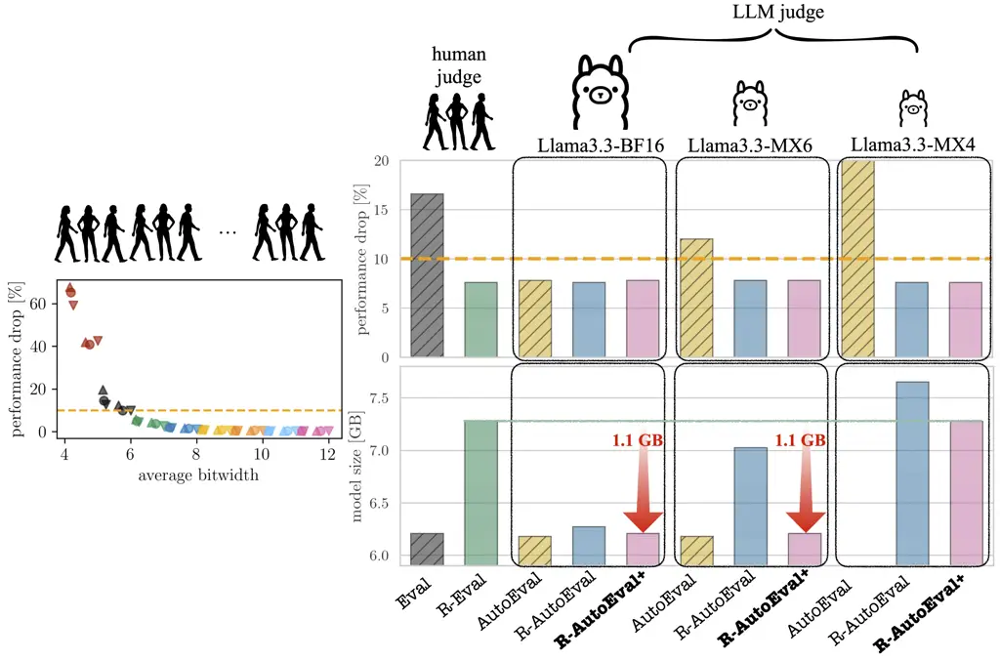
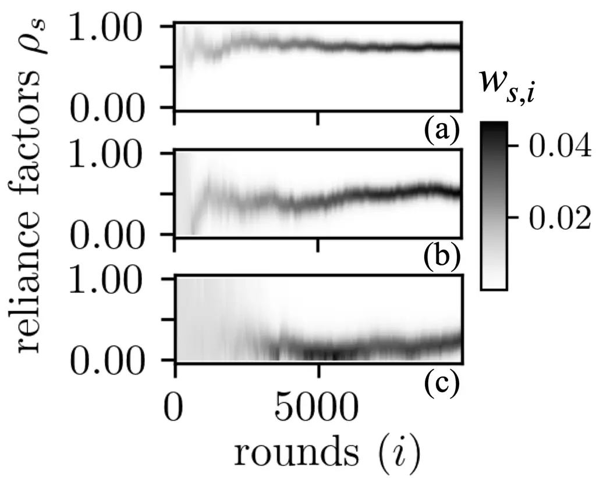
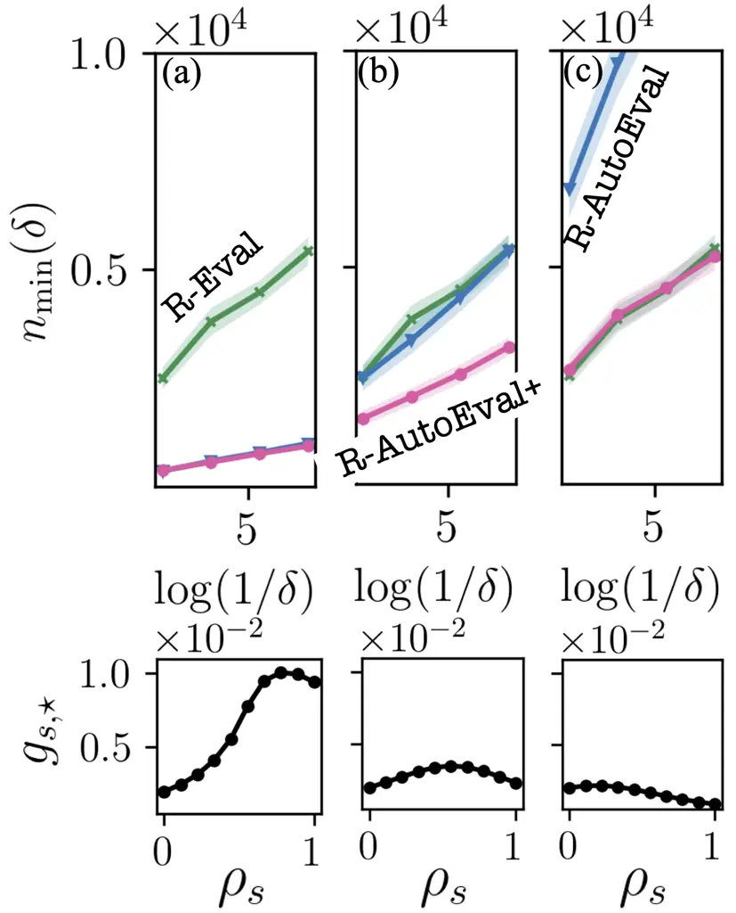
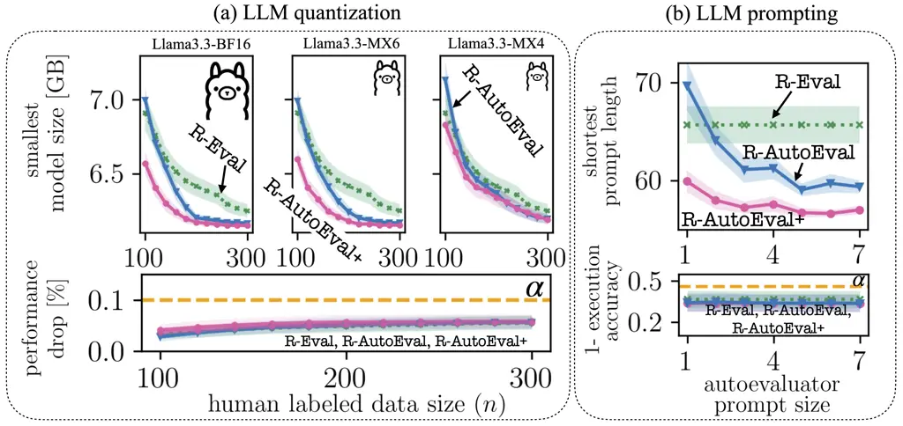
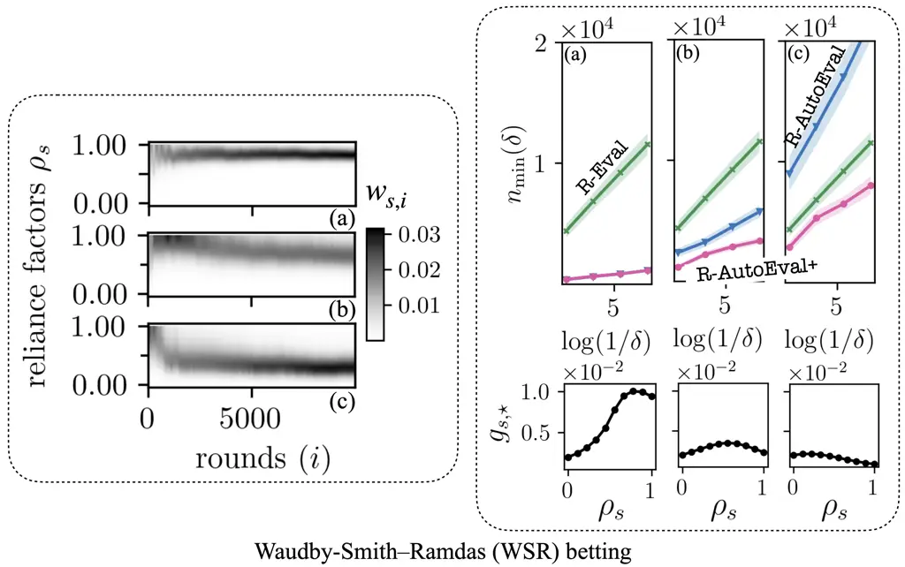
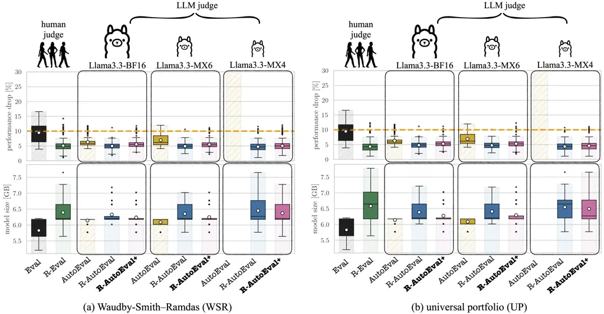
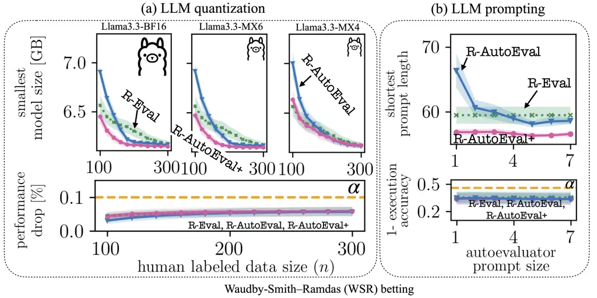
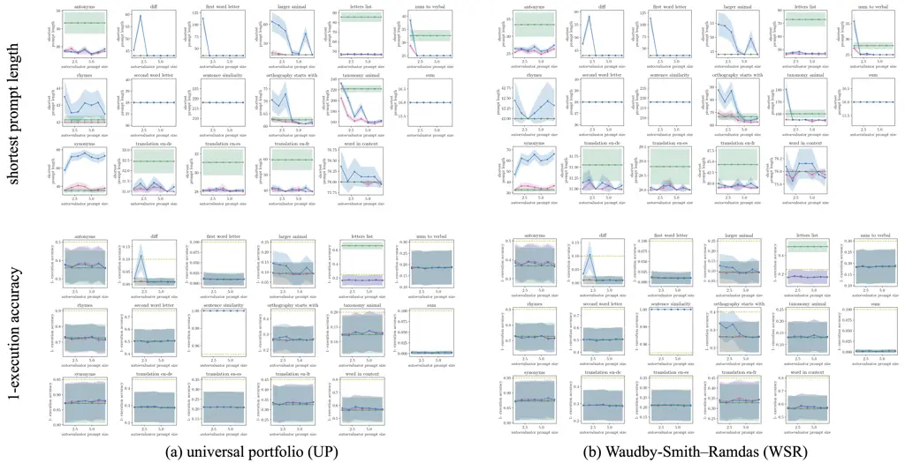
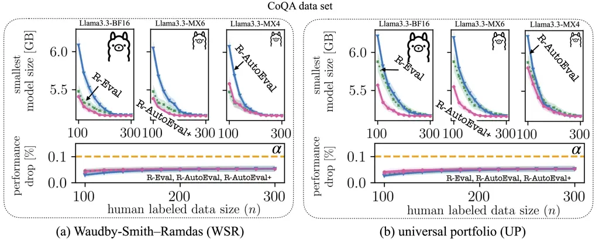
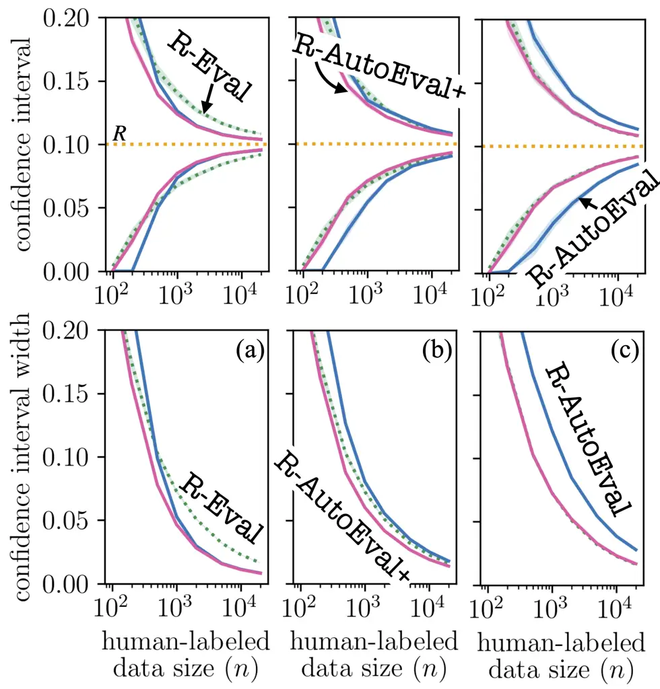

# Adaptive Prediction-Powered AutoEval with Reliability and Efficiency Guarantees

Sangwoo Park Matteo Zecchin Osvaldo Simeone Affiliation: Department of
Engineering Affiliation: King’s College London Affiliation: London,
United Kingdom Affiliation: {sangwoo.park, matteo.1.zecchin,
osvaldo.simeone}@kcl.ac.uk

###### Abstract

Selecting artificial intelligence (AI) models, such as large language
models (LLMs), from multiple candidates requires accurate performance
estimation. This is ideally achieved through empirical evaluations
involving abundant real-world data. However, such evaluations are costly
and impractical at scale. To address this challenge, autoevaluation
methods leverage synthetic data produced by automated evaluators, such
as LLMs-as-judges, reducing variance but potentially introducing bias.
Recent approaches have employed semi-supervised prediction-powered
inference (PPI) to correct for the bias of autoevaluators. However, the
use of autoevaluators may lead in practice to a degradation in sample
efficiency compared to conventional methods using only real-world data.
In this paper, we propose R-AutoEval+, a novel framework that provides
finite-sample reliability guarantees on the model evaluation, while also
ensuring an enhanced (or at least no worse) sample efficiency compared
to conventional methods. The key innovation of R-AutoEval+ is an
adaptive construction of the model evaluation variable, which
dynamically tunes its reliance on synthetic data, reverting to
conventional methods when the autoevaluator is insufficiently accurate.
Experiments on the use of LLMs-as-judges for the optimization of
quantization settings for the weights of an LLM, for prompt design in
LLMs, and for test-time reasoning budget allocation in LLMs confirm the
reliability and efficiency of R-AutoEval+.

## 1 Introduction



Figure 1: How to select the lightest quantized Llama-3.1-8B-Instruct
model \[24\] (in the MX quantization format \[41\]) that guarantees up
to $`10\%`$ performance drop as compared to the unquantized version
(BF16) (for the TriviaQA task \[28\])? (left) Ground-truth risk $`R`$
for different MX quantization settings, requiring massive human-labeled
data. (right) Performance drop and corresponding model size for the
models chosen via Eval, AutoEval \[35, 31, 52\], R-Eval \[47\],
R-AutoEval \[20\], and the proposed R-AutoEval+. We adopt
Llama-3.3-70B-Instruct \[24\] BF16/MX6/MX4 as the autoevaluators, and
set target risk in (1) to $`\alpha=0.1`$ and target reliability in (2)
to $`1-\delta=0.9`$. Maximum values are reported within the $`1.5`$
interquartile range (IQR) range \[34\] across $`500`$ independent
experiments (see Sec. 4 for details).

### 1.1 Context and Motivation

Selecting an artificial intelligence (AI) model among multiple
candidates necessitates accurately estimating each model’s performance.
Typically, performance assessment involves actively employing each model
to gather relevant empirical evidence or data. To mitigate the
substantial cost and practical burden of real-world testing,
autoevaluation leverages automated tools to evaluate model performance
without direct human intervention \[35, 31, 12, 8, 52, 5\].

Standard evaluation based on human judgment – referred to as Eval – and
autoevaluation – AutoEval – each present distinct advantages and
drawbacks. Eval provides unbiased estimates of a model’s performance but
requires costly annotation. In contrast, AutoEval is cheaper, as it can
rely on abundant synthetic data, but it may introduce estimation bias
\[35, 12\]. Consequently, neither approach, in isolation, ensures
reliable model evaluation, potentially leading to erroneous evaluation
outcomes.

Reliability in evaluation methods can be established via confidence
intervals that accurately capture the true expected performance at a
specified coverage level, or through testing strategies that detect
whether target performance levels are met at specified false detection
probabilities. For Eval, both approaches can be implemented using
standard statistical methods \[26, 33, 47\], which we refer to as
R-Eval.

Achieving reliability in AutoEval is more challenging. Recent works,
including \[10, 22, 21, 42\], have successfully applied a
semi-supervised inference framework known as prediction-powered
inference (PPI) \[3, 4\] to correct for the inherent bias of AutoEval by
leveraging a small amount of human-labeled, real-world data. These
methodologies, referred to here as R-AutoEval, either guarantee
reliability only asymptotically – as the sizes of both synthetic and
real-world data sets grow indefinitely \[10, 22, 21\] – or lack explicit
sample efficiency guarantees – i.e., they do not provably yield narrower
confidence intervals or higher test powers compared to R-Eval \[20\].

In this paper, we introduce R-AutoEval+, a novel autoevaluation
framework that provides finite-sample (non-asymptotic) reliability
guarantees while also ensuring improved (or at least no worse) sample
efficiency compared to R-AutoEval. The primary innovation of R-AutoEval+
is its sequential construction of the model evaluation variable,
enabling it to adaptively adjust its reliance on synthetic data based on
evolving assessments of the autoevaluator’s quality. R-AutoEval+
seamlessly reverts to R-Eval when synthetic data are deemed to be of
insufficient quality, while otherwise employing a weighted variant of
R-AutoEval to enhance efficiency.

At a technical level, R-AutoEval+ leverages two primary methodologies.
The first is the game-theoretic testing-by-betting approach \[43, 37\]
to mean estimation introduced by \[47\]. The second is PPI++ \[4\], an
enhanced variant of PPI that incorporates a regularization coefficient
to control the estimator’s dependence on autoevaluator-generated data
\[4\].

### 1.2 Overview of the Main Results

To clarify the main concepts, consider the problem of selecting a large
language model (LLM) from multiple candidate models characterized by
different sizes. These models are derived from a single base LLM through
quantization with varying average bitwidths using the MX format \[41\].
As illustrated in left panel of Fig. 1, our goal is to identify models
that maintain performance comparable to the full-precision baseline,
tolerating at most a predefined performance degradation threshold
$`\alpha`$ (e.g., $`\alpha=10\%`$ in the figure).

Formally, consider a bounded loss function $`\ell(X,Y)\in[0,1]`$ that
measures the performance of a given candidate model. In the context of
Fig. 1, this loss quantifies the performance gap between the candidate
quantized LLM and its full-precision counterpart. Our primary objective
is to verify whether or not the expected loss, or risk, defined as
$`R=\mathbb{E}[\ell(X,Y)]`$, exceeds a target level $`\alpha`$, i.e.,
whether the following risk-controlling condition can be satisfied

```math
R\leq\alpha. \tag{1}
```

The challenge is that evaluating the risk $`R`$ necessitates access to a
large number of human-generated, i.e., real-world, responses $`Y`$
corresponding to queries $`X`$.

#### 1.2.1 Eval and AutoEval

Given $`n`$ pairs of real-world data
$`\mathcal{D}_{n}=\{(X_{i},Y_{i})\}_{i=1}^{n}`$ with
$`(X_{i},Y_{i})\overset{\text{i.i.d.}}{\sim}P_{XY}=P_{X}P_{Y|X}`$ for
$`i=1,...,n`$, the standard Eval approach estimates the risk $`R`$ for
any given candidate model via the empirical average
$`\hat{R}_{n}=(1/n)\sum_{i=1}^{n}\ell(X_{i},Y_{i})`$.

In contrast, AutoEval does not assume access to real data
$`\mathcal{D}_{n}`$, relying instead the availability of a pre-trained
autoevaluator $`f:\mathcal{X}\rightarrow\mathcal{Y}`$, where
$`\mathcal{X}`$ and $`\mathcal{Y}`$ denote the respective domains of
input and output $`X`$, $`Y`$. In the example of Fig. 1, the
autoevaluator is a larger LLM, serving as an LLM judge \[52\].
Specifically, given an unlabeled data
$`\mathcal{D}_{N}^{\text{unl}}=\{\tilde{X}_{i}\}_{i=1}^{N}`$ with
$`\tilde{X}_{i}\overset{\text{i.i.d.}}{\sim}P_{X}`$, AutoEval estimates
the risk as
$`\hat{R}_{N}^{f}=(1/N)\sum_{i=1}^{N}\ell(\tilde{X}_{i},f(\tilde{X}_{i}))`$,
thus using the outputs from the LLM judge as labels \[35, 31, 52\].

Lacking formal uncertainty quantification, the risk-controlling
condition (1) cannot be guaranteed via the risk estimates
$`\hat{R}_{n}`$ and $`\hat{R}_{N}^{f}`$ provided by Eval and AutoEval.
That is, even if the evaluation outcome for a candidate model satisfies
the inequality $`\hat{R}_{n}\leq\alpha`$, or
$`\hat{R}_{N}^{f}\leq\alpha`$, its actual performance may still fail to
meet the condition (1). In the example shown in Fig.1, LLMs selected via
Eval and AutoEval exhibit performance degradations that exceed the
target threshold of $`\alpha=10\%`$. Furthermore, for AutoEval, the
performance degradation becomes larger as the quality of the LLM judge
deteriorates.

#### 1.2.2 R-Eval and R-AutoEval

Reliable Eval (R-Eval) \[47\] and Reliable AutoEval (R-AutoEval) \[20\]
endow Eval and AutoEval, respectively, with reliability guarantees by
formulating model evaluation as a binary hypothesis test problem.
Accordingly, these evaluation protocols test the null hypothesis
$`\mathcal{H}_{0}:R>\alpha`$ that the model’s risk exceeds the target
$`\alpha`$ against the alternative hypothesis
$`\mathcal{H}_{1}:R\leq\alpha`$ that the risk-controlling condition (1)
is satisfied.

Define as $`T_{n}\in\{0,1\}`$ the test output, with $`T_{n}=1`$
indicating the decision for the alternative hypothesis
$`\mathcal{H}_{1}:R\leq\alpha`$. Then, an evaluation procedure is said
to be reliable at level $`1-\delta`$ if the probability of incorrectly
concluding that a candidate model satisfies the requirement (1) does not
exceed the level $`\delta\in(0,1)`$, i.e.,

```math
\displaystyle\Pr\big[T_{n}=1|R>\alpha\big]\leq\delta. \tag{2}
```

While Eval constructs the test decision based only on real data
$`\mathcal{D}_{n}`$, R-AutoEval incorporates also synthetic data by
leveraging PPI \[3\] as we detail in Sec. 2.

As illustrated in Fig. 1, selecting the smallest LLM among the
candidates deemed risk-controlling by R-Eval and R-AutoEval, i.e., the
models with respective testing results being $`T_{n}=1`$, indeed results
in a performance drop that remains within the tolerated risk level of
$`\alpha=10\%`$. However, as also shown in Fig. 1, R-AutoEval may select
a model with a larger size than R-Eval, highlighting the potential
inefficiency due to the use of an LLM judge.

#### 1.2.3 R-AutoEval+

This paper proposes R-AutoEval+, a novel reliable autoevaluation method
that adaptively tunes its reliance on synthetic data based on an
evolving reliability assessments of the autoevaluator. This approach
balances synthetic and real data, reverting to conventional methods when
the accuracy of the autoevaluator is insufficient, while maintaining
rigorous statistical guarantees.

R-AutoEval+ is not only reliable in the sense of satisfying the
condition (2), but it also provides a guaranteed improvement (possibly
not strict) in terms of sample efficiency. To formalize this property,
define the sample complexity of an evaluation method producing test
variable $`T_{n}`$ as the smallest average size of the real-world data
set $`\mathcal{D}_{n}`$ necessary to conclude that a model satisfies the
requirement (1) under the reliability constraint (2), i.e., \[48\]

```math
\displaystyle n_{\text{min}}(\delta)=\mathbb{E}[\min\{n:\ T_{n}=1\}|R\leq\alpha]. \tag{3}
```

An evaluation scheme with smaller sample complexity
$`n_{\text{min}}(\delta)`$ can generally identify more efficient
candidate models with the same amount of real data. The main result is
informally outlined as follows.

###### Theorem 1 (Informal).

Under mild regularity assumptions, for sufficiently low tolerated
unreliability level $`\delta`$, R-AutoEval+ is provably more sample
efficient than both R-Eval \[47\] and R-AutoEval \[20\], i.e.,

```math
\displaystyle n_{\text{min}}^{\texttt{R-AutoEval+}}(\delta)\leq\min\Big\{n^{\texttt{R-Eval}}_{\text{min}}(\delta),n_{\text{min}}^{\texttt{R-AutoEval}}(\delta)\Big\}. \tag{4}
```

Furthermore, this inequality is strict when the autoevaluator is
sufficiently accurate.

## 2 Preliminaries: R-Eval and R-AutoEval

In this section, we first review the testing-by-betting framework \[43,
38, 47, 48, 37\], and then review R-Eval \[47\] and R-AutoEval \[20\].
Further connections to the state-of-the-art can be found in Appendix A.

### 2.1 Testing-By-Betting

Consider the problem of testing the null hypothesis
$`\mathcal{H}_{0}:R>\alpha`$ against the alternative hypothesis
$`\mathcal{H}_{1}:R\leq\alpha`$ based on the observations of $`n`$
i.i.d. bounded random variables $`\{q_{i}\}_{i=1}^{n}`$ with
$`q_{i}\in[m,M]`$ providing unbiased estimates of the risk, i.e.,
$`\mathbb{E}[q_{i}]=R`$. An e-value $`E_{n}`$ is a nonnegative statistic
of the observations $`\{q_{i}\}_{i=1}^{n}`$ whose expectation under the
null hypothesis does not exceed 1, i.e.,
$`\mathbb{E}[E_{n}|R>\alpha]\leq 1`$ \[45\]. An e-value $`E_{n}`$ can be
interpreted as providing evidence in favor of the alternative hypothesis
$`\mathcal{H}_{1}`$, i.e., of the risk-controlling condition (1) \[43\].
With an e-value $`E_{n}`$, the test

```math
\displaystyle T_{n}=\mathbbm{1}(E_{n}\geq 1/\delta) \tag{5}
```

meets the reliability condition (2) due to Markov’s inequality for a
fixed $`n`$.

The testing-by-betting approach constructs an e-value $`E_{n}`$
sequentially by processing the observations $`q_{i}`$ one by one over
index $`i=1,...,n`$. Specifically, an e-value can be obtained via the
product of the contributions of each observation $`q_{i}`$ as \[47, 6\]

```math
\displaystyle E_{n}=\prod_{i=1}^{n}\big(1-\lambda_{i}(q_{i}-\alpha)\big), \tag{6}
```

where $`E_{0}=1`$ and $`\lambda_{i}\in[0,1/(M-\alpha))`$ is an arbitrary
function of the past observations $`\{q_{j}\}_{j=1}^{i-1}`$. To verify
that the quantify (6) is an e-value, one can use the independence of the
observations $`\{q_{i}\}_{i=1}^{n}`$ and the unbiasedness assumption
$`\mathbb{E}[q_{i}]=R`$ as
$`\mathbb{E}[E_{n}|R>\alpha]=\prod_{i=1}^{n}(1-\lambda_{i}(\mathbb{E}[q_{i}|R>\alpha]-\alpha))\leq 1`$.

The e-value has an interpretation in terms of a sequential betting game,
which supports the design of the sequence of bets $`\lambda_{i}`$ using
online convex optimization \[47\]. In this game, at each round $`i`$,
based on the observations $`\{q_{j}\}_{j=1}^{i-1}`$, a gambler bets an
amount of her wealth measured by variable $`\lambda_{i}`$ on the outcome
$`q_{i}\leq\alpha`$ that the next observation $`q_{i}`$ does not exceed
the target $`\alpha`$. Accordingly, the e-value $`E_{n}`$ in (6)
represents the wealth accumulated after $`n`$ rounds of betting with
initial wealth $`E_{0}=1`$ \[47\].

A more general form of e-value has been also proposed that allows the
gambler to have $`S\geq 1`$ different betting strategies
$`\{\lambda_{s,i}\}_{s=1}^{S}`$, with each strategy $`\lambda_{s,i}`$
being responsible for a fraction $`w_{s,i}`$ of the wealth. To
elaborate, fix a probability vector $`w_{i}=[w_{1,i},...,w_{S,i}]`$,
which, like the betting strategies $`\{\lambda_{s,i}\}_{s=1}^{S}`$, may
depend on the past observations $`\{q_{j}\}_{j=1}^{i-1}`$. The resulting
e-value is defined as the convex combination \[47, B.8\]

```math
\displaystyle E_{n}=\prod_{i=1}^{n}\sum_{s=1}^{S}w_{s,i}\big(1-\lambda_{s,i}(q_{i}-\alpha)\big). \tag{7}
```

### 2.2 R-Eval and R-AutoEval

Both R-Eval and R-AutoEval follow the testing-by-betting approach
presented in the previous subsection. Specifically, R-Eval computes the
e-value $`E_{n}^{\texttt{R-Eval}}`$ in (6) using directly the
observations $`q_{i}=\ell_{i}`$ of the losses
$`\ell_{i}=\ell(X_{i},Y_{i})\in[m=0,M=1]`$, obtaining the decision
$`T_{n}^{\texttt{R-Eval}}`$ in (5).

R-AutoEval \[20\] also computes the e-value
$`E_{n}^{\texttt{R-AutoEval}}`$ in (6), but with effective observations
$`q_{i}=\ell_{i}^{f}`$ that incorporate both real data and synthetic
data. In particular, each effective observation $`q_{i}=\ell_{i}^{f}`$
uses the real data point $`(X_{i},Y_{i})\in\mathcal{D}_{n}`$ together
with $`r=\lfloor N/n\rfloor`$ autoevaluated samples
$`\{(\tilde{X}_{i},f(\tilde{X}_{i}))\}_{r\cdot(i-1)+1}^{r\cdot i}`$ with
$`\tilde{X}_{i}\in\tilde{\mathcal{D}}_{N}`$. Note that this divides the
set of unlabeled samples $`\tilde{\mathcal{D}}_{N}`$ equally across the
effective observations.

Specifically, R-AutoEval uses effective observations obtained via PPI
\[3\] by correcting the bias of the empirical autoevaluated risk using
the real data sample as

```math
\displaystyle\ell_{i}^{f}=\underbrace{\frac{1}{r}\sum_{i^{\prime}=r\cdot(i-1)+1}^{r\cdot i}\ell(\tilde{X}_{i^{\prime}},f(\tilde{X}_{i^{\prime}}))}_{\text{autoevaluator data}}+\underbrace{\ell(X_{i},Y_{i})-\ell(X_{i},f(X_{i}))}_{\text{bias correction}}. \tag{8}
```

One can readily check that this is an unbiased estimate of the risk,
i.e., $`\mathbb{E}[\ell_{i}^{f}]=R`$, with support interval
$`\ell_{i}^{f}\in[m=-1,M=2]`$. However, owing to the possible lower
quality of the autoevaluator’s labels $`f(\tilde{X}_{i})`$, using the
effective observations (8) may result in a larger sample complexity
compared to R-Eval (see Fig. 1).

## 3 R-AutoEval+: AutoEval with Reliability and Efficiency Guarantees

In this section, we present the proposed autoevaluation method,
R-AutoEval+. R-AutoEval+ aims at balancing the importance assigned to
synthetic and real-world data in the effective observations (8). Through
the proposed mechanism, R-AutoEval+ reverts to using the effective
observations $`q_{i}=\ell_{i}`$ of R-Eval when the autoevaluator is
inaccurate, while leveraging the effective observations of R-AutoEval,
$`q_{i}=\ell_{i}^{f}`$, when the autoevaluator is very accurate. The
approach is based on an adaptive construction of the effective
observations used in the e-value statistic (7), dynamically tuning the
reliance on synthetic data based on evolving reliability assessments of
the autoevaluator.

The key idea is to weight the contribution of synthetic data in the
e-value with a factor $`\rho\in[0,1]`$, so that setting $`\rho=0`$
recovers AutoEval, while setting $`\rho=1`$ yields R-AutoEval. In order
to automatically identify the best value of the factor $`\rho`$,
R-AutoEval+ processes the real-world data samples sequentially across
index $`i=1,...,n`$, tracking the performance of $`S`$ possible
candidate values $`\{\rho_{s}\}_{s=1}^{S}`$, with

```math
0=\rho_{1}<\cdots<\rho_{S}=1. \tag{9}
```

Specifically, R-AutoEval+ maintains adaptive weights
$`\{w_{s,i}\}_{s=1}^{S}`$ across index $`i=1,...,n`$, with weight
$`w_{s,i}`$ associated to candidate value $`\rho_{s}`$. The resulting
effective observations are used in (7).

After providing a more detailed description of R-AutoEval+, this section
demonstrates that R-AutoEval+ can provably enhance the sample efficiency
of both R-Eval and R-AutoEval.

### 3.1 Adaptive Effective Observations and E-Values

At each round $`i`$, R-AutoEval+ computes $`S`$ effective observations
$`\{\ell_{s,i}^{f}\}_{s=1}^{S}`$, with each effective observation
$`\ell_{s,i}^{f}`$ weighting the contribution of synthetic data via the
factor $`\rho_{s}`$. In particular, generalizing (8) via PPI++ \[4\],
each $`s`$-th effective observation is given by

```math
\displaystyle\ell_{s,i}^{f}=\underbrace{\frac{\rho_{s}}{r}\sum_{i^{\prime}=r\cdot(i-1)+1}^{r\cdot i}\ell(\tilde{X}_{i^{\prime}},f(\tilde{X}_{i^{\prime}}))}_{\text{autoevaluator data}}+\underbrace{\ell(X_{i},Y_{i})-\rho_{s}\cdot\ell(X_{i},f(X_{i}))}_{\text{bias correction}}, \tag{10}
```

where the factor $`\rho_{s}`$ multiplies the contributions of the
autoevaluator. The observation (10) is a bounded unbiased estimate of
the risk $`R`$, i.e., $`\mathbb{E}[\ell_{s,i}^{f}]=R`$, with
$`\ell_{s,i}^{f}\in[m=-\rho_{s},M=1+\rho_{s}]`$ \[4\].

Using the effective observations
$`\{q_{s,i}=\ell_{s,i}^{f}\}_{s=1}^{S}`$, R-AutoEval+ constructs a
variant of the e-value $`E_{n}`$ in (7) in which a different bounded
unbiased estimate of the risk, namely $`\ell_{s,i}^{f}`$, is used for
each $`s`$-th term, i.e.,

```math
\displaystyle E_{n}=\prod_{i=1}^{n}\sum_{s=1}^{S}w_{s,i}\big(1-\lambda_{s,i}(\ell_{s,i}^{f}-\alpha)\big). \tag{11}
```

Note that this is indeed a valid e-value, i.e.,
$`\mathbb{E}[E_{n}|R>\alpha]\leq 1`$.



Figure 2: Heatmap of the evolution of the weights
$`\{w_{s,i}\}_{s=1}^{100}`$ assigned to the factors $`\rho_{s}`$ as a
function of the processing round $`i`$ for Example 1. The autoevaluator
reports the correct loss with probability $`\gamma=0.99`$ (top),
$`\gamma=0.9`$ (middle), and $`\gamma=0.7`$ (bottom). R-AutoEval+
assigns larger weights to synthetic data, i.e., to larger values of
$`\rho_{s}`$, when the autoevaluator is of higher quality.

In the e-value (11), the weights $`w_{s,i}`$ associated with each factor
$`\rho_{s}`$ are updated over index $`i=1,...,n`$ depending on the
evidence accumulated up to round $`i-1`$. To do this, define as

```math
E_{s,i}=\prod_{j=1}^{i}\big(1-\lambda_{s,j}(\ell^{f}_{s,j}-\alpha)\big) \tag{12}
```

the e-value (6) computed using only the effective observations
$`\ell^{f}_{s,i}`$ up to round $`i`$. Intuitively, a larger value of the
quantity $`E_{s,i}`$ indicates that the factor $`\rho_{s}`$ yields a
large evidence in favor of the alternative (risk-controlling) hypothesis
(1).

Following this logic, the weight $`w_{s,i}`$ is updated as

```math
w_{s,i}=\frac{w_{s,0}\cdot E_{s,i-1}}{\sum_{s^{\prime}=1}^{S}w_{s^{\prime},0}\cdot E_{s^{\prime},i-1}}, \tag{13}
```

for all $`s=1,...,S`$, with initial strictly positive weights
$`\{w_{s,0}\}_{s=1}^{S}`$, where $`\sum_{s=1}^{S}w_{s,0}=1`$ and
$`E_{s,0}=1`$. By (13), values of the factor $`\rho_{s}`$ associated
with a larger evidence $`E_{s,i-1}`$ in favor of the risk-controlling
condition (1) are assigned a proportionally larger weight in the e-value
(7).

The update (13) aims at identifying the most informative effective
observations $`\ell^{f}_{s,i}`$ for $`s=1,...,S`$ by sequentially
processing the available data. The following simple example demonstrates
its operation.

###### Example 1.

Consider a setting where the autoevaluator yields the same output as the
human judge with probability $`\gamma`$. Specifically, assume a binary
loss $`\ell(X,Y)\in\{0,1\}`$ with mean equal to the risk $`R=0.1`$, and
on autoevaluated loss $`\ell(X,f(X))`$ given by
$`\ell(X,f(X))=\ell(X,Y)\cdot(1-\epsilon)+(1-\ell(X,Y))\cdot\epsilon`$,
where $`\epsilon\in\{0,1\}`$ has mean $`1-\gamma`$. Fix the target risk
$`\alpha=0.12`$ and the synthetic-to-real data ratio $`r=10`$.

Fig. 2 provides an heatmap of the evolution of the weights
$`\{w_{s,i}\}_{s=1}^{S}`$ over index $`i`$ for $`S=100`$ uniformly
spaced candidate factors in the range $`[0,1]`$. We set initial weights
$`w_{s,0}=1/S`$ for $`s=1,...,S`$. The top figure corresponds to
$`\gamma=0.99`$, the middle figure to $`\gamma=0.9`$ and the bottom
figure to $`\gamma=0.7`$, so that the quality of the autoevaluator
decreases in going from the top panel to the bottom panel. The figure
shows that, as the autoevaluator becomes less reliable, the update (13)
correctly decreases the reliance of the e-value (11) on the effective
observations that leverage synthetic data. Specifically, it is seen from
the figure that the weights $`\{w_{s,i}\}_{s=1}^{S}`$ tend to
concentrate around the values $`0.9`$, $`0.5`$, and $`0`$ for
$`\gamma=0.99,0.9,`$ and $`0.7`$, respectively.∎

The overall procedure of R-AutoEval+ is summarized in Algorithm 1
(Appendix B).

### 3.2 Sample Efficiency Guarantees

In this section, we analyze the sample efficiency of R-AutoEval+. We
start by reviewing existing results on R-Eval and R-AutoEval, and then
we introduce a formal version of Theorem 1 (see Sec. 1) on the sample
efficiency of R-AutoEval+.

#### 3.2.1 Sample complexity of R-Eval and R-AutoEval

Reference \[48\] showed that the sample complexity of the e-value (6)
can be analyzed by considering its maximum expected logarithmic
per-round increment under the alternative hypothesis, i.e.,

```math
\displaystyle g_{\star}=\mathbb{E}[\log(1-\lambda_{\star}(q_{i}-\alpha))|R\leq\alpha], \tag{14}
```

where $`\lambda_{\star}`$ is the optimal constant betting variable
$`\lambda_{\star}=\arg\max_{\lambda\in[0,1/(M-\alpha))}\mathbb{E}[\log(1-\lambda(q_{i}-\alpha))|R\leq\alpha]`$.
Specifically, defining
$`E_{n}(\lambda_{\star})=\prod_{i=1}^{n}(1-\lambda_{\star}(q_{i}-\alpha))`$
for the e-value (6) with constant $`\lambda_{i}=\lambda_{\star}`$ for
all rounds $`i=1,...,n`$, we have the following result.

###### Theorem 2 (Sample complexity of testing-by-betting (6) \[48, Theorem 3.3\]).

Assume that: (A1) the betting strategy $`\lambda_{i}`$ admits sublinear
regret with respect to the optimal constant $`\lambda_{\star}`$, i.e.,
$`\log E_{n}(\lambda_{\star})-\log E_{n}=o(n)`$ (see Appendix C, for an
example of such betting strategy), and (A2) the instantaneous
logarithmic increment of the e-value $`E_{n}(\lambda_{\star})`$ has
finite $`\sigma`$-th central moment for some $`\sigma>2`$, i.e.,
$`\mathbb{E}[|\log(1-\lambda_{\star}\cdot(q_{i}-\alpha))-g_{\star}|^{\sigma}|R\leq\alpha]<\infty`$.
Then, the sample complexity (3) obtained by the test variable $`T_{n}`$
in (5) with the e-value $`E_{n}`$ in (6) admits the limit

```math
\displaystyle\lim_{\delta\rightarrow 0^{+}}\frac{n_{\text{min}}(\delta)}{\log(1/\delta)}=\frac{1}{g_{\star}}. \tag{15}
```

To interpret this result, consider the second-order Taylor approximation
$`\log(1-y)\simeq-y-y^{2}/2`$, which yields (see also \[48, Sec. 4.2\])

```math
\displaystyle\frac{1}{g_{\star}}\simeq 2\bigg(1+\frac{\text{Var}(q_{i}|R\leq\alpha)}{(\alpha-R)^{2}}\bigg) \tag{16}
```

According to this approximation, the sample complexity grows with the
variance
$`\text{Var}(q_{i}|R\leq\alpha)=\mathbb{E}[|q_{i}-R|^{2}|R\leq\alpha]`$
of the observation under the alternative hypothesis.

The result (15) can be readily applied to obtain the sample complexities
of R-Eval and R-AutoEval by setting $`q_{i}=\ell_{i}`$ and
$`q_{i}=\ell_{i}^{f}`$, respectively, in the e-value (6). In the
presence of a low-quality autoevaluator, it is known that PPI can
increase the variance of the risk estimates \[3, 4, 22, 10\]. Therefore,
based on the approximation (16), R-AutoEval may have a larger sample
complexity than R-Eval when the autoevaluation is not sufficiently
accurate.

#### 3.2.2 Sample complexity of R-AutoEval+

R-AutoEval+ optimizes not only the $`S`$ betting strategies
$`\{\lambda_{s,i}\}_{s=1}^{S}`$, but also the weights
$`\{w_{s,i}\}_{s=1}^{S}`$ associated to the factors
$`\{\rho_{s}\}_{s=1}^{S}`$ determining the reliance of the effective
observations (10) on the autoevaluated data. Since the weight update
(13) has the form of exponential weights \[23\], the following property
follows from existing results on online convex optimization \[18, Lemma
1\].

###### Lemma 1 (Sublinear regret for the weights (13)).

For any set of betting strategies $`\{\lambda_{s,i}\}_{s=1}^{S}`$ and
for any positive initial weights $`\{w_{s,0}\}_{s=1}^{S}`$, the weight
update strategy (13) satisfies

```math
\displaystyle\max_{s=1,...,S}\underbrace{\sum_{i=1}^{n}\log\big(1-\lambda_{s,i}(\ell^{f}_{s,i}-\alpha)\big)}_{\log E_{s,n}}-\underbrace{\sum_{i=1}^{n}\log\sum_{s=1}^{S}w_{s,i}\big(1-\lambda_{s,i}(\ell_{s,i}^{f}-\alpha)\big)}_{\log E_{n}}\leq\max_{s=1,...,S}\log\bigg(\frac{1}{w_{s,0}}\bigg). \tag{17}
```

Intuitively, this result implies that the weight update (13) can
identify the best factor $`\rho_{s}`$ in the set
$`\{\rho_{s}\}_{s=1}^{S}`$, determining an optimal level of reliance on
autoevaluated data. In fact, the first term in (17) represents the
maximum, i.e., most informative, e-value among all the e-values
$`\{E_{s,n}\}_{s=1}^{S}`$ corresponding to the $`S`$ candidate factors
$`\{\rho_{s}\}_{s=1}^{S}`$. This result, in turn, suggests that
R-AutoEval+ may be able to outperform both R-Eval and R-AutoEval,
reducing to the former when autoevaluated data is of poor quality and to
the latter when the autoevaluated data is sufficiently accurate. The
following result formalizes this intuition.

###### Theorem 3 (Sample complexity of R-AutoEval+).

For every $`s=1,...,S`$, suppose that the betting strategy
$`\lambda_{s,i}`$ satisfies assumptions (A1) and (A2) in Theorem 2 with
$`E_{s,n}`$ in lieu of $`E_{n}`$ and $`q_{i}=\ell_{s,i}^{f}`$. Then, the
sample complexity of R-AutoEval+ satisfies the following limit

```math
\displaystyle\lim_{\delta\rightarrow 0^{+}}\frac{n_{\text{min}}^{\texttt{R-AutoEval+}}(\delta)}{\log(1/\delta)}\leq\min_{s=1,...,S}\bigg\{\frac{1}{g_{s,\star}}\bigg\}. \tag{18}
```

###### Proof.

See Appendix F.2. ∎

The limit (18) implies the main result (4) in Theorem 1. In fact, by
(15), the ratio $`1/g_{s,\star}`$ in (18) corresponds to the scaling of
the sample complexity of R-Eval and R-AutoEval by setting $`s=1`$ and
$`s=S`$, respectively. The next example shows that the inequality in (4)



Figure 3: Sample complexity as a function of $`\log(1/\delta)`$ (top)
and maximum expected increment of the log-e-value $`g_{s,\star}`$ as a
function of $`\rho_{s}`$ (bottom) for Example 2.

can be strict.

###### Example 2.

Consider again the example setting in Example 1. The sample complexity
$`n_{\text{min}}(\delta)`$ is plotted in the top part of Fig. 3 as a
function of $`\log(1/\delta)`$ for $`\alpha=0.12,S=10`$, $`r=10`$, and
for (a) $`\gamma=0.99`$, (b) $`\gamma=0.9`$, and (c) $`\gamma=0.7`$. The
results are averaged over $`100`$ independent experiments and we use the
universal portfolio betting strategy (see Appendix C) \[16, 15, 48\].
The figure confirms the linear trend of the sample complexity with
respect to the term $`\log(1/\delta)`$. Furthermore, it shows that the
inequality (4) can indeed be strict, with R-AutoEval+ outperforming both
R-Eval and R-AutoEval.

The bottom part of the figure plots the maximum expected logarithmic
increment of the e-value, $`g_{s,\star}`$, in (18) as a function of the
factor $`\rho_{s}`$ for (a) $`\gamma=0.99`$, (b) $`\gamma=0.9`$, (c)
$`\gamma=0.7`$. As the autoevaluator becomes less (more) reliable, i.e.,
as $`\gamma`$ decreases (increases), the maximum value of the expected
increment $`g_{s,\star}`$ is obtained for values of $`\rho_{s}`$ closer
to zero (one), making R-AutoEval+ behave as R-Eval (R-AutoEval).

More generally, using the approximation (16), one can conclude that the
sample complexity of R-AutoEval+ is strictly smaller than for R-Eval and
R-AutoEval as long as the variance of the effective observation
$`\ell_{s,i}^{f}`$ in (10) for some index $`s`$ different from $`s=1`$
and $`s=S`$ is strictly smaller than for the effective observations
$`\ell_{i}`$ and $`\ell_{i}^{f}`$ in (8). As shown in \[4, Example
6.1\], this condition is satisfied when the autoevaluator is
sufficiently accurate.

## 4 Experimental Results¹¹ 1 Code is available at [https://github.com/kclip/R_AutoEval_plus](https://github.com/kclip/R_AutoEval_plus).

For experimental validation, we consider three model selection
applications: 1) selecting the lightest quantized LLM with guaranteed
performance drop as compared to the baseline model on the TriviaQA data
set \[28\] (see Fig. 1); 2) selecting the shortest prompt template for
an LLM with guaranteed accuracy on the Instruct-Induction task \[27\];
and 3) test-time reasoning budget allocation with guaranteed performance
enhancement on the GSM8K data set \[13\]. We set $`S=10`$ with
$`\rho_{s}`$ being uniformly spaced in the range $`[0,1]`$ and choose
initial weights as $`w_{s,0}=1/S`$. We refer to Appendix E for results
with different choices of such hyperparameters. All the results in this
section are reported after averaging over $`100`$ independent
experiments, and 2 H100 GPUs are used for LLM executions.



Figure 4: Risk-controlling model selection using R-Eval \[47, 6, 2\],
R-AutoEval \[20\], and the proposed R-AutoEval+ for the problems of (a)
selecting the lightest quantized LLM with guaranteed performance drop on
the TriviaQA data set \[28\], and (b) selecting the shortest prompt
template with guaranteed execution accuracy on the Instruction-Induction
task \[27\]. (a, top) Size of the smallest selected model versus the
number $`n`$ of real-world data points, and (a, bottom) corresponding
performance drop. (b, top) Length of the shortest selected prompt
template versus the number of in-context samples used by the
autoevaluator, and (b, bottom) corresponding complement of the execution
accuracy.

1. Selecting quantized LLMs: As shown in Fig. 1, for this task the
   candidate set of models consists of LLMs obtained from the baseline
   Llama-3.1-8B-Instruct by applying quantization in the MX format \[40\].
   The candidate formats have different configurations specified by
   parameters
   $`[k_{1},k_{2},d_{1},d_{2},{\scriptstyle\mathcal{M}}]\in\mathbb{N}^{5}`$
   where $`k_{1},k_{2}`$ are the first, second block granularity levels,
   $`d_{1},d_{2}`$ are the first, second scale bit-width levels, and
   $`{\scriptstyle\mathcal{M}}`$ is the mantissa bit-width \[40, Table
   II\]. We set
   $`k_{1}\in\{16,64\},d_{1}=8,d_{2}=1,{\scriptstyle\mathcal{M}}\in\{3,4,...,10\}`$
   with $`k_{1}/k_{2}=\{2,4,8\}`$. Model selection is carried out based on
   fixed sequence testing (FST) \[7\], visiting the candidates in order of
   decreasing average bitwidth. FST guarantees the family-wise error rate
   (FWER) with error probability no larger than $`\delta`$.

For the autoevaluator, we adopt a larger Llama-3.1-70B-Instruct \[24\],
whose quality is controlled by adjusting the weight precision of the
autoevaluator from full-precision BF16 to MX6/MX4, with average bitwidth
decreasing from 16 to 6/4 \[41\]. We set $`\delta=0.1`$, $`\alpha=0.1`$,
$`n=150`$, and $`r=5`$ for Fig. 1 while vary $`n`$ from $`100`$ to
$`300`$ with $`r=3`$ for Fig. 4. Fig. 1 reports maximum values within
the 1.5 interquartile range (IQR) range \[34\] across $`500`$
independent experiments (the corresponding full box plot can be found in
Appendix E).

Fig. 4(a) plots the size of the smallest selected model versus the
number $`n`$ of real-world data points (top) and the corresponding
performance drop against the full-precision model (bottom). The figure
confirms that all schemes do not exceed the target maximum performance
drop $`\alpha=0.1`$. Furthermore, R-AutoEval+ outperforms both R-Eval
and R-AutoEval when the autoevaluator is sufficiently accurate
(Llama3.3-BF16/MX6), while recovering R-Eval when the autoevaluator is
of low quality (Llama3.3-MX4), thus confirming the efficiency guarantee
of R-AutoEval+ in Theorem 3.

2. Selecting the shortest prompt template: For this second task, the
   candidate set consists of 25 prompt templates designed to enhance the
   zero-shot performance of Llama-3.1-8B-Instruct using the larger
   Llama-3.1-70B-Instruct \[24\] via the forward mode generation of
   automatic prompt engineering (APE) \[53\]. Model selection is carried
   out via the Bonferroni correction \[9\], thus applying the test (5) with
   $`\delta/25`$ in lieu of $`\delta`$.

For the autoevaluator, we adopt in-context learning \[11\] on the
Llama-3.1-70B-Instruct with prompt examples randomly chosen from the
same held-out data set used for APE. The accuracy of the autoevaluator
is controlled by varying the number of prompt examples from $`1`$ to
$`7`$. We set $`\delta=0.1,n=200,r=9`$, with $`\alpha`$ chosen as the
minimum value in the set $`\{0.05,0.1,...,0.95\}`$ for which R-AutoEval
\[20\] finds at least one reliable prompt template with the strongest
autoevaluator. We select the longest prompt template if the model
selection algorithm does not select any template.

Fig. 4(b) plots the length of the shortest selected prompt template
versus the number of in-context samples used for autoevaluator (top) and
the corresponding risk defined as the complement of the execution
accuracy as defined in \[27, A.1\]. The figure confirms that all schemes
reach execution accuracy no smaller than $`1-\alpha`$. Moreover,
R-AutoEval+ consistently outperforms both R-Eval and R-AutoEval
irrespective of the number of in-context samples used for the
autoevaluator.

3. Test-time reasoning budget allocation: For the last task, the
   candidate set consists of computation budgets for the reasoning mode of
   the Qwen3-1.7B \[51\] base model, varying between 128 and 1280 tokens.
   Model selection is carried out via FST, visiting the candidates in order
   of decreasing reasoning budget. For the autoevaluator, we adopt
   different kinds of pre-trained LLMs, ranging from large-scale models
   such as GPT-4.1 \[1\] to light-weight models such as BitNet b1.58
   \[32\]. We set $`\delta=0.1,n=1000,r=4,`$ and $`\alpha=0.03`$ (i.e.,
   reasoning should improve accuracy by at least 3%).

Table 1 confirms again the efficiency gain of R-AutoEval+ as compared to
R-Eval and R-AutoEval, saving up to 127 tokens over R-Eval and up to 66
tokens over R-AutoEval on average. Choosing the autoevaluator from the
same family of the model is seen to substantially reduce the gain of
autoeval-based approaches. For instance, Llama-3.2-3B-Instruct
autoevaluator achieves much lower accuracy than Qwen3-32B autoevaluator
(66% vs. 82%) but it significantly helps reducing the number of
reasoning tokens: R-AutoEval+ saves 90 tokens over R-Eval when using
Llama-3.2-3B-Instruct autoevaluator, while it saves 42 tokens over
R-Eval when using Qwen3-32B autoevaluator; R-AutoEval saves 83 tokens
over R-Eval when using Llama-3.2-3B-Instruct autoevaluator, while it
requires 24 tokens more than R-Eval when using Qwen3-32B autoevaluator.
Such behavior can be understood as a consequence of positive feedback of
LLM judges within the same family \[52\], also known as preference
leakage \[30\], which makes the bias correction (8) more challenging.

| autoevaluator (accuracy)           | R-Eval          | R-AutoEval       | R-AutoEval+     |
| ---------------------------------- | --------------- | ---------------- | --------------- |
| BitNet b1.58 (35%)                 | 983.34 (137.87) | 950.27 (152.84)  | 942.47 (135.65) |
| Llama-3.2-3B-Instruct (66%)        |                 | 900.58 (122.70)  | 892.86 (112.10) |
| Qwen3-32B (82%)                    |                 | 1007.45 (150.48) | 941.20 (129.61) |
| DeepSeek-R1-Distill-Qwen-32B (89%) |                 | 893.39 (105.13)  | 866.22 (80.58)  |
| Llama-3.3-70B-Instruct (89%)       |                 | 854.42 (90.26)   | 847.05 (69.21)  |
| GPT-4.1 (93%)                      |                 | 883.99 (103.00)  | 856.13 (70.93)  |

Table 1: Selecting the smallest reasoning budget for Qwen3-1.7B that
ensures at least 3% accuracy enhancement as compared to its
non-reasoning mode, evaluated on GSM8K data set \[13\]: average number
of generated tokens with standard deviation shown within parentheses.

We refer to Appendix E for further details and additional experiments.

## 5 Conclusion and Further Discussions

This work introduced R-AutoEval+, a novel autoevaluation method that can
provably enhance the efficiency of the state-of-the-art evaluation
method while maintaining strict finite-sample reliability guarantees.
The theoretical properties of R-AutoEval+ were confirmed by experimental
results on LLM quantization and LLM prompting with LLM judges as
autoevaluators.

Some limitations of this work are as follows: (i) R-AutoEval+ requires
access to real-world unlabeled data; (ii) the discrete set of candidate
factors determining reliance on synthetic data are fixed a priori; and
lastly, (iii) the sample efficiency guarantee in Theorem 3 only holds
for sufficiently high target reliability levels $`1-\delta`$. Addressing
these limitations may leverage the tools in \[3, 15, 36\], and we leave
these directions to future work.

Another interesting direction for future research includes combining the
benefits of R-AutoEval+ in adaptively weighting synthetic data with the
complementary advantages of methods that actively select real data \[49,
46, 54, 17, 50\].

## Acknowledgments

This work was supported by the European Union’s Horizon Europe project
CENTRIC (101096379). The work of Osvaldo Simeone was also supported by
the Open Fellowships of the EPSRC (EP/W024101/1) and by the EPSRC
project (EP/X011852/1). Thanks also to the Advanced Research and
Invention Agency (ARIA) for supporting broader foundational work in this
space. The authors also thank Bipin Rajendran for his advice on LLM
quantization.

## References

- \[1\] J. Achiam, S. Adler, S. Agarwal, L. Ahmad, I. Akkaya, F. L.
  Aleman, D. Almeida, J. Altenschmidt, S. Altman, S. Anadkat, et
  al. (2023) Gpt-4 technical report. arXiv preprint arXiv:2303.08774.
  Cited by: §E.6, §4.
- \[2\] A. N. Angelopoulos, S. Bates, E. J. Candès, M. I. Jordan, and L.
  Lei (2021) Learn then test: calibrating predictive algorithms to
  achieve risk control. arXiv preprint arXiv:2110.01052. Cited by:
  Figure 4.
- \[3\] A. N. Angelopoulos, S. Bates, C. Fannjiang, M. I. Jordan, and T.
  Zrnic (2023) Prediction-powered inference. Science 382 (6671),
  pp. 669–674. Cited by: §1.1, §1.2.2, §2.2, §3.2.1, §5.
- \[4\] A. N. Angelopoulos, J. C. Duchi, and T. Zrnic (2023) PPI++:
  efficient prediction-powered inference. arXiv preprint
  arXiv:2311.01453. Cited by: §1.1, §1.1, §3.1, §3.1, §3.2.1, §3.2.2.
- \[5\] S. Badshah and H. Sajjad (2024) Reference-guided verdict:
  llms-as-judges in automatic evaluation of free-form text. arXiv
  preprint arXiv:2408.09235. Cited by: §1.1.
- \[6\] S. Bates, A. Angelopoulos, L. Lei, J. Malik, and M.
  Jordan (2021) Distribution-free, risk-controlling prediction sets.
  Journal of the ACM (JACM) 68 (6), pp. 1–34. Cited by: Appendix A,
  Appendix B, Appendix B, §C.2, §E.5, Appendix E, §2.1, Figure 4.
- \[7\] P. Bauer (1991) Multiple testing in clinical trials. Statistics
  in medicine 10 (6), pp. 871–890. Cited by: §4.
- \[8\] B. Bohnet, V. Q. Tran, P. Verga, R. Aharoni, D. Andor, L. B.
  Soares, M. Ciaramita, J. Eisenstein, K. Ganchev, J. Herzig, et
  al. (2022) Attributed question answering: evaluation and modeling for
  attributed large language models. arXiv preprint arXiv:2212.08037.
  Cited by: §1.1.
- \[9\] C. Bonferroni (1936) Teoria statistica delle classi e calcolo
  delle probabilita. Pubblicazioni del R istituto superiore di scienze
  economiche e commericiali di firenze 8, pp. 3–62. Cited by: §4.
- \[10\] P. Boyeau, A. N. Angelopoulos, N. Yosef, J. Malik, and M. I.
  Jordan (2024) Autoeval done right: using synthetic data for model
  evaluation. arXiv preprint arXiv:2403.07008. Cited by: §1.1, §3.2.1.
- \[11\] T. Brown, B. Mann, N. Ryder, M. Subbiah, J. D. Kaplan, P.
  Dhariwal, A. Neelakantan, P. Shyam, G. Sastry, A. Askell, et
  al. (2020) Language models are few-shot learners. Advances in neural
  information processing systems 33, pp. 1877–1901. Cited by: §4.
- \[12\] A. T. Chaganty, S. Mussman, and P. Liang (2018) The price of
  debiasing automatic metrics in natural language evaluation. arXiv
  preprint arXiv:1807.02202. Cited by: §1.1, §1.1.
- \[13\] K. Cobbe, V. Kosaraju, M. Bavarian, M. Chen, H. Jun, L.
  Kaiser, M. Plappert, J. Tworek, J. Hilton, R. Nakano, et al. (2021)
  Training verifiers to solve math word problems. arXiv preprint
  arXiv:2110.14168. Cited by: Table 3, Table 1, §4.
- \[14\] D. A. Cohn, Z. Ghahramani, and M. I. Jordan (1996) Active
  learning with statistical models. Journal of artificial intelligence
  research 4, pp. 129–145. Cited by: Appendix A.
- \[15\] T. M. Cover and E. Ordentlich (2002) Universal portfolios with
  side information. IEEE Transactions on Information Theory 42 (2),
  pp. 348–363. Cited by: §F.1, §5, Example 2.
- \[16\] T. M. Cover (1991) Universal portfolios. Mathematical finance 1
  (1), pp. 1–29. Cited by: §C.1, §C.1, Appendix C, Example 2.
- \[17\] D. Csillag, C. J. Struchiner, and G. T. Goedert (2025)
  Prediction-powered e-values. arXiv preprint arXiv:2502.04294. Cited
  by: Appendix A, Appendix A, §5.
- \[18\] S. De Rooij, T. Van Erven, P. D. Grünwald, and W. M.
  Koolen (2014) Follow the leader if you can, hedge if you must. The
  Journal of Machine Learning Research 15 (1), pp. 1281–1316. Cited by:
  §F.1, §3.2.2.
- \[19\] A. Dubey, A. Jauhri, A. Pandey, A. Kadian, A. Al-Dahle, A.
  Letman, A. Mathur, A. Schelten, A. Yang, A. Fan, et al. (2024) The
  llama 3 herd of models. arXiv e-prints, pp. arXiv–2407. Cited by:
  §E.6.
- \[20\] B. Einbinder, L. Ringel, and Y. Romano (2024) Semi-supervised
  risk control via prediction-powered inference. arXiv preprint
  arXiv:2412.11174. Cited by: Appendix B, §C.2, §C.2, §E.5, Appendix E,
  Figure 1, §1.1, §1.2.2, §2.2, §2, Figure 4, §4, Theorem 1.
- \[21\] B. Eyre and D. Madras (2024) Auto-evaluation with few labels
  through post-hoc regression. arXiv preprint arXiv:2411.12665. Cited
  by: §1.1.
- \[22\] A. Fisch, J. Maynez, R. A. Hofer, B. Dhingra, A. Globerson,
  and W. W. Cohen (2024) Stratified prediction-powered inference for
  hybrid language model evaluation. arXiv preprint arXiv:2406.04291.
  Cited by: §1.1, §3.2.1.
- \[23\] Y. Freund and R. E. Schapire (1997) A decision-theoretic
  generalization of on-line learning and an application to boosting.
  Journal of computer and system sciences 55 (1), pp. 119–139. Cited by:
  §3.2.2.
- \[24\] A. Grattafiori, A. Dubey, A. Jauhri, A. Pandey, A. Kadian, A.
  Al-Dahle, A. Letman, A. Mathur, A. Schelten, A. Vaughan, et al. (2024)
  The llama 3 herd of models. arXiv preprint arXiv:2407.21783. Cited by:
  Figure 1, §4, §4.
- \[25\] D. Guo, D. Yang, H. Zhang, J. Song, R. Zhang, R. Xu, Q. Zhu, S.
  Ma, P. Wang, X. Bi, et al. (2025) Deepseek-r1: incentivizing reasoning
  capability in llms via reinforcement learning. arXiv preprint
  arXiv:2501.12948. Cited by: §E.6.
- \[26\] W. Hoeffding (1994) Probability inequalities for sums of
  bounded random variables. The collected works of Wassily Hoeffding,
  pp. 409–426. Cited by: §1.1.
- \[27\] O. Honovich, U. Shaham, S. R. Bowman, and O. Levy (2022)
  Instruction induction: from few examples to natural language task
  descriptions. arXiv preprint arXiv:2205.10782. Cited by: §E.3, Figure
  4, §4, §4.
- \[28\] M. Joshi, E. Choi, D. S. Weld, and L. Zettlemoyer (2017)
  Triviaqa: a large scale distantly supervised challenge dataset for
  reading comprehension. arXiv preprint arXiv:1705.03551. Cited by:
  Figure 1, Figure 4, §4.
- \[29\] A. Kalai and S. Vempala (2002) Efficient algorithms for
  universal portfolios. Journal of Machine Learning Research 3 (Nov),
  pp. 423–440. Cited by: Appendix D.
- \[30\] D. Li, R. Sun, Y. Huang, M. Zhong, B. Jiang, J. Han, X.
  Zhang, W. Wang, and H. Liu (2025) Preference leakage: a contamination
  problem in llm-as-a-judge. arXiv preprint arXiv:2502.01534. Cited by:
  §4.
- \[31\] C. Liu, R. Lowe, I. V. Serban, M. Noseworthy, L. Charlin,
  and J. Pineau (2016) How not to evaluate your dialogue system: an
  empirical study of unsupervised evaluation metrics for dialogue
  response generation. arXiv preprint arXiv:1603.08023. Cited by: Figure
  1, §1.1, §1.2.1.
- \[32\] S. Ma, H. Wang, S. Huang, X. Zhang, Y. Hu, T. Song, Y. Xia,
  and F. Wei (2025) BitNet b1. 58 2b4t technical report. arXiv preprint
  arXiv:2504.12285. Cited by: §E.6, §4.
- \[33\] A. Maurer and M. Pontil (2009) Empirical bernstein bounds and
  sample variance penalization. arXiv preprint arXiv:0907.3740. Cited
  by: §1.1.
- \[34\] R. McGill, J. W. Tukey, and W. A. Larsen (1978) Variations of
  box plots. The american statistician 32 (1), pp. 12–16. Cited by:
  §E.2, Figure 1, §4.
- \[35\] J. Novikova, O. Dušek, A. C. Curry, and V. Rieser (2017) Why we
  need new evaluation metrics for nlg. arXiv preprint arXiv:1707.06875.
  Cited by: Figure 1, §1.1, §1.1, §1.2.1.
- \[36\] F. Orabona and K. Jun (2023) Tight concentrations and
  confidence sequences from the regret of universal portfolio. IEEE
  Transactions on Information Theory. Cited by: §C.1, §5.
- \[37\] A. Ramdas, P. Grünwald, V. Vovk, and G. Shafer (2023)
  Game-theoretic statistics and safe anytime-valid inference.
  Statistical Science 38 (4), pp. 576–601. Cited by: Appendix A, §1.1,
  §2.
- \[38\] A. Ramdas and R. Wang (2024) Hypothesis testing with e-values.
  arXiv preprint arXiv:2410.23614. Cited by: Appendix A, §2.
- \[39\] S. Reddy, D. Chen, and C. D. Manning (2019) Coqa: a
  conversational question answering challenge. Transactions of the
  Association for Computational Linguistics 7, pp. 249–266. Cited by:
  Figure 9, §E.4, Appendix E.
- \[40\] B. D. Rouhani, R. Zhao, V. Elango, R. Shafipour, M. Hall, M.
  Mesmakhosroshahi, A. More, L. Melnick, M. Golub, G. Varatkar, et
  al. (2023) With shared microexponents, a little shifting goes a long
  way. In Proceedings of the 50th Annual International Symposium on
  Computer Architecture, pp. 1–13. Cited by: §4.
- \[41\] B. D. Rouhani, R. Zhao, A. More, M. Hall, A. Khodamoradi, S.
  Deng, D. Choudhary, M. Cornea, E. Dellinger, K. Denolf, et al. (2023)
  Microscaling data formats for deep learning. arXiv preprint
  arXiv:2310.10537. Cited by: Figure 1, §1.2, §4.
- \[42\] L. Schneider, M. Wistuba, A. Klein, J. Golebiowski, G.
  Zappella, and F. A. Merra (2024) Hyperband-based bayesian optimization
  for black-box prompt selection. arXiv preprint arXiv:2412.07820. Cited
  by: §1.1.
- \[43\] G. Shafer (2021) Testing by betting: a strategy for statistical
  and scientific communication. Journal of the Royal Statistical Society
  Series A: Statistics in Society 184 (2), pp. 407–431. Cited by: §1.1,
  §2.1, §2.
- \[44\] J. Ville (1939) Etude critique de la notion de collectif.
  Gauthier-Villars Paris. Cited by: Appendix B.
- \[45\] V. Vovk and R. Wang (2021) E-values: calibration, combination
  and applications. The Annals of Statistics 49 (3), pp. 1736–1754.
  Cited by: Appendix A, §2.1.
- \[46\] G. Wang, Z. Chen, B. Li, and H. Xu (2025) Cer-eval: certifiable
  and cost-efficient evaluation framework for llms. arXiv preprint
  arXiv:2505.03814. Cited by: Appendix A, §5.
- \[47\] I. Waudby-Smith and A. Ramdas (2024) Estimating means of
  bounded random variables by betting. Journal of the Royal Statistical
  Society Series B: Statistical Methodology 86 (1), pp. 1–27. Cited by:
  Appendix A, Appendix B, Appendix B, §C.2, §C.2, Appendix C, §E.5,
  §E.7, Appendix E, Figure 1, §1.1, §1.1, §1.2.2, §2.1, §2.1, §2.1, §2,
  Figure 4, Theorem 1.
- \[48\] I. Waudby-Smith, R. Sandoval, and M. I. Jordan (2025) Universal
  log-optimality for general classes of e-processes and sequential
  hypothesis tests. arXiv preprint arXiv:2504.02818. Cited by: §C.1,
  Appendix C, §F.2.1, §F.2.2, §F.2.3, §F.2.3, §F.2.3, §F.2.3, §F.2.3,
  §F.2.3, §F.2, §1.2.3, §2, §3.2.1, §3.2.1, Example 2, Lemma 2, Theorem 2.
- \[49\] Z. Xu, N. Karampatziakis, and P. Mineiro (2024) Active,
  anytime-valid risk controlling prediction sets. arXiv preprint
  arXiv:2406.10490. Cited by: Appendix A, Appendix A, §5.
- \[50\] Z. Xu, C. Wang, L. Wasserman, K. Roeder, and A. Ramdas (2025)
  Active multiple testing with proxy p-values and e-values. arXiv
  preprint arXiv:2502.05715. Cited by: Appendix A, §5.
- \[51\] A. Yang, A. Li, B. Yang, B. Zhang, B. Hui, B. Zheng, B. Yu, C.
  Gao, C. Huang, C. Lv, et al. (2025) Qwen3 technical report. arXiv
  preprint arXiv:2505.09388. Cited by: §E.6, §4.
- \[52\] L. Zheng, W. Chiang, Y. Sheng, S. Zhuang, Z. Wu, Y. Zhuang, Z.
  Lin, Z. Li, D. Li, E. Xing, et al. (2023) Judging llm-as-a-judge with
  mt-bench and chatbot arena. Advances in Neural Information Processing
  Systems 36, pp. 46595–46623. Cited by: Figure 1, §1.1, §1.2.1, §4.
- \[53\] Y. Zhou, A. I. Muresanu, Z. Han, K. Paster, S. Pitis, H. Chan,
  and J. Ba (2022) Large language models are human-level prompt
  engineers. In The Eleventh International Conference on Learning
  Representations, Cited by: §4.
- \[54\] T. Zrnic and E. J. Candès (2024) Active statistical inference.
  arXiv preprint arXiv:2403.03208. Cited by: Appendix A, §5.

## Appendix A Further Related Work

Active evaluation. While standard Eval leverages a fixed real-world data
set, active evaluation aims at reducing the labeling cost by adaptively
choosing data for human labeling \[14, 46\]. Active evaluation has also
been extended to AutoEval \[54, 49, 17\]. This line of work is
orthogonal to the solution proposed in our work, which focuses on
adaptively weighting synthetic data rather than adaptively selecting
real-world data.

Game-theoretic statistics. Game-theoretic statistics builds on the
notion of e-value. E-values are measures of evidence that offer several
advantages over conventional p-values, including the support of optional
continuation \[37, 38\]. The interpretation of an e-value as the wealth
associated with a betting strategy makes it possible to optimize test
statistics using tools from online convex optimization, leading to
state-of-the-art estimation and testing mechanisms \[45, 47, 6\].
Moreover, active e-values \[49\] support the implementation of active
evaluation \[17, 50\].

## Appendix B Algorithm

Algorithm 1 summarizes the overall procedure of R-AutoEval+, which
reduces to R-Eval \[47, 6\] by setting $`\rho_{s}=0`$ for all
$`s=1,...,S`$, and to R-AutoEval \[20\] by setting $`\rho_{s}=1`$ for
all $`s=1,...,S`$. In Algorithm 1, we consider the test

```math
\displaystyle T_{n}=\mathbbm{1}\Big(\max_{i\in\{1,...,n\}}E_{i}\geq 1/\delta\Big), \tag{19}
```

which meets the reliability condition (2) thanks to Ville’s inequality
\[44\]. The testing design (19) is standard in testing-by-betting
frameworks \[47, 6\] due to its higher power, as it returns $`T_{n}=1`$
any time the test (5) does.

Input: human-labeled data
$`\mathcal{D}_{n}=\{(X_{i},Y_{i})\}_{i=1}^{n}`$, unlabeled data
$`{\mathcal{D}}_{N}^{\text{unl}}=\{\tilde{X}_{i}\}_{i=1}^{N}`$,
autoevaluator $`f`$, target risk level $`\alpha`$, reliability level
$`1-\delta`$, reliance factors $`\{\rho_{s}\}_{s=1}^{S}`$ satisfying
(9), initial positive weights $`\{w_{s,0}\}_{s=1}^{S}`$ satisfying
$`\sum_{s=1}^{S}w_{s,0}=1`$, betting algorithm $`\mathcal{A}lg`$ (see
Sec. C)

Output: test output $`T_{n}`$

 initialize $`E_{0}\leftarrow 1`$, $`E_{s,0}\leftarrow 1`$;
$`\lambda_{s,1}=\mathcal{A}lg(\ell^{f}_{s,1:0})`$ denoting as
$`\ell^{f}_{s,1:m}=\{\ell^{f}_{s,i}\}_{i=1}^{m}`$; $`w_{s,1}=w_{s,0}`$
for $`s=1,...,S`$

for $`i=1,...,n`$ do

   for $`s=1,...,S`$ do

      $`\triangleleft\quad`$get effective observation
$`\ell_{s,i}^{f}`$$`\quad\triangleright`$

      $`\ell_{s,i}^{f}=\frac{\rho_{s}}{\lfloor N/n\rfloor}\sum_{i^{\prime}=\lfloor N/n\rfloor\cdot(i-1)+1}^{{\lfloor N/n\rfloor}\cdot i}\ell(\tilde{X}_{i^{\prime}},f(\tilde{X}_{i^{\prime}}))+\ell(X_{i},Y_{i})-\rho_{s}\cdot\ell(X_{i},f(X_{i}))`$.

      $`\triangleleft\quad`$update $`E_{s,i}`$$`\quad\triangleright`$

      $`E_{s,i}\leftarrow E_{s,i-1}\cdot\underbrace{(1-\lambda_{s,i}\cdot(\ell_{s,i}^{f}-\alpha))}_{=e_{s,i}}`$

      $`\triangleleft\quad`$update betting variable
$`\lambda_{s,i+1}`$$`\quad\triangleright`$

      $`\lambda_{s,i+1}=\mathcal{A}lg(\ell^{f}_{s,1:i})`$

   end for

   $`\triangleleft\quad`$update e-value $`E_{i}`$$`\quad\triangleright`$

   $`E_{i}\leftarrow E_{i-1}\cdot\sum_{s=1}^{S}w_{s,i}\cdot e_{s,i}`$

   $`\triangleleft\quad`$update weights
$`w_{s,i+1}`$$`\quad\triangleright`$

   $`w_{s,i+1}=\frac{w_{s,0}\cdot E_{s,i}}{\sum_{s^{\prime}=1}^{S}w_{s^{\prime},0}\cdot E_{s^{\prime},i}}`$
for all $`s=1,...,S`$.

end for

return $`\mathbbm{1}\big(\max_{i\in\{1,...,n\}}E_{i}\geq 1/\delta\big)`$

Algorithm 1 R-AutoEval+

## Appendix C Betting Strategy

In this section, we summarize commonly used betting strategies \[47,
48\], namely Waudby-Smith–Ramdas (WSR) \[47\] and universal portfolio
(UP) \[16\]. While both schemes show excellent performance empirically,
we start with UP, which satisfies assumption A1 in Theorem 2.

In this section, we denote as $`\mathcal{A}lg`$ a betting algorithm that
maps the available past observations into the next betting variable,
i.e., at round $`i`$, given previous observations
$`q_{1:i-1}=\{q_{j}\}_{j=1}^{i-1}`$ with $`q_{i}\in[m,M]`$, a betting
algorithm outputs $`\lambda_{i}=\mathcal{A}lg(q_{1:i-1})`$.

### C.1 Universal Portfolio (UP)

Recall the definition of
$`E_{n}(\lambda)=\prod_{i=1}^{n}(1-\lambda(q_{i}-\alpha))`$, which is
the e-value (6) with $`\lambda_{i}=\lambda`$ for all $`i=1,...,n`$. UP
\[16\] defines the betting variable $`\lambda_{i}`$ at round $`i`$ as

```math
\displaystyle\mathcal{A}lg(q_{1:i-1})=\frac{1}{M-\alpha}\frac{\int_{0}^{1}\lambda E_{i-1}(\lambda/(M-\alpha))\mathrm{d}F(\lambda)}{\int_{0}^{1}E_{i-1}(\lambda/(M-\alpha))\mathrm{d}F(\lambda)}, \tag{20}
```

which satisfies the assumption A1 in Theorem 2 (see also \[48, 36\]).
The integrals in (20) are computed by discretizing the continuous domain
$`[0,1]`$ of $`\lambda`$ into a uniformly spaced grid of size $`10000`$
in a manner similar to \[16, Sec. 8\].

### C.2 Waudby-Smith–Ramdas (WSR)

WSR defines the betting variable $`\lambda_{i}`$ at round $`i`$ as \[47,
6, 20\]

```math
\displaystyle\mathcal{A}lg(q_{1:i-1})=\min\bigg\{\frac{c}{M-\alpha},\sqrt{\frac{2\log(1/\delta)}{n\hat{\sigma}^{2}_{i-1}}}\bigg\}, \tag{21}
```

where the empirical standard deviation and empirical mean at round
$`i-1`$ and at round $`j`$ are respectively defined as

```math
\displaystyle\hat{\sigma}_{i-1}^{2}=\frac{\hat{\sigma}_{0}^{2}+\sum_{j=1}^{i-1}(q_{j}-\hat{\mu}_{j})^{2}}{i},\ \ \text{and}\ \ \hat{\mu}_{j}=\frac{\hat{\mu}_{0}+\sum_{k=1}^{j}q_{k}}{j+1} \tag{22}
```

with initial guesses $`\hat{\mu}_{0}=1/2`$ and
$`\hat{\sigma}_{0}^{2}=1/4`$ \[47, 20\]. We set $`c=3/4`$ following
\[47\].

## Appendix D Computational Complexity

Here we compare the computational complexities of the algorithms
considered in this work. Given both the human-labeled (size $`n`$) and
autoevaluated data (size $`N`$), mean-based approaches (Eval and
AutoEval, which do not come with reliability guarantees), require
$`O(n)`$ (for Eval) and $`O(N)`$ (for AutoEval) operations for computing
the respective average.

The reliable approaches (R-Eval and R-AutoEval) need additional
computation steps for updating the e-values as well as the betting
strategies (Sec. 2). While updating the e-values at each round requires
a single multiplication, the betting strategy may be more complex. For
example, especially the universal portfolio (UP) strategy with sublinear
regret (Assumption A1) has a complexity of order $`O(nG)`$ where $`G`$
is the size of the grid used to approximate the integral operation of UP
(Sec. C.1), although this can be decreased by adopting sampling-based
approaches \[29\].

Lastly, R-AutoEval+ requires $`S`$ times more computation than
R-AutoEval due to its consideration of $`S`$ candidate factors. It is
worth emphasizing that, the costs described above are generally
negligible with respect to running the autoevaluator (e.g., an LLM
judge). The summary of the computation complexities can be found in
Table 2.

| Eval     | AutoEval | R-Eval      | R-AutoEval   | R-AutoEval+    |
| -------- | -------- | ----------- | ------------ | -------------- |
| $`O(n)`$ | $`O(N)`$ | $`O(n+nG)`$ | $`O(nr+nG)`$ | $`O(Snr+SnG)`$ |

Table 2: Computational complexity comparison of the algorithms
considered in this work.

## Appendix E Additional Experimental Results

While UP betting provably achieves sublinear regret bound (A1 in
Theorem 2), WSR betting shows excellent empirical result with
significantly lower computational overhead. Furthermore, existing works
on R-Eval \[47, 6\] and R-AutoEval \[20\] adopted WSR as their betting
strategy. Accordingly, here we investigate the impact of the choice of
betting strategy between WSR and UP (see Sec. C for the summary of WSR
and UP). Note that we have used WSR for Fig. 1 to maintain consistency
with prior art, while for all the other figures, we have used UP, which
satisfies assumption A1 in Theorem 2. In this section, we provide all
the missing figures with the alternative betting strategy choice. After
showing all the counterparts of the figures in the main text, we provide
additional experiments on LLM quantization for CoQA data set \[39\] and
on constructing two-sided confidence interval for the setting studied in
Examples 1 and 2. Lastly, we provide an extended version of Table 1 for
LLM reasoning task by accounting a wider range of autoevaluators. We
conclude this section by investigating the impact of R-AutoEval+’s
hyperparameters such as $`S`$, $`\{w_{s,0}\}_{s=1}^{S}`$, and
$`\{\rho_{s}\}_{s=1}^{S}`$, as well as of the ordering of data, on the
amount of reasoning tokens that can be saved while ensuring the target
3% accuracy gain.

### E.1 Toy Example

In Fig. 5, we provide the counterpart to Figs. 2 and 3, considering a
WSR betting strategy instead of the UP one. It is observed that WSR
betting makes the weights of R-AutoEval+ less concentrated around the
optimal reliance factor, although it still outperforms the other two
schemes with a substantial margin.



Figure 5: Same setting with Figs. 2 and 3 but with WSR betting instead
of UP betting.

### E.2 LLM Quantization

Fig. 6(a) shows the box plot for Fig. 1. Fig. 1 reports maximum values
within the 1.5 IQR range \[34\]. Fig. 6(b) plots the same box plot but
with UP betting instead of WSR betting. Fig. 7(a) is the counterpart of
Fig. 4(a) which uses WSR betting in lieu of UP betting. It is observed
that even under the WSR betting strategy, R-AutoEval+ consistently
outperforms R-Eval and R-AutoEval, returning a smaller quantized model.



Figure 6: (a) Box plot for Fig. 1; (b) same setting as (a) but with UP
betting strategy (see Sec. C.1).



Figure 7: Same setting as Fig. 4 but with WSR betting strategy (see
Sec. C.2).



Figure 8: (a) Per-task result for Fig. 4(b); (b) same setting as (a) but
with WSR betting strategy.

### E.3 LLM Prompting

Fig. 7(b) is the counterpart of Fig. 4(b) which uses WSR betting in lieu
of UP betting. Fig. 8 then shows per-task results of
Instruction-Induction task \[27\] with (a) UP betting and (b) WSR
betting. We show $`17`$ tasks among $`24`$ tasks that have more than
$`2000`$ examples \[27\]. Even under the different choice of betting
strategy, R-AutoEval+ outperforms both R-Eval and R-AutoEval.



Figure 9: LLM quantization task on CoQA data set \[39\]. All the other
settings are the same with Fig. 4.

### E.4 LLM Quantization: CoQA Data Set

We extend the experimental validation of R-AutoEval+ by considering a
different data set for LLM quantization task. Fig. 9 is the counterpart
of Fig. 4(a) but with CoQA data set \[39\] under (a) WSR betting and (b)
UP betting. The same trend is observed, confirming the improved
efficiency of R-AutoEval+.



Figure 10: $`99.9\%`$ two-sided confidence interval for the same setting
in Example 2.

### E.5 Confidence Interval

Under the same setting as Examples 1 and 2, we consider the construction
of two-sided confidence interval for the expected risk $`R`$ using
R-Eval, R-AutoEval, and R-AutoEval+. We follow the hedged capital
process \[47, Sec. 4.4\] to first construct
$`(1-\delta\cdot\varepsilon)`$-upper confidence bound and
$`(1-\delta\cdot(1-\varepsilon))`$-lower confidence bound separately to
yield their intersection as the two-sided confidence interval. An upper
confidence bound can be obtained by finding the largest $`\alpha`$ for
which the respective testing $`T_{n}`$ in (5) yields $`0`$; a lower
confidence bound can be obtained similarly by considering the
observation $`q^{lb}_{i}=m+M-q_{i}`$ in lieu of the observation
$`q_{i}`$. We set $`\varepsilon=0.5`$ and adopt uniform grid of size
$`10000`$ to approximately find the largest $`\alpha`$ with $`T_{n}=0`$.
We employ the WSR betting strategy, and set the upper bound of
$`\lambda_{i}`$ in (21) to $`1/(M-m)`$ to ensure the monotonicity of
R-Eval’s and R-AutoEval’s e-values \[20, 6\]. Fig. 10 shows the
corresponding (top) confidence interval and (bottom) its width versus
the number of real-world data $`n`$. Recall from Example 1 and 2 that
the quality of synthetic data decreases in the order of (a), (b), and
(c). Across all scenarios, R-AutoEval+ returns confidence intervals that
have the smallest size.

### E.6 LLM Reasoning: Wider range of autoevaluators

Table 3 extends Table 1 in the main text by considering additional
autoevaluators: BitNet \[32\], Llama-3 \[19\], DeepSeek-R1 \[25\], Qwen3
\[51\], and GPT4 \[1\]. The table confirms again the efficiency gain of
R-AutoEval+ as compared to R-Eval and R-AutoEval; also demonstrating
again the benefit of choosing autoevaluator from the different family of
the base model to achieve better efficiency for autoeval-based
approaches.

| autoevaluator (accuracy)            | R-Eval          | R-AutoEval       | R-AutoEval+     |
| ----------------------------------- | --------------- | ---------------- | --------------- |
| BitNet b1.58 (35%)                  | 983.34 (137.87) | 950.27 (152.84)  | 942.47 (135.65) |
| Llama-3.2-1B-Instruct (26%)         |                 | 964.91 (136.55)  | 954.63 (145.60) |
| DeepSeek-R1-Distill-Qwen-1.5B (33%) |                 | 943.98 (136.38)  | 935.58 (130.83) |
| Llama-3.2-3B-Instruct (66%)         |                 | 900.58 (122.70)  | 892.86 (112.10) |
| DeepSeek-R1-Distill-Qwen-7B (54%)   |                 | 941.66 (126.32)  | 926.85 (118.08) |
| DeepSeek-R1-Distill-Llama-8B (67%)  |                 | 916.34 (129.83)  | 900.82 (119.73) |
| DeepSeek-R1-0528-Qwen3-8B (32%)     |                 | 986.53 (140.77)  | 961.94 (138.98) |
| Qwen3-32B (82%)                     |                 | 1007.45 (150.48) | 941.20 (129.61) |
| DeepSeek-R1-Distill-Qwen-32B (89%)  |                 | 893.39 (105.13)  | 866.22 (80.58)  |
| Llama-3.3-70B-Instruct (89%)        |                 | 854.42 (90.26)   | 847.05 (69.21)  |
| DeepSeek-R1-Distill-Llama-70B (88%) |                 | 863.72 (71.60)   | 858.02 (69.59)  |
| GPT-4.1 nano (90%)                  |                 | 879.45 (93.95)   | 865.28 (72.34)  |
| GPT-4.1 (93%)                       |                 | 883.99 (103.00)  | 856.13 (70.93)  |

Table 3: Selecting the smallest reasoning budget for Qwen3-1.7B that
ensures at least 3% accuracy enhancement as compared to its
non-reasoning mode, evaluated on GSM8K data set \[13\]: average number
of generated tokens with standard deviation shown within parentheses.

### E.7 LLM Reasoning: Sensitivity of testing-by-betting-type algorithms with respect to data ordering

We first recall that the algorithms that builds upon the
testing-by-betting framework \[47\] need to impose some arbitrary
ordering of the data to sequentially run the algorithm. Here we
investigate the impact of such ordering on the final decision of the
algorithms. To this end, we fix the calibration-test data split and only
change the ordering of data randomly for $`100`$ times to compute the
normalized deviation (standard deviation / mean) of the generated tokens
dictated by each algorithm. We consider GPT-4.1 and
DeepSeek-R1-0528-Qwen3-8B as the autoevaluators for the experimental
results. As can be seen from Table 4, R-AutoEval and R-AutoEval+ are
more robust to the data ordering than R-Eval, which may be possibly
attributed to its reduced variability of averaged autoevaluated data (at
each round we average $`r`$ number of autoevaluated examples), while
R-AutoEval+ tends to be slightly less robust than R-AutoEval for its
adaptive nature that incorporates the data ordering.

| autoevaluator             | R-Eval | R-AutoEval | R-AutoEval+ |
| ------------------------- | ------ | ---------- | ----------- |
| GPT4.1                    | 8.62%  | 3.90%      | 6.88%       |
| DeepSeek-R1-0528-Qwen3-8B | 8.62%  | 6.32%      | 6.00%       |

Table 4: Sensitivity of algorithms with respect to data ordering.
Normalized deviation (standard deviation / mean) of the generated tokens
yielded by each algorithm for a fixed calibration-test data split is
shown for each algorithm.

### E.8 LLM Reasoning: Impact of the number of candidate factors $`S`$

We now start investigating the impact of hyperparameters required by
R-AutoEval+. We first investigate the impact on the number of
candidates, $`S`$, with candidate factors equally spaced within the
interval $`[0,1]`$; and with equal initial weights. We report the
average number of generated tokens with corresponding standard deviation
in a manner similar to Table 1 and 3.

| autoevaluator             | $`S=2`$        | $`S=5`$        | $`S=10`$       | $`S=20`$       |
| ------------------------- | -------------- | -------------- | -------------- | -------------- |
| GPT4.1                    | 871.67 (16.24) | 854.99 (14.02) | 856.13 (13.90) | 856.13 (13.90) |
| DeepSeek-R1-0528-Qwen3-8B | 964.41 (27.17) | 961.94 (27.24) | 961.94 (27.24) | 961.94 (27.24) |

Table 5: Impact of the number of candidate factors ($`S`$) for
R-AutoEval+. The other settings are the same as in Table 1 and 3.

As can be observed in Table 5, as long as the candidate factors includes
$`\rho=0`$ (R-Eval) and $`\rho=1`$ (R-AutoEval), i.e., as long as
$`S\geq 2`$, R-AutoEval+ consistently outperforms both R-Eval and
R-AutoEval, with its gain being maximized at $`S=5`$, and saturates
after $`S=10`$.

### E.9 LLM Reasoning: Impact of the values of candidate factors ($`\{\rho_{s}\}_{s=1}^{S}`$)

Next, we investigate the impact of the values of each candidate factors
by going beyond the equally spaced grid. To this end, we consider
Dirichlet distribution with concentration parameter $`0.1,1,10`$ to
allocate the values within the $`[0,1]`$ interval. Specifically, the
cumulative probabilities of the Dirichlet distribution are used as the
candidate factors and we keep the first and the last factors to be $`0`$
and $`1`$ to ensure the efficiency guarantee as per our Theorem 3. An
increased concentration parameter makes samples from the Dirichlet
distribution closer to the uniform distribution, and hence the grid
becomes closer to the equally spaced grid. Table 6 shows the preference
for setting the grid with equal spacing.

| autoevaluator             | equal grid     | $`\text{Dir}(10,...,10)`$ | $`\text{Dir}(1,...,1)`$ | $`\text{Dir}(0.1,...,0.1)`$ |
| ------------------------- | -------------- | ------------------------- | ----------------------- | --------------------------- |
| GPT4.1                    | 856.13 (13.90) | 856.13 (13.90)            | 860.91 (15.63)          | 873.27 (15.10)              |
| DeepSeek-R1-0528-Qwen3-8B | 961.94 (27.24) | 964.22 (26.77)            | 960.76 (27.09)          | 966.72 (27.46)              |

Table 6: Impact of the values of candidate factors
($`\{\rho_{s}\}_{s=1}^{S}`$) for R-AutoEval+. The other settings are the
same as in Table 1 and 3.

### E.10 LLM Reasoning: Impact of the weights associated with the candidate factors ($`\{w_{s,0}\}_{s=1}^{S}`$)

The last remaining degree of freedom is given by the choice of the
weights associated with each candidate factor. To this end, we go beyond
the uniform distribution and consider again the Dirichlet distribution
to allocate the weights for the candidate factors. Table 7 confirms
again the preference for equal weighting.

| autoevaluator             | equal weight   | $`\text{Dir}(10,...,10)`$ | $`\text{Dir}(1,...,1)`$ | $`\text{Dir}(0.1,...,0.1)`$ |
| ------------------------- | -------------- | ------------------------- | ----------------------- | --------------------------- |
| GPT4.1                    | 856.13 (13.90) | 856.13 (13.90)            | 856.13 (13.90)          | 856.68 (12.31)              |
| DeepSeek-R1-0528-Qwen3-8B | 961.94 (27.24) | 959.21 (27.04)            | 962.41 (26.52)          | 969.50 (25.59)              |

Table 7: Impact of the initial weights ($`\{w_{s,0}\}_{s=1}^{S}`$) for
R-AutoEval+. The other settings are the same as in Table 1 and 3.

## Appendix F Proofs

Here we provide proofs of Lemma 1 and Theorem 3.

### F.1 Proof of Lemma 1

This proof follows as in \[15, Sec. III\] (see also \[18, Sec. A\] for a
more general version).

###### Proof.

We first rewrite the e-value $`E_{s,i}`$ in (12) in an exponential form
as

```math
\displaystyle E_{s,i}=\exp{\bigg(\sum_{j=1}^{i}\underbrace{\log\Big((1-\lambda_{s,j}(\ell_{s,j}^{f}-\alpha))}_{=g_{s,j}}\Big)\bigg)}, \tag{23}
```

where $`g_{s,j}`$ is the increment of log-e-value $`\log E_{s,j}`$ at
round $`j`$. We will further simplify the notation by writing
$`g_{s,1:i}`$ as the summation of logarithmic increments up to round
$`i`$, i.e., $`g_{s,1:i}=\sum_{j=1}^{i}g_{s,j}`$. The update rule (13)
for the weight $`w_{s,i}`$ can then be rewritten as

```math
\displaystyle w_{s,i}=\frac{w_{s,0}\cdot\exp{({g_{s,1:i-1}})}}{\sum_{s^{\prime}=1}^{S}w_{s^{\prime},0}\cdot\exp{({g_{s^{\prime},1:i-1}})}}. \tag{24}
```

Now, by unfolding the product term in (11) as

```math
\displaystyle E_{n}=\frac{\cancel{\sum_{s=1}^{S}w_{s,0}\cdot\exp{(g_{s,1:1}})}}{\sum_{s=1}^{S}w_{s,0}\cdot 1}\times\cdots\times\frac{\sum_{s=1}^{S}w_{s,0}\cdot\exp{(g_{s,1:n}})}{\cancel{\sum_{s=1}^{S}w_{s,0}\cdot\exp{(g_{s,1:n-1}}})}, \tag{25}
```

we have

```math
\displaystyle E_{n}=\sum_{s=1}^{S}w_{s,0}\cdot\exp{(g_{s,1:n})}=\sum_{s=1}^{S}w_{s,0}E_{s,n}. \tag{26}
```

For any positive weights $`\{w_{s,0}\}_{s=1}^{S}`$, it follows that

```math
\displaystyle E_{n}\geq w_{s,0}E_{s,n}\ \ \text{for all $s=1,...,S$}, \tag{27}
```

from which we conclude

```math
\displaystyle\max_{s=1,...,S}\log E_{s,n}-\log E_{n}\leq\max_{s\in\{1,...,S\}}\log\bigg(\frac{1}{w_{s,0}}\bigg). \tag{28}
```

∎

### F.2 Proof of Theorem 3

We start this subsection with proof sketch of Theorem 3 that builds upon
\[48, B.4\]. This is followed by a series of useful properties of the
R-AutoEval+’s e-value (11), which are instrumental for proving
Theorem 3. The full proof then follows the proof technique in \[48,
B.4\].

#### F.2.1 Proof sketch

Waudby-Smith et al. \[48\] showed that the sample complexity of testing
(5) given some e-value $`E_{n}`$ of the form (6) can be studied by
investigating the simpler e-value with optimal constant betting strategy
$`\lambda_{\star}`$. Recall that in Sec. 3.2.1, we have already defined
such simpler e-value, and we repeat its definition here again for
convenience

```math
\displaystyle E_{n}(\lambda_{\star})=\prod_{i=1}^{n}\big(1-\lambda_{\star}(q_{i}-\alpha)\big). \tag{29}
```

The rationale for this simplification is as follows: (i) The simpler
e-value cannot be too large as compared to the actual e-value obtained
using betting strategy that satisfies assumption A1 in Theorem 2
(sublinear regret); (ii) the actual e-value also cannot be too large as
compared to the simpler e-value (so called numeraire property, see below
Lemma 2), hence one can instead study the sample complexity of such
simpler e-value in order to characterize the actual sample complexity of
R-Eval.

That is to say, as long as we can also find a simpler e-value with a
bounded deviation from R-AutoEval+’s e-value $`E_{n}`$ in (11), we can
then study the corresponding sample complexity instead. As can be
anticipated from Theorem 3, such simpler e-value is described as

```math
\displaystyle E_{\bar{s},n}(\lambda_{\bar{s},\star})=\prod_{i=1}^{n}\big(1-\lambda_{\bar{s},\star}(\ell_{\bar{s},i}^{f}-\alpha)), \tag{30}
```

where $`\bar{s}`$ is the index that maximizes the expected increment of
the $`s`$-th log-e-value, i.e.,

```math
\displaystyle\bar{s}=\arg\max_{s=1,...,S}g_{s,\star}. \tag{31}
```

While intuitively R-AutoEval+’s e-value has a bounded deviation from
$`E_{\bar{s},n}(\lambda_{\bar{s},\star})`$, one subtlety here is that,
the best index $`\bar{s}`$ might not be equal with the one that is
chosen at hindsight, i.e., the following event can happen

```math
\displaystyle\arg\max_{s=1,...,S}g_{s,\star}\neq\arg\max_{s=1,...,S}E_{s,n} \tag{32}
```

with non-negligible probability. To overcome this issue, we focus on the
upper bound of the sample complexity by considering a deterministically
no larger e-value $`E^{\texttt{+}}_{n}`$ as compared to R-AutoEval+’s
e-value, defined as follows

```math
\displaystyle E^{\texttt{+}}_{n}=\sum_{s=1}^{S}w_{s,0}\min\{E_{s,n},E_{\bar{s},n}\}\leq\sum_{s=1}^{S}w_{s,0}E_{s,n}\overset{(\ref{eq:pf:E_n_begin_sum_e})}{=}E_{n}. \tag{33}
```

Accordingly, we denote the sample complexity of $`E_{n}^{\texttt{+}}`$
as

```math
\displaystyle n_{\text{min}}^{\texttt{+}}(\delta)=\mathbb{E}[\min\{n:E_{n}^{\texttt{+}}\geq 1/\delta\}|R\leq\alpha] \tag{34}
```

which is no smaller than $`n_{\text{min}}^{\texttt{R-AutoEval+}}`$ due
to (33). We then show the upper bound of
$`n_{\text{min}}^{\texttt{+}}(\delta)`$, which will prove Theorem 3.

#### F.2.2 Useful properties

We first summarize the useful properties of $`E_{n}^{\texttt{+}}`$,
which bounds its amount of deviation with respect to the simpler e-value
$`E_{\bar{s},n}(\lambda_{\bar{s},\star})`$. We first discuss the regret,
which dictates the lower bound deterministically, then discuss the
suboptimality ratio which captures its upper bound probabilistically.

Regrets: The regret of $`E_{n}^{\texttt{+}}`$ as compared to the one
that chooses the constant betting at hindsight with index chosen as
$`\bar{s}`$ can be formally defined as

```math
\displaystyle r_{k}^{\texttt{+}} \displaystyle=\max_{\lambda\in[0,1/(1+\rho_{\bar{s}}-\alpha))}\log E_{\bar{s},k}(\lambda)-\log E_{k}^{\texttt{+}}
```

```math
\displaystyle=\max_{\lambda\in[0,1/(1+\rho_{\bar{s}}-\alpha))}\log E_{\bar{s},k}(\lambda)-\log E_{\bar{s},k}+\log E_{\bar{s},k}-\log E_{k}^{\texttt{+}}
```

```math
\displaystyle\overset{(a)}{=}\underbrace{\max_{\lambda\in[0,1/(1+\rho_{\bar{s}}-\alpha))}\log E_{\bar{s},k}(\lambda)-\log E_{\bar{s},k}}_{=\text{regret}_{\bar{s},k}^{\text{bet}}}+\log E_{\bar{s},k}-\log\underbrace{\sum_{s=1}^{S}w_{s,0}\min\{E_{s,k},E_{\bar{s},k}\}}_{\geq w_{\bar{s},0}E_{\bar{s},k}}
```

```math
\displaystyle\leq\text{regret}_{\bar{s},k}^{\text{bet}}+\log E_{\bar{s},k}-\log(w_{\bar{s},0}E_{\bar{s},k})=\text{regret}_{\bar{s},k}^{\text{bet}}+\log(1/w_{\bar{s},0}). \tag{35}
```

where (a) is due to the definition of $`E^{\texttt{+}}_{k}`$ in (33),
and we have denoted as $`\text{regret}_{s,n}^{\text{bet}}`$ the regret
of betting associated with the $`s`$-th e-value $`E_{s,i}`$ in (12) at
round $`n`$, which is sublinear under the choice of betting strategy as
per assumption A1 in Theorem 2, e.g., universal portfolio strategy (see
Appendix C). Accordingly, under assumption A1 in Theorem 2, we can
conclude that $`r_{k}^{\texttt{+}}`$ is sublinear, i.e.,

```math
\displaystyle r_{k}^{\texttt{+}}=o(n). \tag{36}
```

Suboptimality ratio: The probabilistic upper bound of e-values can be
captured by the expected ratio with respect to the simpler e-values. We
first summarize the known results of R-Eval \[48\].

###### Lemma 2 (R-Eval’s suboptimality ratio \[48, Lemma 5.3\]).

Consider an e-value of the form (6) with some arbitrary betting strategy
$`\lambda_{i}`$. Under the alternative hypothesis
$`\mathcal{H}_{1}:R\leq\alpha`$, the following property holds at any
round $`n`$

```math
\displaystyle\mathbb{E}\Big[\frac{E_{n}}{E_{n}(\lambda_{\star})}\Big]\leq 1. \tag{37}
```

We then extend the above property to $`E_{n}^{\texttt{+}}`$ in (33).

###### Lemma 3 ($`E_{n}^{\texttt{+}}`$’s suboptimality ratio).

Consider the e-value $`E_{n}^{\texttt{+}}`$ in (33) with some arbitrary
betting strategy $`\{\lambda_{s,i}\}_{s=1}^{S}`$. Under the alternative
hypothesis $`\mathcal{H}_{1}:R\leq\alpha`$, the following property holds
at any round $`n`$

```math
\displaystyle\mathbb{E}\Big[\frac{E_{n}^{\texttt{+}}}{E_{\bar{s},n}(\lambda_{\bar{s},\star})}\Big]\leq 1. \tag{38}
```

###### Proof.

We first recall
$`E_{n}^{\texttt{+}}=\sum_{s=1}^{S}w_{s,0}\min\{E_{s,n},E_{\bar{s},n}\}`$
from (33). We then have

```math
\displaystyle\mathbb{E}\Big[\frac{E_{n}^{\texttt{+}}}{E_{\bar{s},n}(\lambda_{\bar{s},\star})}\Big]\leq\mathbb{E}\Big[\frac{\sum_{s=1}^{S}w_{s,0}E_{{\bar{s}},n}}{E_{\bar{s},n}(\lambda_{\bar{s},\star})}\Big]=\mathbb{E}\Big[\frac{E_{{\bar{s}},n}}{E_{\bar{s},n}(\lambda_{\bar{s},\star})}\Big]\leq 1. \tag{39}
```

where the last inequality is due to Lemma 2 by noting that $`\bar{s}`$
is a fixed variable. ∎

#### F.2.3 Full proof

We now show the upper bound of R-AutoEval+. Most of the steps are
identical with the proof technique of \[48, B.4\] that uses regret and
suboptimality ratio to get an upper bound of the sample complexity. We
just need to take into account for the regret and suboptimality ratio
that are tailored for R-AutoEval+ as defined in the previous subsection.

Upper bounding $`n_{\text{min}}^{\texttt{R-AutoEval+}}(\delta)`$. As
discussed earlier, we focus on the upper bound of
$`n_{\text{min}}^{\texttt{+}}(\delta)`$ (see (34)).

Waudby-Smith et al. \[48, B.4\] started the proof by first showing that
the expected stopping time $`\mathbb{E}[\tau]`$ given the stopping time
$`\tau`$ of a random process $`(W_{i})_{i=1}^{\infty}`$ defined as
$`\tau=\inf\{n\in\mathbb{N}:W_{n}\geq 1/\delta\}`$, can be simplified as

```math
\displaystyle\mathbb{E}[\tau]\leq m+1+\sum_{k=m}^{\infty}\Pr[|k^{-1}\log W_{k}-g|\geq c], \tag{40}
```

for some constant $`g`$, where the variables $`c`$ and $`m`$ are
respectively defined as

```math
\displaystyle c=\frac{\beta}{1+\beta}g\ \ \text{ and }\ \ m=\bigg\lceil\frac{\log(1/\delta)}{g-c}\bigg\rceil, \tag{41}
```

given some $`\beta\in(0,1).`$

We now start our proof by taking $`E_{i}^{\texttt{+}}`$ and
$`g_{\bar{s},\star}`$ in lieu of $`W_{i}`$ and $`g`$ from (40), i.e.,

```math
\displaystyle n_{\text{min}}^{\texttt{+}}(\delta)\leq m+1+\underbrace{\sum_{k=m}^{\infty}\Pr\big[\big|k^{-1}\log E^{\texttt{+}}_{k}-g_{\bar{s},\star}\big|\geq c}_{(\square)}, \tag{42}
```

with the variables $`c`$ and $`m`$ being redefined as

```math
\displaystyle c=\frac{\beta}{1+\beta}g_{\bar{s},\star}\ \ \text{ and }\ \ m=\bigg\lceil\frac{\log(1/\delta)}{g_{\bar{s},\star}-c}\bigg\rceil. \tag{43}
```

Following the next step of Waudby-Smith et al. \[48, B.4\], we upper
bound $`(\square)`$ as

```math
\displaystyle\square \displaystyle\leq\underbrace{\sum_{k=m}^{\infty}\Pr\big[\big|k^{-1}\log E^{\texttt{+}}_{k}-k^{-1}\log E_{\bar{s},k}(\lambda_{\bar{s},\star})\big|\geq c/2\big]}_{(\dagger)}
```

```math
\displaystyle+\underbrace{\sum_{k=m}^{\infty}\Pr\big[\big|k^{-1}\log E_{\bar{s},k}(\lambda_{\bar{s},\star})-g_{\bar{s},\star}\big|\geq c/2\big]}_{(\dagger\dagger)}. \tag{44}
```

Note that each term in (44) measures the tail probability associated
with the deviation between $`(\dagger):`$ $`E_{k}^{\texttt{+}}`$’s
log-e-value and the one with optimal constant betting/weighting
$`(\dagger\dagger):`$ average log-e-value and the expected log-e-value.

We first bound $`(\dagger)`$. The $`k`$-th summand of $`(\dagger)`$ can
be bounded as follows denoting as
$`\Delta_{k}=k^{-1}\log(E_{k}^{\texttt{+}}/E_{\bar{s},k}(\lambda_{\bar{s},\star}))`$:

```math
\displaystyle\Pr[|\Delta_{k}|\geq c/2] \displaystyle\leq\Pr[\Delta_{k}\geq c/2]+\Pr[-\Delta_{k}\geq c/2]
```

```math
\displaystyle=\Pr\big[\log(E_{k}^{\texttt{+}}/E_{\bar{s},k}(\lambda_{\bar{s},\star}))\geq kc/2]
```

```math
\displaystyle+\Pr[k^{-1}\log E_{\bar{s},k}(\lambda_{\bar{s},\star})-k^{-1}\log E_{k}^{\texttt{+}}\geq c/2\big]
```

```math
\displaystyle\leq\exp(-kc/2)+\mathbbm{1}\big(k^{-1}r_{k}^{\texttt{+}}\geq c/2\big), \tag{45}
```

where the first part of the inequality is due to Lemma 3; the second
part of the inequality is due to the sublinear regret (36).

The rest is identical with \[48, B.4\], although we proceed the proof to
make the paper self-contained. The term $`(\dagger)`$ can be further
bounded by noting
$`\sum_{k=m-1}^{\infty}\exp(-kc/2)\leq 2(1+\beta)\delta^{\beta/2}/\beta g_{\bar{s},\star}`$
as

```math
\displaystyle(\dagger)\leq 1+\frac{2(1+\beta)\delta^{\beta/2}}{\beta g_{\bar{s},\star}}+\sum_{k=m}^{\infty}\mathbbm{1}\big(k^{-1}r_{k}^{\texttt{+}}\geq c/2\big) \tag{46}
```

where the third term is finite if and only if $`r_{k}^{\texttt{+}}`$ is
sublinear.

The remaining term, $`(\dagger\dagger)`$, can be bounded using
concentration inequality, in particular Chebyshev-Nemirovski inequality
\[48, Lemma B.1\]

```math
\displaystyle(\dagger\dagger)\leq 1+\frac{2^{\sigma}\nu_{\sigma,\star}}{c^{\sigma/2}m^{\sigma/2-1}(\sigma/2-1)}, \tag{47}
```

where we denote the $`s^{\text{th}}`$ central moment as
$`\nu_{\sigma,\star}=\mathbb{E}[|\log(1-\lambda_{\bar{s},\star}(\ell_{\bar{s},i}^{f}-\alpha))-g_{\bar{s},\star}|^{\sigma}|R\leq\alpha]`$,
which is finite as per the assumption A2 made in Theorem 3.

Putting everything together, we get the upper bound for any
$`\beta\in(0,1)`$ as

```math
\displaystyle n^{\texttt{+}}_{\text{min}}(\delta) \displaystyle\leq 4+\frac{(1+\beta)\log(1/\delta)}{g_{\bar{s},\star}}+\frac{2(1+\beta)\delta^{\beta/2}}{\beta g_{\bar{s},\star}}
```

```math
\displaystyle+\frac{2^{\sigma}\nu_{\sigma,\star}}{\beta(\sigma/2-1)}\Big(\frac{1+\beta}{g_{\bar{s},\star}}+\frac{1}{\log(1/\delta)}\Big)+\sum_{k=m}^{\infty}\mathbbm{1}(k^{-1}r_{k}^{\texttt{+}}\geq c/2). \tag{48}
```

In the limit $`\delta\rightarrow 0^{+}`$, and when considering the ratio
$`n^{\texttt{+}}_{\text{min}}(\delta)/\log(1/\delta)`$, one can make the
factor $`(1+\beta)`$ arbitrarily close to $`1`$ in a manner similar to
\[48\], which concludes the proof of Theorem 3. ∎
