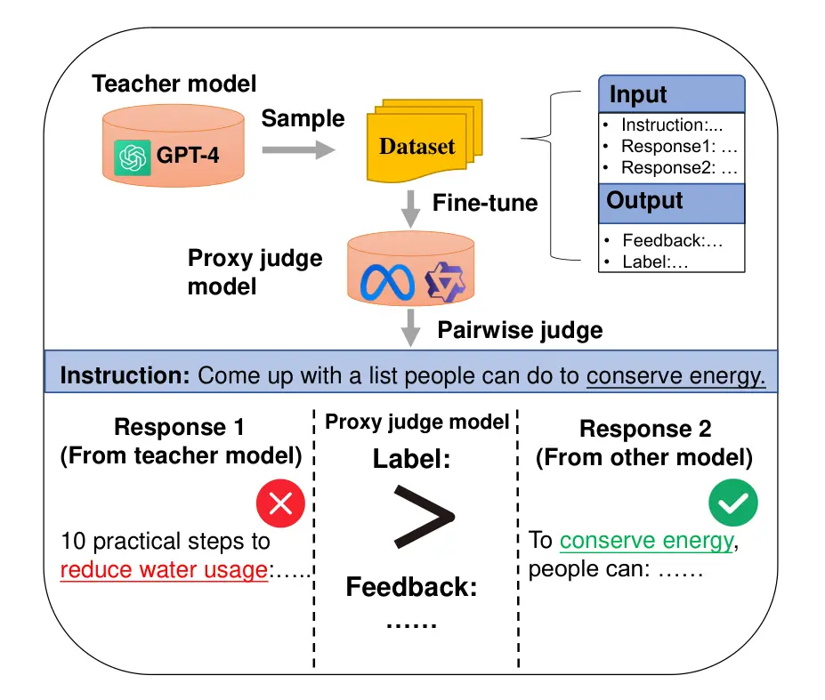
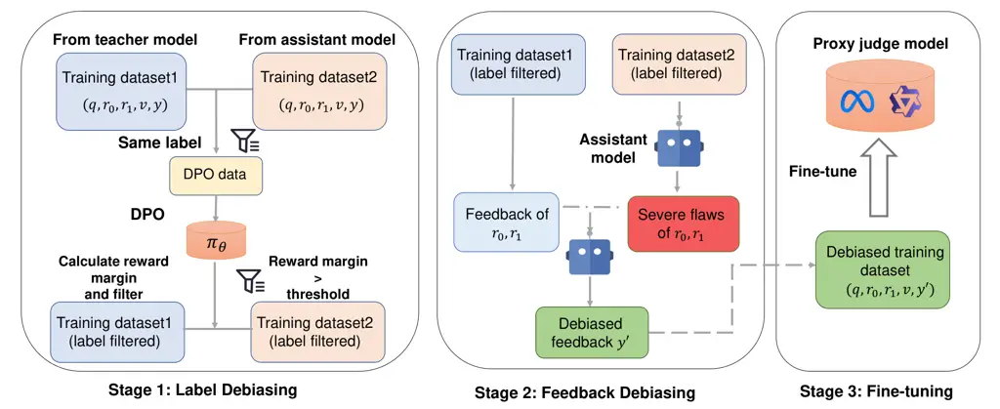

# Assistant-Guided Mitigation of Teacher Preference Bias in LLM-as-a-Judge

Zhuo Liu Email: <liuz@mail.ustc.edu.cn>    Moxin Li
Email: <limoxin@u.nus.edu>    Xun Deng
Email: <dx981228@mail.ustc.edu.cn>    Qifan Wang Affiliation: University
of Science and Technology of China  National University of Singapore
 Meta AI Email: <wqfcr@fb.com>    Fuli Feng
Email: <fulifeng93@gmail.com>

###### Abstract

LLM-as-a-Judge employs large language models (LLMs), such as GPT-4, to
evaluate the quality of LLM-generated responses, gaining popularity for
its cost-effectiveness and strong alignment with human evaluations.
However, training proxy judge models using evaluation data generated by
powerful teacher models introduces a critical yet previously overlooked
issue: teacher preference bias, where the proxy judge model learns a
biased preference for responses from the teacher model. To tackle this
problem, we propose a novel setting that incorporates an additional
assistant model, which is not biased toward the teacher model’s
responses, to complement the training data. Building on this setup, we
introduce AGDe-Judge, a three-stage framework designed to debias from
both the labels and feedbacks in the training data. Extensive
experiments demonstrate that AGDe-Judge effectively reduces teacher
preference bias while maintaining strong performance across six
evaluation benchmarks¹¹ 1 Code is available at
[https://github.com/Liuz233/AGDe-Judge](https://github.com/Liuz233/AGDe-Judge)..

^(†)^(†)footnotetext: ^($`\dagger`$)Corresponding author.

## 1 Introduction

LLM-as-a-Judge refers to the use of Large Language Models (LLMs), such
as GPT-4 OpenAI (2024), to evaluate text quality by generating feedback
and making evaluative judgments Zheng et al. (2023). Unlike traditional
manual evaluation or automatic metrics (e.g., BLEU), this method offers
a cost-effective and scalable alternative, achieving strong alignment
with human evaluations when using advanced models like GPT-4 Liu et al.
(2023). Consequently, LLM-as-a-Judge has seen growing adoption in LLM
evaluation tasks Zheng et al. (2023); Wu et al. (2024); Dubois et al.
(2025).

Concerns regarding the high cost, limited transparency, and lack of
controllability of proprietary large models (e.g., GPT-4) have driven
the adoption of proxy judge models based on open-source LLMs Wang et al.
(2023); Kim et al. (2023); Kim et al. (2024); Li et al. (2024). To equip
smaller open-source models with evaluation capabilities comparable to
those of advanced large models, this approach typically employs a
high-performing teacher model—such as GPT-4—to generate judge-specific
training data for evaluation tasks. The open-source model is then
fine-tuned on this data to create a specialized proxy judge model. By
constructing high-quality judge datasets and applying techniques such as
weight merging Kim et al. (2024), the resulting proxy judge models can
achieve performance close to that of large models like GPT-4 Kim et al.
(2023); Li et al. (2024), enabling broad practical adoption.



Figure 1: Illustration of the teacher preference bias. The evaluation
task is a pairwise ranking, where the proxy judge model generates
evaluation feedback and a label indicating which of the two responses is
better.

Despite the advantages of proxy judge models, we identify a key
limitation: these models exhibit a significant bias favoring responses
generated by the teacher model, regardless of their actual quality. We
term this phenomenon teacher preference bias (_cf._ Figure 1). This bias
stems from the self-preference bias of the teacher model itself Ye
et al. (2024a); Chen et al. (2025), which is contained in the training
data and subsequently captured by the proxy judge model through
fine-tuning. To the best of our knowledge, teacher preference bias has
not been previously identified or systematically investigated. Our
experiments confirm the presence of this bias, which arises from both
the judge labels and feedback included in the training data. As GPT-4 is
a dominant and highly capable model, many existing methods rely
exclusively on data generated by GPT-4 Li et al. (2024); Kim et al.
(2023); Kim et al. (2024), further amplifying the spread of this bias
and posing a substantial challenge to the fairness and accuracy of proxy
judge models.

To mitigate teacher preference bias, we propose to introduce an
additional, smaller LLM, termed as assistant model, into the training
pipeline of proxy judge models. These models do not have a biased
preference toward the teacher model’s responses, and are relatively
inexpensive with decent evaluation capability. Within this framework, we
leverage the assistant model to debias the teacher model-generated data
from two sources: biased labels and biased feedback. Firstly, we aim to
identify and filter out the instances with biased labels leveraging
information from the reliable labels agreed by the assistant model.
Then, we aim to debias the feedback by reducing the teacher model’s
tendency to overemphasize minor or superficial issues.

To this end, we propose a three-stage framework, AGDe-Judge
(Assistant-Guided Debiasing for Judge Models), to mitigate teacher
preference bias in proxy judge models. First, we filter out biased
labels using an implicit reward margin Rafailov et al. (2024), which is
derived from consensus labels between the teacher and assistant models.
Second, we leverage the assistant model to identify severe flaws in
responses, thereby counteracting the overemphasis on minor or
superficial issues in the feedback. Finally, we fine-tune the student
model using the refined data to obtain the final proxy judge model.
Experimental results show that AGDe-Judge effectively reduces teacher
preference bias while maintaining high evaluation accuracy across six
standard benchmarks. In summary, the main contributions of our paper are
as follows:

- •
  We identify and define a previously unstudied critical limitation in
  existing proxy judge models, the teacher preference bias.
- •
  We introduce an assistant LLM to tackle this bias and propose a
  three-stage approach that tackles biased labels and biased feedback.
- •
  We conduct extensive experiments validating the strong effectiveness
  of our approach both in debiasing and evaluation performance.

## 2 Related Work

LLM-as-a-Judge Zheng et al. (2023) proposed LLM-as-a-Judge, leverages
powerful LLMs (e.g., GPT-4) to evaluate responses to open-ended
questions, offering a scalable alternative to costly human annotators
and limited traditional methods. Studies show LLMs achieve high
agreement with human experts Ashktorab et al. (2024); Bavaresco et al.
(2024), driving its adoption across various tasks Zhu et al. (2023); Cui
et al. (2023); Bai et al. (2023). However, this paradigm suffers from
biases, including position bias Shi et al. (2025), verbosity bias Chen
et al. (2024), and self-preference bias, where LLMs favor their own
responses Li et al. (); Panickssery et al. (2024). These biases
undermine the reliability and fairness of LLM-as-a-Judge evaluations Ye
et al. (2024a).

Proxy Judge Models Due to the high cost, limited transparency, and lack
of controllability associated with proprietary large models, fine-tuning
open-source models to serve as judge models—commonly referred to as
proxy judge models—has become an increasingly popular alternative Wang
et al. (2023); Zhu et al. (2023); Kim et al. (2023); Kim et al. (2024).
This approach typically involves leveraging a powerful proprietary model
(mostly GPT-4), known as the teacher model, to construct
evaluation-specific training data. However, the self-preference bias
implicitly embedded in the teacher model’s outputs may be inherited by
the proxy judge model, introducing subtler forms of bias. Despite its
significance, this issue has not yet been systematically studied.

Debiasing Approaches Various debiasing approaches have been proposed to
address the widespread biases in LLM-as-a-Judge. Discussion-based
methods mitigate the bias of a single LLM by leveraging multiple LLMs to
engage in debate and deliberation Khan et al. (2024); Li et al. ().
Adversarial methods introduce structured rationale pairs Ye et al.
(2024b), or construct specially curated debiasing datasets Park et al.
(2024). However, addressing the previously unstudied teacher preference
bias calls for new debiasing methods specifically tailored to this
issue.

## 3 Preliminary Study

[TABLE]

Table 1: Evaluation accuracy of Mistral-7B-Instruct-v0.3 fine-tuned on
the AutoJ-pairwise and Preference Collection datasets under different
filtering condition. The best accuracy for each benchmark is bolded.

#### Problem Definition

LLM-as-a-judge is an efficient and effective strategy for evaluating
LLM-generated responses to compare LLM performance. We focus on the most
common and effective evaluation setting of _pairwise ranking_ Kim et al.
(2024), where the judge LLM evaluates and rank pairs of LLM responses.
Let $`M`$ denote the judge LLM. Given an input tuple consisting of a
instruction $`q`$, two responses $`r_{0}`$ and $`r_{1}`$ generated by
LLMs to be evaluated, and an auxiliary input $`e`$ which includes
evaluation criteria and reference answers Kim et al. (2024), the judge
LLM generates a textual feedback $`v`$ to illustrate the reason behind
its judgment, and a preference label $`y\in\{0,1\}`$ to indicate which
response is better. Formally,

```math
\displaystyle(v,y)=M(q,r_{0},r_{1},e). \tag{1}
```

Due to the limitations of proprietary large judge models (e.g., GPT-4),
such as high cost, limited transparency and controllability, researchers
have increasingly turned to proxy judge models as a practical
alternative. A common approach begins by constructing a training dataset
using outputs from the proprietary model, referred to as the teacher
model $`M_{t}`$, denoted as
$`\mathcal{D}_{t}=\{(q,r_{0},r_{1},e),(v_{t},y_{t})\}`$, where $`v_{t}`$
and $`y_{t}`$ are the textual feedback and label generated by $`M_{t}`$.
An open-source model is then fine-tuned on $`\mathcal{D}_{t}`$ to obtain
a proxy judge model, referred to as the student model $`M_{s}`$, which
is used for evaluation tasks. This method of constructing proxy judge
models has demonstrated strong performance comparable to that of the
teacher model Kim et al. (2024). Formally, denoting the feedback and
label generated from proxy judge model as $`v_{s}`$ and $`y_{s}`$,

```math
\displaystyle(v_{s},y_{s})=M_{s}(q,r_{0},r_{1},e). \tag{2}
```

#### Teacher Preference Bias

Despite the advantages of proxy judge models, we identify a critical
issue in pairwise ranking: when _one response is generated by the
teacher model_ and the other by an unrelated model, the proxy judge
often exhibits a _biased preference for the teacher model’s response_,
which is much larger than the actual probability of the teacher model’s
response being better . We refer to this phenomenon as teacher
preference bias. This bias stems from the self-preference bias Ye et al.
(2024a); Chen et al. (2025) captured in $`\mathcal{D}_{t}`$ generated by
the teacher model who often favors its own responses. Denoting the
ground-truth label as $`y_{gt}\in\{0,1\}`$, and the response index
generated by $`M_{t}`$ as $`y_{tg}\in\{0,1\}`$, this bias can exhibit as

```math
\displaystyle P(y_{s}=y_{tg})\gg P(y_{gt}=y_{tg}). \tag{3}
```

This issue poses a significant challenge to building reliable proxy
judge models. First, existing evaluation datasets (e.g., Preference
Collection Kim et al. (2024), AutoJ-pairwise Li et al. (2024),
JudgeLM Zhu et al. (2023)) heavily rely on the state-of-the-art teacher
model GPT-4, which is widely used due to its strong alignment with human
preferences Liu et al. (2023). Moreover, the response pairs in these
datasets often include outputs generated by GPT-4, which creates the
condition for introducing such bias. Also, many evaluation benchmarks
involve direct comparisons between a GPT-4 response and a response from
another model (e.g., MT-Bench Zheng et al. (2023), Chatbot-Arena Chiang
et al. (2024), Reward-Bench Lambert et al. (2024)). As a result, the
proxy judge model can easily learn and exhibit this latent bias. In the
following section, we systematically demonstrate the existence of this
bias.

Figure 2: Results of GPT4-Mistral-7B and Human judgments on MT-Bench
Human Judge (filtered). The models were trained on AutoJ-pairwise (left)
and Preference Collection data (right). The upper row uses all training
samples; the lower row uses only those where GPT-4 and GPT-3.5-Turbo
assign the same preference label.

#### Evaluation Setup

To demonstrate the existence of teacher preference bias, we fine-tune
proxy judge models using GPT-4 as the teacher model and evaluate their
biased preference toward GPT-4-generated responses. The bias evaluation
is primarily conducted on the following datasets:

- •
  OffsetBias (filtered) Park et al. (2024): A representative evaluation
  dataset on the bias for LLM-as-a-Judge. The worse responses are
  generated by GPT-4, crafted intentionally through adversarial
  prompting techniques such as providing misleading or off-topic
  instructions, or explicitly encouraging the inclusion of factual
  errors or incomplete answers. In contrast, the better responses come
  from other models. Lower accuracy in this dataset show more severe
  bias.
- •
  MT-Bench Human Judge (filtered) Zheng et al. (2023): Uses the 80
  prompts from MT-Bench along with 3.3k pairs of model responses
  annotated with human preferences. We extract a subset of MT-Bench
  Human Judge consisting of instances where one response is from GPT-4
  and the other from a different model. To evaluate the bias, we measure
  the extent to which the proxy judge favors GPT-4 responses compared to
  the ground-truth human labels.

Additionally, we employ two standard benchmarks, the full MT-Bench Human
Judge and Arena-Human Chiang et al. (2024), from which we randomly
sample evaluation instances to examine the quality of the proxy judge
model.

For fine-tuning datasets, we employ AutoJ-pairwise and Preference
Collection. Both are constructed under GPT-4 with evaluated responses
from GPT-4. In addition to using GPT-4 as the teacher model, we
investigate the severity of teacher preference bias by introducing an
alternative teacher model: GPT-3.5-Turbo. We prompt GPT-3.5-Turbo with
the same inputs used in the fine-tuning datasets to generate feedback
and labels. Comparing the performance of proxy judge models fine-tuned
with GPT-3.5-Turbo versus GPT-4 as teacher enables us to evaluate the
extent of bias toward GPT-4-generated responses. For base proxy judge
model, we use the open-source Mistral-7B-Instruct-v0.3 Jiang et al.
(2023).

Furthermore, we investigate different sources of bias. We hypothesize
that bias may arise from both the preference labels and the textual
feedback. To isolate the effect of feedback, we introduce an additional
setting where we retain only training instances for which GPT-4 and
GPT-3.5-Turbo teacher models assign identical preference labels. This
allows us to assess the extent of bias attributable specifically to the
feedback. More details regarding dataset processing, fine-tuning, and
generating procedures are in Appendix A.

#### Evaluation Results

Table 1 shows the bias and accuracy results for proxy judge models with
different teacher models. On standard benchmarks, the model trained with
GPT-4 as the teacher (GPT4-Mistral-7B) achieves the highest accuracy,
outperforming GPT3.5-Mistral-7B. This highlights GPT-4’s strong
alignment with human evaluations and supports its use as a teacher model
for generating fine-tuning data. However, on the bias evaluation set
OffsetBias, GPT4-Mistral-7B shows a notable performance drop compared to
GPT3.5-Mistral-7B. This suggests that GPT4-Mistral-7B incorrectly favors
GPT-4 responses even when they are worse. Together, these findings
indicate that, despite its overall effectiveness, the proxy judge model
tends to over-rank responses from its teacher model—a phenomenon we
refer to as _teacher preference bias_.

Results using identical labels from both teacher models are also
presented below Table 1, showing a trend consistent with the unfiltered
results: while GPT4-Mistral-7B achieves higher accuracy on standard
benchmarks, it still demonstrates a clear biased preference toward
responses from GPT-4, confirming the presence of teacher preference
bias. Notably, the bias performance gap in the feedback-only setting is
smaller than that in the joint setting. Taken together, these findings
indicate that both labels and feedback in the training data contribute
to the teacher preference bias.

Figure 2 presents the results on MT-Bench Human Judge (filtered),
offering an complementary metric, namely by comparing the proportion of
GPT-4 responses labeled as winner by judge models with the actual
proportion labeled as winner by human annotators, thereby quantifying
the degree of teacher preference bias. We can clearly observe that,
under different training datasets and sampling settings, the win ratio
assigned to GPT-4 by GPT4-Mistral-7B is substantially higher than that
assigned by human annotators. This provides another piece of intuitive
evidence that reinforces the existence of teacher preference bias.

#### Case Study

To further investigate the causes of teacher preference bias, we conduct
a case study. We first observe the patterns of GPT-4’s self-preference
bias in the training data, as illustrated in Table 12. The case reveals
that GPT-4’s feedback is not solely grounded in core evaluation criteria
such as relevance, completeness, and factual accuracy. Instead, it also
emphasizes features commonly associated with GPT-4’s own outputs—such as
informativeness, extensive citations, and greater depth of reasoning.
Next, we examine the failure patterns of proxy judge models with respect
to teacher preference bias, as shown in Table 13. We find that the model
tends to prioritize stylistic and content-rich features like vividness
and depth of knowledge—features typical of GPT-4 outputs—while
overlooking critical flaws such as topical irrelevance. This case shows
that self-preference bias present in the training data is captured by
the proxy judge model during fine-tuning.

## 4 Methodology



Figure 3: Illustration of three-stage debiasing framework AGDe-Judge.
$`q`$, $`r_{0}`$, $`r_{1}`$, $`v`$, $`y`$ denote the inputs and outputs
of the pairwise ranking task, following the same notation as in
Section 3.

After identifying the teacher preference bias, our goal is to mitigate
this bias in proxy judge models while maintaining their strong
evaluation performance. We incorporate an additional smaller LLM,
referred to as the assistant model, into the fine-tuning process. The
assistant model is cost-effective, exhibits reliable evaluation
capabilities, and remains unaffected by the teacher model’s bias.
Building on our earlier observations, the proposed framework aims to
reduce teacher preference bias by targeting two key sources
sequentially: first, by filtering biased labels, and then by addressing
biased feedback. We propose AGDe-Judge, a three-stage debiasing
framework to achieve this goal.

#### Stage 1: Label Filtering by Reward Margin

We observe that labels in the dataset $`\mathcal{D}_{t}`$ can be
incorrect and biased. Therefore, the first stage of our framework
focuses on filtering out incorrectly labeled instances. Inspired by Deng
et al. (2025), we assign a reward score to each candidate response in an
evaluation instance and retain only those instances with a sufficiently
large reward margin between the better and worse responses—indicating a
clear quality difference. To ensure the reward is reliable and corrects
potential bias from the teacher model, we leverage instances where the
teacher and assistant models agree on the ranking, rather than relying
solely on the teacher model’s judgment.

Specifically, we first construct an additional training dataset by
prompting the assistant model with the same instructions and candidate
responses, generating new labels and feedback. We then select samples
where both the teacher and assistant models provide consistent label
annotations, denoted as $`\mathcal{D}_{a}`$. These samples are used to
train an auxiliary DPO model $`M_{i}`$, using the following loss
function:

```math
\displaystyle\mathcal{L}_{i}=-\mathbb{E}_{\mathcal{D}_{a}}\bigg[\log\sigma\bigg( \displaystyle\beta\frac{M_{i}(r_{y}|q)}{M_{\text{ref}}(r_{y}|q)}
```

```math
\displaystyle-\beta\frac{M_{i}(r_{1-y}|q)}{M_{\text{ref}}(r_{1-y}|q)}\bigg)\bigg], \tag{4}
```

where $`M_{\text{ref}}`$ is the reference assistant model. Next, we
compute the implicit reward margin between the better and worse
responses, $`r_{y}`$ and $`r_{1-y}`$:

```math
\displaystyle t=\log\frac{M_{i}(r_{y}|q)}{M_{\text{ref}}(r_{y}|q)}-\log\frac{M_{i}(r_{1-y}|q)}{M_{\text{ref}}(r_{1-y}|q)}. \tag{5}
```

By applying a threshold $`T`$ on this reward margin, we filter out
instances with potentially biased labels in both datasets. The remaining
better-quality samples are then passed to the next stage.

#### Stage 2: Feedback Debiasing by Assistant-Critique Aggregation

For instances with filtered labels, the feedback provided by the teacher
model may still exhibit significant bias—overemphasizing minor features
characteristic of its own responses while overlooking more critical
aspects of response quality (see Section 3). In contrast, the assistant
model’s feedback is less prone to such self-preference bias.

To address this, we utilize the assistant model to identify severe flaws
in both candidate responses. These identified flaws serve as anchors to
guide the assistant model in mitigating the biased focus of the original
feedback on minor or superficial features. The assistant model is then
prompted to generate revised feedback by integrating the detected flaws
with the original teacher feedback, resulting in a more balanced and
critical evaluation. Formally,

```math
\displaystyle c_{a} \displaystyle=M_{a}(q,r_{0},r_{1},w), \tag{6}
```

```math
\displaystyle v_{a} \displaystyle=M_{a}(q,r_{0},r_{1},v,c_{a},e,o), \tag{7}
```

where $`M_{a}`$ is assistant model, $`c_{a}`$ is the critique under
prompt $`w`$, and $`v_{a}`$ is the revised feedback under original
feedback $`v`$, $`c_{a}`$, and prompt $`o`$.

#### Stage 3: Fine-tuning

After the first two stages, we obtain de-biased labels and feedback. We
then fine-tune the proxy judge model $`M_{s}`$ using the following loss
function. Denoting the dataset obtained from the first two stages as
$`\mathcal{D}_{j}=\{q,r_{0},r_{1},e,v_{a},y_{a}\}:`$

```math
\displaystyle\mathcal{L}_{j}=-\mathbb{E}_{\mathcal{D}_{j}}\bigg[\log\frac{M_{s}(v_{a},y_{a}|q,r_{0},r_{1},e)}{M_{\text{ref}}(v_{a},y_{a}|q,r_{0},r_{1},e)}\bigg]. \tag{8}
```

## 5 Experiments

|                            |                  |          |              |             |               |         |            |
| -------------------------- | ---------------- | -------- | ------------ | ----------- | ------------- | ------- | ---------- |
|                            | Preference-Bench | MT-Bench | Reward-Bench | Arena-Human | UltraFeedback | JudgeLM | OffsetBias |
| Mistral-7B                 | 0.669            | 0.571    | 0.835        | 0.462       | 0.554         | 0.616   | 0.322      |
| GPT3.5-Mistral-7B          | 0.874            | 0.695    | 0.931        | 0.565       | 0.681         | 0.735   | 0.269      |
| GPT4-Mistral-7B            | 0.721            | 0.700    | 0.962        | 0.583       | 0.735         | 0.760   | 0.182      |
| Naive Mix                  | 0.788            | 0.665    | 0.953        | 0.598       | 0.687         | 0.733   | 0.194      |
| Teacher-Only Margin Filter | 0.831            | 0.700    | 0.964        | 0.586       | 0.754         | 0.783   | 0.207      |
| Weight Merging             | 0.853            | 0.710    | 0.941        | 0.594       | 0.707         | 0.761   | 0.293      |
| AGDe-Judge                 | 0.832            | 0.715    | 0.947        | 0.598       | 0.744         | 0.792   | 0.391      |
|                            | Preference-Bench | MT-Bench | Reward-Bench | Arena-Human | UltraFeedback | JudgeLM | OffsetBias |
| Mistral-7B                 | 0.669            | 0.571    | 0.835        | 0.462       | 0.554         | 0.616   | 0.322      |
| Qwen2.5-Mistral-7B         | 0.852            | 0.715    | 0.915        | 0.565       | 0.702         | 0.753   | 0.360      |
| GPT4-Mistral-7B            | 0.721            | 0.700    | 0.962        | 0.583       | 0.735         | 0.760   | 0.182      |
| Naive Mix                  | 0.840            | 0.716    | 0.926        | 0.536       | 0.713         | 0.752   | 0.335      |
| Teacher-Only Margin Filter | 0.812            | 0.695    | 0.961        | 0.598       | 0.747         | 0.760   | 0.204      |
| Weight Merging             | 0.856            | 0.720    | 0.942        | 0.582       | 0.742         | 0.766   | 0.340      |
| AGDe-Judge                 | 0.833            | 0.716    | 0.945        | 0.608       | 0.748         | 0.777   | 0.373      |

Table 2: Evaluation results on standard benchmarks and the teacher
preference bias test dataset. The upper part is when the assistant model
is GPT-3.5-Turbo, and that for the lower part is Qwen2.5-7B-Instruct.
Bolded and underlined numbers denote the best and the second-best value.

#### Datasets and Models

To evaluate the extent of teacher preference bias across different
methods, we use two bias evaluation datasets: OffsetBias (filtered) and
MT-Bench Human Judge(filtered), processed following the same protocol as
in Section 3. In addition, we assess the accuracy of proxy judge models
using six standard benchmarks: Preference-Bench Kim et al. (2024),
MT-Bench Human Judge, Reward-Bench Lambert et al. (2024), Arena-Human,
UltraFeedback Binarized Cui et al. (2023), JudgeLM Zhu et al. (2023).
See Appendix A.1 for more details.

For fine-tuning datasets, we employ AutoJ-pairwise. We use GPT-4 as the
teacher model. To validate the effectiveness of our proposed framework
AGDe-Judge, we experiment with two different assistant models:
GPT-3.5-Turbo and Qwen2.5-7B-Instruct Qwen (2024). In the DPO phase of
Stage 1, we adopt Llama-2-7b-hf Touvron et al. (2023) as the base model.
For the proxy judge model, we use the open-source
Mistral-7B-Instruct-v0.3 as the backbone.

|                  |                   |                      |            |
| ---------------- | ----------------- | -------------------- | ---------- |
|                  | Label Debias Only | Feedback Debias Only | AGDe-Judge |
| Preference-Bench | 0.822             | 0.798                | 0.832      |
| MT-Bench         | 0.702             | 0.679                | 0.715      |
| Reward-Bench     | 0.946             | 0.930                | 0.947      |
| Arena-Human      | 0.593             | 0.592                | 0.598      |
| UltraFeedback    | 0.712             | 0.725                | 0.744      |
| JudgeLM          | 0.758             | 0.774                | 0.792      |
| OffsetBias       | 0.274             | 0.335                | 0.391      |

Table 3: Results of ablation study. Each row corresponds to one
benchmark and the best accuracy for each benchmark is bolded.

#### Compared Methods

In addition to directly using the base model and training the proxy
judge model with conventional methods, we also compare our approach with
data-centric and model-centric optimization baselines.

- •
  Naive Mix, directly mix the training data generated by the teacher
  model and the assistant model without any further processing.
- •
  Teacher-Only Margin Filter, after computing the implicit reward margin
  in Stage 1, we use the filtered training data from the teacher model
  as the final training set.
- •
  Weight Merging Rame et al. (2023), involves two proxy judge models,
  $`\theta_{t}`$ and $`\theta_{a}`$, which are fine-tuned separately on
  the training data generated by the teacher model and the assistant
  model, respectively. Then, we obtain the final proxy judge model via
  linear merging:
  $`\theta_{final}=\alpha\cdot\theta_{t}+(1-\alpha)\cdot\theta_{p}`$,
  where we experiment by using $`\alpha=0.5`$.

There are also some debiasing methods, such as multi-agent debate
methods Khan et al. (2024); Li et al. (), constructing debiasing
datasets Park et al. (2024) and Con-J Ye et al. (2024b), that were not
included as baselines for comparison. This is because these methods are
not directly applicable to our problem setting, which involves only
teacher-generated training data and an assistant model, and thus
including them as baselines would not constitute a fair comparison. The
detailed reasons and analysis are provided in Appendix A.3 and A.4.

Except for MT-Bench Human Judge (filtered), where results are reported
as win/loss ratios, all other datasets use accuracy as the evaluation
metric. For implementation details of fine-tuning and DPO, please refer
to Appendix A.

### 5.1 Results

Table 2 present the results when using GPT-3.5-Turbo and
Qwen2.5-7B-Instruction as the assistant models, respectively. We can
observe the following key findings:(1) AGDe-Judge outperforms all
baselines, achieving the best results on most benchmarks, and
simultaneously achieves the highest accuracy on OffsetBias. This
indicates its strong ability to mitigate teacher preference bias, which
is attributed to its effective removal of bias from both labels and
feedback, thereby prevents the hidden self-preference bias in the
training data from influencing the proxy judge model. Figure 4 further
demonstrates the effectiveness of AGDe-Judge in mitigating teacher
preference bias. (2) Naive Mix performs poorly because it retains biased
and conflicting labels and feedback, harming model performance. In
contrast, AGDe-Judge ensures data quality by filtering out bias and
inconsistencies. (3) Teacher-Only Margin Filter improves over basic
teacher-trained models by removing biased labels, but biased feedback
still causes teacher preference bias. AGDe-Judge further mitigates this
by using the assistant model to highlight key flaws, leading to better
results. (4) Weight-Merging, a model-centric approach, combines teacher
and assistant models at the parameter level and improves accuracy, but
fails to fully remove bias. AGDe-Judge adopts a data-centric strategy,
directly eliminating bias from training data and achieving superior
debiasing and evaluation performance. (5) The results in Figure 6
indicate that introducing the assistant model in AGDe-Judge does not
introduce additional teacher preference bias.

|                  |                     |            |            |
| ---------------- | ------------------- | ---------- | ---------- |
|                  | Naive Concatenation | Rephrasing | AGDe-Judge |
| Preference-Bench | 0.868               | 0.840      | 0.832      |
| MT-Bench         | 0.692               | 0.696      | 0.715      |
| Reward-Bench     | 0.932               | 0.945      | 0.947      |
| Arena-Human      | 0.570               | 0.580      | 0.598      |
| UltraFeedback    | 0.690               | 0.747      | 0.744      |
| JudgeLM          | 0.762               | 0.783      | 0.792      |
| OffsetBias       | 0.271               | 0.320      | 0.391      |

Table 4: Results of feedback debiasing with different prompt strategies.

### 5.2 In-depth Analysis

Figure 4: Result on MT-Bench Human Judge (filtered). All methods in the
left subfigure use GPT-3.5-Turbo as the assistant model, while those in
the right subfigure use Qwen2.5-7B-Instruction.

#### Ablation Studies

To validate the effectiveness of each component within our framework, we
conduct the following ablation studies: (1) Label Debiasing Only: we
remove the Stage 2 feedback debiasing process and retain only the label
filtering step from Stage 1; (2) Feedback Debiasing Only: we skip the
label debiasing in Stage 1 and directly apply feedback refinement to the
original training datasets. We use GPT-3.5-Turbo as assistant model.

From the results shown in Table 3, we observe that compared to the full
AGDe-Judge framework, performing only label debiasing or only feedback
debiasing leads to significant performance degradation, demonstrating
the necessity of implementing debiasing measures for both labels and
feedback. Label debiasing alone results in a greater decline on the
OffsetBias test set, while feedback debiasing alone causes a more
substantial accuracy drop on standard benchmarks. This indicates that in
the AGDe-Judge framework, feedback debiasing plays a more critical role
in reducing bias, whereas label debiasing is more essential for
improving accuracy.

|                  |             |              |              |
| ---------------- | ----------- | ------------ | ------------ |
|                  | Threshold=0 | Threshold =5 | Threshold=10 |
| Preference-Bench | 0.799       | 0.832        | 0.850        |
| MT-Bench         | 0.708       | 0.715        | 0.712        |
| Reward-Bench     | 0.924       | 0.947        | 0.937        |
| Arena-Human      | 0.572       | 0.598        | 0.586        |
| UltraFeedback    | 0.707       | 0.744        | 0.717        |
| JudgeLM          | 0.753       | 0.792        | 0.736        |
| OffsetBias       | 0.277       | 0.391        | 0.239        |

Table 5: Results of different implicit reward margin threshold. The best
accuracy for each benchmark is bolded, and the second-best value is
underlined.

#### Comparison of Different Prompting Strategy Design

To evaluate the impact of different prompting strategies on feedback
debiasing in Stage 2, we experiment with several prompt designs: (1)
Naive Concatenation: directly present the feedback from both the teacher
and assistant models to the assistant model, prompting it to generate a
final evaluation; (2) Rephrasing: directly prompt the assistant model to
rephrase the feedback originally provided by the teacher model; (3)
AGDe-Judge: prompt the assistant model to explicitly identify severe
flaws in the responses, and then generate a final evaluation that
integrates the original feedback from the teacher model, which is
adopted by AGDe-Judge. For detail prompt, refer to Appendix C.

Table 4 presents the results, showing that AGDe-Judge outperforms other
prompt strategies. This is because AGDe-Judge’s Stage 2 leverages the
assistant model to identify significant and severe flaws in the
candidate responses, it can compensates for the teacher model’s tendency
to overemphasize minor and superficial issues. As a result, the final
feedback is more focused on critical aspects, more comprehensive, and
free from bias, leading to higher overall quality.

#### Sensitivity to the Implicit Reward Margin

In this part, to assess the impact of different implicit reward margin
thresholds used in Stage 1 on label filtering, we conduct experiments
using three threshold values: 0, 5, and 10. Figure 7 shows the
distribution of implicit reward margins in labels generated by GPT-4 and
GPT-3.5-Turbo. From the results in Table 5, we can infer that when
labels are filtered using a threshold of 5, the resulting proxy judge
model achieves the best performance. This is attributed to the following
reasons: (1) When the threshold is lower, the debiasing effect on labels
is weak, leading to relatively poor quality of the remaining filtered
data. (2) When the threshold is set too high, the number of remaining
samples after filtering decreases sharply, making it insufficient to
effectively train the proxy judge model.

Figure 5: Annotation results from GPT-4, GPT-3.5-Turbo API, and human on
MT-Bench Human Judge (filtered) for GPT-4 vs others.

#### Potential Biases Introduced by the Assistant Model

To investigate whether the introduction of the assistant model amplifies
the existing teacher preference bias or introduces additional biases, we
conducted further experiments on the filtered MT-Bench dataset. Figure 5
illustrates the degree of bias of GPT-3.5-Turbo toward GPT-4’s
responses. By comparing the win rate of GPT-4’s responses labeled by
GPT-3.5-Turbo against those labeled by human annotators, we observe that
the selected assistant model (GPT-3.5-Turbo) exhibits minimal bias
toward the teacher, even though they belong to the same model family.
This result can be attributed to the fact that the assistant model we
selected is generally smaller in scale, making it less likely to capture
the teacher model’s stylistic patterns and preferences—thereby reducing
the risk of bias toward the teacher.

In addition, Figure 6 shows that AGDe-Judge exhibits no significant
preference for the assistant model. Therefore, we conclude that the
introduction of assistant models such as GPT-3.5-Turbo neither amplifies
the bias toward the teacher model nor introduces potential new biases,
thus supporting the robustness of our evaluation framework.

Figure 6: Result on MT-Bench Human Judge (filtered) of GPT-3.5-Turbo vs
others.

## 6 Conclusion

This work investigates a previously overlooked bias: teacher preference
bias. Through extensive experiments and analysis, we demonstrate that
training datasets generated by teacher models inherently contain
self-preference bias in both labels and feedback, which in turn induces
teacher preference bias in proxy judge models. To mitigate this, we
introduce AGDe-Judge, a three-stage framework that filters biased labels
using an implicit reward margin and refines biased feedback with the
help of an assistant model. Our experimental results show the superior
performance of our approach over several existing baselines across
multiple standard and bias evaluation benchmarks.

## Limitations

#### Conducting Experiments with Additional Teacher Models

All our experiments used GPT-4 as the teacher model, as it is the
dominant and highly capable model most widely used for generating
training data. However, the extent of teacher preference bias when using
other advanced large language models, such as the Claude series or
DeepSeek, as teacher models remains to be further explored.

#### Proposing Solutions from Alternative Perspectives

Our AGDe-Judge framework primarily focuses on debiasing training data.
Future work could explore alternative optimization strategies from the
perspectives of model architecture or training methodologies to further
mitigate teacher preference bias.

#### Deeper Investigation into the Sources of Bias

Our work demonstrates that the teacher preference bias in proxy judge
models primarily stems from self-preference bias implicitly embedded in
the labels and feedback of the training data. However, the underlying
causes of self-preference bias have not yet been thoroughly investigated
or substantiated. Studying the root causes of bias could facilitate more
effective solutions for addressing both self-preference bias and teacher
preference bias.

## Ethical Consideration

The case study shown in the Appendix D includes responses from LLMs,
some of which may contain non-factual or harmful information.

## Acknowledgement

This work is supported by the National Natural Science Foundation of
China (62272437).

## References

- Ashktorab et al. (2024) Zahra Ashktorab, Michael Desmond, Qian Pan,
  James M Johnson, Martin Santillan Cooper, Elizabeth M Daly, Rahul
  Nair, Tejaswini Pedapati, Swapnaja Achintalwar, and Werner
  Geyer. 2024. Aligning human and llm judgments: Insights from
  evalassist on task-specific evaluations and ai-assisted assessment
  strategy preferences. _arXiv preprint arXiv:2410.00873_.
- Bai et al. (2023) Yushi Bai, Jiahao Ying, Yixin Cao, Xin Lv, Yuze He,
  Xiaozhi Wang, Jifan Yu, Kaisheng Zeng, Yijia Xiao, Haozhe Lyu, and 1
  others. 2023. Benchmarking foundation models with
  language-model-as-an-examiner. _Advances in Neural Information
  Processing Systems_, 36:78142–78167.
- Bavaresco et al. (2024) Anna Bavaresco, Raffaella Bernardi, Leonardo
  Bertolazzi, Desmond Elliott, Raquel Fernández, Albert Gatt, Esam
  Ghaleb, Mario Giulianelli, Michael Hanna, Alexander Koller, and 1
  others. 2024. Llms instead of human judges? a large scale empirical
  study across 20 nlp evaluation tasks. _CoRR_.
- Chen et al. (2024) Guiming Chen, Shunian Chen, Ziche Liu, Feng Jiang,
  and Benyou Wang. 2024. Humans or llms as the judge? a study on
  judgement bias. In _Proceedings of the 2024 Conference on Empirical
  Methods in Natural Language Processing_, pages 8301–8327.
- Chen et al. (2025) Wei-Lin Chen, Zhepei Wei, Xinyu Zhu, Shi Feng, and
  Yu Meng. 2025. Do llm evaluators prefer themselves for a reason?
  _arXiv preprint arXiv:2504.03846_.
- Chiang et al. (2024) Wei-Lin Chiang, Lianmin Zheng, Ying Sheng,
  Anastasios Nikolas Angelopoulos, Tianle Li, Dacheng Li, Hao Zhang,
  Banghua Zhu, Michael Jordan, Joseph E. Gonzalez, and Ion Stoica. 2024.
  [Chatbot arena: An open platform for evaluating llms by human
  preference](https://arxiv.org/abs/2403.04132). _Preprint_,
  arXiv:2403.04132.
- Cui et al. (2023) Ganqu Cui, Lifan Yuan, Ning Ding, Guanming Yao, Wei
  Zhu, Yuan Ni, Guotong Xie, Zhiyuan Liu, and Maosong Sun. 2023.
  [Ultrafeedback: Boosting language models with high-quality
  feedback](https://arxiv.org/abs/2310.01377). _Preprint_,
  arXiv:2310.01377.
- Deng et al. (2025) Xun Deng, Han Zhong, Rui Ai, Fuli Feng, Zheng Wang,
  and Xiangnan He. 2025. [Less is more: Improving LLM alignment via
  preference data selection](https://doi.org/10.48550/ARXIV.2502.14560).
  _CoRR_, abs/2502.14560.
- Dubois et al. (2025) Yann Dubois, Balázs Galambosi, Percy Liang, and
  Tatsunori B. Hashimoto. 2025. [Length-controlled alpacaeval: A simple
  way to debias automatic evaluators](https://arxiv.org/abs/2404.04475).
  _Preprint_, arXiv:2404.04475.
- Jiang et al. (2023) Albert Q. Jiang, Alexandre Sablayrolles, Arthur
  Mensch, Chris Bamford, Devendra Singh Chaplot, Diego de las Casas,
  Florian Bressand, Gianna Lengyel, Guillaume Lample, Lucile Saulnier,
  Lélio Renard Lavaud, Marie-Anne Lachaux, Pierre Stock, Teven Le Scao,
  Thibaut Lavril, Thomas Wang, Timothée Lacroix, and William El
  Sayed. 2023. [Mistral 7b](https://arxiv.org/abs/2310.06825).
  _Preprint_, arXiv:2310.06825.
- Khan et al. (2024) Akbir Khan, John Hughes, Dan Valentine, Laura Ruis,
  Kshitij Sachan, Ansh Radhakrishnan, Edward Grefenstette, Samuel R
  Bowman, Tim Rocktäschel, and Ethan Perez. 2024. Debating with more
  persuasive llms leads to more truthful answers. In _Proceedings of the
  41st International Conference on Machine Learning_, pages 23662–23733.
- Kim et al. (2023) Seungone Kim, Jamin Shin, Yejin Cho, Joel Jang,
  Shayne Longpre, Hwaran Lee, Sangdoo Yun, Seongjin Shin, Sungdong Kim,
  James Thorne, and 1 others. 2023. Prometheus: Inducing fine-grained
  evaluation capability in language models. In _The Twelfth
  International Conference on Learning Representations_.
- Kim et al. (2024) Seungone Kim, Juyoung Suk, and Minjoon Seo. 2024.
  Prometheus 2: An open source language model specialized in evaluating
  other language models. In _EMNLP 2024_. Association for Computational
  Linguistics (ACL).
- Lambert et al. (2024) Nathan Lambert, Valentina Pyatkin, Jacob
  Morrison, LJ Miranda, Bill Yuchen Lin, Khyathi Chandu, Nouha Dziri,
  Sachin Kumar, Tom Zick, Yejin Choi, Noah A. Smith, and Hannaneh
  Hajishirzi. 2024. [Rewardbench: Evaluating reward models for language
  modeling](https://arxiv.org/abs/2403.13787). _Preprint_,
  arXiv:2403.13787.
- Li et al. (2024) Junlong Li, Shichao Sun, Weizhe Yuan, Run-Ze Fan,
  Pengfei Liu, and 1 others. 2024. Generative judge for evaluating
  alignment. In _The Twelfth International Conference on Learning
  Representations_.
- (16) Ruosen Li, Teerth Patel, and Xinya Du. Prd: Peer rank and
  discussion improve large language model based evaluations.
  _Transactions on Machine Learning Research_.
- Liu et al. (2023) Yang Liu, Dan Iter, Yichong Xu, Shuohang Wang,
  Ruochen Xu, and Chenguang Zhu. 2023. G-eval: Nlg evaluation using
  gpt-4 with better human alignment. In _Proceedings of the 2023
  Conference on Empirical Methods in Natural Language Processing_, pages
  2511–2522.
- OpenAI (2024) OpenAI. 2024. [Gpt-4 technical
  report](https://arxiv.org/abs/2303.08774). _Preprint_,
  arXiv:2303.08774.
- Panickssery et al. (2024) Arjun Panickssery, Samuel Bowman, and Shi
  Feng. 2024. Llm evaluators recognize and favor their own generations.
  _Advances in Neural Information Processing Systems_, 37:68772–68802.
- Park et al. (2024) Junsoo Park, Seungyeon Jwa, Ren Meiying, Daeyoung
  Kim, and Sanghyuk Choi. 2024. Offsetbias: Leveraging debiased data for
  tuning evaluators. In _Findings of the Association for Computational
  Linguistics: EMNLP 2024_, pages 1043–1067.
- Qwen (2024) Qwen. 2024. [Qwen2.5: A party of foundation
  models](https://qwenlm.github.io/blog/qwen2.5/).
- Rafailov et al. (2024) Rafael Rafailov, Archit Sharma, Eric Mitchell,
  Christopher D Manning, Stefano Ermon, and Chelsea Finn. 2024. Direct
  preference optimization: Your language model is secretly a reward
  model. _NeurIPS_, 36.
- Rame et al. (2023) Alexandre Rame, Guillaume Couairon, Corentin
  Dancette, Jean-Baptiste Gaya, Mustafa Shukor, Laure Soulier, and
  Matthieu Cord. 2023. Rewarded soups: towards pareto-optimal alignment
  by interpolating weights fine-tuned on diverse rewards. _Advances in
  Neural Information Processing Systems_, 36:71095–71134.
- Shi et al. (2025) Lin Shi, Chiyu Ma, Wenhua Liang, Xingjian Diao,
  Weicheng Ma, and Soroush Vosoughi. 2025. [Judging the judges: A
  systematic study of position bias in
  llm-as-a-judge](https://arxiv.org/abs/2406.07791). _Preprint_,
  arXiv:2406.07791.
- Touvron et al. (2023) Hugo Touvron, Louis Martin, Kevin Stone, Peter
  Albert, Amjad Almahairi, Yasmine Babaei, Nikolay Bashlykov, Soumya
  Batra, Prajjwal Bhargava, Shruti Bhosale, and 1 others. 2023. Llama 2:
  Open foundation and fine-tuned chat models. _arXiv preprint
  arXiv:2307.09288_.
- Wang et al. (2023) Yidong Wang, Zhuohao Yu, Wenjin Yao, Zhengran Zeng,
  Linyi Yang, Cunxiang Wang, Hao Chen, Chaoya Jiang, Rui Xie, Jindong
  Wang, and 1 others. 2023. Pandalm: An automatic evaluation benchmark
  for llm instruction tuning optimization. In _The Twelfth International
  Conference on Learning Representations_.
- Wu et al. (2024) Tianhao Wu, Weizhe Yuan, Olga Golovneva, Jing Xu,
  Yuandong Tian, Jiantao Jiao, Jason Weston, and Sainbayar
  Sukhbaatar. 2024. Meta-rewarding language models: Self-improving
  alignment with llm-as-a-meta-judge. _arXiv preprint arXiv:2407.19594_.
- Ye et al. (2024a) Jiayi Ye, Yanbo Wang, Yue Huang, Dongping Chen,
  Qihui Zhang, Nuno Moniz, Tian Gao, Werner Geyer, Chao Huang, Pin-Yu
  Chen, and 1 others. 2024a. Justice or prejudice? quantifying biases in
  llm-as-a-judge. In _Neurips Safe Generative AI Workshop 2024_.
- Ye et al. (2024b) Ziyi Ye, Xiangsheng Li, Qiuchi Li, Qingyao Ai, Yujia
  Zhou, Wei Shen, Dong Yan, and Yiqun Liu. 2024b. Beyond scalar reward
  model: Learning generative judge from preference data. _arXiv preprint
  arXiv:2410.03742_.
- Zheng et al. (2023) Lianmin Zheng, Wei-Lin Chiang, Ying Sheng, Siyuan
  Zhuang, Zhanghao Wu, Yonghao Zhuang, Zi Lin, Zhuohan Li, Dacheng Li,
  Eric Xing, and 1 others. 2023. Judging llm-as-a-judge with mt-bench
  and chatbot arena. _Advances in Neural Information Processing
  Systems_, 36:46595–46623.
- Zhu et al. (2023) Lianghui Zhu, Xinggang Wang, and Xinlong Wang. 2023.
  [Judgelm: Fine-tuned large language models are scalable
  judges](https://arxiv.org/abs/2310.17631).

## Appendices

## Appendix A Experimental Details

### A.1 Dataset Processing

#### Preference-Bench

Kim et al. (2024): A benchmark split from the Preference Collection,
serving as the in-domain test set for PROMETHEUS models. It consists of
200 prompts, 2,000 response pairs labeled as "win" or "lose", and 200
evaluation criteria.

#### MT-Bench Human Judge

Zheng et al. (2023): Comprises 80 prompts from MT-Bench and 3.3k pairs
of model responses annotated with human preferences. We use the full set
after removing tie cases to evaluate accuracy. We filtered samples from
the first round of dialogue with labels other than "TIE".

#### Reward-Bench

Lambert et al. (2024): A benchmark for evaluating alignment with human
preferences, covering four domains: chat, chat hard, safety, and
reasoning.

#### Arena-Human

Chiang et al. (2024): Arena-Human is a dataset collected from the
Chatbot Arena platform, a crowdsourced platform featuring anonymous
battles between chatbots in real-world scenarios Chiang et al. (2024).
Contains 100k pairwise human-labeled comparisons collected from the
Chatbot Arena leaderboard, reflecting real-world model preferences. We
filtered samples from the first round of dialogue with labels other than
"TIE".

#### UltraFeedback Binarized

Cui et al. (2023): A binarized version of the original UltraFeedback
dataset. It includes 64k prompts, with chosen and rejected responses
determined by the overall score.

#### JudgeLM

Zhu et al. (2023): Includes 100k+ high-quality judgment samples
generated by GPT-4. We use a subset of test samples that have been
manually reviewed and validated by human annotators.

For the all standard benchmarks used to test the accuracy, we randomly
selected 1k data for testing and removed the samples labeled as “TIE”.

### A.2 Implementation Details

#### Details for Fine-tuning Mistral-7B-Instruct-v0.3 model

For both the AutoJ-pairwise and Preference Collection training datasets,
we set the maximum input length to 2048, the learning rate to 1e-5, the
number of training epochs to 2, the gradient accumulation steps to 4,
and the batch size to 4. We adopt the AdamW optimizer and apply LoRA for
efficient fine-tuning. During training, we follow the prompt templates
provided with each training dataset. AutoJ-pairwise uses all 3,400
samples with those labeled as "TIE" removed for training. Preference
Collection randomly selects 2,000 samples for training. Both datasets
are split into training and validation sets with a 9:1 ratio. Detailed
prompt formats are described in Appendix C. We conduct all experiments
on 8 NVIDIA A100 GPUs, and the same setup is used for the following
experiments.

#### Details for DPO training Llama-2-7b-hf

We randomly selected 1,000 samples in Autoj-pairwise with consistent
labels for DPO training, and split them into training and test sets with
a 9:1 ratio. We set the maximum input length to 1024, the learning rate
to 1e-4, the warmup steps to 0.1, the number of training epochs to 3,
the gradient accumulation steps to 4, and the batch size to 1.

#### Details for Evaluation

During sampling, we set max tokens to 1024, repetition penalty to 1.03,
best_of to 1, temperature to 1.0, and top_p to 0.9. Since smaller
open-source models often exhibit limited instruction-following
capabilities and occasionally fail to generate well-structured feedback
and labels, we follow the sampling strategy proposed in Prometheus 2 Kim
et al. (2024). Specifically, we apply regular expression-based
extraction with a maximum of 10 attempts to reliably parse valid
outputs.

### A.3 Problem Setting

In our problem setting, we only make use of training data generated by a
powerful teacher model together with an additional lightweight or
low-cost assistant model. This aligns with common practice, as many
existing practices rely on pre-existing judge datasets Kim et al.
(2023); Kim et al. (2024); Li et al. (2024) from strong teacher models
such as GPT-4, and it also avoids the high computational overhead or
high cost of repeatedly invoking such models.

### A.4 Baseline Selection Details

Some major debiasing methods are not included as our baselines for
comparison, as they are not directly applicable to our problem setting
we predefined. In particular, they introduce additional models or
datasets. A detailed explanation is provided below:

#### Multi-agent debate methods

Such methods typically rely on multiple models with different
architectures and preferences engaging in debate to mitigate the bias
introduced by a single model Li et al. (); Khan et al. (2024). However,
they require incorporating several distinct large models of comparable
capability, which is not compatible with our problem setting.

#### constructing adversarial training sets

These methods construct responses that exhibit a specific type of
bias—for example, answers with superficially higher quality but
containing severe errors—as negative samples in a pairwise ranking task,
thereby forming adversarial training sets used for fine-tuning the proxy
judge model to internalize the ability to detect such errors Park et al.
(2024). However, for addressing teacher preference bias, re-invoking the
teacher model to generate negative samples would violate our problem
setting; moreover, due to the differences in biases between the
assistant and teacher models, it is challenging for the assistant model
to effectively generate such negative samples with stylistic
characteristics of the teacher model.

#### Constructing Positive and Negative Judgment Samples

Such methods typically rely on manual annotation and repeated sampling
to generate correct and incorrect judgment feedback and labels, which
are subsequently used for DPO training of the proxy judge model, as in
Con-J Ye et al. (2024b). However, in the absence of human annotation, it
is not feasible to deliberately construct incorrect judgment examples
that encode teacher preference bias, and therefore this approach cannot
be straightforwardly applied to our problem setting.

## Appendix B Additional Experimental Results

We present some additional experimental results.

### B.1 Visualization of Margin Distributions

Figure 7: Distribution of implicit reward margins in labels generated by
GPT-4 and GPT-3.5-Turbo.

Figure 8: Distribution of implicit reward margins in labels generated by
GPT-4 and Qwen2.5-7B-Instruction.

## Appendix C Prompts

We provided prompts corresponding to different training datasets, as
shown in Table 6 and Table 7. Table 8 presents the prompt for the
assistant model to identify severe flaws in both responses. Table 9,
Table 10, and Table 11 correspond to different feedback optimization
strategies, namely: directly generating new feedback based on two
evaluations, directly paraphrasing the teacher model’s feedback, and
generating new feedback based on the teacher model’s feedback combined
with severe flaws identified by the assistant model.

[TABLE]

Table 6: The prompt template used for the proxy judge model trained on
the Preference Collection dataset.

[TABLE]

Table 7: The prompt template used for the proxy judge model trained on
the AutoJ-pairwise dataset.

[TABLE]

Table 8: The prompt for identifying the severe flaws of two candidate
responses.

[TABLE]

Table 9: The assistant model is prompted to provide a new evaluation
based on evaluations from teacher model and assistant model directly.

[TABLE]

Table 10: Rephrase the evaluation generated by the teacher model.

[TABLE]

Table 11: Generate new evaluation by integrating the teacher model’s
feedback and the critical flaws identified by assistant model.

## Appendix D Case Study

We provided specific judgment examples to illustrate the sources of
teacher preference bias. Table 12 contains data from AutoJ-pairwise, and
Table 13 is derived from the OffsetBias test set.

[TABLE]

Table 12: An example of a judgment made by GPT-4 in the AutoJ-pairwise
training set.

[TABLE]

Table 13: An example of a judgment made by GPT-4 in the OffsetBias test
set.
