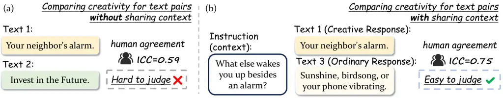
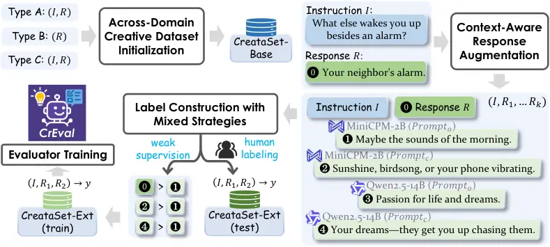
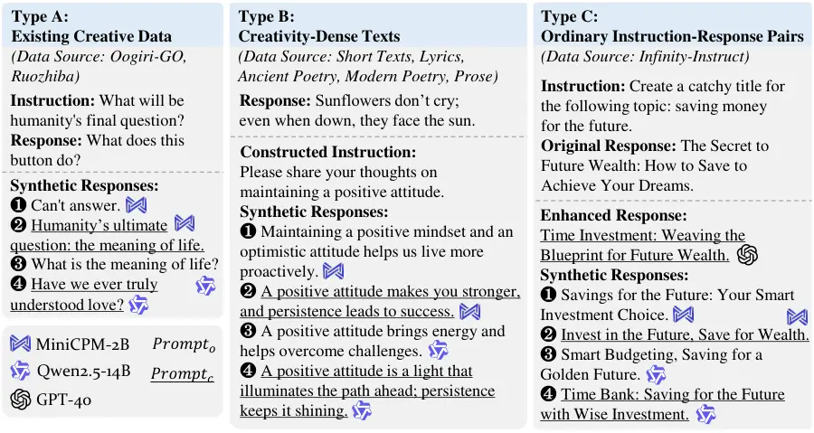
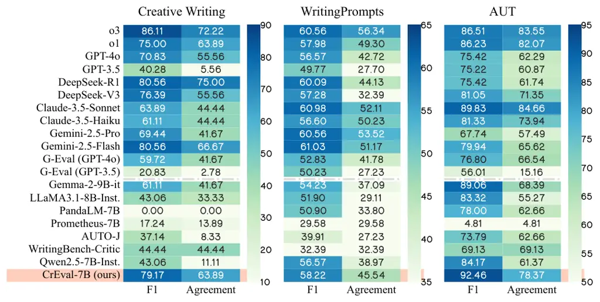
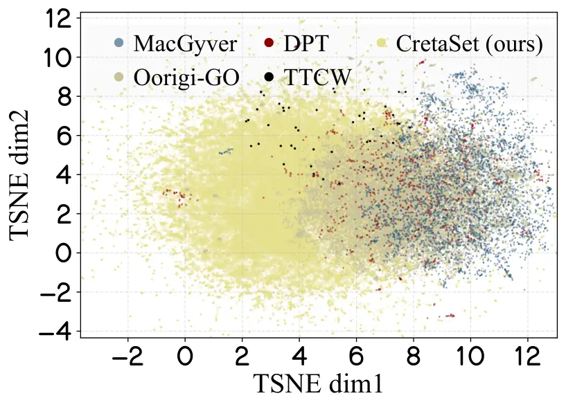
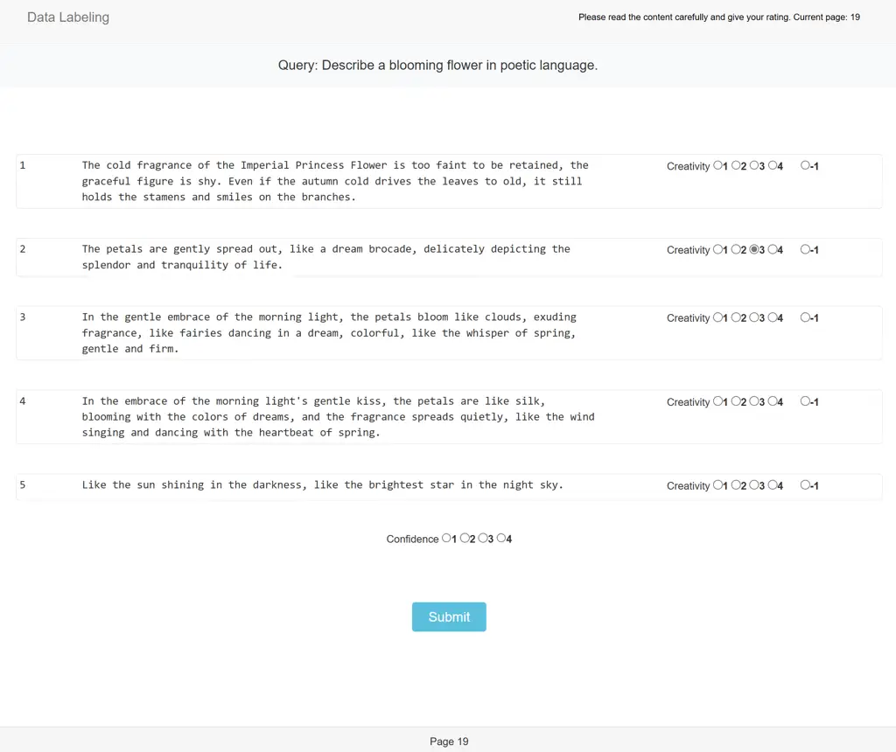

# ![[Uncaptioned image]](arxiv-2505-19236v2--c14d96cb1eb8.figures/figure-1.webp) Evaluating Text Creativity across Diverse Domains: A Dataset and Large Language Model Evaluator

Qian Cao    Xiting Wang    Yuzhuo Yuan    Yahui Liu    Fang Luo   
Ruihua Song Email: [yahui.cvrs@gmail.com, luof@bnu.edu.cn 
![[Uncaptioned
image]](arxiv-2505-19236v2--c14d96cb1eb8.figures/figure-2.webp)˜Project
Page:˜](mailto:yahui.cvrs@gmail.com,%20luof@bnu.edu.cn)[https://creval-creative-evaluation.github.io](https://creval-creative-evaluation.github.io)
Affiliation: Renmin University of China Affiliation: Beijing Normal
University Affiliation: Kuaishou Technology{caoqian4real, xitingwang,
rsong}@ruc.edu.cn, joyyuan@mail.bnu.edu.cn,

###### Abstract

Creativity evaluation remains a challenging frontier for large language
models (LLMs). Current evaluations heavily rely on inefficient and
costly human judgments, hindering progress in enhancing machine
creativity. While automated methods exist, ranging from psychological
testing to heuristic- or prompting-based approaches, they often lack
generalizability or alignment with human judgment. To address these
issues, we propose a novel pairwise-comparison framework for assessing
textual creativity that leverages shared contextual instructions to
improve evaluation consistency. We introduce CreataSet, a large-scale
dataset with 100K+ human-level and 1M+ synthetic creative
instruction-response pairs spanning diverse open-domain tasks. Through
training on CreataSet, we develop an LLM-based evaluator named CrEval.
CrEval demonstrates remarkable superiority over existing methods in
alignment with human judgments. Experimental results underscore the
indispensable significance of integrating both human and synthetic data
to train highly robust evaluators, and showcase the practical utility of
CrEval in boosting the creativity of LLMs.

|     |
| --- |
|     |

^(†)^(†)footnotetext: 🖂 Corresponding author.

## 1 Introduction

Creativity, defined as “ideas or artifacts that are new, surprising and
valuable” Boden (2003), has long been a defining trait of human
intelligence and fueled the progress of modern civilization Guilford
(1967). As current large language models (LLMs) exhibit increasingly
remarkable capabilities across diverse domains and downstream tasks,
they have also shown the ability to perform tasks requiring
creativity Summers-Stay et al. (2023); Zhao et al. (2025); Zhong et al.
(2024); Wu et al. (2025b). Evaluating the creativity of LLMs not only
sheds light on their applicability to critical creative domains such as
creative writing Chakrabarty et al. (2025); Marco et al. (2024),
literature Bena and Kalita (2019); Cao et al. (2022); He et al. (2023)
and other creative domains Naeini et al. (2023); Summers-Stay et al.
(2023); Tian et al. (2024), but also has the potential to reveal gaps
between LLM and human capabilities, offering valuable insights for
future improvements.

Although evaluating LLM creativity is increasingly important, current
methods face limitations that restrict their broader applicability.
First (cross-domain applicability), most current methods assess
creativity within a single domain or constrained task, like
problem-solving Naeini et al. (2023); Tian et al. (2024), humor Zhong et
al. (2024), or simile generation He et al. (2023), where creativity is
just one of several assessed aspects. Unlike open-domain tasks, they are
often entangled with other concepts, making it hard to isolate and
generalize creativity itself to other domains, such as literature.
Second (granularity), most methods evaluate creativity at the model or
subject level rather than at the level of individual responses Mednick
and Halpern (1968); Torrance (1966). While useful for comparing models,
they struggle to distinguish which of two responses to the same prompt
is more creative Chakrabarty et al. (2024); Zhao et al. (2025). We refer
to the latter as text-level creativity (or simply text creativity). It
is especially valuable as it highlights specific responses for
improvement, providing more actionable insights than coarse model- or
subject-level evaluations. Third, (effective automation) automating
cross-domain creativity evaluation reduces human effort and supports
iterative improvement. LLMs have shown effectiveness as automatic
evaluators, in areas such as helpfulness and coherence Hu et al.
(2024b); Kim et al. (2024); Li et al. (2024), known as LLM-as-a-judge Gu
et al. (2024); Li et al. (2025a); Zheng et al. (2023). However,
creativity evaluation remains underexplored. While early attempts prompt
LLMs to assess creativity Summers-Stay et al. (2023); Zhao et al.
(2025), leveraging the cross-domain strengths of advanced models like
GPT-4o Hurst et al. (2024), their judgments often suffer from
unreliability Chakrabarty et al. (2024), inconsistency Wang et al.
(2024a), and high cost Chen et al. (2023).

This paper aims to address these issues by proposing a novel evaluation
methodology for automated, cross-domain creativity assessment, including
a cross-domain benchmark dataset labeled by 30 human judges and an
effective LLM-based creativity evaluator. Developing this framework
presents two key challenges. The first is how to facilitate consistent
human labeling. We observe that without clear contextual guidance, human
annotators may struggle to reach consistent judgments, since creativity
may be understood differently in different contexts. For example, as
shown in Figure 1 (a), when three annotators independently rated 400
decontextualized text pairs, the agreement among them was only moderate
(with an Intraclass Correlation Coefficient, i.e., ICC, of 0.59). The
second challenge is how to train a reliable LLM evaluator given the
scarcity of creative data. Data scarcity limits the ability of
evaluators to generalize across diverse domains and their effectiveness.
To address this, it is thus crucial to collect large-scale training data
in a weakly supervised manner.



Figure 1: An example of how to formulate the problem of text creativity
evaluation to better evaluate.

Our work resolves these two challenges by introducing a framework that
generates multiple creative responses conditioned on the same context.
On the one hand, this setup ensures high-quality human annotations of
text creativity pairs. As shown in Figure 1 (b), when a shared
instruction was provided as a context, the agreement improved
significantly (ICC increases to a good level of 0.75). On the other
hand, by controlling the response generation process for the same
context, we automatically generate large-scale pseudo labels for their
creativity levels in a weakly supervised manner, which solves the data
scarcity issue. Specifically, our contributions are as follows:

$`\bullet`$ We propose a context-aware, pairwise comparison-based
evaluation protocol for assessing text creativity. Using this protocol,
we manually annotate a test set of over 3,000 samples to benchmark text
creativity evaluators. Notably, even state-of-the-art LLMs perform
poorly on it compared to humans, underscoring a key performance
bottleneck in current evaluators. To support training, we further
construct CreataSet, a large-scale dataset incorporating creative tasks
in 87 domains, including over 1M instruction-response pairs with varying
weakly supervised creativity levels.

$`\bullet`$ Building on CreataSet, we introduce CrEval, an LLM-based
creativity evaluator. To the best of our knowledge, our work is among
the first to evaluate creativity across multiple domains using pairwise
assessments. CrEval outperforms strong frontier models, e.g., GPT-4o by
18.7% in agreement with human judges, and demonstrates strong domain
generalization capabilities. We further show that CrEval can enhance LLM
creativity, offering a practical approach to improve generative AI.

## 2 Related Work

##### Creativity Evaluation

Evaluating creativity has been a long-standing challenge Kim (2006);
Acar and Runco (2019). Many proposed methods Gray et al. (2019); Zhao et
al. (2025); Beketayev and Runco (2016); Sun et al. (2025) adopt
frameworks targeting particular tasks, such as the Remote Associates
Test (RAT) Mednick and Halpern (1968) or the Torrance Test of Creative
Thinking (TTCT) Torrance (1966), which measures human divergent thinking
through scoring ideas on fluency, originality, flexibility, and
elaboration (e.g., listing diverse uses for a paperclip). Subsequent
adaptations have applied TTCT principles to creative writing
(TTCW) Chakrabarty et al. (2024); Li et al. (2025c) or to evaluate LLMs
on such tasks Zhao et al. (2025), while other work uses problem-solving
as a creativity proxy Naeini et al. (2023); Tian et al. (2024). However,
these approaches are often narrow in scope, focusing on a limited set of
tasks and primarily assessing a model’s creative ability rather than the
creativity of the generated text itself.

Existing methods for evaluating textual creativity face significant
limitations. Heuristic scoring He et al. (2023), matching for unique
n-grams on a reference corpus (Creativity Index) Lu et al. (2025b), and
calculating divergent semantic integration using BERT Devlin et al.
(2019) (DSI) Johnson et al. (2023) are often constrained by their
specific designs, reliance on static corpora, and limited
generalizability. While prompting general-purpose LLMs (e.g., GPT-4) has
become common Summers-Stay et al. (2023); Zhao et al. (2025);
Chakrabarty et al. (2024); Chakrabarty et al. (2025), results are often
unsatisfactory Olson et al. (2024); Chakrabarty et al. (2024);
Chakrabarty et al. (2025); Lu et al. (2025a). Another work,
LitBench Fein et al. (2025), has trained reward models on specialized
preference data Fein et al. (2025), but their applicability remains
confined to creative writing, lacking broader generalization to other
domains. Consequently, reliable evaluation of textual creativity still
depends heavily on costly and inefficient human judgment, such as the
Consensual Assessment Technique (CAT) Baer and McKool (2009); Marco et
al. (2024), which cannot provide automated feedback for improving
models. To overcome these challenges, we propose a novel approach that
leverages the LLM-as-a-judge paradigm for more efficient and accurate
creativity assessment.

##### LLM-as-a-Judge

In the area of automatic evaluation for text generation, recent advent
of large language models (LLMs) has enabled the evaluation paradigms to
incorporate LLMs to be more accurate and flexible Gao et al. (2025),
known as LLM-as-a-judge Zheng et al. (2023); Gu et al. (2024); Li et al.
(2025a), capable of assessing more diverse dimensions of text quality.
Prior works focus more on the evaluation of text attributes like
relevance Liu et al. (2023); Abbasiantaeb et al. (2024); Liu et al.
(2024), helpfulness Kim et al. (2024); Li et al. (2024), or overall
excellence Dongfu et al. (2024); Hu et al. (2024b), etc. Other works
also explore how to adapt LLMs to evaluate specific domains such as code
generation Tong and Zhang (2024); Wu et al. (2025a) and dialogue
generation Lin and Chen (2023); Zhang et al. (2024). However, few of
these works investigate how to evaluate text creativity, making it hard
to assess and improve the creative aspects of text generation. In our
work, we propose to assess it in a pairwise-comparison manner, and
provide a comprehensive study on leveraging LLMs to evaluate text
creativity.



Figure 2: The construction process of CreataSet and training process of
CrEval.

## 3 Methodology

In this section, we employ a three-step process to construct our
large-scale weakly supervised dataset CreataSet to support our
evaluation protocol and train CrEval. First, in Across-Domain Creativity
Dataset Initialization, we gather initial data in 87 diverse domains
with varying lengths, generating corresponding instructions to create
initial instruction-response pairs $`(I,R)`$. Second, Context-Aware
Response Augmentation expands these pairs by generating responses of
varying creative levels for the same instruction $`I`$. Finally, in
Label Construction with Mixed Strategy, we pair the responses and assign
a label $`y`$, yielding training samples of the form
$`(I,R_{1},R_{2},y)`$ for the creativity evaluator CrEval. For
meta-evaluation, we manually annotate a test set to benchmark CrEval
against other evaluators. The overall data construction pipeline is
illustrated in Figure 2.



Figure 3: The examples of three different types of data. The original
data are above the dashed line, while our constructed components are
below.

### 3.1 Across-Domain Creativity Dataset Initialization

To build a creativity dataset across diverse domains, we gather initial
data with varying creativity levels from eight sources. We unified them
into a consistent $`(I,R)`$ format.

Multi-Domain Multi-Source Data Collection We aim to collect data from
diverse sources and domains to construct a broad distribution in both
domain coverage and response length, thereby enabling the model to
generalize across a wide range of scenarios. Specifically, we begin by
collecting data from existing creativity datasets, such as
Oogiri-GO Zhong et al. (2024) and Ruozhiba Bai et al. (2025), which
naturally contain creative $`(I,R)`$ pairs in the humor domain (Type A
in Figure 3). We further incorporate creativity-dense texts $`(R)`$ from
corpora of human creative works, such as poetry, lyrics, and prose,
sourced from well-known websites¹¹ 1
[https://github.com/chinese-poetry/chinese-poetry](https://github.com/chinese-poetry/chinese-poetry),
[https://github.com/VMIJUNV/chinese-poetry-and-prose](https://github.com/VMIJUNV/chinese-poetry-and-prose),
[https://github.com/yuxqiu/modern-poetry](https://github.com/yuxqiu/modern-poetry),
[https://music.163.com](https://music.163.com),
[https://m.sbkk8.com](https://m.sbkk8.com). To enhance length diversity,
we curate a sub-dataset called Short Texts, comprising inspiring and
thought-provoking sentences collected from online sources²² 2
[https://www.juzikong.com/](https://www.juzikong.com/). Most of these
entries consist of standalone texts $`(R)`$ without explicit input
prompts (Type B in Figure 3). In addition, aiming to capture data with
diverse creativity levels and expand domain coverage, we leverage an
existing instruction-tuning dataset Infinity-Instruct Li et al. (2025b),
given its high-quality $`(I,R)`$ pairs spanning a wide range of domains
(Type C in Figure 3).

Unified Instruction-Response Standardization To standardize the
multi-source data into a unified $`(I,R)`$ format, we first enrich
standalone texts by generating missing instructions. We train an
instruction generator by reversing an instruction-tuning dataset
(Infinity-Instruct). The generator learns to produce an instruction
$`I`$ given a response $`R`$. We generate an instruction for each
standalone text, thus forming $`(I,R)`$ pairs. To prevent non-creative
data from obscuring creative data, we followed previous work Ritchie
(2007) and applied some filters. All data are ultimately formatted as
$`(I,R)`$ pairs (as shown in Figure 3, forming CreataSet-Base, with over
113k creative samples. Due to the deeply contextual nature of
creativity, which is highly subject to cultural and linguistic context,
the dataset is predominantly in Simplified Chinese. However, our
framework is language-agnostic and can be easily extended to other
languages.

|                                  |                      |                       |                |             |            |              |
| -------------------------------- | -------------------- | --------------------- | -------------- | ----------- | ---------- | ------------ |
| Dataset                          | Cross-domain         | Granularity           | Auto-Evaluator | Total Words | \# Samples | Train/Test   |
| Oorigi-GO Zhong et al. (2024)    | ✗ (humor)            | Subject Level         | ✗              | 894,712     | 15,797     | train & test |
| MacGyver Tian et al. (2024)      | ✗ (problem-solving)  | Subject Level         | ✗              | 249,385     | 1,683      | test         |
| DPT Jr. et al. (2025)            | ✗ (problem-solving)  | Subject Level         | ✗              | 12,576      | 803        | test         |
| TTCW Chakrabarty et al. (2024)   | ✗ (creative writing) | Subject Level         | ✗              | 58,426      | 48         | test         |
| Creative Writing v3 Paech (2023) | ✗ (creative writing) | Subject Level         | ✗              | 10,176      | 32         | test         |
| TTCT+ Zhao et al. (2025)         | ✓ (7 domains)        | Subject Level         | ✗              | \-          | 700        | test         |
| LitBench Fein et al. (2025)      | ✗ (creative writing) | Individual Text Level | ✓              | 16,309,661  | 43,827     | train & test |
| WritingBench Wu et al. (2025b)   | ✓ (100 domains)      | Individual Text Level | ✓              | 1,875,146   | 1,000      | test         |
| CreataSet-Base (ours)            | ✓ (87 domains)       | Individual Text Level | ✓              | 20,720,179  | 112,965    | train & test |

Table 1: The statistics of different creative datasets. Auto-Evaluator
denotes whether an automatic evaluator is proposed based on this
dataset. TTCT+ and training data for the evaluator in WritingBench are
not publicly available. We calculate the total word count of the
responses of each dataset.

Figure 4: Domain distribution of CreataSet-Base. Secondary domains for
the top 5 primary ones are shown in gray.

Table 1 compares CreataSet-Base with other creativity-related datasets,
highlighting its larger scale. To assess domain diversity (i.e.,
thematic category), we followed prior works Tian et al. (2024); Wang et
al. (2023); Jin et al. (2024) and started from a manually curated seed
taxonomy. We then adopted GPT-4o-mini to classify each data sample into
a fine-grained category, yielding 87 distinct subdomains. They were then
aggregated by the model into broader, semantically coherent ones,
resulting in 17 core domains. The distribution of these domains is shown
in Figure 4. Additional details on response length and semantic
distributions are provided in Appendix A.3.

### 3.2 Context-Aware Response Augmentation

Before constructing pairwise data $`(I,R_{1},R_{2})`$ for training the
evaluator, we first augment the set of responses for each instruction,
i.e., $`(I,R_{1},\dots,R_{k})`$. This aims to enrich the creative
diversity, enabling the construction of pairs with creative differences.
To efficiently construct such data at scale, we employ open-sourced
models with different levels of capability, e.g.,
Qwen2.5-14B-Instruct Yang et al. (2024) and MiniCPM-2B-SFT Hu et al.
(2024a), to generate responses for instructions in CreataSet-Base, as
illustrated in Figure 2. For each model, we use two prompting modes to
induce varying creativity levels: (1) $`\texttt{Prompt}_{\textit{o}}`$,
a general prompt that elicits ordinary responses; and (2)
$`\texttt{Prompt}_{\textit{c}}`$, a creativity-oriented prompt that
encourages more imaginative outputs. By adopting different
models/prompts, we generate multiple synthetic responses. The original
responses in Type C data are direct answers to instructions with weak
creativity. To enrich those, we further prompt GPT-4o to generate more
creative ones to the same instructions. Finally, we name this dataset in
the form $`(I,R_{1},\dots,R_{k})`$ as CreataSet-Ext. The diversity
analysis of augmented responses and the prompts used are in
Appendix A.3.5 and Appendix A.6, respectively.

### 3.3 Label Construction with Mixed Strategies

We combine responses into pairs $`(I,R_{1},R_{2})`$ and use a mixed
strategy to assign labels for training and testing separately, since the
label requirements differ between them. Reliable human-annotated labels
are essential for meta-evaluation to accurately assess model
performance, while constructing labels in a large scale is more
important for training. We detail them in the following.

High-Quality Human Labeling for Test Benchmark Construction To ensure
diversity in the test set, we sample 50 instances from each data source
in CreataSet, yielding 400 initial samples. These are further augmented
using GPT-4o-mini with both prompts to enhance the distribution
difference for evaluation. Following prior work Weinstein et al. (2022);
Johnson et al. (2023), we recruited 30 qualified annotators from 18
different majors to rate response creativity on a 4-point Likert scale,
with responses presented in randomized order (more details are in
Appendix A.8). Each response’s creativity score is computed as the
average of all ratings. The annotations exhibit high inter-rater
reliability (Intraclass Correlation Coefficient, ICC(2k)=0.92). Finally,
we construct a 3K test set in the format $`(I,R_{1},R_{2},y)`$, where
pairs with score differences $`>`$ 0.3 are labeled as distinguishable,
and those with differences $`<`$ 0.1 as comparable (tie).

Weakly-Supervised Pseudo Labels for Training Set Construction  For the
training set, we assign weakly supervised pseudo-labels to response
pairs in CreataSet-Base, enabling large-scale label construction. Our
approach is based on two key assumptions: (1) stronger models tend to
produce more creative responses than weaker ones, and (2)
creativity-focused prompts elicit more creative outputs than ordinary
prompts.

To validate these assumptions, we sampled 150 data groups
($`(I,R_{1},\dots,R_{k})`$) with 1,050 response pairs for each
model/prompt combination and recruited 3 annotators to compare their
creativity. The results show that creativity distinctions based on
assumption (1) achieve 86.6% accuracy, and assumption (2) achieves
81.4%, confirming the reliability of both heuristics. For creatively
comparable samples (the tie cases), we randomly pair responses produced
by the same models using $`\texttt{Prompt}_{\textit{o}}`$. Using these
assumptions, we assign labels $`y`$ to response pairs in CreataSet-Ext,
resulting in training data of the form $`(I,R_{1},R_{2},y)`$.

### 3.4 CrEval Training

The constructed large-scale CreataSet-Ext can enable us to train CrEval.
It provides triplets $`(I,R_{1},R_{2})\in\mathcal{D}`$ as input, and
trained to minimize the classification loss:

```math
\mathcal{L}=-\sum_{(I,R_{1},R_{2})\in\mathcal{D}}\log P(y|I,R_{1},R_{2}), \tag{1}
```

where $`P(y|I,R_{1},R_{2})`$ represents the probability of the label
$`y`$ given the triplet $`(I,R_{1},R_{2})`$³³ 3 Since we use LLM
backbones, the classification label is treated as a text output
conditioned on the prompt.. To mitigate the positional bias, we follow
previous works Wang et al. (2024a); Wang et al. (2024b); Li et al.
(2024) by augmenting the data by swapping $`R_{1}`$ and $`R_{2}`$ in the
input and adjusting the corresponding label. Additionally, we apply
negative sampling by randomly selecting a response to serve as the least
creative response, further enhancing the model’s awareness of the
instruction context $`I`$.

During inference, the model predicts whether $`R_{1}`$ is more creative
than $`R_{2}`$, vice versa, or if they are creatively comparable.
Moreover, a reference response $`R^{r}`$, generated by either a human or
a model, can be a baseline for comparing the creativity of another
response $`R`$ in such a comparison manner.

## 4 Experiments

### 4.1 Experimental Setup

In our experiments, we set $`k=5`$ in response augmentation. This is
shared across all data sources. Based on our human-labeled test set of
CreataSet, we adopt F1 score, Kappa score, and Agreement rate to
evaluate the performance of different methods, following previous
work Wang et al. (2024b); Li et al. (2024). All metrics are calculated
twice by swapping the order of the two responses, and then the average
scores are reported. Following Hu et al. (2024b), to eliminate the
influence of sampling randomness, we set the temperature T to 0 for
deterministic results, while other methods retain their original
settings. We conduct pairwise comparison experiments on CreataSet  where
CrEval is compared with the following baselines:

Traditional Metrics: (1) Perplexity (PPL): A simple baseline where we
use Qwen2.5-7B-Instruct to calculate the perplexity of a response.
Higher perplexity indicates higher novelty and creativity. (2) Divergent
semantic integration (DSI) Johnson et al. (2023): It adopts BERT Devlin
et al. (2019) to calculate the average semantic distance between all
words in the response. A higher DSI indicates higher creativity. (3)
Creativity Index Lu et al. (2025b): A corpus-based metric calculates
creativity inversely to n-gram similarity with a reference corpus.

Evaluation-Centric Models: Several evaluation-centric models including
prompting-based G-Eval Liu et al. (2023) and fine-tuned LLMs
PandaLM Wang et al. (2024b), Prometheus Kim et al. (2024), AUTO-J Li et
al. (2024) and WritingBench-Critic Wu et al. (2025b).

General-purpose LLMs as Evaluators: We compare CrEval against several
general-purpose LLMs, including LLaMA3.1-{8,70}B-Instruct Dubey et al.
(2024), Gemma-{2-9B,3-12B,3-27B}-it Rivière et al. (2024); Kamath et al.
(2025), Qwen2.5-{7,14,72}B-Instruct Yang et al. (2024),
GPT-3.5-Turbo-1106 OpenAI (2022), GPT-4o Hurst et al. (2024), OpenAI
o1/o3 Jaech et al. (2024); OpenAI (2025), DeepSeek-{V3,R1} DeepSeek-AI
et al. (2024); DeepSeek-AI et al. (2025), Claude-3.5-{Haiku,
Sonnet} Anthropic (2024a); Anthropic (2024b), and Gemini-2.5-{Flash,
Pro} Comanici et al. (2025). We evaluate all models using the same
prompt as for CrEval.

|                              |       |        |        |        |        |        |        |       |         |        |        |
| ---------------------------- | ----- | ------ | ------ | ------ | ------ | ------ | ------ | ----- | ------- | ------ | ------ |
|                              |       |        |        |        |        |        |        |       | Average |        |        |
| Method                       | S.T.  | Lyr.   | A.P.   | M.P.   | Pro.   | Oog.   | Ruo.   | Inf.  | F1      | Kappa  | Agree. |
| Traditional Metrics          |       |        |        |        |        |        |        |       |         |        |        |
| PPL                          | 0.464 | 0.245  | 0.245  | 0.316  | 0.349  | 0.515  | 0.329  | 0.374 | 0.357   | -0.042 | 0.430  |
| DSI                          | 0.440 | 0.430  | 0.354  | 0.527  | 0.377  | 0.578  | 0.561  | 0.528 | 0.480   | 0.175  | 0.457  |
| Creativity Index             | 0.695 | 0.368  | 0.338  | 0.417  | 0.592  | 0.585  | 0.566  | 0.640 | 0.531   | 0.231  | 0.568  |
| Frontier LLMs                |       |        |        |        |        |        |        |       |         |        |        |
| o3                           | 0.802 | 0.589  | 0.596  | 0.667  | 0.663  | 0.774  | 0.832  | 0.769 | 0.721   | 0.578  | 0.725  |
| o1                           | 0.807 | 0.573  | 0.629  | 0.670  | 0.672  | 0.738  | 0.790  | 0.798 | 0.720   | 0.563  | 0.664  |
| GPT-4o                       | 0.800 | 0.605  | 0.641  | 0.699  | 0.667  | 0.749  | 0.633  | 0.789 | 0.703   | 0.519  | 0.642  |
| GPT-3.5                      | 0.686 | 0.486  | 0.425  | 0.548  | 0.489  | 0.667  | 0.567  | 0.743 | 0.585   | 0.350  | 0.522  |
| DeepSeek-R1                  | 0.743 | 0.479  | 0.494  | 0.578  | 0.612  | 0.751  | 0.745  | 0.733 | 0.653   | 0.457  | 0.547  |
| DeepSeek-V3                  | 0.780 | 0.584  | 0.584  | 0.681  | 0.684  | 0.765  | 0.774  | 0.784 | 0.714   | 0.558  | 0.668  |
| Claude-3.5-Sonnet            | 0.775 | 0.603  | 0.634  | 0.671  | 0.702  | 0.762  | 0.850  | 0.810 | 0.727   | 0.609  | 0.740  |
| Claude-3.5-Haiku             | 0.748 | 0.573  | 0.509  | 0.633  | 0.652  | 0.724  | 0.695  | 0.779 | 0.669   | 0.496  | 0.641  |
| Gemini-2.5-Pro               | 0.764 | 0.569  | 0.585  | 0.639  | 0.656  | 0.760  | 0.866  | 0.752 | 0.708   | 0.557  | 0.702  |
| Gemini-2.5-Flash             | 0.785 | 0.588  | 0.642  | 0.670  | 0.692  | 0.761  | 0.858  | 0.797 | 0.731   | 0.582  | 0.682  |
| G-Eval (GPT-4o)              | 0.772 | 0.583  | 0.568  | 0.665  | 0.694  | 0.759  | 0.803  | 0.793 | 0.712   | 0.558  | 0.677  |
| G-Eval (GPT-3.5)             | 0.636 | 0.494  | 0.460  | 0.561  | 0.493  | 0.608  | 0.575  | 0.774 | 0.582   | 0.339  | 0.500  |
| 7B Scale LLMs                |       |        |        |        |        |        |        |       |         |        |        |
| Gemma-2-9B-it                | 0.795 | 0.562  | 0.619  | 0.654  | 0.646  | 0.751  | 0.779  | 0.788 | 0.704   | 0.544  | 0.654  |
| LLaMA3.1-8B-Instruct         | 0.713 | 0.548  | 0.440  | 0.618  | 0.615  | 0.649  | 0.573  | 0.782 | 0.621   | 0.418  | 0.565  |
| PandaLM-7B                   | 0.390 | 0.435  | 0.454  | 0.469  | 0.346  | 0.398  | 0.540  | 0.506 | 0.453   | 0.129  | 0.326  |
| Prometheus-7B                | 0.330 | 0.365  | 0.326  | 0.315  | 0.342  | 0.369  | 0.449  | 0.498 | 0.377   | 0.097  | 0.352  |
| AUTO-J                       | 0.659 | 0.526  | 0.377  | 0.561  | 0.541  | 0.553  | 0.565  | 0.720 | 0.567   | 0.323  | 0.512  |
| WritingBench-Critic          | 0.715 | 0.528  | 0.500  | 0.626  | 0.548  | 0.600  | 0.641  | 0.712 | 0.612   | 0.362  | 0.576  |
| Qwen2.5-7B-Instruct          | 0.710 | 0.494  | 0.426  | 0.578  | 0.487  | 0.647  | 0.704  | 0.771 | 0.614   | 0.403  | 0.574  |
| CrEval-7B (ours)             | 0.779 | 0.556  | 0.649  | 0.681  | 0.665  | 0.778  | 0.873  | 0.820 | 0.732   | 0.601  | 0.745  |
| $`\Delta`$ (v.s. base model) | +9.7% | +12.6% | +52.3% | +17.8% | +36.6% | +20.2% | +24.0% | +6.4% | +19.2%  | +49.1% | +29.8% |
| 13B Scale and Larger LLMs    |       |        |        |        |        |        |        |       |         |        |        |
| Qwen2.5-72B-Instruct         | 0.751 | 0.558  | 0.520  | 0.655  | 0.594  | 0.734  | 0.833  | 0.806 | 0.692   | 0.535  | 0.673  |
| LLaMA3.1-70B-Instruct        | 0.736 | 0.564  | 0.559  | 0.642  | 0.624  | 0.732  | 0.764  | 0.810 | 0.684   | 0.535  | 0.675  |
| Gemma-3-27B-it               | 0.792 | 0.572  | 0.608  | 0.650  | 0.666  | 0.753  | 0.789  | 0.783 | 0.706   | 0.564  | 0.702  |
| Gemma-3-12B-it               | 0.761 | 0.542  | 0.575  | 0.615  | 0.674  | 0.729  | 0.667  | 0.772 | 0.672   | 0.498  | 0.633  |
| Prometheus-13B               | 0.445 | 0.377  | 0.329  | 0.372  | 0.410  | 0.386  | 0.367  | 0.641 | 0.416   | 0.095  | 0.400  |
| Qwen2.5-14B-Instruct         | 0.742 | 0.568  | 0.523  | 0.649  | 0.629  | 0.717  | 0.783  | 0.797 | 0.683   | 0.523  | 0.661  |
| CrEval-14B (ours)            | 0.786 | 0.556  | 0.650  | 0.680  | 0.672  | 0.797  | 0.882  | 0.810 | 0.735   | 0.613  | 0.762  |
| $`\Delta`$ (v.s. base model) | +5.9% | -2.1%  | +24.3% | +4.8%  | +6.8%  | +11.2% | +12.6% | +1.6% | +7.6%   | +17.2% | +15.3% |

Table 2: Results of different methods on our CreataSet test set. Best
results in the same group are highlighted in bold, and the second-best
are underlined. S.T., Lyr., A.P., M.P., Pro., Oog., Ruo., and Inf.
represent Short Texts, Lyrics, Ancient Poetry, Modern Poetry, Prose,
Oogiri-Go, Ruozhiba, and Infinity-Instruct, respectively. We gray out
the results of frontier LLMs due to their larger sizes.

### 4.2 How Well Can CrEval Simulate Human Evaluation?

As shown in Table 2, CrEval demonstrates consistent and significant
improvements over all baselines across the evaluated metrics. Notably,
the 14B variant even surpasses most frontier baselines, improving F1 by
2.9%, Kappa by 9.7%, and agreement rate by 12.6% compared to strong
competitors like DeepSeek-V3. These results validate the effectiveness
of our approach for simulating human creativity assessment. Second,
traditional metrics such as PPL and DSI perform poorly; e.g., PPL yields
a Kappa score near zero, indicating their weak correlation with human
judgment. The Creativity Index metric improves on them but remains
limited by its reliance on n-gram matching and fails to capture the
semantic creativity conveyed through conventional lexical choices.
Third, while Gemma models achieve the highest F1 scores of the according
groups on Short Texts and Lyrics, they struggle to generalize across
other creative domains like humor (e.g., Oogiri-Go and Ruozhiba) and
ancient genres. Claude-3.5-Sonnet excels in evaluating Prose, indicating
a stronger capacity for assessing creativity in longer texts. In
contrast, CrEval exhibits more balanced and robust performance across
all creative domains.

LLMs may favor certain positions of the response, known as positional
bias Wang et al. (2024a), which may lead to inconsistent evaluation
results when swapping the order of responses. We have conducted a
consistency analysis to evaluate the stability of different methods,
inlcuding comparing with an ablation version CrEval (w/o Swap) where
CrEval was trained without explicitly balancing the positions. As shown
in 5, CrEval achieves the highest consistency rate of 94.4, indicating
that it is more consistent and reliable in evaluating creativity
compared to other methods. Also, omitting position swapping during
training introduces a position bias and leads to decreased performance.

Figure 5: Consistency rate of different methods when swapping the order
of responses. We inlcude an ablation version CrEval-7B (w/o Swap)
without explicitly swapping response positions.

### 4.3 How Do Data Influence CrEval?

Data Composition. In training CrEval, we use $`(I,R_{1},R_{2},y)`$ of
different pseudo-creativity levels. To investigate their influence, we
conduct an ablation study by training multiple CrEval variants with
different data compositions as follows: (1) CrEval-w/o Neg.: Training
CrEval without sampling negative responses. (2) CrEval-w/o Syn.:
Training CrEval with only the original responses (highest creativity) in
CreataSet  without synthetic ones. (3) CrEval-w/ Only Syn.: Training
CrEval with only synthetic responses (lower creativity) in CreataSet 
without original ones. Table 7 presents the ablation study results. The
results indicate that each type of data makes a positive contribution.
The original human-created responses contribute the most, as they
provide diverse, high-quality information that better aligns CrEval with
human preferences. Synthetic data plays a crucial role in helping the
model grasp the characteristics of creative responses, particularly
those that LLMs can generate. Meanwhile, negative responses offer
additional information to improve the model’s ability to measure the
relevance between responses and instructions.

|              |       |       |           |
| ------------ | ----- | ----- | --------- |
| Method       | F1    | Kappa | Agreement |
| CrEval-7B    | 0.732 | 0.601 | 0.745     |
| w/o Neg.     | 0.723 | 0.586 | 0.745     |
| w/o Syn.     | 0.665 | 0.464 | 0.634     |
| w/ Only Syn. | 0.585 | 0.356 | 0.589     |

Figure 6: Evaluation results of ablation study on different data
components.

Figure 7: Performance variation with data scales.

Data Scale. To assess the impact of data volume, we train CrEval on
datasets of varying scales, shown in Figure 7. F1, Kappa, and agreement
rates improve with data size but plateau after 100K samples. This
suggests that while more data benefits CrEval, the gains diminish at
higher scales.



Figure 8: Agreement and F1 scores on three O.O.D. datasets.

### 4.4 Does CrEval Demonstrate Out-of-Distribution Generalization?

Due to the scarcity of human-annotated creative pairs, finding suitable
out-of-distribution (O.O.D.) datasets for meta-evaluation remains
challenging. To address this, we conduct three O.O.D. experiments on two
creative writing datasets and one classical creativity benchmark, the
Alternative Uses Task (AUT). For creative writing, we adopt data
from Chakrabarty et al. (2024), which contains long responses produced
by both humans and models. Following their findings, we treat human
responses as more creative and construct 36 evaluation pairs. Besides,
we curate 213 pairs from another WritingPrompts dataset, selecting
samples with a like-count difference greater than 10 as a proxy for
creativity. For the AUT task, we use the dataset from Sun et al. (2023),
focusing on the annotated alternative uses for “bowl”. We form pairs
from responses whose human-assigned creativity scores differ by more
than two points, resulting in 541 test pairs.

As shown in Figure 8, CrEval achieves the best performance among models
of similar scale ($`\sim`$7B) and even outperforms much larger frontier
models like GPT-4o and DeepSeek-V3. This strong generalization ability
can be attributed to its robust training on diverse and creative text
sources, enabling it better to capture subtle qualitative differences in
open-ended generation tasks. The consistent advantage across both
datasets underscores its effectiveness in text creativity evaluation.

Figure 9: Win rate of different methods over GPT-4o-mini responses.
DPO-Negative denotes DPO with negative sampled responses as reject
samples. DPO-100E and DPO-70E30H use all easy and 70% easy+30% hard
responses as reject samples, respectively.

### 4.5 Can CrEval Enhance Model Creativity?

As a creativity evaluator, CrEval can differentiate response creativity,
allowing us to leverage it for enhancing model creativity. We randomly
sample 10K data from CreataSet to train Qwen2.5-7B-Instruct, using the
original response as the ground truth, serving as the standard (the SFT
baseline). By utilizing synthetic candidate responses (randomly
sampled), we apply DPO Rafailov et al. (2023) to take low-creativity
responses as reject samples (the DPO baseline). We also randomly sample
negative responses from other instructions as reject samples, denoted as
DPO-Negative.

Given an instruction and multiple candidate responses, CrEval performs
pairwise creativity comparisons, scoring wins as 3 points, ties as 1,
and losses as 0. This scoring yields a creativity ranking, with the
top-ranked responses as hard and the lowest as easy samples. We control
creativity difficulty by adjusting the hard/easy ratio in DPO
rejections, evaluating methods on the CreataSet test set, with win rates
against GPT-4o-mini measured by CrEval, GPT-4o, and human annotators.

Results in Figure 9 demonstrate that DPO yields significant gains over
SFT in all evaluation settings (CrEval, GPT-4o, human). The inferior
performance of DPO-Negative relative to DPO demonstrates that contextual
conditioning is crucial for accurate creativity assessment. Leveraging
CrEval for creativity-aware data selection leads to further
improvements, with DPO-70E30H achieving the highest win rate. DPO-100E,
which treats all easy samples as rejections, shows marginal improvement,
indicating that a clearer distinction between chosen and rejected
examples is crucial for learning creativity. DPO-70E30H achieves the
highest win rate by using 30% hard samples as rejections, underscoring
the benefit of a balanced mixture of creativity difficulty levels.

## 5 Conclusion

In this paper, we propose a novel pairwise-comparison framework for
evaluating textual creativity and present CreataSet, a large-scale
dataset across diverse domains. Based on it, we develop CrEval, an
LLM-based evaluator that significantly outperforms existing methods in
alignment with human judgments. Our experiments highlight the essential
role of combining both human and synthetic data in training robust
creativity evaluators, and demonstrate that CrEval exhibits
out-of-distribution generalization. We further find the practical value
of integrating CrEval into generation pipelines to boost LLM creativity.
We believe that CreataSet and CrEval will be valuable assets for the
research community, driving progress toward more accurate and scalable
creativity evaluation.

## Ethics Statement

This work adheres to the ICLR Code of Ethics. The study involved human
participants who were recruited as data annotators, and the annotation
tasks were designed to be of minimal risk. The study did not involve any
animal experimentation. All datasets used were sourced in compliance
with relevant usage guidelines, with appropriate measures taken to
protect privacy and prevent any unauthorized use of data. We have
strived to mitigate potential biases and avoid discriminatory outcomes
throughout the research process. No personally identifiable information
was utilized, and no experiments were conducted that would raise
ethical, privacy, or security concerns. We are committed to upholding
principles of transparency and integrity in all aspects of this
research.

## Reproducibility Statement

We have taken comprehensive steps to ensure the reproducibility of the
results presented in this paper. We have made our code, datasets and
models publicly available. The experimental setup, including training
procedures and model configurations, is described in detail. We believe
these steps will enable the community to validate and build upon our
work effectively.

## References

- Abbasiantaeb et al. (2024) Z. Abbasiantaeb, C. Meng, L. Azzopardi,
  and M. Aliannejadi Can we use large language models to fill relevance
  judgment holes?. arXiv preprint:2405.05600. Cited by: §2.
- Acar and Runco (2019) S. Acar and M. A. Runco Divergent thinking: new
  methods, recent research, and extended theory.. Psychology of
  Aesthetics, Creativity, and the Arts 13 (2), pp. 153. Cited by: §2.
- Anthropic (2024a) AnthropicClaude 3.5 haiku(Website) External Links:
  [Link](https://www.anthropic.com/claude/haiku) Cited by: §4.1.
- Anthropic (2024b) AnthropicClaude 3.5 sonnet(Website) External Links:
  [Link](https://www.anthropic.com/news/claude-3-5-sonnet) Cited by:
  §4.1.
- Baer and McKool (2009) J. Baer and S. S. McKool Assessing creativity
  using the consensual assessment technique. In Handbook of research on
  assessment technologies, methods, and applications in higher
  education, pp. 65–77. Cited by: §2.
- Bai et al. (2025) Y. Bai, X. Du, Y. Liang, L. Jin, J. Zhou, Z. Liu, F.
  Fang, M. Chang, T. Zheng, X. Zhang, et al. Coig-cqia: quality is all
  you need for chinese instruction fine-tuning. In Findings of the
  Association for Computational Linguistics: NAACL 2025, pp. 8190–8205.
  Cited by: §A.3.1, §3.1.
- Barbot et al. (2019) B. Barbot, R. W. Hass, and R. Reiter-Palmon
  Creativity assessment in psychological research:(re) setting the
  standards.. Psychology of Aesthetics, Creativity, and the Arts 13 (2),
  pp. 233. Cited by: §A.1, §A.1.
- Beketayev and Runco (2016) K. Beketayev and M. A. Runco Scoring
  divergent thinking tests by computer with a semantics-based algorithm.
  Europe’s journal of psychology 12 (2), pp. 210. Cited by: §2.
- Bena and Kalita (2019) B. Bena and J. Kalita Introducing aspects of
  creativity in automatic poetry generation. In Proceedings of the 16th
  International Conference on Natural Language Processing, pp. 26–35.
  Cited by: §1.
- Boden (2003) M. A. Boden The creative mind - myths and mechanisms (2.
  ed.). Routledge. Cited by: §1.
- Cao et al. (2022) Q. Cao, X. Chen, R. Song, H. Jiang, G. Yang, and Z.
  Cao Multi-modal experience inspired AI creation. In MM ’22: The 30th
  ACM International Conference on Multimedia, Lisboa, Portugal, October
  10 - 14, 2022, J. Magalhães, A. D. Bimbo, S. Satoh, N. Sebe, X.
  Alameda-Pineda, Q. Jin, V. Oria, and L. Toni (Eds.), pp. 1445–1454.
  External Links: [Link](https://doi.org/10.1145/3503161.3548189),
  [Document](https://dx.doi.org/10.1145/3503161.3548189) Cited by: §1.
- Chakrabarty et al. (2024) T. Chakrabarty, P. Laban, D. Agarwal, S.
  Muresan, and C. Wu Art or artifice? large language models and the
  false promise of creativity. In Proceedings of the CHI Conference on
  Human Factors in Computing Systems, CHI 2024, Honolulu, HI, USA, May
  11-16, 2024, F. ’. Mueller, P. Kyburz, J. R. Williamson, C. Sas, M. L.
  Wilson, P. O. T. Dugas, and I. Shklovski (Eds.), pp. 30:1–30:34.
  External Links: [Link](https://doi.org/10.1145/3613904.3642731),
  [Document](https://dx.doi.org/10.1145/3613904.3642731) Cited by: §A.8,
  §1, §2, §2, Table 1, §4.4.
- Chakrabarty et al. (2025) T. Chakrabarty, P. Laban, and C. Wu AI-slop
  to ai-polish? aligning language models through edit-based writing
  rewards and test-time computation. arXiv preprint arXiv:2504.07532.
  Cited by: §1, §2.
- Chen et al. (2023) L. Chen, M. Zaharia, and J. Zou FrugalGPT: how to
  use large language models while reducing cost and improving
  performance. CoRR abs/2305.05176. External Links:
  [Link](https://doi.org/10.48550/arXiv.2305.05176),
  [Document](https://dx.doi.org/10.48550/ARXIV.2305.05176), 2305.05176
  Cited by: §1.
- Chen et al. (2021) M. Chen, J. Tworek, H. Jun, Q. Yuan, H. P. de
  Oliveira Pinto, J. Kaplan, H. Edwards, Y. Burda, N. Joseph, G.
  Brockman, A. Ray, R. Puri, G. Krueger, M. Petrov, H. Khlaaf, G.
  Sastry, P. Mishkin, B. Chan, S. Gray, N. Ryder, M. Pavlov, A.
  Power, L. Kaiser, M. Bavarian, C. Winter, P. Tillet, F. P. Such, D.
  Cummings, M. Plappert, F. Chantzis, E. Barnes, A. Herbert-Voss, W. H.
  Guss, A. Nichol, A. Paino, N. Tezak, J. Tang, I. Babuschkin, S.
  Balaji, S. Jain, W. Saunders, C. Hesse, A. N. Carr, J. Leike, J.
  Achiam, V. Misra, E. Morikawa, A. Radford, M. Knight, M. Brundage, M.
  Murati, K. Mayer, P. Welinder, B. McGrew, D. Amodei, S. McCandlish, I.
  Sutskever, and W. Zaremba Evaluating large language models trained on
  code. CoRR abs/2107.03374. External Links:
  [Link](https://arxiv.org/abs/2107.03374), 2107.03374 Cited by: §A.4.5.
- Comanici et al. (2025) G. Comanici, E. Bieber, M. Schaekermann, I.
  Pasupat, N. Sachdeva, I. S. Dhillon, M. Blistein, O. Ram, D. Zhang, E.
  Rosen, L. Marris, S. Petulla, C. Gaffney, A. Aharoni, N. Lintz, T. C.
  Pais, H. Jacobsson, I. Szpektor, N. Jiang, K. Haridasan, A. Omran, N.
  Saunshi, D. Bahri, G. Mishra, E. Chu, T. Boyd, B. Hekman, A.
  Parisi, C. Zhang, K. Kawintiranon, T. Bedrax-Weiss, O. Wang, Y. Xu, O.
  Purkiss, U. Mendlovic, I. Deutel, N. Nguyen, A. Langley, F. Korn, L.
  Rossazza, A. Ramé, S. Waghmare, H. Miller, N. Byrd, A.
  Sheshan, R. H. S. Bhardwaj, P. Janus, T. Rissa, D. Horgan, S.
  Silver, A. Wahid, S. Brin, Y. Raimond, K. Kloboves, C. Wang, N. B.
  Gundavarapu, I. Shumailov, B. Wang, M. Pajarskas, J. Heyward, M.
  Nikoltchev, M. Kula, H. Zhou, Z. Garrett, S. Kafle, S. Arik, A.
  Goel, M. Yang, J. Park, K. Kojima, P. Mahmoudieh, K. Kavukcuoglu, G.
  Chen, D. Fritz, A. Bulyenov, S. Roy, D. Paparas, H. Shemtov, B.
  Chen, R. Strudel, D. Reitter, A. Roy, A. Vlasov, C. Ryu, C.
  Leichner, H. Yang, Z. Mariet, D. Vnukov, T. Sohn, A. Stuart, W.
  Liang, M. Chen, P. Rawlani, C. Koh, J. Co-Reyes, G. Lai, P. Banzal, D.
  Vytiniotis, J. Mei, and M. Cai Gemini 2.5: pushing the frontier with
  advanced reasoning, multimodality, long context, and next generation
  agentic capabilities. CoRR abs/2507.06261. External Links:
  [Link](https://doi.org/10.48550/arXiv.2507.06261),
  [Document](https://dx.doi.org/10.48550/ARXIV.2507.06261), 2507.06261
  Cited by: §4.1.
- DeepSeek-AI et al. (2025) DeepSeek-AI, D. Guo, D. Yang, H. Zhang, J.
  Song, R. Zhang, R. Xu, Q. Zhu, S. Ma, P. Wang, X. Bi, X. Zhang, X.
  Yu, Y. Wu, Z. F. Wu, Z. Gou, Z. Shao, Z. Li, Z. Gao, A. Liu, B.
  Xue, B. Wang, B. Wu, B. Feng, C. Lu, C. Zhao, C. Deng, C. Zhang, C.
  Ruan, D. Dai, D. Chen, D. Ji, E. Li, F. Lin, F. Dai, F. Luo, G.
  Hao, G. Chen, G. Li, H. Zhang, H. Bao, H. Xu, H. Wang, H. Ding, H.
  Xin, H. Gao, H. Qu, H. Li, J. Guo, J. Li, J. Wang, J. Chen, J.
  Yuan, J. Qiu, J. Li, J. L. Cai, J. Ni, J. Liang, J. Chen, K. Dong, K.
  Hu, K. Gao, K. Guan, K. Huang, K. Yu, L. Wang, L. Zhang, L. Zhao, L.
  Wang, L. Zhang, L. Xu, L. Xia, M. Zhang, M. Zhang, M. Tang, M. Li, M.
  Wang, M. Li, N. Tian, P. Huang, P. Zhang, Q. Wang, Q. Chen, Q. Du, R.
  Ge, R. Zhang, R. Pan, R. Wang, R. J. Chen, R. L. Jin, R. Chen, S.
  Lu, S. Zhou, S. Chen, S. Ye, S. Wang, S. Yu, S. Zhou, S. Pan,
  and S. S. Li DeepSeek-r1: incentivizing reasoning capability in llms
  via reinforcement learning. CoRR abs/2501.12948. External Links:
  [Link](https://doi.org/10.48550/arXiv.2501.12948),
  [Document](https://dx.doi.org/10.48550/ARXIV.2501.12948), 2501.12948
  Cited by: §4.1.
- DeepSeek-AI et al. (2024) DeepSeek-AI, A. Liu, B. Feng, B. Xue, B.
  Wang, B. Wu, C. Lu, C. Zhao, C. Deng, C. Zhang, C. Ruan, D. Dai, D.
  Guo, D. Yang, D. Chen, D. Ji, E. Li, F. Lin, F. Dai, F. Luo, G.
  Hao, G. Chen, G. Li, H. Zhang, H. Bao, H. Xu, H. Wang, H. Zhang, H.
  Ding, H. Xin, H. Gao, H. Li, H. Qu, J. L. Cai, J. Liang, J. Guo, J.
  Ni, J. Li, J. Wang, J. Chen, J. Chen, J. Yuan, J. Qiu, J. Li, J.
  Song, K. Dong, K. Hu, K. Gao, K. Guan, K. Huang, K. Yu, L. Wang, L.
  Zhang, L. Xu, L. Xia, L. Zhao, L. Wang, L. Zhang, M. Li, M. Wang, M.
  Zhang, M. Zhang, M. Tang, M. Li, N. Tian, P. Huang, P. Wang, P.
  Zhang, Q. Wang, Q. Zhu, Q. Chen, Q. Du, R. J. Chen, R. L. Jin, R.
  Ge, R. Zhang, R. Pan, R. Wang, R. Xu, R. Zhang, R. Chen, S. S. Li, S.
  Lu, S. Zhou, S. Chen, S. Wu, S. Ye, S. Ye, S. Ma, S. Wang, S. Zhou, S.
  Yu, S. Zhou, S. Pan, T. Wang, T. Yun, T. Pei, T. Sun, W. L. Xiao,
  and W. Zeng DeepSeek-v3 technical report. CoRR abs/2412.19437.
  External Links: [Link](https://doi.org/10.48550/arXiv.2412.19437),
  [Document](https://dx.doi.org/10.48550/ARXIV.2412.19437), 2412.19437
  Cited by: §4.1.
- Devlin et al. (2019) J. Devlin, M. Chang, K. Lee, and K. Toutanova
  BERT: pre-training of deep bidirectional transformers for language
  understanding. In Proceedings of the Conference of the North American
  Chapter of the Association for Computational Linguistics (NAACL), J.
  Burstein, C. Doran, and T. Solorio (Eds.), Cited by: §2, §4.1.
- Dongfu et al. (2024) J. Dongfu, L. Yishan, G. Zhang, H. Wenhao, L. B.
  Yuchen, and C. Wenhu Tigerscore: towards building explainable metric
  for all text generation tasks. Computing Research Repository. Cited
  by: §2.
- Dubey et al. (2024) A. Dubey, A. Jauhri, A. Pandey, A. Kadian, A.
  Al-Dahle, A. Letman, A. Mathur, A. Schelten, A. Yang, A. Fan, A.
  Goyal, A. Hartshorn, A. Yang, A. Mitra, A. Sravankumar, A. Korenev, A.
  Hinsvark, A. Rao, A. Zhang, A. Rodriguez, A. Gregerson, A. Spataru, B.
  Rozière, B. Biron, B. Tang, B. Chern, C. Caucheteux, C. Nayak, C.
  Bi, C. Marra, C. McConnell, C. Keller, C. Touret, C. Wu, C.
  Wong, C. C. Ferrer, C. Nikolaidis, D. Allonsius, D. Song, D. Pintz, D.
  Livshits, D. Esiobu, D. Choudhary, D. Mahajan, D. Garcia-Olano, D.
  Perino, D. Hupkes, E. Lakomkin, E. AlBadawy, E. Lobanova, E.
  Dinan, E. M. Smith, F. Radenovic, F. Zhang, G. Synnaeve, G. Lee, G. L.
  Anderson, G. Nail, G. Mialon, G. Pang, G. Cucurell, H. Nguyen, H.
  Korevaar, H. Xu, H. Touvron, I. Zarov, I. A. Ibarra, I. M.
  Kloumann, I. Misra, I. Evtimov, J. Copet, J. Lee, J. Geffert, J.
  Vranes, J. Park, J. Mahadeokar, J. Shah, J. van der Linde, J.
  Billock, J. Hong, J. Lee, J. Fu, J. Chi, J. Huang, J. Liu, J. Wang, J.
  Yu, J. Bitton, J. Spisak, J. Park, J. Rocca, J. Johnstun, J. Saxe, J.
  Jia, K. V. Alwala, K. Upasani, K. Plawiak, K. Li, K. Heafield, K.
  Stone, and et al. The llama 3 herd of models. CoRR abs/2407.21783.
  External Links: [Link](https://doi.org/10.48550/arXiv.2407.21783),
  [Document](https://dx.doi.org/10.48550/ARXIV.2407.21783), 2407.21783
  Cited by: §4.1.
- Fein et al. (2025) D. Fein, S. Russo, V. Xiang, K. Jolly, R. Rafailov,
  and N. Haber LitBench: A benchmark and dataset for reliable evaluation
  of creative writing. CoRR abs/2507.00769. External Links:
  [Link](https://doi.org/10.48550/arXiv.2507.00769),
  [Document](https://dx.doi.org/10.48550/ARXIV.2507.00769), 2507.00769
  Cited by: §2, Table 1.
- Gao et al. (2025) M. Gao, X. Hu, X. Yin, J. Ruan, X. Pu, and X. Wan
  LLM-based NLG evaluation: current status and challenges. Computational
  Linguistics, pp. 1–28. Cited by: §2.
- Gray et al. (2019) K. Gray, S. Anderson, E. E. Chen, J. M.
  Kelly, M. S. Christian, J. Patrick, L. Huang, Y. N. Kenett, and K.
  Lewis “Forward flow”: a new measure to quantify free thought and
  predict creativity.. American Psychologist 74 (5), pp. 539. Cited by:
  §2.
- Grootendorst (2022) M. Grootendorst BERTopic: neural topic modeling
  with a class-based tf-idf procedure. arXiv preprint arXiv:2203.05794.
  Cited by: §A.3.4.
- Gu et al. (2024) J. Gu, X. Jiang, Z. Shi, H. Tan, X. Zhai, C. Xu, W.
  Li, Y. Shen, S. Ma, H. Liu, et al. A survey on llm-as-a-judge. arXiv
  preprint arXiv:2411.15594. Cited by: §1, §2.
- Guilford (1967) J. P. Guilford The nature of human intelligence..
  Cited by: §1.
- He et al. (2023) Q. He, Y. Zhang, J. Liang, Y. Huang, Y. Xiao, and Y.
  Chen HAUSER: towards holistic and automatic evaluation of simile
  generation. In Proceedings of the Annual Meeting of the Association
  for Computational Linguistics (ACL), A. Rogers, J. L. Boyd-Graber,
  and N. Okazaki (Eds.), Cited by: §1, §1, §2.
- Hendrycks et al. (2021) D. Hendrycks, C. Burns, S. Kadavath, A.
  Arora, S. Basart, E. Tang, D. Song, and J. Steinhardt Measuring
  mathematical problem solving with the MATH dataset. In Proceedings of
  the Neural Information Processing Systems Track on Datasets and
  Benchmarks 1, NeurIPS Datasets and Benchmarks 2021, December 2021,
  virtual, J. Vanschoren and S. Yeung (Eds.), External Links:
  [Link](https://datasets-benchmarks-proceedings.neurips.cc/paper/2021/hash/be83ab3ecd0db773eb2dc1b0a17836a1-Abstract-round2.html)
  Cited by: §A.4.5.
- Hu et al. (2024a) S. Hu, Y. Tu, X. Han, C. He, G. Cui, X. Long, Z.
  Zheng, Y. Fang, Y. Huang, W. Zhao, X. Zhang, Z. L. Thai, K. Zhang, C.
  Wang, Y. Yao, C. Zhao, J. Zhou, J. Cai, Z. Zhai, N. Ding, C. Jia, G.
  Zeng, D. Li, Z. Liu, and M. Sun MiniCPM: unveiling the potential of
  small language models with scalable training strategies. CoRR
  abs/2404.06395. External Links:
  [Link](https://doi.org/10.48550/arXiv.2404.06395),
  [Document](https://dx.doi.org/10.48550/ARXIV.2404.06395), 2404.06395
  Cited by: §3.2.
- Hu et al. (2024b) X. Hu, L. Lin, M. Gao, X. Yin, and X. Wan Themis: a
  reference-free nlg evaluation language model with flexibility and
  interpretability. In Proceedings of the 2024 Conference on Empirical
  Methods in Natural Language Processing, pp. 15924–15951. Cited by: §1,
  §2, §4.1.
- Hurst et al. (2024) A. Hurst, A. Lerer, A. P. Goucher, A. Perelman, A.
  Ramesh, A. Clark, A. Ostrow, A. Welihinda, A. Hayes, A. Radford, A.
  Madry, A. Baker-Whitcomb, A. Beutel, A. Borzunov, A. Carney, A.
  Chow, A. Kirillov, A. Nichol, A. Paino, A. Renzin, A. T. Passos, A.
  Kirillov, A. Christakis, A. Conneau, A. Kamali, A. Jabri, A. Moyer, A.
  Tam, A. Crookes, A. Tootoonchian, A. Kumar, A. Vallone, A.
  Karpathy, A. Braunstein, A. Cann, A. Codispoti, A. Galu, A.
  Kondrich, A. Tulloch, A. Mishchenko, A. Baek, A. Jiang, A. Pelisse, A.
  Woodford, A. Gosalia, A. Dhar, A. Pantuliano, A. Nayak, A. Oliver, B.
  Zoph, B. Ghorbani, B. Leimberger, B. Rossen, B. Sokolowsky, B.
  Wang, B. Zweig, B. Hoover, B. Samic, B. McGrew, B. Spero, B.
  Giertler, B. Cheng, B. Lightcap, B. Walkin, B. Quinn, B. Guarraci, B.
  Hsu, B. Kellogg, B. Eastman, C. Lugaresi, C. L. Wainwright, C.
  Bassin, C. Hudson, C. Chu, C. Nelson, C. Li, C. J. Shern, C.
  Conger, C. Barette, C. Voss, C. Ding, C. Lu, C. Zhang, C. Beaumont, C.
  Hallacy, C. Koch, C. Gibson, C. Kim, C. Choi, C. McLeavey, C.
  Hesse, C. Fischer, C. Winter, C. Czarnecki, C. Jarvis, C. Wei, C.
  Koumouzelis, and D. Sherburn GPT-4o system card. CoRR abs/2410.21276.
  External Links: [Link](https://doi.org/10.48550/arXiv.2410.21276),
  [Document](https://dx.doi.org/10.48550/ARXIV.2410.21276), 2410.21276
  Cited by: §1, §4.1.
- Jaech et al. (2024) A. Jaech, A. Kalai, A. Lerer, A. Richardson, A.
  El-Kishky, A. Low, A. Helyar, A. Madry, A. Beutel, A. Carney, A.
  Iftimie, A. Karpenko, A. T. Passos, A. Neitz, A. Prokofiev, A. Wei, A.
  Tam, A. Bennett, A. Kumar, A. Saraiva, A. Vallone, A. Duberstein, A.
  Kondrich, A. Mishchenko, A. Applebaum, A. Jiang, A. Nair, B. Zoph, B.
  Ghorbani, B. Rossen, B. Sokolowsky, B. Barak, B. McGrew, B.
  Minaiev, B. Hao, B. Baker, B. Houghton, B. McKinzie, B. Eastman, C.
  Lugaresi, C. Bassin, C. Hudson, C. M. Li, C. de Bourcy, C. Voss, C.
  Shen, C. Zhang, C. Koch, C. Orsinger, C. Hesse, C. Fischer, C.
  Chan, D. Roberts, D. Kappler, D. Levy, D. Selsam, D. Dohan, D.
  Farhi, D. Mely, D. Robinson, D. Tsipras, D. Li, D. Oprica, E.
  Freeman, E. Zhang, E. Wong, E. Proehl, E. Cheung, E. Mitchell, E.
  Wallace, E. Ritter, E. Mays, F. Wang, F. P. Such, F. Raso, F.
  Leoni, F. Tsimpourlas, F. Song, F. von Lohmann, F. Sulit, G.
  Salmon, G. Parascandolo, G. Chabot, G. Zhao, G. Brockman, G.
  Leclerc, H. Salman, H. Bao, H. Sheng, H. Andrin, H. Bagherinezhad, H.
  Ren, H. Lightman, H. W. Chung, I. Kivlichan, I. O’Connell, I.
  Osband, I. C. Gilaberte, and I. Akkaya OpenAI o1 system card. CoRR
  abs/2412.16720. External Links:
  [Link](https://doi.org/10.48550/arXiv.2412.16720),
  [Document](https://dx.doi.org/10.48550/ARXIV.2412.16720), 2412.16720
  Cited by: §4.1.
- Jin et al. (2024) C. Jin, K. Ren, L. Kong, X. Wang, R. Song, and H.
  Chen Persuading across diverse domains: a dataset and persuasion large
  language model. In Proceedings of the 62nd Annual Meeting of the
  Association for Computational Linguistics (Volume 1: Long Papers), ACL
  2024, Bangkok, Thailand, August 11-16, 2024, L. Ku, A. Martins, and V.
  Srikumar (Eds.), pp. 1678–1706. External Links:
  [Link](https://doi.org/10.18653/v1/2024.acl-long.92),
  [Document](https://dx.doi.org/10.18653/V1/2024.ACL-LONG.92) Cited by:
  §3.1.
- Johnson et al. (2023) D. R. Johnson, J. C. Kaufman, B. S. Baker, J. D.
  Patterson, B. Barbot, A. E. Green, J. van Hell, E. Kennedy, G. F.
  Sullivan, C. L. Taylor, et al. Divergent semantic integration (dsi):
  extracting creativity from narratives with distributional semantic
  modeling. Behavior Research Methods 55 (7), pp. 3726–3759. Cited by:
  §2, §3.3, §4.1.
- Jr. et al. (2025) A. L. Jr., T. Chakrabarty, T. Hope, J. Pronchick, K.
  Bhawsar, and R. E. Beaty How do humans and language models reason
  about creativity? A comparative analysis. CoRR abs/2502.03253.
  External Links: [Link](https://doi.org/10.48550/arXiv.2502.03253),
  [Document](https://dx.doi.org/10.48550/ARXIV.2502.03253), 2502.03253
  Cited by: Table 1.
- Kamath et al. (2025) A. Kamath, J. Ferret, S. Pathak, N. Vieillard, R.
  Merhej, S. Perrin, T. Matejovicova, A. Ramé, M. Rivière, L.
  Rouillard, T. Mesnard, G. Cideron, J. Grill, S. Ramos, E. Yvinec, M.
  Casbon, E. Pot, I. Penchev, G. Liu, F. Visin, K. Kenealy, L. Beyer, X.
  Zhai, A. Tsitsulin, R. Busa-Fekete, A. Feng, N. Sachdeva, B.
  Coleman, Y. Gao, B. Mustafa, I. Barr, E. Parisotto, D. Tian, M.
  Eyal, C. Cherry, J. Peter, D. Sinopalnikov, S. Bhupatiraju, R.
  Agarwal, M. Kazemi, D. Malkin, R. Kumar, D. Vilar, I. Brusilovsky, J.
  Luo, A. Steiner, A. Friesen, A. Sharma, A. Sharma, A. M. Gilady, A.
  Goedeckemeyer, A. Saade, A. Kolesnikov, A. Bendebury, A. Abdagic, A.
  Vadi, A. György, A. S. Pinto, A. Das, A. Bapna, A. Miech, A. Yang, A.
  Paterson, A. Shenoy, A. Chakrabarti, B. Piot, B. Wu, B. Shahriari, B.
  Petrini, C. Chen, C. L. Lan, C. A. Choquette-Choo, C. Carey, C.
  Brick, D. Deutsch, D. Eisenbud, D. Cattle, D. Cheng, D. Paparas, D. S.
  Sreepathihalli, D. Reid, D. Tran, D. Zelle, E. Noland, E. Huizenga, E.
  Kharitonov, F. Liu, G. Amirkhanyan, G. Cameron, H. Hashemi, H.
  Klimczak-Plucinska, H. Singh, H. Mehta, H. T. Lehri, H. Hazimeh, I.
  Ballantyne, I. Szpektor, and I. Nardini Gemma 3 technical report. CoRR
  abs/2503.19786. External Links:
  [Link](https://doi.org/10.48550/arXiv.2503.19786),
  [Document](https://dx.doi.org/10.48550/ARXIV.2503.19786), 2503.19786
  Cited by: §4.1.
- Kim (2006) K. H. Kim Can we trust creativity tests? a review of the
  torrance tests of creative thinking (ttct). Creativity research
  journal 18 (1), pp. 3–14. Cited by: §2.
- Kim et al. (2024) S. Kim, J. Shin, Y. Choi, J. Jang, S. Longpre, H.
  Lee, S. Yun, S. Shin, S. Kim, J. Thorne, and M. Seo Prometheus:
  inducing fine-grained evaluation capability in language models. In The
  International Conference on Learning Representations (ICLR), Cited by:
  §1, §2, §4.1.
- Li et al. (2025a) D. Li, B. Jiang, L. Huang, A. Beigi, C. Zhao, Z.
  Tan, A. Bhattacharjee, Y. Jiang, C. Chen, T. Wu, et al. From
  generation to judgment: opportunities and challenges of
  llm-as-a-judge. In Proceedings of the 2025 Conference on Empirical
  Methods in Natural Language Processing, pp. 2757–2791. Cited by: §1,
  §2.
- Li et al. (2025b) J. Li, L. Du, H. Zhao, B. Zhang, L. Wang, B. Gao, G.
  Liu, and Y. Lin Infinity instruct: scaling instruction selection and
  synthesis to enhance language models. CoRR abs/2506.11116. External
  Links: [Link](https://doi.org/10.48550/arXiv.2506.11116),
  [Document](https://dx.doi.org/10.48550/ARXIV.2506.11116), 2506.11116
  Cited by: §3.1.
- Li et al. (2024) J. Li, S. Sun, W. Yuan, R. Fan, H. Zhao, and P. Liu
  Generative judge for evaluating alignment. In The International
  Conference on Learning Representations, (ICLR), Cited by: §1, §2,
  §3.4, §4.1, §4.1.
- Li et al. (2025c) R. Li, C. Zhu, B. Xu, X. Wang, and Z. Mao Automated
  creativity evaluation for large language models: a reference-based
  approach. arXiv preprint arXiv:2504.15784. Cited by: §2.
- Lin et al. (2022) S. Lin, J. Hilton, and O. Evans TruthfulQA:
  measuring how models mimic human falsehoods. In Proceedings of the
  60th Annual Meeting of the Association for Computational Linguistics
  (Volume 1: Long Papers), ACL 2022, Dublin, Ireland, May 22-27,
  2022, S. Muresan, P. Nakov, and A. Villavicencio (Eds.),
  pp. 3214–3252. External Links:
  [Link](https://doi.org/10.18653/v1/2022.acl-long.229),
  [Document](https://dx.doi.org/10.18653/V1/2022.ACL-LONG.229) Cited by:
  §A.4.5.
- Lin and Chen (2023) Y. Lin and Y. Chen LLM-eval: unified
  multi-dimensional automatic evaluation for open-domain conversations
  with large language models. In Proceedings of the 5th Workshop on NLP
  for Conversational AI (NLP4ConvAI 2023), Y. Chen and A. Rastogi
  (Eds.), Toronto, Canada, pp. 47–58. External Links:
  [Link](https://aclanthology.org/2023.nlp4convai-1.5/),
  [Document](https://dx.doi.org/10.18653/v1/2023.nlp4convai-1.5) Cited
  by: §2.
- Liu et al. (2024) M. Liu, Y. Shen, Z. Xu, Y. Cao, E. Cho, V. Kumar, R.
  Ghanadan, and L. Huang X-eval: generalizable multi-aspect text
  evaluation via augmented instruction tuning with auxiliary evaluation
  aspects. In Proceedings of the Conference of the North American
  Chapter of the Association for Computational Linguistics (NAACL), K.
  Duh, H. Gómez-Adorno, and S. Bethard (Eds.), Cited by: §2.
- Liu et al. (2023) Y. Liu, D. Iter, Y. Xu, S. Wang, R. Xu, and C. Zhu
  G-eval: NLG evaluation using gpt-4 with better human alignment. In
  Proceedings of the 2023 Conference on Empirical Methods in Natural
  Language Processing, (EMNLP), H. Bouamor, J. Pino, and K. Bali (Eds.),
  Cited by: §2, §4.1.
- Loshchilov and Hutter (2019) I. Loshchilov and F. Hutter Decoupled
  weight decay regularization. In The International Conference on
  Learning Representations (ICLR), Cited by: §A.4.1.
- Lu et al. (2025a) L. Lu, M. Liu, P. Lu, Y. Tian, S. Sun, and N. Peng
  Rethinking creativity evaluation: A critical analysis of existing
  creativity evaluations. CoRR abs/2508.05470. External Links:
  [Link](https://doi.org/10.48550/arXiv.2508.05470),
  [Document](https://dx.doi.org/10.48550/ARXIV.2508.05470), 2508.05470
  Cited by: §2.
- Lu et al. (2025b) X. Lu, M. Sclar, S. Hallinan, N. Mireshghallah, J.
  Liu, S. Han, A. Ettinger, L. Jiang, K. R. Chandu, N. Dziri, and Y.
  Choi AI as humanity’s salieri: quantifying linguistic creativity of
  language models via systematic attribution of machine text against web
  text. In The Thirteenth International Conference on Learning
  Representations, ICLR 2025, Singapore, April 24-28, 2025, External
  Links: [Link](https://openreview.net/forum?id=ilOEOIqolQ) Cited by:
  §2, §4.1.
- Marco et al. (2024) G. Marco, J. Gonzalo, M. T. M. Girona, and R.
  Santos Pron vs prompt: can large language models already challenge a
  world-class fiction author at creative text writing?. In Proceedings
  of the 2024 Conference on Empirical Methods in Natural Language
  Processing, EMNLP 2024, Miami, FL, USA, November 12-16, 2024, Y.
  Al-Onaizan, M. Bansal, and Y. Chen (Eds.), pp. 19654–19670. External
  Links: [Link](https://aclanthology.org/2024.emnlp-main.1096) Cited by:
  §1, §2.
- McCarthy et al. (2006) J. McCarthy, M. L. Minsky, N. Rochester,
  and C. E. Shannon A proposal for the dartmouth summer research project
  on artificial intelligence, august 31, 1955. AI magazine 27 (4),
  pp. 12–12. Cited by: §A.1.
- Mednick and Halpern (1968) M. T. Mednick and S. Halpern Remote
  associates test. Psychological Review. Cited by: §1, §2.
- Naeini et al. (2023) S. A. Naeini, R. Saqur, M. Saeidi, J. M. Giorgi,
  and B. Taati Large language models are fixated by red herrings:
  exploring creative problem solving and einstellung effect using the
  only connect wall dataset. In Advances in Neural Information
  Processing Systems (NeurIPS), A. Oh, T. Naumann, A. Globerson, K.
  Saenko, M. Hardt, and S. Levine (Eds.), Cited by: §1, §1, §2.
- Olson et al. (2024) M. L. Olson, N. Ratzlaff, M. Hinck, S. Tseng,
  and V. Lal Steering large language models to evaluate and amplify
  creativity. arXiv preprint arXiv:2412.06060. Cited by: §2.
- OpenAI (2022) OpenAIIntroducing chatgpt(Website) External Links:
  [Link](https://openai.com/index/chatgpt/) Cited by: §4.1.
- OpenAI (2025) OpenAI O3 and o4 mini system card. External Links:
  [Link](https://cdn.openai.com/pdf/2221c875-02dc-4789-800b-e7758f3722c1/o3-and-o4-mini-system-card.pdf)
  Cited by: §4.1.
- Paech (2023) S. J. Paech Eq-bench: an emotional intelligence benchmark
  for large language models. arXiv preprint arXiv:2312.06281. Cited by:
  Table 1.
- Parkhurst (1999) H. B. Parkhurst Confusion, lack of consensus, and the
  definition of creativity as a construct. The Journal of Creative
  Behavior 33 (1), pp. 1–21. Cited by: §A.1.
- Rafailov et al. (2023) R. Rafailov, A. Sharma, E. Mitchell, C. D.
  Manning, S. Ermon, and C. Finn Direct preference optimization: your
  language model is secretly a reward model. In Advances in Neural
  Information Processing Systems (NeurIPS), A. Oh, T. Naumann, A.
  Globerson, K. Saenko, M. Hardt, and S. Levine (Eds.), Cited by: §4.5.
- Rajbhandari et al. (2020) S. Rajbhandari, J. Rasley, O. Ruwase, and Y.
  He ZeRO: memory optimizations toward training trillion parameter
  models. In Proceedings of the International Conference for High
  Performance Computing, Networking, Storage and Analysis, SC 2020,
  Virtual Event / Atlanta, Georgia, USA, November 9-19, 2020, C.
  Cuicchi, I. Qualters, and W. T. Kramer (Eds.), pp. 20. External Links:
  [Link](https://doi.org/10.1109/SC41405.2020.00024),
  [Document](https://dx.doi.org/10.1109/SC41405.2020.00024) Cited by:
  §A.4.1.
- Rasley et al. (2020) J. Rasley, S. Rajbhandari, O. Ruwase, and Y. He
  DeepSpeed: system optimizations enable training deep learning models
  with over 100 billion parameters. In KDD ’20: The 26th ACM SIGKDD
  Conference on Knowledge Discovery and Data Mining, Virtual Event, CA,
  USA, August 23-27, 2020, R. Gupta, Y. Liu, J. Tang, and B. A. Prakash
  (Eds.), pp. 3505–3506. External Links:
  [Link](https://doi.org/10.1145/3394486.3406703),
  [Document](https://dx.doi.org/10.1145/3394486.3406703) Cited by:
  §A.4.1.
- Reimers and Gurevych (2019) N. Reimers and I. Gurevych Sentence-bert:
  sentence embeddings using siamese bert-networks. In Proceedings of the
  2019 Conference on Empirical Methods in Natural Language Processing,
  External Links: [Link](http://arxiv.org/abs/1908.10084) Cited by:
  §A.3.4.
- Ritchie (2007) G. Ritchie Some empirical criteria for attributing
  creativity to a computer program. Minds Mach. 17 (1), pp. 67–99.
  External Links: [Link](https://doi.org/10.1007/s11023-007-9066-2),
  [Document](https://dx.doi.org/10.1007/S11023-007-9066-2) Cited by:
  §3.1.
- Rivière et al. (2024) M. Rivière, S. Pathak, P. G. Sessa, C.
  Hardin, S. Bhupatiraju, L. Hussenot, T. Mesnard, B. Shahriari, A.
  Ramé, J. Ferret, P. Liu, P. Tafti, A. Friesen, M. Casbon, S. Ramos, R.
  Kumar, C. L. Lan, S. Jerome, A. Tsitsulin, N. Vieillard, P.
  Stanczyk, S. Girgin, N. Momchev, M. Hoffman, S. Thakoor, J. Grill, B.
  Neyshabur, O. Bachem, A. Walton, A. Severyn, A. Parrish, A. Ahmad, A.
  Hutchison, A. Abdagic, A. Carl, A. Shen, A. Brock, A. Coenen, A.
  Laforge, A. Paterson, B. Bastian, B. Piot, B. Wu, B. Royal, C.
  Chen, C. Kumar, C. Perry, C. Welty, C. A. Choquette-Choo, D.
  Sinopalnikov, D. Weinberger, D. Vijaykumar, D. Rogozinska, D.
  Herbison, E. Bandy, E. Wang, E. Noland, E. Moreira, E. Senter, E.
  Eltyshev, F. Visin, G. Rasskin, G. Wei, G. Cameron, G. Martins, H.
  Hashemi, H. Klimczak-Plucinska, H. Batra, H. Dhand, I. Nardini, J.
  Mein, J. Zhou, J. Svensson, J. Stanway, J. Chan, J. P. Zhou, J.
  Carrasqueira, J. Iljazi, J. Becker, J. Fernandez, J. van
  Amersfoort, J. Gordon, J. Lipschultz, J. Newlan, J. Ji, K. Mohamed, K.
  Badola, K. Black, K. Millican, K. McDonell, K. Nguyen, K. Sodhia, K.
  Greene, L. L. Sjösund, L. Usui, L. Sifre, L. Heuermann, L. Lago,
  and L. McNealus Gemma 2: improving open language models at a practical
  size. CoRR abs/2408.00118. External Links:
  [Link](https://doi.org/10.48550/arXiv.2408.00118),
  [Document](https://dx.doi.org/10.48550/ARXIV.2408.00118), 2408.00118
  Cited by: §4.1.
- Runco and Jaeger (2012) M. A. Runco and G. J. Jaeger The standard
  definition of creativity. Creativity research journal 24 (1),
  pp. 92–96. Cited by: §A.1.
- Stevenson et al. (2022) C. E. Stevenson, I. Smal, M. Baas, R. P. P. P.
  Grasman, and H. L. J. van der Maas Putting gpt-3’s creativity to the
  (alternative uses) test. In Proceedings of the 13th International
  Conference on Computational Creativity, ICCC 2022, Bozen-Bolzano,
  Italy, June 27 - July 1, 2022, M. M. Hedblom, A. A. Kantosalo, R.
  Confalonieri, O. Kutz, and T. Veale (Eds.), pp. 164–168. External
  Links:
  [Link](https://computationalcreativity.net/iccc22/papers/ICCC-2022%5C_paper%5C_140.pdf)
  Cited by: §A.8.
- Summers-Stay et al. (2023) D. Summers-Stay, C. R. Voss, and S. M.
  Lukin Brainstorm, then select: a generative language model improves
  its creativity score. In The AAAI Workshop on Creative AI Across
  Modalities, Cited by: §A.2, §1, §1, §2.
- Sun et al. (2023) L. Sun, H. Gu, R. Myers, and Z. Yuan A new dataset
  and method for creativity assessment using the alternate uses task. In
  BenchCouncil International Symposium on Intelligent Computers,
  Algorithms, and Applications, pp. 125–138. Cited by: §4.4.
- Sun et al. (2025) L. Sun, Y. Yuan, Y. Yao, Y. Li, H. Zhang, X. Xie, X.
  Wang, F. Luo, and D. Stillwell Large language models show both
  individual and collective creativity comparable to humans. Thinking
  Skills and Creativity, pp. 101870. Cited by: §2.
- Tian et al. (2024) Y. Tian, A. Ravichander, L. Qin, R. L. Bras, R.
  Marjieh, N. Peng, Y. Choi, T. L. Griffiths, and F. Brahman MacGyver:
  are large language models creative problem solvers?. In Proceedings of
  the Conference of the North American Chapter of the Association for
  Computational Linguistics (NAACL), K. Duh, H. Gómez-Adorno, and S.
  Bethard (Eds.), Cited by: §1, §1, §2, §3.1, Table 1.
- Tong and Zhang (2024) W. Tong and T. Zhang CodeJudge: evaluating code
  generation with large language models. In Proceedings of the
  Conference on Empirical Methods in Natural Language Processing
  (EMNLP), Y. Al-Onaizan, M. Bansal, and Y. Chen (Eds.), Cited by: §2.
- Torrance (1966) E. P. Torrance Torrance tests of creative thinking.
  Educational and psychological measurement. Cited by: §1, §2.
- Van der Maaten and Hinton (2008) L. Van der Maaten and G. Hinton
  Visualizing data using t-sne.. Journal of machine learning research 9
  (11). Cited by: §A.3.4.
- Wang et al. (2024a) P. Wang, L. Li, L. Chen, Z. Cai, D. Zhu, B.
  Lin, Y. Cao, L. Kong, Q. Liu, T. Liu, and Z. Sui Large language models
  are not fair evaluators. In Proceedings of the Annual Meeting of the
  Association for Computational Linguistics (ACL), L. Ku, A. Martins,
  and V. Srikumar (Eds.), Cited by: §1, §3.4, §4.2.
- Wang et al. (2024b) Y. Wang, Z. Yu, W. Yao, Z. Zeng, L. Yang, C.
  Wang, H. Chen, C. Jiang, R. Xie, J. Wang, X. Xie, W. Ye, S. Zhang,
  and Y. Zhang PandaLM: an automatic evaluation benchmark for LLM
  instruction tuning optimization. In The International Conference on
  Learning Representations (ICLR), Cited by: §3.4, §4.1, §4.1.
- Wang et al. (2023) Y. Wang, Y. Kordi, S. Mishra, A. Liu, N. A.
  Smith, D. Khashabi, and H. Hajishirzi Self-instruct: aligning language
  models with self-generated instructions. In Proceedings of the 61st
  annual meeting of the association for computational linguistics
  (volume 1: long papers), pp. 13484–13508. Cited by: §3.1.
- Weinstein et al. (2022) T. J. Weinstein, S. M. Ceh, C. Meinel, and M.
  Benedek What’s creative about sentences? a computational approach to
  assessing creativity in a sentence generation task. Creativity
  Research Journal 34 (4), pp. 419–430. Cited by: §3.3.
- Wu et al. (2025a) Y. Wu, Y. Wan, Z. Chu, W. Zhao, Y. Liu, H. Zhang, X.
  Shi, H. Jin, and P. S. Yu Can large language models serve as
  evaluators for code summarization?. IEEE Transactions on Software
  Engineering. Cited by: §2.
- Wu et al. (2025b) Y. Wu, J. Mei, M. Yan, C. Li, S. Lai, Y. Ren, Z.
  Wang, J. Zhang, M. Wu, Q. Jin, et al. WritingBench: a comprehensive
  benchmark for generative writing. arXiv preprint arXiv:2503.05244.
  Cited by: §1, Table 1, §4.1.
- Xu et al. (2024) Y. Xu, L. Xie, X. Gu, X. Chen, H. Chang, H. Zhang, Z.
  Chen, X. Zhang, and Q. Tian QA-lora: quantization-aware low-rank
  adaptation of large language models. In The International Conference
  on Learning Representations (ICLR), Cited by: §A.4.1.
- Yang et al. (2023) A. Yang, B. Xiao, B. Wang, B. Zhang, C. Bian, C.
  Yin, C. Lv, D. Pan, D. Wang, D. Yan, F. Yang, F. Deng, F. Wang, F.
  Liu, G. Ai, G. Dong, H. Zhao, H. Xu, H. Sun, H. Zhang, H. Liu, J.
  Ji, J. Xie, J. Dai, K. Fang, L. Su, L. Song, L. Liu, L. Ru, L. Ma, M.
  Wang, M. Liu, M. Lin, N. Nie, P. Guo, R. Sun, T. Zhang, T. Li, T.
  Li, W. Cheng, W. Chen, X. Zeng, X. Wang, X. Chen, X. Men, X. Yu, X.
  Pan, Y. Shen, Y. Wang, Y. Li, Y. Jiang, Y. Gao, Y. Zhang, Z. Zhou,
  and Z. Wu Baichuan 2: open large-scale language models. CoRR
  abs/2309.10305. External Links:
  [Link](https://doi.org/10.48550/arXiv.2309.10305),
  [Document](https://dx.doi.org/10.48550/ARXIV.2309.10305), 2309.10305
  Cited by: §A.3.1.
- Yang et al. (2025) A. Yang, A. Li, B. Yang, B. Zhang, B. Hui, B.
  Zheng, B. Yu, C. Gao, C. Huang, C. Lv, C. Zheng, D. Liu, F. Zhou, F.
  Huang, F. Hu, H. Ge, H. Wei, H. Lin, J. Tang, J. Yang, J. Tu, J.
  Zhang, J. Yang, J. Yang, J. Zhou, J. Lin, K. Dang, K. Bao, K. Yang, L.
  Yu, L. Deng, M. Li, M. Xue, M. Li, P. Zhang, P. Wang, Q. Zhu, R.
  Men, R. Gao, S. Liu, S. Luo, T. Li, T. Tang, W. Yin, X. Ren, X.
  Wang, X. Zhang, X. Ren, Y. Fan, Y. Su, Y. Zhang, Y. Zhang, Y. Wan, Y.
  Liu, Z. Wang, Z. Cui, Z. Zhang, Z. Zhou, and Z. Qiu Qwen3 technical
  report. CoRR abs/2505.09388. External Links:
  [Link](https://doi.org/10.48550/arXiv.2505.09388),
  [Document](https://dx.doi.org/10.48550/ARXIV.2505.09388), 2505.09388
  Cited by: §A.3.5.
- Yang et al. (2024) A. Yang, B. Yang, B. Zhang, B. Hui, B. Zheng, B.
  Yu, C. Li, D. Liu, F. Huang, H. Wei, H. Lin, J. Yang, J. Tu, J.
  Zhang, J. Yang, J. Yang, J. Zhou, J. Lin, K. Dang, K. Lu, K. Bao, K.
  Yang, L. Yu, M. Li, M. Xue, P. Zhang, Q. Zhu, R. Men, R. Lin, T.
  Li, T. Xia, X. Ren, X. Ren, Y. Fan, Y. Su, Y. Zhang, Y. Wan, Y.
  Liu, Z. Cui, Z. Zhang, and Z. Qiu Qwen2.5 technical report. CoRR
  abs/2412.15115. External Links:
  [Link](https://doi.org/10.48550/arXiv.2412.15115),
  [Document](https://dx.doi.org/10.48550/ARXIV.2412.15115), 2412.15115
  Cited by: §A.4.1, §3.2, §4.1.
- Zhang et al. (2024) C. Zhang, L. F. D’Haro, Y. Chen, M. Zhang, and H.
  Li A comprehensive analysis of the effectiveness of large language
  models as automatic dialogue evaluators. In Thirty-Eighth AAAI
  Conference on Artificial Intelligence, AAAI 2024, Thirty-Sixth
  Conference on Innovative Applications of Artificial Intelligence, IAAI
  2024, Fourteenth Symposium on Educational Advances in Artificial
  Intelligence, EAAI 2014, February 20-27, 2024, Vancouver, Canada,
  M. J. Wooldridge, J. G. Dy, and S. Natarajan (Eds.), pp. 19515–19524.
  External Links: [Link](https://doi.org/10.1609/aaai.v38i17.29923),
  [Document](https://dx.doi.org/10.1609/AAAI.V38I17.29923) Cited by: §2.
- Zhao et al. (2025) Y. Zhao, R. Zhang, W. Li, and L. Li Assessing and
  understanding creativity in large language models. Machine
  Intelligence Research 22 (3), pp. 417–436. Cited by: §A.2, §1, §1, §2,
  §2, Table 1.
- Zheng et al. (2023) L. Zheng, W. Chiang, Y. Sheng, S. Zhuang, Z.
  Wu, Y. Zhuang, Z. Lin, Z. Li, D. Li, E. Xing, et al. Judging
  llm-as-a-judge with mt-bench and chatbot arena. Advances in Neural
  Information Processing Systems (NeurIPS). Cited by: §1, §2.
- Zhong et al. (2024) S. Zhong, Z. Huang, S. Gao, W. Wen, L. Lin, M.
  Zitnik, and P. Zhou Let’s think outside the box: exploring
  leap-of-thought in large language models with creative humor
  generation. In IEEE/CVF Conference on Computer Vision and Pattern
  Recognition (CVPR), Cited by: §A.3.1, §1, §1, §3.1, Table 1.

## Appendix A Appendix

### A.1 Subjectivity and Importance of Creativity

While creativity is inherently subjective, we wish to highlight that:

\(1\) Creativity is a core AI objective, both historically and
practically, whose complexity should be embraced rather than avoided.
“Randomness and creativity” was identified as one of the seven key
problems at the Dartmouth Summer Research Project on Artificial
Intelligence and recognized as essential to human-level intelligence and
central to the very definition of machine intelligence McCarthy et al.
(2006). With the rise of LLMs in domains such as storytelling, ideation,
and design, evaluating creative ability has become both timely and
necessary. Without creativity, AI models cannot generate truly novel,
out-of-domain ideas — a crucial aspect of human-level intelligence that
has shaped modern civilization.

\(2\) The subjectivity of creativity is inevitable but controllable
through our rigorous evaluation design. Although creativity involves
personal and cultural variation, psychological studies Barbot et al.
(2019); Parkhurst (1999) show that people often converge in recognizing
creative content. For instance, more creative ideas, such as the novel
Harry Potter, typically receive higher engagement (e.g., more likes).
Rather than eliminating subjectivity, our goal is to model shared human
judgment in a reproducible manner using pairwise comparisons and
consensus-driven aggregation. To this end, we collaborate with
annotators from diverse backgrounds to ensure that the resulting
evaluation framework captures a robust, collective understanding of
creativity.

\(3\) Our goal is not to equate creativity with conformity, but rather
to approximate shared human judgments in a reproducible and scalable
way. Psychological studies have shown humans can reliably recognize
creativity across cultures and domains, especially when it combines
novelty with usefulness Runco and Jaeger (2012); Barbot et al. (2019).
Our use of consensus aims to reflect this shared intuition, not to
suppress unconventionally. Importantly, our evaluation framework
supports multiple forms of creativity, including surprising, offbeat, or
even subversive responses, as long as they are meaningful and novel to
the prompt. In this sense, we aim to capture a broad and inclusive view
of creativity, grounded in human judgment but not reduced to majority
taste.

### A.2 Comparison with the Absolute Scale of Creativity

Although absolute score-based evaluation has some value, we emphasize
that the pairwise comparison approach offers several distinct
advantages.

Absolute creativity scales are difficult to define and apply. In
practice, defining a universal absolute scale for creativity is
difficult: annotators find it hard to define what 1 to 5 means across
samples and keep consistent standards/thresholds across people.
Depending on the context of the instruction, a response scoring 3 could
be deemed creative, whereas another instruction might require a 5 score
for its response to constitute a creative answer, making “high score =
high creativity” an unreliable standard. In our pilot experiments, the
ratings of 3 annotators on 50 data groups (each with 5 responses)
demonstrate that they produced similar relative rankings across
responses but diverged substantially in absolute scores, with
differences up to 1.02 points. This level of inconsistency further
reduces the usefulness of absolute scoring for large-scale alignment.

Pairwise comparison aligns directly with how LLMs are trained. We frame
CrEval as a pairwise task due to its direct applicability to various
model training algorithms, including DPO, reward model training, etc.
These methods require a reliable, scalable, and implicit understanding
of preference. Given the above challenges, absolute scale methods like
prompt-based LLM scoring Summers-Stay et al. (2023); Zhao et al. (2025),
often struggle to provide fine-grained, relative assessments needed for
model alignment. This is partly because the definition of an absolute
score can be ambiguous and prone to individual interpretation, leading
to inconsistency. As a result, pairs derived from absolute scores tend
to be less reliable than those constructed directly through pairwise
comparison, which provides clearer and more consistent training signals.
If we want to quickly rank model responses using pairwise comparisons,
we can leverage the response from any model as a reference. Ranking can
then be efficiently achieved based on win rate, incurring minimal
computational overhead. These advantages above motivate our design
choice for CrEval.

### A.3 Additional Information of CreataSet

#### A.3.1 Details of CreataSet-Base Construction

Across-Domain Creativity Dataset Initialization We use the Oogiri-GO
dataset from CLoT Zhong et al. (2024) contains over 15K Chinese humorous
responses to given questions. The Ruozhiba dataset Bai et al. (2025),
derived from an interest-based online community, which demonstrates
linguistic creativity through various linguistic features, including
puns, wordplay, and humor. Since most of the creativity in this dataset
of 1K entries is concentrated in the instructions, we reformulate the
task by generating instructions from responses. The evaluator is to
judge whether the generated instruction is creative.

The instruction generator is trained based on the Baichuan2 Yang et al.
(2023) model. We sampled 600k reversed data pairs from the large-scale
instruction tuning dataset Infinity-Instruct. To further enhance
instruction diversity, we also employ GPT-4o-mini to generate additional
instructions. Each creativity-dense text is paired with a generated
instruction after filtering, forming a set of creative
instruction-response pairs. We sample 100k ordinary instruction-response
pairs from Infinity-Instruct. Then, these instructions are used to
prompt GPT-4o to generate creative responses.

Unified Instruction-Response Standardization  To verify the quality of
generated instructions, we conduct several steps for quality control.
First, generated instructions are carefully refined through length
filtering, eliminating repeated phrases, and removing those containing
the response as a substring. Then, we annotate 200 data samples across
all sources to assess whether each instruction aligns with its
corresponding response. We finally obtained an accuracy of 96.5%, which
indicates that our instructions are of high quality.

After collecting $`(I,R)`$ pairs, we employ GPT-4o-mini to score the
creativity of each $`(I,R)`$ pair on a scale from 1 to 6. This
creativity score serves as a quality indicator, enabling us to filter
out low-quality data. At last, only pairs with a score exceeding 4 are
retained. The prompt used in this step will be presented in the
following.

|                   |            |      |                   |       |
| ----------------- | ---------- | ---- | ----------------- | ----- |
| Scenario          | \# Samples |      | \# Paired Samples |       |
|                   | Train      | Test | Train             | Test  |
| Short Texts       | 36,205     | 50   | 361,090           | 410   |
| Lyrics            | 9,186      | 50   | 81,566            | 364   |
| Ancient Poetry    | 11,222     | 50   | 111,590           | 369   |
| Modern Poetry     | 17,359     | 50   | 159,973           | 368   |
| Prose             | 806        | 50   | 5,786             | 380   |
| Oorigi-Go         | 10,008     | 50   | 99,409            | 430   |
| Ruozhiba          | 1,135      | 50   | 11,315            | 451   |
| Infinity-Instruct | 27,044     | 50   | 225,876           | 424   |
| Total             | 112,965    | 400  | 1,056,605         | 3,196 |

Table 3: The statistics of the CreataSet dataset.

#### A.3.2 Statistics

We present the details of our CreataSet in original and paired samples,
as shown in Table 3. The dataset consists of multi-source data,
including short texts, lyrics, ancient poetry, modern poetry, prose,
Oogiri-GO, Ruozhiba, and Infinity-Instruct. It is worth noting that the
infinity-instruct source can provide a large number of data with general
instructions, which is beneficial for training creativity evaluators.
Besides, prose offers long texts with rich content, enabling CrEval to
handle a longer context. We will release the dataset along with the
CrEval to facilitate future research on creativity evaluation.

Figure 10: Length Distribution of Different Sources.

Figure 11: The length distributions of MacGyver, Oorigi-GO, DPT,
WritingBench and CreataSet-Base. For better visualization, we have
omitted TTCW and Creative Writing v3 due to their small dataset sizes.



Figure 12: The t-SNE visualization of semantic distributions of DPT,
TTCW, MacGyver, Oorigi-GO, and CreataSet-Base.

#### A.3.3 Length Distributions

We present the length distributions of CreataSet-Base and other
creative-related datasets in Figure 12. As shown, CreataSet-Base has a
broader response length distribution.

Additionally, we randomly sample 800 samples from each source in the
dataset and present the distribution of the response lengths in
Figure 10. For better visualization of their KDE curves, we applied a
log transformation to the length as the x-axis.

From the figure, we observe that: (1) The Short Texts, Ruozhiba, and
Ancient Poetry sources primarily consist of shorter responses. (2) The
Lyrics, Modern Poetry, and Infinity-Instruct mostly contain
medium-length responses. (3) The Prose source exhibits longer responses
than other sources, while CLoT shows a more uniform distribution,
covering both short and medium-length responses.

Overall, our dataset encompasses a diverse range of response lengths
from short to long. This diversity ensures that the evaluators trained
by this can capture a broad spectrum of linguistic patterns and
structural characteristics.

#### A.3.4 Semantic Distribution of Different Datasets

To verify the diversity of our data semantics, we use
Sentence-BERT Reimers and Gurevych (2019) and BERTopic Grootendorst
(2022) to extract the semantic embeddings of each sample in
CreataSet-Base, and adopt t-SNE Van der Maaten and Hinton (2008) to
visualize the semantic distribution of these samples, as shown in
Figure 12. Our dataset covers a wide range of domains, which can
effectively support the generalization of the model’s evaluation ability
across diverse contexts.

#### A.3.5 Diversity Analysis of Augmented Responses

To validate whether the $`k`$ responses in section 3.2 exhibit
meaningful diversity, we use the Qwen3-Embedding-8B Yang et al. (2025)
model to compute semantic distances (cosine similarities) for the
training pairs. The distances span 0.19–0.94, with a median of 0.64,
showing that the responses vary across both fine-grained and coarse
semantic differences. We also conducted a human diversity assessment:
100 randomly sampled groups ($`k=5`$ responses each) of responses were
rated by 3 annotators on a 1–5 scale. The diversity scores fall within
1–5, with an average score of 3.84. This confirms the responses are not
clustered around a narrow semantic band. These results indicate our data
exhibit substantial and meaningful diversity, which supports learning
both subtle distinctions (when responses are semantically close) and
broader conceptual differences (when they diverge).

### A.4 Additional Information of CrEval

#### A.4.1 Implementation Details

The backbone of CrEval is Qwen2.5-{7,14}B-Instruct Yang et al. (2024)
and Low-Rank Adaptation (LoRA) Xu et al. (2024) with $`\alpha`$=16 and
$`r`$=8 is applied to enhance efficiency. It is trained with
DeepSpeed Rasley et al. (2020) Zero Redundancy Optimizer
(ZeRO) Rajbhandari et al. (2020) Stage 2 and bfloat16 (BF16) mix
computation precision, using the AdamW optimizer Loshchilov and Hutter
(2019) with $`\beta_{1}`$ = 0.9, $`\beta_{2}`$ = 0.999. The learning
rate is $`1e-5`$ with a 0.1 warmup ratio, followed by a cosine decay
schedule. CrEval is trained for 2 epochs with a batch size of 2 and
gradient accumulation steps of 8 on 8 NVIDIA H100 GPUs, while the max
sequence length is set to 3072.

#### A.4.2 Comparing to the Standard Bradley Terry Loss

We chose the loss formula in 1 because it is simple, efficient, and
naturally compatible with the training paradigm of LLMs, where labels
are treated as text outputs conditioned on prompts. Moreover, this
formulation can be easily extended to multi-class preference settings.
Fundamentally, we view both our loss and the Bradley-Terry (BT) loss as
approaches to the same underlying goal: modeling the probability of
preference between responses. Both can be adopted for pairwise
preference learning by maximizing the likelihood of the preferred
sample.

|           |       |       |        |         |
| --------- | ----- | ----- | ------ | ------- |
| Method    | F1    | Kappa | Agree. | Consis. |
| BT Loss   | 0.722 | 0.593 | 0.703  | 0.846   |
| CrEval-7B | 0.732 | 0.601 | 0.745  | 0.920   |

Table 4: The results of different loss functions.

To compare the results of different loss functions, we compare our
method with a BT loss. The results in Table 4 show that the two
approaches perform comparably, with our method achieving better
consistency. We consider that the specific form of preference modeling
may not be the primary bottleneck for creativity evaluation performance
at this stage.

#### A.4.3 Results on Different Base Models

|                      |       |       |        |         |
| -------------------- | ----- | ----- | ------ | ------- |
| Method               | F1    | Kappa | Agree. | Consis. |
| Baichuan2-7B-Chat    | 0.721 | 0.588 | 0.741  | 0.927   |
| Llama3.1-8B-Chat     | 0.729 | 0.590 | 0.738  | 0.922   |
| Qwen2.5-Instruct-7B  | 0.732 | 0.601 | 0.745  | 0.920   |
| Qwen2.5-Instruct-14B | 0.735 | 0.613 | 0.762  | 0.944   |

Table 5: The results of performance on different base models. Agree. and
Consis. represents Agreement and Consistency, respectively.

To identify the most effective base model, we evaluate several
candidates, with the results presented in Table 5. Among them,
Qwen2.5-Instruct-14B consistently delivers superior performance across
all evaluation metrics. Its advantage may stem from its larger model
capacity and instruction tuning, which allow it to better capture the
nuances of creativity in texts. Accordingly, we adopt the Qwen2.5 series
as the base model for all experiments.

#### A.4.4 An Analysis of CrEval’s Decision

|                           |             |                         |            |
| ------------------------- | ----------- | ----------------------- | ---------- |
| Category                  | Ratio       | Category                | Ratio      |
| Unique Imagery            | $`\sim`$21% | Concrete Details        | $`\sim`$5% |
| Vivid Metaphor            | $`\sim`$19% | Rich Visuals            | $`\sim`$5% |
| Unconventional Expression | $`\sim`$12% | Imaginative elaboration | $`\sim`$4% |
| Sincere Emotion           | $`\sim`$10% | Distinctive Layers      | $`\sim`$3% |
| Profound Symbolism        | $`\sim`$6%  | Precise word choice     | $`\sim`$2% |

Table 6: The top 10 most frequent attributes that CrEval judged as more
creative.

Our dataset provides further value for deeply analyzing the latent
factors and what specific features and semantic patterns CrEval learn to
recognize as creative. For every pairwise comparison in the test set
(3K+ pairs), we use an LLM (i.e., DeepSeek-V3.2) to identify which
creative attributes were associated with the response CrEval judged as
more creative. We then aggregated these attributes and showed the most
frequent attributes in Table 6. The distribution reveals that CrEval is
not relying on superficial artifacts but consistently attends to
semantic, stylistic, and structural patterns that align with widely
accepted dimensions of creativity.

#### A.4.5 Further Analysis of CrEval-Enhanced Models

\(1\) How CrEval Enhance Model Creativity by Selecting Data Difficulty?

We further examine how the win rate varies with different ratios of hard
reject samples in DPO training. As shown in Figure 13, the win rate
increases slightly until the ratio reaches 30%, where it peaks. Beyond
this point, it declines rapidly, with the worst performance observed
when all reject samples are hard responses. These findings indicate that
incorporating an optimal proportion of hard samples can enhance learning
creativity; however, careful balance is crucial for effective training.

Figure 13: Win rate curves of incorporating different ratios of hard
reject samples in DPO training, evaluated by CrEval and GPT-4o.

\(2\) Are CrEval-Enhanced Models Compromised in Reasoning or Prone to
More Hallucination?

While Section 4.5 demonstrates a promising direction for enhancing
creativity, we further investigate whether CrEval-enhanced models are
compromised in core capabilities by evaluating their reasoning ability
and tendency to hallucinate.

a. Creativity and reasoning are not contradictory and can be
multi-dimensionally optimized.

|                     |       |           |
| ------------------- | ----- | --------- |
| Model               | MATH  | HumanEval |
| Qwen2.5-7B-Instruct | 59.76 | 72.97     |
| DPO-70E30H          | 60.28 | 73.98     |

Table 7: The results of reasoning abilities on MATH and HumanEval.

We evaluated the reasoning ability of the DPO-70E30H model (introduced
in Section 4.5) on the MATH Hendrycks et al. (2021) and HumanEval Chen
et al. (2021) benchmarks, comparing it with the original base model
under identical settings. As shown in Table 7, enhancing creativity did
not compromise reasoning or factual accuracy. Instead, the
CrEval-enhanced model exhibited a slight improvement (though not
statistically significant), possibly due to increased exploration during
training, which may have led to more robust solution patterns.

b. Enhancing model creativity did not increase hallucination.

|                     |         |       |       |       |
| ------------------- | ------- | ----- | ----- | ----- |
| Model               | ROUGE-L | BLEU  | MC1   | MC2   |
| Qwen2.5-7B-Instruct | 48.84   | 50.06 | 47.61 | 64.76 |
| DPO-70E30H          | 48.96   | 51.41 | 47.12 | 64.83 |

Table 8: The results of hallucination analysis.

We evaluated DPO-70E30H and its base model Qwen2.5-7B-Instruct on the
TruthfulQA benchmark Lin et al. (2022) to assess potential hallucination
tendencies. Results in Table 8 show comparable performance between the
two models, indicating that the creativity enhancement in DPO-70E30H
maintains factual integrity without introducing hallucinations.

### A.5 Qualitative Results

To provide valuable intuition about what CrEval has learned and how it
makes judgments, we include some test pairs along with CrEval’s
predictions and human preferences in Table 9. Both success and failure
cases are included to offer a more balanced and in-depth examination of
the discrepancies between CrEval and human judgments.

Success examples highlight that CrEval can favor responses that are not
only novel but also relevant—hallmarks of meaningful creativity. Other
failure cases suggest that when the creativity levels between two
responses are very close, CrEval may encounter challenges in accurately
identifying subtle semantic preferences. We will further investigate
these failure patterns in future work to better understand the nuances
in creative evaluation.

|                                                                                                                                                |
| ---------------------------------------------------------------------------------------------------------------------------------------------- |
| Success cases                                                                                                                                  |
| Instruction: Even though three generations in our family haven’t understood music or played any instruments, can a child still learn one well? |
| Response 1: I’m the only programmer in my entire ancestral line — going back 300 generations.                                                  |
| Response 2: As long as the child has an interest and puts in the effort, they can definitely learn an instrument well.                         |
| Ground Truth: Response 1                                                                                                                       |
| CrEval: After careful consideration, I think Response 1 is more creative.                                                                      |
| Instruction: Express the reason for giving up in one sentence.                                                                                 |
| Response 1: I’m tired — not physically, but because all my hard work hasn’t paid off.                                                          |
| Response 2: If I gave up, it’s not because I lost — it’s because I understood.                                                                 |
| Ground Truth: Response 2                                                                                                                       |
| CrEval: After careful consideration, I think Response 2 is more creative.                                                                      |
| Failure cases                                                                                                                                  |
| Instruction: Please describe the distance between people in one sentence.                                                                      |
| Response 1: A wall; a bridge; an embrace.                                                                                                      |
| Response 2: Amid the bustling warmth of human life, only a gentle word lies between heart and heart.                                           |
| Ground Truth: Response 1                                                                                                                       |
| CrEval: After careful consideration, I think Response 2 is more creative.                                                                      |
| Instruction: Why do people always seem to lose one sock?                                                                                       |
| Response 1: In the sock world’s ballroom, solo dancers always lose their way.                                                                  |
| Response 2: If both went missing, you wouldn’t even notice.                                                                                    |
| Ground Truth: Response 2                                                                                                                       |
| CrEval: After careful consideration, I think Response 1 is more creative.                                                                      |

Table 9: Qualitative examples from the test data.

### A.6 Prompts

We present the prompts we used in this section. Table 10 and 11 are
ordinary and creative prompts, which we adopt to synthesize responses
with different creative levels (Section 3.3). Table 12 shows the prompt
used in Section A.3.1, where we employ it to score the creativity of
instruction-response pairs and filter out those with low creativity
scores. We adopt the prompt in Table 13 to generate creative responses
for Ordinary Instruction-response pairs (i.e., Infinity-Instruct) using
GPT-4o.

|                                                                                                                                                                                               |
| --------------------------------------------------------------------------------------------------------------------------------------------------------------------------------------------- |
| Ordinary Prompt ($`\texttt{Prompt}_{\textit{o}}`$)                                                                                                                                            |
| Please reply to the following instruction. The length of the answer should be about {{len$`\left(\text{oringinal\_response}\right)`$}} words. Only give a reply, do not output anything else. |
| Instruction: {{Instruction}}                                                                                                                                                                  |
| Your reply:                                                                                                                                                                                   |
| 请回复以下指令，回答长度在{{len$`\left(\text{oringinal\_response}\right)`$}}字左右。你只需要给出回复，不要输出任何其他内容。                                                                  |
| 指令：{{Instruction}}                                                                                                                                                                         |
| 你的回复：                                                                                                                                                                                    |

Table 10: The ordinary prompt ($`\texttt{Prompt}_{\textit{o}}`$) used to
synthesize ordinary responses.

|                                                                                                                                                                                                                                                                                                                                                                                        |
| -------------------------------------------------------------------------------------------------------------------------------------------------------------------------------------------------------------------------------------------------------------------------------------------------------------------------------------------------------------------------------------- |
| Creative Prompt ($`\texttt{Prompt}_{\textit{c}}`$)                                                                                                                                                                                                                                                                                                                                     |
| You are a talented creative expert. Use your imagination to respond to the instructions as creatively as possible. Creativity standard: novel, clever, and meaningful. Only give a reply, do not output anything else. Please respond creatively to the following instructions, and the length of the answer should be about {{len$`\left(\text{oringinal\_response}\right)`$}} words. |
| Instruction: {{Instruction}}                                                                                                                                                                                                                                                                                                                                                           |
| Your reply:                                                                                                                                                                                                                                                                                                                                                                            |
| 你是一个才华横溢的创意专家，发挥你的想象力，用尽可能有创意的方式回复给出的指令。创意标准：新奇巧妙并且有意义的。你只需要给出回复，不要输出任何其他内容。请有创意地回复以下指令，回答长度在{{len$`\left(\text{oringinal\_response}\right)`$}}字左右。                                                                                                                                   |
| 指令：{{Instruction}}                                                                                                                                                                                                                                                                                                                                                                  |
| 你的回复：                                                                                                                                                                                                                                                                                                                                                                             |

Table 11: The creative prompt ($`\texttt{Prompt}_{\textit{c}}`$) used to
synthesize creative responses.

|                                                                                                                                                                                                                                              |
| -------------------------------------------------------------------------------------------------------------------------------------------------------------------------------------------------------------------------------------------- |
| Creative Data Filtering Prompt                                                                                                                                                                                                               |
| \### Task Description:                                                                                                                                                                                                                       |
| You are a keen and rigorous literary critic responsible for evaluating the quality and creativity of {{category}}. \### Specific Requirements:                                                                                               |
| 1. Assess whether the core creative elements are novel and meaningful by considering aspects such as word choice, word order, syntax, symbolism, rhetorical devices, and overall imagery.                                                    |
| 2. If a text contains many creative elements, such as novel syntactic structures and expressions, it should receive a high score. Conversely, if it is merely a simple statement or lacks creative potential, it should receive a low score. |
| 3. Provide a concise critical analysis of the text, followed by a creativity score ranging from 1 to 6.                                                                                                                                      |
| 4. Your response must be in JSON format, containing only two fields: “analysis” and “score”, with no additional output.                                                                                                                      |
| 5. Novel expressions and original meanings should be awarded high scores, while excessive repetition and commonplace expressions should be assigned low scores. If the creativity level is deemed moderate, the score should not exceed 3.   |
| Adhere strictly to all requirements; otherwise, the overseeing critic will impose severe penalties.                                                                                                                                          |
| \### Given Text: {{Text}}                                                                                                                                                                                                                    |
| \### Your reply:                                                                                                                                                                                                                             |
| \### 任务描述：                                                                                                                                                                                                                              |
| 你是一个敏锐严厉的文艺评论家，你需要对{{category}}的质量和创意程度进行判断。                                                                                                                                                                 |
| \### 具体要求：                                                                                                                                                                                                                              |
| 1. 创意的核心内涵是否新颖且有意义，判定的时候可以从用词、词序、句法、象征意义、修辞手法、整体意象等方面综合判定。                                                                                                                            |
| 2. 如果一段文本包含了较多的创意要素，例如新奇的句法和表达，应该得到高分；如果是简单的陈述，或是不适合作为创意回答，具有低创意潜力，则应该得到低分。                                                                                          |
| 3. 请先给出对文本的简要分析鉴赏，然后从1到6分给出你的创意打分。                                                                                                                                                                              |
| 4. 你的回复需要为json格式，包含“analysi”和“score”两个字段，不需要输出任何其他内容。                                                                                                                                                          |
| 5. 新颖的表意会被赋予高分，过度的重复和平常的表达直接赋予低分。如果分析中认为创意程度一般，得分不应该超过3分。                                                                                                                               |
| 尽全力达到所有要求，否则监视你的批判学者将会严厉惩罚你。                                                                                                                                                                                     |
| \### 给定文本：{{Text}}                                                                                                                                                                                                                      |
| \### 你的回复：                                                                                                                                                                                                                              |

Table 12: The prompt used to score and filter creative responses.

|                                                                                                                                                                           |
| ------------------------------------------------------------------------------------------------------------------------------------------------------------------------- |
| Prompt for Creative Response Generation                                                                                                                                   |
| You are an exceptionally talented expert in creativity. Utilize your imagination to respond to the given instructions in the most inventive manner possible.              |
| Creativity Criteria: Your responses should be novel, ingenious, and meaningful. Reference Features of Creativity:                                                         |
| 1. Uncommon or novel word choices and combinations;                                                                                                                       |
| 2. Unique syntactic structures, including unconventional word order and sentence arrangements;                                                                            |
| 3. Rhythmic or phonetic elements, such as rhyme or alliteration;                                                                                                          |
| 4. Clever rhetorical devices, literary allusions, quotations, or humor-based wordplay.                                                                                    |
| Specific Requirements:                                                                                                                                                    |
| 1. The creative response must align with the given instructions.                                                                                                          |
| 2. There is no restriction on response length—both longer responses (fluid, intricately structured, etc.) and shorter ones (concise, witty, etc.) can exhibit creativity. |
| Provide only the response to the instructions without any additional commentary.                                                                                          |
| Instruction: {{Instruction}}                                                                                                                                              |
| Your reply:                                                                                                                                                               |
| 你是一个才华横溢的创意专家，发挥你的想象力，用尽可能有创意的方式回复给出的指令。                                                                                          |
| 创意标准：新奇巧妙并且有意义的。                                                                                                                                          |
| 可参考的创意特征：                                                                                                                                                        |
| 1. 不常见的新奇词语或词语组合；                                                                                                                                           |
| 2. 独特的句法和句子结构，包括新奇的词序和语序关系；                                                                                                                       |
| 3. 文本韵律性或语音相似性，例如押韵或相似声音的存在；                                                                                                                     |
| 4. 一些巧妙的修辞手法、典故、引用或者幽默的用梗；                                                                                                                         |
| 具体要求：                                                                                                                                                                |
| 1. 创意的回复要符合指令要求；                                                                                                                                             |
| 2. 回复的长短没有限制，较长（行文流畅、结构精巧等等）或者较短（一语中的、幽默用梗等等）都可以是富含创意的；                                                               |
| 不要回复我其他内容，只给出问题的回答。                                                                                                                                    |
| 指令：{{Instruction}}                                                                                                                                                     |
| 你的回复：                                                                                                                                                                |

Table 13: The prompt used to generate creative response for Ordinary
Instruction-response Pairs.

### A.7 Dataset Examples

For each source from our dataset, we present an example from
Figure 14-23. Each example contains the original form of the data from
its source and our synthetic contents for training creativity evaluator
CrEval (divided by the dashed line). We have omitted some texts for a
clearer presentation. It is worth noting that what we provide is a
synthesis method. If necessary, one can use our method to synthesize
more similar data for training.


Figure 14: An example from type Existing Creative Data and source
Oogiri-GO. We present texts in English and Chinese for better
understanding. The original data are listed in the upper part of the
dashed line, and our constructed components are in the lower part.


Figure 15: An example from type Existing Creative Data and source
Ruozhiba. We present texts in English and Chinese for better
understanding. The original data are listed in the upper part of the
dashed line, and our constructed components are in the lower part.


Figure 16: An example from type Creativity-Dense Texts and source Short
Texts. We present texts in English and Chinese for better understanding.
The original data are listed in the upper part of the dashed line, and
our constructed components are in the lower part.


Figure 17: An example from type Creativity-Dense Texts and source
Lyrics. We present texts in English and Chinese for better
understanding. The original data are listed in the upper part of the
dashed line, and our constructed components are in the lower part. Owing
to length constraints, the middle part of each response is omitted.


Figure 18: An example from type Creativity-Dense Texts and source Lyrics
(continued).


Figure 19: An example from type Creativity-Dense Texts and source
Ancient Poetry. We present texts in English and Chinese for better
understanding. The original data are listed in the upper part of the
dashed line, and our constructed components are in the lower part.


Figure 20: An example from type Creativity-Dense Texts and source Modern
Poetry. We present texts in English and Chinese for better
understanding. The original data are listed in the upper part of the
dashed line, and our constructed components are in the lower part.


Figure 21: An example from type Creativity-Dense Texts and source Prose.
We present texts in English and Chinese for better understanding. The
original data are listed in the upper part of the dashed line, and our
constructed components are in the lower part. Owing to length
constraints, the middle part of each response is omitted.


Figure 22: An example from type Creativity-Dense Texts and source Prose
(continued).


Figure 23: An example from type Existing Creative Data and source
Infinity-Instruct. We present texts in English and Chinese for better
understanding. The original data are listed in the upper part of the
dashed line, and our constructed components are in the lower part.

### A.8 Details of Human Annotation



Figure 24: Human annotation screenshot.

The goal of human annotation is not to eliminate subjectivity but to
model shared human judgment in a reproducible and structured way using
pairwise comparisons and consensus-driven aggregation. The human
annotation was conducted through a professional data annotation company.
The recruited 30 qualified annotators are from 18 different majors, aged
from 21 to 29. The group included 12 male and 18 female annotators.
Though drawn from diverse backgrounds, they achieved strong
inter-annotator agreement (ICC = 0.75), which is typically considered
highly consistent ($`>=`$ 0.75). While it is difficult to empirically
prove that their views represent the global majority, such high
consensus among 30 diverse annotators marks a notable advance over prior
work that relied on fewer (2 Stevenson et al. (2022) or 10 Chakrabarty
et al. (2024)) annotators.

Figure 24 illustrates the user interface used during the human
annotation process. Annotators were presented with a group of responses,
along with the corresponding instructions. They were instructed to
carefully read both the instructions and the responses, and then give a
creativity score. The interface was designed to be minimal and
intuitive, allowing annotators to focus on the content rather than the
mechanics of annotation. Each annotator is compensated at a rate of 50
RMB/hour.

### A.9 Limitations

Although we have established a viable evaluation method for textual
creativity, understanding and analyzing the core of text creativity
remains a challenge that has not yet been fully addressed by machines or
even humans. Our dataset also cannot cover all possible creative
scenarios that may appear in texts, which requires collective efforts
from the community in the future. We hope that through improved
creativity evaluation, we can ultimately enhance the model’s ability to
understand and generate creativity, but the true mechanisms behind this
process remain unknown and will be our future focus. In addition, there
are more ways of using CrEval as a plug-in to improve any LLMs’
creativity, e.g., using it as a reward model and refining LLMs via PPO.
We leave this for future work.

### A.10 Potential Societal Impacts

CreataSet and CrEval could advance the development of AI systems that
better generate creative content, benefiting education, entertainment,
and content creation. However, improved automated creativity assessment
may also lead to over-optimization for machine-friendly metrics,
potentially stifling genuine human creativity or reinforcing biases in
machine-generated content.

### A.11 LLM Usage

In this study, Large Language Models (LLMs) were utilized as tools to
assist with two specific tasks: 1) the construction and cleaning of
datasets. The specific methodologies employed for these tasks are
described in detail within the main text, and every effort was made to
mitigate potential risks. 2) the polishing of the manuscript’s language
to improve clarity, including tasks such as rephrasing sentences,
checking grammar, and improving textual flow. It is important to
emphasize that the LLM did not author the manuscript or generate any of
the core scientific content, analysis, or conclusions. All intellectual
contributions remain solely with the authors.
