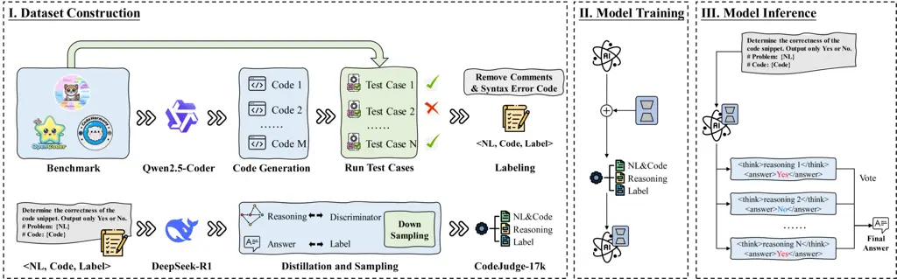
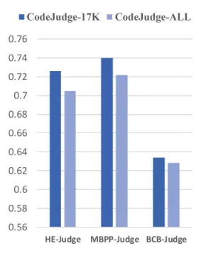
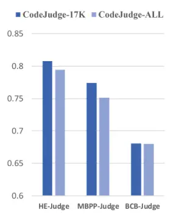
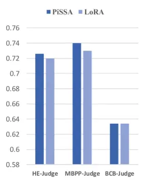
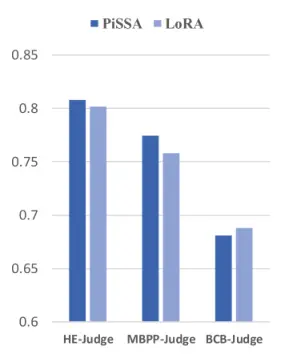
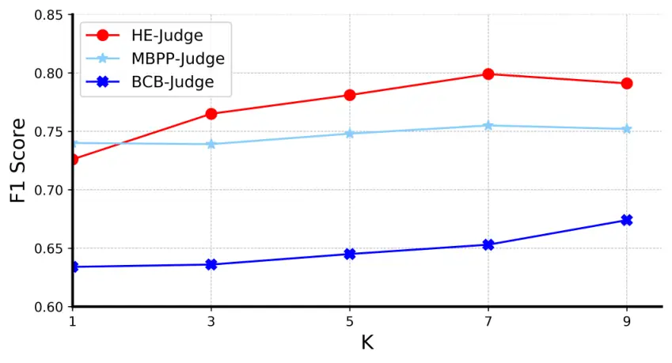
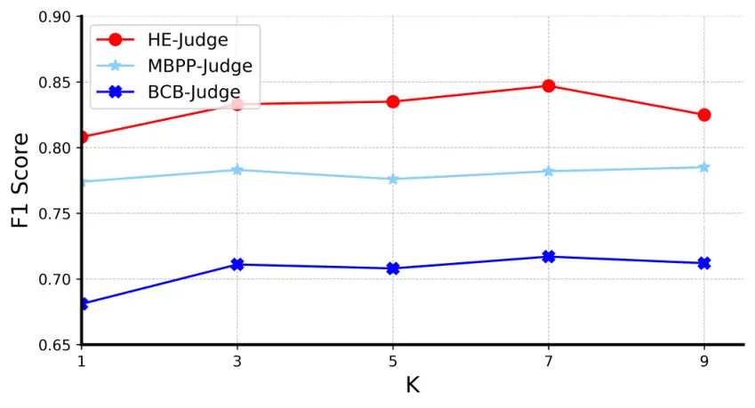

# Code-DiTing: A Reasoning-Based Metric for Functional Alignment in Code Evaluation

Guang Yang², Yu Zhou²¹, Xiang Chen³, Wei Zheng⁴, Xing Hu⁵, Xin Zhou⁶,
David Lo⁶, Taolue Chen⁸¹ Affiliation: ²College of Computer Science and
Technology, Nanjing University of Aeronautics and Astronautics, China  
³School of Artificial Intelligence and Computer Science, Nantong
University, China  
⁴School of Software, Northwestern Polytechnical University, China  
⁵School of Software Technology,  
Zhejiang University, China  
⁶School of Computing and Information Systems,  
Singapore Management University, Singapore  
⁸School of Computing and Mathematical Sciences,  
Birkbeck, University of London, UK  
Email: novelyg@outlook.com, zhouyu@nuaa.edu.cn, xchencs@ntu.edu.cn,  
wzheng@nwpu.edu.cn, xinghu@zju.edu.cn, xinzhou.2020@phdcs.smu.edu.sg,  
davidlo@smu.edu.sg, t.chen@bbk.ac.uk

###### Abstract

Trustworthy evaluation methods for code snippets play a crucial role in
neural code generation. Traditional methods, which either rely on
reference solutions or require executable test cases, have inherent
limitation in flexibility and scalability. The recent LLM-as-Judge
methodology offers a promising alternative by directly evaluating
functional consistency between the problem description and the generated
code. To systematically understand the landscape of these LLM-as-Judge
methods, we conduct a comprehensive empirical study across three diverse
datasets. Our investigation reveals the pros and cons of two categories
of LLM-as-Judge methods: the methods based on general foundation models
can achieve good performance but require complex prompts and lack
explainability, while the methods based on reasoning foundation models
provide better explainability with simpler prompts but demand
substantial computational resources due to their large parameter sizes.

To address these limitations, we propose Code-DiTing, a novel code
evaluation method that balances accuracy, efficiency and explainability.
We develop a data distillation framework that effectively transfers
reasoning capabilities from DeepSeek-R1-671B to our Code-DiTing 1.5B and
7B models, significantly enhancing evaluation explainability and
reducing the computational cost. With the majority vote strategy in the
inference process, Code-DiTing 1.5B outperforms all models with the same
magnitude of parameters and achieves performance which would normally
exhibit in a model with 5 times of parameter scale. Code-DiTing 7B
surpasses GPT-4o and DeepSeek-V3 671B, even though it only uses 1% of
the parameter volume of these large models. Further experiments show
that Code-DiTing is robust to preference leakage and can serve as a
promising alternative for code evaluation.

###### Index Terms: 

Code Generation, Evaluation, LLM-as-Judge

¹¹footnotetext: ¹ Yu Zhou and Taolue Chen are the corresponding authors.

## I Introduction

Large Language Models (LLMs) have emerged as a fundamental tool in
modern software development \[1, 2, 3\], demonstrating exceptional
language understanding and generation capabilities. Their application
has shown remarkable potential across various software engineering tasks
\[4, 5\], particularly in code generation\[6\]. However, as LLMs are
increasingly deployed, evaluating the correctness of generated code
remains a significant challenge \[7, 8\], primarily because multiple
correct or semantically equivalent solutions \[9\] may exist for a given
programming problem.

Traditional evaluation metrics, which are either reference-based or
test-based, have been widely adopted. However, these metrics suffer from
inherent limitations. Reference-based metrics (e.g., BLEU \[10\],
ROUGE \[11\] and ChrF \[12\]) depend on high-quality reference code and
frequently penalize implementations that are correct but diverge from
them. Test-based metrics (e.g., Pass@k \[13\]) require careful manual
design of comprehensive test cases that cover edge cases, along with
secure environments for code execution. Another evaluation method is
human evaluation \[14\], which is accurate yet expensive, as it involves
multiple domain experts who directly assess the correctness of generated
artifacts. Importantly, this method is prohibitively labor-intensive and
time-consuming, rendering it impractical for large-scale assessments.
These constraints significantly limit the flexibility and scalability of
human evaluation for code generation evaluation \[15, 16\].

Recent advancements in LLMs have catalyzed the development of
LLM-as-Judge methods \[17, 18, 19\], which directly evaluate the
functional consistency between problem descriptions and generated code.
These methods offer a promising alternative to traditional evaluation
method \[20\]. However, with the rapid proliferation of LLM-as-Judge
methods, there remains considerable uncertainty regarding their
performance in code generation evaluation and it is far from clear which
method delivers optimal results \[21\].

Empirical study. We first conduct a large-scale empirical study to
systematically compare different LLM-as-Judge methods in code generation
evaluation. Specifically, we classify existing LLM-as-Judge methods into
two categories, i.e., methods based on general models (e.g.,
GPT-3.5-turbo and GPT-4o) and methods based on reasoning-focused models
(e.g., DeepSeek-R1\[22\]). To ensure the comprehensive evaluation, we
curate three datasets (i.e., HumanEval-Judge, MBPP-Judge and
BigCodeBench-Judge) as new benchmarks for evaluating the effectiveness
of LLM-as-Judge methods in code generation evaluation. Our findings
indicate that, while these methods generally perform well, they exhibit
significant discrepancy across various dimensions. In particular, the
former requires elaborate prompts and lacks explainability, whereas the
latter provides enhanced explainability with simpler prompts but demands
substantial computational resources due to their parameter sizes.

Our methods. To address these limitations and advance the state of code
generation evaluation, we propose a novel code evaluation method that
effectively balances accuracy, efficiency, and explainability. We name
it Code-DiTing¹¹ 1 The name is from Chinese classic Journey to the West,
reflecting the model’s goal to accurately discern the correctness of
code implementations, just as the mythical creature distinguishes truth
from falsehood..

To reduce the computational cost, we develop a data distillation
framework that transfers reasoning capabilities from the powerful
DeepSeek-R1-671B model to our more compact Code-DiTing model, available
in 1.5B and 7B parameter sizes. Through this process, we construct a
high-quality dataset CodeJudge-17K consisting of 17,000 carefully
curated samples with reasoning paths. This method not only enhances the
explainability of the evaluation but also makes the reasoning process
more accessible and comprehensible. To further enhance performance, the
Code-DiTing models employ PiSSA \[23\] technique for model training and
the majority vote strategy during inference.

Experimental results demonstrate that Code-DiTing 1.5B outperforms all
models of comparable parameter magnitude and achieves performance
equivalent to models with five times the parameter count. Notably,
Code-DiTing 7B surpasses even large-scale models such as GPT-4o and
DeepSeek-V3 671B \[24\], despite utilizing only 1% of their parameter
volume. Our ablation studies reveal that all components of Code-DiTing
are essential for its superior performance. In addition, we demonstrate
that Code-DiTing is robust to preference leakage \[25\], where
evaluation models show bias toward code produced by same series of
architectures, a common issue in LLM-as-Judge methods. These findings
establish Code-DiTing as a promising alternative for code generation
evaluation, representing a significant advancement in the field.

Summary of contributions.

- •
  We curate three datasets (i.e., HumanEval-Judge, MBPP-Judge and
  BigCodeBench-Judge) as benchmark for the empirical study. In addition,
  we introduce a new dataset CodeJudge-17K designed for training
  purposes.
- •
  We design and carry out a large-scale empirical study to
  systematically compare different LLM-as-Judge methods in code
  generation evaluation.
- •
  We propose Code-DiTing, a novel code evaluation method that
  effectively balances accuracy, efficiency and explainability.
- •
  We conduct extensive experiments to evaluate the performance of
  Code-DiTing on different scenarios, including performance comparisons,
  ablation studies and analyses of preference leakage.

To facilitate reproducibility, experimental data and model weights are
released at
[https://github.com/Code-DiTing](https://github.com/Code-DiTing).

## II Background

### II-A Problem Formulation

We formally define the _code generation evaluation problem_ as follows.
Let $`\mathcal{X}`$ be the space of problem descriptions,
$`\mathcal{Y}`$ be the space of code implementations, $`\mathcal{R}`$ be
the space of reference implementations and $`\mathcal{T}`$ be the space
of test case sets.

Given a problem description $`x\in\mathcal{X}`$, a code generation model
$`M:\mathcal{X}\rightarrow\mathcal{Y}`$ produces code $`y=M(x)`$. The
evaluation function
$`\mathcal{F}:\mathcal{X}\times\mathcal{Y}\times\mathcal{R}\times\mathcal{T}\rightarrow\{0,1\}`$
determines the functional correctness of $`y`$ with respect to $`x`$.
Formally,

```math
\mathcal{F}(x,y,r,T)=\begin{cases}1,&\text{if }y\text{ is functionally correct}\\
0,&\text{otherwise}\end{cases} \tag{1}
```

where $`r\in\mathcal{R}\cup\{\bot\}`$ is an (optional) reference
implementation ($`r=\bot`$ means that $`r`$ is not provided) and
$`T\in\mathcal{T}\cup\{\bot\}`$ is an (optional) set of test cases
($`T=\bot`$ means that $`T`$ is not provided).

Based on the availability of $`r`$ or $`T`$, the existing code
generation evaluation methods can be categorized into: reference-based,
test-based, and reference-and-Test-free evaluation. Table I summarizes a
comparison of code generation evaluation metrics used in various
methods.

|                      |                |                |                 |                |                |                |
| -------------------- | -------------- | -------------- | --------------- | -------------- | -------------- | -------------- |
| Metric               | Category       |                | Characteristics |                |                |                |
|                      | Ref            | Test           | Func.           | Auto.          | Expl.          | Open.          |
| BLEU \[10\]          | $`\checkmark`$ | $`\times`$     | $`\times`$      | $`\checkmark`$ | $`\times`$     | $`\checkmark`$ |
| Rouge \[11\]         | $`\checkmark`$ | $`\times`$     | $`\times`$      | $`\checkmark`$ | $`\times`$     | $`\checkmark`$ |
| ChrF \[12\]          | $`\checkmark`$ | $`\times`$     | $`\times`$      | $`\checkmark`$ | $`\times`$     | $`\checkmark`$ |
| EM \[26\]            | $`\checkmark`$ | $`\times`$     | $`\times`$      | $`\checkmark`$ | $`\times`$     | $`\checkmark`$ |
| ED \[26\]            | $`\checkmark`$ | $`\times`$     | $`\times`$      | $`\checkmark`$ | $`\times`$     | $`\checkmark`$ |
| CrystalBLEU \[27\]   | $`\checkmark`$ | $`\times`$     | $`\times`$      | $`\checkmark`$ | $`\times`$     | $`\checkmark`$ |
| CodeBLEU \[28\]      | $`\checkmark`$ | $`\times`$     | $`\times`$      | $`\checkmark`$ | $`\times`$     | $`\checkmark`$ |
| CodeBERTScore \[29\] | $`\checkmark`$ | $`\times`$     | $`\times`$      | $`\checkmark`$ | $`\times`$     | $`\checkmark`$ |
| CodeScore \[30\]     | $`\checkmark`$ | $`\times`$     | $`\circ`$       | $`\checkmark`$ | $`\times`$     | $`\checkmark`$ |
| CodeScore-R \[31\]   | $`\checkmark`$ | $`\times`$     | $`\checkmark`$  | $`\checkmark`$ | $`\times`$     | $`\checkmark`$ |
| Human Study \[14\]   | $`\circ`$      | $`\times`$     | $`\checkmark`$  | $`\times`$     | $`\checkmark`$ | $`\checkmark`$ |
| Pass@k \[13\]        | $`\times`$     | $`\checkmark`$ | $`\checkmark`$  | $`\checkmark`$ | $`\checkmark`$ | $`\checkmark`$ |
| ICE-Score \[32\]     | $`\circ`$      | $`\times`$     | $`\checkmark`$  | $`\checkmark`$ | $`\times`$     | $`\times`$     |
| CodeJudge \[33\]     | $`\circ`$      | $`\times`$     | $`\checkmark`$  | $`\checkmark`$ | $`\times`$     | $`\times`$     |
| Code-DiTing          | $`\times`$     | $`\times`$     | $`\checkmark`$  | $`\checkmark`$ | $`\checkmark`$ | $`\checkmark`$ |

TABLE I: Comparison of Code Generation Evaluation Metrics, where Func.
means functional correctness, Auto. means automatic evaluation, Expl.
means explainability and Open. means using open-source models.
$`\checkmark`$ denotes applicable, $`\times`$ denotes not applicable and
$`\circ`$ denotes optional.

### II-B Reference-Based Evaluation ($`r\neq\bot`$)

Reference-based methods compute the similarity between $`y`$ and $`r`$,
based on metrics ranging from token-based metrics (e.g., BLEU \[10\],
ChrF \[12\]) to semantics-aware ones (e.g., CodeBLEU \[28\],
CodeBERTScore \[29\]).

Token-based metrics are limited to the n-gram lexical similarity
computation and ignore potential semantic information in the code. These
metrics originate from, e.g., machine translation and text
summarization, including BLEU \[10\], ROUGE \[11\] and ChrF \[12\].
Additionally, exact match (EM) metrics are widely used in code
synthesis. Eghbali et al. \[27\] proposed the CrystalBLEU metric to
enhance evaluation accuracy by excluding common n-grams that inflate
BLEU scores due to verbose syntax and coding conventions. Furthermore,
Liguori et al. \[26\] argued that edit distance (ED) better measures
code similarity compared to other token-based metrics.

Semantics-based metrics consider the syntactic structure, data flow
information and potential semantic information of code. Ren et
al. \[28\] proposed CodeBLEU, which injects code syntax through AST and
code semantics through data flow. Dong et al. \[30\] proposed CodeScore,
which conducts supervised learning on datasets with test cases to
perform functional evaluation of code synthesis. Zhou et al. \[29\]
proposed CodeBERTScore, which uses CodeBERT to performs contextual
encoding of reference and predicted code to calculate similarity scores
between each token. Yang et al. \[31\] proposed CodeScore-R based on
UniXcoder and contrastive learning, which employs sketch processing,
syntax transformation and mutation testing to improve the robustness of
metric.

Nevertheless, these methods cannot directly assess functional
correctness, require high-quality reference code collection, and
penalize correct but divergent implementations.

### II-C Test-Based Evaluation ($`T\neq\bot`$)

Test-based methods  \[13\] execute code against test cases $`T`$ to
assess functional correctness. The widely-adopted pass@k metric is
defined as

```math
\text{pass@k}=\mathbb{E}_{x}\left[1-\frac{\binom{n-c}{k}}{\binom{n}{k}}\right]
```

where $`n`$ (resp. $`c`$) is the total (resp. correct) number of samples
for the problem $`x`$. This metric has become standard in evaluating
code generation models.

Despite its popularity, pass@k requires human experts for designing
high-quality test cases, and demands secure execution environments to
prevent malicious code execution.

### II-D Reference-and-Test-Free Evaluation ($`r=\bot`$ and $`T=\bot`$)

When neither reference implementations nor test cases are available,
evaluation typically relies on either human evaluation or LLM-as-judge
methods \[34, 35\]. Human evaluation, while accurate, is prohibitively
expensive and time-consuming for large-scale assessments. Yang et
al. \[14\] proposed a sampling-based method applied in small-scale
empirical studies, which can obtain high-quality assessments of
predicted code within acceptable time and resource constraints.

Recent LLM-as-judge methods leverage large language models to directly
evaluate the functional consistency between problem descriptions and
generated code. Zhuo et al. \[32\] proposed ICE-Score, which pioneered
the use of GPT-3.5 as a judge to evaluate code generation model
performance through carefully crafted prompt engineering. Tong et
al. \[33\] introduced CodeJudge, which not only utilizes GPT-3.5 but
also explores smaller open-source models as judges, employing a
two-stage prompt engineering method for evaluation.

While promising, these methods generally require complex prompt
engineering, rely on proprietary closed-source models, and lack
explanations for their judgments. In contrast, we aim to provide a
simple and explainable evaluation method that requires neither reference
implementations nor test cases, which can balance accuracy, efficiency,
and explainability.

## III Empirical Study

In this section, we conduct an empirical study to explore the existing
LLM-as-judge methods to code generation evaluation and analyze the
various factors on their effectiveness.

### III-A Experiment Setup

Code Generation Datasets. To comprehensively evaluate LLM-as-judge
methods, establishing accurate and diverse benchmarks is a crucial first
step. We select three diverse and widely adopted datasets that
faithfully simulate real-world code generation scenarios. Our dataset
selection is guided by two principles: (1) To ensure accurate assessment
of semantic correctness, we prioritize datasets with exceptional test
case quality and quantity, specifically targeting those with test
coverage approaching 100%; (2) Beyond algorithm-centric problems,
datasets need to encompass a wide range of libraries and function call
patterns typical in professional software development, enabling thorough
evaluation of LLM-as-judge methods across varied programming contexts.

As a result, we select the following datasets:

- •
  HumanEval-plus \[36\] is an enhanced variant of the HumanEval
  benchmark that addresses fundamental ground-truth issues in the
  original dataset (including unhandled edge cases, logical errors and
  performance limitations). It expands the test coverage from an average
  of 9.6 to 764.1 test cases per problem, incorporating more challenging
  edge cases and complex functionalities to ensure rigorous and
  comprehensive evaluation.
- •
  MBPP-plus \[36\] applies similar enhancement techniques to the MBPP
  benchmark, resulting in a test suite 35 times larger than the original
  dataset.
- •
  BigCodeBench \[37\] specifically targets real-world software
  development scenarios by incorporating diverse libraries and complex
  function call patterns. It comprises 1,140 function-level tasks that
  challenge LLMs to interpret instructions and orchestrate multiple
  function calls across 139 different libraries. Each programming task
  is validated through an average of 5.6 carefully designed test cases,
  achieving a mean branch coverage of 99%.

Data Sampling. With the chosen benchmark datasets, we proceed to sample
code generated by various LLMs. We employ different models of varying
sizes: Qwen2.5Coder (1.5B/7B) \[38\] and DeepSeekCoder
(1.3B/6.7B) \[39\] to ensure diversity in the generated solutions. Using
multiple models not only enhances the diversity of our dataset but also
allows us to evaluate the robustness of LLM-as-Judge methods across
different code generation patterns and qualities.

During the data processing phase, we extract natural language problem
descriptions and corresponding code implementations from the generated
samples through rigorous data cleaning and deduplication processes.
Additionally, we remove code comments to enhance conciseness and focus
the evaluation on functional implementation rather than documentation.

Data Labeling. (1) Automatic Labeling. We utilize test cases from the
existing datasets to automatically label code samples. Functional
correctness is determined using the pass@1 metric, serving as the
ground-truth for evaluation. (2) Manual Verification. To address
potential mislabeling from expanded test cases in
HumanEval-plus/MBPP-plus, three authors independently review samples
that passed original benchmarks but failed enhanced test suites. Labels
are assigned directly when judgments align, or through discussion when
opinions differ, ensuring high-quality ground-truth labels.

We hence curate three datasets: HumanEval-Judge (640 samples),
MBPP-Judge (1,512 samples) and BigCodeBench-Judge (800 samples).
Detailed statistics, including class distributions, are provided in
Table II.

| Dataset            | Samples | \#Positive  | \#Negative  |
| ------------------ | ------- | ----------- | ----------- |
| HumanEval-Judge    | 640     | 480 (75.0%) | 160 (25.0%) |
| MBPP-Judge         | 1,512   | 997 (65.9%) | 515 (34.1%) |
| BigCodeBench-Judge | 800     | 321 (40.1%) | 479 (59.9%) |

TABLE II: Sample Statistics for HumanEval-Judge, MBPP-Judge and
BigCodeBench-Judge Datasets

### III-B LLM-as-Judge Methods

Foundation Models. To comprehensively evaluate LLM-as-judge methods
across different model scales and architectures, we select a diverse set
of foundation models:

- •
  Closed-source models: GPT-3.5-turbo and GPT-4o.
- •
  Large-scale open-source models: DeepSeek-v3-671B and DeepSeek-r1-671B.
- •
  Medium-scale open-source models:Llama3-8B, Qwen2.5-7B and
  DeepSeek-r1-distill-7B.
- •
  Small-scale open-source models: Llama3-1.5B, Qwen2.5-1.5B and
  DeepSeek-r1-distill-1.5B.

The DeepSeek series models are classified as _reasoning models_ because
of their powerful reasoning capabilities, and the rest of the models are
classified as _general models_. We limited our study to these models as
they provide sufficient representativeness across different
architectures, capabilities, and parameter scales.

This selection enables us to analyze how model size affects the
performance of LLM-as-judge methods and investigate whether smaller,
more computationally efficient models can achieve comparable evaluation
quality to their larger counterparts.

Existing Prompting Methods. We evaluate four representative prompting
methods that represent different perspectives to eliciting code
evaluation capabilities from LLMs:

- •
  Vanilla, which is a straightforward prompting method that directly
  asks the model to evaluate code correctness based on the problem
  description and implementation, without additional guidance.
- •
  CoT \[40\], which encourages the model to perform step-by-step
  reasoning by analyzing the code’s logic, identifying potential issues,
  and then making a final judgment on correctness.
- •
  ICE_SCORE \[32\], which performs multi-dimensional evaluation and
  instructs the LLM to predict an evaluation score from 0 to 4 based on
  an evaluation criterion. In our experiments, we adopt the evaluation
  score as 0 or 1 for functional correctness.
- •
  CodeJudge \[33\], which is a two-phase method, where a summary of the
  given code is first generated and then is evaluated to determine
  whether the code is correct, based on the generated summary and the
  given problem description.

### III-C Evaluation Metrics

To comprehensively assess the performance of LLM-as-judge methods for
code evaluation, we employ three metrics.

Accuracy (Acc). It measures the proportion of correctly classified
instances among all evaluated samples. For $`n`$ code samples with
ground truth labels $`y_{i}`$ and predicted labels $`\hat{y}_{i}`$:

```math
\text{Accuracy}=\frac{1}{n}\sum_{i=1}^{n}\mathbb{I}(\hat{y}_{i}=y_{i})
```

where $`\mathbb{I}(\cdot)`$ is the indicator function that returns 1 for
correct predictions and 0 otherwise.

F1 Score (F1). It is the macro-average of precision and recall,
particularly valuable for our datasets with class imbalance:

```math
\displaystyle\text{Precision}=\frac{\text{TP}}{\text{TP}+\text{FP}},\quad\text{Recall}=\frac{\text{TP}}{\text{TP}+\text{FN}}
```

```math
\displaystyle\text{F1}=2\times\frac{\text{Precision}\times\text{Recall}}{\text{Precision}+\text{Recall}}
```

F1 ranges from 0 to 1, with higher values indicating better performance
in identifying functionally correct code.

Matthews Correlation Coefficient (MCC). It provides a balanced measure
by considering all confusion matrix entries:

```math
\text{MCC}=\frac{\text{TP}\times\text{TN}-\text{FP}\times\text{FN}}{\sqrt{(\text{TP}+\text{FP})(\text{TP}+\text{FN})(\text{TN}+\text{FP})(\text{TN}+\text{FN})}}
```

MCC ranges from -1 to 1, where 1 indicates perfect prediction, 0 random
prediction, and -1 inverse prediction. It is less sensitive to class
imbalance than the accuracy and F1 score.

### III-D Implementation Details

Across all experiments, we fix the maximum context length at 8k tokens.
Temperature settings were tailored to model type: 0.6 for
reasoning-focused models (to promote exploratory reasoning) and 0.0 for
general-purpose models (to ensure deterministic outputs).

We interact with the following large-scale models (via their official
APIs): DeepSeek-v3-67B, DeepSeek-r1-67B, GPT-3.5-turbo and GPT-4o.
Medium/small-scale open-source models were from Hugging Face, with
inference optimized via VLLM \[41\] on a single RTX 4090 GPU to maximize
throughput.

| Base Model    | Prompt    | HumanEval-Judge |       |        | MBPP-Judge |       |        | BigCodeBench-Judge |       |        | Avg.  |       |        |
| ------------- | --------- | --------------- | ----- | ------ | ---------- | ----- | ------ | ------------------ | ----- | ------ | ----- | ----- | ------ |
|               |           | Acc             | F1    | MCC    | Acc        | F1    | MCC    | Acc                | F1    | MCC    | Acc   | F1    | MCC    |
|               | Vanilla   | 0.730           | 0.658 | 0.319  | 0.663      | 0.642 | 0.293  | 0.584              | 0.584 | 0.219  | 0.659 | 0.628 | 0.277  |
| GPT-3.5-turbo | CoT       | 0.781           | 0.601 | 0.303  | 0.687      | 0.558 | 0.214  | 0.493              | 0.449 | 0.210  | 0.654 | 0.536 | 0.242  |
| Close-Source  | ICE_SCORE | 0.752           | 0.571 | 0.200  | 0.695      | 0.575 | 0.242  | 0.516              | 0.487 | 0.229  | 0.654 | 0.544 | 0.224  |
|               | CodeJudge | 0.773           | 0.666 | 0.343  | 0.726      | 0.661 | 0.349  | 0.525              | 0.498 | 0.246  | 0.675 | 0.608 | 0.313  |
|               | Vanilla   | 0.731           | 0.679 | 0.375  | 0.645      | 0.633 | 0.293  | 0.639              | 0.614 | 0.361  | 0.672 | 0.642 | 0.343  |
| GPT-4o        | CoT       | 0.873           | 0.816 | 0.643  | 0.807      | 0.763 | 0.554  | 0.706              | 0.706 | 0.294  | 0.795 | 0.762 | 0.497  |
| Close-Source  | ICE_SCORE | 0.880           | 0.821 | 0.660  | 0.785      | 0.732 | 0.499  | 0.666              | 0.666 | 0.334  | 0.777 | 0.740 | 0.498  |
|               | CodeJudge | 0.880           | 0.843 | 0.686  | 0.735      | 0.718 | 0.446  | 0.714              | 0.705 | 0.286  | 0.776 | 0.755 | 0.473  |
|               | Vanilla   | 0.873           | 0.822 | 0.649  | 0.792      | 0.742 | 0.516  | 0.626              | 0.623 | 0.367  | 0.764 | 0.729 | 0.511  |
| DS-v3         | CoT       | 0.867           | 0.788 | 0.623  | 0.786      | 0.722 | 0.507  | 0.638              | 0.632 | 0.410  | 0.764 | 0.714 | 0.513  |
| 671B          | ICE_SCORE | 0.814           | 0.702 | 0.445  | 0.737      | 0.640 | 0.371  | 0.564              | 0.553 | 0.271  | 0.705 | 0.632 | 0.362  |
|               | CodeJudge | 0.884           | 0.831 | 0.675  | 0.783      | 0.730 | 0.494  | 0.675              | 0.674 | 0.325  | 0.781 | 0.745 | 0.498  |
|               | Vanilla   | 0.925           | 0.904 | 0.812  | 0.828      | 0.806 | 0.613  | 0.748              | 0.735 | 0.471  | 0.834 | 0.815 | 0.632  |
| DS-r1         | CoT       | 0.920           | 0.899 | 0.802  | 0.821      | 0.798 | 0.597  | 0.728              | 0.710 | 0.423  | 0.823 | 0.802 | 0.607  |
| 671B          | ICE_SCORE | 0.925           | 0.904 | 0.811  | 0.825      | 0.801 | 0.604  | 0.744              | 0.730 | 0.461  | 0.831 | 0.812 | 0.625  |
|               | CodeJudge | 0.897           | 0.875 | 0.765  | 0.791      | 0.773 | 0.547  | 0.731              | 0.708 | 0.428  | 0.806 | 0.785 | 0.580  |
|               | Vanilla   | 0.639           | 0.581 | 0.184  | 0.645      | 0.622 | 0.252  | 0.581              | 0.560 | 0.147  | 0.622 | 0.588 | 0.194  |
| Llama3        | CoT       | 0.667           | 0.608 | 0.235  | 0.682      | 0.657 | 0.318  | 0.569              | 0.569 | 0.178  | 0.639 | 0.611 | 0.244  |
| 8B            | ICE_SCORE | 0.738           | 0.660 | 0.320  | 0.700      | 0.656 | 0.315  | 0.536              | 0.533 | 0.161  | 0.658 | 0.616 | 0.265  |
|               | CodeJudge | 0.509           | 0.496 | 0.121  | 0.562      | 0.559 | 0.184  | 0.585              | 0.563 | 0.127  | 0.552 | 0.539 | 0.144  |
|               | Vanilla   | 0.769           | 0.662 | 0.333  | 0.748      | 0.694 | 0.408  | 0.575              | 0.563 | 0.305  | 0.697 | 0.640 | 0.349  |
| Qwen2.5       | CoT       | 0.789           | 0.673 | 0.372  | 0.743      | 0.684 | 0.394  | 0.563              | 0.545 | 0.306  | 0.698 | 0.634 | 0.357  |
| 7B            | ICE_SCORE | 0.789           | 0.684 | 0.384  | 0.745      | 0.684 | 0.398  | 0.591              | 0.582 | 0.327  | 0.708 | 0.650 | 0.370  |
|               | CodeJudge | 0.783           | 0.694 | 0.391  | 0.739      | 0.693 | 0.395  | 0.589              | 0.584 | 0.287  | 0.704 | 0.657 | 0.358  |
|               | Vanilla   | 0.816           | 0.770 | 0.546  | 0.766      | 0.730 | 0.464  | 0.629              | 0.629 | 0.319  | 0.737 | 0.710 | 0.443  |
| DS-r1-distill | CoT       | 0.773           | 0.705 | 0.410  | 0.765      | 0.723 | 0.456  | 0.524              | 0.507 | 0.197  | 0.687 | 0.645 | 0.354  |
| 7B            | ICE_SCORE | 0.817           | 0.753 | 0.506  | 0.747      | 0.698 | 0.410  | 0.571              | 0.565 | 0.262  | 0.712 | 0.672 | 0.393  |
|               | CodeJudge | 0.788           | 0.720 | 0.440  | 0.718      | 0.676 | 0.355  | 0.604              | 0.604 | 0.265  | 0.703 | 0.667 | 0.353  |
|               | Vanilla   | 0.267           | 0.235 | -0.030 | 0.343      | 0.277 | -0.051 | 0.551              | 0.405 | -0.092 | 0.387 | 0.306 | -0.058 |
| Llama3        | CoT       | 0.603           | 0.475 | -0.050 | 0.553      | 0.490 | -0.019 | 0.540              | 0.540 | 0.125  | 0.565 | 0.502 | 0.019  |
| 1B            | ICE_SCORE | 0.625           | 0.523 | 0.049  | 0.610      | 0.496 | 0.025  | 0.479              | 0.479 | 0.000  | 0.571 | 0.499 | 0.025  |
|               | CodeJudge | 0.400           | 0.399 | 0.000  | 0.401      | 0.400 | -0.082 | 0.561              | 0.487 | 0.013  | 0.454 | 0.429 | -0.023 |
|               | Vanilla   | 0.630           | 0.567 | 0.155  | 0.663      | 0.630 | 0.262  | 0.586              | 0.573 | 0.147  | 0.626 | 0.590 | 0.188  |
| Qwen2.5       | CoT       | 0.684           | 0.533 | 0.075  | 0.650      | 0.546 | 0.133  | 0.439              | 0.376 | 0.076  | 0.591 | 0.485 | 0.095  |
| 1.5B          | ICE_SCORE | 0.686           | 0.480 | -0.014 | 0.651      | 0.522 | 0.111  | 0.446              | 0.394 | 0.078  | 0.594 | 0.465 | 0.058  |
|               | CodeJudge | 0.717           | 0.512 | 0.069  | 0.658      | 0.522 | 0.123  | 0.561              | 0.487 | 0.095  | 0.645 | 0.507 | 0.096  |
|               | Vanilla   | 0.728           | 0.639 | 0.278  | 0.714      | 0.664 | 0.336  | 0.514              | 0.510 | 0.109  | 0.652 | 0.604 | 0.241  |
| DS-r1-distill | CoT       | 0.728           | 0.575 | 0.172  | 0.702      | 0.612 | 0.275  | 0.466              | 0.435 | 0.087  | 0.632 | 0.541 | 0.178  |
| 1.5B          | ICE_SCORE | 0.747           | 0.658 | 0.317  | 0.702      | 0.643 | 0.299  | 0.480              | 0.467 | 0.072  | 0.643 | 0.589 | 0.229  |
|               | CodeJudge | 0.713           | 0.570 | 0.152  | 0.648      | 0.547 | 0.131  | 0.549              | 0.549 | 0.152  | 0.637 | 0.555 | 0.145  |

TABLE III: Performance Comparison of Different Models and Prompting
Methods across Datasets

### III-E Empirical Findings

The results are shown in Table III. Based on the extensive experiments
with different models and prompting methods for code evaluation tasks,
we have identified differences between general models
(GPT/DeepSeek-V3/Llama3/Qwen2.5 series) and reasoning models
(DeepSeek-R1 series):

(1) General Models Depend on Prompt Engineering. Our analysis reveals
that general-purpose models show high sensitivity to prompt engineering.

Large-scale models respond differently to prompts: GPT-3.5-turbo and
DeepSeek-v3 perform best with CodeJudge, while GPT-4o excels with CoT.
For medium and small-scale models, structured approaches like ICE_SCORE
significantly improve performance.

A notable example is Llama3 8B, which achieved an accuracy of 0.658 and
MCC of 0.265 using ICE_SCORE, substantially outperforming its Vanilla
baseline (accuracy 0.622, MCC 0.194).


(2) Reasoning Models Prefer Simple Prompts. In contrast to their general
counterparts, reasoning models exhibit consistent superior performance
with simpler prompts. The Vanilla method emerges as the most effective
approach across all DeepSeek-r1-distill model sizes (7B and 1.5B).

Notably, increased prompt complexity often leads to performance
degradation, with the 7B model achieving a remarkable 0.737 accuracy
using the basic Vanilla approach.




Fig. 1: The overall method of Code-DiTing.

(3) Performance Comparison. Our evaluation reveals the superior
stability of reasoning models across diverse datasets, highlighting
their robustness and generalizability.

For large-scale models, DeepSeek-r1-671B with the best prompting method
achieves an accuracy of 0.834, F1 score of 0.815 and MCC of 0.632,
significantly higher than others. Similarly, for the 7B-scale,
DeepSeek-r1-distill 7B with the best prompting method achieves an
accuracy of 0.737, F1 score of 0.710, and MCC of 0.443. For the
1.5B-scale models, DeepSeek-r1-distill 1.5B achieves the best accuracy
of 0.652, F1 score of 0.604 and MCC of 0.241.


## IV Methods

In this section, we introduce our method Code-DiTing. Based on the
empirical findings in Section III, we build on two key insights: (1)
explicit reasoning paths significantly enhance code evaluation accuracy
while enabling better sample explainability; and (2) smaller models with
appropriate training can potentially match or exceed the performance of
much larger models.

Code-DiTing distills reasoning capabilities into compact models to
balance accuracy with computational efficiency, as shown in Figure 1.

### IV-A Dataset Construction

To effectively transfer reasoning capabilities from large-scale models
to Code-DiTing, high-quality training data are essential.

#### IV-A1 Source Benchmark Collection

We follow three key principles for dataset selection:

- •
  Diversity: The dataset needs to cover a wide range of programming
  scenarios, including algorithmic problems, system programming, and
  library usage.
- •
  Difficulty: In addition to basic syntax tasks, the dataset must
  encompass complex logical challenges and multi-step reasoning
  problems.
- •
  Quality: The dataset needs to contain high-coverage test cases to
  ensure reliable functional correctness assessment.

Based on these principles, we select three large-scale code generation
benchmarks, i.e, KodCode \[42\], OpenCoder \[43\], and
CodeHarmony \[44\], as the seed data. These benchmarks are widely used
to train large-scale CodeLLMs.

#### IV-A2 Code Generation and Labeling

To ensure a balanced and representative training set, we implement a
systematic data generation and labeling process. In addition, to control
the distribution of correct and incorrect examples in our dataset, we
generate multiple candidate solutions using Qwen2.5-Coder (1.5B/7B) for
each programming task. For quality assurance, we employ a multi-step
validation process as HumanEval-Judge:

- •
  We evaluate each solution’s functional correctness through test cases
  and compute the pass@1 as the label.
- •
  We apply static analysis tools to identify and filter out solutions
  containing syntax errors.
- •
  We remove code comments to focus the evaluation on core implementation
  logic.

#### IV-A3 Reasoning Knowledge Distillation

To transfer the logical reasoning capabilities of large-scale reasoning
models to our target dataset and enhance sample explainability, we
implement a distillation process. For each triple $`\langle`$nl, code,
label$`\rangle`$, we use DeepSeek-R1-671B (the SOTA reasoning model, as
shown in Table III) in Vanilla setting to produce independent judgments
on code functional correctness, including both predicted labels and
reasoning paths. This process yields raw distillation data in the format
$`\langle`$nl, code, label, reasoning$`\rangle`$.

#### IV-A4 Data Filtering and Sampling

We implement a multi-stage filtering mechanism:

- •
  Accuracy filtering. We remove samples where DeepSeek-R1-671B’s
  predictions disagreed with test case labels to ensure consistency;
- •
  Logical coherence filtering. We employ DeepSeek-V3 as a
  discriminator²² 2 The prompt can be found in the our GitHub
  repository. to detect and eliminate reasoning paths containing
  hallucinations or logical inconsistencies;
- •
  Class balancing. We downsample the filtered data to achieve a 1:1
  ratio between positive and negative samples, addressing the imbalance
  in the original dataset where correct samples were overrepresented.

As a result, we construct CodeJudge-17k, a high-quality dataset
containing 17,000 samples. CodeJudge-17k features a balanced
distribution of correct and incorrect code samples across diverse
programming tasks, spanning from basic algorithmic challenges to complex
system implementations. Each sample is accompanied by a detailed
reasoning path that explains the judgment process, making the dataset
valuable for training explainable code judgment models.

### IV-B Model Training

To transfer reasoning capabilities to smaller models while maintaining
efficiency, we train the model in three stages.

1. Knowledge Injection We hypothesize that explicit reasoning paths are
   crucial for code evaluation tasks. To inject this capability while
   minimizing deployment costs, we use DS-R1-distil (1.5B/7B) as base
   models which are fine-tuned on CodeJudge-17k. This enables smaller
   models to learn from larger experts while requiring only 1% of the
   parameters.

2. Parameter-Efficient Fine-tuning with LoRA To optimize model training
   while maintaining performance, we adopt Low-Rank Adaptation (LoRA), a
   parameter-efficient fine-tuning technique. This freezes pre-trained
   weights $`W_{0}\in\mathbb{R}^{d\times k}`$ and introduces trainable
   low-rank matrices $`A\in\mathbb{R}^{r\times k}`$,
   $`B\in\mathbb{R}^{d\times r}`$ ($`r\ll\min(d,k)`$):

```math
W=W_{0}+BA
```

This reduces trainable parameters from $`dk`$ to $`r(d+k)`$, preserving
performance with minimal overhead.

3. PiSSA Initialization To enhance training efficiency and model
   performance, we leverage Principal Singular Vector Adaptation
   (PiSSA) \[23\] for initializing LoRA matrices. Instead of
   Kaiming-uniform \[45\] initialization used in LoRA, PiSSA leverages the
   intrinsic low-rank structure of $`W_{0}`$ through truncated SVD, i.e.,
   $`W_{0}\approx U_{r}\Sigma_{r}V_{r}^{\top}`$. The LoRA matrices are then
   initialized as

```math
B=U_{r}\Sigma_{r}^{1/2},\quad A=\Sigma_{r}^{1/2}V_{r}^{\top}
```

This ensures $`\Delta W=BA`$ initially aligns with $`W_{0}`$’s principal
subspace, concentrating updates on directions critical for functional
preservation. Compared to the Kaiming-uniform initialization, PiSSA
provides structured starting points that improve convergence speed and
final performance, particularly in low-rank regimes.

### IV-C Model Inference

Considering that the reasoning model may have inconsistent reasoning
paths when the temperature is set to 0.6, we use the Majority Vote
strategy to determine the final reasoning result and further enhance
model inference performance. This belongs to parallel inference methods,
where the model performs multiple independent inferences on the same
input, and the most frequent result is selected as the final judgment.

From a probabilistic perspective, if the probability of a correct
judgment in a single inference is $`P(A)`$, the probability of the final
result being correct can be modeled through a binomial distribution when
conducting $`T`$ independent inferences. Specifically, if at least
$`(T+1)/2`$ inference results are correct (i.e., the majority vote is
correct), then the probability of the final judgment being correct is

```math
P\left(X\geq\frac{T+1}{2}\right)=\sum_{k=\lceil\frac{T+1}{2}\rceil}^{T}\binom{T}{k}P(A)^{k}(1-P(A))^{T-k}.
```

When $`P(A)>0.5`$, according to the Law of Large Numbers, as $`T`$
increases, the success probability of the majority vote strategy
$`P\left(X\geq\frac{T+1}{2}\right)`$ will continuously improve. This
explains why majority voting can effectively enhance model performance:
as long as the accuracy of a single inference exceeds random guessing
(i.e., $`P(A)>0.5`$), multiple voting can significantly reduce the
probability of misjudgment.

In our experiments, we perform $`T=7`$ independent inferences for each
test sample and use majority voting to determine the final judgment
result. Note that $`T`$ is set $`7`$ based on RQ3 findings (Section V-C)
as the optimal trade-off between model performance and inference
latency.

## V Experiments and Analysis

To evaluate the effectiveness and benefits of Code-DiTing, we mainly
study the following three research questions (RQs):

### V-A RQ1: How does Code-DiTing perform compared to the state-of-the-art methods?

| Base Model         | Prompt    | HumanEval-Judge |       |       | MBPP-Judge |       |       | BigCodeBench-Judge |       |       | Avg.  |       |       |
| ------------------ | --------- | --------------- | ----- | ----- | ---------- | ----- | ----- | ------------------ | ----- | ----- | ----- | ----- | ----- |
|                    |           | Acc             | F1    | MCC   | Acc        | F1    | MCC   | Acc                | F1    | MCC   | Acc   | F1    | MCC   |
| GPT-3.5-turbo      | CodeJudge | 0.773           | 0.666 | 0.343 | 0.726      | 0.661 | 0.349 | 0.525              | 0.498 | 0.246 | 0.675 | 0.608 | 0.313 |
| GPT-4o             | CoT       | 0.873           | 0.816 | 0.643 | 0.807      | 0.763 | 0.554 | 0.706              | 0.706 | 0.294 | 0.795 | 0.762 | 0.497 |
| DS-v3 671B         | CodeJudge | 0.884           | 0.831 | 0.675 | 0.783      | 0.730 | 0.494 | 0.675              | 0.674 | 0.325 | 0.781 | 0.745 | 0.498 |
| DS-r1 671B         | Vanilla   | 0.925           | 0.904 | 0.812 | 0.828      | 0.806 | 0.613 | 0.748              | 0.735 | 0.471 | 0.834 | 0.815 | 0.632 |
| Llama3 8B          | ICE_SCORE | 0.738           | 0.660 | 0.320 | 0.700      | 0.656 | 0.315 | 0.536              | 0.533 | 0.161 | 0.658 | 0.616 | 0.265 |
| Qwen2.5 7B         | ICE_SCORE | 0.789           | 0.684 | 0.384 | 0.745      | 0.684 | 0.398 | 0.591              | 0.582 | 0.327 | 0.708 | 0.650 | 0.370 |
| DS-r1-distill 7B   | Vanilla   | 0.816           | 0.770 | 0.546 | 0.766      | 0.730 | 0.464 | 0.629              | 0.629 | 0.319 | 0.737 | 0.710 | 0.443 |
| Code-DiTing 7B     | Vanilla   | 0.883           | 0.847 | 0.695 | 0.806      | 0.782 | 0.564 | 0.729              | 0.717 | 0.435 | 0.806 | 0.782 | 0.565 |
| Llama3 1B          | ICE_SCORE | 0.625           | 0.523 | 0.049 | 0.610      | 0.496 | 0.025 | 0.479              | 0.479 | 0.000 | 0.571 | 0.499 | 0.025 |
| Qwen2.5 1.5B       | Vanilla   | 0.630           | 0.567 | 0.155 | 0.663      | 0.630 | 0.262 | 0.586              | 0.573 | 0.147 | 0.626 | 0.590 | 0.188 |
| DS-r1-distill 1.5B | Vanilla   | 0.728           | 0.639 | 0.278 | 0.714      | 0.664 | 0.336 | 0.514              | 0.510 | 0.109 | 0.652 | 0.604 | 0.241 |
| Code-DiTing 1.5B   | Vanilla   | 0.842           | 0.799 | 0.601 | 0.778      | 0.755 | 0.510 | 0.681              | 0.653 | 0.318 | 0.767 | 0.736 | 0.476 |

TABLE IV: Performance Comparison of Different Models and Prompting
Methods across Datasets

To evaluate the performance of Code-DiTing, we compare it with various
models mentioned in Section III. For a fair comparison, we use the most
effective prompt for each model and employ the same evaluation metrics.
The results are presented in Table IV.

(1) Performance Comparison. Both Code-DiTing 1.5B and 7B models
significantly outperform other models in their respective parameter
scales, with substantial improvements across accuracy, F1 score and MCC
metrics. In particular, Code-DiTing 1.5B surpasses Llama3 1B, Qwen2.5
1.5B and even the base DS-r1-distill 1.5B model by large margins.
Similarly, Code-DiTing 7B shows clear advantages over Llama3 8B, Qwen2.5
7B, and the base DS-r1-distill 7B model.

(2) Parameter Efficiency. The parameter efficiency of our method is
particularly noteworthy, as Code-DiTing 1.5B achieves performance
comparable to DS-r1-distill 7B despite using only about 20% of its
parameters, demonstrating the effectiveness of our knowledge
distillation method in transferring reasoning capabilities to smaller
models.

Most impressively, Code-DiTing 7B outperforms both (closed-source)
GPT-4o and DeepSeek-V3 (671B) across all three datasets, falling short
only of DeepSeek-R1 671B. This is remarkable considering that
Code-DiTing 7B uses only about 1% of the parameters of these larger
models.

Both Code-DiTing variants maintain strong performance across all
evaluation datasets, indicating robust generalization capabilities.
These results validate our hypothesis that explicit reasoning paths are
crucial for code evaluation tasks and demonstrate that smaller models
can effectively learn these reasoning patterns through our proposed
fine-tuning method.




(a) Code-DiTing 1.5B



(b) Code-DiTing 7B

Fig. 2: Ablation Study (F1 Score) of Data Filtering Component

### V-B RQ2: What is the impact of different components of Code-DiTing?

To evaluate the effectiveness of different components of Code-DiTing, we
conducted a series of ablation studies, focusing on three key aspects:
data filtering, parameter initialization and inference strategy.

(1) Data Filtering Component. Figure 2 illustrates the impact of the
data filtering component on model performance. We compare the F1 scores
under k=1 (single inference) across different datasets and observe that
the data filtering strategy consistently and significantly improves
model performance. This empirical evidence strongly supports the
hypothesis that high-quality reasoning paths are crucial for models to
develop accurate code evaluation capabilities.

Specifically, the relative improvement from filtering is notably more
pronounced in the smaller 1.5B model compared to the 7B model. This
distinct impact suggests that smaller models, with their inherently
limited representational capacity, benefit disproportionately from
high-quality training data, as they lack the parameter space to
effectively learn from noisy or ambiguous examples.



(a) Code-DiTing 1.5B



(b) Code-DiTing 7B

Fig. 3: Ablation Study (F1 Score) of PiSSA Component

(2) PiSSA Component. Figure 3 shows the impact of PiSSA initialization
on model performance. We also compare F1 scores at k=1 across different
initialization methods to isolate this component’s contribution. In
standard LoRA implementations, the A matrix is typically initialized
using Kaiming-uniform initialization, while the B matrix is initialized
to zero. In contrast, PiSSA derives both A and B matrices through SVD
decomposition, which fundamentally aligns the initialization with
model’s intrinsic parameter structure.

The experimental results reveal that PiSSA yields substantial
performance improvements on the HumanEval-Judge and MBPP-Judge datasets
compared to standard LoRA initialization techniques. However, we observe
that the performance enhancement on the more challenging
BigCodeBench-Judge dataset is less pronounced, suggesting that
initialization benefits may vary with task complexity and dataset
characteristics.

These findings indicate that PiSSA initialization helps models converge
to more optimal solution spaces, particularly in parameter-constrained
low-rank adaptation scenarios.



(a) Code-DiTing 1.5B



(b) Code-DiTing 7B

Fig. 4: Ablation study (F1 Score) of the inference component

(3) Inference Component. Figure 4 presents a detailed analysis of how
our inference strategy affects model performance. We systematically
compare F1 scores across different values of k (the number of inference
passes) to identify the optimal configuration. The results demonstrate a
clear pattern: as k increases, model performance consistently improves,
though with diminishing returns at higher values.

To determine the most practical configuration for real-world
applications, we conduct an analysis of the performance-efficiency
trade-off. Our experiments are performed using vllm as the inference
server on a single NVIDIA RTX 4090 GPU. The baseline latency (k=1) for a
single inference pass is 0.15s and 0.30s for the 1.5B and 7B models,
respectively. As expected, the time cost scales linearly with k,
reaching approximately 1s (1.5B) and 2s (7B) when k=7.

By analyzing both the performance improvements and computational
overhead across different k values, we identify k=7 as the optimal one.
This configuration delivers substantial accuracy gains while maintaining
reasonable inference latency, making it well-suited for practical
applications where both prediction quality and response time are
critical considerations.


### V-C RQ3: Does Code-DiTing suffer from preference leakage?

Preference leakage \[25\] refers to a contamination issue in
LLM-as-judge frameworks where correlations between the synthetic data
generator and the LLM-based evaluator lead to biased assessments.

In our training process, we have used code generated by models in the
same families (DeepSeek and Qwen Coder) that serve as our base models.
This raises a legitimate concern: does Code-DiTing exhibit preference
bias toward code generated by models similar to those used in its
training data?

To systematically investigate this potential issue, we consider
Agreement Rate and Cohen’s Kappa \[46\] as the evaluation metrics.
Specifically, Agreement Rate measures the consistency of judgments
between different evaluation scenarios:

```math
\text{Agreement Rate}=\frac{\text{Number of consistent judgments}}{\text{Total number of samples}}
```

Cohen’s Kappa quantifies the agreement between evaluators while
accounting for chance agreement:

```math
\text{Cohen's Kappa}=\frac{p_{o}-p_{e}}{1-p_{e}}
```

where $`p_{o}`$ is the observed agreement rate and $`p_{e}`$ is the
expected agreement rate by chance. The chance agreement $`p_{e}`$ is
calculated based on the marginal distributions of each evaluator’s
judgments:

```math
p_{e}=\sum_{i}(p_{i1}\times p_{i2})
```

where $`p_{i1}`$ and $`p_{i2}`$ represent the proportion of samples
classified as category $`i`$ by the first and second evaluator,
respectively. This adjustment for chance agreement makes Cohen’s Kappa a
more robust measure than simple agreement rate, especially when the
distribution of categories is imbalanced.

We carry out experiments the assess the consistency of Code-DiTing from
different perspectives.

(1) Consistency across different code generators. This experiment
evaluates whether Code-DiTing maintains consistent judgments when
evaluating code generated by different models for the same programming
task. We selected 50 problems from each dataset and used two models not
involved in our training data generation (i.e., GPT-4o and Claude-3.5)
to generate code solutions. We then assessed whether Code-DiTing
produced consistent evaluations regardless of the code’s source.

| Model      | Dataset            | Agreement Rate | Kappa |
| ---------- | ------------------ | -------------- | ----- |
| GPT-4o     | HumanEval-Judge    | 98.0%          | 0.96  |
|            | MBPP-Judge         | 96.0%          | 0.92  |
|            | BigCodeBench-Judge | 94.0%          | 0.88  |
| Claude-3.5 | HumanEval-Judge    | 97.0%          | 0.94  |
|            | MBPP-Judge         | 95.0%          | 0.90  |
|            | BigCodeBench-Judge | 93.0%          | 0.86  |

TABLE V: Consistency analysis across different code generation models

As shown in Table V, Code-DiTing demonstrates high consistency in its
judgments across different code generators, with agreement rates
exceeding 93% across all datasets. The exceptionally high Cohen’s Kappa
values (ranging from 0.86 to 0.96) indicate near-perfect agreement
beyond what would be expected by chance. This consistency is
particularly evident on the HumanEval-Judge dataset, where agreement
rates reach 98% with GPT-4o-generated code and 97% with
Claude-3.5-generated code. Even on the more challenging
BigCodeBench-Judge dataset, which involves complex library interactions,
Code-DiTing maintains agreement rates of 94% and 93% respectively. These
results strongly suggest that Code-DiTing’s evaluation mechanism focuses
on the intrinsic quality and correctness of code rather than superficial
patterns associated with specific code generators.

(2) Consistency across different problem descriptions. This experiment
examines whether Code-DiTing maintains consistent judgments when the
same code is evaluated against semantically equivalent–but differently
phrased–problem descriptions. We also select 50 code samples from each
dataset and use GPT-4o and Claude-3.5 to generate paraphrased versions
of the original problem descriptions while preserving their semantic
meaning. We then evaluate whether Code-DiTing’s judgments remained
consistent across these different problem formulations.

| Model      | Dataset            | Agreement Rate | Kappa |
| ---------- | ------------------ | -------------- | ----- |
| GPT-4o     | HumanEval-Judge    | 96.0%          | 0.92  |
|            | MBPP-Judge         | 95.0%          | 0.90  |
|            | BigCodeBench-Judge | 94.0%          | 0.88  |
| Claude-3.5 | HumanEval-Judge    | 95.0%          | 0.90  |
|            | MBPP-Judge         | 94.5%          | 0.89  |
|            | BigCodeBench-Judge | 94.0%          | 0.87  |

TABLE VI: Consistency analysis across different problem descriptions

Table VI shows that Code-DiTing maintains even higher consistency with
agreement rates of 94–96% across datasets. The Cohen’s Kappa values
(0.87-0.92) indicate near-perfect agreement, substantially exceeding
what would be expected by chance. Notably, the consistency remains
stable across all three datasets, with minimal variation between
HumanEval-Judge, MBPP-Judge and BigCodeBench-Judge. The stability is
particularly significant for BigCodeBench-Judge, where the complexity of
library interactions could potentially make the model more sensitive to
variations in problem descriptions. The high agreement rates for both
GPT-4o and Claude-3.5 paraphrases demonstrate that Code-DiTing robustly
captures the semantic relationship between code and requirements,
focusing on functional alignment rather than superficial textual
patterns in the problem description. This resilience to paraphrasing
suggests that Code-DiTing has developed a deep understanding of
programming tasks that transcends specific wording choices.


## VI Threats to Validity

Internal Validity. The primary threat to internal validity concerns
implementation fidelity. We mitigated this by carefully implementing
baseline methods according to their original descriptions, using public
implementations where available, and thoroughly validating our
Code-DiTing implementation. Regarding potential bias in the distilled
CodeJudge-17K training dataset, we employed multi-stage filtering to
ensure high-quality reasoning paths and accurate labels.

External Validity. External validity threats stem from our dataset and
model selections. We chose HumanEval-plus, MBPP-plus, and BigCodeBench
for their high-quality test cases and diverse programming scenarios,
though future work could explore additional programming paradigms and
domain-specific languages. Our model selection spans various scales and
architectures (closed-source GPT models, large-scale DeepSeek models,
and smaller open-source models ranging from 1.5B to 8B parameters),
providing meaningful insights within our hardware constraints (single
RTX 4090 GPU).

Construct Validity. Construct threats concern the performance metrics
used to evaluate the performance of Code-DiTing and the compared
methods. To evaluate the performance of models, we utilized Accuracy,
F1-score, and MCC as the evaluation metrics. Furthermore, to evaluate
the performance leakage issue of Code-DiTing, we used Agreement Rate and
Cohen’s Kappa as the evaluation metrics.

## VII Conclusion and Future Work

In this study, we first conducted a comprehensive empirical study of
LLM-as-Judge methods, identifying key differences between general and
reasoning models. We then proposed Code-DiTing, a code evaluation metric
balancing accuracy, efficiency, and explainability. Our experiments
confirm that Code-DiTing outperforms state-of-the-art methods while
maintaining robustness to preference leakage.

Future work will focus on: (1) evaluating Code-DiTing across additional
programming languages and more complex datasets to better understand its
generalization capabilities, and (2) applying Code-DiTing as an
environment for reinforcement learning to improve code generation
models.

## References

- \[1\] J. He, C. Treude, and D. Lo, “Llm-based multi-agent systems for
  software engineering: Literature review, vision and the road ahead,”
  _ACM Transactions on Software Engineering and Methodology_, 2024.
- \[2\] J. Shi, Z. Yang, and D. Lo, “Efficient and green large language
  models for software engineering: Vision and the road ahead,” _ACM
  Transactions on Software Engineering and Methodology_, 2024.
- \[3\] X. Hou, Y. Zhao, Y. Liu, Z. Yang, K. Wang, L. Li, X. Luo, D. Lo,
  J. Grundy, and H. Wang, “Large language models for software
  engineering: A systematic literature review,” _ACM Transactions on
  Software Engineering and Methodology_, vol. 33, no. 8, pp. 1–79, 2024.
- \[4\] L. Fan, J. Liu, Z. Liu, D. Lo, X. Xia, and S. Li, “Exploring the
  capabilities of llms for code change related tasks,” _ACM Transactions
  on Software Engineering and Methodology_, 2024.
- \[5\] G. Yang, Y. Zhou, X. Chen, X. Zhang, T. Y. Zhuo, and T. Chen,
  “Chain-of-thought in neural code generation: From and for lightweight
  language models,” _IEEE Transactions on Software Engineering_, 2024.
- \[6\] Z. Yang, S. Chen, C. Gao, Z. Li, X. Hu, K. Liu, and X. Xia, “An
  empirical study of retrieval-augmented code generation: Challenges and
  opportunities,” _ACM Transactions on Software Engineering and
  Methodology_, 2025.
- \[7\] J. Wang and Y. Chen, “A review on code generation with llms:
  Application and evaluation,” in _2023 IEEE International Conference on
  Medical Artificial Intelligence (MedAI)_. IEEE, 2023, pp. 284–289.
- \[8\] D. Zheng, Y. Wang, E. Shi, R. Zhang, Y. Ma, H. Zhang, and
  Z. Zheng, “Towards more realistic evaluation of llm-based code
  generation: an experimental study and beyond,” _arXiv preprint
  arXiv:2406.06918_, 2024.
- \[9\] G. Yang, Y. Zhou, X. Zhang, X. Chen, T. Han, and T. Chen,
  “Assessing and improving syntactic adversarial robustness of
  pre-trained models for code translation,” _Information and Software
  Technology_, vol. 181, p. 107699, 2025.
- \[10\] K. Papineni, S. Roukos, T. Ward, and W.-J. Zhu, “Bleu: a method
  for automatic evaluation of machine translation,” in _Proceedings of
  the 40th annual meeting of the Association for Computational
  Linguistics_, 2002, pp. 311–318.
- \[11\] C.-Y. Lin, “Rouge: A package for automatic evaluation of
  summaries,” in _Text summarization branches out_, 2004, pp. 74–81.
- \[12\] M. Popović, “chrf: character n-gram f-score for automatic mt
  evaluation,” in _Proceedings of the tenth workshop on statistical
  machine translation_, 2015, pp. 392–395.
- \[13\] M. Chen, J. Tworek, H. Jun, Q. Yuan, H. P. D. O. Pinto,
  J. Kaplan, H. Edwards, Y. Burda, N. Joseph, G. Brockman _et al._,
  “Evaluating large language models trained on code,” _arXiv preprint
  arXiv:2107.03374_, 2021.
- \[14\] G. Yang, Y. Zhou, X. Chen, X. Zhang, T. Han, and T. Chen,
  “Exploitgen: Template-augmented exploit code generation based on
  codebert,” _Journal of Systems and Software_, vol. 197, p.
  111577, 2023.
- \[15\] R. Takaichi, Y. Higo, S. Matsumoto, S. Kusumoto,
  T. Kurabayashi, H. Kirinuki, and H. Tanno, “Are nlp metrics suitable
  for evaluating generated code?” in _International Conference on
  Product-Focused Software Process Improvement_. Springer, 2022, pp.
  531–537.
- \[16\] A. Naik, “On the limitations of embedding based methods for
  measuring functional correctness for code generation,” _arXiv preprint
  arXiv:2405.01580_, 2024.
- \[17\] H. Li, Q. Dong, J. Chen, H. Su, Y. Zhou, Q. Ai, Z. Ye, and
  Y. Liu, “Llms-as-judges: a comprehensive survey on llm-based
  evaluation methods,” _arXiv preprint arXiv:2412.05579_, 2024.
- \[18\] J. Gu, X. Jiang, Z. Shi, H. Tan, X. Zhai, C. Xu, W. Li,
  Y. Shen, S. Ma, H. Liu _et al._, “A survey on llm-as-a-judge,” _arXiv
  preprint arXiv:2411.15594_, 2024.
- \[19\] D. Li, B. Jiang, L. Huang, A. Beigi, C. Zhao, Z. Tan,
  A. Bhattacharjee, Y. Jiang, C. Chen, T. Wu _et al._, “From generation
  to judgment: Opportunities and challenges of llm-as-a-judge,” _arXiv
  preprint arXiv:2411.16594_, 2024.
- \[20\] L. Zheng, W.-L. Chiang, Y. Sheng, S. Zhuang, Z. Wu, Y. Zhuang,
  Z. Lin, Z. Li, D. Li, E. Xing _et al._, “Judging llm-as-a-judge with
  mt-bench and chatbot arena,” _Advances in Neural Information
  Processing Systems_, vol. 36, pp. 46 595–46 623, 2023.
- \[21\] X. Yu, L. Liu, X. Hu, J. W. Keung, J. Liu, and X. Xia, “Fight
  fire with fire: How much can we trust chatgpt on source code-related
  tasks?” _IEEE Transactions on Software Engineering_, 2024.
- \[22\] D. Guo, D. Yang, H. Zhang, J. Song, R. Zhang, R. Xu, Q. Zhu,
  S. Ma, P. Wang, X. Bi _et al._, “Deepseek-r1: Incentivizing reasoning
  capability in llms via reinforcement learning,” _arXiv preprint
  arXiv:2501.12948_, 2025.
- \[23\] F. Meng, Z. Wang, and M. Zhang, “Pissa: Principal singular
  values and singular vectors adaptation of large language models,”
  _Advances in Neural Information Processing Systems_, vol. 37, pp.
  121 038–121 072, 2024.
- \[24\] A. Liu, B. Feng, B. Xue, B. Wang, B. Wu, C. Lu, C. Zhao,
  C. Deng, C. Zhang, C. Ruan _et al._, “Deepseek-v3 technical report,”
  _arXiv preprint arXiv:2412.19437_, 2024.
- \[25\] D. Li, R. Sun, Y. Huang, M. Zhong, B. Jiang, J. Han, X. Zhang,
  W. Wang, and H. Liu, “Preference leakage: A contamination problem in
  llm-as-a-judge,” _arXiv preprint arXiv:2502.01534_, 2025.
- \[26\] P. Liguori, C. Improta, R. Natella, B. Cukic, and D. Cotroneo,
  “Who evaluates the evaluators? on automatic metrics for assessing
  ai-based offensive code generators,” _Expert Systems with
  Applications_, vol. 225, p. 120073, 2023.
- \[27\] A. Eghbali and M. Pradel, “Crystalbleu: precisely and
  efficiently measuring the similarity of code,” in _Proceedings of the
  37th IEEE/ACM International Conference on Automated Software
  Engineering_, 2022, pp. 1–12.
- \[28\] S. Ren, D. Guo, S. Lu, L. Zhou, S. Liu, D. Tang, N. Sundaresan,
  M. Zhou, A. Blanco, and S. Ma, “Codebleu: a method for automatic
  evaluation of code synthesis,” _arXiv preprint
  arXiv:2009.10297_, 2020.
- \[29\] S. Zhou, U. Alon, S. Agarwal, and G. Neubig, “Codebertscore:
  Evaluating code generation with pretrained models of code,” in _The
  2023 Conference on Empirical Methods in Natural Language Processing_.
- \[30\] Y. Dong, J. Ding, X. Jiang, G. Li, Z. Li, and Z. Jin,
  “Codescore: Evaluating code generation by learning code execution,”
  _ACM Transactions on Software Engineering and Methodology_, vol. 34,
  no. 3, pp. 1–22, 2025.
- \[31\] G. Yang, Y. Zhou, X. Chen, and X. Zhang, “Codescore-r: An
  automated robustness metric for assessing the functionalcorrectness of
  code synthesis,” _arXiv preprint arXiv:2406.06902_, 2024.
- \[32\] T. Y. Zhuo, “Ice-score: Instructing large language models to
  evaluate code,” in _Findings of the Association for Computational
  Linguistics: EACL 2024_, 2024, pp. 2232–2242.
- \[33\] W. Tong and T. Zhang, “Codejudge: Evaluating code generation
  with large language models,” in _Proceedings of the 2024 Conference on
  Empirical Methods in Natural Language Processing_, 2024, pp.
  20 032–20 051.
- \[34\] D. G. Paul, H. Zhu, and I. Bayley, “Benchmarks and metrics for
  evaluations of code generation: A critical review,” in _2024 IEEE
  International Conference on Artificial Intelligence Testing
  (AITest)_. IEEE, 2024, pp. 87–94.
- \[35\] J. He, J. Shi, T. Y. Zhuo, C. Treude, J. Sun, Z. Xing, X. Du,
  and D. Lo, “From code to courtroom: Llms as the new software judges,”
  _arXiv preprint arXiv:2503.02246_, 2025.
- \[36\] J. Liu, C. S. Xia, Y. Wang, and L. Zhang, “Is your code
  generated by chatGPT really correct? rigorous evaluation of large
  language models for code generation,” in _Thirty-seventh Conference on
  Neural Information Processing Systems_, 2023. \[Online\]. Available:
  [https://openreview.net/forum?id=1qvx610Cu7](https://openreview.net/forum?id=1qvx610Cu7)
- \[37\] T. Y. Zhuo, M. C. Vu, J. Chim, H. Hu, W. Yu, R. Widyasari,
  I. N. B. Yusuf, H. Zhan, J. He, I. Paul _et al._, “Bigcodebench:
  Benchmarking code generation with diverse function calls and complex
  instructions,” _arXiv preprint arXiv:2406.15877_, 2024.
- \[38\] B. Hui, J. Yang, Z. Cui, J. Yang, D. Liu, L. Zhang, T. Liu,
  J. Zhang, B. Yu, K. Lu _et al._, “Qwen2. 5-coder technical report,”
  _arXiv preprint arXiv:2409.12186_, 2024.
- \[39\] D. Guo, Q. Zhu, D. Yang, Z. Xie, K. Dong, W. Zhang, G. Chen,
  X. Bi, Y. Wu, Y. Li _et al._, “Deepseek-coder: When the large language
  model meets programming–the rise of code intelligence,” _arXiv
  preprint arXiv:2401.14196_, 2024.
- \[40\] J. Wei, X. Wang, D. Schuurmans, M. Bosma, F. Xia, E. Chi, Q. V.
  Le, D. Zhou _et al._, “Chain-of-thought prompting elicits reasoning in
  large language models,” _Advances in neural information processing
  systems_, vol. 35, pp. 24 824–24 837, 2022.
- \[41\] W. Kwon, Z. Li, S. Zhuang, Y. Sheng, L. Zheng, C. H. Yu, J. E.
  Gonzalez, H. Zhang, and I. Stoica, “Efficient memory management for
  large language model serving with pagedattention,” in _Proceedings of
  the ACM SIGOPS 29th Symposium on Operating Systems Principles_, 2023.
- \[42\] Z. Xu, Y. Liu, Y. Yin, M. Zhou, and R. Poovendran, “Kodcode: A
  diverse, challenging, and verifiable synthetic dataset for coding,”
  _arXiv preprint arXiv:2503.02951_, 2025.
- \[43\] S. Huang, T. Cheng, J. K. Liu, J. Hao, L. Song, Y. Xu, J. Yang,
  J. Liu, C. Zhang, L. Chai _et al._, “Opencoder: The open cookbook for
  top-tier code large language models,” _arXiv preprint
  arXiv:2411.04905_, 2024.
- \[44\] G. Yang, Y. Zhou, X. Zhang, W. Cheng, K. Liu, X. Chen, T. Y.
  Zhuo, and T. Chen, “Less is more: Towards green code large language
  models via unified structural pruning,” _arXiv preprint
  arXiv:2412.15921_, 2024.
- \[45\] K. He, X. Zhang, S. Ren, and J. Sun, “Delving deep into
  rectifiers: Surpassing human-level performance on imagenet
  classification,” in _Proceedings of the IEEE international conference
  on computer vision_, 2015, pp. 1026–1034.
- \[46\] J. Cohen, “A coefficient of agreement for nominal scales,”
  _Educational and psychological measurement_, vol. 20, no. 1, pp.
  37–46, 1960.
