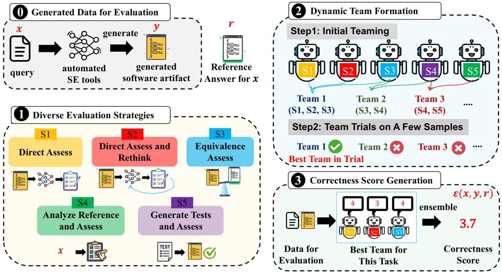
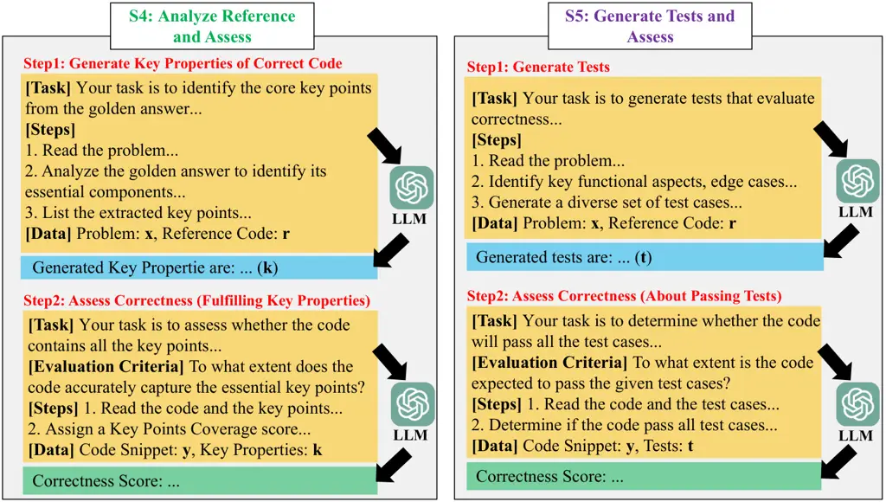

# SE-Jury: An LLM-as-Ensemble-Judge Metric for Narrowing the Gap with Human Evaluation in SE

Xin Zhou^(†) Affiliation: Guang Yang^(¶), Kui Liu^(∥), Xin Xia^(\#),
David Lo^(†) Affiliation: ^(†)Singapore Management University, Singapore
   Kisub Kim^(‡\*) Affiliation: ^(‡)DGIST, Republic of Korea
Affiliation: ^(§)Monash University, Australia    Ting Zhang^(§)
Affiliation: ^(¶)Nanjing University of Aeronautics and Astronautics,
China Affiliation: ^(∥)Huawei Software Engineering Application
Technology Lab, China    Martin Weyssow^(†) Affiliation: ^(\#)Zhejiang
University, China Affiliation: Emails: xinzhou.2020@phdcs.smu.edu.sg,
kisub.kim@dgist.ac.kr, ting.zhang@monash.edu,    Luís F. Gomes^(†)
Affiliation: mweyssow@smu.edu.sg, lfgomes@smu.edu.sg,
novelyg@outlook.com, brucekuiliu@gmail.com,
Affiliation: xin.xia@acm.org, davidlo@smu.edu.sg

###### Abstract

Large Language Models (LLMs) and other automated techniques have been
increasingly used to support software developers by generating software
artifacts such as code snippets, patches, and comments. However,
accurately assessing the correctness of these generated artifacts
remains a significant challenge. On one hand, human evaluation provides
high accuracy but is labor-intensive and lacks scalability. On the other
hand, many automatic evaluation metrics are scalable and require minimal
human effort, but they often fail to accurately reflect the actual
correctness of generated software artifacts.

In this paper, we present SE-Jury, the first evaluation metric for
LLM-as-Ensemble-Judge specifically designed to accurately assess the
correctness of generated software artifacts. SE-Jury first defines five
distinct evaluation strategies, each implemented as an independent
judge. A dynamic team selection mechanism then identifies the most
appropriate subset of judges as a team to produce a final correctness
score through ensembling. We evaluate SE-Jury across a diverse set of
software engineering (SE) benchmarks that span three popular SE tasks:
code generation, automated program repair, and code summarization.
Results demonstrate that SE-Jury consistently achieves a higher
correlation with human judgments, with improvements ranging from
29.6%–140.8% over existing automatic metrics. SE-Jury reaches agreement
levels with human annotators that are close to inter-annotator agreement
in code generation and program repair. These findings underscore
SE-Jury’s potential as a scalable and reliable alternative to human
evaluation in these SE tasks.

¹¹footnotetext: Corresponding author.

## I Introduction

The growing demand to automate software development tasks has led to the
emergence of automated techniques for generating software artifacts,
such as code snippets \[1, 2\], code changes \[3, 4\], and
summarization \[5\]. However, evaluating the correctness of those
generated artifacts remains a challenge, largely due to the existence of
multiple correct or semantically equivalent solutions for a given
problem.

One accurate evaluation method is human evaluation, where multiple human
experts directly assess the correctness of the generated artifacts.
However, human evaluation is labor-intensive and time-consuming, making
it impractical for large-scale assessments. An alternative is test-based
metrics, such as pass@k \[1\], where human experts manually design a set
of test cases and the generated code is then executed to check whether
it passes these test cases. While test-based metrics are more scalable
than human evaluation, they still require the careful manual design of
comprehensive test cases that cover edge cases \[6, 7\]. Designing
complete test cases is tedious and challenging itself, and many Software
Engineering (SE) tasks lack the necessary test cases, making test-based
metrics unpractical for large-scale evaluations.

To enable scalable evaluation of generated artifacts with minimal human
effort, several automatic evaluation metrics have been proposed. These
metrics offer greater scalability by eliminating the need for human
evaluation or test cases. However, they are typically less accurate in
assessing correctness \[8\]. These automatic metrics can generally be
categorized into three types: 1) Match-based metrics, 2) Embedding-based
metrics, and 3) LLM-as-judge metrics. Match-based metrics, such as
BLEU \[9\] and CodeBLEU \[10\], evaluate the similarity between the
generated artifact and a reference, i.e., a correct answer.
Embedding-based metrics \[11, 12\], on the other hand, also compare the
generated artifact to a reference, but they first encode both into
embeddings and then measure the similarity between them. In contrast,
the LLM-as-judge metric \[13\] instructs the LLMs to judge the quality
of the generated artifact. Despite the widespread adoption of metrics
above, they still suffer from two major limitations.

Interpreting Similarity as Correctness. Both match-based and
embedding-based metrics use similarity as an indicator of correctness.
However, similarity does not always align with correctness. For example,
if the generated artifact is semantically equivalent to the reference
but differs significantly in syntax, the similarity scores would be low,
failing to accurately reflect the correctness. Moreover, Evtikhiev et
al. \[8\] provided empirical evidence demonstrating a significant
misalignment between human judgment and match-based metrics.

Lack of Diverse Evaluation Strategies for Correctness Assessment. The
representative LLM-as-judge evaluation metric for code,
ICE-Score \[13\], prompts LLMs to directly assign evaluation scores
using instructions such as “Assign a score for functional correctness.”
However, it primarily relies on a single evaluation strategy that
involves direct score assignment, without incorporating diverse
perspectives to assess correctness. For instance, LLMs can also be
prompted to determine whether the generated code is functionally
equivalent to a reference implementation or whether it passes a set of
test cases. To enable a more reliable and robust evaluation, there is a
need for a more comprehensive LLM-as-judge framework that incorporates
multiple complementary strategies.

Our Work. To address these limitations, we propose SE-Jury (Software
Engineering Jury), the first LLM-as-Ensemble-Judge metric designed to
assess the correctness of generated software artifacts, including code
snippets, patches, and comments. Unlike match-based and embedding-based
metrics that approximate correctness through similarity, SE-Jury, like
other LLM-as-judge approaches, leverages LLMs’ reasoning and code
comprehension abilities for semantic evaluation.

Inspired by the deliberative process of a legal tribunal composed of
domain-specific experts \[14\], where each judge could contribute a
unique perspective to reach a well-reasoned verdict, SE-Jury employs a
multi-evaluator framework. Specifically, SE-Jury first defines five
distinct evaluation strategies, each represented by an independent judge
responsible for its own correctness assessment strategy. Second, a team
selection mechanism identifies the most suitable subset of judges to
form the team. Team selection helps reduce costs by avoiding the use of
all strategies for every task and allows the exclusion of strategies
that are less suitable for specific tasks. Third, team members conduct
their assessments, and their results are merged into a final correctness
score through ensembling.

We evaluate SE-Jury on a diverse set of SE datasets, encompassing three
popular SE tasks, code generation, automated program repair, and code
summarization, across five programming languages: Java, C++, Python,
JavaScript, and Go, and cover three different types of generated
software artifacts: code snippets, patches, and comments. Following
prior work \[8, 13\], we employ Kendall’s $`\tau`$ coefficient and
Spearman’s $`r_{s}`$ to quantify the statistical correlation between the
assessments made by SE-Jury and the ground-truth human evaluation
results. The experimental results illustrate that SE-Jury achieves
substantially and consistently higher correlations 29.6%–140.8% than the
baselines on average. Moreover, SE-Jury also achieves agreement levels
with human annotators that are close to inter-annotator agreement
observed in code generation and automated program repair.

Contributions. The main contributions are as follows:

- •
  To the best of our knowledge, we are the first to advance LLM-as-judge
  techniques for software by effectively integrating multiple diverse
  strategies on correctness evaluation.
- •
  We propose SE-Jury, a novel LLM-as-Ensemble-Judge evaluation framework
  that enables LLMs to produce correctness assessments that closely
  align with human judgment. SE-Jury achieves this through (1) the
  introduction of multiple novel evaluation strategies, and (2) a team
  selection mechanism that effectively combines the strengths of these
  strategies for robust and reliable evaluation.
- •
  Through extensive experiments spanning five programming languages
  across three popular SE tasks, we demonstrate the effectiveness and
  generalizability of SE-Jury in generating accurate correctness
  assessments for diverse software artifacts, including code snippets,
  patches, and comments.

## II Background

Fig. 1: Overview of SE-Jury.

### II-A Problem Statement

Automatic evaluation metrics aim to assess the quality of software
artifacts generated by SE automation tools. In this work, we focus
specifically on the aspect of functional correctness for code-based
artifacts, which refers to the extent to which a generated software
artifact fulfills the intended functional behavior described in the user
requirement. Correctness is a fundamental and indispensable attribute in
many SE tasks. Without correctness, other desirable properties—such as
efficiency or readability are rendered secondary. For text–based
artifacts, such as code summaries, functional correctness is not clearly
defined. Therefore, we focus on the Content Adequacy aspect \[15\],
which is more closely related to correctness than other aspects, e.g.,
fluency or conciseness. This Content Adequacy aspect assesses the extent
to which the summary provides the information necessary to understand
the code.

Formally, the task is defined as follows and illustrated in

of Figure 1. Let $`x`$ denote a user’s requirement (e.g., a natural
language description of a task), and let $`y`$ be a software artifact
generated by an automated SE tool (e.g., an LLM-based code generator),
intended to fulfill the requirement $`x`$. Let $`r`$ be a reference
solution that correctly fulfills the user requirement $`x`$. For each
generated software artifact $`y`$, human annotators provide a
correctness score, e.g., $`S\in\{0,1,2,3,4\}`$, where 0 indicates a
completely incorrect software artifact and 4 indicates a fully correct
one. Our objective is to develop an automatic evaluation metric
$`\mathcal{E}(x,y,r)`$ that can closely correlate with the
human-provided correctness score $`S`$. Our method supports both
categorical values (e.g., $`S\in\{0,1,2,3,4\}`$) and continuous values.
We use categorical values here because the human-annotated scores in the
studied datasets follow this scheme. To adapt our method for continuous
values, the only required modification is to adjust the prompt
instructions so that the LLM generates continuous values instead of
integers.

### II-B Representative LLM-based Metric: ICE-Score

The representative LLM-as-judge evaluation metric for code,
ICE-Score \[13\], prompts LLMs to directly assign evaluation scores to
the generated software artifacts. Formally, it takes the requirement
$`x`$, the generated software artifact $`y`$, and an optional reference
solution $`r`$, and inserts them into a predefined prompt, yielding
$`Prompt(x,y,r)`$. The LLM then generates a score based on this prompt:
$`P=LLM(Prompt(x,y,r))`$. We showcase the ICE-Score’s prompt for code
generation:

The core idea behind ICE-Score is to directly “ask” the LLM to assess
the correctness of the generated code $`y`$, as reflected in
instructions like “Your task is to rate the code snippet” and “Assign a
score for functional correctness.” This represents a straightforward
strategy in using LLMs for correctness evaluation, which we refer to as
the “Direct Assess” strategy. However, ICE-Score focuses solely on this
strategy, leaving other potential strategies unexplored.

### II-C Motivation of SE-Jury

Motivation for Framework. Our work is inspired by the deliberative
process of a legal tribunal composed of expert judges. In complex court
cases, a panel of legal professionals is formed, with each member
specializing in a specific domain such as criminal law, civil law, or
international law. Each expert analyzes the case using their own legal
framework, drawing on different reasoning approaches. The final verdict
emerges through a process of collective deliberation, which benefits
from the diversity of these expert perspectives. Such tribunals do not
simply assemble all available experts; rather, they carefully select
members whose expertise is most relevant to the case at hand, ensuring
both efficiency and quality of deliberation.

Inspired by this legal setting, we identify two key limitations in
existing evaluation approaches, such as ICE-Score. First, they rely on a
single evaluator using a fixed strategy, which limits the diversity of
perspectives. Second, they do not provide an effective mechanism for
assembling a team of evaluators with complementary strengths. To address
these limitations, our work introduces two key ideas at the framework
level: 1) designing diverse evaluation strategies that reflect different
modes of reasoning, ensuring that varied analytical perspectives are
brought into the assessment process; 2) introducing a lightweight team
assembly mechanism that selects an effective combination of evaluation
strategies.

Motivation for Correctness Evaluation Strategies. When designing
detailed strategies for evaluating correctness, we drew inspiration from
a common and relevant academic task: grading exam papers, such as those
in an algorithms course. In practice, different graders can apply
different approaches to assess correctness. Some graders make a direct
judgment about whether an answer is correct and assign a score
accordingly. Others may revisit their initial evaluations to check for
potential oversights. To improve efficiency, some graders might compare
a student’s solution to a reference answer and judge whether they are
functionally or semantically equivalent. For more complex or subjective
problems, graders may identify key evaluation criteria first and then
verify whether each criterion is met. Inspired by this process, we
propose several distinct perspectives for evaluating the correctness of
software artifacts:

- - Assessment with justification and self-reflection, where an LLM
    provides a judgment, explains its reasons, and then re-evaluates the
    validity of those reasons;
- - Equivalence-based comparison, where an LLM determines whether the
    software artifact under evaluation is semantically or functionally
    equivalent to a reference;
- - Criteria-based evaluation, where an LLM first identifies the necessary
    conditions for correctness and then checks whether each condition is
    satisfied;

Lastly, recognizing the widespread use of test cases for verifying code
correctness, we propose a test-based perspective. Since many of our
evaluation datasets provide only a reference solution without test
cases, we first generate test cases and then assess whether the code
passes them. Each perspective above brings a distinct way of reasoning
about correctness.

## III Our Approach

Figure 1 presents the framework of SE-Jury, consisting of three main
stages:

Stage 1: Diverse Evaluation Strategies
(
of Figure 1). Given a requirement $`x`$, a generated software artifact
$`y`$, and a reference solution $`r`$, this part defines five distinct
correctness evaluation strategies to assess the correctness of the
generated software artifact $`y`$ from diverse perspectives.

Stage 2: Dynamic Team Formation
(
of Figure 1). Given the five evaluation strategies, this stage aims to
assemble an effective subset, referred to as a “team”, from these
strategies. This process enables the assembled team to adapt to varying
dataset characteristics while reducing the costs of using LLMs.

Stage 3: Correctness Score Generation
(
of Figure 1). Once the team is determined, it is used to evaluate the
correctness of data samples in the evaluation dataset, generating
individual scores for each data sample. These individual scores are then
aggregated to produce the final correctness score.

### III-A Diverse Evaluation Strategies

Basics of Evaluation Strategy. Following the prior work \[13\], our tool
leverages the zero-shot capabilities of LLMs, which means that we do not
provide any human-annotated scores as input to LLMs. This choice reduces
both manual labeling effort and LLM usage costs. For each evaluation
data sample, we construct prompts containing the requirement $`x`$, the
generated software artifact $`y`$, and the reference solution $`r`$.
These prompts are then fed into LLMs, which generate the correctness of
$`y`$.

Each unique prompt design corresponds to a distinct evaluation strategy.
By pairing a specific strategy’s prompt with an LLM, we form an
_evaluator_ that generates individual correctness scores in a zero-shot
fashion. We introduce the prompt designs of five different evaluation
strategies as follows:

Strategy 1: Direct Assess. Strategy 1 (S1) directly asks LLMs to assess
the correctness of the generated software $`y`$. For the prompt design
of S1, see Section II-B. S1 has two variants: one without the reference
solution and one with it. A team is considered to adopt S1 if it selects
either variant.

Strategy 2: Direct Assess and Rethink. Strategy 2 (S2) builds upon
Strategy 1 (S1). In S1, the LLM directly provides a correctness score
$`\hat{s_{1}}`$ for the generated software artifact $`y`$, typically
accompanied by a brief explanation justifying the assigned score.
Inspired by the way humans often reflect on their initial judgments, S2
introduces a rethink step. This step prompts the LLM to review both its
previously assigned score and the reasoning behind it, and to consider
whether any revision is necessary. Specifically, the LLM is asked to
critically re-evaluate the validity of its earlier explanation and
adjust its score accordingly. For example, suppose in S1 the LLM assigns
a low score to the generated software artifact $`y`$ due to a flaw it
identifies (e.g., a reason $`e`$). During the rethink phase, if the LLM
realizes that this reason $`e`$ is actually incorrect, it is encouraged
to revise the score upward. Below, we present an example of the prompt
in S2 for the code generation task.

After the rethink step, the LLM will produce an adjusted score
$`\hat{s_{2}}`$ by either increasing, decreasing, or maintaining the
original correctness score generated in S1 (i.e., $`\hat{s_{1}}`$).

Fig. 2: Prompt Designs of Strategy 4 and Strategy 5.

Strategy 3: Equivalence Assess. Strategy 3 (S3) adopts a different
approach from S1 and S2. Since the reference solution, $`r`$, can
correctly satisfy the user requirement $`x`$, we can assess the
correctness of $`y`$ by evaluating its equivalence to $`r`$. The
underlying idea is that if $`y`$ and $`r`$ are semantically or
functionally equivalent, then it is highly likely that $`y`$ also meets
the original requirement $`x`$. Therefore, rather than reasoning
directly on the correctness of $`y`$, the LLM focuses on comparing $`y`$
and $`r`$, making this strategy an equivalence-based evaluation
strategy. We present an example of the prompt used in S3 for the code
generation task above.

Strategy 4: Analyze Reference and Assess. Strategy 4 (S4) adopts an
analytical approach. Figure 2 illustrates the prompt design for S4. This
strategy involves two steps. First, the LLM identifies the critical
properties of $`r`$ that make it a correct solution for $`x`$. In the
second step, the LLM checks whether $`y`$ preserves those core
properties. If the LLM determines that $`y`$ aligns with the reference
solution’s key characteristics, it considers $`y`$ to be correct.

Strategy 5: Generate Tests and Assess. Strategy 5 (S5) introduces a
different evaluation strategy. The core idea is straightforward: when
the generated artifact $`y`$ is a code snippet or a code change, test
cases serve as an effective means for assessing its correctness.
Figure 2 illustrates the prompt design for S5, which consists of two
steps. In the first step, we prompt the LLM to generate test cases based
on the user requirement $`x`$ and the reference code $`r`$. In the
second step, we provide the generated software artifact $`y`$ along with
the previously generated test cases as input to the LLM. The LLM is then
asked to evaluate whether $`y`$ can pass all the generated test cases
and, based on this evaluation, assign a correctness score. We generate
test cases using the reference code, as using the generated code
directly could propagate any existing bugs into the test cases. By
relying on the known reference code, the LLM can produce more reliable
test cases.

Please note that, due to space limitations, we primarily present the
prompt design at a high level for the code generation task, and the
prompts shown are simplified illustrative versions.

Turning Strategies into Evaluators. With all strategies defined, we can
now pair each strategy with a specific LLM to construct a set of
evaluators. Each evaluator produces an independent correctness score
according to its respective evaluation strategy. In addition, as the
target human score ranges vary across datasets such as CoNaLa \[8\]
using a 0–4 scale, and Summary-Assess \[16\] using 1–5, we standardize
the output range across all strategies to ensure consistency. To do
this, we include an instruction in each prompt that constrains the LLM
to output a score within the 0–100 range.

### III-B Dynamic Team Formation

Dynamic team selection aims to choose the most suitable team for each
dataset, helping to reduce costs by avoiding the use of all strategies
on every task and excluding those that are less effective for specific
tasks. For example, since test cases cannot be generated for code
comments, Strategy S5 is not suitable for evaluating the correctness of
code comments. Building on this insight, this component dynamically
assembles an effective team from the available 5 strategies, tailoring
the combination to each dataset.

Initial Teaming. Let $`\mathcal{S}=\{S_{1},S_{2},S_{3},S_{4},S_{5}\}`$
denote the set of strategies we can choose from. We leverage LLMs to
automatically obtain correctness scores, allowing us to explore a broad
space of strategy combinations. Specifically, we consider all
combinations that include at least two distinct strategies and require
S1, since it represents the most fundamental strategy that directly
reflects the original task. We denote these combinations as
$`\mathcal{T}=\{T_{1},\ldots,T_{k}\}`$, where $`k`$ is the number of
possible combinations.

Team Trials on A Few Annotated Samples. To identify the best team from
$`\mathcal{T}=\{T_{1},\ldots,T_{k}\}`$, we utilize a small set of
annotated examples from the evaluation dataset. We randomly sample 20
instances, assuming their ground truth correctness scores are available,
as annotating this number is feasible for a human developer. Each team
generates predicted scores for these samples, and we measure their
alignment with the ground truth using Kendall’s $`\tau`$ coefficient and
Spearman’s $`r_{s}`$. The team with the highest correlation is selected
as the best team.

Although they may appear similar, dynamic team selection serves a
different purpose and operates under different constraints compared to
Hyperparameter Tuning (HP). HP is applied during training and requires a
large amount of labeled data. In contrast, our method selects the
ensemble configuration and only uses 20 annotated samples.

### III-C Final Correctness Score Generation

For illustration purposes, suppose the selected team $`T_{i}`$ comprises
strategies $`S_{1}`$, $`S_{2}`$, and $`S_{3}`$. Please note that
$`T_{i}=(S_{1},S_{2},S_{3})`$ is just an example.

Individual Score Prediction.  Given the selected team
$`T_{i}=(S_{1},S_{2},S_{3})`$, we apply this team to the remaining
samples in the dataset $`\mathcal{D}=\{d_{1},d_{2},\ldots,d_{k}\}`$,
excluding the 20 randomly sampled instances used for team selection. We
exclude these 20 instances from the evaluation dataset to avoid bias, as
their ground truth scores were involved in the selection process.

Each sample $`d_{i}\in\mathcal{D}`$ is represented as a tuple
$`(x_{i},y_{i},r_{i})`$. Strategies in the selected team independently
generate correctness scores for each sample, resulting in three
individual scores: $`s_{1}`$, $`s_{2}`$, and $`s_{3}`$, corresponding to
$`S_{1}`$, $`S_{2}`$, and $`S_{3}`$, respectively.

Score Ensembling. To generate the final score for each sample, we
aggregate the individual scores from the team members using a simple
averaging ensembling strategy. The final predicted score $`\hat{s}`$ is
computed as: $`\hat{s}=\frac{s_{1}+s_{2}+s_{3}}{3}`$.

Mapping Score to Target Scale. The predicted score $`\hat{s}`$ is
initially on a 0–100 scale. However, human-annotated scores in different
datasets may use different scales (e.g., 1–5). To ensure compatibility
with the evaluation criteria, we apply a linear transformation \[17\].
For example, for datasets where the human-annotated scores follow a 1–5
scale, we map the predicted score as follows:
$`\mathcal{E}(x,y,r)=\frac{\hat{s}}{100}\times 4+1`$.

## IV Experimental Setup

In this section, we introduce the datasets used in our experiments, the
baseline methods for comparison, and the evaluation methodology to
assess the effectiveness of our proposed metric. We also outline the
implementation details and define the key research questions.

### IV-A Datasets

We evaluate SE-Jury on three popular SE tasks: code generation,
automated program repair, and code summarization. The primary goal is to
assess how well SE-Jury’s results align with human evaluation results.
Therefore, we have selected evaluation datasets that include human
evaluation scores. Moreover, all selected datasets contain the reference
solutions. The selected datasets are:

- •
  CoNaLa \[18\] is a Python Code Generation benchmark sourced from
  StackOverflow. We selected CoNaLa because Evtikhiev et al.\[8\]
  provided human evaluation scores for code generated by various
  automated code generation tools addressing these CoNaLa problems.
- •
  Card2Code \[19\] is a Python Code Generation benchmark derived from
  the collectible trading card game Hearthstone. We selected Card2Code
  due to its inclusion in \[8\].
- •
  APR-Assess \[20\] is a human-annotated dataset for Automated Program
  Repair (APR), involving the generation of patches (i.e., code changes)
  to fix identified bugs. It consists of patches generated by program
  repair tools, each manually evaluated for correctness. Although the
  APR data contains tests, tests in real-world projects can be
  weak \[21, 22\]. As a result, an APR-generated patch passing all the
  tests could still be faulty upon developer review \[21\]. In this
  study, we use the APR-Assess dataset \[20\], where 35 professional
  developers manually reviewed test-passing patches to determine their
  true correctness. These labels are considered more reliable than test
  outcomes, as they are assigned by experts with full knowledge of the
  test results.
- •
  Summary-Assess \[16\] is a human-annotated dataset for Code
  Summarization, which focuses on generating accurate descriptions for
  given code snippets. It is based on a publicly available Java code
  summarization dataset \[23\]. Human annotators evaluate various
  aspects of each summary, including conciseness, fluency, and content
  adequacy. We use the content adequacy results as the ground truth
  labels.

### IV-B Selected Baselines

Match-based Metrics. We select 7 widely used match-based metrics as
baselines, all of which evaluate the similarity between generated
content and ground-truth answers. These include four from the natural
language processing domain: BLEU \[9\], ROUGE-L \[24\], ChrF++ \[25\],
METEOR \[26\], and three designed for SE: CodeBLEU \[27\], RUBY \[28\],
and CrystalBLEU \[29\]. Among them, CrystalBLEU \[29\] is the SOTA
match-based metric designed to measure code similarity.

Embedding-based Metric. We choose four popular embedding-based metrics
as baselines: MoverScore \[30\], BERTScore \[31\], CodeBERTScore, and
SIDE \[15\]. Among these, SIDE \[15\] is the state-of-the-art metric,
though it is specifically designed for the code summarization task.

LLM-as-judge Metrics. We select three LLM-as-judge metrics as baselines.
Vanilla LLM refers to the default LLM used with a straightforward
prompt, without employing the specialized strategies proposed in this
work. Specifically, we provide the LLM with a simple instruction:“Please
assign a correctness score to the given input data.” ICE-Score \[13\] is
the leading LLM-as-judge method for code evaluation. It extends the
recent LLM-as-judge approach for text, G-Eval \[32\], with adaptations
for code evaluation. ICE-Score prompts the LLM to generate a correctness
score based on pre-defined evaluation criteria. To enable ICE-Score to
support automated program repair and code summarization tasks, we
adapted it (originally designed for code evaluation) by implementing
similarly styled prompts. The adapted ICE-Score prompt retains the same
core modules as the original framework: (1) task description, (2)
evaluation criteria, (3) evaluation steps, and (4) data placeholders,
with only necessary modifications (e.g., task definitions, evaluation
criteria explanations). For all datasets, we evaluated two variants of
ICE-Score: one using reference answers and one without, and reported the
better-performing variant on average. CodeJudge \[33\] is a
state-of-the-art LLM-based evaluator of code correctness, designed to
assess the functional correctness of generated code.

### IV-C Effectiveness Evaluation

We use two evaluation approaches to assess the effectiveness.

Statistical Correlations. We follow prior studies \[13, 33\] to employ
two statistical correlation metrics, including Kendall’s $`\tau`$
coefficient and Spearman’s $`r_{s}`$. They are widely used to measure
the statistical correlation between evaluation results produced by
automatic evaluation metrics and the ground truth. Specifically,
Kendall’s $`\tau`$ coefficient \[34\] measures the ordinal association
between two data, and Spearman $`r_{s}`$ \[35\] is a measure of rank
correlation. Note that Pearson’s correlation is not employed because it
is a parametric measure that assumes a linear relationship between
variables, an assumption that may not be satisfied in our tasks. For
ease of comparison, we report the average of the Kendall’s and
Spearman’s correlation coefficients.

Statistical Agreements. We also evaluate the statistical agreement
between our tool’s results and human evaluation scores. Specifically, we
use Cohen’s Kappa score \[36\], a statistical measure that assesses the
agreement between two raters who independently classify items into
categories.

|                                  |          |           |      |           |           |      |            |           |      |                |           |      |         |
| -------------------------------- | -------- | --------- | ---- | --------- | --------- | ---- | ---------- | --------- | ---- | -------------- | --------- | ---- | ------- |
|                                  | CoNaLa   |           |      | Card2Code |           |      | APR-Assess |           |      | Summary-Assess |           |      | Average |
| Metrics                          | $`\tau`$ | $`r_{s}`$ | avg  | $`\tau`$  | $`r_{s}`$ | avg  | $`\tau`$   | $`r_{s}`$ | avg  | $`\tau`$       | $`r_{s}`$ | avg  | Tasks   |
|                                  |          |           |      |           |           |      |            |           |      |                |           |      |         |
| Existing Metrics                 |          |           |      |           |           |      |            |           |      |                |           |      |         |
| BLEU                             | 29.4     | 32.6      | 31.0 | 43.8      | 54.3      | 49.0 | 24.3       | 29.6      | 26.9 | 13.4           | 15.3      | 14.3 | 30.4    |
| ROUGE-L                          | 44.0     | 51.0      | 47.5 | 52.6      | 65.0      | 58.8 | 20.1       | 24.6      | 22.4 | 17.6           | 21.7      | 19.6 | 37.1    |
| METEOR                           | 38.0     | 44.3      | 41.2 | 65.4      | 79.6      | 72.5 | 40.5       | 49.4      | 45.0 | 17.8           | 22.0      | 19.9 | 44.7    |
| Chrf++                           | 47.3     | 54.4      | 50.9 | 64.0      | 78.3      | 71.1 | 23.1       | 28.2      | 25.7 | 19.0           | 23.2      | 21.1 | 42.2    |
| CodeBLEU                         | 22.4     | 25.3      | 23.9 | 40.9      | 51.3      | 46.1 | 19.7       | 24.0      | 21.8 | 13.3           | 16.0      | 14.6 | 26.7    |
| RUBY                             | 36.5     | 42.9      | 39.7 | 65.4      | 78.2      | 71.8 | 10.4       | 12.7      | 11.6 | 17.0           | 20.9      | 18.9 | 35.5    |
| CrystalBLEU                      | 26.7     | 29.5      | 28.1 | 37.8      | 47.6      | 42.7 | 28.7       | 35.0      | 31.8 | 12.8           | 14.6      | 13.7 | 29.1    |
| MoverScore                       | 40.0     | 44.0      | 42.0 | 64.7      | 79.0      | 71.8 | 17.7       | 21.6      | 19.6 | 15.8           | 18.3      | 17.0 | 37.7    |
| BERTScore                        | 43.8     | 48.0      | 45.9 | 55.8      | 69.1      | 62.5 | 1.3        | 1.6       | 1.5  | 21.6           | 24.0      | 22.8 | 33.2    |
| CodeBERTScore                    | 42.1     | 46.6      | 44.3 | 58.0      | 72.2      | 65.1 | 5.5        | 6.7       | 6.1  | 14.8           | 17.0      | 15.9 | 32.9    |
| SIDE                             | \-       | \-        | \-   | \-        | \-        | \-   | \-         | \-        | \-   | 23.8           | 28.2      | 26.0 | -       |
| Vanilla LLM                      | 42.3     | 48.9      | 45.6 | 66.1      | 74.6      | 70.4 | 42.6       | 44.5      | 43.5 | 31.1           | 36.7      | 33.9 | 48.4    |
| ICE-Score                        | 52.1     | 58.2      | 55.2 | 62.7      | 70.2      | 66.5 | 42.1       | 44.9      | 43.5 | 30.1           | 36.0      | 33.1 | 49.6    |
|                                  |          |           |      |           |           |      |            |           |      |                |           |      |         |
| Our LLM-as-Ensemble-Judge Metric |          |           |      |           |           |      |            |           |      |                |           |      |         |
| SE-Jury                          | 60.0     | 66.9      | 63.5 | 76.9      | 83.7      | 80.3 | 76.2       | 76.2      | 76.2 | 33.2           | 41.5      | 37.3 | 64.3    |
| w/o Team Select (Merge All)      | 59.3     | 66.5      | 62.9 | 73.4      | 80.4      | 76.9 | 73.6       | 73.6      | 73.6 | 29.8           | 38.2      | 34.0 | 61.9    |
| w/o Team & Strategies            | 42.3     | 48.9      | 45.6 | 66.1      | 74.6      | 70.4 | 42.6       | 44.5      | 43.5 | 31.1           | 36.7      | 33.9 | 48.4    |

TABLE I: Experimental results for correlation with human scores. The
highest correlation is highlighted in bold, and the best-performing
baseline is underlined. $`\tau`$: Kendall’s coefficient, and $`r_{s}`$:
Spearman’s coefficient.

### IV-D Implementation Details

We evaluate the effectiveness of SE-Jury using the OpenAI GPT-4o mini
model (i.e., gpt-4o-mini-2024-07-18) \[37\] as the backbone. For reasons
of scalability and cost-effectiveness, we selected GPT-4o-mini as the
primary underlying LLM. As a lightweight version of GPT-4o, GPT-4o-mini
costs only US\$0.15 per million input tokens, which is approximately 6%
of the cost of GPT-4o, 1.5% of GPT-4-turbo, and 30% of GPT-3.5-turbo. We
set the temperature to 0 to reduce the impact of randomness in the LLM
on the results.

### IV-E Research Questions

Our work aims to answer three Research Questions (RQs).

- •
  RQ1: How well does SE-Jury correlate with human judgment compared to
  baseline methods? In RQ1, we investigate whether SE-Jury generates
  evaluation results that more closely correlate with human judgment
  compared to baseline evaluation metrics.
- •
  RQ2: How does the agreement between SE-Jury and human evaluators
  compare to the agreement among humans? In RQ2, we quantify the gap
  between human-tool agreement and human-human agreement to assess how
  closely SE-Jury can replace human evaluators.
- •
  RQ3: How do the key design components of SE-Jury impact its
  effectiveness? We conduct an ablation study to assess the
  contributions of the main modules of SE-Jury. We also analyze the
  impact of different design choices.
- •
  RQ4: How well does SE-Jury correlate with test case execution
  outcomes? In RQ4, we investigate the generalizability of SE-Jury from
  human-annotated labels to labels derived from test execution.

## V Experimental Results

### V-A RQ1: Correlation with Human Scores

In RQ1, we evaluate the correlation between SE-Jury’s scores and
human-annotated scores. Table I shows how well SE-Jury’s scores
correlate with human judgments across four human-annotated datasets. For
the results of each dataset, the first two columns report statistical
correlation metrics: Kendall’s $`\tau`$ and Spearman’s $`r_{s}`$,
respectively.

SE-Jury achieves the highest alignment with human evaluations,
consistently and significantly outperforming all baseline methods. As
shown in Table I, SE-Jury consistently outperforms all baselines by an
average of 29.6%–140.8% across all tasks, based on the mean of two
statistical correlation metrics. Among the baselines, ICE-Score performs
the best. For individual tasks, SE-Jury exceeds the best-performing
baseline ICE-Score by 17.9% on the code generation task (CoNaLa and
Card2Code), 75.2% on the automated program repair task (APR-Assess), and
12.7% on the code summarization task (Summary-Assess). The results
indicate that SE-Jury generalizes well across diverse types of software
artifacts: code changes in APR-Assess, code snippets in CoNaLa and
Card2Code, and code comments in Summary-Assess. Moreover, we perform the
Wilcoxon signed-rank test \[38\] at the 95% significance level (i.e.,
p-value $`<`$ 0.05) between SE-Jury and each baseline. The Wilcoxon
signed-rank test was applied to the paired performance differences
between SE-Jury and each baseline over all studied datasets together.
Specifically, the performance was measured as the difference between a
tool’s output score and the human score. To account for multiple
comparisons, the Bonferroni correction \[39\] was applied. The results
show that p-values are below 0.05, indicating that SE-Jury significantly
outperforms baselines.

SE-Jury achieves strong alignment with human judgments in code
generation and automated program repair. We follow prior work to
interpret correlation scores: Kendall’s $`\tau\geq 0.5`$ \[40\] and
Spearman’s $`r_{s}\geq 0.6`$ \[41\] are considered strong correlations.
Based on these thresholds, SE-Jury shows strong alignment with human
evaluation for code generation (CoNaLa and Card2Code) and automated
program repair (APR-Assess). While SE-Jury’s performance on code
summarization (Summary-Assess) is relatively lower compared to other
tasks, it still substantially outperforms competing methods.

### V-B RQ2: Human-Tool & Human-Human Agreement

In RQ2, we assess how closely SE-Jury aligns with individual annotators
relative to human–human agreement.

Fig. 3: Agreements between human developers (“H-H” and highlighted in
blue) and agreements between SE-Jury and humans (“H-T” and highlighted
in orange).

Setup. It is important to note that the datasets we study, i.e., CoNaLa,
Card2Code, APR-Assess, and Summary-Assess, are all annotated by multiple
human developers. In RQ1, we used the aggregated human score as the
ground truth. This score is obtained by combining the individual ratings
from different annotators. For example, in the CoNaLa dataset, Evtikhiev
et al. adopted the M-MSR algorithm \[42\] to aggregate multiple human
grades into a single aggregated human score \[8\]. In contrast, RQ2 uses
individual human annotations as the ground truth to evaluate SE-Jury.
Our objective is to measure the gap between the agreement levels of
SE-Jury with human annotators (human-tool agreement) and the agreement
among human annotators themselves (human-human agreement). If its
agreement with individual annotators matches the level of agreement
among humans themselves, it indicates that SE-Jury could serve as a
reliable surrogate for human evaluation. Specifically, we group human
annotators into pairs and compute Cohen’s Kappa \[36\] scores to
quantify their agreement levels. Moreover, we pair SE-Jury with each
human annotator and compute Cohen’s Kappa scores on all human-tool
pairs.

|                                                         |          |           |      |           |           |      |            |           |      |                |           |      |         |
| ------------------------------------------------------- | -------- | --------- | ---- | --------- | --------- | ---- | ---------- | --------- | ---- | -------------- | --------- | ---- | ------- |
|                                                         | CoNaLa   |           |      | Card2Code |           |      | APR-Assess |           |      | Summary-Assess |           |      | Average |
| Metrics                                                 | $`\tau`$ | $`r_{s}`$ | avg  | $`\tau`$  | $`r_{s}`$ | avg  | $`\tau`$   | $`r_{s}`$ | avg  | $`\tau`$       | $`r_{s}`$ | avg  | Tasks   |
|                                                         |          |           |      |           |           |      |            |           |      |                |           |      |         |
| Performance of Using Different Underlying LLMs          |          |           |      |           |           |      |            |           |      |                |           |      |         |
| SE-Jury (GPT-4o-mini)                                   | 60.0     | 66.9      | 63.5 | 76.9      | 83.7      | 80.3 | 76.2       | 76.2      | 76.2 | 33.2           | 41.5      | 37.3 | 64.3    |
| SE-Jury (DeepSeek-Chat)                                 | 62.3     | 72.6      | 67.4 | 80.5      | 86.7      | 83.6 | 74.2       | 74.2      | 74.2 | 31.2           | 37.2      | 34.2 | 64.9    |
| Performance of Individual Strategies (with GPT-4o-mini) |          |           |      |           |           |      |            |           |      |                |           |      |         |
| Team Selected by SE-Jury                                | S1+S4    |           |      | S1+S2+S3  |           |      | S1+S4      |           |      | S1+S2          |           |      | -       |
| S1                                                      | 56.9     | 63.3      | 60.1 | 56.7      | 62.8      | 59.8 | 68.6       | 68.6      | 68.6 | 33.2           | 39.0      | 36.1 | 56.2    |
| S2                                                      | 52.7     | 60.2      | 56.4 | 72.5      | 80.2      | 76.4 | 63.1       | 63.1      | 63.1 | 31.9           | 37.8      | 34.9 | 57.7    |
| S3                                                      | 52.3     | 59.0      | 55.6 | 76.1      | 82.7      | 79.4 | 76.9       | 76.9      | 76.9 | 19.5           | 23.2      | 21.4 | 58.3    |
| S4                                                      | 45.5     | 50.3      | 47.9 | 64.4      | 71.1      | 67.8 | 56.1       | 56.1      | 56.1 | 18.9           | 21.7      | 20.3 | 48.0    |
| S5                                                      | 46.2     | 52.3      | 49.3 | 52.2      | 59.3      | 55.8 | 68.2       | 68.2      | 68.2 | NA             | NA        | NA   | 57.8    |
| Underlying LLM Alone                                    |          |           |      |           |           |      |            |           |      |                |           |      |         |
| GPT-4o-mini Alone                                       | 42.3     | 48.9      | 45.6 | 66.1      | 74.6      | 70.4 | 42.6       | 44.5      | 43.5 | 31.1           | 36.7      | 33.9 | 48.4    |

TABLE II: Performance of SE-Jury with different LLMs, individual
evaluation strategies, and the underlying LLM alone.

Results. Figure 3 shows a box plot illustrating the agreement levels
between human developers (labeled as “H-H” in the figure and highlighted
in blue) and between humans and our tool (labeled as “H-T” and
highlighted in orange), measured by Cohen’s Kappa scores. The middle
line of each box represents the median, and the white diamond represents
the mean. A smaller box indicates more stable results and smaller
variance.

In the automated program repair task, SE-Jury achieves agreement levels
with human annotators that are comparable to the agreement among human
annotators. Figure 3 shows that SE-Jury exhibits comparable median and
mean agreement with human annotators, indicating it has the potential to
serve as a reliable substitute for humans in this task.

In the code generation task, SE-Jury achieves agreement levels that are
close to human-human agreement. Specifically, on CoNaLa, SE-Jury attains
a score of 16.7, lower than the human–human average of 25.7. In
contrast, on Card2Code, it achieves a higher average Cohen’s Kappa score
of 41.9, surpassing the human–human agreement score of 30.5. Overall,
SE-Jury demonstrates performance close to that of human evaluators,
making it a promising choice for code generation evaluation.

However, in the code summarization task, there remains a substantial gap
between the agreement of SE-Jury and human annotators compared to
human-human agreement. On the Summary-Assess dataset, SE-Jury achieves
an average Cohen’s Kappa score of 1.9, which is substantially lower than
the human–human average of 15.5. This suggests that SE-Jury is not yet a
viable replacement for human evaluators in code summarization.
Nonetheless, as shown in Table I, SE-Jury remains the best-performing
automatic evaluation metric in the code summarization task, highlighting
our progress.

### V-C RQ3: Ablation Study and Impact Analysis

In this RQ, we examine the contribution of two key components in
SE-Jury: 1) the Strategy Design, and 2) the Dynamic Team Selection. We
also analyze the impact of different design choices.

Effectiveness of Dynamic Team Selection. The row labeled “wo Team
Selection” in Table I shows the performance of SE-Jury when all
strategies are combined using simple ensembling. We find that the
dynamically selected teams perform slightly better than the full
ensemble. This demonstrates that our approach can effectively identify
strong strategy combinations while also reducing the costs of using
LLMs. Overall, the team selection mechanism reduces LLM cost by about
50% without sacrificing performance. The selected team improves over the
full ensemble, possibly because some strategies are less suitable for
these tasks, and our dynamic team selection mechanism helps avoid
choosing those less effective strategies.

Effectiveness of Strategy Design. To demonstrate the effectiveness of
our strategy design, we compare two variants of SE-Jury. The first
variant removes the team selection component, while the second removes
both team selection and our custom strategies, which simply prompts the
LLM with: “Please assign a correctness score to the given input data.”
The performance gap between these two variants highlights the
contribution of our strategy design. The last two rows of Table I show
the results of these two variants. Our strategy design leads to an
average improvement of 27.9% across three tasks, underscoring its
critical role in SE-Jury’s overall effectiveness.

Effectiveness of Individual Strategies. Table II presents the
performance of the five individual strategies (S1–S5) on each dataset.
The results show that while individual strategies may perform well or
poorly on specific datasets, SE-Jury, as a combined, suitable team,
delivers strong and stable performance across all tasks. When comparing
average performance across tasks, SE-Jury outperforms S1 (the average of
its two variants), S2, S3, S4, and S5 by 14.4%, 11.4%, 10.3%, 34.0%, and
11.2%, respectively. This robust performance arises from combining the
strengths of the individual strategies, with each strategy contributing
to at least one of the best-performing teams across different datasets.
Among the individual strategies, S3 performs best overall.

Comparison between SE-Jury and the LLM alone. To clearly illustrate the
performance of SE-Jury relative to its underlying LLM, GPT-4o-mini, we
compared them on each dataset. In this comparison, GPT-4o-mini uses the
prompt of the Vanilla LLM baseline. Table II shows that SE-Jury
consistently and substantially outperforms GPT-4o-mini alone, with a
relative improvement of 32.9% on average. This demonstrates that our
proposed design substantially enhances the performance of the LLM.

|                      |      |      |      |      |      |
| -------------------- | ---- | ---- | ---- | ---- | ---- |
| Impact of N Examples | N=2  | N=6  | N=18 | N=20 | N=50 |
| Averaged Correlation | 58.1 | 61.1 | 61.1 | 64.3 | 64.4 |

TABLE III: Impact of varying numbers of annotated samples

Impact of Underlying LLM. Impact of Underlying LLM. To assess the impact
of the underlying LLM, we also experimented with another
state-of-the-art and cost-effective model, DeepSeek-Chat. Table II shows
that SE-Jury achieves slightly higher effectiveness with DeepSeek-chat
(average correlation score: 64.9) compared to GPT-4o-mini (average
correlation score: 64.3). These results suggest that SE-Jury can
maintain strong performance across different state-of-the-art LLMs.

Impact of Varying Number of Annotated Samples. In our team selection
module, SE-Jury requires a small number of annotated examples (20
samples) from the evaluation dataset to identify the most effective team
for each dataset. To assess the impact of varying the number of
annotated examples, we conduct experiments using different values of
$`N`$. For benchmarks with fewer than 200 samples, we set N to at most
20, since a larger N would leave too few remaining test samples and
distort the original distribution. As shown in Table III, while
performance may fluctuate, it exhibits a general upward trend as more
labeled data is added. However, asking human annotators to label a large
number of samples can be burdensome. We believe that the chosen 20
samples mark is a good trade-off between developers’ time to annotate
and performance improvement.

### V-D RQ4: Correlation to Test Case Execution Outcomes

In this RQ, we evaluate the correlation between SE-Jury’s scores and
test execution outcomes. Additionally, we compare SE-Jury with the
state-of-the-art LLM judge, CodeJudge, since CodeJudge was primarily
evaluated based on its correlation with test execution outcomes in its
original paper.

|               | HumanEval-X        |                    |                    |                    |                    | APPS               |
| ------------- | ------------------ | ------------------ | ------------------ | ------------------ | ------------------ | ------------------ |
|               | Python             | Java               | C++                | JavaScript         | Go                 |                    |
| Metrics       | $`avg\text{-}cor`$ | $`avg\text{-}cor`$ | $`avg\text{-}cor`$ | $`avg\text{-}cor`$ | $`avg\text{-}cor`$ | $`avg\text{-}cor`$ |
| BLEU          | 48.0               | 30.6               | 47.7               | 39.0               | 34.5               | 1.1                |
| ROUGE-L       | 47.6               | 33.2               | 45.7               | 42.8               | 33.4               | 2.0                |
| METEOR        | 51.9               | 37.4               | 46.2               | 45.4               | 32.1               | 10.7               |
| ChrF++        | 47.3               | 35.9               | 47.5               | 44.4               | 30.8               | 1.9                |
| CodeBLEU      | 52.5               | 41.4               | 43.7               | 47.5               | 31.8               | 20.5               |
| RUBY          | 42.1               | 34.8               | 44.9               | 42.2               | 32.5               | 4.0                |
| CrystalBLEU   | 36.7               | 30.0               | 42.4               | 39.7               | 31.3               | 3.2                |
| MoverScore    | 42.1               | 32.9               | 42.1               | 38.8               | 42.3               | 1.8                |
| BERTScore     | 43.1               | 34.2               | 45.3               | 41.7               | 26.8               | 3.9                |
| CodeBERTScore | 46.1               | 37.7               | 48.1               | 42.1               | 37.2               | 1.7                |
| Vanilla LLM   | 62.9               | 59.1               | 57.4               | 62.2               | 45.7               | 16.0               |
| ICE-Score     | 60.1               | 53.0               | 59.3               | 60.5               | 53.9               | 27.7               |
| SE-Jury       | 74.0               | 63.6               | 72.2               | 62.3               | 55.9               | 47.4               |

TABLE IV: Experimental results for correlation with test case execution
outcomes. The highest correlation is highlighted in bold, and the second
highest is underlined.

|                         | HumanEval-X |           | CoNaLa   |           | APPS     |           | BigcodeBench |           |
| ----------------------- | ----------- | --------- | -------- | --------- | -------- | --------- | ------------ | --------- |
| Metrics                 | $`\tau`$    | $`r_{s}`$ | $`\tau`$ | $`r_{s}`$ | $`\tau`$ | $`r_{s}`$ | $`\tau`$     | $`r_{s}`$ |
| CodeJudge               | 62.9        | 62.9      | 54.9     | 64.5      | 39.5     | 39.5      | 39.2         | 39.2      |
| CodeJudge w/o reference | 52.6        | 52.6      | 55.3     | 65.5      | 16.5     | 16.5      | 31.7         | 31.7      |
| SE-Jury                 | 62.9        | 68.3      | 60.0     | 66.9      | 44.0     | 50.8      | 42.0         | 46.3      |

TABLE V: Comparison with CodeJudge \[33\].

Generalizability to Test Case Execution Outcomes. We examine the
generalizability of SE-Jury to labels based on test execution, where 0
indicates test failure while 1 represents test success. To this end, we
select two popular code generation datasets that include accompanying
test cases: HumanEval-X \[43\], which spans multiple programming
languages, and APPS \[44\], which provides more complex and challenging
coding tasks. Table IV presents the average correlation between
SE-Jury’s evaluation scores and test case execution results on both
datasets. Table IV demonstrates that SE-Jury achieves the highest
average correlation with test case execution outcomes, consistently
outperforming all baseline methods. On the HumanEval-X dataset, SE-Jury
outperforms the best-performing baseline by an average of 14.4% across
five programming languages. On the APPS dataset, SE-Jury achieves even
greater improvements, surpassing the best-performing baseline by 71.1%
in terms of average correlation scores. These results confirm SE-Jury’s
generalizability from human-annotated scores to test case-based
execution outcomes.

Comparison of SE-Jury with CodeJudge. CodeJudge \[33\] is a
state-of-the-art LLM-based evaluator of code correctness in code
generation. We compare SE-Jury with CodeJudge using four code generation
datasets from CodeJudge’s evaluation suite: HumanEval-X \[43\],
APPS \[44\], BigCodeBench \[45\], and CoNaLa \[18\]. Table V presents
the experimental results. SE-Jury consistently and substantially
outperforms CodeJudge, achieving 9.6% higher average correlation scores
across all datasets compared to CodeJudge, and 36.8% higher than the
CodeJudge variant without reference code. In addition, SE-Jury supports
a broader range of tasks, including APR and code summarization, which
are not supported by CodeJudge.

## VI Discussion

### VI-A Limitations

First, although SE-Jury generally produces evaluation results that align
well with human judgments, it still encounters some failure cases,
especially in the code summarization task. The evaluation of code
comments is often subjective, and even human annotators may disagree on
what constitutes a correct summary. Similarly, when dealing with
ambiguous or controversial comments, SE-Jury may find it difficult to
generate scores that match human assessments. Nevertheless, this
limitation is common across all baseline methods, and SE-Jury still
demonstrates better performance compared to other approaches. Second,
SE-Jury incorporates multiple strategies (prompts) that reflect
different perspectives and it relies on commercial LLMs, which results
in an additional cost of by around US\$ 0.1 per 100 samples. To manage
this, we use OpenAI’s GPT-4o Mini \[37\] as the backbone model, which is
one of the most cost-effective commercial LLMs. We also introduce a team
selection mechanism to further reduce the number of LLM queries.
Although traditional automatic metrics such as BLEU are free, they often
fail to accurately reflect human judgment \[8\] and can lead to
misleading conclusions.

### VI-B Threats to Validity

Our findings are limited to the specific SE datasets examined in this
study and may not generalize to all SE datasets. To mitigate this
limitation, we selected three widely adopted datasets—CoNaLa, Card2Code,
and Summary-Assess—and introduced APR-Assess, a human-annotated dataset
not previously studied in this context. These benchmarks collectively
span three major SE tasks: code generation, automated program repair,
and code summarization. They also cover diverse software artifacts,
including source code, code changes, and code comments. Another
potential threat to validity is our choice of evaluation metrics.
Following prior work \[8, 13\], we adopt widely used metrics for this
task: Kendall’s $`\tau`$ and Spearman’s $`r_{s}`$ for measuring
statistical correlation. We employ the widely used Cohen’s Kappa score
to quantify inter-rater agreement. Moreover, SE-Jury uses the OpenAI
GPT-4o mini model for its cost-effectiveness, though its performance may
improve when more advanced LLMs (e.g., GPT-4.5) are used.

## VII Related Work

Traditional Metrics for Correctness Evaluation. Many SE-specific metrics
have been proposed to assess the correctness of SE data. Ren et al.
introduced CodeBLEU \[27\], which extends BLEU by incorporating code
syntax and structure. Tran et al. proposed RUBY \[28\], which measures
similarity using lexical, syntactic, and semantic representations.
Eghbali et al. developed CrystalBLEU \[29\], which improves BLEU by
filtering out common n-grams to focus on more informative patterns. Zhou
et al. proposed CodeBERTScore \[46\], which adapts BERTScore to code by
leveraging a fine-tuned CodeBERT model. Mastropaolo et al. introduced
SIDE \[15\], a metric that applies contrastive learning to enhance
cosine similarity-based evaluation on code summaries. Additionally,
Evtikhiev et al. \[8\] empirically evaluated six metrics, such as BLEU
and ROUGE-L, against human judgments and found significant misalignment,
emphasizing the need for more accurate and reliable automatic metrics.
In contrast to prior traditional metrics, SE-Jury leverages LLMs’
reasoning and code comprehension abilities for semantic evaluation.

LLM-based Metrics for SE Artifacts Correctness Evaluation. Zhuo et al.
proposed ICE-Score\[13\], which prompts an LLM to assign a correctness
score based on predefined criteria. CodeScore \[47\] assesses the
functional correctness of generated code by estimating its pass ratio
(the proportion of unit tests the code passes) and executability
(whether the code can be executed successfully). Yang et al. \[48\]
introduced Code-DiTing, a judge model enhanced by reasoning distillation
from DeepSeek-R1, designed to align closely with test case execution
outcomes. CodeJudge \[33\] is the state-of-the-art LLM judge, which uses
the LLM to evaluate the functional correctness of generated code in code
generation. The above methods rely on a single prompting strategy and
are limited to evaluating code correctness. In contrast, SE-Jury
introduces multiple strategies and supports a broader set of tasks,
including code generation, summarization, and automated program repair.
We also introduce a dynamic team selection module that enhances
performance while reducing LLM API costs. Moreover, SE-Jury
substantially outperforms both CodeJudge and ICE-Score. Furthermore, we
demonstrate that SE-Jury can achieve agreement levels with human
annotators that are close to the inter-annotator agreement observed
among humans on code generation and automated program repair tasks.
Moreover, Kumar et al. \[49\] introduced an LLM judge for the bug
summarization task, relying on a single evaluation strategy. In
contrast, our work addresses multiple SE tasks and introduces five
distinct prompt strategies along with a dynamic team selection module to
enhance performance and reduce LLM API costs. Lastly, Chun et al. \[50\]
introduced a multi-agent system designed to generate high-quality code
summarization and translation, whereas our work focuses on assessing the
correctness of AI-generated SE artifacts.

LLM-based Methods for Evaluating Non-functional Properties of SE
Artifacts. Wang et al. \[51\] empirically investigate LLM-as-a-judge
methods from NLP for evaluating SE tasks, focusing on consistency and
readability aspects. CodeUltraFeedback \[52\] is a recent study focused
on non-functional properties, specifically coding preferences such as
style or readability. The study first collects a preference dataset
consisting of instructions and corresponding responses generated by
various LLMs. It then introduces an LLM-based judge to assess code
preferences using this dataset, achieving competitive performance. In
contrast, SE-Jury primarily evaluates functional correctness. Therefore,
we consider our work orthogonal to CodeUltraFeedback \[52\] and Wang et
al. \[51\] and view extending SE-Jury to non-functional properties as an
interesting direction for future work.

Fine-tuned LLM Judges from Natural Language Processing. Several
fine-tuned LLM judges have been proposed in Natural Language Processing
(e.g., \[53\], \[54\]). These approaches require large-scale training
datasets, but annotated datasets for evaluating the correctness of
AI-generated SE artifacts are still scarce. This scarcity makes it
difficult to apply fine-tuned judges in the SE domain. Furthermore, to
the best of our knowledge, no SE-specific fine-tuned LLM judge has been
published. Given these limitations inherent to the field, we do not
compare SE-Jury with fine-tuned evaluators in our experiments. In
contrast, SE-Jury performs effectively with only 20 annotated samples,
making it a more practical solution.

## VIII Conclusion and Future Work

In this paper, we present SE-Jury, the first LLM-as-Ensemble-Judge
metric specifically designed to evaluate the correctness of generated
software artifacts. SE-Jury defines five distinct evaluation strategies
and introduces a team selection mechanism that chooses an appropriate
subset of strategies. Our experiments show that SE-Jury achieves
substantially and consistently higher correlations with human judgments,
with improvements ranging from 29.6% to 140.8% on average compared to
existing automatic evaluation metrics. Furthermore, SE-Jury reaches
agreement levels with human annotators that are close to inter-annotator
agreement in tasks like code generation and automated program repair.

In future work, we plan to extend SE-Jury beyond correctness evaluation
to cover additional dimensions, such as assessing non-functional
properties of generated software.

Acknowledgement. This research was supported by the Singapore Ministry
of Education (MOE) Academic Research Fund (AcRF) Tier 1 grant (Project
ID: 23-SOL-SMU-004). Any opinions, findings and conclusions or
recommendations expressed in this material are those of the author(s)
and do not reflect the views of the Ministry of Education, Singapore.

## References

- \[1\] M. Chen, J. Tworek, H. Jun, Q. Yuan, H. P. de Oliveira Pinto,
  J. Kaplan, H. Edwards, Y. Burda, N. Joseph, G. Brockman, A. Ray,
  R. Puri, G. Krueger, M. Petrov, H. Khlaaf, G. Sastry, P. Mishkin,
  B. Chan, S. Gray, N. Ryder, M. Pavlov, A. Power, L. Kaiser,
  M. Bavarian, C. Winter, P. Tillet, F. P. Such, D. Cummings,
  M. Plappert, F. Chantzis, E. Barnes, A. Herbert-Voss, W. H. Guss,
  A. Nichol, A. Paino, N. Tezak, J. Tang, I. Babuschkin, S. Balaji,
  S. Jain, W. Saunders, C. Hesse, A. N. Carr, J. Leike, J. Achiam,
  V. Misra, E. Morikawa, A. Radford, M. Knight, M. Brundage, M. Murati,
  K. Mayer, P. Welinder, B. McGrew, D. Amodei, S. McCandlish,
  I. Sutskever, and W. Zaremba, “Evaluating large language models
  trained on code,” _CoRR_, vol. abs/2107.03374, 2021.
- \[2\] M. Weyssow, X. Zhou, K. Kim, D. Lo, and H. A. Sahraoui,
  “Exploring parameter-efficient fine-tuning techniques for code
  generation with large language models,” _CoRR_, vol.
  abs/2308.10462, 2023. \[Online\]. Available:
  [https://doi.org/10.48550/arXiv.2308.10462](https://doi.org/10.48550/arXiv.2308.10462)
- \[3\] Q. Guo, J. Cao, X. Xie, S. Liu, X. Li, B. Chen, and X. Peng,
  “Exploring the potential of chatgpt in automated code refinement: An
  empirical study,” in _Proceedings of the 46th IEEE/ACM International
  Conference on Software Engineering, ICSE 2024, Lisbon, Portugal, April
  14-20, 2024_. ACM, 2024, pp. 34:1–34:13. \[Online\]. Available:
  [https://doi.org/10.1145/3597503.3623306](https://doi.org/10.1145/3597503.3623306)
- \[4\] X. Zhou, K. Kim, B. Xu, D. Han, J. He, and D. Lo,
  “Generation-based code review automation: How far are we?” _CoRR_,
  vol. abs/2303.07221, 2023. \[Online\]. Available:
  [https://doi.org/10.48550/arXiv.2303.07221](https://doi.org/10.48550/arXiv.2303.07221)
- \[5\] W. Sun, C. Fang, Y. Chen, Q. Zhang, G. Tao, Y. You, T. Han,
  Y. Ge, Y. Hu, B. Luo, and Z. Chen, “An extractive-and-abstractive
  framework for source code summarization,” _ACM Trans. Softw. Eng.
  Methodol._, vol. 33, no. 3, pp. 75:1–75:39, 2024. \[Online\].
  Available:
  [https://doi.org/10.1145/3632742](https://doi.org/10.1145/3632742)
- \[6\] X. D. Le, F. Thung, D. Lo, and C. Le Goues, “Overfitting in
  semantics-based automated program repair,” _Empir. Softw. Eng._,
  vol. 23, no. 5, pp. 3007–3033, 2018. \[Online\]. Available:
  [https://doi.org/10.1007/s10664-017-9577-2](https://doi.org/10.1007/s10664-017-9577-2)
- \[7\] X. Zhou, B. Xu, K. Kim, D. Han, H. H. Nguyen, T. Le-Cong, J. He,
  B. Le, and D. Lo, “Leveraging large language model for automatic patch
  correctness assessment,” _IEEE Trans. Software Eng._, vol. 50, no. 11,
  pp. 2865–2883, 2024. \[Online\]. Available:
  [https://doi.org/10.1109/TSE.2024.3452252](https://doi.org/10.1109/TSE.2024.3452252)
- \[8\] M. Evtikhiev, E. Bogomolov, Y. Sokolov, and T. Bryksin, “Out of
  the BLEU: how should we assess quality of the code generation models?”
  _J. Syst. Softw._, vol. 203, p. 111741, 2023. \[Online\]. Available:
  [https://doi.org/10.1016/j.jss.2023.111741](https://doi.org/10.1016/j.jss.2023.111741)
- \[9\] K. Papineni, S. Roukos, T. Ward, and W. Zhu, “Bleu: a method for
  automatic evaluation of machine translation,” in _Proceedings of the
  40th Annual Meeting of the Association for Computational Linguistics,
  July 6-12, 2002, Philadelphia, PA, USA_. ACL, 2002, pp. 311–318.
  \[Online\]. Available:
  [https://aclanthology.org/P02-1040/](https://aclanthology.org/P02-1040/)
- \[10\] S. Ren, D. Guo, S. Lu, L. Zhou, S. Liu, D. Tang, N. Sundaresan,
  M. Zhou, A. Blanco, and S. Ma, “Codebleu: a method for automatic
  evaluation of code synthesis,” _CoRR_, vol. abs/2009.10297, 2020.
  \[Online\]. Available:
  [https://arxiv.org/abs/2009.10297](https://arxiv.org/abs/2009.10297)
- \[11\] T. Zhang, V. Kishore, F. Wu, K. Q. Weinberger, and Y. Artzi,
  “Bertscore: Evaluating text generation with BERT,” in _8th
  International Conference on Learning Representations, ICLR 2020, Addis
  Ababa, Ethiopia, April 26-30, 2020_. OpenReview.net, 2020. \[Online\].
  Available:
  [https://openreview.net/forum?id=SkeHuCVFDr](https://openreview.net/forum?id=SkeHuCVFDr)
- \[12\] S. Zhou, U. Alon, S. Agarwal, and G. Neubig, “Codebertscore:
  Evaluating code generation with pretrained models of code,” in
  _Proceedings of the 2023 Conference on Empirical Methods in Natural
  Language Processing, EMNLP 2023, Singapore, December 6-10, 2023_,
  H. Bouamor, J. Pino, and K. Bali, Eds. Association for Computational
  Linguistics, 2023, pp. 13 921–13 937. \[Online\]. Available:
  [https://doi.org/10.18653/v1/2023.emnlp-main.859](https://doi.org/10.18653/v1/2023.emnlp-main.859)
- \[13\] T. Y. Zhuo, “Ice-score: Instructing large language models to
  evaluate code,” in _Findings of the Association for Computational
  Linguistics: EACL 2024, St. Julian’s, Malta, March 17-22, 2024_,
  Y. Graham and M. Purver, Eds. Association for Computational
  Linguistics, 2024, pp. 2232–2242. \[Online\]. Available:
  [https://aclanthology.org/2024.findings-eacl.148](https://aclanthology.org/2024.findings-eacl.148)
- \[14\] I. L. Editorial, “Understanding international court of justice
  procedures in detail,” 2024. \[Online\]. Available:
  [https://worldjurisprudence.com/international-court-of-justice-procedures/](https://worldjurisprudence.com/international-court-of-justice-procedures/)
- \[15\] A. Mastropaolo, M. Ciniselli, M. D. Penta, and G. Bavota,
  “Evaluating code summarization techniques: A new metric and an
  empirical characterization,” in _Proceedings of the 46th IEEE/ACM
  International Conference on Software Engineering, ICSE 2024, Lisbon,
  Portugal, April 14-20, 2024_. ACM, 2024, pp. 218:1–218:13. \[Online\].
  Available:
  [https://doi.org/10.1145/3597503.3639174](https://doi.org/10.1145/3597503.3639174)
- \[16\] D. Roy, S. Fakhoury, and V. Arnaoudova, “Reassessing automatic
  evaluation metrics for code summarization tasks,” in _ESEC/FSE ’21:
  29th ACM Joint European Software Engineering Conference and Symposium
  on the Foundations of Software Engineering, Athens, Greece, August
  23-28, 2021_, D. Spinellis, G. Gousios, M. Chechik, and M. D. Penta,
  Eds. ACM, 2021, pp. 1105–1116. \[Online\]. Available:
  [https://doi.org/10.1145/3468264.3468588](https://doi.org/10.1145/3468264.3468588)
- \[17\] C. G. Cullen, _Matrices and linear transformations_. Courier
  Corporation, 2012.
- \[18\] P. Yin, B. Deng, E. Chen, B. Vasilescu, and G. Neubig,
  “Learning to mine aligned code and natural language pairs from stack
  overflow,” in _Proceedings of the 15th International Conference on
  Mining Software Repositories, MSR 2018, Gothenburg, Sweden, May 28-29,
  2018_, A. Zaidman, Y. Kamei, and E. Hill, Eds. ACM, 2018, pp. 476–486.
  \[Online\]. Available:
  [https://doi.org/10.1145/3196398.3196408](https://doi.org/10.1145/3196398.3196408)
- \[19\] W. Ling, P. Blunsom, E. Grefenstette, K. M. Hermann,
  T. Kociský, F. Wang, and A. W. Senior, “Latent predictor networks for
  code generation,” in _Proceedings of the 54th Annual Meeting of the
  Association for Computational Linguistics, ACL 2016, August 7-12,
  2016, Berlin, Germany, Volume 1: Long Papers_. The Association for
  Computer Linguistics, 2016. \[Online\]. Available:
  [https://doi.org/10.18653/v1/p16-1057](https://doi.org/10.18653/v1/p16-1057)
- \[20\] X. D. Le, L. Bao, D. Lo, X. Xia, S. Li, and C. S. Pasareanu,
  “On reliability of patch correctness assessment,” in _Proceedings of
  the 41st International Conference on Software Engineering, ICSE 2019,
  Montreal, QC, Canada, May 25-31, 2019_, J. M. Atlee, T. Bultan, and
  J. Whittle, Eds. IEEE / ACM, 2019, pp. 524–535. \[Online\]. Available:
  [https://doi.org/10.1109/ICSE.2019.00064](https://doi.org/10.1109/ICSE.2019.00064)
- \[21\] H. Ye, J. Gu, M. Martinez, T. Durieux, and M. Monperrus,
  “Automated classification of overfitting patches with statically
  extracted code features,” _IEEE Transactions on Software Engineering_,
  vol. 48, no. 8, pp. 2920–2938, 2021.
- \[22\] Z. Qi, F. Long, S. Achour, and M. Rinard, “An analysis of patch
  plausibility and correctness for generate-and-validate patch
  generation systems,” in _Proceedings of the 2015 international
  symposium on software testing and analysis_, 2015, pp. 24–36.
- \[23\] A. LeClair and C. McMillan, “Recommendations for datasets for
  source code summarization,” _arXiv preprint arXiv:1904.02660_, 2019.
- \[24\] C.-Y. Lin, “Rouge: A package for automatic evaluation of
  summaries,” in _Text summarization branches out_, 2004, pp. 74–81.
- \[25\] M. Popovic, “chrf++: words helping character n-grams,” in
  _Proceedings of the Second Conference on Machine Translation, WMT
  2017, Copenhagen, Denmark, September 7-8, 2017_. Association for
  Computational Linguistics, 2017, pp. 612–618.
- \[26\] S. Banerjee and A. Lavie, “METEOR: an automatic metric for MT
  evaluation with improved correlation with human judgments,” in
  _Proceedings of the Workshop on Intrinsic and Extrinsic Evaluation
  Measures for Machine Translation and/or Summarization@ACL 2005, Ann
  Arbor, Michigan, USA, June 29, 2005_. Association for Computational
  Linguistics, 2005, pp. 65–72.
- \[27\] S. Ren, D. Guo, S. Lu, L. Zhou, S. Liu, D. Tang, N. Sundaresan,
  M. Zhou, A. Blanco, and S. Ma, “Codebleu: a method for automatic
  evaluation of code synthesis,” _CoRR_, vol. abs/2009.10297, 2020.
  \[Online\]. Available:
  [https://arxiv.org/abs/2009.10297](https://arxiv.org/abs/2009.10297)
- \[28\] N. M. Tran, H. Tran, S. Nguyen, H. Nguyen, and T. N. Nguyen,
  “Does BLEU score work for code migration?” in _Proceedings of the 27th
  International Conference on Program Comprehension, ICPC 2019,
  Montreal, QC, Canada, May 25-31, 2019_, Y. Guéhéneuc, F. Khomh, and
  F. Sarro, Eds. IEEE / ACM, 2019, pp. 165–176. \[Online\]. Available:
  [https://doi.org/10.1109/ICPC.2019.00034](https://doi.org/10.1109/ICPC.2019.00034)
- \[29\] A. Eghbali and M. Pradel, “Crystalbleu: Precisely and
  efficiently measuring the similarity of code,” in _37th IEEE/ACM
  International Conference on Automated Software Engineering, ASE 2022,
  Rochester, MI, USA, October 10-14, 2022_. ACM, 2022, pp. 28:1–28:12.
- \[30\] W. Zhao, M. Peyrard, F. Liu, Y. Gao, C. M. Meyer, and S. Eger,
  “Moverscore: Text generation evaluating with contextualized embeddings
  and earth mover distance,” in _Proceedings of the 2019 Conference on
  Empirical Methods in Natural Language Processing and the 9th
  International Joint Conference on Natural Language Processing,
  EMNLP-IJCNLP 2019, Hong Kong, China, November 3-7, 2019_. Association
  for Computational Linguistics, 2019, pp. 563–578.
- \[31\] T. Zhang, V. Kishore, F. Wu, K. Q. Weinberger, and Y. Artzi,
  “Bertscore: Evaluating text generation with BERT,” in _8th
  International Conference on Learning Representations, ICLR 2020, Addis
  Ababa, Ethiopia, April 26-30, 2020_, 2020.
- \[32\] Y. Liu, D. Iter, Y. Xu, S. Wang, R. Xu, and C. Zhu, “G-eval:
  NLG evaluation using gpt-4 with better human alignment,” in
  _Proceedings of the 2023 Conference on Empirical Methods in Natural
  Language Processing, EMNLP 2023, Singapore, December 6-10,
  2023_. Association for Computational Linguistics, 2023, pp. 2511–2522.
- \[33\] W. Tong and T. Zhang, “Codejudge: Evaluating code generation
  with large language models,” in _Proceedings of the 2024 Conference on
  Empirical Methods in Natural Language Processing_, 2024, pp.
  20 032–20 051.
- \[34\] M. G. Kendall, “A new measure of rank correlation,”
  _Biometrika_, vol. 30, no. 1-2, pp. 81–93, 1938.
- \[35\] C. Spearman, “The proof and measurement of association between
  two things.” 1961.
- \[36\] M. L. McHugh, “Interrater reliability: the kappa statistic,”
  _Biochemia medica_, vol. 22, no. 3, pp. 276–282, 2012.
- \[37\] OpenAI, “Gpt-4o mini,” 2024, accessed: 2024-03-25. \[Online\].
  Available:
  [https://platform.openai.com/docs/models/gpt-4o-mini](https://platform.openai.com/docs/models/gpt-4o-mini)
- \[38\] W. J. Conover, _Practical nonparametric statistics_. john wiley
  & sons, 1999.
- \[39\] C. Bonferroni, “Teoria statistica delle classi e calcolo delle
  probabilita,” _Pubblicazioni del R istituto superiore di scienze
  economiche e commericiali di firenze_, vol. 8, pp. 3–62, 1936.
- \[40\] A. Bachmann and A. Bernstein, “When process data quality
  affects the number of bugs: Correlations in software engineering
  datasets,” in _2010 7th IEEE Working Conference on Mining Software
  Repositories (MSR 2010)_. IEEE, 2010, pp. 62–71.
- \[41\] H. Akoglu, “User’s guide to correlation coefficients,” _Turkish
  journal of emergency medicine_, vol. 18, no. 3, pp. 91–93, 2018.
- \[42\] Q. Ma and A. Olshevsky, “Adversarial crowdsourcing through
  robust rank-one matrix completion,” _Advances in Neural Information
  Processing Systems_, vol. 33, pp. 21 841–21 852, 2020.
- \[43\] Q. Zheng, X. Xia, X. Zou, Y. Dong, S. Wang, Y. Xue, L. Shen,
  Z. Wang, A. Wang, Y. Li, T. Su, Z. Yang, and J. Tang, “Codegeex: A
  pre-trained model for code generation with multilingual benchmarking
  on humaneval-x,” in _Proceedings of the 29th ACM SIGKDD Conference on
  Knowledge Discovery and Data Mining, KDD 2023, Long Beach, CA, USA,
  August 6-10, 2023_. ACM, 2023, pp. 5673–5684.
- \[44\] D. Hendrycks, S. Basart, S. Kadavath, M. Mazeika, A. Arora,
  E. Guo, C. Burns, S. Puranik, H. He, D. Song, and J. Steinhardt,
  “Measuring coding challenge competence with APPS,” in _Proceedings of
  the Neural Information Processing Systems Track on Datasets and
  Benchmarks 1, NeurIPS Datasets and Benchmarks 2021, December 2021,
  virtual_, J. Vanschoren and S. Yeung, Eds., 2021. \[Online\].
  Available:
  [https://datasets-benchmarks-proceedings.neurips.cc/paper/2021/hash/c24cd76e1ce41366a4bbe8a49b02a028-Abstract-round2.html](https://datasets-benchmarks-proceedings.neurips.cc/paper/2021/hash/c24cd76e1ce41366a4bbe8a49b02a028-Abstract-round2.html)
- \[45\] T. Y. Zhuo, V. M. Chien, J. Chim, H. Hu, W. Yu, R. Widyasari,
  I. N. B. Yusuf, H. Zhan, J. He, I. Paul _et al._, “Bigcodebench:
  Benchmarking code generation with diverse function calls and complex
  instructions,” in _The Thirteenth International Conference on Learning
  Representations_.
- \[46\] S. Zhou, U. Alon, S. Agarwal, and G. Neubig, “Codebertscore:
  Evaluating code generation with pretrained models of code,” in
  _Proceedings of the 2023 Conference on Empirical Methods in Natural
  Language Processing, EMNLP 2023, Singapore, December 6-10, 2023_,
  H. Bouamor, J. Pino, and K. Bali, Eds. Association for Computational
  Linguistics, 2023, pp. 13 921–13 937. \[Online\]. Available:
  [https://doi.org/10.18653/v1/2023.emnlp-main.859](https://doi.org/10.18653/v1/2023.emnlp-main.859)
- \[47\] Y. Dong, J. Ding, X. Jiang, G. Li, Z. Li, and Z. Jin,
  “Codescore: Evaluating code generation by learning code execution,”
  _ACM Transactions on Software Engineering and Methodology_, vol. 34,
  no. 3, pp. 1–22, 2025.
- \[48\] G. Yang, Y. Zhou, X. Chen, W. Zheng, X. Hu, X. Zhou, D. Lo, and
  T. Chen, “Code-diting: A reasoning-based metric for functional
  alignment in code evaluation,” 2025. \[Online\]. Available:
  [https://arxiv.org/abs/2505.19502](https://arxiv.org/abs/2505.19502)
- \[49\] A. Kumar, S. Haiduc, P. P. Das, and P. P. Chakrabarti, “Llms as
  evaluators: A novel approach to evaluate bug report summarization,”
  _arXiv preprint arXiv:2409.00630_, 2024.
- \[50\] J. Chun, Q. Chen, J. Li, and I. Ahmed, “Is multi-agent debate
  (mad) the silver bullet? an empirical analysis of mad in code
  summarization and translation,” _arXiv preprint
  arXiv:2503.12029_, 2025.
- \[51\] R. Wang, J. Guo, C. Gao, G. Fan, C. Y. Chong, and X. Xia, “Can
  llms replace human evaluators? an empirical study of llm-as-a-judge in
  software engineering,” _arXiv preprint arXiv:2502.06193_, 2025.
- \[52\] M. Weyssow, A. Kamanda, X. Zhou, and H. Sahraoui,
  “Codeultrafeedback: An llm-as-a-judge dataset for aligning large
  language models to coding preferences,” _arXiv preprint
  arXiv:2403.09032_, 2024.
- \[53\] J. Li, S. Sun, W. Yuan, R.-Z. Fan, P. Liu _et al._, “Generative
  judge for evaluating alignment,” in _The Twelfth International
  Conference on Learning Representations_.
- \[54\] S. Kim, J. Suk, S. Longpre, B. Y. Lin, J. Shin, S. Welleck,
  G. Neubig, M. Lee, K. Lee, and M. Seo, “Prometheus 2: An open source
  language model specialized in evaluating other language models,” in
  _EMNLP_, 2024.
