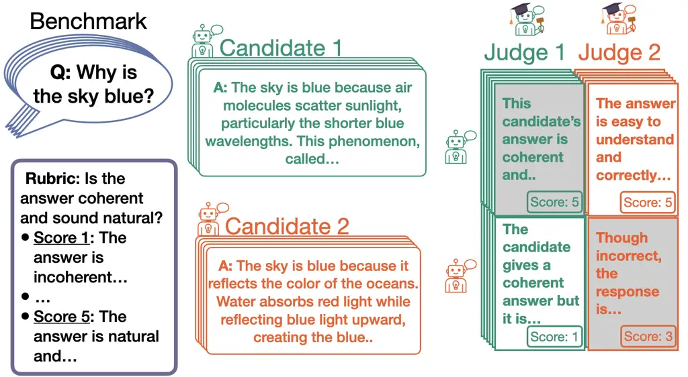
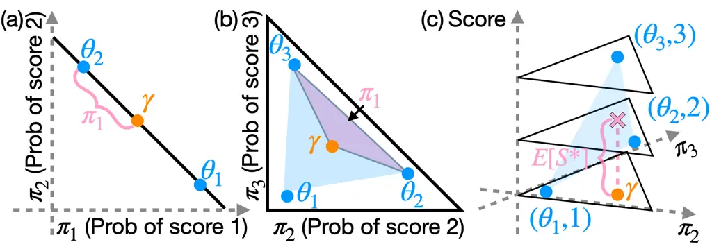
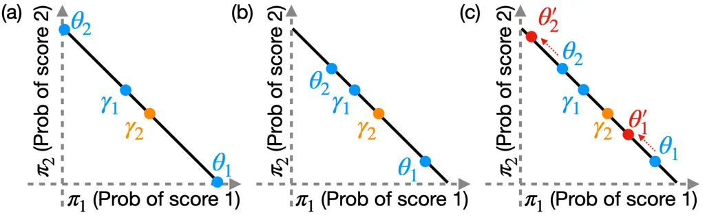
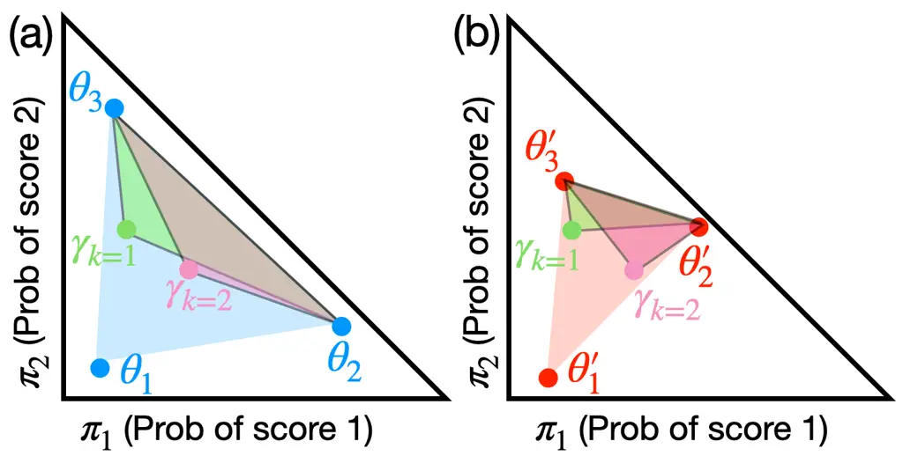
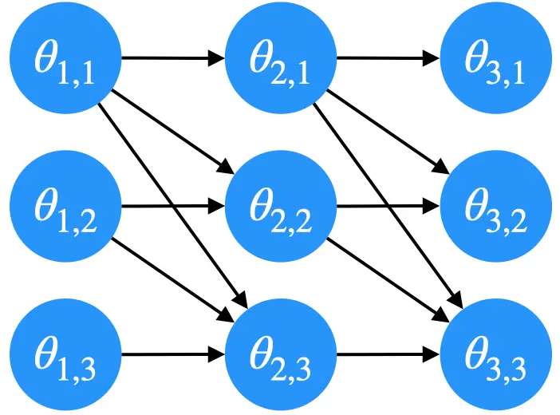
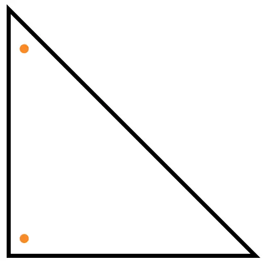
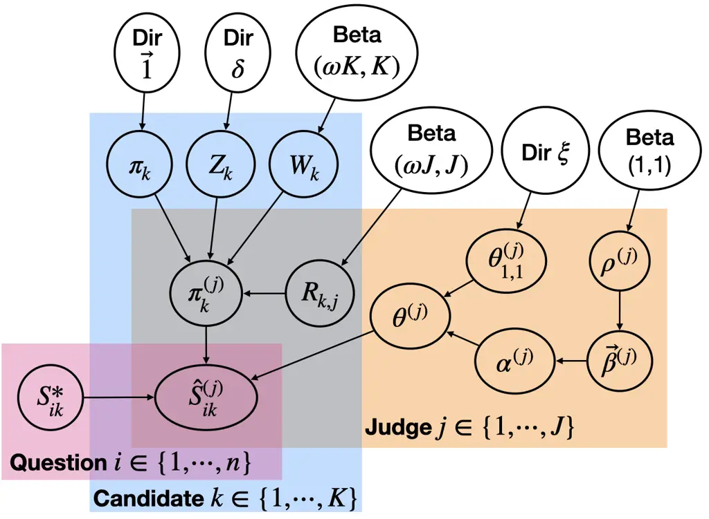

# LLMs Judging LLMs: A Simplex Perspective

###### Abstract

Given the challenge of automatically evaluating free-form outputs from
large language models (LLMs), a common solution is to use LLMs
themselves as judges, without any gold-standard scores. Implicitly, this
practice accounts for only sampling variability (aleatoric uncertainty)
and ignores uncertainty about judge quality (epistemic uncertainty).
While this is justified if judges are perfectly accurate, it is unclear
when such an approach is theoretically valid and practically robust. We
study these questions for the task of ranking LLM candidates from a
novel geometric perspective: for $`M`$-level scoring systems, both LLM
judges and candidates can be represented as points on an
$`(M-1)`$-dimensional probability simplex, where geometric concepts
(e.g., triangle areas) correspond to key ranking concepts. This
perspective yields intuitive theoretical conditions and visual proofs
for when rankings are identifiable; for instance, we provide a formal
basis for the “folk wisdom” that LLM judges are more effective for
two-level scoring ($`M=2`$) than multi-level scoring ($`M>2`$). Using
this geometric intuition, we design Bayesian priors that encode
epistemic uncertainty and vary the priors to conduct sensitivity
analyses. Experiments on LLM benchmarks show that rankings based solely
on LLM judges are robust in many but not all datasets, underscoring both
their widespread success and the need for caution. Our Bayesian method
achieves substantially higher coverage rates than existing procedures by
modeling epistemic uncertainty.

 

LLMs Judging LLMs: A Simplex Perspective

 

Patrick Vossler^(1∗)          Fan Xia^(1∗)          Yifan Mai²         
Adarsh Subbaswamy³          Jean Feng¹

¹University of California, San Francisco          ²Stanford University
         ³University of Maryland, Baltimore

¹¹footnotetext: Equal contribution

## 1 INTRODUCTION

Scalable benchmarking of large language models (LLMs) is increasingly
critical given the rapid proliferation of models, model updates, and new
benchmark datasets. While multiple choice or numerical answers can be
verified algorithmically, many benchmark tasks allow free-form text
responses that are more difficult to verify, such as clinical reasoning
expressed as natural language or mathematical proofs involving
multi-part LaTeX formulas. While the current gold standard of consensus
voting by multiple human experts is effective, it is often prohibitively
expensive and difficult to scale.

In response to these challenges, recent work has proposed using LLMs
themselves as judges (Figure 1) (Zheng et al., 2023b). Here we refer to
evaluator LLMs as “judges” and evaluated LLMs as “candidates.” This
now-common practice effectively treats LLM judges as perfectly accurate,
ignoring any uncertainty about their quality and acknowledging only
sampling variability (e.g., through bootstrapping or confidence
intervals). Borrowing terms from epistemology, the first source of
uncertainty is systematic or epistemic; due to the lack of gold-standard
data, one is uncertain about and cannot determine the true quality of
the judges. The second source of uncertainty is stochastic or aleatoric;
due to sampling variability, there is noise in the returned judge scores
but this type of uncertainty can be reduced by increasing sample size.
The goal of this work is to understand how epistemic uncertainty impacts
our ability to rank LLM candidates. We do so by answering two questions:
(i) from a theoretical standpoint, what are sufficient conditions for an
LLM-as-a-judge pipeline to identify the true rankings and (ii) from a
methodological standpoint, how can we quantify our confidence in
estimated rankings when we do not know if these theoretical conditions
hold in practice?



Figure 1: LLM judge workflow: For each benchmark question, LLM judges
score each candidate’s answer according to a rubric. Candidates are
ranked based on their judge-assigned scores. Shaded boxes indicate cases
where the same LLM serves as both candidate and judge (self-judging).

We show that a geometric perspective clarifies the role of epistemic
uncertainty and guides both theoretical and methodological development.
The key idea is that we can simultaneously visualize judge quality and
candidate score distributions on a probability simplex, where geometric
concepts (e.g., triangle areas) correspond to key ranking concepts.
Epistemic uncertainty manifests as uncertainty in the location of judge
points, while aleatoric uncertainty manifests as stochasticity of
candidate points. This representation allows us to reason about how the
relative positions of these points affect identifiability and estimation
of the true rankings.

Using this framework, we find that constancy of LLM judge behavior is
sufficient for ranking identifiability in two-level scoring systems.
However, this sufficiency breaks down when ranking across three or more
levels, uncovering a surprising phase transition. These theoretical
results motivate the development of a Bayesian framework for estimating
ranks, where we construct minimally-informative geometric priors that
encode our prior beliefs about judge quality. We then conduct
sensitivity analyses of estimated rankings by varying the strength of
the Bayesian priors, which corresponds to varying the level of epistemic
uncertainty.

Applying our framework to five LLM benchmark datasets, our sensitivity
analyses reveal that estimated candidate rankings are robust in some
cases (e.g., GPQA and SummEval) but not others (e.g., Omni-MATH). These
results explain the practical success of LLM judges, but also emphasize
the importance of their careful, measured use. The Bayesian framework
also achieves substantially higher coverage of the true rankings than
existing methods, since it captures both aleatoric and epistemic
uncertainty whereas standard approaches capture only the former. These
results underscore how incorporating epistemic uncertainty is necessary
for reliable rankings from LLM judges. Code for reproducing this work
and running the Bayesian inference pipeline is available at
[https://github.com/jjfenglab/judging-llms-on-a-simplex](https://github.com/jjfenglab/judging-llms-on-a-simplex).

## 2 RELATED WORK

LLM-as-a-judge and their implicit assumptions. While LLM judges have
emerged as a scalable alternative to traditional metrics that require
reference outputs (Papineni et al., 2001; Lin, 2004; Wang et al., 2023;
Chiang and Lee, 2023; Li et al., 2024; Gu et al., 2024), current
approaches may not fully capture all sources of uncertainty in their
rankings. LLM judges exhibit systematic biases such as position bias and
verbosity bias (Zheng et al., 2023b; Koo et al., 2024; Wei et al.,
2025), echoing known phenomena in human judgment—the halo
effect (Thorndike, 1920) and anchoring (Tversky and Kahneman, 1974).
Proposed mitigations—score averaging, juries, judge debates, rubrics
(Liang et al., 2023; Verga et al., 2024; Kalra and Tang, ; Chan et al.,
2024; Databricks, 2024; Lee et al., 2024)—implicitly assume that judges
are perfect or that their errors cancel out in expectation, ignoring
uncertainty about judge quality. While Guerdan et al. (2025) discussed
the limitations of LLM judges when there is no true agreed-upon rating
scale, we prove that even with agreed-upon scales, fundamental
identifiability limits exist that no averaging or ensemble method can
overcome.

Uncertainty quantification without ground truth. Existing uncertainty
quantification methods cannot address the fundamental challenge of
epistemic uncertainty about judge quality. Bootstrapping (Goldstein and
Spiegelhalter, 1996; Xie et al., 2009) only quantifies sampling
variation, leading to undercoverage when assumptions fail. Methods like
prediction-powered inference (Chatzi et al., 2024; Angelopoulos et al.,
2023), conformal inference (Jung et al., 2025), or consensus models
(Raykar et al., 2010; Welinder and Perona, 2010) can integrate LLM
judging if some subset of gold-standard labels are available for each
new model and benchmark, limiting scalability. Bradley-Terry models
(Bradley and Terry, 1952; Rao and Kupper, 1967; Herbrich et al., 2006;
Ameli et al., 2025), widely used in rating systems like Elo and Chatbot
Arena, assume strong stochastic transitivity, restricting their
applicability to settings where pairwise comparisons uniquely determine
a global ranking.

Crowdsourcing. A key statistical problem in crowdsourcing is to recover
the confusion matrix and impute the true labels for observations given
labels from noisy annotators (Dawid and Skene, 1979). This is related to
the problem of judging candidates given LLM judges, but a key difference
is this work’s focus on ranking candidates. The ranking perspective
allows us to use assumptions that are weaker than those typically
considered in the crowdsourcing literature (Welinder and Perona, 2010;
Ibrahim et al., 2019).

Imperfect reference standards. Using LLMs as imperfect judges parallels
evaluation of medical diagnostics with imperfect reference standards
(Reitsma et al., 2009; Umemneku Chikere et al., 2019; Sun and Zhou,
2025; Sun et al., 2024). Our results expand on ideas used in this field,
beyond the classical setting of evaluating binary diagnostic tests to
the case of multi-level ratings, which are commonly used for LLM
evaluation. The geometric arguments substantially extend (Fienberg and
Gilbert, 1970; Black and Craig, 2002; Jones et al., 2010; Duan et al.,
2020), which focused on identifying diagnostic test performance rather
than ranking and only considered the case with binary diagnostic tests.

## 3 A GEOMETRIC PERSPECTIVE

We study the LLM judge pipeline shown in Figure 1, where $`J`$ LLM
judges score answers by $`K`$ candidate LLMs to questions from a
benchmark task. Formally, denote the spaces of questions and answers as
$`\mathcal{Q}`$ and $`\mathcal{A}`$, respectively. A benchmark task is
defined by a distribution over questions $`Q\sim P_{\mathcal{Q}}`$ and a
true scoring function
$`s^{*}:\mathcal{Q}\times\mathcal{A}\to\{1,\ldots,M\}`$. Each candidate
$`k`$ is a (potentially stochastic) function
$`f_{k}:\mathcal{Q}\to\mathcal{A}`$ that generates answers, with true
score $`S^{*}_{k}=s^{*}(Q,f_{k}(Q))`$ for question $`Q`$. Candidate
$`k`$’s true score distribution is denoted
$`\pi_{k}=(\pi_{k,1},\ldots,\pi_{k,M})`$, where
$`\pi_{k,m}=\Pr(S^{*}_{k}=m)`$ is the frequency with which the candidate
achieves true score $`m`$. The goal is to recover the true ranking of
candidates with respect to their expected true scores
$`\mathbb{E}[S^{*}_{k}]=\sum_{m=1}^{M}m\cdot\pi_{k,m}`$.

We study the setting where both true scoring function $`s^{*}`$ and the
true scores $`S^{*}_{k}`$ are unobserved. Instead, we rely on the LLM
judge pipeline to obtain judge-assigned scores, which can be viewed as
noisy proxies. Each judge $`j=1,\cdots,J`$ is represented as a function
$`\hat{s}_{j}:\mathcal{Q}\times\mathcal{A}\to\{1,\ldots,M\}`$. So given
question $`Q`$ and candidate $`k`$’s answer, the judge assigns score
$`\hat{S}_{k}^{(j)}=\hat{s}_{j}(Q,f_{k}(Q))`$. Given infinite questions
drawn from the benchmark task, the distribution of judge-assigned scores
for candidate $`k`$ is
$`\gamma^{(j)}_{k}=(\gamma^{(j)}_{k,1},\ldots,\gamma^{(j)}_{k,M})`$,
where $`\gamma^{(j)}_{k,m}=\Pr(\hat{S}_{k}^{(j)}=m)`$ is the frequency
that judge $`j`$ assigns score $`m`$ to the candidate’s answers.



Figure 2: The true prevalence of the true scores corresponds to
barycentric coordinates; (a) and (b) highlight prevalence $`\pi_{1}`$ in
2- and 3-level scoring systems, respectively. A candidate’s expected
score corresponds to the height of vertical projection in the augmented
space, as illustrated in (c).

Using simple geometric arguments, we can relate the true score
distribution $`\pi_{k}`$ to the observed score distribution
$`\gamma_{k}^{(j)}`$ using judge $`j`$’s confusion matrix for candidate
$`k`$. In particular, let the $`m`$th column of the judge’s confusion
matrix for candidate $`k`$ represent the distribution of assigned scores
for answers with true score $`m`$, i.e.,

```math
\displaystyle\theta^{(j)}_{m,k}=\big(\Pr(\hat{S}_{k}^{(j)}=1|S^{*}_{k}=m),\ldots,\Pr(\hat{S}_{k}^{(j)}=M|S^{*}_{k}=m)\big).
```

Each of the judge’s confusion matrix columns $`\theta^{(j)}_{m,k}`$ for
$`m=1,\cdots,M`$ lie on the $`(M-1)`$-dimensional probability simplex
and, critically, the candidate’s judge-assigned score distribution
$`\gamma_{k}^{(j)}`$ is the convex combination of these columns with
respect to true score distribution, i.e.,
$`\gamma^{(j)}_{k}=\sum_{m=1}^{M}\pi_{k,m}\theta^{(j)}_{m,k}.`$ As
examples, Figure 2a shows how the judge and candidate in a 2-level
scoring system all fall on a line segment and Figure 2b shows how these
points in a 3-level scoring system all fall within a triangle. Using
this geometric perspective, we can then establish equivalences between
geometric concepts to key ranking concepts:

1. True score distributions correspond to barycentric coordinates.
   $`\pi_{k}`$ corresponds precisely to the barycentric coordinates for the
   weighted centroid $`\gamma^{(j)}_{k}`$ relative to judge vertices
   $`\theta^{(j)}_{m,k}`$, which are also known as areal coordinates
   because they can be expressed as ratios of simplex sub-areas. For
   instance, for $`M=3`$, $`\pi_{k,1}`$ equals the area of the subtriangle
   from the weighted centroid to the 2nd and 3rd vertices divided by the
   area of the triangle defined by all vertices (Figure 2b), i.e.,

```math
\displaystyle\pi_{k,1}=\frac{\text{Area of }\triangle_{(\gamma_{k},\theta_{2},\theta_{3})}}{\text{Area of }\triangle_{(\theta_{1},\theta_{2},\theta_{3})}}, \tag{1}
```

with $`\pi_{k,2}`$ and $`\pi_{k,3}`$ defined analogously. This geometric
characterization extends to any $`M`$.

2. Expected scores map to height in augmented space. If we augment the
   probability simplex with an additional axis representing score values
   and lift each judge vertex $`\theta^{(j)}_{m,k}`$ to height $`m`$, the
   vertices form an augmented simplex (Figure 2c). Then, as proved in the
   Appendix, candidate $`k`$’s expected score $`\mathbb{E}[S^{*}_{k}]`$
   corresponds precisely to the height of its vertical projection onto this
   augmented simplex.

3. Epistemic uncertainty manifests as unknown positions of judge
   vertices. When multiple configurations of judge vertices are compatible
   with the observed set of candidate points, the location of the judge
   vertices cannot be determined. Thus epistemic uncertainty of judge
   quality is represented by uncertainty in the location of judge vertices.

4. Aleatoric uncertainty manifests as stochasticity of candidate points.
   Aleatoric uncertainty is sampling variability, which corresponds to us
   observing the empirical judge-assigned score distributions
   $`\hat{\gamma}_{k,n}^{(j)}`$ for a benchmark dataset with $`n`$
   questions, rather than the expected judge-assigned score distribution
   $`\gamma_{k}^{(j)}`$.

## 4 THEORETICAL LIMITS OF RANKING IDENTIFIABILITY



Figure 3: Visualization of judge assumptions for the 2-level scoring
setting. We suppose there are two LLMs (1=blue, 2=orange), where both
are candidates (with score distributions $`\gamma_{1}`$ and
$`\gamma_{2}`$) and LLM 1 is a judge. (a) Perfect Judge assumes judge
vertices $`(\theta_{1},\theta_{2})`$ are at the extremes of the
1-dimensional probability simplex. (b) Strong Constancy assumes the
vertex positions for the judge are same across all candidates. (c)
Moderate Constancy assumes the vertex positions for the judge only
differ when self-judging (indicated by the red shifted vertices).

Using this geometric framework, we now investigate when true rankings
can or cannot be recovered from LLM judge scores without ground truth
labels. To understand the theoretical limits, we assume access to
infinite data samples, resulting in zero aleatoric uncertainty and
leaving only epistemic uncertainty. To clarify these limits, we consider
assumptions that idealize judge behavior to varying degrees; Section 5
relaxes these idealizations for practical inference.

In the most general case with zero constraints on the LLM judge
behaviors, our geometric visualization will have $`J\times K\times M`$
points representing the performance of the $`J`$ judges across the $`K`$
candidates as well as $`J\times K`$ points representing the score
distributions assigned by each judge to each candidate. The true
rankings are generally nonidentifiable in this setting, so we must
impose structure on judge behavior. Thus we consider assumptions, that
when imposed, may sufficiently reduce epistemic uncertainty to make the
true rankings identifiable.

The strongest assumption is to assume the judges are perfect. The
confusion matrices collapse to the identity matrix, placing all judge
vertices at the simplex corners (Figure 3a). If true, this assumption
would obviously make the true rankings identifiable for any value of
$`J`$, $`M`$, and/or $`K`$. However, this is likely unrealistic.

A weaker and somewhat more realistic assumption is that the judge’s
performance is perfectly consistent across candidates (Strong
Constancy). Mathematically, this corresponds to the confusion matrix
being the same across candidates, i.e., the vertices for each judge
$`j`$ are shared across candidates (Figure 3b).

###### Assumption 1 (Strong Constancy).

The confusion matrix of judge $`j`$ is identical across all $`K`$
candidates: For each $`m`$, there is some $`\theta^{(j)}_{m}`$ such that
$`\theta^{(j)}_{m,k}=\theta^{(j)}_{m}`$ for $`k=1,\cdots,K`$.

A weaker assumption that allows for self-preference bias (Koo et al., 2024) is to suppose that the LLM judge is perfectly consistent as long
as it is not judging itself (Moderate Constancy). This can be visualized
by a separate set of vertices when the LLM is judging itself but a
shared set of vertices otherwise (Figure 3c).

###### Assumption 2 (Moderate Constancy).

Judge $`\hat{s}_{j}`$ has an identical confusion matrix for all non-self
candidates: For each $`m`$, there is some $`\theta^{(j)}_{m}`$ such that
$`\theta^{(j)}_{m,k}=\theta^{(j)}_{m}`$ for all $`k\neq j`$.¹¹ 1 For
simplicity, the theoretical results study the case where self-judging
means the same LLM judges itself. In practice, we exclude judges from
judging their model family.

While one may consider even weaker assumptions, we study the
implications of these two constancy conditions on ranking
identifiability, as even here the results are nuanced. These theoretical
results then motivate our framework in the next section for estimating
ranks and quantifying uncertainty.

### 4.1 2-level scoring systems

Let us consider the simplest setting: a 2-level scoring system with a
single judge that satisfies Strong Constancy. In this setting, all
candidates must lie on the line segment between the two judge vertices
$`\theta_{1}`$ and $`\theta_{2}`$. Figure 2 (left) provides a visual
proof why the true ranking is identifiable: for 2-level scoring, ranking
candidates by expected true score reduces to ranking them by their
prevalence of the higher score, which is determined by their order along
the line segment. This is true even though we do not know the exact
positions of the judge vertices and even if the LLM judges are far from
perfect. In fact, our only requirement is that the judges are not
adversarial (to avoid the so-called “label-flipping problem” (Sun and
Zhou, 2025)), i.e.,

###### Assumption 3.

Judge $`j`$’s probability of assigning the lowest score when the true
score is equal to $`m`$ decreases with respect to $`m`$.

For 2-level scoring, this is a weak condition as it only requires the
judges to perform better than random.

The result under Moderate Constancy is analogous. Using similar
geometric reasoning (see Appendix), we find that the only difference is
that at least two judges and four candidates are needed to obtain enough
information to recover the true ranking.


Remark. For completeness, we present in the Appendix necessary and
sufficient conditions for recovering rankings in two-level systems. The
geometry is complex, so we defer the details to the appendix.

### 4.2 3+-level scoring systems

Results for scoring systems with 3 or more levels are qualitatively
different. Below, we present geometric arguments for 3-level scoring
systems, but the same arguments extend to more levels. To build
intuition, we first discuss the tasks of (i) ranking the prevalence of
each score and then (ii) ranking the expected scores.

(i) Ranking prevalences. Without loss of generality, suppose we wanted
to rank the prevalence of true score $`m=1`$. As mentioned in Section 3,
this is equivalent to ranking the barycentric coordinates $`\pi_{k,1}`$
across candidates $`k=1,\cdots,K`$, which are defined as the area ratios
(1). Under strong constancy, the denominators of these ratios are the
same for all $`k`$, so ranking $`\pi_{k,1}`$ reduces to ranking the
areas of the subtriangles
$`\triangle_{(\gamma_{k},\theta_{2},\theta_{3})}`$ Nevertheless, we find
that the rankings are non-identifiable in general, even under strong
constancy. Figure 4 provides a visual proof: panels (a) and (b) show two
equally valid judge configurations
($`\{\theta_{1},\theta_{2},\theta_{3}\}`$ versus
$`\{\theta^{\prime}_{1},\theta^{\prime}_{2},\theta^{\prime}_{3}\}`$)
that can explain candidate score distributions $`\gamma_{k=1}`$ and
$`\gamma_{k=2}`$, as both judge configurations envelop the candidate
points. However, the areas flip between configurations. In panel (a),
subtriangle $`\triangle_{(\gamma_{1},\theta_{2},\theta_{3})}`$ has
greater area than $`\triangle_{(\gamma_{2},\theta_{2},\theta_{3})}`$,
while in panel (b) this relationship reverses. Thus the two panels show
that even under strong constancy, the rankings of the score prevalences
cannot be recovered if there is no prior knowledge about judge quality.



Figure 4: Non-identifiability in 3-level scoring. Same candidate
positions (green/pink) explained by different judge configurations yield
opposite prevalence rankings: $`\pi_{1,1}>\pi_{2,1}`$ in (a) vs.
$`\pi_{1,1}<\pi_{2,1}`$ in (b).

(ii) Ranking expected scores. Given the nonidentifiability of prevalence
rankings, the ranking of expected true scores is also nonidentifiable
without gold standard labels. To see this, recall that each candidate’s
expected score corresponds to the height of its vertical projection onto
the augmented simplex (Figure 2c); these heights change when the judge
vertices shift, which can lead to a reordering of candidates. This
argument applies under either constancy assumption and for any number of
judges.

Together, these results illustrate that epistemic uncertainty can
significantly affect recoverability of the true rankings, even when
aleatoric uncertainty is removed.


### 4.3 Recoverability is dataset-specific

The prior theoretical results show that recoverability depends not only
on judge quality assumptions but also the problem setting. In
particular, Theorems 1 and 2 uncover a dependence on the number of
scoring levels, supporting the “folk wisdom” that LLM judges tend to be
more effective for 2-level scoring systems and less effective for
3+levels (Shankar et al., 2024; Husain, 2025). The geometric perspective
further reveals that recoverability is, in fact, dataset-specific, as
illustrated in the following two examples. This means we need a way to
rigorously quantify how sensitive the estimated rankings for a given
dataset are to varying levels of epistemic uncertainty, which we address
using Bayesian inference in the next section.

Example 1: Dataset requiring stronger priors. Consider again the
Figure 4 example and the task of ranking prevalence of score $`m=1`$.
Intuitively, the judge configuration in panel (a) may seem more probable
than panel (b) if we believe that LLM judges can distinguish scores 2
and 3 moderately well. To formalize this prior belief, we distill it
using geometric arguments. In particular, ranking $`\pi_{k,1}`$ is
equivalent to ranking areas of subtriangles
$`\triangle{\gamma_{k},\theta_{2},\theta_{3}}`$. Because all the
subtriangles have the same line segment
$`\overline{\theta_{2}\theta_{3}}`$ as the base, ranking areas is
equivalent to ranking distances from each candidate $`\gamma_{k}`$ to
the line $`\overrightarrow{\theta_{2}\theta_{3}}`$. Because ranking
distances only require knowing the slope of this line, it is sufficient
to state our prior belief about judge quality in terms of slopes. This
is something we generally have a good prior about. In contrast, it is
generally more difficult to specify one’s prior about the exact location
of the judge vertices, since LLMs are often miscalibrated (Wang et al.,
2024a).

Example 2: Dataset allowing weaker priors. Consider a candidate
receiving mostly 1’s versus another receiving mostly 3’s from an LLM
judge (see visualization in Appendix). When score distributions are so
different, the ranking between two candidates may be quite evident, even
if we have limited prior knowledge on the performance of the LLM judges
and even if the constancy assumptions do not hold. However, we need a
method to quantify when constancy violations flip rankings, as discussed
in the next section.

## 5 BAYESIAN FRAMEWORK

The theoretical results show that epistemic uncertainty impacts our
ability to rank candidates but that the level of impact is
dataset-specific. To model this, we design a Bayesian framework that
encodes epistemic uncertainty through two priors: (i) how strongly the
constancy assumption holds, represented by random effects (Section 5.2),
and (ii) prior beliefs about judge discriminative ability, represented
by slopes between judge vertices (Section 5.3). We can then conduct
sensitivity analyses that assess the ranking robustness to varying
levels of epistemic uncertainty, by systematically varying the strength
of the Bayesian priors. Moreover, by defining appropriate hyperpriors,
we can fully marginalize over our epistemic uncertainty when conducting
posterior inference for candidate rankings. We describe the key
components of the Bayesian model here; the full specification appears in
the Appendix.

### 5.1 A base probability model

As the base probability model, the assigned score $`\hat{S}_{ik}^{(j)}`$
by judge $`j`$ to candidate $`k`$’s answer to the $`i`$-th question,
given its true score $`S_{ik}^{*}`$, is modeled as independent draws
from a multinomial distribution with parameter
$`\theta_{S_{ik}^{*},k}^{(j)}`$. Marginalizing out the true latent
scores, the likelihood of the observed data is

```math
\displaystyle\prod_{i=1}^{n}\prod_{j=1}^{J}\prod_{k\neq j}\Big[\sum_{m=1}^{M}\underbrace{\Pr\left(\hat{S}^{(j)}_{ik}|S_{ik}^{*}=m;\theta_{m,k}^{(j)}\right)}_{=\theta_{m,k,\hat{S}^{(j)}_{ik}}^{(j)}}\underbrace{\Pr(S_{ik}^{*}=m)}_{=\pi_{k,m}}\Big],
```

where $`n`$ is the number of questions. To remove the influence of
self-preference, note that we filter for $`k\neq j`$.

The base model assumes conditional independence given the true score for
computational tractability. In practice, residual correlation is still
likely, as LLMs are trained on similar datasets. This will be naturally
addressed by random effects introduced in the next section, which is
motivated from the different angle of relaxing the constancy assumption.

### 5.2 Prior for relaxing constancy

To relax the constancy assumptions (Assumptions 1 and 1), we model the
prevalence of each judge-assigned score for a given candidate using
random effects relative to a “base” score prevalence $`\vec{\pi}_{k}`$:

```math
\displaystyle\vec{\pi}_{k}^{(j)}=(1-W_{k}R_{j})\vec{\pi}_{k}+W_{k}R_{j}Z_{k}
```

where $`Z_{k}\sim\text{Dirichlet}(\delta)`$ determines the direction of
the deviation, $`R_{j}\sim\text{Beta}(\omega J,J)`$ controls the
judge-specific magnitude, and $`W_{k}\sim\text{Beta}(\omega K,K)`$
controls the candidate-specific magnitude. The hyperparameter
$`\omega\in[0,\infty)`$ controls the degree of constancy violation
through the random effect magnitude, where $`\omega=0`$ enforces perfect
constancy and increasing $`\omega`$ allows progressively larger
violations. For instance, $`\omega=1`$ expects random effects to
contribute half of the effect, while $`\omega=8`$ expects a contribution
of 90%.

### 5.3 Prior for varying judge quality



Figure 5: Weight propagation framework for encoding judge quality priors
in 3-level scoring, where outgoing edge weights must sum to 1. The
probability of the judge assigning score $`m_{2}`$ when the true score
is $`m_{1}`$, $`\theta_{m_{1},m_{2}}`$, equals the weighted sum of all
its parent nodes per the incoming edge weights.

To construct a Bayesian prior over slopes between judge vertices, we
parameterize the judge vertices in terms of a weight propagation graph
(Figure 5), where each element in the confusion matrix is an average of
its parent nodes weighted by edge weights $`\alpha`$, i.e.,
$`\theta_{\texttt{v}}^{(j)}=\sum_{\texttt{u}\rightarrow\texttt{v}}\theta_{\texttt{u}}^{(j)}\alpha_{\texttt{u}\rightarrow\texttt{v}}`$.
As such, the slopes between vertices are directly controlled in terms of
edge weights. This parameterization encodes the prior belief that judges
tend to assign scores close to the true score more often than distant
ones, while remaining flexible enough to accommodate varying degrees of
judge quality. The graph structure also enforces the monotonicity
requirement (Assumption 3) by construction. We discuss alternative prior
specifications considered in Appendix E.4.

For each node v, we place a Dirichlet prior over the outgoing edge
weights $`\alpha_{\texttt{v}}`$ indexed by a single hyperparameter
$`\beta_{\max}`$, where increasing $`\beta_{\max}`$ corresponds to more
discriminative judges. For instance, in 3-level scoring, the Dirichlet
prior for outgoing edges from node $`\theta_{m_{1},m_{2}}`$ has
parameters $`\vec{\beta}_{m_{1},m_{2}}=[1,1+\rho\cdot\beta_{\max},1]`$
with $`\rho\sim\text{Beta}(1,1)`$. Full details are in the Appendix.

### 5.4 Conducting sensitivity analyses

Using this model, we develop a practical protocol for sensitivity
analysis to understand how epistemic uncertainty influences confidence
in the estimated rankings. In the absence of strong prior knowledge
about LLM judge behavior, we recommend the following:

1.  1.  Start with conducting Bayesian inference with hyperparameters
        $`\omega=0`$ (perfect constancy) and $`\beta_{\max}=5`$ (moderate
        judge quality).
2.  2.  Estimate how rankings shift as the constancy assumption is relaxed,
        by increasing $`\omega`$ from 0 to 8 while holding $`\beta_{\max}`$
        fixed.
3.  3.  Estimate how rankings shift as our prior over judge quality varies,
        by varying $`\beta_{\max}`$ from 0 to 20 while holding $`\omega=0`$.

If rankings remain stable across parameter variations, the conclusions
are reliable despite epistemic uncertainty. Otherwise, one may need to
inject additional prior knowledge (e.g., narrow the range of plausible
hyperparameter values) or obtain gold-standard labels.

## 6 EXPERIMENTS

Figure 6: Top: Sensitivity of estimated rankings when varying random
effects (RE, left) and judge quality (right) hyperparameters, by
plotting the correlation between the estimated ranking for each
hyperparameter and their base values ($`\omega=0,\beta_{\max}=0)`$.
Bottom: Candidates visualized on the probability simplex with judge
configurations sampled from posterior (blue triangles), for MTBench
(left) and Omni-MATH (right). We collapse 5-level ratings to 3 levels
for visualization (see Appendix for mapping details).

Here we present experiments across various LLM benchmarks to assess the
impact of epistemic uncertainty on ranking. First, using the geometric
Bayesian framework, we conduct sensitivity analyses to determine the
robustness of learned rankings. Second, we compare the overall
performance of the Bayesian framework to existing methods in terms of
coverage and correlation with ground truth rankings. We present our main
experimental results below, with ablation studies, implementation
details, and extended analyses in the Appendix.

We evaluate the Bayesian framework across three categories of benchmark
datasets: (i) Verifiable tasks with 2-level scores: GPQA (Rein et al., 2023) and MMLU Pro (Wang et al., 2024b) contain multiple-choice
questions graded as correct/incorrect, with judges having an abstention
option. (ii) Multi-level human-judged tasks: MTBench (Zheng et al.,
2023a) evaluates multi-turn conversations while SummEval (Völske et al., 2017) assesses summarizations. Both datasets are assessed on multi-level
Likert scales, by LLMs as well as human experts. (iii) “Semi-verifiable”
tasks: Omni-MATH (Gao et al., 2024) contains mathematical reasoning
problems with reference solutions, though there is no single
ground-truth answer. LLM judges are asked to evaluate answers on a
3-level scale (correct, partial credit, incorrect).

We use a two-stage protocol to compare ranking methods. First, LLM
judges evaluate candidates without access to ground truth, mirroring
real-world usage. Second, we generate ground-truth scores for each
answer by comparing against the correct multiple-choice answer on
verifiable tasks and obtaining human-assigned scores for human-judged
tasks. For semi-verifiable tasks, we rescore each candidate’s answer by
providing the LLM judge with the provided reference answer. For GPQA,
MMLU Pro, and Omni-MATH, we evaluated 19 contemporary models including
Claude, GPT, Gemini, Llama, Mistral, and Qwen variants, with Claude 3.5
Haiku and GPT-4o mini serving as judges. These judges were deliberately
selected to assess the performance of ranking methods when the judges
are imperfect. For MTBench and SummEval, we utilize their existing
candidates and judges.

### 6.1 Sensitivity analyses

Figure 7: Estimated rankings for the top 10 candidates on GPQA,
presented in order by their true rankings. Unlike existing methods,
Bayesian method fully incorporates epistemic uncertainty.

| Method         | GPQA                          |                               | MMLU                          |                               | Omni-MATH                     |                               | SummEval                      |                               | MTBench                       |                               |
| -------------- | ----------------------------- | ----------------------------- | ----------------------------- | ----------------------------- | ----------------------------- | ----------------------------- | ----------------------------- | ----------------------------- | ----------------------------- | ----------------------------- |
|                | Corr                          | Cov                           | Corr                          | Cov                           | Corr                          | Cov                           | Corr                          | Cov                           | Corr                          | Cov                           |
| Bayesian       | 0.916 \[-0.1em\] (0.87, 0.94) | 0.889 \[-0.1em\] (0.72, 0.94) | 0.940 \[-0.1em\] (0.85, 0.95) | 1.000 \[-0.1em\] (0.90, 1.00) | 0.791 \[-0.1em\] (0.60, 0.83) | 0.737 \[-0.1em\] (0.37, 0.79) | 0.888 \[-0.1em\] (0.76, 0.91) | 0.917 \[-0.1em\] (0.67, 0.95) | 1.000 \[-0.1em\] (0.94, 1.00) | 1.000 \[-0.1em\] (1.00, 1.00) |
| Bootstrap      | 0.922 \[-0.1em\] (0.88, 0.93) | 0.556 \[-0.1em\] (0.51, 0.83) | 0.884 \[-0.1em\] (0.84, 0.90) | 0.474 \[-0.1em\] (0.49, 0.68) | 0.767 \[-0.1em\] (0.71, 0.80) | 0.368 \[-0.1em\] (0.37, 0.47) | 0.885 \[-0.1em\] (0.78, 0.90) | 0.729 \[-0.1em\] (0.65, 0.96) | 0.943 \[-0.1em\] (0.94, 1.00) | 1.000 \[-0.1em\] (1.00, 1.00) |
| Bradley-Terry  | 0.901 \[-0.1em\] (0.88, 0.92) | 0.389 \[-0.1em\] (0.39, 0.67) | 0.886 \[-0.1em\] (0.84, 0.90) | 0.474 \[-0.1em\] (0.38, 0.58) | 0.767 \[-0.1em\] (0.72, 0.79) | 0.368 \[-0.1em\] (0.37, 0.42) | 0.902 \[-0.1em\] (0.82, 0.91) | 0.771 \[-0.1em\] (0.61, 0.91) | 0.943 \[-0.1em\] (0.94, 1.00) | 1.000 \[-0.1em\] (0.67, 1.00) |
| Simple Average | 0.922 \[-0.1em\] (0.88, 0.93) | 0.130 \[-0.1em\] (0.02, 0.28) | 0.884 \[-0.1em\] (0.84, 0.90) | 0.211 \[-0.1em\] (0.14, 0.28) | 0.767 \[-0.1em\] (0.71, 0.80) | 0.228 \[-0.1em\] (0.18, 0.33) | 0.885 \[-0.1em\] (0.78, 0.90) | 0.271 \[-0.1em\] (0.09, 0.54) | 0.943 \[-0.1em\] (0.94, 1.00) | 0.667 \[-0.1em\] (0.67, 1.00) |
| Single Judge   | 0.869 \[-0.1em\] (0.81, 0.90) | 0.130 \[-0.1em\] (0.02, 0.28) | 0.855 \[-0.1em\] (0.81, 0.89) | 0.211 \[-0.1em\] (0.14, 0.28) | 0.725 \[-0.1em\] (0.70, 0.75) | 0.228 \[-0.1em\] (0.18, 0.33) | 0.787 \[-0.1em\] (0.58, 0.86) | 0.285 \[-0.1em\] (0.06, 0.45) | 0.971 \[-0.1em\] (0.94, 1.00) | 0.833 \[-0.1em\] (0.67, 1.00) |

Table 1: Ranking method performance on benchmarks in terms of
correlation and coverage of ground-truth ranks.

For each benchmark dataset, we conducted Bayesian inference with random
effects hyperparameter $`\omega`$ values of 0, 1, 2, 4, and 8,
corresponding to expected random effect magnitudes of approximately 0,
0.5, 0.7, 0.8, and 0.9 respectively. Figure 6 (left) shows that rankings
remain remarkably stable across these variations for most datasets. The
correlation between rankings at different $`\omega`$ values and the
baseline rankings exceeds 0.95 for GPQA, MTBench, and SummEval,
indicating that significant violations of the constancy assumption have
minimal impact on the resulting rankings. Similarly, varying the judge
quality hyperparameter $`\beta_{\max}`$ from 1 to 20 produces negligible
effects on rankings across all datasets (Figure 6 right), with
correlations consistently above 0.99. This insensitivity to the judge
quality prior suggests that the observed score data are sufficiently
informative to overwhelm the prior on judge discrimination, making the
resulting rankings robust to prior beliefs about $`\beta_{\max}`$.
However, both MMLU Pro and Omni-MATH show greater sensitivity to the
constancy assumption, with correlations between baseline rankings
dropping to 0.77 and 0.86 respectively when $`\omega`$ is increased from
0 to 8. This sensitivity appears pronounced for MMLU Pro for
$`\omega>4`$, highlighting uncertainty in its rankings because of
potential variability in judge performance across candidates.

To understand why estimated rankings are more or less robust, we can
visualize the candidates in the probability simplex against possible
judge configurations sampled from the posterior distribution of the
Bayesian method. Here we compare two contrasting datasets to illustrate
why some benchmarks are robust to epistemic uncertainty while others are
not. As shown in Figure 6 left, estimated rankings for MTBench are
robust even when the constancy assumption is relaxed because (i)
candidates are well-separated across the simplex, with clear performance
tiers and (ii) the posterior judge configurations are relatively
consistent with similar triangular shapes with minimal variability. In
contrast, Figure 6 right shows that estimated rankings for Omni-MATH are
more sensitive to epistemic uncertainty because (i) candidates cluster
tightly in the central region with overlapping score distributions,
making their relative ordering sensitive to judge vertex positions, and
(ii) the posterior samples demonstrate considerable uncertainty in the
judge configurations. Simplex visualizations for MMLU Pro and GPQA are
provided in the Appendix.

### 6.2 Comparative performance evaluation

While Section 6.1 examined ranking estimates qualitatively, this section
will evaluate ranking estimates from the Bayesian framework
quantitatively, in terms of Spearman correlation between estimated and
ground-truth rankings (ranking accuracy) and coverage rate of 95%
credible or confidence intervals (calibration). To produce a single
point estimate from our Bayesian framework rather than a sensitivity
curve, we place hyperpriors over $`\omega`$ and $`\beta_{\max}`$,
integrating out epistemic uncertainty during posterior inference. We
compare against the following four baselines: single judge scoring (the
score from one LLM judge, without adjudication), simple averaging across
multiple judges, bootstrap confidence intervals (Xie et al., 2009), and
Bradley-Terry pairwise comparison models (Bradley and Terry, 1952).

The Bayesian framework consistently achieves higher correlations and
better coverage across all benchmark datasets (Table 1), with coverage
rates improving by over 20 percentage points in some cases. This
dramatic improvement in coverage reflects our theoretical finding that
epistemic uncertainty is essential for proper uncertainty
quantification. The correlation improvements, while more modest,
demonstrate that incorporating judge uncertainty also benefits ranking
estimates. Figure 7 illustrates how this coverage improvement is
achieved: as seen on the GPQA dataset, the intervals from Bayesian
inference are indeed significantly wider than those produced by
comparator methods. These wider intervals reflect genuine epistemic
uncertainty about judge quality. Baseline methods produce narrower
intervals by treating judge parameters as known, which leads to
systematic undercoverage when those assumptions are violated (Table 1).
Conversely, credible intervals that are narrow represent areas of low
posterior uncertainty, which can occur due to the discrete nature of
ranks as well as the consistency in ranks assigned by judges. Posterior
distributions for the other datasets are given in the Appendix.

## 7 DISCUSSION

This work presents a geometric framework for understanding when
gold-standard rankings can and cannot be recovered from only scores
assigned by imperfect LLM judges and not gold-standard scores. By
representing judges and candidates on a probability simplex, we
establish theoretical conditions for ranking identifiability and develop
a sensitivity analysis approach. Our key conclusion is that epistemic
uncertainty about judge quality critically affects ranking reliability
and is not captured by existing methods. The geometric perspective
reveals that identifiability depends on scoring levels, judge
consistency, and candidate separation in the simplex.

Future work includes deriving formal guarantees on the maximum
achievable ranking accuracy given judge quality constraints, and
extending the framework to more diverse judge ensembles and scoring
rubrics. In addition, the Bayesian framework can be readily extended to
incorporate gold-standard labels when they are available, as a Bayesian
extension of methods like prediction-powered inference (Angelopoulos et
al., 2023). Finally, more work can be done to understand the tradeoffs
between different methods for improving ranking estimates, such as
through statistical correction in this work versus the collection of a
small set of gold-standard scores; we include basic experiments
comparing the two options in the Appendix.

## ACKNOWLEDGMENTS

J.F. and P.V. were supported through a Patient-Centered Outcomes
Research Institute^(®) (PCORI^(®)) Award (ME-2022C1-25619). The authors
thank Gene Pennello and Nicholas Petrick (U.S. Food and Drug
Administration, Center for Devices and Radiological Health) for helpful
discussions.

## References

- Ameli et al. (2025) S. Ameli, S. Zhuang, I. Stoica, and M. W. Mahoney
  A statistical framework for ranking LLM-based chatbots. In The
  Thirteenth International Conference on Learning Representations, Cited
  by: §2.
- Angelopoulos et al. (2023) A. N. Angelopoulos, S. Bates, C.
  Fannjiang, M. I. Jordan, and T. Zrnic Prediction-powered inference.
  Science 382 (6671), pp. 669–674 (en). Cited by: §D.3.1, §2, §7.
- Black and Craig (2002) M. A. Black and B. A. Craig Estimating disease
  prevalence in the absence of a gold standard. Stat. Med. 21 (18),
  pp. 2653–2669 (en). Cited by: §2.
- Bradley and Terry (1952) R. A. Bradley and M. E. Terry Rank analysis
  of incomplete block designs: I. the method of paired comparisons.
  Biometrika 39 (3/4), pp. 324 (en). Cited by: §2, §6.2.
- Chan et al. (2024) C. Chan, W. Chen, Y. Su, J. Yu, W. Xue, S.
  Zhang, J. Fu, and Z. Liu ChatEval: towards better LLM-based evaluators
  through multi-agent debate. In The Twelfth International Conference on
  Learning Representations, Cited by: §2.
- Chatzi et al. (2024) I. Chatzi, E. Straitouri, S. Thejaswi, and M. G.
  Rodriguez Prediction-powered ranking of large language models. In The
  Thirty-eighth Annual Conference on Neural Information Processing
  Systems, Cited by: §2.
- Chiang and Lee (2023) C. Chiang and H. Lee Can large language models
  be an alternative to human evaluations?. Annual Meeting of the
  Association for Computational Linguistics, pp. 15607–15631. Cited by:
  §2.
- Databricks (2024) Databricks Enhancing LLM-as-a-judge with grading
  notes. (en). Note:
  [https://www.databricks.com/blog/enhancing-llm-as-a-judge-with-grading-notes](https://www.databricks.com/blog/enhancing-llm-as-a-judge-with-grading-notes)Accessed:
  2025-2-14 Cited by: §2.
- Dawid and Skene (1979) A. P. Dawid and A. M. Skene Maximum likelihood
  estimation of observer error-rates using the EM algorithm. J. R. Stat.
  Soc. Ser. C. Appl. Stat. 28 (1), pp. 20. Cited by: §2.
- Duan et al. (2020) R. Duan, M. Cao, Y. Ning, M. Zhu, B. Zhang, A.
  McDermott, H. Chu, X. Zhou, J. H. Moore, J. G. Ibrahim, D. O.
  Scharfstein, and Y. Chen Global identifiability of latent class models
  with applications to diagnostic test accuracy studies: a gröbner basis
  approach. Biometrics 76 (1), pp. 98–108 (en). Cited by: §2.
- Fabbri et al. (2021) A. R. Fabbri, W. Kryściński, B. McCann, C.
  Xiong, R. Socher, and D. Radev SummEval: re-evaluating summarization
  evaluation. Trans. Assoc. Comput. Linguist. 9, pp. 391–409 (en). Cited
  by: 4th item, §D.3, §D.4.2.
- Fienberg and Gilbert (1970) S. E. Fienberg and J. P. Gilbert The
  geometry of a two by two contingency table. J. Am. Stat. Assoc. 65
  (330), pp. 694–701 (en). Cited by: §2.
- Gao et al. (2024) B. Gao, F. Song, Z. Yang, Z. Cai, Y. Miao, Q.
  Dong, L. Li, C. Ma, L. Chen, R. Xu, Z. Tang, B. Wang, D. Zan, S.
  Quan, G. Zhang, L. Sha, Y. Zhang, X. Ren, T. Liu, and B. Chang
  Omni-MATH: a universal olympiad level mathematic benchmark for large
  language models. In The Thirteenth International Conference on
  Learning Representations, Cited by: 5th item, §6.
- Goldstein and Spiegelhalter (1996) H. Goldstein and D. J.
  Spiegelhalter League tables and their limitations: statistical issues
  in comparisons of institutional performance. J. R. Stat. Soc. Ser. A
  Stat. Soc. 159 (3), pp. 385 (en). Cited by: §2.
- Gu et al. (2024) J. Gu, X. Jiang, Z. Shi, H. Tan, X. Zhai, C. Xu, W.
  Li, Y. Shen, S. Ma, H. Liu, Y. Wang, and J. Guo A survey on
  LLM-as-a-judge. arXiv \[cs.CL\]. Cited by: §2.
- Guerdan et al. (2025) L. Guerdan, S. Barocas, K. Holstein, H.
  Wallach, Z. S. Wu, and A. Chouldechova Validating LLM-as-a-judge
  systems in the absence of gold labels. arXiv \[cs.LG\]. Cited by: §2.
- Herbrich et al. (2006) R. Herbrich, T. Minka, and T. Graepel
  TrueSkill™: a bayesian skill rating system. Advances in Neural
  Information Processing Systems 19. Cited by: §2.
- Husain (2025) H. Husain A field guide to rapidly improving AI
  products. O’Reilly Media (en). Note:
  [https://www.oreilly.com/radar/a-field-guide-to-rapidly-improving-ai-products/](https://www.oreilly.com/radar/a-field-guide-to-rapidly-improving-ai-products/)Accessed:
  2025-9-18 Cited by: §4.3.
- Ibrahim et al. (2019) S. Ibrahim, X. Fu, N. Kargas, and K. Huang
  Crowdsourcing via pairwise co-occurrences: identifiability and
  algorithms. Adv. Neural Inf. Process. Syst.. Cited by: §2.
- Jones et al. (2010) G. Jones, W. O. Johnson, T. E. Hanson, and R.
  Christensen Identifiability of models for multiple diagnostic testing
  in the absence of a gold standard. Biometrics 66 (3), pp. 855–863
  (en). Cited by: §2.
- Jung et al. (2025) J. Jung, F. Brahman, and Y. Choi Trust or escalate:
  LLM judges with provable guarantees for human agreement. In The
  Thirteenth International Conference on Learning Representations, Cited
  by: §2.
- \[22\] N. Kalra and L. Tang VERDICT: a library for compound LLM judge
  systems. Cited by: §2.
- Koo et al. (2024) R. Koo, M. Lee, V. Raheja, J. I. Park, Z. M. Kim,
  and D. Kang Benchmarking cognitive biases in large language models as
  evaluators. In Findings of the Association for Computational
  Linguistics ACL 2024, Stroudsburg, PA, USA, pp. 517–545. Cited by: §2,
  §4.
- Lee et al. (2024) Y. Lee, J. Kim, J. Kim, H. Cho, and P. Kang
  CheckEval: robust evaluation framework using large language model via
  checklist. arXiv \[cs.CL\]. Cited by: §2.
- Li et al. (2024) D. Li, B. Jiang, L. Huang, A. Beigi, C. Zhao, Z.
  Tan, A. Bhattacharjee, Y. Jiang, C. Chen, T. Wu, K. Shu, L. Cheng,
  and H. Liu From generation to judgment: opportunities and challenges
  of LLM-as-a-judge. arXiv \[cs.AI\]. Cited by: §2.
- Liang et al. (2023) P. Liang, R. Bommasani, T. Lee, D. Tsipras, D.
  Soylu, M. Yasunaga, Y. Zhang, D. Narayanan, Y. Wu, A. Kumar, B.
  Newman, B. Yuan, B. Yan, C. Zhang, C. A. Cosgrove, C. D. Manning, C.
  Re, D. Acosta-Navas, D. A. Hudson, E. Zelikman, E. Durmus, F.
  Ladhak, F. Rong, H. Ren, H. Yao, J. Wang, K. Santhanam, L. Orr, L.
  Zheng, M. Yuksekgonul, M. Suzgun, N. Kim, N. Guha, N. S. Chatterji, O.
  Khattab, P. Henderson, Q. Huang, R. A. Chi, S. M. Xie, S.
  Santurkar, S. Ganguli, T. Hashimoto, T. Icard, T. Zhang, V.
  Chaudhary, W. Wang, X. Li, Y. Mai, Y. Zhang, and Y. Koreeda Holistic
  evaluation of language models. Transactions on Machine Learning
  Research. Cited by: §2.
- Lin (2004) C. Lin ROUGE: a package for automatic evaluation of
  summaries. In Text Summarization Branches Out, pp. 74–81. Cited by:
  §2.
- Papineni et al. (2001) K. Papineni, S. Roukos, T. Ward, and W. Zhu
  BLEU: a method for automatic evaluation of machine translation. In
  Proceedings of the 40th Annual Meeting on Association for
  Computational Linguistics - ACL ’02, Morristown, NJ, USA (en). Cited
  by: §2.
- Rao and Kupper (1967) P. V. Rao and L. L. Kupper Ties in
  paired-comparison experiments: a generalization of the bradley-terry
  model. J. Am. Stat. Assoc. 62 (317), pp. 194 (en). Cited by: §D.3.1,
  §2.
- Raykar et al. (2010) V. Raykar, S. Yu, L. H. Zhao, G. Hermosillo, C.
  Florin, L. Bogoni, and L. Moy Learning from crowds. J. Mach. Learn.
  Res. 11 (43), pp. 1297–1322. Cited by: §2.
- Rein et al. (2023) D. Rein, B. L. Hou, A. C. Stickland, J.
  Petty, R. Y. Pang, J. Dirani, J. Michael, and S. R. Bowman GPQA: a
  graduate-level google-proof Q&A benchmark. arXiv \[cs.AI\]. Cited by:
  1st item, §6.
- Reitsma et al. (2009) J. B. Reitsma, A. W. S. Rutjes, K. S. Khan, A.
  Coomarasamy, and P. M. Bossuyt A review of solutions for diagnostic
  accuracy studies with an imperfect or missing reference standard. J.
  Clin. Epidemiol. 62 (8), pp. 797–806 (en). Cited by: §2.
- Shankar et al. (2024) S. Shankar, J. D. Zamfirescu-Pereira, B.
  Hartmann, A. Parameswaran, and I. Arawjo Who validates the validators?
  aligning LLM-assisted evaluation of LLM outputs with human
  preferences. In Proceedings of the 37th Annual ACM Symposium on User
  Interface Software and Technology, Vol. 4, New York, NY, USA, pp. 1–14
  (en). Cited by: §4.3.
- Stan Development Team (2021) Stan Development Team Stan modeling
  language users guide and reference manual. Cited by: Appendix C.
- Sun and Zhou (2025) A. Sun and X. Zhou Estimation of diagnostic test
  accuracy without gold standards. Stat. Med. 44 (3-4), pp. e10315 (en).
  Cited by: §2, §4.1.
- Sun et al. (2024) J. Sun, C. Tang, W. Xie, and X. Zhou Nonparametric
  receiver operating characteristic curve analysis with an imperfect
  gold standard. Biometrics 80 (3), pp. ujae063 (en). Cited by: §2.
- Thorndike (1920) E. L. Thorndike A constant error in psychological
  ratings. J. Appl. Psychol. 4 (1), pp. 25–29. Cited by: §2.
- Tversky and Kahneman (1974) A. Tversky and D. Kahneman Judgment under
  uncertainty: heuristics and biases. Science 185 (4157), pp. 1124–1131.
  Cited by: §2.
- Umemneku Chikere et al. (2019) C. M. Umemneku Chikere, K. Wilson, S.
  Graziadio, L. Vale, and A. J. Allen Diagnostic test evaluation
  methodology: a systematic review of methods employed to evaluate
  diagnostic tests in the absence of gold standard - an update. PLoS One
  14 (10), pp. e0223832 (en). Cited by: §2.
- Verga et al. (2024) P. Verga, S. Hofstatter, S. Althammer, Y. Su, A.
  Piktus, A. Arkhangorodsky, M. Xu, N. White, and P. Lewis Replacing
  judges with juries: evaluating LLM generations with a panel of diverse
  models. arXiv \[cs.CL\]. Cited by: §2.
- Völske et al. (2017) M. Völske, M. Potthast, S. Syed, and B. Stein
  TL;DR: mining reddit to learn automatic summarization. In Proceedings
  of the Workshop on New Frontiers in Summarization, L. Wang, J. C. K.
  Cheung, G. Carenini, and F. Liu (Eds.), Stroudsburg, PA, USA,
  pp. 59–63. Cited by: §6.
- Wang et al. (2024a) P. Wang, L. Li, L. Chen, Z. Cai, D. Zhu, B.
  Lin, Y. Cao, L. Kong, Q. Liu, T. Liu, and Z. Sui Large language models
  are not fair evaluators. In Proceedings of the 62nd Annual Meeting of
  the Association for Computational Linguistics (Volume 1: Long
  Papers), L. Ku, A. Martins, and V. Srikumar (Eds.), Stroudsburg, PA,
  USA, pp. 9440–9450. Cited by: §4.3.
- Wang et al. (2023) Y. Wang, Z. Yu, Z. Zeng, L. Yang, C. Wang, H.
  Chen, C. Jiang, R. Xie, J. Wang, X. Xie, W. Ye, S. Zhang, and Y. Zhang
  PandaLM: an automatic evaluation benchmark for LLM instruction tuning
  optimization. arXiv \[cs.CL\]. Cited by: §2.
- Wang et al. (2024b) Y. Wang, X. Ma, G. Zhang, Y. Ni, A. Chandra, S.
  Guo, W. Ren, A. Arulraj, X. He, Z. Jiang, T. Li, M. Ku, K. Wang, A.
  Zhuang, R. Fan, X. Yue, and W. Chen MMLU-pro: a more robust and
  challenging multi-task language understanding benchmark. arXiv
  \[cs.CL\]. Cited by: 2nd item, §6.
- Wei et al. (2025) H. Wei, S. He, T. Xia, F. Liu, A. Wong, J. Lin,
  and M. Han Systematic evaluation of LLM-as-a-judge in LLM alignment
  tasks: explainable metrics and diverse prompt templates. In ICLR 2025
  Workshop on Building Trust in Language Models and Applications, Cited
  by: §2.
- Welinder and Perona (2010) P. Welinder and P. Perona Online
  crowdsourcing: rating annotators and obtaining cost-effective labels.
  In 2010 IEEE Computer Society Conference on Computer Vision and
  Pattern Recognition - Workshops, pp. 25–32 (en). Cited by: §2, §2.
- Xie et al. (2009) M. Xie, K. Singh, and C. Zhang Confidence intervals
  for population ranks in the presence of ties and near ties. J. Am.
  Stat. Assoc. 104 (486), pp. 775–788 (en). Cited by: §D.3.1, §2, §6.2.
- Zheng et al. (2023a) L. Zheng, W. Chiang, Y. Sheng, S. Zhuang, Z.
  Wu, Y. Zhuang, Z. Lin, Z. Li, D. Li, E. Xing, H. Zhang, J. E.
  Gonzalez, and I. Stoica Judging LLM-as-a-judge with MT-bench and
  chatbot arena. Neural Inf Process Syst abs/2306.05685. Cited by: 3rd
  item, §D.3, §D.4.2, §6.
- Zheng et al. (2023b) L. Zheng, W. Chiang, Y. Sheng, S. Zhuang, Z.
  Wu, Y. Zhuang, Z. Lin, Z. Li, D. Li, E. Xing, H. Zhang, J. E.
  Gonzalez, and I. Stoica Judging LLM-as-a-judge with MT-bench and
  chatbot arena. In Thirty-seventh Conference on Neural Information
  Processing Systems Datasets and Benchmarks Track, Cited by: §1, §2.

 

LLMs Judging LLMs: A Simplex Perspective  
Supplementary Materials

 

## Appendix A GEOMETRIC PERSPECTIVE: ADDITIONAL DETAILS

### A.1 Expected scores map to height in augmented space

A key geometric insight used throughout the analysis is that a
candidate’s expected score corresponds to its height when the
probability simplex is embedded in a higher-dimensional space. This
result connects the abstract barycentric coordinates to the ranking
task.

###### Theorem 3 (Height Correspondence in Augmented Simplex).

Consider embedding the $`(M-1)`$-dimensional probability simplex into
$`M`$-dimensional space by adding a “score” axis. Lift each judge vertex
$`\theta_{m}^{(j)}`$ to position $`(\theta_{m}^{(j)},m)`$, placing it at
height $`m`$. For any candidate $`k`$ with barycentric coordinates
$`\vec{\pi}_{k}=(\pi_{k,1},\ldots,\pi_{k,M})`$, when positioned in the
augmented space using these same coordinates, its height equals its
expected score $`\mathbb{E}[S_{k}^{*}]`$.

###### Proof.

The candidate’s position in the original $`(M-1)`$-dimensional simplex
is determined by its barycentric coordinates:

```math
\displaystyle\gamma_{k}^{(j)}=\sum_{m=1}^{M}\pi_{k,m}\theta_{m}^{(j)} \tag{2}
```

where $`\pi_{k,m}`$ represents the weight given to judge vertex
$`\theta_{m}^{(j)}`$.

To augment the space, the simplex is embedded into $`M`$-dimensional
space by adding a “score” coordinate. Each judge vertex
$`\theta_{m}^{(j)}`$ is lifted to position $`(\theta_{m}^{(j)},m)`$,
placing it at height equal to its score value $`m`$.

When the candidate is positioned in this augmented space using the same
barycentric coordinates $`\pi_{k,m}`$, the result is:

```math
\displaystyle\text{Augmented position}=\sum_{m=1}^{M}\pi_{k,m}\left(\theta_{m}^{(j)},m\right) \tag{3}
```

This convex combination gives:

- •
  Simplex coordinates:
  $`\gamma_{k}^{(j)}=\sum_{m=1}^{M}\pi_{k,m}\theta_{m}^{(j)}`$
  (unchanged)
- •
  Height coordinate: $`h_{k}=\sum_{m=1}^{M}\pi_{k,m}\cdot m`$

The height $`h_{k}=\sum_{m=1}^{M}\pi_{k,m}\cdot m`$ is precisely the
definition of the expected score $`\mathbb{E}[S_{k}^{*}]`$, where
$`\pi_{k,m}=\Pr(S_{k}^{*}=m)`$.

Thus, the candidate’s height in the augmented space directly encodes its
expected score, so ranking candidates reduces to comparing their
heights. ∎

This geometric correspondence means that candidates automatically
acquire heights equal to their expected scores when the simplex is
embedded in augmented space using the barycentric coordinates. Ranking
then reduces to comparing heights. This representation also captures how
uncertainty in judge vertex positions (epistemic uncertainty) translates
to uncertainty in candidate heights and thus rankings.

### A.2 Recoverability is dataset-specific



Figure A.8: Example where candidate rankings are likely identifiable
even when there are 3+ levels, due to characteristics of the dataset.
Candidates have assigned scores that are very different (mostly 1’s
versus mostly 3’s).

Special cases exist where rankings are robust to judge quality
assumptions despite the general non-identifiability result for 3+-level
scoring systems. When candidates have substantially different score
distributions—manifesting as widely separated points on the probability
simplex—their relative ordering remains stable across a broad range of
plausible judge configurations. See Figure A.8 as an example (Example 2
in Section 4.3).

## Appendix B BAYESIAN MODEL

### B.1 Probability Model

For judge $`j`$ evaluating candidate $`k`$’s answer to the $`i`$-th
question, the assigned score $`\hat{S}_{ik}^{(j)}`$ given its true score
$`S_{ik}^{*}`$ is assumed to follow a multinomial distribution with
parameter $`\theta_{S_{ik}^{*},k}^{(j)}`$ (Figure B.9). To keep the
model tractable while preserving the geometric structure from Section 3,
conditional independence across judges and questions is assumed. After
marginalizing over the true latent scores, the likelihood of the
observed data becomes:

```math
\displaystyle\prod_{i=1}^{n}\prod_{j=1}^{J}\prod_{k\neq j}\Big[\sum_{m=1}^{M}\underbrace{\Pr\left(\hat{S}^{(j)}_{ik}|S_{ik}^{*}=m;\theta_{m,k}^{(j)}\right)}_{=\theta_{m,k,\hat{S}^{(j)}_{ik}}^{(j)}}\underbrace{\Pr(S_{ik}^{*}=m)}_{=\pi_{k,m}}\Big], \tag{4}
```

where $`n`$ is the number of questions and self-evaluations
($`k\neq j`$) are excluded to avoid self-preference bias.



Figure B.9: Plate diagram of the Bayesian model

Although judge scores are likely correlated in practice and (4)
simplifies the true data-generating mechanism, modeling the full joint
distribution would add complexity and require additional constancy
assumptions without changing the identifiability results in Section 3.
For binary scoring systems, posterior inference under this model yields
consistent estimators for prevalences and rankings even when correlation
structure is ignored.

### B.2 Random Effects Parameterization

#### B.2.1 Complete Hierarchical Specification

To relax the constancy assumption while keeping the model tractable,
random effects are introduced that allow judge-specific and
candidate-specific deviations from base prevalences. The complete
hierarchical model is:

```math
\displaystyle Z_{k} \displaystyle\sim\text{Dirichlet}(\delta)\quad\text{(candidate-specific random direction)} \tag{5}
```

```math
\displaystyle R_{j} \displaystyle\sim\text{Beta}(\omega J,J)\quad\text{(judge-specific random effect magnitude)} \tag{6}
```

```math
\displaystyle W_{k} \displaystyle\sim\text{Beta}(\omega K,K)\quad\text{(candidate-specific random effect magnitude)} \tag{7}
```

```math
\displaystyle\vec{\pi}_{k}^{(j)} \displaystyle=(1-W_{k}R_{j})\vec{\pi}_{k}+W_{k}R_{j}Z_{k}\quad\text{(perturbed prevalences)} \tag{8}
```

The perturbed prevalences $`\vec{\pi}_{k}^{(j)}`$ replace
$`\vec{\pi}_{k}`$ in the likelihood (4). This parameterization ensures
that $`\vec{\pi}_{k}^{(j)}`$ remains on the probability simplex for all
valid parameter values.

#### B.2.2 Choice of Prevalence vs. Confusion Matrix Perturbation

Two approaches for introducing random effects were considered:
perturbations in judge performance (i.e. $`\theta_{m,k}^{(j)}`$ as
perturbations of $`\theta_{m}^{(j)}`$) or in score prevalences (i.e.
$`\vec{\pi}_{k}^{(j)}`$ as perturbations of $`\vec{\pi}_{k}`$).

Prevalence perturbation was chosen for several reasons. For $`M`$-level
scoring with $`J`$ judges and $`K`$ candidates, confusion matrix
perturbation requires $`O(JKM^{2})`$ parameters while prevalence
perturbation requires only $`O(JKM)`$. Fewer parameters reduce the risk
of overfitting and model misspecification and enable faster MCMC
convergence. Deviations in prevalences also correspond directly to
changes in perceived candidate quality across judges.

#### B.2.3 Setting $`\delta`$ for Detecting Specific Biases

The Dirichlet parameter $`\delta`$ controls the distribution of random
directions and can be tuned to detect specific types of bias:

- •
  Uniform exploration: $`\delta=[1,1,...,1]`$ explores all directions
  equally
- •
  Score inflation detection: For 3-level scoring, $`\delta=[1,4,10]`$
  places more weight on higher scores, detecting judges who
  systematically overrate candidates
- •
  Score deflation detection: For 3-level scoring, $`\delta=[10,4,1]`$
  places more weight on lower scores, detecting overly critical judges
- •
  Central tendency bias: $`\delta=[1,10,1]`$ for 3-level scoring detects
  judges who avoid extreme scores

In the experiments, score inflation detection ($`\delta=[1,4,10]`$) is
used because self-preference bias typically manifests as inflated scores
for one’s own model family.

### B.3 Judge Quality Prior Specification

The judge quality prior is implemented through a transition weight
framework that parameterizes the confusion matrix columns (judge
vertices) as weighted combinations of base positions. This section
provides the full mathematical specification of the framework briefly
introduced in Section 5.3 of the main paper. This approach encodes
beliefs about relative vertex positions while maintaining the
probabilistic constraints of the confusion matrix.

#### B.3.1 Transition Weight Framework

The judge’s confusion matrix columns (vertices) are parameterized
through a directed acyclic graph where nodes represent confusion matrix
entries and edges control how probability mass flows between them. Prior
beliefs about judge quality are encoded through the edge weights while
ensuring mathematical constraints are satisfied.


```math
\displaystyle\left\{\alpha_{(m_{1},m_{2})\rightarrow(m_{1}^{\prime},m_{2}^{\prime})}\right\}_{(m_{1}^{\prime},m_{2}^{\prime})\text{ s.t. }(m_{1},m_{2})\rightarrow(m_{1}^{\prime},m_{2}^{\prime})}\sim\mathrm{Dirichlet}(\vec{\beta}_{(m_{1},m_{2})})
```

```math
\displaystyle\theta_{m_{1}^{\prime},m_{2}^{\prime}}^{(j)}=\sum_{(m_{1},m_{2})\rightarrow(m_{1}^{\prime},m_{2}^{\prime})}\theta_{(m_{1},m_{2})}^{(j)}\alpha_{(m_{1},m_{2})\rightarrow(m_{1}^{\prime},m_{2}^{\prime})}
```

Figure B.10: Transition weight framework for encoding judge quality
priors in 3-level scoring. Nodes represent pairs $`(m_{1},m_{2})`$ where
$`m_{1}`$ is the true score and $`m_{2}`$ is the assigned score. Edges
show allowed transitions, with weights $`\alpha`$ drawn from Dirichlet
priors parameterized by $`\vec{\beta}_{(m_{1},m_{2})}`$ (see
Appendix B.3 for formal specification).

The formal specification of the transition weights is:

```math
\displaystyle\left\{\alpha_{(m_{1},m_{2})\rightarrow(m_{1}^{\prime},m_{2}^{\prime})}\right\}_{(m_{1}^{\prime},m_{2}^{\prime})\text{ s.t. }(m_{1},m_{2})\rightarrow(m_{1}^{\prime},m_{2}^{\prime})}\sim\text{Dirichlet}(\vec{\beta}_{(m_{1},m_{2})})
```

```math
\displaystyle\theta_{m_{1}^{\prime},m_{2}^{\prime}}^{(j)} \displaystyle=\sum_{(m_{1},m_{2})\rightarrow(m_{1}^{\prime},m_{2}^{\prime})}\theta_{(m_{1},m_{2})}^{(j)}\alpha_{(m_{1},m_{2})\rightarrow(m_{1}^{\prime},m_{2}^{\prime})}
```

Each node $`(m_{1},m_{2})`$ in the transition graph represents a
confusion matrix entry: the probability of assigning score $`m_{2}`$
when the true score is $`m_{1}`$. The transition weights
$`\alpha_{(m_{1},m_{2})\rightarrow(m_{1}^{\prime},m_{2}^{\prime})}`$
control how probability mass flows from parent to child nodes. All
outgoing weights from any parent node sum to one, ensuring the result
remains a valid probability distribution. The final confusion matrix
entry $`\theta_{m_{1}^{\prime},m_{2}^{\prime}}^{(j)}`$ for judge $`j`$
is a weighted average of its parent nodes’ values, weighted by the
incoming edge weights.

For example, in Figure 5, the probability $`\theta_{2,2}`$ (assigning
score 2 when true score is 2) receives contributions from both
$`\theta_{1,1}`$ and $`\theta_{1,2}`$ through their respective edge
weights.

#### B.3.2 Parameterization for 3-Level Scoring

For a 3-level scoring system, the Dirichlet parameters
$`\vec{\beta}_{(m_{1},m_{2})}`$ are specified as follows:

```math
\displaystyle\vec{\beta}_{1,1}^{(j)} \displaystyle=[1,1+\rho^{(j)}\beta_{\max},1]
```

```math
\displaystyle\vec{\beta}_{1,2}^{(j)} \displaystyle=[{\beta}_{1,1,2}^{(j)},{\beta}_{1,1,3}^{(j)}]
```

```math
\displaystyle\vec{\beta}_{2,1}^{(j)} \displaystyle=[1,1,1+\rho^{(j)}\beta_{\max}]
```

```math
\displaystyle\vec{\beta}_{2,2}^{(j)} \displaystyle=[{\beta}_{2,1,2}^{(j)},{\beta}_{2,1,3}^{(j)}],
```

where:

- •
  $`\beta_{\max}`$ is the global hyperparameter controlling prior
  strength about judge quality
- •
  $`\rho^{(j)}\sim\text{Beta}(1,1)`$ allows judge-specific variation in
  discrimination ability (drawn from a uniform hyperprior on $`[0,1]`$)
- •
  The structure ensures higher weight on correct identification
  (diagonal elements) as $`\beta_{\max}`$ increases

Note that $`\alpha_{1,3}`$ and $`\alpha_{2,3}`$ are deterministically
set equal to one as these represent terminal nodes in the transition
graph with no outgoing edges.

Intuitively, when $`\beta_{\max}=0`$, all Dirichlet parameters equal 1
(uniform prior), allowing maximum flexibility in judge behavior. As
$`\beta_{\max}`$ increases, the parameters
$`[1,1+\rho^{(j)}\beta_{\max},1]`$ place more weight on the middle
transition, encoding our belief that better judges more consistently
assign higher scores when the true score increases.

#### B.3.3 Enforcing Monotonicity Through Graph Structure

The transition graph topology automatically enforces Assumption 3
(monotonicity) by restricting which edges exist. Specifically, edges
from node $`(m_{1},m_{2})`$ to $`(m_{1}^{\prime},m_{2}^{\prime})`$ only
exist when:

- •
  $`m_{1}^{\prime}=m_{1}+1`$ (moving to the next true score level)
- •
  $`m_{2}^{\prime}\geq m_{2}`$ (assigned score cannot decrease as true
  score increases)

This structural constraint ensures that judges cannot be
“label-flippers” who systematically assign lower scores to better
answers, without requiring explicit inequality constraints during MCMC
sampling.

#### B.3.4 Extension to $`M`$-Level Scoring

For general $`M`$-level scoring systems, the framework extends
naturally:

- •
  The graph has $`M(M+1)/2`$ nodes representing all valid
  $`(m_{1},m_{2})`$ pairs where $`m_{2}\geq m_{1}`$
- •
  Edge constraints follow the same monotonicity rules
- •
  Dirichlet parameters follow the pattern: higher values along paths
  that preserve or increase the assigned score relative to the true
  score

The parameterization for $`M>3`$ follows similar principles, with
$`\beta_{\max}`$ controlling the concentration around correct
identification. The accompanying code provides exact implementation
details for different values of $`M`$.

## Appendix C IMPLEMENTATION DETAILS

Bayesian inference: Posterior inference is conducted using Hamiltonian
Monte Carlo (HMC) in Stan (Stan Development Team, 2021). HMC ran with 4
chains, each with 1000 warmup iterations and 1000 sampling iterations.

Abstention: In practice, the judge may not always be sure what score to
assign. The judge is given the option to abstain when there are only two
levels, e.g. correct or not.

## Appendix D EXPERIMENT CONFIGURATION

### D.1 Benchmarks

- •
  GPQA (Rein et al., 2023): Questions resistant to simple internet
  searches across STEM domains, stratified by difficulty (undergraduate,
  graduate, post-graduate).
- •
  MMLU Pro (Wang et al., 2024b): Enhanced professional knowledge
  questions across 16 domain-specific subcategories from natural
  sciences, social sciences, and humanities.
- •
  MTBench (Zheng et al., 2023a): A conversational benchmark evaluating
  single- and multi-turn dialogue capabilities across diverse scenarios
  (creative writing, reasoning, coding, mathematics, role-playing).
  Human judges rated responses on a 10-point scale. LLM judges are asked
  for ratings on a simplified 5-point scale.
- •
  TLDR (aka SummEval) (Fabbri et al., 2021): A summarization benchmark
  where models condense news articles into concise summaries, with human
  ratings across four dimensions (relevance, consistency, fluency,
  coherence) on 5-point scales.
- •
  Omni-MATH (Gao et al., 2024): A benchmark of competition-level
  problems from International and National Olympiads. These problems are
  difficult to evaluate automatically because solutions vary in
  approach, notation, and presentation; multiple valid solution paths
  may exist; and partial correctness must be assessed along multiple
  dimensions.

### D.2 LLM judges

Two LLM judges are used: Claude 3.5 Haiku
(anthropic/claude-3-5-haiku-20241022) and GPT-4o Mini
(gpt-4o-mini-2024-07-18) for all benchmark datasets except TLDR. For
TLDR, the provided judge-assigned scores from older LLMs are used:
GPT-4-0314, GPT-3.5-Turbo-0301, and Llama-2-70b-chat-hf.

To mitigate position bias, the order of candidate responses presented to
judges was randomized.

### D.3 LLM candidates

For consistent comparison across datasets, the set of candidate LLMs
shown in Table 2 was evaluated.

Model Family Model Name Version/Date Experiments Anthropic Claude 3.5
Haiku claude-3-5-haiku-20241022 GPQA, MMLU Pro, Omni-MATH Anthropic
Claude 3.5 Sonnet claude-3-5-sonnet-20241022 GPQA, MMLU Pro, Omni-MATH
Anthropic Claude 3.7 Sonnet claude-3-7-sonnet-20250219 GPQA, MMLU Pro,
Omni-MATH DeepSeek DeepSeek V3 deepseek-v3 GPQA Google Gemini 1.5 Flash
gemini-1.5-flash-002 GPQA, MMLU Pro, Omni-MATH Google Gemini 1.5 Pro
gemini-1.5-pro-002 GPQA, MMLU Pro, Omni-MATH Google Gemini 2.0 Flash
gemini-2.0-flash-001 GPQA, MMLU Pro, Omni-MATH Google Gemini 2.0 Flash
Lite gemini-2.0-flash-lite-preview-02-05 GPQA, MMLU Pro, Omni-MATH Meta
Llama 3.1 405B llama-3.1-405b-instruct-turbo GPQA, MMLU Pro, Omni-MATH
Meta Llama 3.1 70B llama-3.1-70b-instruct-turbo GPQA, MMLU Pro,
Omni-MATH Meta Llama 3.1 8B llama-3.1-8b-instruct-turbo GPQA, MMLU Pro,
Omni-MATH Meta Llama 4 Maverick 17B
llama-4-maverick-17b-128e-instruct-fp8 MMLU Pro, Omni-MATH Meta Llama 4
Scout 17B llama-4-scout-17b-16e-instruct MMLU Pro, Omni-MATH Mistral AI
Mistral 7B mistral-7b-instruct-v0.3 GPQA Mistral AI Mixtral 8x22B
mixtral-8x22b-instruct-v0.1 GPQA Mistral AI Mixtral 8x7B
mixtral-8x7b-instruct-v0.1 GPQA OpenAI GPT-4.1 gpt-4.1-2025-04-14 MMLU
Pro, Omni-MATH OpenAI GPT-4.1 mini gpt-4.1-mini-2025-04-14 MMLU Pro,
Omni-MATH OpenAI GPT-4.1 nano gpt-4.1-nano-2025-04-14 MMLU Pro,
Omni-MATH OpenAI GPT-4o gpt-4o-2024-11-20 GPQA, MMLU Pro, Omni-MATH
OpenAI GPT-4o mini gpt-4o-mini-2024-07-18 GPQA, MMLU Pro, Omni-MATH Qwen
Qwen 2.5 72B qwen2.5-72b-instruct-turbo GPQA, MMLU Pro, Omni-MATH Qwen
Qwen 2.5 7B qwen2.5-7b-instruct-turbo GPQA, MMLU Pro, Omni-MATH

Table 2: LLM candidates evaluated across all experimental settings

For the MTBench dataset (Zheng et al., 2023a), the candidates in the
provided dataset are assessed: GPT-4-0613, Claude-1, Llama-2-13B-Chat,
Vicuna-13B, and Alpaca-13B. Similarly, for the TLDR (SummEval) benchmark
(Fabbri et al., 2021), the 12 provided language models are assessed.

#### D.3.1 Comparison Methods

The Bayesian adjudication framework is compared against the following
baseline methods:

Simple Averaging: This approach computes the mean score for each
candidate across all evaluations and determines rankings based on these
averages. It treats each judge’s assessment with equal weight and
assumes judge scores accurately reflect true performance.

Single Judge Aggregation: This approach collapses distinctions between
multiple judges, treating all evaluations as if they came from a single
judge. It computes the mean score for each candidate across all judge
evaluations, ignoring judge identity.

Simple Averaging with Bootstrap Confidence Intervals: This comparator
uses the bootstrap approach for population ranks proposed in Xie et al.
(2009) to generate confidence intervals for the simple averaging
estimate.

Pairwise Comparison Approach: As a representative pairwise comparison
method, an extension of the Bradley-Terry model with ties (Rao and
Kupper, 1967) is used, which estimates candidate ability parameters
based on win-loss-tie patterns in pairwise evaluations. Confidence
intervals are calculated using the bootstrap.

Prediction-Powered Inference (PPI): For benchmarks with ground truth
labels, PPI (Angelopoulos et al., 2023) is implemented as an alternative
ranking method. PPI uses a small labeled dataset to calibrate
predictions from LLM judges on a larger unlabeled dataset, providing
statistically valid confidence intervals for candidate rankings. The
implementation: (i) randomly partitions questions into labeled and
unlabeled sets (using 5% or 10% labeled fractions), (ii) applies the PPI
mean estimator using the ppi_py library with judge scores converted to a
0-1 scale, and (iii) generates confidence intervals through bootstrap
resampling (300 iterations) while maintaining the fixed
labeled/unlabeled partition. PPI is applied to GPQA, MMLU Pro, and
Omni-MATH benchmarks where ground truth answers are available. Results
for different labeled data fractions are presented in Section E.1.

Performance is assessed using Spearman’s rank correlation with ground
truth rankings when available, and coverage rates of 95%
credible/confidence intervals for uncertainty calibration. Together
these metrics evaluate both point estimate accuracy and uncertainty
calibration across methods.

### D.4 Prompts

Below are the prompts used for evaluating candidate answers in each
experiment. Where possible, structured generation is used to produce
JSON outputs.

#### D.4.1 Binary Verification Judge Prompt

For the GPQA and MMLU Pro dataset experiments with multiple-choice
questions and ground truth answers, the following prompt is used:

You are evaluating candidate answers to a multiple-choice question.

- Consistency: How well the candidate’s explanation aligns with their
  final multiple choice selection (1-5 scale).

\* 1 = The explanation contradicts the selected answer

\* 2 = Major disconnects between explanation and selected answer

\* 3 = Explanation partially supports the answer with some
inconsistencies

\* 4 = Explanation mostly supports the answer with minor inconsistencies

\* 5 = Explanation perfectly aligns with and justifies the selected
answer

- Accuracy: Did the candidate select the correct answer choice? (-1 =
  no, 1 = yes, 0 = unsure)

\* Provide a concise explanation referencing key facts or reasoning that
makes the answer correct or incorrect

\<QUESTION\>

\[\[question\]\]

\</QUESTION\>

\[\[candidates_section\]\]

Respond with a JSON object containing evaluations for all candidates and
ensure that your JSON response:

- Uses the exact structure provided below

- Includes only the evaluation without additional preamble or commentary

- Properly escapes any special characters in the reasoning strings

{

"evaluations" : \[

{

"model_id": "1",

"consistency": {

"reasoning": str,

"score": int

},

"accuracy": {

"reasoning": str,

"score": int

}

},

...

\]

}

In the actual implementation, the \[\[candidates_section\]\] placeholder
is dynamically populated with candidate answers and explanations using
the following format:

\<CANDIDATE \#{i} ANSWER\>

{candidate.get(answer_key)}

\</CANDIDATE ANSWER\>

\<CANDIDATE \#{i} EXPLANATION\>

{rationale}

\</CANDIDATE \#{i} EXPLANATION\>

where {i} is the candidate number, {candidate.get(answer_key)} retrieves
the candidate’s multiple-choice answer, and {rationale} contains their
explanation for that answer.

#### D.4.2 Human Judgement Prompts

MTBench Judge Prompts:  
For MTBench, a prompt similar to the original one given to human judges
in (Zheng et al., 2023a) is used for the single-turn and two-turn cases.
As with the binary tasks, the \[\[question\]\] and
\[\[candidates_section\]\] placeholders are replaced with the prompt and
the conversation history using the following format:

Please act as an impartial judge and evaluate the quality of the
responses provided by AI assistants to the user question displayed
below. Your evaluation should consider factors such as the helpfulness,
relevance, accuracy, depth, creativity, and level of detail of their
responses. Avoid any position biases and ensure that the order in which
the responses were presented does not influence your decision. Do not
allow the length of the responses to influence your evaluation. Do not
favor certain names of the assistants.Be as objective as possible. Rate
the response on a scale of 1 to 5 (1=Very Bad, 5=Very Good), along with
the reasoning.

Initial User Question:

\<PROMPT\>

\[\[question\]\]

\</PROMPT\>

Assistant Conversation(s):

\[\[candidates_section\]\]

{

"evaluations" : \[

{

"model_id": "1",

"overall": {

"reasoning": str,

"score": int

}

},

{

"model_id": "2",

"overall": {

"reasoning": str,

"score": int

}

},

{

"model_id": "3",

"overall": {

"reasoning": str,

"score": int

}

}

\]

}

The candidate presentation format differs between single-turn and
multi-turn evaluations. For single-turn interactions, only the initial
response is presented:

\<CANDIDATE \#{i}\>

{response1}

\</CANDIDATE \#{i}\>

For two-turn interactions, the complete conversation history is
presented with delineation between turns:

\<CANDIDATE \#{i}\>

\<TURN 1\>

\[User Prompt\]

{prompt1}

\[Assistant Response\]

{response1}

\</TURN 1\>

\<TURN 2\>

\[User Prompt\]

{prompt2}

\[Assistant Response\]

{response2}

\</TURN 2\>

\</CANDIDATE \#{i}\>

In cases where a candidate fails to respond to the second turn, this
absence is explicitly noted:

\<TURN 2\>

\[No second turn response provided\]

\</TURN 2\>

TLDR (SummEval) Judge Prompts:  
For the TLDR (SummEval) dataset, the same evaluation framework as in
(Fabbri et al., 2021) is used, assessing news article summarization
quality across four criteria: relevance, consistency, fluency, and
coherence. Each dimension is evaluated on a 5-point Likert scale with
specific definitions to ensure consistent interpretation:

Instructions: In this task you will evaluate the quality of summaries
written for a news article. You will be shown the original article and
\[\[num_candidates\]\] candidate summaries.

To correctly solve this task, follow these steps:

1. Carefully read the original news article provided below.

2. Read the candidate summaries presented in the \<CANDIDATE \#i
   ANSWER\> sections.

3. Rate each summary on a scale from 1 (very low) to 5 (very high) based
   on its relevance, consistency, fluency, and coherence. Note that
   summaries that are very similar on an axis may receive the same score.

Definitions:

\* Relevance: The rating measures how well the summary captures the key
points of the article. Summaries in which all and only the important
aspects are contained will receive the highest rating.

\* Consistency: The rating measures whether the facts in the summary are
consistent with the facts in the original article. The summary should
stay true to the facts reported and not make up untrue information.

\* Fluency: This rating measures the quality of individual sentences:
are they well-written and grammatically correct?

\* Coherence: This rating measures the quality of all sentences
collectively: do they fit together and sound natural? Consider the
quality of the summary as a whole.

Original news article:

\[\[question\]\]

Candidate Summaries:

\[\[candidates_section\]\]

Now provide your scores in the following JSON format. Ensure your
response is a single JSON object, starting with {{ and ending with }},
and includes evaluations for all \[\[num_candidates\]\] candidates:

{{

"evaluations": \[

// Evaluation for Candidate \#1

{{

"model_id": "1", // Corresponds to Candidate \#1

"relevance": {{

"reasoning": "Provide your reasoning for the relevance score here.",

"score": int // Score from 1 to 5

}},

"consistency": {{

"reasoning": "Provide your reasoning for the consistency score here.",

"score": int // Score from 1 to 5

}},

"fluency": {{

"reasoning": "Provide your reasoning for the fluency score here.",

"score": int // Score from 1 to 5

}},

"coherence": {{

"reasoning": "Provide your reasoning for the coherence score here.",

"score": int // Score from 1 to 5

}}

}},

// Add evaluations for Candidate \#2, \#3, ... up to
\#\[\[num_candidates\]\] following the same structure

// Example for Candidate \#2:

/\*

{{

"model_id": "2", // Corresponds to Candidate \#2

"relevance": {{

"reasoning": "...",

"score": int

}},

"consistency": {{

"reasoning": "...",

"score": int

}},

"fluency": {{

"reasoning": "...",

"score": int

}},

"coherence": {{

"reasoning": "...",

"score": int

}}

}}

\*/

// ... other candidates ...

\]

}}

The \[\[question\]\] and \[\[candidates_section\]\] placeholders are
filled with the news article and the candidate summaries in the same
format as the other datasets.

#### D.4.3 Semi-verifiable task Judge Prompt

For the Omni-MATH dataset experiments, a two-stage evaluation process is
used to assess mathematical reasoning when multiple solution paths may
be valid. This measures both standalone solution quality and alignment
with reference solutions.

Stage 1: Evaluation Without Ground Truth:  
In the first stage, judge LLMs evaluate candidate solutions based solely
on mathematical correctness without access to reference answers,
mimicking how human experts might evaluate mathematical work without
preconceived notions of the “correct” approach. The prompt uses a
3-point accuracy scale (-1 for incorrect, 0 for partially correct, 1 for
correct), with explicit instructions to use the middle category
sparingly. The full prompt is:

Instructions: Evaluate the quality of candidate answers to mathematical
questions. You will be shown the original question and
\[\[num_candidates\]\] candidate answers.

To correctly solve this task, follow these steps:

1. Carefully read the original question to understand what is being
   asked.

2. Read each candidate answer carefully.

3. Rate each answer according to the criteria below based on general
   mathematical knowledge and reasoning.

4. Provide clear justification for each score with specific references
   to the candidate’s answer.

Rate each answer using the following criteria:

\### Accuracy Assessment (1 for correct, 0 for partially
correct/borderline, -1 for incorrect)

Based on your mathematical knowledge, how accurate is the candidate
answer? Strive to categorize answers as either Correct (1) or Incorrect
(-1). Reserve the Partially Correct/Borderline (0) score for answers
that contain significant correct elements but also notable errors or
omissions, making a definitive Correct/Incorrect judgment difficult, or
for answers that are technically correct but incomplete in a way that
affects the final conclusion.

\* 1 (Correct): The answer is mathematically sound, reaches a valid
conclusion, and is substantially free of errors.

\* 0 (Partially Correct / Borderline): The answer contains significant
correct elements but also notable errors or omissions preventing a clear
"Correct" score OR the answer is technically correct but misses key
steps or context, making it significantly less complete. Use this score
sparingly.

\* -1 (Incorrect): The answer contains significant mathematical errors
or reaches an incorrect conclusion.

Question:

\[\[question\]\]

Candidates Summaries:

\[\[candidates_section\]\]

Respond with a JSON object containing evaluations for all candidates and
ensure that your JSON response:

- Uses the exact structure provided below

- Includes only the evaluation without additional preamble or commentary

- Properly escapes any special characters in the reasoning strings

- Always output the reasoning before providing a final score

{

"evaluations" : \[

{

"model_id": "1",

"accuracy": {

"reasoning": str,

"score": int

}

},

...

\]

}

Stage 2: Evaluation With Ground Truth Reference:  
In the second stage, judge LLMs re-evaluate candidate solutions with
access to reference solutions, providing a benchmark for alignment with
established approaches while still allowing alternative valid solution
paths. The prompt maintains the same 3-point scale but refocuses
evaluation on comparison with the reference solution. The full prompt
is:

Instructions: Evaluate the quality of candidate answers to mathematical
questions. You will be shown the original question, the ground truth
reference answer, and \[\[num_candidates\]\] candidate answers.

To correctly solve this task, follow these steps:

1. Carefully read the original question.

2. Carefully read the ground truth reference answer to understand the
   correct approach and solution.

3. For each candidate answer:

- Read the entire response

- Evaluate it against the ground truth reference answer

- Score it according to the criteria below

- Provide clear justification for each score with specific references
  to both the candidate answer and ground truth

Rate each answer using the following criteria relative to the ground
truth reference answer:

\### Accuracy Assessment (1 for correct, 0 for partially
correct/borderline, -1 for incorrect)

Based on the reference answer, how accurate is the candidate answer?
Strive to categorize answers as either Correct (1) or Incorrect (-1).
Reserve the Partially Correct/Borderline (0) score for answers that
contain significant correct elements but also notable errors or
omissions, making a definitive Correct/Incorrect judgment difficult, or
for answers that are technically correct but incomplete in a way that
affects the final conclusion compared to the reference.

\* 1 (Correct): The answer reaches the same mathematical conclusion as
the reference answer (even if using a different valid approach) and is
substantially free of errors.

\* 0 (Partially Correct / Borderline): The answer contains significant
correct elements but also notable errors or omissions preventing a clear
"Correct" score OR the answer is technically correct but misses key
steps or context provided in the reference, making it significantly less
complete. Use this score sparingly.

\* -1 (Incorrect): The answer reaches a different conclusion from the
reference answer or contains significant mathematical errors that
invalidate the result.

Question:

\[\[question\]\]

Ground Truth Reference Answer:

\[\[ground_truth_answer\]\]

Candidates Summaries:

\[\[candidates_section\]\]

Respond with a JSON object containing evaluations for all candidates and
ensure that your JSON response:

- Uses the exact structure provided below

- Includes only the evaluation without additional preamble or commentary

- Properly escapes any special characters in the reasoning strings

- Always output the reasoning before providing a final score

{

"evaluations" : \[

{

"model_id": "1",

"accuracy": {

"reasoning": str,

"score": int

}

},

...

\]

}

Combined Analysis:  
This two-stage approach enables separate analyses of intrinsic solution
quality and reference alignment. The second-stage (reference-based)
evaluations serve as pseudo-ground truth when comparing the Bayesian
ranking methods against baselines. The first-stage evaluations indicate
the judge’s standalone mathematical reasoning ability—how often judges
can identify correct solutions without reference answers. The gap
between stage-one and stage-two evaluations may also provide a signal
about problem difficulty and the capabilities of both candidate and
judge models.

In the actual implementation, the \[\[question\]\],
\[\[ground_truth_answer\]\], and \[\[candidates_section\]\] placeholders
are dynamically populated with the mathematical problem statement,
reference solution, and candidate solutions, respectively. The candidate
solutions are presented in the same format as in the other experimental
settings.

### D.5 MTBench self-preference

Table 3 presents the frequency of scores (ranging from 1, low, to 5,
high) assigned by the two LLM judges—Claude 3.5 Haiku and GPT-4o mini—to
various candidate LLMs based on their responses to two-turn questions
from the MTBench dataset. The results suggest self-preference bias in
LLM-based evaluations. The Claude 3.5 Haiku judge awarded its
predecessor, Claude v1, a high frequency of top scores (48 instances of
‘5’), surpassing other models like GPT-4 (40 instances of ‘5’). The
GPT-4o mini judge assigned an equal number of perfect ‘5’ scores (50
instances each) to both its own family model, GPT-4, and to Claude v1.
While GPT-4o mini gives the same number of top scores to GPT-4 and
Claude, the scores from the Claude judge suggest that models receive
more favorable evaluations from judges within the same model family,
indicating self-preference.

|                 |                  |     |     |     |     |             |     |     |     |     |
| --------------- | ---------------- | --- | --- | --- | --- | ----------- | --- | --- | --- | --- |
|                 | Claude 3.5 Haiku |     |     |     |     | GPT-4o mini |     |     |     |     |
| Model Name      | 1                | 2   | 3   | 4   | 5   | 1           | 2   | 3   | 4   | 5   |
| Llama 13B       | 29               | 32  | 11  | 5   | 0   | 43          | 24  | 15  | 0   | 0   |
| Alpaca 13B      | 3                | 33  | 33  | 8   | 3   | 17          | 25  | 29  | 10  | 0   |
| Vicuna 13B v1.2 | 1                | 7   | 24  | 27  | 19  | 7           | 12  | 19  | 25  | 18  |
| Claude v1       | 0                | 3   | 2   | 21  | 48  | 1           | 6   | 6   | 18  | 50  |
| GPT-3.5 Turbo   | 0                | 2   | 11  | 38  | 20  | 1           | 7   | 14  | 23  | 37  |
| GPT-4           | 0                | 1   | 6   | 26  | 40  | 0           | 4   | 8   | 20  | 50  |

Table 3: Distribution of scores (1-5) assigned by Claude 3.5 Haiku and
GPT-4o mini judges to candidate LLMs on the MTBench two-turn benchmark.
Cell values represent the frequency of each score.

### D.6 Score Mapping for Simplex Visualizations

For the probability simplex visualizations of 3+-level Likert scale
datasets, the original 5-point scales are mapped to 3-point scales to
enable more interpretable simplex representations. The mapping functions
$`f:\{0,1,2,3,4,5\}\mapsto\{1,2,3\}`$ are defined as follows:

TLDR mapping:

```math
\displaystyle f_{\text{TLDR}}(s)=\begin{cases}1,&\text{if }s\in\{1,2\}\\
2,&\text{if }s\in\{0,3,4\}\\
3,&\text{if }s=5\end{cases}
```

MTBench mapping:

```math
\displaystyle f_{\text{MTBench}}(s)=\begin{cases}1,&\text{if }s\in\{1,2\}\\
2,&\text{if }s\in\{0,3\}\\
3,&\text{if }s\in\{4,5\}\\
\end{cases}
```

The main difference between these mappings is the treatment of score 4.
For TLDR, it is grouped with score 3 in the middle category, while for
MTBench, it is grouped with score 5 in the top category. These different
groupings reflect the empirical distribution patterns observed in each
dataset. MTBench evaluations exhibit more separation between
high-performing candidates, while TLDR shows finer distinctions between
middle performing candidates.

## Appendix E ADDITIONAL RESULTS

### E.1 Prediction-Powered Inference Results

Table 4 presents ranking results using Prediction-Powered Inference
(PPI) across GPQA, MMLU Pro, and Omni-MATH benchmarks with varying
amounts of labeled data (5% and 10%). PPI achieves high correlations
with true rankings and strong coverage rates. These results confirm that
PPI is effective at quantifying uncertainty when calibrated with even
small amounts of labeled data, providing reliable confidence intervals
while maintaining competitive ranking accuracy. The method’s strength is
its ability to use limited ground truth to correct for judge bias,
making it well suited when some labeled examples are available. In
contrast, the Bayesian framework provides robust uncertainty
quantification when gold-standard labels are unavailable, addressing the
complementary scenario where obtaining any ground truth is impractical.

Labeled Fraction GPQA MMLU Pro Omni-MATH Corr Cov Corr Cov Corr Cov 5%
0.773 \[-0.1em\] (0.445, 0.889) 0.889 \[-0.1em\] (0.778, 1.000) 0.902
\[-0.1em\] (0.691, 0.919) 0.947 \[-0.1em\] (0.749, 1.000) 0.789
\[-0.1em\] (0.486, 0.905) 0.895 \[-0.1em\] (0.789, 1.000) 10% 0.875
\[-0.1em\] (0.529, 0.923) 0.944 \[-0.1em\] (0.790, 1.000) 0.922
\[-0.1em\] (0.782, 0.929) 1.000 \[-0.1em\] (0.737, 0.947) 0.737
\[-0.1em\] (0.621, 0.929) 0.895 \[-0.1em\] (0.801, 1.000)

Table 4: Performance of PPI ranking method across benchmark datasets
with different labeled fractions. Results show Spearman correlation
(Corr) and coverage rates (Cov) with 95% confidence intervals.

### E.2 Posterior Distribution Plots

Figures E.11–E.14 present posterior distributions for candidate rankings
across additional benchmarks, complementing the GPQA results in the main
text. These visualizations reveal consistent patterns in how different
methods quantify uncertainty.

MMLU Pro and Omni-MATH (Figure E.11): Both datasets exhibit similar
characteristics to GPQA, with the Bayesian method producing wider
credible intervals that capture epistemic uncertainty about judge
quality. The increased width is most pronounced for middle-ranked
candidates, where judge disagreement tends to be highest. For Omni-MATH,
greater overall uncertainty is observed across all methods, consistent
with the sensitivity analysis showing this dataset’s vulnerability to
constancy violations.

Figure E.11: Posterior distributions for candidate rankings on MMLU Pro
(left) and Omni-MATH (right), with candidates ordered by true ranking
(best at top).

Figure E.12: Candidates visualized on the probability simplex for MMLU
Pro, with judge configurations sampled from the posterior (blue line
segments). With binary true scores (correct/incorrect) and three
assigned score categories (correct, incorrect, abstain), each posterior
judge configuration maps to two points on the simplex connected by a
line segment. The tight clustering of candidates in the upper region
reflects the high overall accuracy on MMLU Pro, while the posterior
judge configurations show moderate variability consistent with the
sensitivity to constancy violations observed in the main text.

SummEval (Figure E.14): Across the four evaluation dimensions
(coherence, consistency, fluency, and relevance), the Bayesian approach
maintains wider intervals while preserving accurate point estimates. The
coherence and consistency dimensions show tighter clustering of
posterior distributions compared to fluency and relevance, suggesting
these aspects may be more reliably evaluated by LLM judges. The
top-ranked candidates (M22, M23, M17) show relatively narrow intervals
across all methods, indicating strong agreement on the best performers.

Figure E.13: Posterior distributions for candidate rankings on MTBench,
with candidates ordered by true ranking (best at top).

MTBench (Figure E.13): The MTBench dataset exhibits tight posterior
distributions across all methods, indicating strong judge consensus.
Even the Bayesian approach produces relatively narrow credible
intervals, suggesting low epistemic uncertainty for this dataset. This
aligns with the sensitivity analysis showing MTBench maintains stable
rankings under relaxed constancy assumptions, a case where judge-based
evaluation is particularly reliable.

A key pattern across all datasets is that while the three methods
generally agree on median rankings, they diverge substantially in
uncertainty quantification. The Bootstrap and Bradley-Terry methods
produce similar narrow confidence intervals that account only for
sampling variability. The Bayesian framework’s wider intervals reflect
both aleatoric and epistemic uncertainty, explaining its superior
coverage rates reported in the main text. This difference is most
pronounced for candidates with intermediate performance levels, where
judge quality uncertainty has the greatest impact on ranking
uncertainty.

Figure E.14: Posterior distributions for candidate rankings on
TLDR/SummEval across four evaluation dimensions: coherence (top left),
consistency (top right), fluency (bottom left), and relevance (bottom
right). Candidates are ordered by true ranking (best at top).

### E.3 Robustness to Self-Preference Bias

While the main experiments demonstrate the framework’s ability to handle
naturally occurring judge biases (e.g., MTBench self-preference in
Table 3), additional controlled experiments were conducted to
systematically evaluate robustness to self-preference bias.

Experimental Design: Using the GPQA dataset, self-preference bias was
artificially induced by manipulating judge-assigned scores when judges
evaluated candidates from the same model family. Specifically, when
Claude judges evaluated Claude candidates or GPT judges evaluated GPT
candidates, the assigned score was shifted upward with probability 0.8.
This creates a strong but realistic bias pattern similar to that
observed in real evaluations.

Bias Injection Protocol:

- •
  For binary scores (correct/incorrect), incorrect answers were changed
  to correct with probability 0.8
- •
  For abstentions, scores were converted to correct with probability 0.8
- •
  Non-self evaluations remained unchanged

This manipulation creates a challenging scenario where traditional
averaging methods would systematically overestimate the performance of
judge-candidates.

| Method                                   | Correlation | Coverage |
| ---------------------------------------- | ----------- | -------- |
| Bayesian with self-preference adjustment | 0.811       | 0.852    |
| Bayesian without adjustment              | 0.701       | 0.611    |
| Bootstrap                                | 0.680       | 0.519    |
| Bradley-Terry                            | 0.673       | 0.482    |
| Simple Average                           | 0.680       | 0.056    |
| Single Judge                             | 0.683       | 0.148    |

Table 5: Performance under simulated self-preference bias on GPQA
dataset

The results demonstrate that the Bayesian framework with self-preference
adjustment effectively corrects for the induced bias, achieving
correlation and coverage rates comparable to the unbiased setting shown
in the main text. Without adjustment, all methods suffer substantial
performance degradation, with the Bayesian method’s correlation dropping
from 0.881 to 0.701.

### E.4 Prior Specification Comparison

The weight-propagation prior (Section 5.3) encodes structural
monotonicity through a directed graph over confusion matrix entries. It
is compared against two alternatives: a diagonal-heavy Dirichlet prior
that places independent priors on each confusion matrix row with boosted
diagonal concentration, and a mixing prior that constructs each row as a
convex combination of the preceding row and an innovation term. Table 6
reports Spearman rank correlation with ground truth and 95% credible
interval coverage for each specification across GPQA, MMLU Pro, and
Omni-MATH, with 95% bootstrap confidence intervals over 50 resamples.

| Benchmark | Prior              | Spearman \[95% CI\]              | Coverage \[95% CI\]    |
| --------- | ------------------ | -------------------------------- | ---------------------- |
| GPQA      | Weight-propagation | 0.920 \[0.869, 0.946\]           | 0.833 \[0.722, 0.889\] |
| GPQA      | Diagonal-heavy     | $`-0.558`$ \[$`-0.932`$, 0.920\] | 0.944 \[0.013, 0.944\] |
| GPQA      | Mixing             | 0.921 \[$`-0.936`$, 0.896\]      | 0.833 \[0.056, 0.944\] |
| MMLU Pro  | Weight-propagation | 0.940 \[0.840, 0.943\]           | 0.895 \[0.895, 1.000\] |
| MMLU Pro  | Diagonal-heavy     | 0.809 \[$`-0.878`$, 0.939\]      | 0.947 \[0.749, 1.000\] |
| MMLU Pro  | Mixing             | $`-0.886`$ \[$`-0.906`$, 0.312\] | 0.842 \[0.064, 0.947\] |
| Omni-MATH | Weight-propagation | 0.811 \[0.730, 0.834\]           | 0.737 \[0.421, 0.789\] |
| Omni-MATH | Diagonal-heavy     | 0.251 \[$`-0.769`$, 0.783\]      | 0.579 \[0.486, 0.895\] |
| Omni-MATH | Mixing             | $`-0.758`$ \[$`-0.817`$, 0.801\] | 0.737 \[0.404, 0.895\] |

Table 6: Spearman correlation and coverage under three prior
specifications, with 95% bootstrap confidence intervals. The
weight-propagation prior is the only specification with consistently
positive correlations and tight confidence intervals across all
benchmarks.

Both alternative priors exhibit instability: their bootstrap confidence
intervals span from strongly negative to strongly positive correlations,
indicating that on any given data resample the ranking may be accurate
or catastrophically inverted. Each fails through a distinct mechanism.

##### Confusion matrix collapse (diagonal prior).

The diagonal-heavy prior places independent Dirichlet priors on each
confusion matrix row with boosted diagonal elements but no inter-row
coupling. On GPQA, where judge signal is weak and score marginals are
near-balanced, both rows of the confusion matrix collapse toward the
marginal distribution of observed scores. All candidates’ latent
prevalences compress into a narrow range, and the residual variation
anti-correlates with ground truth ($`\rho=-0.558`$). The bootstrap CI
\[$`-0.932`$, $`0.920`$\] spans nearly the full range, confirming this
instability across resamples. On Omni-MATH, the same mechanism yields a
point estimate of only $`0.251`$ with a CI of \[$`-0.769`$, $`0.783`$\].

##### Label switching (mixing prior).

The mixing prior constructs each confusion matrix row as a convex
combination of the previous row and an innovation term but lacks
monotonicity constraints. On MMLU Pro, the posterior finds a
label-switched solution where
$`P(\text{correct}\mid\text{true}=\text{low})=0.839`$ exceeds
$`P(\text{correct}\mid\text{true}=\text{high})=0.633`$, inverting the
labels entirely ($`\rho=-0.886`$). This is not a convergence failure
(only 15 of 4000 transitions are divergent) but a likelihood geometry
problem: the label-switched mode is equally valid without structural
constraints. The same failure occurs on Omni-MATH ($`\rho=-0.758`$).

##### Why weight-propagation succeeds.

The weight-propagation prior makes label switching geometrically
impossible: probability mass can only shift toward higher assigned
scores as the true score increases, so the confusion matrix rows are
ordered by construction. This structural monotonicity also prevents
collapse by maintaining meaningful separation between rows ($`L_{1}`$
separation $`>1.3`$ vs. $`0.25`$–$`0.41`$ for the failing priors).
Critically, the weight-propagation prior is the only specification whose
bootstrap confidence intervals remain consistently positive across all
three benchmarks (Table 6), confirming its stability under data
perturbation.

## Appendix F PROOFS

This section presents the proofs for the main results. For the
identifiability results, recall the following assumptions:

###### Assumption 4.

Judge $`\hat{s}_{j}`$ satisfies “strong constancy” if its confusion
matrix is the same across all $`K`$ candidates: For each $`m`$, there is
some $`\theta^{(j)}_{m}`$ such that
$`\theta^{(j)}_{m,k}=\theta^{(j)}_{m}`$ for $`k=1,\cdots,K`$.

###### Assumption 5.

Judge $`\hat{s}_{j}`$ satisfies “moderate constancy” if its confusion
matrix is the same for all non-self candidates: For each $`m`$, there is
some $`\theta^{(j)}_{m}`$ such that
$`\theta^{(j)}_{m,k}=\theta^{(j)}_{m}`$ for all $`k\neq j`$.

###### Assumption 6.

The $`j`$-th judge’s probability of assigning the lowest score when the
true score is equal to $`m`$ decreases with respect to $`m`$.

### F.1 Proof for Theorem 1

###### Proof for Theorem 1(i).

By Assumption 1, we have

```math
{{\theta_{1}}}\;=\;\Pr\bigl(\hat{S}_{k}=1\mid S_{k}^{*}=1\bigr),\qquad{{\theta_{0}}}\;=\;\Pr\bigl(\hat{S}_{k}=1\mid S_{k}^{*}=0\bigr)
```

for all $`k=1,\cdots,K`$. Moreover, by Assumption 6, we have that
$`\theta_{1}>\theta_{0}`$.

For candidate $`k`$, let

```math
\pi_{k}\;=\;\Pr\bigl(S_{k}^{*}=1\bigr),\qquad\gamma_{k}\;=\;\Pr\bigl(\hat{S}_{k}=1\bigr).
```

Then

```math
\gamma_{k}=\;\pi_{k}\,{{\theta_{1}}}\;+\;(1-\pi_{k})\,{{\theta_{0}}}.
```

For any set of $`K`$ candidates with non-equal prevalences of the
judge-assigned scores, suppose WLOG that the ordering indices
$`k_{1},\cdots,k_{K}`$ are such that
$`\gamma_{k_{1}}>\gamma_{k_{2}}>\cdots>\gamma_{k_{K}}`$. This implies
that

```math
\bigl[{{\theta_{0}}}+\pi_{k_{1}}({{\theta_{1}}}-{{\theta_{0}}})\bigr]\;>\;\bigl[{{\theta_{0}}}+\pi_{k_{2}}({{\theta_{1}}}-{{\theta_{0}}})\bigr]\;>\;\cdots\;>\;\bigl[{{\theta_{0}}}+\pi_{k_{K}}({{\theta_{1}}}-{{\theta_{0}}})\bigr]
```

which implies that

```math
\pi_{k_{1}}>\pi_{k_{2}}>\cdots>\pi_{k_{K}}.
```

∎

###### Proof for Theorem 1(ii).

WLOG, let the candidates who are not also judges (referred to as _core
candidates_) have indices $`k=3,4,\cdots,J`$. Let the two LLMs who are
both judges and candidates be $`k=j\in\{1,2\}`$ (referred to as
judge-candidates).

Per Assumption 1, we have for each judge $`j=1,2`$ that there exists
$`\theta_{1}^{(j)}>\theta_{0}^{(j)}`$ such that

```math
{{\theta_{1}^{(j)}}}\;=\;\Pr\bigl(\hat{S}_{k}=1\mid S_{k}^{*}=1\bigr),\qquad{{\theta_{0}^{(j)}}}\;=\;\Pr\bigl(\hat{S}_{k}=1\mid S_{k}^{*}=0\bigr),
```

for all core candidates $`k`$.

Applying our result for Theorem 1(i), we can rank core candidates
$`k=3`$ and $`k=4`$ using their ranking on the line segment from
$`\theta_{1}^{(1)}`$ to $`\theta_{0}^{(1)}`$ (or the line segment from
$`\theta_{1}^{(2)}`$ to $`\theta_{0}^{(2)}`$). Then all core-candidates
$`k`$ can then be jointly ranked (including $`k=3,4`$) by assessing:

```math
\frac{\gamma^{(1)}_{k}-\gamma^{(1)}_{k}}{\gamma^{(1)}_{4}-\gamma^{(1)}_{3}}=\frac{\pi_{k}-\pi_{3}}{\pi_{4}-\pi_{3}}.
```

We can rank judge-candidates in a similar way, using their
non-self-judged position. Specifically, for candidate $`k=1`$, we use
its score distribution from judge $`j=2`$, i.e.
$`\gamma^{(2)}_{1}=\Pr(\hat{S}_{1}^{(2)}=1)`$, relative to candidates
$`k=3`$ and $`k=4`$ to compute

```math
\frac{\gamma^{(2)}_{1}-\gamma^{(2)}_{3}}{\gamma^{(2)}_{4}-\gamma^{(2)}_{3}}=\frac{\pi_{1}-\pi_{3}}{\pi_{4}-\pi_{3}}.
```

Likewise, for candidate $`k=2`$, we use its score distribution from
judge $`j=1`$, i.e. $`\gamma^{(1)}_{2}=\Pr(\hat{S}_{2}^{(1)}=1)`$,
relative to candidates $`k=3`$ and $`k=4`$ to compute

```math
\frac{\gamma^{(1)}_{2}-\gamma^{(1)}_{3}}{\gamma^{(1)}_{4}-\gamma^{(1)}_{3}}=\frac{\pi_{2}-\pi_{3}}{\pi_{4}-\pi_{3}}.
```

Thus we have

```math
\frac{\gamma^{(1)}_{2}-\gamma^{(1)}_{3}}{\gamma^{(1)}_{4}-\gamma^{(1)}_{3}}=\frac{\pi_{1}-\pi_{3}}{\pi_{2}-\pi_{3}}.
```

By ranking these shifted and scaled judge-assigned score distributions,
we can recover the true ranking between all candidates. ∎

### F.2 Necessary and Sufficient Conditions for 2-Level Systems

While Theorem 1 provides sufficient conditions for ranking
identifiability under constancy assumptions, the exact necessary and
sufficient conditions for when rankings are preserved in 2-level systems
with a single judge can also be characterized.

###### Lemma 1.

Let $`(k_{1},k_{2},\ldots,k_{K})`$ be a permutation such that the true
scores satisfy
$`\Pr(S_{k_{1}}^{*}=2)>\Pr(S_{k_{2}}^{*}=2)>\cdots>\Pr(S_{k_{K}}^{*}=2)`$.
Then the following are equivalent:

1.  (i)
    The judge-assigned scores preserve this ordering:
    $`\Pr(\hat{S}_{k_{1}}^{(j)}=2)>\Pr(\hat{S}_{k_{2}}^{(j)}=2)>\cdots>\Pr(\hat{S}_{k_{K}}^{(j)}=2)`$
2.  (ii)
    For all $`\ell\in\{1,\ldots,K-1\}`$:
    $`\Pr(\hat{S}_{k_{\ell}}^{(j)}=2)>\Pr(\hat{S}_{k_{\ell+1}}^{(j)}=2)`$

###### Proof.

The forward direction (i $`\Rightarrow`$ ii) is immediate. For (ii
$`\Rightarrow`$ i), assume
$`Pr(\hat{S}_{k_{\ell}}=2)>Pr(\hat{S}_{k_{\ell+1}}=2)`$ for every
$`\ell=1,\dots,K-1`$. Fix any indices $`1\leq i<j\leq K`$. By repeated
transitivity,

```math
\hat{p}_{k_{i}}>\hat{p}_{k_{i+1}}>\cdots>\hat{p}_{k_{j}},
```

hence $`\hat{p}_{k_{i}}>\hat{p}_{k_{j}}`$. Since this holds for all
$`i<j`$, we obtain the strict chain
$`\hat{p}_{k_{1}}>\hat{p}_{k_{2}}>\cdots>\hat{p}_{k_{K}}`$, proving (i).
∎

The key insight is that only $`K-1`$ local inequalities between adjacent
candidates need to be verified, rather than all $`\binom{K}{2}`$
pairwise comparisons. For condition (ii) to hold given the true ranking,
the following is required:

###### Theorem 4 (Necessary and Sufficient Conditions).

Consider a 2-level scoring system with a single judge. True rankings are
preserved by judge $`j`$ for all possible candidate configurations if
and only if for each adjacent pair $`(k_{\ell},k_{\ell+1})`$ in the true
ranking:

```math
\displaystyle\theta_{2,k_{\ell}}^{(1)}>\theta_{1,k_{\ell+1}}^{(1)}\quad\text{(cross-term dominance)} \tag{9}
```

```math
\displaystyle\theta_{1,k_{\ell}}^{(1)}\geq\theta_{1,k_{\ell+1}}^{(1)},\text{ and if equal, then }\theta_{2,k_{\ell}}^{(1)}>\theta_{1,k_{\ell}}^{(1)} \tag{10}
```

```math
\displaystyle\theta_{2,k_{\ell}}^{(1)}\geq\theta_{2,k_{\ell+1}}^{(1)},\text{ and if equal, then }\theta_{2,k_{\ell+1}}^{(1)}>\theta_{1,k_{\ell+1}}^{(1)} \tag{11}
```

where $`\theta_{m,k}^{(1)}=\Pr(\hat{S}_{k}^{(1)}=2|S_{k}^{*}=m)`$
represents the judge’s confusion matrix entries.

###### Proof.

Condition (ii) from Lemma 1 states that
$`\Pr(S_{k_{\ell}}^{*}=2)>\Pr(S_{k_{\ell+1}}^{*}=2)`$ implies
$`\Pr(\hat{S}_{k_{\ell}}^{(1)}=2)>\Pr(\hat{S}_{k_{\ell+1}}^{(1)}=2)`$.
Using the notation $`\pi_{k,m}=\Pr(S_{k}^{*}=m)`$ and
$`\theta_{m,k}^{(1)}=\Pr(\hat{S}_{k}^{(1)}=2|S_{k}^{*}=m)`$, this
becomes:

```math
\displaystyle\pi_{k_{\ell},2}>\pi_{k_{\ell+1},2}\implies\gamma_{k_{\ell}}^{(1)}>\gamma_{k_{\ell+1}}^{(1)} \tag{12}
```

where
$`\gamma_{k}^{(1)}=\theta_{1,k}^{(1)}(1-\pi_{k,2})+\theta_{2,k}^{(1)}\pi_{k,2}`$
is the judge-assigned score probability.

For (12) to hold, we need the difference

```math
\displaystyle g(\pi_{k_{\ell},2},\pi_{k_{\ell+1},2}) \displaystyle=\gamma_{k_{\ell}}^{(1)}-\gamma_{k_{\ell+1}}^{(1)}
```

```math
\displaystyle=\theta_{1,k_{\ell}}^{(1)}(1-\pi_{k_{\ell},2})+\theta_{2,k_{\ell}}^{(1)}\pi_{k_{\ell},2}-\theta_{1,k_{\ell+1}}^{(1)}(1-\pi_{k_{\ell+1},2})-\theta_{2,k_{\ell+1}}^{(1)}\pi_{k_{\ell+1},2}
```

```math
\displaystyle=(\theta_{1,k_{\ell}}^{(1)}-\theta_{1,k_{\ell+1}}^{(1)})+(\theta_{2,k_{\ell}}^{(1)}-\theta_{1,k_{\ell}}^{(1)})\pi_{k_{\ell},2}+(\theta_{1,k_{\ell+1}}^{(1)}-\theta_{2,k_{\ell+1}}^{(1)})\pi_{k_{\ell+1},2} \tag{13}
```

to be positive for all $`\pi_{k_{\ell},2}>\pi_{k_{\ell+1},2}`$ with
$`0\leq\pi_{k_{\ell+1},2}\leq\pi_{k_{\ell},2}\leq 1`$.

Since $`g(\pi_{k_{\ell},2},\pi_{k_{\ell+1},2})`$ is linear in both
arguments, it is positive throughout the feasible region if and only if
it is non-negative at all extreme points. The feasible region
$`\{(\pi_{k_{\ell},2},\pi_{k_{\ell+1},2}):0\leq\pi_{k_{\ell+1},2}\leq\pi_{k_{\ell},2}\leq 1\}`$
has three extreme points:

At $`(0,0)`$:
$`g(0,0)=\theta_{1,k_{\ell}}^{(1)}-\theta_{1,k_{\ell+1}}^{(1)}\geq 0`$

At $`(1,0)`$:
$`g(1,0)=\theta_{1,k_{\ell}}^{(1)}-\theta_{1,k_{\ell+1}}^{(1)}+(\theta_{2,k_{\ell}}^{(1)}-\theta_{1,k_{\ell}}^{(1)})=\theta_{2,k_{\ell}}^{(1)}-\theta_{1,k_{\ell+1}}^{(1)}>0`$

At $`(1,1)`$:
$`g(1,1)=\theta_{1,k_{\ell}}^{(1)}-\theta_{1,k_{\ell+1}}^{(1)}+(\theta_{2,k_{\ell}}^{(1)}-\theta_{1,k_{\ell}}^{(1)})+(\theta_{1,k_{\ell+1}}^{(1)}-\theta_{2,k_{\ell+1}}^{(1)})=\theta_{2,k_{\ell}}^{(1)}-\theta_{2,k_{\ell+1}}^{(1)}\geq 0`$

Note that $`g(1,0)`$ must be strictly positive since this corresponds to
the interior of the feasible region where
$`\pi_{k_{\ell},2}>\pi_{k_{\ell+1},2}`$.

For strict inequality in (12) when
$`\pi_{k_{\ell},2}>\pi_{k_{\ell+1},2}`$, we also need $`g`$ to be
strictly positive when moving slightly away from the boundary points.
This requires:

- •
  If $`\theta_{1,k_{\ell}}^{(1)}=\theta_{1,k_{\ell+1}}^{(1)}`$, then
  $`\theta_{2,k_{\ell}}^{(1)}>\theta_{1,k_{\ell}}^{(1)}`$ to ensure
  $`g(\Delta,0)>0`$ for small $`\Delta>0`$
- •
  If $`\theta_{2,k_{\ell}}^{(1)}=\theta_{2,k_{\ell+1}}^{(1)}`$, then
  $`\theta_{2,k_{\ell+1}}^{(1)}>\theta_{1,k_{\ell+1}}^{(1)}`$ to ensure
  $`g(1,1-\Delta)>0`$ for small $`\Delta>0`$

These conditions correspond exactly to equations (9), (10), and (11). ∎

###### Remark 1.

These necessary and sufficient conditions reveal that without constancy
assumptions, ranking preservation requires complex coordination between
confusion matrices: higher-ranked candidates must have both larger
false-positive rates (FPR) and true-positive rates (TPR) than
lower-ranked candidates, with the higher rank’s TPR exceeding the lower
rank’s FPR.

### F.3 Proof for Theorem 2

The proof is given for three levels; the extension to more levels is
straightforward.

###### Proof for Theorem 2.

The proof is first given for a single judge. It suffices to show that
there exist two candidates whose relative rankings cannot be identified
from the judge-assigned score distribution alone.

Consider two candidates in the strict interior of the probability
simplex, whose marginal judge-assigned score distributions are denoted
$`\gamma_{1}`$ and $`\gamma_{2}`$. Let us first consider some judge
whose vertices are denoted
$`\Theta=\left(\begin{matrix}\theta_{1}&\theta_{2}&\theta_{3}\end{matrix}\right)`$,
whose vertices are also strictly in the interior of the probability
simplex and where $`\Theta`$ has full column rank. Then the distribution
of the true scores (the barycentric coordinates) for candidate $`k`$ is
given by $`\pi_{k}=\Theta^{-1}\gamma_{k}`$. The true scores of the two
candidates are thus equal if

```math
\displaystyle\left(\Theta^{-1}(\gamma_{1}-\gamma_{2})\right)^{\top}\left(\begin{matrix}0\\
1\\
2\end{matrix}\right)=0. \tag{14}
```

Now it is possible that $`\gamma_{1}`$ and $`\gamma_{2}`$ were generated
by a slightly different judge with triangle corners defined by
$`\Theta^{\prime}_{h}=\Theta+h\Delta`$, where $`h\in\mathbb{R}`$ and
$`\Delta`$ is any matrix such that the columns sum to zero. (As long as
$`h`$ is sufficiently small, $`\Theta^{\prime}_{h}`$ is a valid set of
judge vertices.) If this other judge were the true judge, then the
difference of the true scores between the two candidates would be given
by

```math
\displaystyle\left(\left(\Theta+h\Delta\right)^{-1}(\gamma_{1}-\gamma_{2})\right)^{\top}\left(\begin{matrix}0\\
1\\
2\end{matrix}\right). \tag{15}
```

To prove nonidentifiability of the rankings, it thus suffices to show
that for any $`\Theta`$, there exists $`\gamma_{1},\gamma_{2},\Delta`$
such that the score difference (15) is zero at $`h=0`$, i.e. (14) holds,
and the derivative of the score difference (15) is nonzero, i.e.

```math
\displaystyle\nabla_{h}\left(\left(\Theta+h\Delta\right)^{-1}(\gamma_{1}-\gamma_{2})\right)^{\top}\left(\begin{matrix}0\\
1\\
2\end{matrix}\right)\propto\left(\Theta^{-1}(\gamma_{1}-\gamma_{2})\right)^{\top}(\Theta^{-1}\Delta)^{\top}\left(\begin{matrix}0\\
1\\
2\end{matrix}\right)\neq 0. \tag{16}
```

If this were to hold, then there exists some $`h>0`$ such that the true
score rankings between two candidates with marginal score distributions
$`\gamma_{1}`$ and $`\gamma_{2}`$ from a judge with vertices
$`\Theta-h\Delta`$ would be the opposite if the judge instead had
vertices $`\Theta+h\Delta`$.

To find such a $`\gamma_{1},\gamma_{2}`$, and $`\Delta`$, let
$`\bar{\pi}=(\frac{1}{3},\frac{1}{3},\frac{1}{3})^{T}`$ and
$`\pi_{1}=\bar{\pi}+\frac{\epsilon a}{2}`$,
$`\pi_{2}=\bar{\pi}-\frac{\epsilon a}{2}`$, where $`a=(1,-2,1)^{T}`$,
and $`\epsilon>0`$ and small enough such that $`\pi_{1}`$ and
$`\pi_{2}`$ belong to the probability simplex. Note that
$`\pi_{1}^{T}\mathbf{1}=\pi_{2}^{T}\mathbf{1}=\bar{\pi}^{T}\mathbf{1}=1`$
since $`a^{T}\mathbf{1}=0`$.

Let $`\gamma_{k}=\Theta\pi_{k}`$ for $`k=1,2`$. Then
$`\eqref{eq:score_diff}=0`$ at $`h=0`$. To prove that
$`\eqref{eq:score_der}\neq 0`$ at $`h=0`$, let
$`u=(\Theta^{-1})^{T}\left(\begin{matrix}0\\
1\\
2\end{matrix}\right)`$ and $`\bar{u}=\frac{\mathbf{1}^{T}u}{3}`$. Define

```math
\displaystyle\Delta=(u-\bar{u}\mathbf{1})a^{\top}\in\mathbb{R}^{3\times 3}.
```

Because $`\mathbf{1}^{\top}(u-\bar{u}\mathbf{1})a^{T}=\vec{0}^{\top},`$
we have constructed a $`\Delta`$ such that every column sums to 0.
Moreover, because $`\Theta^{-1}(\gamma_{1}-\gamma_{2})=\epsilon\alpha`$,
(16) simplifies to

```math
\displaystyle\left(\Theta^{-1}(\gamma_{1}-\gamma_{2})\right)^{\top}(\Theta^{-1}\Delta)^{\top}\left(\begin{matrix}0\\
1\\
2\end{matrix}\right) \displaystyle=u^{T}\Delta\epsilon a=u^{T}(u-\bar{u}\mathbf{1})a^{T}a\epsilon
```

```math
\displaystyle=\sum_{m=1}^{3}(u_{m}-\bar{u})^{2}\lVert a\rVert^{2}\epsilon
```

```math
\displaystyle\geq 0.
```

Now we prove that the inequality is in fact strict. We do this by
contradiction. In particular, note that the equity holds if and only if
$`\vec{u}=(\Theta^{-1})^{T}\left(\begin{matrix}0\\
1\\
2\end{matrix}\right)=c\vec{1}`$ for some $`c\in\mathbb{R}`$.
Left-multiplying all elements in the equality by $`\Theta^{\top}`$, this
is equivalent to assuming

```math
\displaystyle\Theta^{\top}\vec{u}=\left(\begin{matrix}0\\
1\\
2\end{matrix}\right)=c\Theta^{\top}\vec{1}.
```

However, because each column of $`\Theta`$ is a probability vector, this
would imply that $`(0,1,2)=c\vec{1}`$, which would be a contradiction.
This implies the score derivative is strictly nonzero.

Note that by adding more judges, the non-identifiability results remain
the same. We can still find candidates and judges that satisfy the above
conditions.

∎
