# Judging Quality Across Languages: A Multilingual Approach to Pretraining Data Filtering with Language Models

†Equal contribution.

Mehdi Ali^(†) Manuel Brack^(†) Max Lübbering^(†) Elias Wendt^(†) Abbas
Goher Khan^(†) Affiliation: Lamarr Institute Affiliation: Fraunhofer
IAIS Affiliation: DFKI SAINT Affiliation: TU
Darmstadtmehdi.ali@iais.fraunhofer.de, brack@cs.tu-darmstadt.de   
Richard Rutmann Alex Jude Maurice Kraus Alexander Arno Weber
Affiliation: Lamarr Institute Affiliation: Fraunhofer IAIS Affiliation:
TU Darmstadtmehdi.ali@iais.fraunhofer.de, brack@cs.tu-darmstadt.de   
David Kaczér Florian Mai Lucie Flek Rafet Sifa Nicolas Flores-Herr
Affiliation: Lamarr Institute Affiliation: Fraunhofer IAIS    Joachim
Köhler Patrick Schramowski Michael Fromm Kristian Kersting Affiliation:
Lamarr Institute Affiliation: Fraunhofer IAIS Affiliation: DFKI SAINT
Affiliation: Hessian AI Affiliation: TU
Darmstadtmehdi.ali@iais.fraunhofer.de, brack@cs.tu-darmstadt.de

###### Abstract

High-quality multilingual training data is essential for effectively
pretraining large language models (LLMs). Yet, the availability of
suitable open-source multilingual datasets remains limited. Existing
state-of-the-art datasets mostly rely on heuristic filtering methods,
restricting both their cross-lingual transferability and scalability.
Here, we introduce JQL, a systematic approach that efficiently curates
diverse and high-quality multilingual data at scale while significantly
reducing computational demands. JQL distills LLMs’ annotation
capabilities into lightweight annotators based on pretrained
multilingual embeddings. These models exhibit robust multilingual and
cross-lingual performance, even for languages and scripts unseen during
training. Evaluated empirically across 35 languages, the resulting
annotation pipeline substantially outperforms current heuristic
filtering methods like Fineweb2. JQL notably enhances downstream model
training quality and increases data retention rates. Our research
provides practical insights and valuable resources for multilingual data
curation, raising the standards of multilingual dataset development.

## 1 Introduction

The quality of pre-training data remains a crucial factor in LLM
performance and represents one of the most effective factors for
reducing training costs Penedo et al. (2024a). Even recent improvements
in post-training and scaling of inference-time compute heavily depend on
the quality of the pre-trained base model Guo et al. (2025).
Consequently, a growing number of research efforts have focused on
developing data curation pipelines for large-scale web data. Penedo et
al. (2024a); Li et al. (2024); Su et al. (2024).

The overall goal of any data filtering set-up is to achieve the largest
possible dataset of the highest quality. Traditionally, heuristic-based
approaches rely on predefined rules to filter the raw training data
Abadji et al. (2022); Penedo et al. (2024a). Recently, however, there
has been a shift towards machine learning-based data curation, which
tends to outperform complex rule-based systems in producing high-quality
pre-training corpora. A particularly interesting research avenue is the
use of existing LLMs to identify high-quality content. This “LLMs as
judges to filter datasets” approach has proven highly effective in
selecting high-quality data that leads to more performant models Penedo
et al. (2024a); Su et al. (2024).

A significant limitation, however, is that existing research in this
area largely focuses on English, making it unclear whether these methods
effectively transfer to highly multilingual settings, especially those
involving low-resource languages. Specifically, in contrast to
English-centric data curation, multilingual settings raise additional
questions on potential gaps between high- and low-resource languages and
the cross-lingual performance on unseen languages. Moreover, much of the
research in this field is led by frontier AI labs, which tend to keep
state-of-the-art data procurement and curation strategies closed-source,
impeding reproducibility and follow-up research.

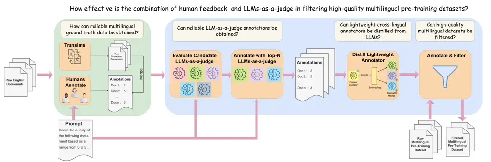

Figure 1: The multilingual data filtering approach JQL: In the first
stage (Sec. 2), human annotators generate ground truth (GT) annotations
on monolingual documents based on an instruction set defined in a
prompt. The documents are translated into all target languages to
receive a multilingual GT dataset. In the second stage (Sec. 3), based
on the GT dataset, we select the top-$`n`$ performing LLMs-as-a-judge
for annotating a multilingual dataset. In the third stage (Sec. 4), we
use the resulting synthetic dataset to train a set of lightweight
annotators. This is done at low cost by reusing shared embeddings. Using
these annotators, we can efficiently annotate pre-training corpora and
filter high-quality subsets (Sec. 5).

|              |                                              |
| ------------ | -------------------------------------------- |
| Family       | Languages                                    |
| Slavic (9)   | Bulgarian, Czech, Croatian, Macedonian,      |
|              | Polish, Slovak,                              |
|              | Slovenian, Serbian, Ukrainian                |
| Germanic (7) | Danish, German, Icelandic, Dutch,            |
|              | Norwegian (Bokmål & Nynorsk), Swedish        |
| Romance (7)  | Catalan, Spanish, French, Galician, Italian, |
|              | Portuguese, Romanian                         |
| Uralic (3)   | Estonian, Finnish, Hungarian                 |
| Baltic (2)   | Lithuanian, Latvian                          |
| Singleton    | Hellenic (Greek), Celtic (Irish),            |
| families     | Basque (Basque), West Semitic (Maltese),     |
|              | Turkic (Turkish), Albanoid (Albanian),       |
|              | Armenian (Armenian)                          |

Table 1: Languages and respective language families considered in this
study. The richness of European language families allows for structured
research into the influence of inter-language similarities for
cross-lingual transfer. For better readability, we report values for
languages highlighted in bold in the main body, with remaining values
supplied in the Appendix.

Addressing these limitations, we propose a multilingual data filtering
approach called JQL (Judging Quality across Languages)¹¹ 1 pronounced
Jackal comprising the four stages outlined in Fig. 1. With minimal human
supervision and small amounts of distilled annotation data, we are able
to train lightweight regressors for efficient filtering of multilingual,
large-scale data at low computational cost. JQL is language agnostic and
can be extended to arbitrary filter criteria.

We provide actionable insights and release valuable artifacts from each
pipeline step²² 2
[https://huggingface.co/spaces/JQL-AI/JQL](https://huggingface.co/spaces/JQL-AI/JQL).
Overall, we make the following contributions: (1) A human-centric
approach to creating ground truth by using human annotations to build a
reliable dataset for evaluating and guiding pipeline component
selection. In this context, we release a novel ground truth dataset
comprising 511 manually annotated documents, translated into 35
languages (Sec. 2). (2) A study investigating LLM capabilities in
assessing the quality of multilingual documents (Sec.3). As part of this
study, we release annotations from the three best-performing LLMs across
35 languages, covering over 14 million documents. (3) A study
investigating the multi- & cross-lingual transfer capabilities of
lightweight annotator models, evaluating how well judgment abilities
generalize to unseen languages (Sec. 4). (4) Demonstration that our
approach leads to high-quality pre-training datasets that improve the
downstream performance of LLMs (Sec. 5).

## 2 Collecting Human Annotations

The first step in the JQL pipeline is to collect human ground truth
annotations. These annotations then serve as the cornerstone of our
structured approach for building multilingual data annotators, enabling
meaningful cross-validation of all design choices.

### 2.1 User Study Design

To construct a multilingual ground truth dataset for selecting a large
language model (LLM) to serve as a judge in evaluating the educational
value of documents, we conducted a human annotation study.

As a starting point, we leveraged the English LLM-annotated dataset from
Fineweb-Edu Penedo et al. (2024a), which contains approximately 450,000
annotations assessing the educational value of documents. Given the
demonstrated effectiveness of their scoring scheme, we adopted the same
6-point scale, ranging from 0 (lowest educational value) to 5 (highest).
To ensure balanced representation across the scoring spectrum, we
sampled 100 documents for each score level. Since only 11 documents were
available for score 5, the resulting dataset totals 511 samples. These
documents form the basis of our human annotation study involving 15
annotators with backgrounds in computer science, English studies,
physics and mathematics (details are provided in App A.2).

To ensure annotation quality and consistency, we employed the
educational prompt defined by Fineweb-Edu as annotation guidelines, and
conducted a dedicated annotator training session. This training proved
essential since in a preliminary pilot without training, some annotators
partially misunderstood the task despite having access to the written
guidelines. In the main annotation phase, each of the 511 documents
received three independent annotations, thus capturing variability in
human judgments. To aggregate the three annotations for each document
into a single score, we applied majority voting and averaging when no
clear majority emerged.

### 2.2 Multilingual Extension

For multilingual support, we translated the English ground truth dataset
into the 35 European languages outlined in Tab. 1. We decided to focus
on these languages, since they offer a good trade-off between linguistic
diversity and well-populated language families. Nonetheless, we
demonstrate in Sec. 6 that our annotation pipeline works equally well on
typologically different languages such as Chinese, without requiring any
modifications. We used DeepL for the 22 languages it supports, and
GPT-4o for the remaining 13 languages. To improve correctness of the
GPT-translated texts, we ran a language classifier over all documents
and discarded those not matching the target language. Additionally, we
removed prefatory phrases added by GPT-4o to ensure overall consistency.

### 2.3 Assessing Inter-Annotator Agreement

To verify the consistency of our annotation process, we analyzed the
collected labels and annotator consensus. We observed a high level of
agreement across annotators, as evidenced by a majority agreement for
78.5% of documents and an overall standard deviation of 0.56. While the
annotation spread was $`\leq 2`$ for 86% of the data, a few documents
exhibited a spread $`>`$ 3. Upon manual inspection, we found that the
educational value of these examples is indeed highly subjective, which
resulted in disagreement between annotators. Overall, our rigorous
annotator training and data cleaning procedure have resulted in a
reliable ground truth, suitable for robustly evaluating ML-based
annotators.

### 2.4 Suitable Evaluation Criteria

Choosing an appropriate evaluation metric is essential for assessing the
performance of LLM-based annotators against human-annotated ground
truth.

While standard classification metrics like F1 score are appropriate for
discrete categories with clear semantic boundaries (e.g., spam vs.
non-spam), they are less suitable for ordered categorical labels that
span a semantic continuum (e.g., very low, low, medium, high,
excellent). These metrics are order-invariant, failing to reflect the
severity of misclassifications, and are sensitive to scale shifts. For
the task of identifying high-quality documents in a web-scale corpus,
the relative ranking of documents is significantly more relevant than
adherence to an arbitrary scoring scheme.

To overcome these limitations, we adopt Spearman correlation as our
primary evaluation metric. Spearman correlation captures the ordinal
structure of the data and is robust to monotonic scale transformations,
making it well-suited for assessing models on tasks with ordered
semantic categories.

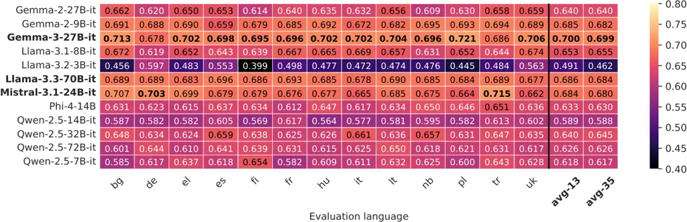

Figure 2: LLMs show varying ranking performance for educational quality.
Some models exhibit strong multilingual capabilities. We show Spearman
Correlation between model predictions and the respective human GT
annotations. Scores are displayed for the 13 language subset, their
average correlation (avg-13) and the average correlation across all 35
considered languages. The numbers highlighted in bold represent the
largest value for each column.

## 3 Harnessing LLMs for Multilingual Data Annotation

Next, we identify LLMs that are reliable judges of the educational value
of documents. Subsequently, we can distill these capabilities into more
efficient models suitable for data processing at scale. We use the
ground truth data obtained in the previous JQL step (Section 2) to guide
model selection.

### 3.1 Experimental Setup

We selected a diverse set of strong, multilingual LLMs across model
sizes and families (Fig. 2). To ensure consistency across languages and
to leverage the models’ strong English capabilities, we used the
original English FineWeb Penedo et al. (2024a) educational prompt for
all evaluations. We also instructed models to produce English
assesments, allowing us to focus on their multilingual natural language
understanding (NLU) rather than their generation capabilities (NLG).
Thus, leveraging the fact that LLMs tend to have good "understanding" in
low-resource languages for which they cannot reliably generate cohesive
outputs Mahfuz et al. (2025); Luukkonen et al. (2024); Darģis et al.
(2024). Similar to our human annotation setup, we sampled three scores
from each model and aggregated them as described in Sec. 2.1.

### 3.2 Multilingual Evaluation

In Fig. 2, we report the LLMs’ capabilities in judging educational
content by measuring the correlation with our ground truth annotation.
We observe substantial differences in performance both across and within
model families. Notably, the smallest model tested, LLaMA-3.2-3B-it,
performs significantly worse than all other evaluated models.
Consequently, effective document quality assessment may require models
to exceed a certain parameter threshold, especially if they have not
been explicitly trained for such tasks. With the exception of
LLaMA-3.1-8B-it, all models show limited performance variance across
languages, supporting our hypothesis that modern LLMs exhibit robust
multilingual NLU, even in low-resource settings. Interestingly, we
observed relatively poor classification performance (App. B.3) for
Gemma-3-27B-it despite exhibiting the strongest ranking capabilities.
Nonetheless, we demonstrate that the model can reliably identify
high-quality documents (App. F.2), again showcasing the importance of
prioritizing ranking metrics and correlation-based evaluation.

Among the evaluated models, Gemma-3-27B-it, Mistral-3.1-24B-it, and
LLaMA-3.3-70B-it emerged as the top performing annotators from unique
model families. We therefore used these models to generate training data
for distilling annotation capabilities into lightweight annotators.⁴⁴ 4
For better readability in the subsequent sections, we refer to
Gemma-3-27B-it, Mistral-3.1-24B-it, and LLaMA-3.3-70B-it as Gemma,
Mistral, and Llama, respectively. Specifically, we randomly sampled up
to 500k documents for each of the 35 languages from the unfiltered but
de-duplicated Fineweb2⁵⁵ 5
[https://huggingface.co/datasets/HuggingFaceFW/fineweb-2](https://huggingface.co/datasets/HuggingFaceFW/fineweb-2)
(FW2) dataset, and used each model to generate three predictions per
document.

## 4 Distilling Lightweight Annotators

Next, we distilled lightweight multilingual annotators suitable for
curating web-scale data corpora. We use the synthetic labels generated
in Sec. 3 for training and the human-annotated data obtained in Sec. 2
for evaluation.

### 4.1 Architecture and Backbone Selection

We focused on cross-lingual embedding models with long context windows
Zhang et al. (2024); Sturua et al. (2024); Yu et al. (2024). These
models efficiently process long web documents and produce well-aligned
representations that map semantically equivalent texts across languages
to similar embeddings. Thus, enabling effective cross-lingual transfer
to unseen languages when using these representations as a backbone.

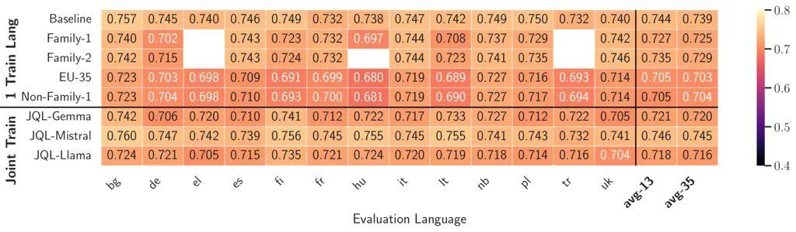

Figure 3: Lightweight JQL annotators show strong multilingual and
cross-lingual performance. Training on the same language as the
evaluation target serves as a baseline (row 1). We show cross-lingual
capabilities by comparing against training on languages within the same
language family from Tab. 1 (row 2), those within the same, lower-level
family (row 3), the full set of the remaining 34 languages (row 4), and
those outside the first-order family (row 5). We also show performance
for joint training on all languages with the respective LLM data (last 3
rows). Empty cells occur when no related language is present in our
dataset. We depict Spearman correlation with ground truth annotation.

In our preliminary analysis, Snowflake Arctic Embed v2.0 Yu et al.
(2024) consistently outperformed other candidates (App C.2). We
therefore selected that model as the embedding backbone for our
subsequent experiments. Our results further indicated that keeping the
embedding model’s weights frozen while training a lightweight regression
head (a simple multilayer perceptron (MLP) with ReLU activation applied
to the embeddings) is sufficient to produce high-quality annotations. We
provide detailed results and ablations in App. C.

This final setup is highly efficient: the lightweight regression head
accounts for less than 1% of total parameters, with embedding
computation being the main runtime cost. As a result, multiple
annotators and tasks, e.g., adult content filtering, mathematical
accuracy, or code quality can be supported in parallel by attaching
different heads to a shared backbone at minimal additional cost (both
training and inference). Our custom annotation pipeline achieves a
throughput of roughly 11,000 annotations per minute on a single A100
with an average of 690 tokens per document.⁷⁷ 7 Implementation based on
Datatrove. Using 6 JQL annotation heads with frozen Snowflake embedding
model.

### 4.2 Multilingual Evaluation

We present the performance results of the regression-based annotators in
Fig. 3. We observe that baseline performance when training in individual
languages remains consistently strong (first row in Fig. 3),
highlighting the robustness of our multilingual architecture.
Additionally, we see only slight performance decreases for checkpoints
trained on all languages (last 3 rows in Fig. 3). On average, the
distilled regression heads even slightly outperform the LLMs from which
the training annotations were derived. While part of this improvement is
attributable to the shift to continuous labels, the gains also reflect
the strength of the pre-trained embedding model. Only three
linguistically isolated languages, Irish, Maltese, and Basque—show
notable performance degradation, likely due to their limited
representation in the Snowflake training data.

Importantly, these results also support our motivation of strong
cross-lingual support through aligned embedding representations. We
evaluate cross-lingual generalization by considering different
typological groups of languages. This includes languages within the same
language family (Tab. 1; row 2 in Fig. 3), those within the same family
at lower typological level (row 3)⁸⁸ 8 We consider the following
second-order families with more than one representative language: West-,
South- & East-Slavic; North- & West-Germanic; Italo-Western Romance; and
Finnic, the full set of the remaining 34 languages (row 4) and those
outside the first-order family altogether (row 5). Despite these
outliers, cross-lingual performance remains generally robust. Annotators
tend to perform slightly worse when evaluated on languages outside their
respective first-order families, but models trained on languages from
the same family consistently yield stronger results.

We further extend on the cross-lingual capabilities by demonstrating
generalization to unseen languages in Sec. 6.

### 4.3 Building the Final Annotator

To systematically explore the amount of data required to effectively
train our lightweight annotation models, we conducted a controlled
experiment involving all 35 languages. The performance converged with
500k training samples (App C.4).

Building upon the insights gained, we trained our final lightweight
annotator models. We used a frozen Snowflake Arctic Embed v2 backbone,
trained on 500,000 documents sampled evenly across all 35 languages. We
trained dedicated annotation heads for each LLM annotator—Gemma,
Mistral, and Llama—to facilitate targeted comparisons and flexibility.
Furthermore, for each lightweight annotator, we consider two distinct
regression heads. The first set of heads is trained on randomly drawn
samples representative of the natural distribution of labels. For the
second, we strategically selected samples per language to achieve the
most uniform possible label distribution, to counteract potential biases
towards over-represented labels. In practice, we thus highly
over-sampled documents with scores 4 and 5.

## 5 Assessing Training Data Quality

Next, we assess the effectiveness of the JQL lightweight annotators in
identifying high-quality pre-training data.

### 5.1 Experimental Setup

To that end, we conducted extensive ablation studies using the raw,
unfiltered FW2 dataset Penedo et al. (2024b). This dataset originates
from Common Crawl WARC files and includes standard preprocessing such as
HTML extraction, language identification, and deduplication. Using the
unfiltered raw data ensures that our comparisons directly reflect
differences introduced by our annotator-driven filtering methods, rather
than preprocessing variations. We benchmark our annotation-based filters
against the original heuristic filtering approach used by FW2. For these
experiments, we selected 13 languages that collectively represent major
European language families, ensuring diverse linguistic coverage (see
bold languages in Tab. 1).

Figure 4: Lightweight annotators trained on different synthetic labels
produce different educational score distributions. On average, Gemma
assigns higher values than Mistral or Llama. Consequently, thresholding
needs to be dynamic and account for the annotators’ distribution.
Example plotted for CC release 2024-14 over 13 languages.

For all training ablations, we used dense decoder-only models with 2
billion parameters, following the LLaMA architecture Touvron et al.
(2023). The training datasets comprised 27 billion and 14 billion
monolingual tokens, with 14 billion tokens used for the languages with
limited training data. A detailed description of the training
hyper-parameters is provided in App. D.1.

To compare model quality across training runs and respective datasets,
we used multilingual versions of MMLU Hendrycks et al. (2021), HellaSwag
Zellers et al. (2019), and ARC Clark et al. (2018). Instead of accuracy,
we relied on the token-normalized probability of the correct answer as
our main metric, as it yields smoother and more interpretable learning
curves.

Experiments at this parameter and token count reliably predict which
datasets perform better when scaling to larger models and more data
Magnusson et al. (2025). However, the absolute benchmark are not
indicative of final downstream performance, as our ablation models
remain heavily under-trained. The relationship between performance at
this scale and that of large-scale pre-training is governed by more
complex scaling laws.

Figure 5: Our JQL annotators improve pre-training data quality over
heuristic baselines (FW2). The exemplary plot depicts results for the
Spanish dataset.

### 5.2 Annotation Analysis

Following the annotation phase, we conducted a detailed statistical
analysis of the score distributions produced by different lightweight
annotators, as shown in Fig. 4. First, we observe that the heuristically
filtered subset of FW2 (orange) exhibits notably higher average
educational quality scores compared to the removed data (blue). This
serves as a sanity check, indicating that FW2’s heuristic filters
capture a meaningful baseline signal. Additionally, the regression heads
trained on synthetic labels generated by different LLMs, i.e., Gemma,
Mistral, and Llama, exhibit significantly different score distributions.
In particular, JQL-annotators based on Gemma consistently assign higher
educational quality scores than those based on Mistral, which in turn
rate samples higher than Llama on average. Notably, this property is
inherited from the LLM-based annotators which have different but
order-preserving scales of educational content (App. Fig. 15). We also
found regression heads trained on datasets with more balanced label
distributions to produce less skewed annotation outputs, which may
facilitate more stable and interpretable threshold selection (App. D.2).

|          | Change over FW2 baselines (%) |           |          |
| -------- | ----------------------------- | --------- | -------- |
| Quantile | Tokens (%)                    | Benchmark |          |
|          |                               | Avg.      | Final    |
| 0.6      | $`+`$04.8                     | $`+`$4.27 | $`+`$4.6 |
| 0.7      | $`-`$15.8                     | $`+`$6.70 | $`+`$7.2 |

Table 2: Percentile-based filtering on JQL annotations provides reliable
trade-offs in performance improvements and achieves higher data quality
and document retention. Retained tokens and benchmark performance are
reported relative to the FW2 baseline and aggregated over 13 languages.
Benchmark "Avg." and "Final" depict the relative difference in the mean
and final checkpoint performances, respectively (see Fig. 5).

Despite differences in absolute score distributions, the annotations
showed very high correlation (Spearman’s $`r`$ \> 0.87), indicating
strong agreement in the relative ranking of document quality across
annotators. This observation aligns with our discussion (Sec. 3) that
all models are similarly effective at ranking document quality, even if
their classification accuracy varies. This finding highlights that
absolute thresholds (e.g., scores $`\geq 3`$) lack general validity
unless supported by extensive ablation. We adopt percentile-based
(relative) thresholds computed per regression head to address this
oversight, enabling more robust comparisons and filtering. This approach
allows to directly control the trade-off between document quality and
corpus size.

### 5.3 Evaluating Pre-training Data Quality

We evaluated the impact of JQL on downstream model performance by
filtering the pre-training data based on two relative threshold values:
the 0.6 and 0.7 percentiles per lightweight annotator head. To include a
document in the final training dataset, we required agreement across an
ensemble of three distinct lightweight annotators (Gemma, Mistral, and
Llama)¹¹¹¹ 11 These heads were trained once on balanced labels and
remained fixed throughout.. Each had to rate the document above its
respective percentile threshold. This ensemble-based filtering approach
enhances robustness by reducing the influence of individual annotator
biases and minimizing the noise present in single-model annotations. The
original FW2 heuristic filtering method serves as our baseline,
providing reference points for both the volume of retained tokens and
downstream model performance.

Figure 5 exemplarily demonstrates the effectiveness of our approach for
Spanish, with aggregated cross-lingual results shown in Table 2. The
results clearly demonstrate that JQL-based filtering consistently
outperforms FW2’s heuristic baseline in terms of data quality. We also
observe a correlation between threshold strictness and quality gains,
with the higher percentile threshold (0.7) consistently yielding better
results than 0.6. Overall, JQL offers a scalable and reliable signal for
data quality, enabling systematic control of the quality–quantity
trade-off, which is particularly useful for scenarios like curriculum
learning.

Importantly, our annotation-driven filtering achieves higher-quality
training outcomes without excessively aggressive data reduction. For
example, in the Spanish language case, applying the 0.6 threshold
retains over 9% more tokens than FW2 while still surpassing its quality.
This advantageous trend holds consistently across languages, as
confirmed by our aggregated results. Thus, demonstrating that our
approach effectively improves training performance even when preserving
more documents compared to heuristic baselines. Eliminating overly
aggressive filtering is especially relevant in multilingual scenarios,
where limited data is available for many languages.

## 6 Generalization to Unseen Languages

To validate the versatile and robust cross-lingual capabilities of our
JQL approach beyond European languages, we conducted additional
experiments on three linguistically and typologically distinct
languages, specifically Arabic, Thai, and Mandarin Chinese, which
represent language families completely unseen during training. We first
validated the capabilities of the existing lightweight annotators on
those languages. When measuring their correlation on respective
translations of the ground truth data, we observed similar performance
as for the European languages (App. E.1). Consequently, we can simply
use the existing lightweight annotators with no further training
required. We applied the same dynamic percentile-based filtering
approach (specifically, the 0.7 quantile threshold) that had previously
proven effective across our European language annotations.

The results in Fig. 6 demonstrate that even for these entirely unseen
languages, the JQL pipeline maintains strong zero-shot performance,
confirming their capability to effectively generalize across diverse
linguistic contexts. These findings highlight the broad applicability
and practical scalability of our approach. Consequently, JQL is suitable
for extending robust data curation practices into low-resource and
underrepresented languages with minimal additional overhead.

## 7 Related work

Heuristic Based Data Curation Pipelines. The vast majority of training
data for large language models is sourced from the web, with Common
Crawl (CC) being the most important corpus. Traditionally, many works
have relied heavily, and in some cases exclusively, on heuristic-based
filtering methods to clean and select web data Raffel et al. (2020); Gao
et al. (2020); Weber et al. (2024); Penedo et al. (2023). These
heuristics typically focus on document-level syntax, such as removing
ill-formed or overly short texts, as well as filtering out documents
containing blocklisted keywords. Web-based corpora are often further
enriched with high-quality sources such as code, academic literature, or
Wikipedia articles Gao et al. (2020).

Neural Data Curation Pipelines. A major drawback of heuristic filters is
their inability to assess the semantic quality of documents.
Consequently, more recent dataset curation incorporates neural networks
into the process Wettig et al. (2024); Su et al. (2024); Penedo et al.
(2024a); Zhao et al. (2024); Li et al. (2024); Zhao et al. (2024);
Sachdeva et al. (2024); Korbak et al. (2023). To scale these approaches
to billions of documents, small and task-specific FastText classifiers
Joulin et al. (2016) are the most common choice.

These quality annotators are increasingly trained on synthetic labels
derived from strong, general-purpose LLMs. Specifically, annotations and
filters judging the educational quality of a document have produced
hiqh-quality datasets Su et al. (2024); Penedo et al. (2024a); Wettig et
al. (2024).

Multilingual Data Curation Pipelines. Despite these advances in dataset
curation, they remain largely English-centric (with a growing body of
research dedicated to Chinese). While large multilingual datasets exist,
the respective filtering pipelines and dataset sizes are not on par with
the high-quality ones for English data Kudugunta et al. (2023); Nguyen
et al. (2024); Brack et al. (2024); Xue et al. (2021); Burchell et al.
(2025)

The best-performing large-scale multilingual dataset is FineWeb2 Penedo
et al. (2024b), which solely relies on heuristic filtering. In this
paper, we developed a data curation pipeline that provides advanced
quality filtering in the multilingual setting and seamlessly transfers
to unseen languages.

Figure 6: Our JQL lightweight annotators generalize to unseen,
topologically different languages. The figure shows aggregated
performance on Arabic, Thai and Chinese. With limited available of
standard benchmarks, we relied on language-specific benchmarks selected
by Fineweb2 Penedo et al. (2024b).

## 8 Conclusion & Future Directions

In this work, we proposed JQL, a multilingual pre-training data
filtering approach that requires minimal human supervision and leverages
language models as judges. We systematically evaluate JQL across 35
languages for filtering educationally valuable content. Our experiments
provide extensive evidence that JQL effectively selects high-quality
multilingual pre-training data, significantly outperforming
heuristic-based filtering methods. Further, our approach is scalable to
large datasets, generalizes to unseen languages, and is easily
extendable.

JQL opens several promising avenues for future research. First, it is
readily applicable to arbitrarily filtering criteria, including code
quality, mathematical correctness, and adult content moderation. Second,
it can be used not only for curating pre-training datasets but also for
selecting relevant data in various post-training stages, such as
instruction tuning and alignment. Ultimately, our contributions lay a
rigorous foundation for improved multilingual data curation and set a
new standard for leveraging language and embedding models effectively in
multilingual contexts.

## 9 Limitations

Despite the breadth and generalizability of our work, we acknowledge the
following limitations.

First, due to the infeasibility of manual annotation at scale, we
machine-translated our human-annotated English ground truth dataset into
the 35 target languages rather than manually annotating ground truth
data in each language.

Second, while we demonstrated the effectiveness of JQL in filtering
high-quality multilingual documents solely based on their educational
value, our approach is not limited to this specific criterion. JQL is
designed to support arbitrary filtering objectives. We chose educational
value as our primary focus because it has been shown to be a strong
indicator for identifying high-quality multilingual pre-training data
Wettig et al. (2024).

Finally, due to the high computational cost, we conducted our ablation
studies at a single model scale (2 billion parameters). Despite this
limitation, we observed consistent improvements in downstream
performance, indicating the effectiveness of JQL-filtered datasets.
Given the evidence of current scaling laws Magnusson et al. (2025), we
expect equally strong performance gains at larger model scales, which we
leave for future work.

## 10 Acknowledgment

This work was funded by the Federal Ministry of Research, Technology &
Space Germany (BMFTR) and the state of North Rhine-Westphalia as part of
the Lamarr Institute for Machine Learning and Artificial Intelligence
(LAMARR22B), as well as by the European Union’s Horizon 2020 research
and innovation program under grant agreement No. 101135671 (TrustLLM).

The authors gratefully acknowledge EuroHPC
([https://eurohpc-ju.europa.eu/index_en](https://eurohpc-ju.europa.eu/index_en))
and the Barcelona Supercomputing Center
([https://www.bsc.es/](https://www.bsc.es/)) for providing computational
resources on MareNostrum 5. Furthermore, we thank hessian.AI for
providing easy access to their 42 supercomputers, and acknowledge the
support of the hessian.AI Innovation Lab (funded by the Hessian Ministry
for Digital Strategy and Innovation), the hessian.AISC Service Center
(funded by the BMFTR, grant No 01IS22091), and the Center for European
Research in Trusted AI (CERTAIN). Further, this work benefited from the
National High Performance Computing Center for Computational Engineering
Science (NHR4CES) and project “XEI” (FKZ 01IS24079B) funded by the
BMFTR. Finally, we thank Felix Friedrich and Pedro Ortiz Suarez for
their feedback.

## References

- Abadji et al. (2022) Julien Abadji, Pedro Javier Ortiz Suárez, Laurent
  Romary, and Benoît Sagot. 2022. [Towards a cleaner document-oriented
  multilingual crawled
  corpus](https://aclanthology.org/2022.lrec-1.463). In _Proceedings of
  the Thirteenth Language Resources and Evaluation Conference, LREC_.
  European Language Resources Association.
- Allal et al. (2025) Loubna Ben Allal, Anton Lozhkov, Elie Bakouch,
  Gabriel Martín Blázquez, Guilherme Penedo, Lewis Tunstall, Andrés
  Marafioti, Hynek Kydlíček, Agustín Piqueres Lajarín, Vaibhav
  Srivastav, Joshua Lochner, Caleb Fahlgren, Xuan-Son Nguyen, Clémentine
  Fourrier, Ben Burtenshaw, Hugo Larcher, Haojun Zhao, Cyril Zakka,
  Mathieu Morlon, Colin Raffel, Leandro von Werra, and Thomas
  Wolf. 2025. [Smollm2: When smol goes big – data-centric training of a
  small language model](https://arxiv.org/abs/2502.02737). _arXiv
  preprint arXiv:2502.02737_.
- Artetxe et al. (2019) Mikel Artetxe, Sebastian Ruder, and Dani
  Yogatama. 2019. [On the cross-lingual transferability of monolingual
  representations](https://arxiv.org/abs/1910.11856). _arXiv preprint
  arXiv1910.11856:_.
- Brack et al. (2024) Manuel Brack, Malte Ostendorff, Pedro Ortiz
  Suarez, José Javier Saiz, Iñaki Lacunza Castilla, Jorge Palomar-Giner,
  Alexander Shvets, Patrick Schramowski, Georg Rehm, Marta Villegas, and
  Kristian Kersting. 2024. [Community oscar: A community effort for
  multilingual web data](https://aclanthology.org/2024.mrl-1.19/). In
  _Proceedings of the Fourth Workshop on Multilingual Representation
  Learning (MRL)_.
- Burchell et al. (2025) Laurie Burchell, Ona de Gibert, Nikolay
  Arefyev, Mikko Aulamo, Marta Bañón, Pinzhen Chen, Mariia Fedorova,
  Liane Guillou, Barry Haddow, Jan Hajič, Jindřich Helcl, Erik
  Henriksson, Mateusz Klimaszewski, Ville Komulainen, Andrey Kutuzov,
  Joona Kytöniemi, Veronika Laippala, Petter Mæhlum, Bhavitvya Malik,
  Farrokh Mehryary, Vladislav Mikhailov, Nikita Moghe, Amanda Myntti,
  Dayyán O’Brien, Stephan Oepen, Proyag Pal, Jousia Piha, Sampo Pyysalo,
  Gema Ramírez-Sánchez, David Samuel, Pavel Stepachev, Jörg Tiedemann,
  Dušan Variš, Tereza Vojtěchová, and Jaume Zaragoza-Bernabeu. 2025. [An
  expanded massive multilingual dataset for high-performance language
  technologies](https://arxiv.org/abs/2503.10267). _arXiv preprint
  arXiv:2503.10267_.
- Clark et al. (2020) Jonathan H. Clark, Eunsol Choi, Michael Collins,
  Dan Garrette, Tom Kwiatkowski, Vitaly Nikolaev, and Jennimaria
  Palomaki. 2020. [Tydi qa: A benchmark for information-seeking question
  answering in typologically diverse
  languages](https://aclanthology.org/2020.tacl-1.30/). _Transactions of
  the Association for Computational Linguistics_.
- Clark et al. (2018) Peter Clark, Isaac Cowhey, Oren Etzioni, Tushar
  Khot, Ashish Sabharwal, Carissa Schoenick, and Oyvind Tafjord. 2018.
  [Think you have solved question answering? try arc, the ai2 reasoning
  challenge](https://arxiv.org/abs/1803.05457). _arXiv preprint
  arXiv:1803.05457_.
- Cui et al. (2019) Yiming Cui, Ting Liu, Wanxiang Che, Li Xiao, Zhipeng
  Chen, Wentao Ma, Shijin Wang, and Guoping Hu. 2019. [A span-extraction
  dataset for Chinese machine reading
  comprehension](https://aclanthology.org/D19-1600/). In _Proceedings of
  the Conference on Empirical Methods in Natural Language Processing and
  the International Joint Conference on Natural Language Processing
  (EMNLP-IJCNLP)_.
- Darģis et al. (2024) Roberts Darģis, Guntis Bārzdiņš, Inguna Skadiņa,
  Normunds Grūzītis, and Baiba Saulīte. 2024. Evaluating open-source
  LLMs in low-resource languages: Insights from Latvian high school
  exams. In _Proceedings of the 4th International Conference on Natural
  Language Processing for Digital Humanities_.
- Gao et al. (2020) Leo Gao, Stella Biderman, Sid Black, Laurence
  Golding, Travis Hoppe, Charles Foster, Jason Phang, Horace He, Anish
  Thite, Noa Nabeshima, Shawn Presser, and Connor Leahy. 2020. [The
  pile: An 800gb dataset of diverse text for language
  modeling](https://arxiv.org/abs/2101.00027). _arXiv preprint
  arXiv:2101.00027_.
- Guo et al. (2025) Daya Guo, Dejian Yang, Haowei Zhang, Junxiao Song,
  Ruoyu Zhang, Runxin Xu, Qihao Zhu, Shirong Ma, Peiyi Wang, Xiao Bi, et
  al. 2025. [Deepseek-r1: Incentivizing reasoning capability in llms via
  reinforcement learning](https://arxiv.org/abs/2501.12948). _arXiv
  preprint arXiv:2501.12948_.
- Hendrycks et al. (2021) Dan Hendrycks, Collin Burns, Steven Basart,
  Andy Zou, Mantas Mazeika, Dawn Song, and Jacob Steinhardt. 2021.
  [Measuring massive multitask language
  understanding](https://openreview.net/forum?id=d7KBjmI3GmQ). In
  _Proceedings of the International Conference on Learning
  Representations (ICLR)_.
- Joulin et al. (2016) Armand Joulin, Edouard Grave, Piotr Bojanowski,
  and Tomas Mikolov. 2016. [Bag of tricks for efficient text
  classification](https://arxiv.org/abs/1607.01759). _arXiv preprint
  arXiv:1607.01759_.
- Korbak et al. (2023) Tomasz Korbak, Kejian Shi, Angelica Chen, Rasika
  Vinayak Bhalerao, Christopher L. Buckley, Jason Phang, Samuel R.
  Bowman, and Ethan Perez. 2023. [Pretraining language models with human
  preferences](https://proceedings.mlr.press/v202/korbak23a/korbak23a.pdf).
  In _Proceedings of the International Conference on Machine Learning
  (ICML)_, Proceedings of Machine Learning Research.
- Kudugunta et al. (2023) Sneha Kudugunta, Isaac Caswell, Biao Zhang,
  Xavier Garcia, Derrick Xin, Aditya Kusupati, Romi Stella, Ankur Bapna,
  and Orhan Firat. 2023. [MADLAD-400: A multilingual and document-level
  large audited
  dataset](https://papers.nips.cc/paper_files/paper/2023/hash/d49042a5d49818711c401d34172f9900-Abstract-Datasets_and_Benchmarks.html).
  In _Proceedings of the Advances in Neural Information Processing
  Systems: Annual Conference on Neural Information Processing Systems
  (NeurIPS)_.
- Lewis et al. (2019) Patrick Lewis, Barlas Oguz, Ruty Rinott, Sebastian
  Riedel, and Holger Schwenk. 2019. [Mlqa: Evaluating cross-lingual
  extractive question answering](https://arxiv.org/abs/1910.07475).
  _arXiv preprint arXiv:1910.07475_.
- Li et al. (2024) Jeffrey Li, Alex Fang, Georgios Smyrnis, Maor Ivgi,
  Matt Jordan, Samir Yitzhak Gadre, Hritik Bansal, Etash Guha, Sedrick
  Scott Keh, Kushal Arora, Saurabh Garg, Rui Xin, Niklas Muennighoff,
  Reinhard Heckel, Jean Mercat, Mayee F. Chen, Suchin Gururangan,
  Mitchell Wortsman, Alon Albalak, Yonatan Bitton, Marianna Nezhurina,
  Amro Abbas, Cheng-Yu Hsieh, Dhruba Ghosh, Josh Gardner, Maciej Kilian,
  Hanlin Zhang, Rulin Shao, Sarah M. Pratt, Sunny Sanyal, Gabriel
  Ilharco, Giannis Daras, Kalyani Marathe, Aaron Gokaslan, Jieyu Zhang,
  Khyathi Raghavi Chandu, Thao Nguyen, Igor Vasiljevic, Sham M. Kakade,
  Shuran Song, Sujay Sanghavi, Fartash Faghri, Sewoong Oh, Luke
  Zettlemoyer, Kyle Lo, Alaaeldin El-Nouby, Hadi Pouransari, Alexander
  Toshev, Stephanie Wang, Dirk Groeneveld, Luca Soldaini, Pang Wei Koh,
  Jenia Jitsev, Thomas Kollar, Alex Dimakis, Yair Carmon, Achal Dave,
  Ludwig Schmidt, and Vaishaal Shankar. 2024. [Datacomp-lm: In search of
  the next generation of training sets for language
  models](https://proceedings.neurips.cc/paper_files/paper/2024/hash/19e4ea30dded58259665db375885e412-Abstract-Datasets_and_Benchmarks_Track.html).
  In _Proceedings of the Advances in Neural Information Processing
  Systems: Annual Conference on Neural Information Processing Systems
  (NeurIPS)_.
- Luukkonen et al. (2024) Risto Luukkonen, Jonathan Burdge, Elaine Zosa,
  Aarne Talman, Ville Komulainen, Väinö Hatanpää, Peter Sarlin, and
  Sampo Pyysalo. 2024. [Poro 34b and the blessing of
  multilinguality](https://arxiv.org/abs/2404.01856). _arXiv preprint
  arXiv:2404.01856_.
- Magnusson et al. (2025) Ian Magnusson, Nguyen Tai, Ben Bogin, David
  Heineman, Jena D. Hwang, Luca Soldaini, Akshita Bhagia, Jiacheng Liu,
  Dirk Groeneveld, Oyvind Tafjord, Noah A. Smith, Pang Wei Koh, and
  Jesse Dodge. 2025. [Datadecide: How to predict best pretraining data
  with small experiments](https://arxiv.org/abs/2504.11393). _arXiv
  preprint arXiv:2504.11393_.
- Mahfuz et al. (2025) Tamzeed Mahfuz, Satak Kumar Dey, Ruwad Naswan,
  Hasnaen Adil, Khondker Salman Sayeed, and Haz Sameen Shahgir. 2025.
  [Too late to train, too early to use? a study on necessity and
  viability of low-resource Bengali
  LLMs](https://aclanthology.org/2025.coling-main.79.pdf). In
  _Proceedings of the International Conference on Computational
  Linguistics (COLING)_.
- Mozannar et al. (2019) Hussein Mozannar, Elie Maamary, Karl El Hajal,
  and Hazem Hajj. 2019. [Neural Arabic question
  answering](https://www.aclweb.org/anthology/W19-4612). In _Proceedings
  of the Fourth Arabic Natural Language Processing Workshop_.
  Association for Computational Linguistics.
- Nguyen et al. (2024) Thuat Nguyen, Chien Van Nguyen, Viet Dac Lai,
  Hieu Man, Nghia Trung Ngo, Franck Dernoncourt, Ryan A. Rossi, and
  Thien Huu Nguyen. 2024. [CulturaX: A cleaned, enormous, and
  multilingual dataset for large language models in 167
  languages](http://www.lrec-conf.org/proceedings/lrec-coling-2024/pdf/2024.main-1.377.pdf).
  In _Proceedings of the Joint International Conference on Computational
  Linguistics, Language Resources and Evaluation (LREC-COLING)_.
- Penedo et al. (2024a) Guilherme Penedo, Hynek Kydlícek, Loubna Ben
  Allal, Anton Lozhkov, Margaret Mitchell, Colin A. Raffel, Leandro von
  Werra, and Thomas Wolf. 2024a. [The fineweb datasets: Decanting the
  web for the finest text data at
  scale](https://proceedings.neurips.cc/paper_files/paper/2024/hash/370df50ccfdf8bde18f8f9c2d9151bda-Abstract-Datasets_and_Benchmarks_Track.html).
  In _Proceedings of the Advances in Neural Information Processing
  Systems: Annual Conference on Neural Information Processing Systems
  (NeurIPS)_.
- Penedo et al. (2024b) Guilherme Penedo, Hynek Kydlíček, Vinko
  Sabolčec, Bettina Messmer, Negar Foroutan, Martin Jaggi, Leandro von
  Werra, and Thomas Wolf. 2024b. [Fineweb2: A sparkling update with
  1000s of languages](https://doi.org/10.57967/hf/3744).
- Penedo et al. (2023) Guilherme Penedo, Quentin Malartic, Daniel
  Hesslow, Ruxandra Cojocaru, Hamza Alobeidli, Alessandro Cappelli,
  Baptiste Pannier, Ebtesam Almazrouei, and Julien Launay. 2023. [The
  refinedweb dataset for falcon LLM: outperforming curated corpora with
  web data
  only](https://proceedings.neurips.cc/paper_files/paper/2023/hash/fa3ed726cc5073b9c31e3e49a807789c-Abstract-Datasets_and_Benchmarks.html).
  In _Proceedings of the Advances in Neural Information Processing
  Systems: Annual Conference on Neural Information Processing Systems
  (NeurIPS)_.
- Raffel et al. (2020) Colin Raffel, Noam Shazeer, Adam Roberts,
  Katherine Lee, Sharan Narang, Michael Matena, Yanqi Zhou, Wei Li, and
  Peter J. Liu. 2020. [Exploring the limits of transfer learning with a
  unified text-to-text
  transformer](https://jmlr.org/papers/volume21/20-074/20-074.pdf).
  _Journal of Machine Learning Research (JMLR)_, 21.
- Sachdeva et al. (2024) Noveen Sachdeva, Benjamin Coleman, Wang-Cheng
  Kang, Jianmo Ni, Lichan Hong, Ed H Chi, James Caverlee, Julian
  McAuley, and Derek Zhiyuan Cheng. 2024. [How to train data-efficient
  llms](https://arxiv.org/abs/2402.09668). _arXiv preprint
  arXiv:2402.09668_.
- Sturua et al. (2024) Saba Sturua, Isabelle Mohr, Mohammad Kalim Akram,
  Michael Günther, Bo Wang, Markus Krimmel, Feng Wang, Georgios
  Mastrapas, Andreas Koukounas, Andreas Koukounas, Nan Wang, and Han
  Xiao. 2024. [jina-embeddings-v3: Multilingual embeddings with task
  lora](https://arxiv.org/abs/2409.10173). _arXiv preprint
  arXiv:2409.10173_.
- Su et al. (2024) Dan Su, Kezhi Kong, Ying Lin, Joseph Jennings,
  Brandon Norick, Markus Kliegl, Mostofa Patwary, Mohammad Shoeybi, and
  Bryan Catanzaro. 2024. [Nemotron-cc: Transforming common crawl into a
  refined long-horizon pretraining
  dataset](https://arxiv.org/abs/2412.02595). _arXiv preprint
  arXiv:2412.02595_.
- Team et al. (2025) Gemma Team, Aishwarya Kamath, Johan Ferret, Shreya
  Pathak, Nino Vieillard, Ramona Merhej, Sarah Perrin, Tatiana
  Matejovicova, Alexandre Ramé, Morgane Rivière, Louis Rouillard, Thomas
  Mesnard, Geoffrey Cideron, Jean bastien Grill, Sabela Ramos, Edouard
  Yvinec, Michelle Casbon, Etienne Pot, Ivo Penchev, Gaël Liu, Francesco
  Visin, Kathleen Kenealy, Lucas Beyer, Xiaohai Zhai, Anton Tsitsulin,
  Robert Busa-Fekete, Alex Feng, Noveen Sachdeva, Benjamin Coleman, Yi
  Gao, Basil Mustafa, Iain Barr, Emilio Parisotto, David Tian, Matan
  Eyal, Colin Cherry, Jan-Thorsten Peter, Danila Sinopalnikov, Surya
  Bhupatiraju, Rishabh Agarwal, Mehran Kazemi, Dan Malkin, Ravin Kumar,
  David Vilar, Idan Brusilovsky, Jiaming Luo, Andreas Steiner, Abe
  Friesen, Abhanshu Sharma, Abheesht Sharma, Adi Mayrav Gilady, Adrian
  Goedeckemeyer, Alaa Saade, Alex Feng, Alexander Kolesnikov, Alexei
  Bendebury, Alvin Abdagic, Amit Vadi, András György, André Susano
  Pinto, Anil Das, Ankur Bapna, Antoine Miech, Antoine Yang, Antonia
  Paterson, Ashish Shenoy, Ayan Chakrabarti, Bilal Piot, Bo Wu, Bobak
  Shahriari, Bryce Petrini, Charlie Chen, Charline Le Lan,
  Christopher A. Choquette-Choo, CJ Carey, Cormac Brick, Daniel Deutsch,
  Danielle Eisenbud, Dee Cattle, Derek Cheng, Dimitris Paparas,
  Divyashree Shivakumar Sreepathihalli, Doug Reid, Dustin Tran, Dustin
  Zelle, Eric Noland, Erwin Huizenga, Eugene Kharitonov, Frederick Liu,
  Gagik Amirkhanyan, Glenn Cameron, Hadi Hashemi, Hanna
  Klimczak-Plucińska, Harman Singh, Harsh Mehta, Harshal Tushar Lehri,
  Hussein Hazimeh, Ian Ballantyne, Idan Szpektor, Ivan Nardini, Jean
  Pouget-Abadie, Jetha Chan, Joe Stanton, John Wieting, Jonathan Lai,
  Jordi Orbay, Joseph Fernandez, Josh Newlan, Ju yeong Ji, Jyotinder
  Singh, Kat Black, Kathy Yu, Kevin Hui, Kiran Vodrahalli, Klaus Greff,
  Linhai Qiu, Marcella Valentine, Marina Coelho, Marvin Ritter, Matt
  Hoffman, Matthew Watson, Mayank Chaturvedi, Michael Moynihan, Min Ma,
  Nabila Babar, Natasha Noy, Nathan Byrd, Nick Roy, Nikola Momchev,
  Nilay Chauhan, Noveen Sachdeva, Oskar Bunyan, Pankil Botarda, Paul
  Caron, Paul Kishan Rubenstein, Phil Culliton, Philipp Schmid, Pier
  Giuseppe Sessa, Pingmei Xu, Piotr Stanczyk, Pouya Tafti, Rakesh
  Shivanna, Renjie Wu, Renke Pan, Reza Rokni, Rob Willoughby, Rohith
  Vallu, Ryan Mullins, Sammy Jerome, Sara Smoot, Sertan Girgin, Shariq
  Iqbal, Shashir Reddy, Shruti Sheth, Siim Põder, Sijal Bhatnagar,
  Sindhu Raghuram Panyam, Sivan Eiger, Susan Zhang, Tianqi Liu, Trevor
  Yacovone, Tyler Liechty, Uday Kalra, Utku Evci, Vedant Misra, Vincent
  Roseberry, Vlad Feinberg, Vlad Kolesnikov, Woohyun Han, Woosuk Kwon,
  Xi Chen, Yinlam Chow, Yuvein Zhu, Zichuan Wei, Zoltan Egyed, Victor
  Cotruta, Minh Giang, Phoebe Kirk, Anand Rao, Kat Black, Nabila Babar,
  Jessica Lo, Erica Moreira, Luiz Gustavo Martins, Omar Sanseviero,
  Lucas Gonzalez, Zach Gleicher, Tris Warkentin, Vahab Mirrokni, Evan
  Senter, Eli Collins, Joelle Barral, Zoubin Ghahramani, Raia Hadsell,
  Yossi Matias, D. Sculley, Slav Petrov, Noah Fiedel, Noam Shazeer,
  Oriol Vinyals, Jeff Dean, Demis Hassabis, Koray Kavukcuoglu, Clement
  Farabet, Elena Buchatskaya, Jean-Baptiste Alayrac, Rohan Anil, Dmitry,
  Lepikhin, Sebastian Borgeaud, Olivier Bachem, Armand Joulin, Alek
  Andreev, Cassidy Hardin, Robert Dadashi, and Léonard Hussenot. 2025.
  [Gemma 3 technical report](https://arxiv.org/abs/2503.19786). _arXiv
  preprint arXiv:2503.19786_.
- Touvron et al. (2023) Hugo Touvron, Louis Martin, Kevin Stone, Peter
  Albert, Amjad Almahairi, Yasmine Babaei, Nikolay Bashlykov, Soumya
  Batra, Prajjwal Bhargava, Shruti Bhosale, Dan Bikel, Lukas Blecher,
  Cristian Canton Ferrer, Moya Chen, Guillem Cucurull, David Esiobu,
  Jude Fernandes, Jeremy Fu, Wenyin Fu, Brian Fuller, Cynthia Gao,
  Vedanuj Goswami, Naman Goyal, Anthony Hartshorn, Saghar Hosseini, Rui
  Hou, Hakan Inan, Marcin Kardas, Viktor Kerkez, Madian Khabsa, Isabel
  Kloumann, Artem Korenev, Punit Singh Koura, Marie-Anne Lachaux,
  Thibaut Lavril, Jenya Lee, Diana Liskovich, Yinghai Lu, Yuning Mao,
  Xavier Martinet, Todor Mihaylov, Pushkar Mishra, Igor Molybog, Yixin
  Nie, Andrew Poulton, Jeremy Reizenstein, Rashi Rungta, Kalyan Saladi,
  Alan Schelten, Ruan Silva, Eric Michael Smith, Ranjan Subramanian,
  Xiaoqing Ellen Tan, Binh Tang, Ross Taylor, Adina Williams, Jian Xiang
  Kuan, Puxin Xu, Zheng Yan, Iliyan Zarov, Yuchen Zhang, Angela Fan,
  Melanie Kambadur, Sharan Narang, Aurelien Rodriguez, Robert Stojnic,
  Sergey Edunov, and Thomas Scialom. 2023. Llama 2: Open foundation and
  fine-tuned chat models. _arXiv preprint arXiv:2307.09288_.
- Weber et al. (2024) Maurice Weber, Daniel Y. Fu, Quentin Anthony,
  Yonatan Oren, Shane Adams, Anton Alexandrov, Xiaozhong Lyu, Huu
  Nguyen, Xiaozhe Yao, Virginia Adams, Ben Athiwaratkun, Rahul
  Chalamala, Kezhen Chen, Max Ryabinin, Tri Dao, Percy Liang,
  Christopher Ré, Irina Rish, and Ce Zhang. 2024. Redpajama: an open
  dataset for training large language models. In _Proceedings of the
  Advances in Neural Information Processing Systems: Annual Conference
  on Neural Information Processing Systems (NeurIPS)_.
- Wettig et al. (2024) Alexander Wettig, Aatmik Gupta, Saumya Malik, and
  Danqi Chen. 2024. [Qurating: Selecting high-quality data for training
  language models](https://openreview.net/forum?id=GLGYYqPwjy). In
  _Forty-first International Conference on Machine Learning, ICML 2024,
  Vienna, Austria, July 21-27, 2024_. OpenReview.net.
- Xue et al. (2021) Linting Xue, Noah Constant, Adam Roberts, Mihir
  Kale, Rami Al-Rfou, Aditya Siddhant, Aditya Barua, and Colin
  Raffel. 2021. mt5: A massively multilingual pre-trained text-to-text
  transformer. In _Proceedings of the Conference of the North American
  Chapter of the Association for Computational Linguistics: Human
  Language Technologies (NAACL-HLT)_.
- Yu et al. (2024) Puxuan Yu, Luke Merrick, Gaurav Nuti, and Daniel
  Campos. 2024. [Arctic-embed 2.0: Multilingual retrieval without
  compromise](https://arxiv.org/abs/2412.04506). _arXiv preprint
  arXiv:2412.04506_.
- Zellers et al. (2019) Rowan Zellers, Ari Holtzman, Yonatan Bisk, Ali
  Farhadi, and Yejin Choi. 2019. Hellaswag: Can a machine really finish
  your sentence? In _Proceedings of the Annual Meeting of the
  Association for Computational Linguistics (ACL)_.
- Zhang et al. (2024) Xin Zhang, Yanzhao Zhang, Dingkun Long, Wen Xie,
  Ziqi Dai, Jialong Tang, Huan Lin, Baosong Yang, Pengjun Xie, Fei
  Huang, et al. 2024. mgte: Generalized long-context text representation
  and reranking models for multilingual text retrieval. In _Proceedings
  of the 2024 Conference on Empirical Methods in Natural Language
  Processing: Industry Track_, pages 1393–1412.
- Zhao et al. (2024) Ranchi Zhao, Zhen Leng Thai, Yifan Zhang, Shengding
  Hu, Jie Zhou, Yunqi Ba, Jie Cai, Zhiyuan Liu, and Maosong Sun. 2024.
  Decoratelm: Data engineering through corpus rating, tagging, and
  editing with language models. In _EMNLP_, pages 1401–1418. Association
  for Computational Linguistics.

## Appendix A Human Annotation Study

### A.1 Annotator Background and Study Protocol

For our human annotation study, we used the prompt introduced by Penedo
et al. (2024b), which was reviewed and discussed with all annotators
during a dedicated training session. Annotations were conducted using a
web interface built with Argilla¹²¹² 12 https://argilla.io/, which
displayed the document text, annotation guidelines, and the 0–5 rating
scale.

Our annotators are colleagues from our lab, and there is an overlap
between the authors of this work and the annotation team. The majority
of annotators have a technical background. Additional information on
annotators is provided in Table 3. Prior to the study, we informed
participants about the purpose of the annotation task and obtained their
consent to use the resulting annotations, along with anonymized
information about the annotators, for subsequent analysis and anonymized
public release. No ethics review board approval was sought, as the study
did not fall under institutional requirements for ethical review.

| Annotator (Anonymized) | Background                                       | Age Group |
| ---------------------- | ------------------------------------------------ | --------- |
| Annotator 1            | MSc. in Computer Science                         | 20-30     |
| Annotator 2            | MSc. in Data and Knowledge Engineering           | 30-40     |
| Annotator 3            | PhD in Computer Science                          | 30-40     |
| Annotator 4            | M.A. English/American Studies and German Studies | 30-40     |
| Annotator 5            | M.Sc. in Mathematics                             | 30-40     |
| Annotator 6            | PhD in Computer Science                          | 30-40     |
| Annotator 7            | M.Sc. in Artificial Intelligence                 | 20-30     |
| Annotator 8            | PhD in Computer Science                          | 30-40     |
| Annotator 9            | MSc. in Computer Science                         | 30-40     |
| Annotator 10           | MSc. in Computer Science                         | 30-30     |
| Annotator 11           | PhD in Theoretical Physics                       | 30-40     |
| Annotator 12           | MSc. in Autonomous Systems                       | 30.40     |
| Annotator 13           | PhD in Computer Science                          | 30-40     |
| Annotator 14           | MSc. in Autonomous Systems                       | 30-40     |
| Annotator 15           | MSc. in Computer Science                         | 30-40     |

Table 3: Backgrounds of the human annotators (anonymized).

### A.2 Human Annotations Evaluation

In this section, we provide additional details about the human-annotated
ground truth dataset introduced in Section 2.

#### Score Distribution of Annotations

Figure 7: Histogram on the distribution of the document scores judged by
the human annotators.

#### Annotator Agreement and Annotation Spread.

To further analyze the variation in human annotations, we present the
cumulative distribution of annotation spread in Figure 8. The plot shows
that over 60% of the samples have a maximum spread of 1, and more than
85% have a maximum spread of 2, indicating strong agreement among
annotators.

Figure 8: Cumulative distribution of spread within annotations. Aligned
with the majority agreement of 78.5% and an interrating standard
deviation of 0.56, (see Sec. 2), also the spread analysis reveals high
interrater consistency with a spread of $`\leq`$ 2 for 86% of the
documents.

## Appendix B LLM Based Annotator Evaluation

In this Section we provide further details and ablations on our LLM
based annotators discussed in Section 3.

### B.1 Invalid Predictions

Similar to the human annotators, we prompted the LLM-based annotators to
assess the educational value of documents on a scale from 0 to 5, where
0 indicates the lowest quality and 5 the highest. For each model and
document, we collected three predictions. A prediction is considered
invalid if it does not fall within the specified integer range. If all
three predictions for a document are invalid, the entire annotation is
marked as invalid. When evaluating LLM performance, it is crucial to
analyze the distribution of valid and invalid predictions to not obtain
distorted conclusions.

Figure 9 shows the proportion of invalid predictions across different
languages. While our selected models, LLaMA-3-70B-IT,
Mistral-3.1-24B-IT, and Gemma-3-27B-IT, exhibit few or no invalid
predictions, LLaMA-3-8B-IT produces a noticeably higher rate of invalid
outputs, and LLaMA-3-3B-IT shows a substantial fraction of invalid
predictions.

Based on these observations, we suggest that a consistently low rate of
invalid predictions should be considered a necessary condition for
further use as LLM-based annotator. Otherwise, annotating data at scale
will result in a large number of invalid predictions, leading to wasted
computational resources.

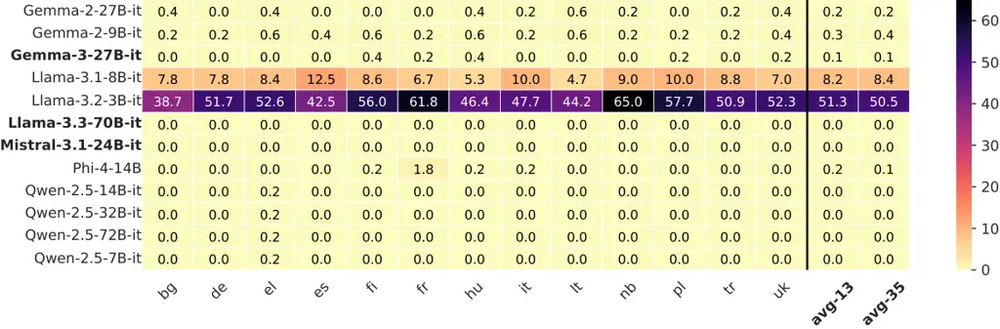

Figure 9: Invalid scores predictions (in percent)

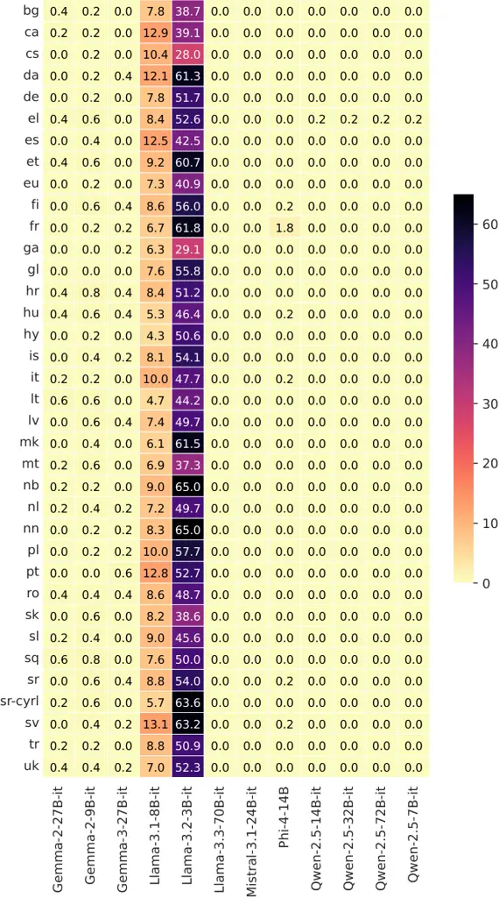

Figure 10: Percentages of invalid scores (aggregated) for each model
across all languages. An aggregated score (majority voted) is counted as
invalid, if all three predictions for a document are invalid.

### B.2 Statistical Significance of Correlations Between Human Annotations and LLM Predictions.

To assess the statistical significance of the correlations presented in
Fig.11, we perform two-sided Student’s t-tests and compute the
corresponding p-values separately for each model and language. Summary
statistics, i.e., average, minimum, and maximum p-values, across the 35
languages are shown in Fig.4.

Notably, the highest p-value observed across all models and languages is
4.49e-07, indicating a consistently high level of statistical
significance throughout our analysis.

| LLM                | avg      | min      | max      |
| ------------------ | -------- | -------- | -------- |
| Gemma-2-27B-it     | 1.51e-52 | 5.76e-68 | 5.38e-51 |
| Gemma-2-9B-it      | 1.43e-61 | 2.77e-76 | 5.16e-60 |
| Gemma-3-27B-it     | 8.38e-65 | 1.09e-85 | 3.02e-63 |
| Llama-3.1-8B-it    | 8.90e-51 | 3.22e-73 | 3.01e-49 |
| Llama-3.2-3B-it    | 2.04e-08 | 6.42e-27 | 4.49e-07 |
| Llama-3.3-70B-it   | 4.06e-66 | 3.54e-76 | 1.07e-64 |
| Mistral-3.1-24B-it | 4.59e-62 | 2.89e-81 | 1.61e-60 |
| Phi-4-14B          | 4.26e-46 | 2.02e-65 | 1.53e-44 |
| Qwen-2.5-14B-it    | 1.73e-37 | 1.88e-56 | 6.22e-36 |
| Qwen-2.5-32B-it    | 4.12e-54 | 1.68e-68 | 1.48e-52 |
| Qwen-2.5-72B-it    | 4.18e-53 | 7.90e-64 | 1.39e-51 |
| Qwen-2.5-7B-it     | 1.24e-43 | 4.28e-68 | 4.46e-42 |

Table 4: p-value analysis on the Spearman correlation scores in Figure 11. The p-values were calculated using a two-sided Student’s t-test and
indicate the statistical significance of the measured correlations
(lower is better). Across all models and languages, even the highest
p-values are extremely small. This underpins the statistical
significance of our results.

### B.3 Classification Based Evaluation

As discussed in Sec. 2.4, we use the Spearman correlation between the
LLMs’ predictions and the human ground truth to evaluate the annotator
capabilities of the models. This metric is preferred because it
effectively captures the models’ ability to rank document quality, which
is central to our task.

Here, we illustrate the limitations of traditional classification
metrics for assessing LLM annotator performance. The figures 11 and 13
show the F1 scores of the LLMs when predicting the correct quality
classes (0 to 5). Notably, Gemma-3-27B-IT appears among the
worst-performing models in terms of F1 score, suggesting a limited
ability to classify document quality. This stands in contrast to its
relatively strong performance when evaluated using Spearman correlation
(see Sec. 3.2).

This discrepancy can be explained by examining the confusion matrices in
Fig. 14. While Mistral-3.1-24B tends to predict more reliably within the
central quality classes (1 to 3), Gemma-3-27B-IT shows a tendency to
shift predictions across the scale, particularly within these same
classes. As a result, its F1 scores are low due to class misalignment,
but its Spearman correlation remains high because it preserves the
relative ranking of document quality.

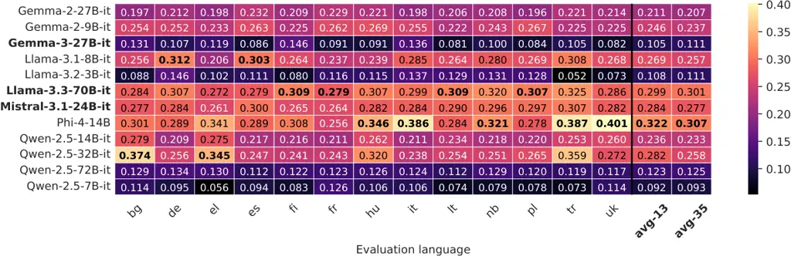

Figure 11: Multilingual LLM classification performance (macro F1-score)
on human-annotated ground truth. Scores are reported individually for
the 13 languages subset, as well as averaged across these 13 languages
(avg-13) and across all 35 evaluated languages.

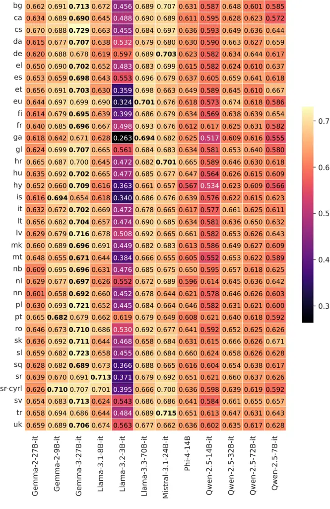

Figure 12: Ranking performance in terms of Spearman correlation for each
model across all languages.

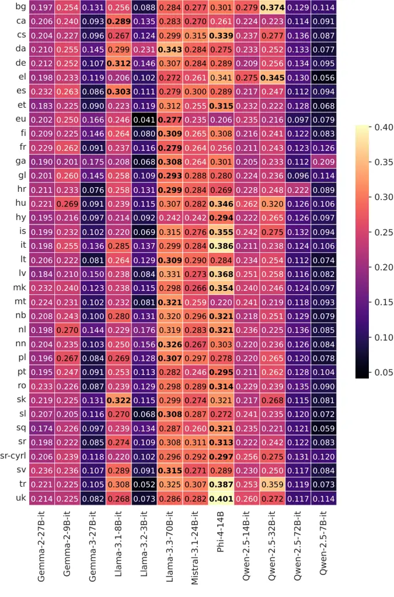

Figure 13: Classification performance in terms of macro F1 score for
each model across all languages.

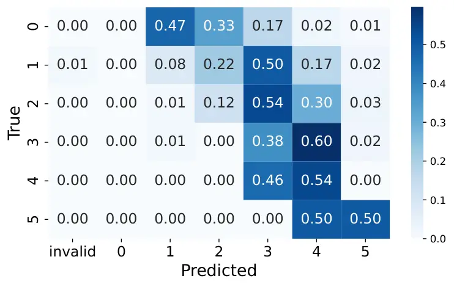

(a) Gemma-3-27B-it

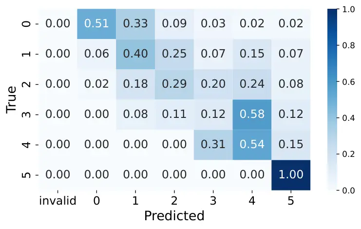

(b) Llama-3.3-70B-it

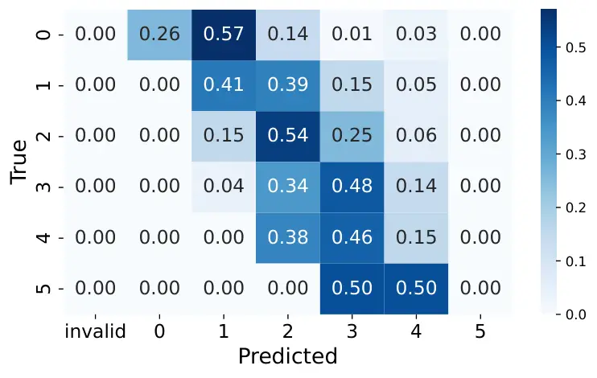

(c) Mistral-3.1-24B-it

Figure 14: Confusion matrices of the three ablated LLMs on the 511 human
annotated ground truth documents in English. Note that Gemma-3-27B-IT
predictions tend to be shifted by 1 to the right which degrades the
classification accuracy but does not influence the ranking performance.
Both LLama-3.3-70B and Mistral-Small-3.1-24B are well aligned with the
human annotations, explaining the high classification accuracy.

### B.4 Predicted Annotation Distributions Across LLM Based Annotators

In Sec. B.3, we showed using predictions from Gemma-3-27B-IT that
different models can shift their predictions across the quality scale.
This has important implications for selecting thresholds when filtering
documents based on predicted quality.

Figure 15 shows the cumulative distribution of predicted scores for
annotated training datasets (approximately 450k documents per language)
by Gemma-3-27B-IT, LLaMA-3.3-70B, and Mistral-Small-3.1-24B. We observe
that, for a fixed filtering threshold, different models yield varying
amounts of retained data. For example, with a threshold of $`\geq 3`$,
Gemma-3-27B-IT retains more data than the other two models, while
LLaMA-3.3-70B retains more than Mistral-Small-3.1-24B. This highlights
that the threshold is model-specific, effectively determining how much
data is preserved and raising questions about the quality–quantity
trade-off.

To address this, we advocate using the p-quantile rather than a fixed
absolute threshold, ensuring consistent data retention across models.
The high Spearman correlation (0.83) between the predicted scores of the
three models indicates that, despite differences in absolute scoring,
all models are capable of ranking documents by quality reliably.

(a) Gemma-3-27B-it

(b) LLama-3.3-70B-it

(c) Mistral-3.1-24B-it

Figure 15: Right cumulative distribution of the scores predicted by the
three ablated models. Alternatively, the curves can be interpreted as
the number of documents whose scores is greater or equal to the given
score. Note that the differences in the monotonously decreasing curves
between models, motivates the model-specific threshold for pre-training
data sampling. Notably, we found a Spearman correlation of 0.83 between
the three models, indicating similar ranking orders despite the scale
shifts.

| Language            | Code    | Translator | \#Testsamples | \#Trainsamples |
| ------------------- | ------- | ---------- | ------------- | -------------- |
| Bulgarian           | bg      | DeepL      | 511           | 499.799        |
| Czech               | cs      | DeepL      | 511           | 496.428        |
| Croatian            | hr      | ChatGPT    | 502           | 497.692        |
| Macedonian          | mk      | ChatGPT    | 509           | 499.446        |
| Polish              | pl      | DeepL      | 511           | 487.150        |
| Slovak              | sk      | DeepL      | 511           | 478.122        |
| Slovenian           | sl      | DeepL      | 511           | 475.949        |
| Serbian             | sr      | ChatGPT    | 509           | 496.172        |
| Serbian Cyrillic    | sr-cyrl | ChatGPT    | 511           | 499.691        |
| Ukrainian           | uk      | DeepL      | 511           | 499.376        |
| Catalan             | ca      | ChatGPT    | 511           | 488.937        |
| Spanish             | es      | DeepL      | 511           | 499.260        |
| French              | fr      | DeepL      | 511           | 499.642        |
| Galician            | gl      | ChatGPT    | 511           | 493.112        |
| Italian             | it      | DeepL      | 511           | 478.998        |
| Portuguese          | pt      | ChatGPT    | 509           | 486.995        |
| Romanian            | ro      | DeepL      | 511           | 499.733        |
| Danish              | da      | DeepL      | 511           | 459.948        |
| German              | de      | DeepL      | 511           | 498.699        |
| Icelandic           | is      | ChatGPT    | 508           | 495.902        |
| Dutch               | nl      | DeepL      | 511           | 495.574        |
| Norwegian (Bokmål)  | nb      | DeepL      | 511           | 493.847        |
| Norwegian (Nynorsk) | nn      | ChatGPT    | 505           | 304.239        |
| Swedish             | sv      | DeepL      | 511           | 491.974        |
| Lithuanian          | lt      | DeepL      | 511           | 488.415        |
| Latvian             | lv      | DeepL      | 511           | 438.257        |
| Greek               | el      | DeepL      | 511           | 499.270        |
| Irish               | ga      | ChatGPT    | 505           | 390.309        |
| Estonian            | et      | DeepL      | 511           | 458.828        |
| Finnish             | fi      | DeepL      | 511           | 490.227        |
| Hungarian           | hu      | DeepL      | 511           | 496.488        |
| Basque              | eu      | ChatGPT    | 508           | 486.467        |
| Maltese             | mt      | ChatGPT    | 510           | 327.441        |
| Turkish             | tr      | DeepL      | 511           | 495.888        |
| Albanian            | sq      | ChatGPT    | 510           | 499.536        |
| Armenian            | hy      | ChatGPT    | 508           | 498.795        |

Table 5: Number of samples for each language contained in the test set
and the regressor training set, including their language codes.

## Appendix C Lightweight Annotators

### C.1 Experimental Setup and Parameter Choice

To reduce computational overhead and accelerate development, we
precomputed and cached all document embeddings prior to training. Since
the embedding models remain frozen throughout training and account for
over 99% of the total parameter count, this approach significantly
reduces iteration time.

The regression head is implemented as a lightweight neural network: a
single-layer multilayer perceptron (MLP) with ReLU activation and a
final linear output layer producing a scalar prediction score. We
performed a hyperparameter sweep over the hidden dimension of the MLP,
exploring values from 10 to 10k. Based on this search, we selected a
hidden size of 1k as a robust default. Depending on the input embedding
dimension, the regression head comprises approximately 770k to 1.03M
trainable parameters.

We trained the regression heads using the AdamW optimizer with a cosine
annealing learning rate schedule, which consistently outperformed
constant and linearly decaying alternatives in our experiments. The
initial learning rate was set to $`5\times 10^{-4}`$, based on a sweep
over values from $`10^{-2}`$ to $`10^{-6}`$. We also tested batch sizes
from 16 to 4096 (in powers of two) and found a batch size of 1024 to
offer the best balance between convergence speed and computational
efficiency.

We trained annotators for up to 20 epochs. To monitor generalization
performance, 10% of the training data is held out for validation. We
applied early stopping if the validation Spearman rank correlation fails
to improve by at least $`10^{-3}`$ over five consecutive epochs.

### C.2 Backbone Selection

We conducted an ablation study comparing three multilingual embedding
models as potential backbones for our lightweight JQL annotators:
gte-multilingual-base Zhang et al. (2024), jina-embeddings-v3 Sturua et
al. (2024), and snowflake-arctic-embed-m-v2.0 Yu et al. (2024).

We trained a total of 18 regression heads, covering all combinations of
the three embedding models and three annotation models used to generate
the ground truth scores. Each combination is trained twice: once on a
randomly sampled training set, and once on a class-balanced variant to
mitigate the skewed distribution of education scores. Training data is
sampled uniformly across all 35 languages The training setup—including
hyperparameters and early stopping criteria—follows the procedure
described in the previous section.

| embedder                | gte-multilingual-base | jina-embeddings-v3 | snowflake-arctic-embed-m-v2 |
| ----------------------- | --------------------- | ------------------ | --------------------------- |
| annotator + balancing   |                       |                    |                             |
| Gemma-3-27B-it bal.     | 0.697 ± 0.013         | 0.722 ± 0.018      | 0.720 ± 0.021               |
| Gemma-3-27B-it          | 0.708 ± 0.014         | 0.734 ± 0.020      | 0.737 ± 0.028               |
| Llama-3.3-70B-it bal.   | 0.693 ± 0.012         | 0.712 ± 0.010      | 0.716 ± 0.014               |
| Llama-3.3-70B-it        | 0.695 ± 0.011         | 0.716 ± 0.009      | 0.724 ± 0.016               |
| Mistral-3.1-24B-it bal. | 0.707 ± 0.011         | 0.735 ± 0.011      | 0.744 ± 0.016               |
| Mistral-3.1-24B-it      | 0.687 ± 0.011         | 0.722 ± 0.017      | 0.736 ± 0.024               |

Table 6: Mean and standard deviation of the Spearman correlation on all
35 testing languages. Each cell corresponds to a training setup
combining an annotating model (with either raw or class-balanced
annotations) and an embedding model. The best result per row is
highlighted in bold. Overall best result underlined.

Results are presented in Tab. 6. The Snowflake embedding model
consistently outperforms the other backbones across annotators and
training set variants. Its best configuration—combined with the
Mistral-3.1 annotation model and class-balanced training—yields the
highest overall correlation (0.744 ± 0.016).

### C.3 End-to-End Training: Embedder and Regression Head

While the regression head alone already yields strong performance when
trained on frozen embeddings, we further investigate whether end-to-end
training of the full model — including both the embedding model and the
regression head — can lead to improved results. To this end, we
integrate the embedding model into the training loop.

This end-to-end setup comes with substantially increased memory and
computational requirements. First, the embedding model accounts for over
99% of the total parameter count. Second, the model input now consists
of full-text documents instead of precomputed embeddings, resulting in
significantly larger input data. These factors necessitate a reduction
in batch size, which, in combination with the increased parameter count,
further increases overall training time.

To conduct the end-to-end experiment, we adopted the learning-rate
schedule and effective batch size (via gradient accumulation)
recommended in the Snowflake technical report Yu et al. (2024). With
these settings, a single epoch on an NVIDIA A100-SXM4-80GB GPU takes
multiple hours, whereas updating only the regression head completes an
epoch in about a minute. This stark contrast quantifies the
computational advantage of training only the regression head while
keeping the embedding model frozen.

Due to these substantially higher runtime and memory demands, we
restricted end-to-end training to the best-performing combination of
Mistral annotations and Snowflake embeddings. Additionally, we observed
that the model could only be trained reliably using float32 precision,
as attempts with brainfloat16 led to numerical instability. This further
increased the memory footprint compared to our default setup.

Figure 16: Validation performance (Spearman correlation) as a function
of the number of processed training samples, comparing two training
strategies. The end-to-end model (blue) jointly trains both the
embedding backbone and the regression head, while the regression-head
model (orange) fine-tunes only the regression layer on top of a frozen
embedder. Performance is evaluated on a held-out validation set, and
both models are trained with early stopping. Epoch boundaries are marked
with dashed lines. While both models show rapid initial gains,
especially during the first 100k samples, the full end-to-end model
converges to a significantly lower final correlation, suggesting limited
benefit from updating the embedding backbone under the given supervision
signal.

Figure 16 illustrates the training progress of both setups: the
end-to-end strategy, where the embedding model is fine-tuned alongside
the regression head, and the regression-head-only setup, which keeps the
embedding model fixed. The figure plots the Spearman correlation on the
validation set against the number of processed training samples.

While both models quickly begin to converge, the performance plateau of
the end-to-end model is substantially lower than that of the
regression-head-only variant. Despite the additional degrees of freedom
introduced by updating the full model. This suggests that fine-tuning
the embedding model does not offer any additional benefit in our setup
and may even hinder performance—likely due to overfitting or
insufficient optimization stability under the increased complexity.

### C.4 Training Data Amount

We conduct an ablation study to determine the minimum amount of training
data required for our lightweight JQL annotators. To this end, we
perform multiple training runs using varying amounts of data, randomly
sampled from all 35 languages. The remainder of the experimental setup,
including all hyperparameters, remains unchanged and is as described in
C.

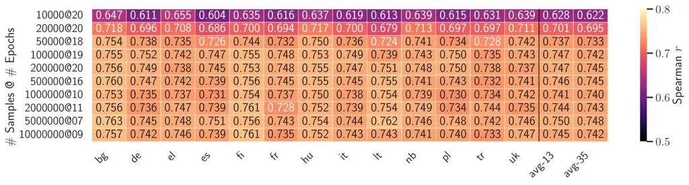

Figure 17: Ten training runs (one per row), utilizing between 10k and
10M training samples (text documents). The number of samples and
corresponding training epochs are shown on the y-axis. Training is
capped at 20 epochs, with early stopping based on Spearman correlation
monitored on a held-out validation set. Each resulting model is
evaluated in terms of Spearman correlation across all 35 test languages.

As shown in Figure 17, using fewer than 50k training samples results in
noticeably lower Spearman correlations. Performance continues to improve
modestly up to approximately 500k samples. Beyond this point, adding
more data does not yield significant gains, suggesting that training
progress begins to converge. As expected, the number of training epochs
required until early stopping decreases with larger training volumes.

One advantage of using smaller training set sizes is improved class
balance. Since our dataset exhibits a highly imbalanced distribution of
education scores—with high and very high scores being strongly
underrepresented—we do not sample randomly but instead enforce
approximate class balance during data selection. Achieving this balance
becomes increasingly difficult as the total number of training samples
increases.

Based on these considerations, we select a training set size of 500k
samples.

### C.5 Detailed results.

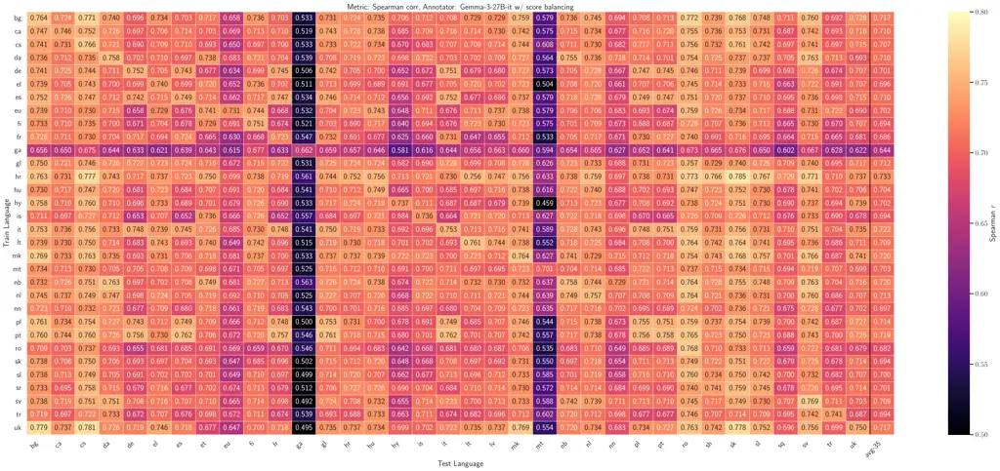

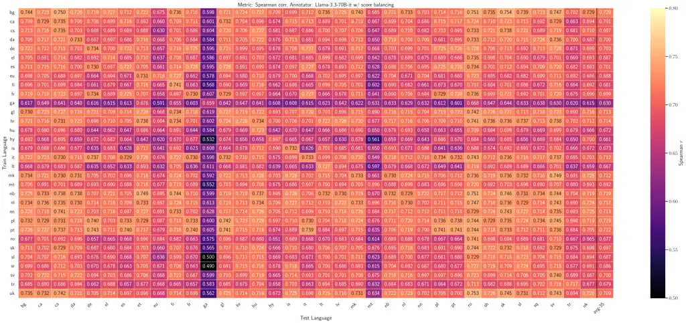

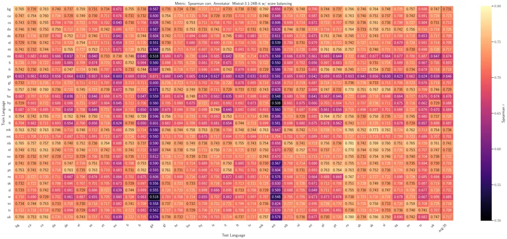

Figure 18: Full cross-lingual transfer; One plot per Annotation model
(balanced); training/evaluation setup is otherwise identical to the best
performing setup. Rows represent the only training language of a
regression head, while columns indicate the testing language. Each cell
reports the Spearman correlation between predicted and human-annotated
scores.

We here provide additional details complementing the main results.
Specifically, Fig 18 shows the full matrix of cross-lingual transfer
performance across all languages considered in our study. Each row
corresponds to a regression head trained solely on one specific
language, while each column represents the test language.

The values in each cell indicate the Spearman correlation between the
model’s predictions and human-annotated scores. This exhaustive view
highlights the generalization capability of the model across language
boundaries.

## Appendix D Assessing Training Data Quality

In this Section, we provide further details and ablations on our
lightweight annotators discussed in Section 5.

### D.1 Experimental Setup

We here provide further details on experimental setup and hyperparameter
for our LLM training ablations.

#### Architecture.

- •
  262144 vocab size SentencePiece tokenizer from Gemma-3 Team et al.
  (2025).
- •
  Dense Llama architecture
- •
  2048 hidden dimension
- •
  24 hidden layers
- •
  32 attention heads
- •
  Silu activation
- •
  Root Mean Square Layer Normalization (RMSNorm) with
  $`\epsilon=1.0e-05`$
- •
  Rotary Position Embeddings (RoPE) with $`\theta=130000`$
- •
  Weight tying for embedding and LM head is customary for small LLMs
  Allal et al. (2025)

#### Training.

- •
  Nanotron¹³¹³ 13
  [https://github.com/huggingface/nanotron](https://github.com/huggingface/nanotron)
  as training framework with tokenization using Datatrove¹⁴¹⁴ 14
  [https://github.com/huggingface/datatrove](https://github.com/huggingface/datatrove)
- •
  2048 sequence length
- •
  Simple document concatenation as Datatrove does not support advanced
  packing algorithms
- •
  AdamW optimizer with $`\beta_{1}=0.9`$, $`\beta_{2}=0.95`$,
  $`\epsilon=1.0e-8`$
- •
  cosine learning rate decay, peak $`lr=1.5e-4`$, decay to $`lr=1.5e-5`$
- •
  linear warmup for 150 steps
- •
  global batch size 960 with micro-batch size $`3`$ and gradient
  accumulation $`5`$.
- •
  1,966,080 tokens per step
- •
  Training on 64 NVIDIA A100-SXM4-80GB with full data parallelism and no
  tensor or pipeline parallelism

#### Data Curation.

Our custom data curation data pipeline for annotation, filtering and
tokenization builds on Datatrove. We use the transformers implementation
with a batch size of 1000 documents per GPU for embedding calculation.
Surprisingly, we observed no speedup when using torch compile.

#### Benchmarks.

In order to conduct our benchmarks, we utilize custom Lighteval¹⁵¹⁵ 15
[https://github.com/huggingface/lighteval](https://github.com/huggingface/lighteval)
tasks. To provide a unified interface, we reformatted ArcX and MMMLU
sources and repacked them to maintain a coherent structure. For MMMLU,
we used off-the-shelf HF-datasets. In all our selected sources, we
considered the highest-quality translations available, such as human
translations from openai/mmmlu, and only resorted to automatic
translations if necessary. The mapping of the different languages to
sources is provided in Tab. 7.

| Language   | Code | ArcX Source         | MMMLU Source           | HellaSwag Source          |
| ---------- | ---- | ------------------- | ---------------------- | ------------------------- |
| Bulgarian  | bg   | openGPT-X/arcx      | openGPT-X/mmlux        | openGPT-X/hellaswagX      |
| German     | de   | openGPT-X/arcx      | openai/MMMLU           | openGPT-X/hellaswagX      |
| Greek      | el   | openGPT-X/arcx      | CohereLabs/Global-MMLU | openGPT-X/hellaswagX      |
| Spanish    | es   | openGPT-X/arcx      | openai/MMMLU           | openGPT-X/hellaswagX      |
| Finnish    | fi   | openGPT-X/arcx      | openGPT-X/mmlux        | openGPT-X/hellaswagX      |
| French     | fr   | openGPT-X/arcx      | openai/MMMLU           | openGPT-X/hellaswagX      |
| Hungarian  | hu   | openGPT-X/arcx      | openGPT-X/mmlux        | openGPT-X/hellaswagX      |
| Italian    | it   | openGPT-X/arcx      | openai/MMMLU           | openGPT-X/hellaswagX      |
| Lithuanian | lt   | openGPT-X/arcx      | CohereLabs/Global-MMLU | openGPT-X/hellaswagX      |
| Norwegian  | nb   | alexandrainst/m_arc | NbAiLab/nb-global-mmlu | alexandrainst/m_hellaswag |
| Polish     | pl   | openGPT-X/arcx      | CohereLabs/Global-MMLU | openGPT-X/hellaswagX      |
| Turkish    | tr   | malhajar/arc-tr     | CohereLabs/Global-MMLU | malhajar/hellaswag-tr     |
| Ukrainian  | uk   | alexandrainst/m_arc | CohereLabs/Global-MMLU | alexandrainst/m_hellaswag |

Table 7: Mapping of language to corresponding ArcX, MMMLU, and HellaSwag
sources.

### D.2 Details on Annotation Distribution

Subsequently, we provide a more detailed insights beyond the annotation
distribution analyzed in Sec. 5.2.

In Fig. 19, we visualize the downstream impact of balancing the training
data of lightweight annotation heads. Training heads on balanced labels
produces slightly smoother distributions, which makes dynamic
thresholding less volatile.

Additionally, we show the difference in label distributions per language
in Fig, 20. The results demonstrate that the heuristic FW-2 filters doe
not uniformly produce similar document quality levels. For example, the
average educational value of retained documents in Lithuanian is
significantly higher than in other languages. Further, we can see a
significant overlap in scores within the filtered and removed subsets.
These results further highlight the difficulty of constructing heuristic
filters that generalize well to different languages. Instead, approaches
like JQL that use document semantics extracted from cross-lingually
aligned embeddings tend to generalize better.

### D.3 Further Results.

We provide more details of the results shown in the main body.
Specifically, we depict the results for all languages under
consideration in Fig. 22-Fig. 34. For almost all languages, we observe
significant improvements over the FW2 baseline, especially on MMLU and
Hellaswag. Additionally, we see higher retention rates for many
languages. For example, in Polish (see Fig. 32), our lightweight edu
annotation model with a dynamic threshold of 0.6 outperforms FW2 while
retaining 16% more tokens. The only two languages with no clear
improvements are Lithuanian (Fig. 30) and Ukranian (Fig. 34). However,
in these cases, we maintain comparable performance while retaining up to
23% and 33% more tokens, respectively.

Figure 19: Distribution of different lightweight annotation heads on CC
release 2024-14 over 13 languages. Training heads on balanced labels
produces slightly smoother distributions.

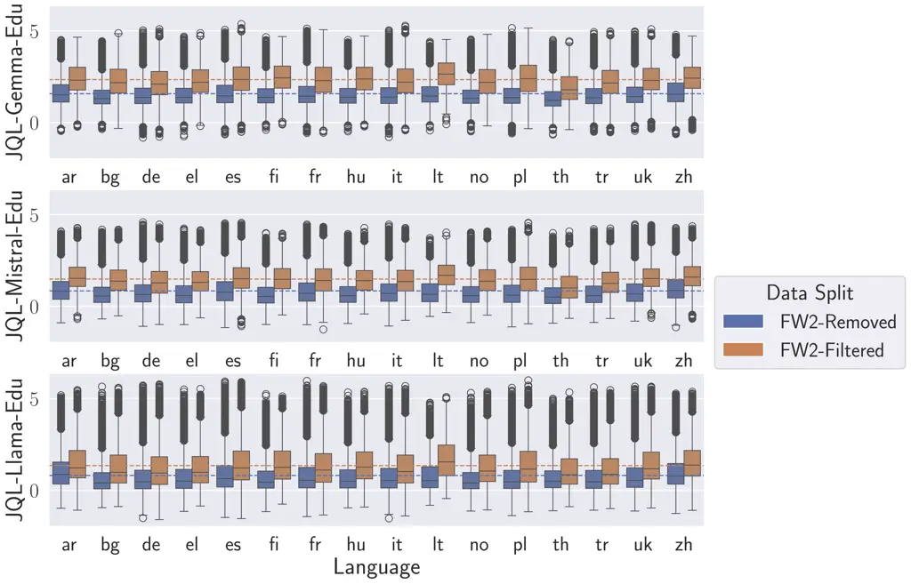

Figure 20: Distribution of edu score annotations by language. Dotted
lines represent the respective mean.

Figure 21: Dataset training performance for Bulgarian.

Figure 22: Dataset training performance for German.

Figure 23: Dataset training performance for Greek.

Figure 24: Dataset training performance for Spanish.

Figure 25: Dataset training performance for Finnish.

Figure 26: Dataset training performance for French.

Figure 27: Dataset training performance for Hungarian.

Figure 28: Dataset training performance for Italian.

Figure 29: Dataset training performance for Lithuanian.

Figure 30: Dataset training performance for Norwegian (Bokmål).

Figure 31: Dataset training performance for Polish.

Figure 32: Dataset training performance for Turkish.

Figure 33: Dataset training performance for Ukrainian.

Figure 34: Dataset training performance for Arabic.

Figure 35: Dataset training performance for Thai.

Figure 36: Dataset training performance for Chinese.

## Appendix E Generalization to Unseen languages

In this Section, we provide further details and ablations on our
generalization experiment on Arabic, Thai, and Chinese in Section 6.

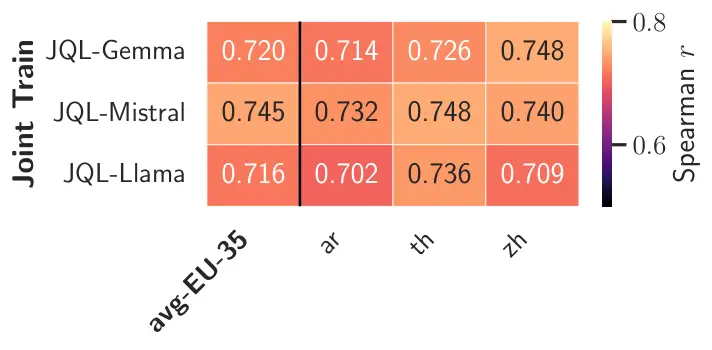

Figure 37: Strong cross-lingual performance of our lightweight JQL
annotators on unseen languages (Arabic, Thai, and Chinese). Compared to
the average performance of the European languages on which the
annotators are trained, we observe an even better correlation with human
GT for some languages.

### E.1 Evaluation of Lightweight PQL-Annotator

We first translated our ground truth documents in the 3 new target
languages. The zero-shot performance of our previously trained
lightweight annotators is depicted in Fig. 37. For these three
topologically new languages, we can see the same level of performance as
for the European languages. For Thai, we even observed better
performance than the European language average across all annotators.
Consequently, JQL generalizes well to new languages (families).

### E.2 Further Results

In Figs. 34, 36 and 36, we compare the training curves of Arabic, Thai,
and Chinese, respectively. Since we only found high-quality MMLU
versions for Arabic and Chinese, we additionally evaluated the
benchmarks proposed by the Fineweb team Penedo et al. (2024b).
Specifically, we extend our evaluation with the following QA benchmarks:

- •
  XQuAD (google/xquad) – 1.190 English QA pairs professionally
  translated into 10 languages Artetxe et al. (2019). We report results
  for Thai.
- •
  MLQA (facebook/mlqa) – 5.000 + extractive QA instances across seven
  languages Lewis et al. (2019). We report results for Arabic.
- •
  TyDi QA (google-research-datasets/tydiqa) – 204 k questions covering
  11 languages Clark et al. (2020). We include Arabic.
- •
  ARCD – The Arabic Reading Comprehension Dataset. 1.395 crowd-sourced
  Arabic questions on Wikipedia articles Mozannar et al. (2019).
- •
  CMRC 2018 – Chinese machine reading comprehension task Cui et al.
  (2019). $`\sim`$20.000 Chinese span-extraction QA pairs from
  Wikipedia.
- •
  Chinese-SQuAD – a machine-translated and manually corrected Chinese
  version of SQuAD v1.1/2.0.
- •
  ThaiQA-SQuAD – 4.074 Thai questions released in SQuAD format.

The results show strong improvements using the JQL filters instead of
FW2 across all languages. Interestingly, though, we can see heavily
diverging impacts on document retention. While our JQL-Edu filters (at
the 0.7 percentile threshold) retain 2% more tokens for Arabic, we see a
drop in retained tokens of 40% for Thai.

Figure 38: Direct comparison of Gemma and Llama as annotators.

## Appendix F Additional Ablations

### F.1 Ablation on Long Context Documents

Contrary to previous works Penedo et al. (2024a), JQL leverages
embedding models with long context windows (i.e., 8k). Penedo et al.
(2024a), for example, only considered the initial 512 tokens of any
document when assigning educational scores. Fig. 39 highlights that a
meaningful portion of documents is indeed longer then 512 tokens.
Consequently, we observe a significant performance improvement of about
7 percentage points on average when using the lightweight annotator at
8192 tokens context length. For low-resource languages like Irish or
Maltese, improvement increases up to 12 percentage points.

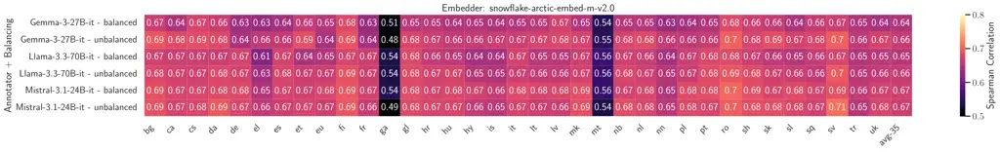

(a) Spearman correlation on test set with 512 tokens context length.

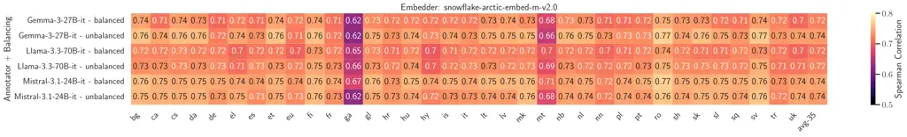

(b) Spearman correlation improves when using full 8192 tokens context
length.

(c) Token Counts across all Test Languages. We observe a meaningful
percentage of documents longer then 512 tokens.

Figure 39: Increased context length of lightweight JQL-annotators
improved performance.

### F.2 Influence of Ranking Performance and Ensembles on Data Quality

In Sec. 3, we observed that Mistral achieves higher classification
accuracy against human ground truth compared to Gemma, while both models
exhibit similarly strong ranking capabilities. To systematically
evaluate the impact of this distinction, we conducted a controlled
ablation study using the Spanish subset. Specifically, we compared data
filtering outcomes using single annotator models—from Gemma and Llama
labels—each applying their respective 0.7 percentile thresholds
independently. Additionally, this setup simultaneously allows us to
assess the value of ensemble-based annotations.

The results in Fig. 38 clearly indicate that the datasets filtered
individually by Gemma and Llama yield very similar downstream training
performance. Consequently, we can conclude that strong ranking
performance is substantially more relevant than classification accuracy
for the task of selecting high-quality training data. Furthermore, we
observed that both single-model-filtered datasets performed worse than
the dataset selected through ensemble-based annotation, thereby
underscoring the robustness provided by ensemble consensus filtering.
These findings emphasize the limited practical importance of absolute
classification accuracy when compared to our design pipeline, which
focuses on ranking capabilities and uses an ensemble to enhance
annotation robustness.

## Appendix G Datasets

Tab. 5 presents the dataset statistics for our training and
human-annotated test sets across all 35 languages included in our study.

For all languages except Norwegian (Nynorsk; 304.2k), Irish (390.3k),
Latvian (438.3k), and Maltese (327.4k), we have at least 450k training
annotations. In some cases, the test set contains fewer than 511 samples
due to the removal of incorrectly translated documents.

## Appendix H License of Used Artifacts

Table 8 summarizes the licenses of the artifacts used in the context of
our work. The majority of artifacts are shared under permissive license
(e.g., CC, MIT, or Apache). The custom license agreements of the two
LLMs we used¹⁶¹⁶ 16 Note that Mistral is shared under Apache License
(Llama-3.3-70B-it and Gemma-2-27b-it) specifically allow for the use of
generated outputs as conducted in our work. The only non-commercial
licenses occurred for some of the benchmark datasets, which we solely
used for academic evaluation. Consequently, our usage aligns with the
terms and intended scope of all respective licenses.

| Artifacts                   | License                                                     |
| --------------------------- | ----------------------------------------------------------- |
| Pre-trained Models:         |                                                             |
| Gemma-2-27B-it              | gemma                                                       |
| Gemma-2-9B-it               | gemma                                                       |
| Gemma-3-27B-it              | gemma                                                       |
| Llama-3.1-8B-it             | Llama 3.1 Community License Agreement                       |
| Llama-3.2-3B-it             | Llama 3.2 Community License Agreement                       |
| Llama-3.3-70B-it            | Llama 3.3 Community License Agreement                       |
| Mistral-3.1-24B-it          | Apache 2.0 License                                          |
| Phi-4-14B                   | MIT License                                                 |
| Qwen-2.5-14B-it             | Apache 2.0 License                                          |
| Qwen-2.5-32B-it             | Apache 2.0 License                                          |
| Qwen-2.5-72B-it             | Qwen License Agreement                                      |
| Qwen-2.5-7B-it              | Apache 2.0 License                                          |
| Snowflake-arctic-embed-v2.0 | Apache-2.0 License                                          |
| Libraries:                  |                                                             |
| Nanotron                    | Apache-2.0 License                                          |
| Datatrove                   | Apache-2.0 License                                          |
| Lighteval                   | MIT License                                                 |
| Transformers                | Apache-2.0 License                                          |
| Pre-training Artifacts:     |                                                             |
| Fineweb-Edu                 | ODC-BY                                                      |
| Fineweb-2                   | ODC-BY                                                      |
| Benchmarks:                 |                                                             |
| Open-AI-MMMLU               | MIT License                                                 |
| Cohere-GLobal-MMLU          | Apache-2.0 License                                          |
| openGPT-X-arcx              | Creative Commons Attribution Share Alike 4.0                |
| openGPT-X-hellaswag-x       | MIT License                                                 |
| alexandrainst-m_arc         | Creative Commons Attribution Non Commercial 4.0             |
| NbAiLab-nb-global-mmlu      | Apache-2.0 License                                          |
| alexandrainst-m_hellaswag   | Creative Commons Attribution Non Commercial 4.0             |
| malhajar-arc-tr             | MIT License                                                 |
| malhajar-hellaswag-tr       | MIT License                                                 |
| google-xQuAD                | Creative Commons Attribution Share Alike 4.0                |
| facebook-mlqa               | Creative Commons Attribution Share Alike 3.0                |
| google-tydiqa               | Apache-2.0 License                                          |
| arcd                        | MIT License                                                 |
| cmrc-2028                   | Creative Commons Attribution Share Alike 4.0                |
| chinese-squad               | No license information available                            |
| thaiQA-squad                | Creative Commons Attribution Non Commercial Share Alike 3.0 |

Table 8: Overview of used artifacts and their licenses.

## Appendix I Data Containing Personally Identifiable Information or Offensive Content

In this work, we introduce JQL, a method designed to enhance the quality
of raw pre-training data by filtering out low-quality content. As part
of this effort, we necessarily engage with data that may contain
personally identifiable information (PII) or offensive material, as such
content is commonly found in large-scale web corpora. While we do not
explicitly quantify JQL’s effectiveness in isolating PII or offensive
content, we assume that its JQL in general is capable in identifying
such content.

## Appendix J Infrastructure & Compute Requirements

In Table 9, we provide a summary of our compute requirements. To
generate the LLM training annotations, we leveraged a large-scale
compute cluster equipped with thousands of H100 GPUs, enabling efficient
processing at scale. ll tasks involving the lightweight annotators and
downstream model training were performed on a cluster equipped with
several hundreds of A100 GPUs.

| Model                  | Task                    | GPU Type | GPU Hours |
| ---------------------- | ----------------------- | -------- | --------- |
| Gemma-3-27B-IT         | Annotation Generation   | H100     | 9072      |
| Mistral-3.1-24B-IT     | Annotation Generation   | H100     | 4464      |
| Llama-3.3-70B-IT       | Annotation Generation   | H100     | 10944     |
| Lightweight Annotators | Embedding Training Data | A100     | 200       |
| Lightweight Annotators | Ablations               | A100     | 300       |
| Lightweight Annotators | Web Corpus Annotation   | A100     | 23000     |
| Custom LLMs (2B)       | Downstream Training     | A100     | 52000     |
| Custom LLMs (2B)       | Evaluation              | A100     | 720       |

Table 9: Estimate of total compute requirements (in GPU hours) across
different stages of the pipeline, including annotation generation and
model training.

## Appendix K Usage of AI Tools

We made use of AI-assisted tools such as ChatGPT and GitHub Copilot to
support writing and coding tasks. All AI-generated outputs were
thoroughly validated to ensure their correctness.
