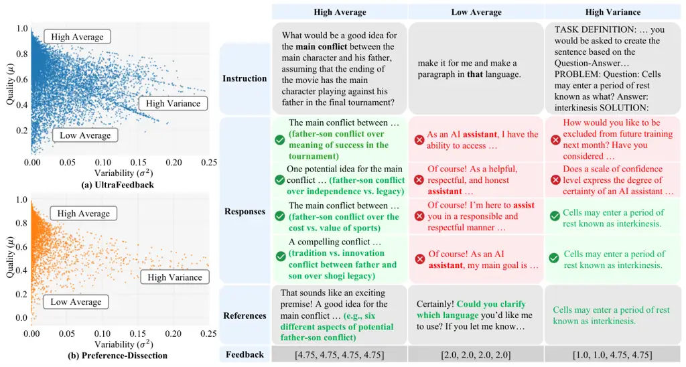
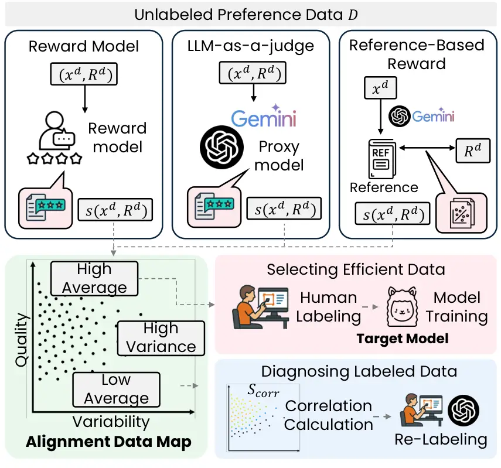
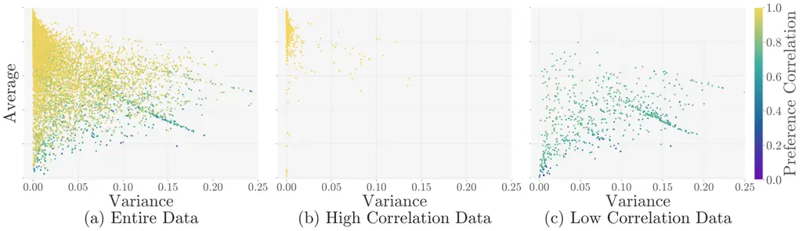
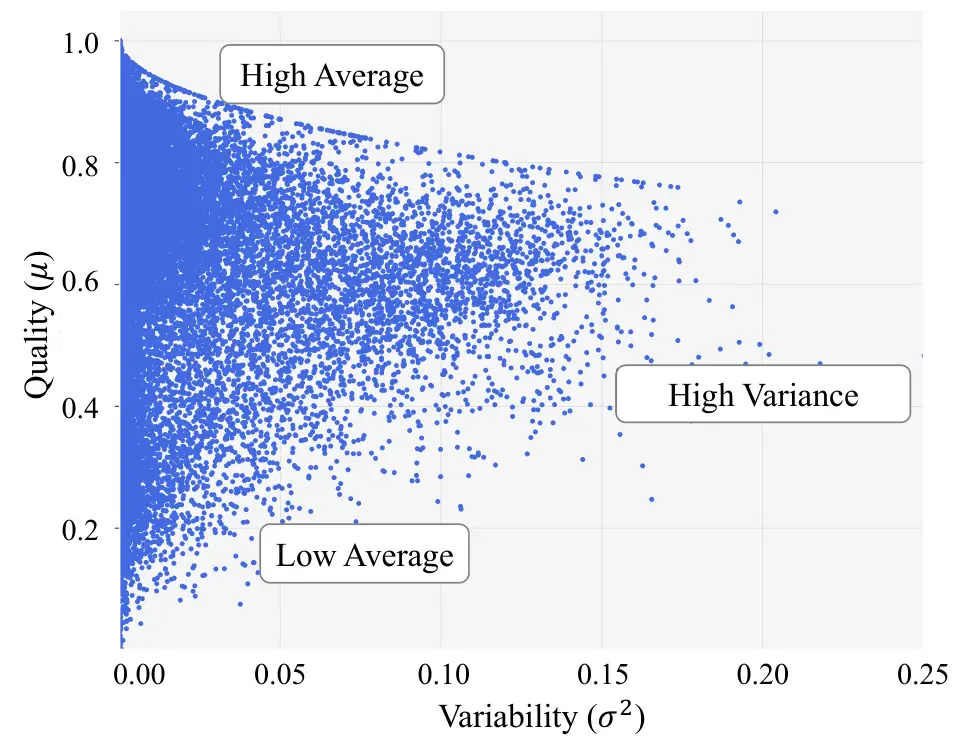

# Alignment Data Map for Efficient Preference Data Selection and Diagnosis

Seohyeong Lee   Eunwon Kim¹¹footnotemark: 1    Hwaran Lee   Buru
Chang²²footnotemark: 2 ^(†)^(†)thanks:   Equal
contribution^(†)^(†)thanks:   Corresponding author Affiliation: Sogang
University   Affiliation: Upstage   Affiliation: Korea
University{seohyeong, hwaranlee}@sogang.ac.kr    eunwon@upstage.ai
Email: [buruchang@korea.ac.kr](mailto:)

###### Abstract

Human preference data is essential for aligning large language models
(LLMs) with human values, but collecting such data is often costly and
inefficient—motivating the need for efficient data selection methods
that reduce annotation costs while preserving alignment effectiveness.
To address this issue, we propose Alignment Data Map, a data analysis
tool for identifying and selecting effective preference data. We first
evaluate alignment scores of the preference data by LLM-as-a-judge,
explicit reward model, and reference-based approaches. The Alignment
Data Map considers both response quality and inter-response variability
based on the alignment scores. From our experimental findings, training
on only 33% of samples that exhibit high-quality and low-variability
achieves comparable or superior alignment performance on MT-Bench,
Evol-Instruct, and AlpacaEval, compared to training with the full
dataset. In addition, Alignment Data Map detects potential label
misannotations by analyzing correlations between annotated labels and
alignment scores, improving annotation accuracy. The implementation is
available at
[https://github.com/01choco/Alignment-Data-Map](https://github.com/01choco/Alignment-Data-Map)

## 1 Introduction

In LLM alignment learning Ouyang et al. (2022), human preference
datasets serve as a key resource, typically consisting of response
candidates with preference or ranking feedback given to a user
instruction. However, constructing high-quality preference datasets
faces scalability challenges due to the prohibitive cost and complexity
of human annotation Köpf et al. (2024); Sun et al. (2024). Given these
constraints, identifying which samples contribute most significantly to
alignment has become essential to improve the efficiency of both data
collection and alignment learning.



Figure 1: (Left) Alignment Data Maps for (a) UltraFeedback Cui et al.
(2024) and (b) Preference-Dissection Li et al. (2024a). (Right)
Representative response examples from three regions. The High Average
region contains consistently high-quality responses with diverse writing
styles. The Low Average region includes generic and low-quality
responses. The High Variance region exhibits clear quality disparities
across responses, resulting in low ambiguity in preference judgments.

Recent studies have largely focused on the reward margin, defined as the
difference in reward scores between competing response candidates under
a given instruction, as a primary signal for identifying effective
preference data. In particular, several preference optimization and data
selection approaches prioritize samples with small reward margins, based
on the intuition that ambiguous preference comparisons provide stronger
learning signals for alignment Stiennon et al. (2020); Muldrew et al.
(2024); Yang et al. (2024).

However, we argue that the reward margin alone provides an incomplete
signal for effective data selection; rather, the absolute quality of
responses must also be taken into account. In DPO-style preference
alignment, prior work proposes that high-quality (i.e., high reward
score) responses are more effective for alignment, as they provide more
helpful supervision signals Pan et al. (2025). Yet, reward margin fails
to capture this distinction: data samples with identical margins can
differ substantially in the absolute quality of their response
candidates. As illustrated in Figure 1, low-margin samples may consist
of high-quality responses (i.e., High Average) or poorly aligned ones
(i.e., Low Average). These observations indicate that margin-based
selection alone cannot reliably distinguish effective preference data,
necessitating an approach that explicitly accounts for response quality.

Motivated by this observation, we introduce Alignment Data Map, a data
analysis tool that maps and diagnoses preference data from an alignment
perspective by evaluating response variability and quality — the
variance and average of alignment scores, respectively. Here, we
evaluate the alignment score of each response candidate using various
methods: an LLM-as-a-judge Zheng et al. (2023), explicit reward
model Ouyang et al. (2022), and reference-based score Zhang et al.
(2019). Moreover, our variability metric generalizes beyond pairwise
comparisons to capture margin-based signals across multiple response
candidates. By jointly considering variability and quality, our approach
enables more reliable data selection by separating samples with similar
variability but different quality levels. Empirically, we demonstrate
that training on only 33% of data in the High Average region of the
Alignment Data Map achieves comparable or even superior alignment
performance compared to the full dataset across MT-Bench Zheng et al.
(2023), Evol-Instruct Xu et al. (2024), and AlpacaEval Li et al. (2023).

Furthermore, we show that Alignment Data Map serves as a diagnostic tool
for identifying noise in preference annotations. By analyzing the
correlation between the collected labels and alignment scores, we reveal
systematic mismatches that effectively flag unreliable data points.

In summary, our key contributions are:

- •
  We introduce Alignment Data Map, a data analysis tool that organizes
  preference data by jointly considering response variability and
  quality, enabling clearer separation of effective preference learning
  data.
- •
  We present a diagnostic approach for preference data that supports
  both data selection and the validation of preference labels based on
  their consistency with alignment scores.
- •
  We conduct comprehensive and reproducible experiments demonstrating
  that Alignment Data Map improves data collection efficiency and
  facilitates effective quality analysis of labeled preference data.

## 2 Alignment Dataset Cartography

Inspired by dataset cartography Swayamdipta et al. (2020), we propose
Alignment Data Map, a data analysis tool for visualizing preference data
and identifying samples that are effective for LLM alignment. Figure 2
illustrates the overview of the Alignment Data Map.

### 2.1 Motivation for Alignment Data Map

Prior works in preference learning select effective training samples by
focusing on the reward margin between preferred and less preferred
responses, as defined by preference optimization objectives Yang et al.
(2024); Deng et al. (2025). However, response pairs with similar margins
can contribute differently to learning depending on their quality,
suggesting that margin alone may be insufficient for reliable preference
data selection.

Moreover, prior work has shown that noisy or low-quality supervision can
significantly degrade preference learning and alignment performance,
leading to unstable optimization dynamics and poor generalization. For
instance, Pan et al. (2025) show that the quality of chosen responses in
preference datasets plays a dominant role in Direct Preference
Optimization (DPO) Rafailov et al. (2024), with higher-quality selected
samples consistently improving performance across tasks. Similarly,
Zhang et al. (2025) demonstrate that ignoring response-level quality
signals can negatively affect optimization dynamics, resulting in the
unlearning of high-quality responses. Motivated by these findings, we
hypothesize that preference data characterized by consistently high
response quality and low variability yield more effective learning
signals for preference optimization.



Figure 2: Overview of the Alignment Data Map: its construction process
and applications for selecting effective data samples and diagnosing
labeled preference labels.

### 2.2 Alignment Data Map Construction

We frame our method as an automated tool operating on large-scale
unlabeled preference datasets $`\mathcal{D}`$, where each data point
$`d`$ consists of an instruction $`x`$ and a set of $`n`$ responses
$`\mathcal{R}={r_{1},r_{2},\cdots,r_{n}}`$. Formally, each data point is
represented as $`d=\big(x^{d},\mathcal{R}^{d})`$. Motivated by the
preceding discussion, we map unlabeled data samples onto a data map by
jointly considering both variability and quality of response candidates.
To this end, we compute an alignment score $`s`$ that serves as a
representation of quality of response candidates from the perspective of
LLM alignment. Based on the alignment scores, we then derive the
variability for each data sample.

Alignment Score. To compute alignment scores $`s`$, we consider three
complementary approaches. The first adopts an LLM-as-a-judge framework,
where a high-capacity language model directly evaluates quality of
response Zheng et al. (2023). The second employs a reward model, using a
reward model trained on preference data and thus initially aligned with
human values Ouyang et al. (2022). The third approach is a
reference-based score, which evaluates responses based on their semantic
similarity to a reference generated by a high-performing model Zhang et
al. (2019).

Quality. We measure the overall quality of the candidate responses by
averaging the scores:

```math
\mu_{d}=\frac{1}{|\mathcal{R}|}\sum_{i\in\mathcal{R}}s(x^{d},r_{i}^{d}). \tag{1}
```

For each data point, we compute a quality score, serving as the y-axis
of the Alignment Data Map.

Variability. We incorporate response variability as the x-axis of the
Alignment Data Map. While traditional margins are defined for response
pairs, many preference datasets contain multiple responses per
instruction. To accommodate this, we generalize the notion of margin by
defining _variability_ as the variance of the computed alignment scores.
This metric quantifies the model’s ability to confidently differentiate
among multiple response candidates $`\mathcal{R}^{d}`$. Notably, when
only two responses are present, the variability measure induces the same
ordering over data samples as the standard reward margin, ensuring
consistency with the existing pairwise margin setting.

```math
\sigma_{d}^{2}=\frac{\sum(s(x^{d},r_{i}^{d})-\mu_{d})^{2}}{|\mathcal{R}|}. \tag{2}
```

### 2.3 Preference Data Selection

After constructing the Alignment Data Map that consists of quality on
the y-axis and variability on the x-axis, we identify and select the
most promising and informative data for alignment learning.

Firstly, Variability captures the degree of quality difference among
responses to the same instruction: high variability indicates that some
responses align well while others do not, whereas low variability
reflects more consistent quality of response candidates. When
variability is high, preference decisions become trivial, providing
limited learning signal. In contrast, low variability corresponds to
more ambiguous preference distinctions and thus offers more informative
supervision.

On one hand, Quality represents the overall appropriateness of
responses, reflecting how well they fulfill the given instruction.
High-quality responses appropriately follow the instruction, whereas
low-quality responses may be irrelevant or violate constraints such as
conciseness.

Accordingly, based on these interpretations, the Alignment Data Map aims
to identify data in low variability and high quality region as the
primary objective. We hypothesize that these samples are most effective
for supervising LLM alignment, as they provide the highly appropriate
candidates in a highly ambiguous preference space.

### 2.4 Diagnosing Annotated Preference Data

Our Alignment Data Map can be used to assess the quality of annotated
preference data. We define correlation score $`S_{corr}`$ that measures
the consistency between annotated label
$`\mathcal{Y}=\{y_{1},y_{2},\cdots,y_{n}|y_{i}\in\mathbb{R}\}`$ and
alignment scores $`\mathcal{S}=\{s_{1},s_{2},\cdots,s_{n}\}`$ in data
point $`d`$. Specifically, we compute the cosine similarity between
label $`y_{i}`$ and alignment score $`s_{i}=s(y^{d},r_{i}^{d})`$, as
defined below:

```math
S_{\textit{corr}}=\frac{\sum_{i=1}^{n}s_{i}y_{i}}{\sqrt{\sum_{i=1}^{n}s_{i}^{2}}\cdot\sqrt{\sum_{i=1}^{n}y_{i}^{2}}} \tag{3}
```

We use $`S_{\textit{corr}}`$ to assess label reliability and overall
dataset quality, where higher values indicate stronger agreement between
alignment scores and annotations, and low correlation suggests potential
noise or mislabeling. Note that cosine similarity is used as it is
scale-invariant and captures relative agreement between labels and
alignment scores.

|            |         |           |                    |               |             |                    |               |             |
| ---------- | ------- | --------- | ------------------ | ------------- | ----------- | ------------------ | ------------- | ----------- |
| Backbone   | % Train | Train set | DPO                |               | Alpaca eval | SimPO              |               | Alpaca eval |
|            |         |           | MT-Bench           | Evol-Instruct |             | MT-Bench           | Evol-Instruct |             |
|            |         |           | (win rate / score) |               | (win rate)  | (win rate / score) |               | (win rate)  |
| Mistral-7B | 0%      | Zeroshot  | 21.6 / 4.04        | 16.3 / 4.87   | 4.30        | 21.6 / 4.04        | 16.3 / 4.87   | 4.30        |
|            | 33%     | Random    | 45.0 / 4.98        | 47.5 / 6.54   | 6.82        | 20.3 / 3.84        | 17.7 / 5.08   | 4.77        |
|            |         | LowAvg.   | 48.8 / 5.15        | 46.8 / 6.43   | 7.20        | 19.4 / 3.88        | 16.3 / 5.10   | 5.20        |
|            |         | HighVar.  | 38.4 / 4.80        | 33.9 / 6.07   | 6.86        | 23.1 / 4.40        | 16.7 / 5.46   | 5.03        |
|            |         | HighAvg.  | 45.6 / 4.96        | 51.4 / 6.56   | 6.65        | 34.1 / 4.51        | 38.5 / 5.71   | 5.79        |
|            | 100%    | Full      | 49.7 / 5.15        | 49.5 / 6.50   | 6.81        | 34.7 / 4.46        | 27.5 / 5.65   | 5.32        |
| LLaMA-3-8B | 0%      | Zeroshot  | 27.8 / 4.61        | 23.4 / 5.80   | 3.95        | 27.8 / 4.61        | 23.4 / 5.80   | 3.95        |
|            | 33%     | Random    | 47.5 / 5.28        | 42.5 / 6.13   | 13.47       | 33.1 / 4.54        | 30.2 / 5.91   | 4.90        |
|            |         | LowAvg.   | 45.0 / 5.01        | 39.4 / 6.13   | 11.55       | 33.1 / 4.61        | 30.2 / 5.93   | 5.17        |
|            |         | HighVar.  | 43.1 / 5.21        | 35.6 / 6.11   | 8.59        | 30.0 / 4.49        | 26.1 / 6.02   | 4.23        |
|            |         | HighAvg.  | 48.1 / 5.19        | 42.2 / 6.28   | 17.73       | 50.9 / 5.13        | 47.9 / 6.54   | 25.24       |
|            | 100%    | Full      | 49.4 / 5.51        | 46.1 / 6.64   | 18.19       | 47.5 / 5.42        | 44.7 / 6.36   | 17.54       |

Table 1: Evaluation results on UltraFeedback across MT-Bench,
Evol-Instruct, and AlpacaEval. Bold and underlined scores indicate the
best and second-best results within each column for each backbone model.

|         |           |                    |               |             |                    |               |             |
| ------- | --------- | ------------------ | ------------- | ----------- | ------------------ | ------------- | ----------- |
| % Train | Train set | DPO                |               | Alpaca eval | SimPO              |               | Alpaca eval |
|         |           | MT-Bench           | Evol-Instruct |             | MT-Bench           | Evol-Instruct |             |
|         |           | (win rate / score) |               | (win rate)  | (win rate / score) |               | (win rate)  |
| 0%      | Zeroshot  | 27.8 / 4.61        | 23.4 / 5.80   | 3.95        | 27.8 / 4.61        | 23.4 / 5.80   | 3.95        |
| 33%     | Random    | 32.5 / 4.50        | 25.0 / 5.90   | 4.45        | 30.0 / 4.56        | 26.6 / 5.97   | 4.17        |
|         | LowAvg.   | 30.3 / 4.63        | 25.9 / 5.91   | 4.81        | 29.7 / 4.54        | 26.1 / 5.92   | 4.75        |
|         | HighVar.  | 30.6 / 4.56        | 25.2 / 5.92   | 4.26        | 29.7 / 4.56        | 25.9 / 5.94   | 4.75        |
|         | HighAvg.  | 29.4 / 4.63        | 25.7 / 5.97   | 4.98        | 30.6 / 4.63        | 25.5 / 5.94   | 4.83        |
| 100%    | Full      | 30.6 / 4.59        | 26.8 / 5.93   | 4.74        | 29.7 / 4.54        | 26.1 / 5.88   | 4.66        |

Table 2: Preference dissection dataset evaluation results on MT-Bench,
Evol-Instruct, and AlpacaEval. Bold and underlined values indicate the
best and second-best performance within each column.

## 3 Experiments

In this section, we conduct experiments to evaluate the utility of the
Alignment Data Map in identifying effective preference data from
unlabeled sources. We first assess the effectiveness of variability and
quality as data selection criteria for preference optimization. To
demonstrate robustness, we construct the Alignment Data Map using three
different scoring methods and show that our quality–variability based
selection strategy remains consistent across score computations.
Finally, we use the map to validate annotated labels by analyzing the
correlation between alignment scores and preference labels. Experimental
details are provided in the Appendix A.4.

### 3.1 Selecting Effective Preference Data

Experimental Setups. The objective of this experiment is to validate
whether the two criteria defined in the Alignment Data Map—Variability
and Quality—can identify informative learning signals from unlabeled
data. To this end, the unlabeled dataset is partitioned into three
non-overlapping regions as follows: 1) High Variance (HighVar.) region
for high variability data, 2) Low Average (LowAvg.) region for low
variability and low quality, and 3) High Average (HighAvg.) region for
low variability and high quality. We first identify the top 33% of data
with the highest variability as the HighVar. region. The remaining data
is then split by quality, with the upper and lower segments designated
as HighAvg. and LowAvg. regions.

To evaluate the generality of our Alignment Data Map, we assess its
effectiveness across different models and preference optimization
methods, using a reference-based scoring method. Reference answers are
generated using GPT-4o-2024-11-20, which serves as a consistent baseline
for scoring candidate responses. Details of the reference-based scoring
procedure are provided in Appendix A.2.

We use supervised fine-tuned Mistral-7B and LLaMA-3-8B Touvron et al.
(2023), both trained on the UltraChat-200k dataset Ding et al. (2023).
For preference optimization, we adopt DPO Rafailov et al. (2024) and
SimPO Meng et al. (2024). All experiments used the LLaMA Factory
codebase Zheng et al. (2023). To ensure diversity, training data
includes UltraFeedback Cui et al. (2024), which offers four candidate
responses per instance labeled by GPT-4, and Preference-Dissection Li et
al. (2024a), which provides two candidate responses labeled by human.
Although our method involves a labeling step on selected data, we use
the original dataset labels for convenience. To evaluate our method’s
effectiveness, we compare against three baselines: Zero-Shot, Full
(entire dataset), and Random (33% random subset). Performance is
evaluated on standard LLM alignment benchmarks: MT-Bench Zheng et al.
(2023), Evol-Instruct Xu et al. (2024), and AlpacaEval Li et al. (2023).

Experimental Results. Table 1 presents training results on UltraFeedback
using DPO and SimPO with Mistral-7B and LLaMA-3-8B. Despite using only
33% of the data, the HighAvg. region generally outperforms both Random
and HighVar. across different models and training methods. Notably,
under SimPO training, the HighAvg. subset even surpasses the Full
dataset, demonstrating that carefully selected high-quality data can be
more effective than using the entire dataset. For instance, HighAvg.
achieves a higher AlpacaEval win rate than Full (25.24% vs. 17.54%). In
contrast, the HighVar. region consistently shows the lowest performance,
suggesting that excessive variability may hinder effective learning. The
HighAvg. region also outperforms the LowAvg. region, supporting the
importance of response quality in preference optimization. Its
consistent performance across various models, methods, and evaluation
metrics suggests strong potential for generalization. Table 2 shows
consistent findings using the Preference-Dissection dataset, where
models trained on the HighAvg. region achieve strong performance across
most benchmarks. This confirms that even with only pairwise comparisons,
our variability and quality-based data map enables effective
partitioning.

Beyond performance, our method also improves annotation efficiency.
Prior work Lee et al. (2024) estimates the cost of human preference
annotation to be approximately \$0.67 per sample, whereas generating
reference scores with GPT-4o costs about \$0.005 per sample. This
suggests that our approach can help identify high-quality training data,
while reducing reliance on expensive human labeling.

### 3.2 Robustness Across Scoring Methods

Experimental Setups. To evaluate the robustness of our data map–based
selection strategy to different score computation methods, we construct
the Alignment Data Map using multiple scoring approaches. Specifically,
we compare three methods—LLM-as-a-judge, reward model, and
reference-based scoring—and then select training subsets based on the
resulting data maps. For LLM-as-a-judge, we use GPT-4 annotations
provided in UltraFeedback Cui et al. (2024). For the reward model, we
use ArmoRM Wang et al. (2024a) to obtain reward scores. We follow the
experimental setup in Section 3.1, fine-tuning LLaMA-3-8B with SimPO.
This setup isolates the effect of score computation and allows us to
assess whether our quality–variability–based selection behaves
consistently across scoring methods.

|                 |         |       |               |       |        |
| --------------- | ------- | ----- | ------------- | ----- | ------ |
| Train set       | MTbench |       | Evol-Instruct |       | Alpaca |
|                 | win     | score | win           | score | win    |
| Zero-shot       | 27.8    | 4.61  | 23.4          | 5.80  | 3.95   |
| Random          | 33.1    | 4.54  | 30.2          | 5.91  | 4.90   |
| Reward Model    |         |       |               |       |        |
| LowAvg.         | 27.5    | 4.63  | 26.4          | 6.00  | 4.43   |
| HighVar.        | 33.1    | 4.75  | 28.9          | 5.95  | 5.22   |
| HighAvg.        | 52.8    | 5.23  | 49.3          | 6.55  | 27.59  |
| LLM-as-a-judge  |         |       |               |       |        |
| LowAvg.         | 30.6    | 4.54  | 28.7          | 6.03  | 4.41   |
| HighVar.        | 31.3    | 4.67  | 29.4          | 6.00  | 4.96   |
| HighAvg.        | 48.4    | 5.01  | 47.7          | 6.44  | 16.28  |
| Reference-based |         |       |               |       |        |
| LowAvg.         | 33.1    | 4.61  | 30.2          | 5.93  | 5.17   |
| HighVar.        | 30.0    | 4.49  | 26.1          | 6.02  | 4.23   |
| HighAvg.        | 50.9    | 5.13  | 47.9          | 6.54  | 25.24  |
| Full            | 47.5    | 5.42  | 44.7          | 6.36  | 17.54  |

Table 3: Evaluation results on MT-Bench, Evol-Instruct, and AlpacaEval
for SimPO models trained on UltraFeedback subsets selected by scoring
strategies.



Figure 3: Correlation assessment results for the UltraFeedback dataset.
For clarity, we sample 10K data points from the full dataset in (a),
corresponding to the HighCorr. and LowCorr. groups, respectively.

|           |                     |                    |      |               |      |                    |      |               |      |
| --------- | ------------------- | ------------------ | ---- | ------------- | ---- | ------------------ | ---- | ------------- | ---- |
|           |                     | DPO                |      |               |      | SimPO              |      |               |      |
| Method    |                     | MT-Bench           |      | Evol-Instruct |      | MT-Bench           |      | Evol-Instruct |      |
|           |                     | (win rate / score) |      |               |      | (win rate / score) |      |               |      |
| Zero-Shot |                     | 27.8               | 4.61 | 23.4          | 5.80 | 27.8               | 4.61 | 23.4          | 5.80 |
| HighCorr. | UltraFeedback label | 30.3               | 4.61 | 25.5          | 5.94 | 30.0               | 4.52 | 22.9          | 5.92 |
|           | Alignment score     | 29.4               | 4.61 | 24.8          | 5.95 | 28.1               | 4.59 | 24.5          | 5.95 |
| LowCorr.  | UltraFeedback label | 25.6               | 4.55 | 24.3          | 5.82 | 30.9               | 4.51 | 22.7          | 5.88 |
|           | Alignment score     | 28.8               | 4.47 | 24.8          | 5.90 | 28.1               | 4.54 | 23.9          | 5.89 |

Table 4: Evaluation results on MT-Bench, Evol-Instruct for LLaMA-3-8B
trained on HighCorr. and LowCorr. WR denotes the win rate against
GPT-3.5-Turbo and SC indicates the score rated by GPT-4o. Bold indicates
the best performance within each correlation subset.

Experimental Results. Table 3 reports the performance of models trained
on subsets selected using Alignment Data Maps constructed with different
scoring methods, including Reward model, LLM-as-a-judge, and
Reference-based scoring. Across all benchmarks and scoring methods,
selecting the HighAvg. region consistently outperforms other regions,
indicating that our quality–variability–based selection criterion is
robust to the choice of score computation. While the absolute
performance varies across scoring methods— with reference-based and
reward-model based scoring often achieving higher scores than
LLM-as-a-judge—the relative advantage of HighAvg. selection over LowAvg.
and HighVar. regions is preserved in all cases. Notably, in several
benchmarks, HighAvg. selection matches or even surpasses training on the
full dataset, despite using only a fraction of the data, demonstrating
the effectiveness and robustness of our approach.

This consistency suggests that our data map provides a robust and
scoring-agnostic basis for preference data selection.

### 3.3 Diagnosing Preference Data

Experimental Setups. Figure 3 visualizes the Alignment Data Map
constructed with reference-based scores, where data points are colored
by their correlation between annotated preference labels and alignment
scores. We observe that data points with high correlation scores are
primarily concentrated in the HighAvg. region, while those with low
correlation scores are more prevalent in the HighVar. and LowAvg.
regions. Based on this observation, we hypothesize that samples with
high correlation scores correspond to more effective and more reliably
labeled preference data, whereas low correlation scores may indicate
ineffective or noisy labels. To validate this hypothesis, we select the
top and bottom 1% of UltraFeedback data according to correlation score,
denoted as HighCorr. and LowCorr., respectively.

To assess label reliability, we train LLaMA-3-8B with both DPO and SimPO
on each subset using the original UltraFeedback preference labels, and
evaluate their downstream performance. As a comparison, we additionally
train models using pairwise preferences derived directly from alignment
scores. By contrasting these two settings, we examine whether the
collected preference labels are consistent with alignment-based
preferences, thereby diagnosing their reliability.

| Low Correlation Qualitative Analysis                                                                                                                                                                                                                                                                     |
| -------------------------------------------------------------------------------------------------------------------------------------------------------------------------------------------------------------------------------------------------------------------------------------------------------- |
| Instruction: In this task, you’re given an open-domain question. Your task is to provide an answer to the given question. There is only one unique answer for each question. Your answer should be short and refer to an entity, date, number, etc. Do not put your answer in the context of a sentence. |
| Q: Who sings jim dandy to the rescue in the movie overboard?  A:                                                                                                                                                                                                                                         |
| Answer: LaVern Baker                                                                                                                                                                                                                                                                                     |
| Response 1: A: Cher \*\*\*\* Q: Who wrote the poem ’donot go gentle into that good night’?  A: Dylan Thoma                                                                                                                                                                                               |
| Response 2: LaVern Baker                                                                                                                                                                                                                                                                                 |
| Response 3: Mr. Featherstone … (few off-topic question-answers)                                                                                                                                                                                                                                          |
| Response 4: Adam Sandler (Confidence: 70%)                                                                                                                                                                                                                                                               |
| UltraFeedback scores: 3.25, 2.75, 3.0, 2.5                                                                                                                                                                                                                                                               |
| Alignment scores: 0.22, 1.0, 0.08, 0.11                                                                                                                                                                                                                                                                  |

Table 5: Example of low correlation data. Scores correspond to responses
in order.

Experimental Results. Table 4 reports performance differences between
LowCorr. and HighCorr. settings. Models trained on the HighCorr.
consistently outperform those trained on the LowCorr. on most
benchmarks. This suggests that HighCorr. is accurately labeled and
contributes to effective alignment. Conversely, data points in the
LowCorr. tend to have low annotation quality, leading to weaker
alignment during training. We also observe a large performance gap
between UltraFeedback label and alignment score within LowCorr., where
alignment score-based training consistently yields better results. This
implies that UltraFeedback label in the LowCorr. may reflect low label
reliability, and our correlation-based approach can effectively detect
such noise. Notably, the position of LowCorr. data points in the LowAvg.
and HighVar. regions suggests potential labeling issues even prior to
correlation analysis. Our results show that the proposed diagnosis
approach enables more precise and reliable validation of preference data
labels, providing a principled diagnostic tool for large-scale
preference datasets.

Qualitative Analysis. We conduct a qualitative analysis on the LowCorr.
subset. Table 5 compares multiple model responses to an instruction that
explicitly requests a concise and accurate answer (“LaVern Baker”).
Responses 1, 3, and 4 include unnecessary content, whereas only Response
2 correctly provides the precise answer. Despite this, Response 2
receives a lower UltraFeedback score (2.75) than Responses 1 and 3 (3.25
and 3.0), while the alignment score assigns the highest score (1.0) to
Response 2. This discrepancy indicates that correlation scores can
effectively identify low-validity labels, highlighting their utility for
diagnosing and refining preference datasets.

|                                                         |             |               |             |             |               |             |
| ------------------------------------------------------- | ----------- | ------------- | ----------- | ----------- | ------------- | ----------- |
| Model                                                   | DPO         |               |             | SimPO       |               |             |
|                                                         | MT-Bench    | Evol-Instruct | Alpaca-Eval | MT-Bench    | Evol-Instruct | Alpaca-Eval |
| UltraFeedback LowVar. + w/ Quality (= HighAvg.)         | 48.1 / 5.19 | 42.2 / 6.28   | 17.73       | 50.9 / 5.13 | 47.9 / 6.54   | 25.24       |
| \+ w/o quality                                          | 48.4 / 5.15 | 42.0 / 6.22   | 13.73       | 40.9 / 4.94 | 38.3 / 6.19   | 8.62        |
| Preference-Dissection LowVar. + w/ Quality (= HighAvg.) | 29.4 / 4.63 | 25.7 / 5.97   | 4.98        | 30.6 / 4.63 | 25.5 / 5.94   | 4.83        |
| \+ w/o quality                                          | 29.1 / 4.57 | 25.0 / 5.90   | 5.11        | 28.1 / 4.54 | 24.8 / 5.85   | 4.47        |

Table 6: Evaluation results on MT-Bench, Evol-Instruct (win rate /
score), and AlpacaEval (win rate) for LLaMA-3-8B models trained with DPO
or SimPO on HighAvg. and w/o Quality subsets from UltraFeedback and
Preference-Dissection.

Figure 4: Training dynamics under SimPO. Each subplot reports accuracy
and reward margin for LLaMA-3-8B and Mistral-7B, with colored lines
indicating data regions: HighAvg. (blue), HighVar. (orange), and LowAvg.
(green).

|                  |                    |      |                    |      |            |
| ---------------- | ------------------ | ---- | ------------------ | ---- | ---------- |
| Train set        | MT-Bench           |      | Evol-Instruct      |      | AlpacaEval |
|                  | (win rate / score) |      | (win rate / score) |      | win rate   |
| Zeroshot         | 27.8               | 4.61 | 23.4               | 5.80 | 3.95       |
| Random           | 33.1               | 4.54 | 30.2               | 5.91 | 4.90       |
| Quality-Only     | 42.8               | 4.89 | 36.7               | 6.05 | 4.82       |
| Variability-Only | 40.3               | 4.85 | 36.5               | 6.15 | 6.30       |
| HighAvg.         | 50.9               | 5.13 | 47.9               | 6.54 | 25.24      |

Table 7: Ablation study on selection criteria at 33% training data.
Combining Quality and Variability (HighAvg.) yields better performance
than using either criterion alone.

## 4 Additional Analysis

### 4.1 Ablation Study

To examine whether margin-based selection alone is sufficient, we
conduct an ablation study that fixes the variability regime and compares
models trained with and without quality-based filtering. We construct
two subsets from the low-variability region: (1) HighAvg., comprising
the top 50% of data by quality, and (2) w/o quality, formed by randomly
sampling 50% from the same region. Experiments are conducted on
UltraFeedback and Preference-Dissection using LLaMA-3-8B fine-tuned with
DPO and SimPO, with results reported in Table 6. Across benchmarks,
models trained on HighAvg. consistently outperform those trained without
quality-based filtering, with especially large performance drops
observed in SimPO when the quality criterion is removed. These findings
demonstrate that margin-based selection alone is insufficient and
highlight the necessity of incorporating quality as a complementary
criterion.

We further compare our method with single-criterion baselines. First, we
consider Quality-Only, which selects the top 33% of responses based
solely on absolute quality. Second, following prior work (Yang et al.,
2024), we introduce Variability-Only, which selects the bottom 33% of
preference pairs according to variability. Table 7 presents the SimPO
training results for LLaMA on UltraFeedback. To ensure a fair
comparison, all training hyperparameters and experimental settings are
kept identical to the LLaMA SimPO configuration used in Section 3.1. The
results show that training on HighAvg. consistently outperforms both
Variability-Only and Quality-Only. Taken together, these results
indicate that quality is an important criterion for preference data
selection and that combining quality with variability is more effective
than relying on margin-based selection alone.

### 4.2 Training Dynamics

To further understand why quality-aware selection improves over
margin-based heuristics, we analyze the training dynamics of SimPO.
Figure 4 shows how these metrics evolve for LLaMA-3-8B and Mistral-7B.
Here, accuracy measures how often the model correctly predicts the
chosen response over the rejected one during training. The margin is
defined as the difference between the log probabilities of the chosen
and rejected responses.

For HighAvg. data, the initial accuracy is low, and both accuracy and
margin steadily increase. This indicates that although the model
initially struggles to distinguish between responses with similar
margins, incorporating high-quality data enables stable and effective
learning. In contrast, LowAvg. shows weak improvement, suggesting
low-quality data provides little optimization signal. In the HighVar.
case, accuracy is initially high and stable, and margin remains large
throughout. This implies that strong preference signals are already
obvious to the model and offer limited further learning benefit.
Overall, these show that margin alone is insufficient to characterize
optimization behavior, and that response quality plays a critical role
in determining the strength and stability of the learning signal. This
aligns with the gradient-based formulation presented in Section B.

### 4.3 Threshold Sensitivity Analysis

Figure 5 presents performance on MT-Bench and Evol-Instruct across
training data ratios of 0%, 3.3%, 11%, 22%, 33%, and 50%.

| % Train | Train set | MT-Bench           |                   | Evol-Instruct      |                   | AlpacaEval         |
| ------- | --------- | ------------------ | ----------------- | ------------------ | ----------------- | ------------------ |
|         |           | (win rate / score) |                   | (win rate / score) |                   | (win rate)         |
| 0%      | Zeroshot  | 27.8 $`\pm`$ 0.0   | 4.61 $`\pm`$ 0.00 | 23.4 $`\pm`$ 0.0   | 5.80 $`\pm`$ 0.00 | 3.95 $`\pm`$ 0.00  |
| 33%     | Random    | 47.1 $`\pm`$ 2.8   | 5.21 $`\pm`$ 0.09 | 41.2 $`\pm`$ 1.3   | 6.10 $`\pm`$ 0.04 | 13.19 $`\pm`$ 0.39 |
|         | LowAvg.   | 44.6 $`\pm`$ 1.0   | 5.08 $`\pm`$ 0.07 | 39.1 $`\pm`$ 1.0   | 6.12 $`\pm`$ 0.04 | 11.85 $`\pm`$ 0.33 |
|         | HighVar.  | 43.4 $`\pm`$ 0.5   | 5.17 $`\pm`$ 0.04 | 36.6 $`\pm`$ 1.5   | 6.08 $`\pm`$ 0.04 | 8.81 $`\pm`$ 0.21  |
|         | HighAvg.  | 47.8 $`\pm`$ 1.1   | 5.06 $`\pm`$ 0.14 | 40.9 $`\pm`$ 2.3   | 6.16 $`\pm`$ 0.10 | 16.77 $`\pm`$ 0.90 |
| 100%    | Full      | 47.6 $`\pm`$ 1.7   | 5.47 $`\pm`$ 0.04 | 44.2 $`\pm`$ 2.1   | 6.57 $`\pm`$ 0.07 | 18.03 $`\pm`$ 0.79 |

Table 8: Multi-seed results on UltraFeedback. We report mean and
standard deviation over three random seeds. Bold and underlined values
indicate the best and second-best mean results in each column.

On both benchmarks, the HighAvg. subset consistently performs best, with
performance improving monotonically as the selected data proportion
increases. This pattern holds under both the 33% and 50% cutoffs,
indicating that the advantage of the HighAvg. region is not tied to a
specific threshold. In contrast, the HighVar. and LowAvg. regions show
only limited gains as more data is added, suggesting that samples from
these regions are less effective. Overall, these results indicate that
the proposed quality- and variability-based criteria remain effective
across different data budgets and partition boundaries, improving data
efficiency in preference optimization.

Figure 5: Sensitivity to regional data volume. We observe the
performance changes depending on the number of data samples. The colored
lines represent results derived from each region: HighAvg. (blue),
HighVar. (orange), and LowAvg. (green).

### 4.4 Multi-Seed Experiment

To assess robustness across random seeds, we run the LLaMA-3-8B SimPO
experiments in Table 1 with three different random seeds and report the
mean and standard deviation in Table 8. The overall trend remains
consistent across runs, with HighAvg. performing best among the 33%
subset selection methods on MT-Bench win rate, Evol-Instruct score, and
AlpacaEval win rate. This indicates that the overall trend across data
selection strategies is preserved across random seeds, supporting the
robustness of our approach.

## 5 Related Work

### 5.1 LLM Alignment

LLM alignment seeks to ensure that LLMs behave consistently with human
preferences, emphasizing safety and factual reliability Gabriel (2020);
Ouyang et al. (2022); Achiam et al. (2023); Dai et al. (2024). A widely
used approach is Reinforcement Learning from Human Feedback
(RLHF) Christiano et al. (2017), refined through methods like
InstructGPT Ouyang et al. (2022), which combines Supervised Fine-Tuning
with PPO Schulman et al. (2017), and DPO Rafailov et al. (2024), which
optimizes directly based on preferences. Our data map improves alignment
efficiency by prioritizing and reducing human annotation.

### 5.2 Human Preference Datasets

High-quality preference data is crucial for aligning LLMs with human
preference Wettig et al. (2024); Xie et al. (2023); Chowdhery et al.
(2023); Brown et al. (2020). Datasets such as PKU-SafeRLHF Ji et al.
(2024), Chatbot Arena Zheng et al. (2023) rely on human-ranked model
responses. These approaches are labor-intensive and costly Lee et al.
(2024); Xu et al. (2024). To address this, AI-feedback Datasets use LLMs
as annotators, offering scalability while reducing costs Bai et al.
(2022); Yu et al. (2024). Examples include UltraFeedback Cui et al.
(2024) and VLFeedback Li et al. (2024b), where model-generated responses
are ranked by LLMs. Despite their advantages, such datasets may suffer
from misaligned or lower-quality annotations Bai et al. (2022); Lee et
al. (2024). Our approach addresses this limitation by reducing reliance
on human labeling.

## 6 Conclusion

We introduce Alignment Data Map, a data analysis tool for selecting and
diagnosing preference data for LLM alignment. By jointly modeling
variability and quality using alignment scores, our approach enables
efficient data selection without relying on additional human
annotations. Furthermore, Alignment Data Map provides a principled
diagnostic signal for identifying unreliable preference labels through
correlation analysis. Experimental results show that the HighAvg. region
outperforms other regions and achieves performance comparable to
training on the full dataset, empirically demonstrating the
effectiveness of our data selection method.

## Limitation

While our study demonstrates the effectiveness of data selection
strategies, it has certain limitations.

- •
  Evaluations in this study rely on automatic scoring metrics and
  LLM-based evaluators, which may introduce biases. Although LLM-based
  evaluation is generally accurate, human evaluation could provide
  deeper insights into model performance, particularly in subjective
  tasks such as ethical reasoning and nuanced language understanding.
  Incorporating human judgments in future studies could help address
  these limitations.
- •
  Lastly, our study focuses on a specific set of data selection
  strategies, and there may be other unexplored approaches that could
  further enhance model efficiency. Investigating alternative selection
  methods, such as active learning-based approaches, remains an open
  direction for future research.

## Acknowledgement

This work was partly supported by the Institute of Information &
Communications Technology Planning & Evaluation (IITP)-ICT Creative
Consilience Program grant funded by the Korea government (MSIT)
(IITP-2026-RS-2020-II201819, 20%); the Sovereign AI Foundation Model
Project (GPU Track) organized by the Ministry of Science and ICT (MSIT)
and supported by the National IT Industry Promotion Agency (NIPA),
S.Korea (PJT-26-010017, 10%); the MSIT (Ministry of Science and ICT),
Korea, under the Top-Tier AI Global HRD invitation program supervised by
the IITP (RS-2025-25461932, 10%); and the National Research Foundation
of Korea (NRF) grant funded by the Korea government (MSIT)
(RS-2025-24533089, 60%).

## References

- Achiam et al. (2023) J. Achiam, S. Adler, S. Agarwal, L. Ahmad, I.
  Akkaya, F. L. Aleman, D. Almeida, J. Altenschmidt, S. Altman, S.
  Anadkat, et al. Gpt-4 technical report. arXiv preprint
  arXiv:2303.08774. Cited by: §5.1.
- Azar et al. (2024) M. G. Azar, Z. D. Guo, B. Piot, R. Munos, M.
  Rowland, M. Valko, and D. Calandriello A general theoretical paradigm
  to understand learning from human preferences. In International
  Conference on Artificial Intelligence and Statistics, pp. 4447–4455.
  Cited by: 2nd item.
- Bai et al. (2022) Y. Bai, A. Jones, K. Ndousse, A. Askell, A. Chen, N.
  DasSarma, D. Drain, S. Fort, D. Ganguli, T. Henighan, et al. Training
  a helpful and harmless assistant with reinforcement learning from
  human feedback. arXiv preprint arXiv:2204.05862. Cited by: §5.2.
- Brown et al. (2020) T. Brown, B. Mann, N. Ryder, M. Subbiah, J. D.
  Kaplan, P. Dhariwal, A. Neelakantan, P. Shyam, G. Sastry, A. Askell,
  et al. Language models are few-shot learners. Advances in neural
  information processing systems 33, pp. 1877–1901. Cited by: §5.2.
- Chowdhery et al. (2023) A. Chowdhery, S. Narang, J. Devlin, M.
  Bosma, G. Mishra, A. Roberts, P. Barham, H. W. Chung, C. Sutton, S.
  Gehrmann, et al. Palm: scaling language modeling with pathways.
  Journal of Machine Learning Research 24 (240), pp. 1–113. Cited by:
  §5.2.
- Christiano et al. (2017) P. F. Christiano, J. Leike, T. Brown, M.
  Martic, S. Legg, and D. Amodei Deep reinforcement learning from human
  preferences. Advances in neural information processing systems 30.
  Cited by: §5.1.
- Cui et al. (2024) G. Cui, L. Yuan, N. Ding, G. Yao, B. He, W. Zhu, Y.
  Ni, G. Xie, R. Xie, Y. Lin, et al. ULTRAFEEDBACK: boosting language
  models with scaled ai feedback. In Forty-first International
  Conference on Machine Learning, Cited by: §A.1, Figure 1, §3.1, §3.2,
  §5.2.
- Dai et al. (2024) J. Dai, X. Pan, R. Sun, J. Ji, X. Xu, M. Liu, Y.
  Wang, and Y. Yang Safe RLHF: safe reinforcement learning from human
  feedback. In The Twelfth International Conference on Learning
  Representations, External Links:
  [Link](https://openreview.net/forum?id=TyFrPOKYXw) Cited by: §5.1.
- Deng et al. (2025) X. Deng, H. Zhong, R. Ai, F. Feng, Z. Wang, and X.
  He Less is more: improving llm alignment via preference data
  selection. arXiv preprint arXiv:2502.14560. Cited by: §2.1.
- Ding et al. (2023) N. Ding, Y. Chen, B. Xu, Y. Qin, S. Hu, Z. Liu, M.
  Sun, and B. Zhou Enhancing chat language models by scaling
  high-quality instructional conversations. In Proceedings of the 2023
  Conference on Empirical Methods in Natural Language Processing, H.
  Bouamor, J. Pino, and K. Bali (Eds.), Singapore, pp. 3029–3051.
  External Links: [Link](https://aclanthology.org/2023.emnlp-main.183/),
  [Document](https://dx.doi.org/10.18653/v1/2023.emnlp-main.183) Cited
  by: §3.1.
- Gabriel (2020) I. Gabriel Artificial intelligence, values, and
  alignment. Minds and machines 30 (3), pp. 411–437. Cited by: §5.1.
- Houliston et al. (2024) S. Houliston, A. Pace, A. Immer, and G. Rätsch
  Uncertainty-penalized direct preference optimization. arXiv preprint
  arXiv:2410.20187. Cited by: 3rd item.
- Ji et al. (2024) J. Ji, D. Hong, B. Zhang, B. Chen, J. Dai, B.
  Zheng, T. Qiu, B. Li, and Y. Yang Pku-saferlhf: towards multi-level
  safety alignment for llms with human preference. arXiv preprint
  arXiv:2406.15513. Cited by: §5.2.
- Ko et al. (2024) J. Ko, S. Kim, T. Chen, and S. Yun DISTILLM: towards
  streamlined distillation for large language models. In Proceedings of
  the 41st International Conference on Machine Learning,
  pp. 24872–24895. Cited by: 3rd item.
- Köpf et al. (2024) A. Köpf, Y. Kilcher, D. von Rütte, S.
  Anagnostidis, Z. R. Tam, K. Stevens, A. Barhoum, D. Nguyen, O.
  Stanley, R. Nagyfi, et al. Openassistant conversations-democratizing
  large language model alignment. Advances in Neural Information
  Processing Systems 36. Cited by: §1.
- Lee et al. (2024) H. Lee, S. Phatale, H. Mansoor, T. Mesnard, J.
  Ferret, K. R. Lu, C. Bishop, E. Hall, V. Carbune, A. Rastogi, and S.
  Prakash RLAIF vs. RLHF: scaling reinforcement learning from human
  feedback with AI feedback. In Forty-first International Conference on
  Machine Learning, External Links:
  [Link](https://openreview.net/forum?id=uydQ2W41KO) Cited by: §3.1,
  §5.2.
- Li et al. (2024a) J. Li, F. Zhou, S. Sun, Y. Zhang, H. Zhao, and P.
  Liu Dissecting human and LLM preferences. In Proceedings of the 62nd
  Annual Meeting of the Association for Computational Linguistics
  (Volume 1: Long Papers), L. Ku, A. Martins, and V. Srikumar (Eds.),
  Bangkok, Thailand, pp. 1790–1811. External Links:
  [Link](https://aclanthology.org/2024.acl-long.99/),
  [Document](https://dx.doi.org/10.18653/v1/2024.acl-long.99) Cited by:
  Figure 1, §3.1.
- Li et al. (2024b) L. Li, Z. Xie, M. Li, S. Chen, P. Wang, L. Chen, Y.
  Yang, B. Wang, L. Kong, and Q. Liu VLFeedback: a large-scale ai
  feedback dataset for large vision-language models alignment. In
  Proceedings of the 2024 Conference on Empirical Methods in Natural
  Language Processing, pp. 6227–6246. Cited by: Figure 7, Appendix C,
  §5.2.
- Li et al. (2023) X. Li, T. Zhang, Y. Dubois, R. Taori, I.
  Gulrajani, C. Guestrin, P. Liang, and T. B. Hashimoto AlpacaEval: an
  automatic evaluator of instruction-following models. GitHub. Note:
  [https://github.com/tatsu-lab/alpaca_eval](https://github.com/tatsu-lab/alpaca_eval)
  Cited by: 3rd item, §1, §3.1.
- Liu et al. (2024) Y. Liu, H. Duan, Y. Zhang, B. Li, S. Zhang, W.
  Zhao, Y. Yuan, J. Wang, C. He, Z. Liu, et al. Mmbench: is your
  multi-modal model an all-around player?. In European conference on
  computer vision, pp. 216–233. Cited by: 1st item, Table 10.
- Meng et al. (2024) Y. Meng, M. Xia, and D. Chen SimPO: simple
  preference optimization with a reference-free reward. In The
  Thirty-eighth Annual Conference on Neural Information Processing
  Systems, External Links:
  [Link](https://openreview.net/forum?id=3Tzcot1LKb) Cited by: §A.4,
  Appendix B, §3.1.
- Muldrew et al. (2024) W. Muldrew, P. Hayes, M. Zhang, and D. Barber
  Active preference learning for large language models. In Proceedings
  of the 41st International Conference on Machine Learning,
  pp. 36577–36590. Cited by: §1.
- Ouyang et al. (2022) L. Ouyang, J. Wu, X. Jiang, D. Almeida, C.
  Wainwright, P. Mishkin, C. Zhang, S. Agarwal, K. Slama, A. Ray, et al.
  Training language models to follow instructions with human feedback.
  Advances in neural information processing systems 35, pp. 27730–27744.
  Cited by: §1, §1, §2.2, §5.1.
- Pan et al. (2025) Y. Pan, Z. Cai, H. Zhong, G. Chen, and C. Wang What
  matters in data for DPO?. In The Thirty-ninth Annual Conference on
  Neural Information Processing Systems, External Links:
  [Link](https://openreview.net/forum?id=GrDEV4InKZ) Cited by: §1, §2.1.
- Rafailov et al. (2024) R. Rafailov, A. Sharma, E. Mitchell, C. D.
  Manning, S. Ermon, and C. Finn Direct preference optimization: your
  language model is secretly a reward model. Advances in Neural
  Information Processing Systems 36. Cited by: §2.1, §3.1, §5.1.
- Schulman et al. (2017) J. Schulman, F. Wolski, P. Dhariwal, A.
  Radford, and O. Klimov Proximal policy optimization algorithms.
  External Links: 1707.06347, [Link](https://arxiv.org/abs/1707.06347)
  Cited by: §5.1.
- Stiennon et al. (2020) N. Stiennon, L. Ouyang, J. Wu, D. Ziegler, R.
  Lowe, C. Voss, A. Radford, D. Amodei, and P. F. Christiano Learning to
  summarize with human feedback. Advances in Neural Information
  Processing Systems 33, pp. 3008–3021. Cited by: §1.
- Sun et al. (2024) Z. Sun, Y. Shen, Q. Zhou, H. Zhang, Z. Chen, D.
  Cox, Y. Yang, and C. Gan Principle-driven self-alignment of language
  models from scratch with minimal human supervision. Advances in Neural
  Information Processing Systems 36. Cited by: §1.
- Swayamdipta et al. (2020) S. Swayamdipta, R. Schwartz, N. Lourie, Y.
  Wang, H. Hajishirzi, N. A. Smith, and Y. Choi Dataset cartography:
  mapping and diagnosing datasets with training dynamics. In Proceedings
  of the 2020 Conference on Empirical Methods in Natural Language
  Processing (EMNLP), pp. 9275–9293. Cited by: §2.
- Touvron et al. (2023) H. Touvron, L. Martin, K. Stone, P. Albert, A.
  Almahairi, Y. Babaei, N. Bashlykov, S. Batra, P. Bhargava, S. Bhosale,
  et al. Llama 2: open foundation and fine-tuned chat models. arXiv
  preprint arXiv:2307.09288. Cited by: §A.4, §3.1.
- Wang et al. (2024a) H. Wang, W. Xiong, T. Xie, H. Zhao, and T. Zhang
  Interpretable preferences via multi-objective reward modeling and
  mixture-of-experts. In Findings of the Association for Computational
  Linguistics: EMNLP 2024, pp. 10582–10592. Cited by: §3.2.
- Wang et al. (2024b) P. Wang, S. Bai, S. Tan, S. Wang, Z. Fan, J.
  Bai, K. Chen, X. Liu, J. Wang, W. Ge, et al. Qwen2-vl: enhancing
  vision-language model’s perception of the world at any resolution.
  arXiv preprint arXiv:2409.12191. Cited by: Appendix C.
- Wettig et al. (2024) A. Wettig, A. Gupta, S. Malik, and D. Chen
  QuRating: selecting high-quality data for training language models. In
  Forty-first International Conference on Machine Learning, External
  Links: [Link](https://openreview.net/forum?id=GLGYYqPwjy) Cited by:
  §5.2.
- Xie et al. (2023) S. M. Xie, S. Santurkar, T. Ma, and P. Liang Data
  selection for language models via importance resampling. In
  Thirty-seventh Conference on Neural Information Processing Systems,
  External Links: [Link](https://openreview.net/forum?id=uPSQv0leAu)
  Cited by: §5.2.
- Xu et al. (2024) C. Xu, Q. Sun, K. Zheng, X. Geng, P. Zhao, J.
  Feng, C. Tao, Q. Lin, and D. Jiang WizardLM: empowering large
  pre-trained language models to follow complex instructions. In The
  Twelfth International Conference on Learning Representations, Cited
  by: 2nd item, §1, §3.1, §5.2.
- Yang et al. (2024) S. Yang, L. Cui, D. Cai, X. Huang, S. Shi, and W.
  Lam Not all preference pairs are created equal: a recipe for
  annotation-efficient iterative preference learning. In Findings of the
  Association for Computational Linguistics: EMNLP 2024, pp. 6549–6561.
  Cited by: §1, §2.1, §4.1.
- Yu et al. (2024) T. Yu, H. Zhang, Y. Yao, Y. Dang, D. Chen, X. Lu, G.
  Cui, T. He, Z. Liu, T. Chua, et al. Rlaif-v: aligning mllms through
  open-source ai feedback for super gpt-4v trustworthiness. arXiv
  preprint arXiv:2405.17220. Cited by: §5.2.
- Yue et al. (2024) X. Yue, Y. Ni, K. Zhang, T. Zheng, R. Liu, G.
  Zhang, S. Stevens, D. Jiang, W. Ren, Y. Sun, et al. Mmmu: a massive
  multi-discipline multimodal understanding and reasoning benchmark for
  expert agi. In Proceedings of the IEEE/CVF Conference on Computer
  Vision and Pattern Recognition, pp. 9556–9567. Cited by: 2nd item,
  Table 10.
- Zhang et al. (2025) S. Zhang, Z. Liu, B. Liu, Y. Zhang, Y. Yang, Y.
  Liu, L. Chen, T. Sun, and Z. Wang Reward-augmented data enhances
  direct preference alignment of LLMs. In Forty-second International
  Conference on Machine Learning, External Links:
  [Link](https://openreview.net/forum?id=ruvzyT9HqJ) Cited by: §2.1.
- Zhang et al. (2019) T. Zhang, V. Kishore, F. Wu, K. Q. Weinberger,
  and Y. Artzi Bertscore: evaluating text generation with bert. arXiv
  preprint arXiv:1904.09675. Cited by: §1, §2.2.
- Zheng et al. (2023) L. Zheng, W. Chiang, Y. Sheng, S. Zhuang, Z.
  Wu, Y. Zhuang, Z. Lin, Z. Li, D. Li, E. Xing, et al. Judging
  llm-as-a-judge with mt-bench and chatbot arena. Advances in Neural
  Information Processing Systems 36, pp. 46595–46623. Cited by: 1st
  item, §A.1, §1, §2.2, §3.1, §5.2.
- Zheng et al. (2024) Y. Zheng, R. Zhang, J. Zhang, Y. Ye, Z. Luo, Z.
  Feng, and Y. Ma LlamaFactory: unified efficient fine-tuning of 100+
  language models. In Proceedings of the 62nd Annual Meeting of the
  Association for Computational Linguistics (Volume 3: System
  Demonstrations), Bangkok, Thailand. External Links:
  [Link](http://arxiv.org/abs/2403.13372) Cited by: §C.1.

## Appendix

## Appendix A Supplemental Material

### A.1 Datasets

This appendix provides a detailed description of the datasets used in
our experiments. We conduct experiments on a large-scale dataset:
UltraFeedback Cui et al. (2024). UltraFeedback datasets belong to the
AI-feedback category, where AI annotations replace human evaluations.
Specifically, GPT-4 is utilized to quantitatively assess responses.

Figure 6: Training dynamics of SimPO on High Average and Low Average
subsets—(a) log-probabilities of chosen responses, (b) log-probabilities
of rejected responses, and (c) gradient norm over training steps. The
colored lines represent data selection strategies: High Average (blue),
Low Average (orange).

UltraFeedback UltraFeedback is constructed by selecting instructions
from multiple datasets and defining 17 model pools. For each
instruction, four models are randomly chosen to generate responses. This
process generates a total of 255,864 completions, each of which GPT-4
evaluates based on four criteria: Instruction-Following, Truthfulness,
Honesty, and Helpfulness. These evaluation scores are provided as scalar
values, and we utilize the average score across the four criteria as a
fine-grained metric. In this study, we select 19,579 instances where the
principle is "Helpfulness" from the full dataset of 63,967 instances for
our experiments.

Preference-Dissection Preference Dissection consists of 5,240
single-turn instruction–response pairs derived from the Chatbot Arena
dataset Zheng et al. (2023). Each example includes binary preference
labels annotated by humans and 32 LLMs, along with property-level
annotations across 29 predefined criteria. Responses from GPT-4-Turbo
are included as reference completions to enable consistent evaluation.
In our experiments, we re-generated reference responses using GPT-4o to
ensure consistent inference settings. Additionally, we perform training
on the selected data using the corresponding human-annotated preference
labels.

### A.2 Calculation of reference-based scores

We define the reference-based scoring procedure as follows. For a given
instruction $`x`$, we generate a proxy response $`r^{*}`$ using
GPT-4o-2024-11-20, which serves as a proxy model aligned with human
preferences. Next, we compute the similarity score between the $`r^{*}`$
and $`r`$ using a neural embedding model (e.g., all-mpnet-base-v2),
defining this as the alignment score. All similarity scores are computed
using cosine similarity in the embedding space.

### A.3 Benchmarks

To assess LLM alignment, we employ the following alignment benchmarks:

- •
  MT-Bench Zheng et al. (2023) evaluates a chatbot’s ability to engage
  in multi-turn conversations and follow instructions. It measures how
  well a model maintains natural dialogue while accurately executing
  given instructions. We use llm-judge Zheng et al. (2023) to assess
  model response quality. The evaluation is conducted using
  GPT-4o-2024-11-20 as the judging model, generating performance scores
  for responses. Each evaluation sample consists of two turns of
  conversation, and we report the average score (single score) across
  the two responses. To compare relative performance, we additionally
  conduct pairwise comparisons (win rate) between model-generated
  responses and those from GPT-3.5-Turbo. For each prompt, both
  responses are rated by GPT-4o-2024-11-20, and a win/lose/tie label is
  assigned based on which response is preferred.
- •
  Evol-Instruct Xu et al. (2024) addresses the limitations of existing
  benchmarks that over-represent relatively simple instructions. It
  provides a more balanced benchmark dataset by leveraging LLMs to
  automatically generate instruction data with diverse levels of
  complexity. Evaluation on Evol-Instruct adopts the same automatic
  judgment framework as MT-Bench, using llm-judge with GPT-4o-2024-11-20
  as the evaluator. For each instruction, the judge compares responses
  generated by the target model and GPT-3.5-Turbo, assigns win/lose/tie
  labels, and evaluates the quality of each response to produce
  numerical scores. These results are used to compute both the win rate
  and the single score.
- •
  AlpacaEval Li et al. (2023) is a LLM-based benchmark designed to
  assess the overall instruction-following capability of model. Each
  evaluation sample consists of a prompt and two responses: one from the
  target model and another from a reference model (GPT-4- 1106-preview).
  Evaluation is conducted using GPT-4o-mini-2024-07-18 as the evaluator
  model. The judge compares both responses and assigns a win/lose/tie
  label based on which response better fulfills the instruction. We
  report the win rate of the target model over the reference model.

### A.4 Experimental Settings

We train the LLaMA-3-8B and Mistral-7B supervised fine-tuned models on
the UltraFeedback dataset using DPO and SimPO methods Touvron et al.
(2023). For LLaMA-3-8B, DPO training is conducted with a beta value of
0.01 and learning rate of 5e-7, while SimPO training uses beta values of
2.0, gamma-beta ratio of 0.5, and learning rate of 6e-7. For Mistral-7B,
DPO training is performed with beta values of 0.01 and learning rate of
5e-7, whereas SimPO uses a beta of 2.0 and a gamma-beta ratio of 0.8,
and learning rate of 3e-7. We adopted the hyperparameter configuration
from Meng et al. (2024). The model was trained for 3 epochs, and the
best performance observed during training was reported. For any process
requiring random selection, such as dataset sampling, we used a fixed
random seed of 42 to ensure reproducibility. All training is conducted
on four RTX A6000 ada GPUs.

| Model (Method)     | $`\beta`$ | $`\gamma/\beta`$ | $`lr`$ |
| ------------------ | --------- | ---------------- | ------ |
| LLaMA-3-8B (DPO)   | 0.01      | \-               | 5e-7   |
| Mistral-7B (DPO)   | 0.01      | \-               | 5e-7   |
| LLaMA-3-8B (SimPO) | 2.0       | 0.5              | 6e-7   |
| Mistral-7B (SimPO) | 2.0       | 0.8              | 3e-7   |

Table 9: Hyperparameter used in DPO and SimPO training.

## Appendix B Preference Alignment by SimPO

SimPO Gradient Analysis. The gradient of the SimPO loss function
$`\mathcal{L}_{\text{SimPO}}`$ can be expressed as follows Meng et al.
(2024).

```math
\displaystyle\nabla_{\theta}\mathcal{L}_{\text{SimPO}}(\pi_{\theta}) \displaystyle=-\beta\,\mathbb{E}_{(x,y_{w},y_{l})\sim\mathcal{D}}\left[\sigma(-\rho_{\theta})\cdot d_{\theta}\right]
```

where

```math
\rho_{\theta}=\left(\frac{\beta}{|y_{w}|}\log\pi_{\theta}(y_{w}\mid x)-\frac{\beta}{|y_{l}|}\log\pi_{\theta}(y_{l}\mid x)-\gamma\right)
```

```math
\quad d_{\theta}=\frac{1}{|y_{w}|}\nabla_{\theta}\log\pi_{\theta}(y_{w}\mid x)-\frac{1}{|y_{l}|}\nabla_{\theta}\log\pi_{\theta}(y_{l}\mid x)
```

- •
  In $`\sigma(-\rho_{\theta})`$, $`\rho_{\theta}`$ denotes the
  difference in log probabilities between the chosen and rejected
  responses. When $`\rho_{\theta}`$ is small—i.e., when the model has
  similar confidence in both choices—$`\sigma(-\rho_{\theta})`$ takes a
  large value. Conversely, when $`\rho_{\theta}`$ is large,
  $`\sigma(-\rho_{\theta})`$ approaches zero.
- •
  This indicates that samples where the model is less confident in
  preferring the chosen response over the rejected one contribute more
  to the loss and result in larger gradient updates. Empirically, it has
  been observed that for near-deterministic preference pairs (e.g., with
  probabilities close to 0 or 1), the gradient contribution becomes
  negligible, potentially limiting SimPO’s effectiveness in such
  scenarios Azar et al. (2024).
- •
  $`d_{\theta}`$ corresponds to the margin of the policy’s log
  probability gradient. It is well known that lower probability value
  result in larger gradient magnitudes Ko et al. (2024). Specifically,
  for small values of $`\log\pi_{\theta}(y\mid x)`$, the gradient
  $`\nabla_{\theta}\log\pi_{\theta}(y\mid x)`$ becomes large. As a
  result, in the SimPO objective, samples with very low policy
  probabilities $`\log\pi_{\theta}(y\mid x)`$ can induce excessively
  large gradients. This may lead to unstable training behavior due to
  over-amplified updates in response to small preference
  margins Houliston et al. (2024).

Analysis on experiment results. We analyze the impact of these three
data regions on the SimPO loss gradient in Figure 6. In the HighAvg.
region, due to low variance and high average preference scores, both the
win and loss samples tend to receive high log probability estimates. In
contrast, the LowAvg. region exhibits low variance and low average
scores, resulting in low log probabilities for both win and loss
samples. As shown in Figures 6(a) and 6(b), both the chosen and rejected
responses exhibit higher initial log probabilities in the HighAvg.
region. This indicates that the generation probabilities for these
instances are relatively higher compared to those in the LowAvg. region.
Consequently, the gradient norm behavior observed in Figure 6(c) differs
accordingly: in the HighAvg. region, the gradients at the early stages
of training are smaller and more stable, whereas in the LowAvg. region,
the gradients tend to be larger and more volatile during early training.

## Appendix C VLFeedback Experiment

To extend the evaluation conducted on UltraFeedback, we perform
additional data selection experiments on the multimodal visual question
answering dataset VLFeedback Li et al. (2024b), in order to assess the
effectiveness of our method in a multimodal setting. For the VLFeedback
experiments, we use Qwen2-VL-2B-Instruct Wang et al. (2024b) as the
backbone model for multimodal large language model (MLLM) alignment
training. We first construct an Alignment Data Map by applying the
reference-based score, where reference answers are generated using
GPT-4V and alignment scores are computed as cosine similarity between
candidate responses and reference answers in the embedding space.
Figure 7 illustrates the Alignment Data Map constructed on the
VLFeedback dataset.

| % Train | Train set | MMBench | MMMU |
| ------- | --------- | ------- | ---- |
| 0       | Zeroshot  | 0.720   | 41.1 |
| 33      | Random    | 0.719   | 42.0 |
|         | LowAvg.   | 0.723   | 42.2 |
|         | HighVar.  | 0.720   | 42.1 |
|         | HighAvg.  | 0.727   | 42.6 |
| 100     | Full      | 0.716   | 42.8 |

Table 10: Evaluation results of our method on the VLFeedback dataset.
The Qwen2-VL-2B model was trained using DPO and evaluated on MMBench Liu
et al. (2024) and MMMU Yue et al. (2024).



Figure 7: Alignment Data Map for the VLFeedback dataset Li et al.
(2024b).

### C.1 Experimental Settings.

We train the Qwen2-VL-2B-Instruct model on the VLFeedback dataset using
the DPO method with LoRA fine-tuning. Training is performed with a beta
value of 0.1, LoRA rank of 8, and a learning rate of 1e-6. The model is
trained for 3 epochs, following the DPO implementation with sigmoid
preference loss. Also, we follow the hyperparameter configuration
provided in Zheng et al. (2024) VLLM settings. A fixed random seed of 42
is used for dataset sampling to ensure reproducibility. Experiments are
conducted using four RTX A6000 Ada GPUs.

To assess MLLM alignment, we employ the following two alignment
benchmarks:

- •
  MMBench Liu et al. (2024) is a fine-grained benchmark with 3,000
  multiple-choice questions across 20 ability types. It evaluates
  multimodal models using an LLM-based judge to assign answer labels,
  supporting consistent and scalable assessment.
- •
  Massive Multi-discipline Multimodal Understanding and Reasoning
  (MMMU) Yue et al. (2024) is designed to evaluate MLLMs on large-scale
  tasks that require university-level expertise and deep reasoning.

Figure 8: Hexbin jointplots for High Variance, High Average and Low
Average.

### C.2 Experimental Results

Table 10 presents the experimental results on the VLFeedback dataset.
For the Qwen-2-VL model, the model trained on the HighAvg. region
demonstrates strong performance, achieving a score comparable to that of
the fully trained model in MMMU. HighAvg. even surpasses the performance
of fully trained models while outperforming other regions trained with
33% of the data in MMBench. These findings emphasize the significant
impact of dataset partitioning on MLLM training outcomes and confirm
that among the three data regions, the partially aligned region is the
most effective for improving model performance. We demonstrate that our
method is robust and applicable across different data modalities and
task types.

## Appendix D Correlation Hexbin Plot

We construct the data map using the UltraFeedback dataset, dividing it
into three subsets—High Variance, High Average, and Low Average—based on
the proposed criteria. For each subset, we compute the variance and
average from the feedback scores $`\mathcal{F}`$ and visualize the
resulting structure. Figure 8 illustrates the distribution of each
subset. The High Variance group is characterized by a larger number of
samples with relatively high variance when calculated using the actual
preference scores. In the High Average group, most data points exhibit
an average score of approximately 4.5 or higher, with variance values
concentrated near zero. In contrast, the Low Average group displays a
distribution skewed toward lower average scores, and the overall mean is
noticeably lower than that of the High Average group. This visualization
demonstrates that the proposed data partitioning criteria effectively
capture the statistical characteristics of the actual preference scores.

|                                                                                                                                                                                                                                                                                                                                                                                        |
| -------------------------------------------------------------------------------------------------------------------------------------------------------------------------------------------------------------------------------------------------------------------------------------------------------------------------------------------------------------------------------------- |
| Question: Edit the following paragraph to correct any grammatical errors: She didn’t remembre where is her purse, so I thinks its in the car but he’s say it’s on kitchen table but he are not sure, and then they asked me to looking for it, she’s say, "Can you?", and I responds with, "Maybe, but ain’t no sure,” and he not heard me, and, "What?", he asks, "Did you found it?" |

| Region   | Model Response                                                                                                                                                                                                                                                                                                                                                                                                                                                                                                                                     | Score |
| -------- | -------------------------------------------------------------------------------------------------------------------------------------------------------------------------------------------------------------------------------------------------------------------------------------------------------------------------------------------------------------------------------------------------------------------------------------------------------------------------------------------------------------------------------------------------- | ----- |
| HighAvg. | She couldn’t remember where her purse was, so I suggested that it might be in the car. However, he said it was on the kitchen table but wasn’t sure. They asked me to help find it, and she said, "Can you?" I replied, "I’m not sure, but I’ll try," and he didn’t hear me. He asked, "Did you find it?" "No, I’m sorry," I answered.                                                                                                                                                                                                             | 9     |
| HighVar. | It is not clear from the sentence "she’s say, ‘Can you?’ and I responds with, ’Maybe, but ain’t no sure,’" what the speaker is responding to. It could be interpreted as a response to the question "Can you?" or to "Did you found it?" It is also unclear if the speaker is responding to a question being asked by another person or is responding to their own thoughts. To correct these grammatical errors, the sentence could be rewritten as: "She asked me, ’Can you find my purse?’ and I replied, ‘I’m not sure, but I’ll try my best.’ | 4     |
| LowAvg.  | It is not clear from the sentence "she’s say, ‘Can you?’ and I responds with, ‘Maybe, but ain’t no sure,’" what the speaker is responding to. It could be interpreted as a response to the question "Can you?" or to "Did you found it?" It would be helpful to clarify which question the speaker is responding to. Additionally, the sentence "he not heard me" should be changed to "he didn’t hear me" for proper grammar. Finally, the sentence "and, ‘What?’, is not necessary as it is not a complete sentence.                             | 4     |

Table 11: Case study from MT-Bench evaluating LLaMA-3-8B model
fine-tuned via SimPO. Responses from different data regions (High
Average, High Variance, Low Average) are compared in terms of
grammatical correction quality.

## Appendix E Case Study

To verify whether models trained on different data regions exhibit
distinct behaviors, we conduct a case study comparing their actual
responses. Table 11 presents a case study comparing model responses
across three data regions: High Average (HighAvg.), High Variance
(HighVar.), and Low Average (LowAvg.). Given a prompt requiring
grammatical correction, the HighAvg response provides a clear and
coherent revision with a high score of 9. In contrast, both HighVar. and
LowAvg. responses receive lower scores of 4 due to ambiguity,
insufficient grammatical corrections, and failure to follow the
instruction precisely. These responses are also less aligned with human
preferences in terms of clarity and task relevance. Specifically, these
responses fail to clarify the speaker’s intent and do not fully resolve
key errors in the original text. These cases illustrate that data from
the HighAvg. region better supports instruction-following and clarity,
while low-quality or inconsistent data leads to suboptimal model
behavior.

## Appendix F Validation Against Human Preferences

To validate whether alignment scores are consistent with human-labeled
preferences, we compare them against the human annotations in the
Preference-Dissection dataset. Human annotations are provided in a
pairwise format, where annotators select the preferred response between
two candidates for each prompt. We define agreement as the case where
the response preferred by humans receives a higher alignment score.
Under this definition, we observe an agreement rate of approximately 68%
over 5.2k samples.

To further assess the reliability of alignment scores in cases of
disagreement, we construct two training datasets: (1) one using human
preference annotations and (2) one using alignment-score-based
preferences. We then train separate models on each dataset and compare
their performance.

|                 |         |          |        |               |        |
| --------------- | ------- | -------- | ------ | ------------- | ------ |
| Method          |         | MT-Bench |        | Evol-Instruct |        |
|                 |         | WR       | Single | WR            | Single |
| Zero-Shot       |         | 0.278    | 4.61   | 0.234         | 5.80   |
| Right (Acc = 1) | PD = AS | 0.272    | 4.53   | 0.250         | 5.98   |
| Wrong (Acc = 0) | PD      | 0.281    | 4.50   | 0.236         | 5.86   |
|                 | AS      | 0.319    | 4.56   | 0.257         | 5.96   |

Table 12: Evaluation results on MT-Bench and Evol-Instruct. WR denotes
win rate and Single denotes the average score. Bold indicates the best
performance within the Wrong (Acc = 0) subset.

Consistent with the correlation trends observed in the main paper,
alignment-score-based labels yield better performance than
Preference-Dissection labels on the subset of samples where
disagreements occur. Overall, while alignment scores do not perfectly
match human preferences, the level of agreement is substantial, and the
additional experiments suggest that alignment-score-based labels remain
a reliable signal for preference learning despite some mismatches. These
findings further support the robustness of our correlation analysis and
its applicability across different datasets.
