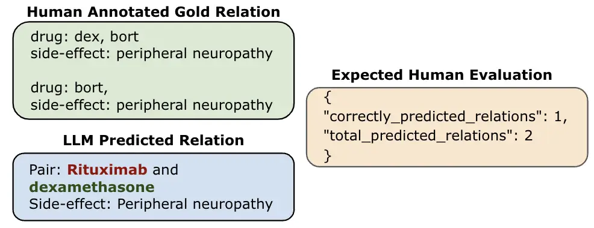
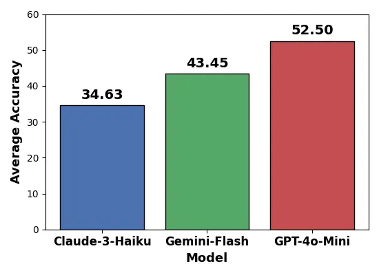
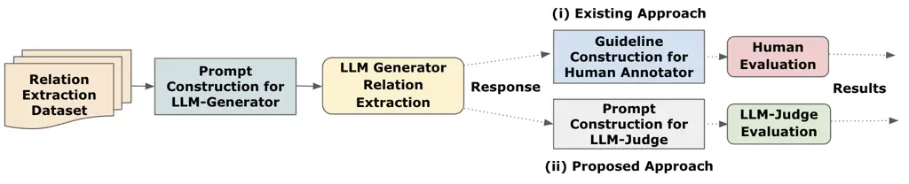
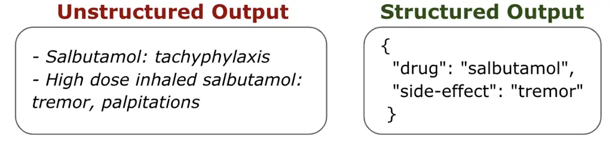
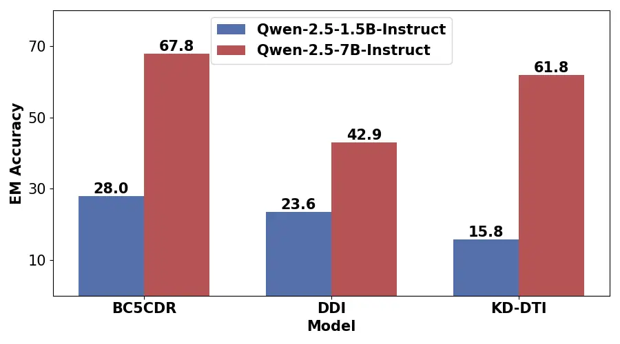
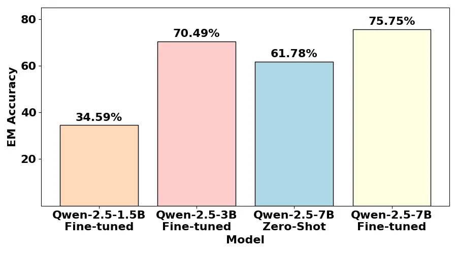
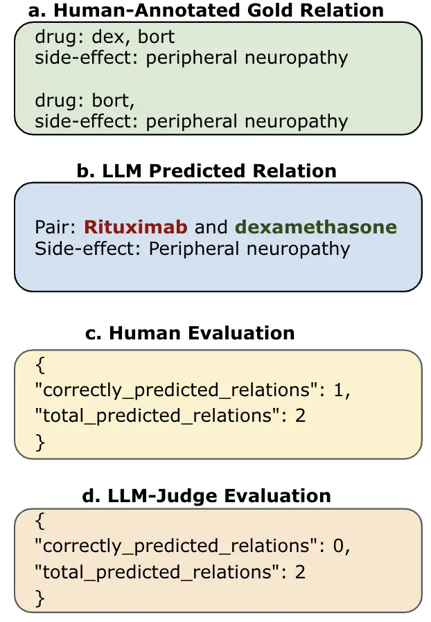

# Improving Automatic Evaluation of Large Language Models (LLMs) in Biomedical Relation Extraction via LLMs-as-the-Judge

Md Tahmid Rahman Laskar, Israt Jahan, ^(†)^(†)thanks:  Corresponding
Emails: {tahmedge, jhuang}@yorku.ca    Elham Dolatabadi, Chun Peng,
Enamul Hoque, Jimmy Xiangji Huang Affiliation: York University, Vector
InstituteToronto, Ontario, Canada

###### Abstract

Large Language Models (LLMs) have demonstrated impressive performance in
biomedical relation extraction, even in zero-shot scenarios. However,
evaluating LLMs in this task remains challenging due to their ability to
generate human-like text, often producing synonyms or abbreviations of
gold-standard answers, making traditional automatic evaluation metrics
unreliable. On the other hand, while human evaluation is more reliable,
it is costly and time-consuming, making it impractical for real-world
applications. This paper investigates the use of LLMs-as-the-Judge as an
alternative evaluation method for biomedical relation extraction. We
benchmark 8 LLMs as judges to evaluate the responses generated by 5
other LLMs across 3 biomedical relation extraction datasets. Unlike
other text-generation tasks, we observe that LLM-based judges perform
quite poorly (usually below 50% accuracy) in the biomedical relation
extraction task. Our findings reveal that it happens mainly because
relations extracted by LLMs do not adhere to any standard format. To
address this, we propose structured output formatting for LLM-generated
responses that helps LLM-Judges to improve their performance by about
15% (on average). We also introduce a domain adaptation technique to
further enhance LLM-Judge performance by effectively transferring
knowledge between datasets. We release both our human-annotated and
LLM-annotated judgment data (36k samples in total) here:
[https://github.com/tahmedge/llm_judge_biomedical_re](https://github.com/tahmedge/llm_judge_biomedical_re).

## 1 Introduction



Figure 1: An example of human evaluation of LLM-generated outputs in
comparison to the gold labels. The drug “dex” in the gold relation is
predicted as “dexamethasone” in LLM response. While exact match will
fail in this case, human evaluators can recognize.

Relation extraction, the task of identifying meaningful associations
between biomedical entities such as drugs, diseases, and genes from vast
amounts of unstructured text Bassignana and Plank (2022), is a
cornerstone of biomedicine. As the volume of unstructured biomedical
text grows exponentially, efficient and accurate relation extraction is
no longer a convenience but a necessity for advancing medical research,
drug discovery, and improving patient outcomes Luo et al. (2022). Recent
research has shown that Large Language Models (LLMs) can achieve strong
performance in biomedical relation extraction, even in zero-shot
scenarios Jahan et al. (2024). This capability makes LLMs particularly
valuable for real-world biomedical applications where manually annotated
datasets are scarce or costly to obtain.

However, LLM’s ability to generate human-like text introduces a major
challenge in evaluation Laskar et al. (2024a); Jahan et al. (2024).
Traditional automatic evaluation methods, such as string matching and
token overlap, fail to capture semantic equivalence, as LLMs frequently
produce synonyms, abbreviations, or paraphrased responses that are
meaningfully correct but not exact matches. For example, an LLM may
generate “Hepatic carcinoma” instead of “Liver cancer”, leading
conventional metrics to misclassify correct extractions as incorrect.
Due to these limitations, human evaluation has been the predominant
method (see Figure 1 for an example) for assessing LLM performance in
biomedical relation extraction Jahan et al. (2024). However, human
evaluation is slow and costly, making it impractical for real-world
applications.

To address this, LLMs-as-the-Judge Zheng et al. (2023) have gained
attention as a potential alternative to human evaluation. While this
paradigm has been explored in general NLP tasks Li et al. (2024a); Gu
et al. (2024), there is currently no biomedical-specific LLM-Judge
designed to evaluate relation extraction tasks. Unlike open-domain text
generation, biomedical relation extraction requires precise domain
knowledge, standardized terminology, and strict adherence to extract
relationships between entities. This complexity raises concerns about
whether existing LLM-Judges can reliably assess biomedical extractions.

To investigate this, we examined the capability of several
LLMs-as-Judges in evaluating the responses generated by different LLMs
(LLM-Generators) across multiple biomedical relation extraction datasets
Jahan et al. (2024). Surprisingly, despite prior success in general NLP
evaluation tasks, LLM-Judges performed very poorly in biomedical
relation extraction in comparison to human evaluators (Figure 2). These
findings suggest that domain specificity may significantly impact the
effectiveness of LLMs-as-Judge, underscoring the need for adaptation in
biomedicine.



Figure 2: Average judgment accuracy based on our evaluation of different
LLMs-as-the-judge across 3 Relation Extraction datasets (KD-DTI, DDI,
BC5CDR) to evaluate the LLM-generated responses in Jahan et al. (2024).

To address the shortcomings of LLMs-as-Judge in the biomedical relation
task, we propose structured output format Xia et al. (2024); Li et al.
(2024b) for response generation by LLM-Generators. Based on extensive
experiments, we find that structured output format in the response
generated by LLM-Generators consistently helps the LLM-Judges to improve
their performance across various relation extraction datasets.

Moreover, we also find that there is a lack of human-annotated judgment
data that prohibits the training of LLM-Judges for relation extraction.
Therefore, we propose a domain adaptation Laskar et al. (2022) technique
to address the lack of human-annotated judgment data by effectively
transferring knowledge from out-of-domain data to improve the
performance of LLM-Judges in the target domain. Our major contributions
are summarized below:

- •
  We provide the first comprehensive study of LLM-Judges in biomedical
  relation extraction, benchmarking 8 LLM-Judges on responses generated
  by 5 LLM-Generators across 3 biomedical relation extraction datasets.
  Our findings demonstrate that LLMs are not reliable to serve as
  evaluators in biomedicine, highlighting their significant performance
  gap compared to human evaluators.
- •
  To address the above limitation, we propose structured output
  formatting in LLM-generated responses for biomedical relation
  extraction to improve the performance of LLM-Judge. We also propose a
  domain adaptation technique to effectively transfer knowledge from one
  domain to another to further improve LLM-Judge performance in
  biomedical relation extraction.
- •
  We conduct over 100 experiments, analyzing the impact of structured
  output format, domain adaptation, and model scaling on LLM-Judge
  performance. These experiments reveal critical insights into why
  LLM-based evaluation fails in biomedical relation extraction,
  establishing the need for task-specific evaluation frameworks.
- •
  We make our judgment data (4k human-annotated and 32k LLM-annotated
  samples) consisting of 3 relation extraction datasets publicly
  available¹¹ 1
  [https://github.com/tahmedge/llm_judge_biomedical_re](https://github.com/tahmedge/llm_judge_biomedical_re).



Figure 3: An Overview of LLM-based Relation Extraction System. After
constructing the input prompt for the LLM-Generator for a given dataset,
the LLM-Generator generates a response. The evaluation requires the
identification of the number of correctly predicted relations and the
total number of predicted relations in the response to evaluate the
performance of the LLM-Generator for relation extraction in terms of
metrics like Precision, Recall, and F1.

## 2 Background

### 2.1 Relation Extraction Task Description

The relation extraction task aims to extract relations between named
entities in a given text Zhong and Chen (2021). The biomedical relation
extraction task aims to identify relationships between biomedical named
entities like genes, drugs, and diseases Chen et al. (2023). More
specifically, in the context of biomedicine, the goal is to analyze
textual data to identify which gene/variant is responsible or which
treatment/drug is effective for which disease, as well as identifying
drug-drug interactions, and etc. An example for disease-treatment
relation extraction is given below.

Example Text: The patient has been given chemotherapy for their rare
form of cancer.

Expected Relation: “Chemotherapy” is a treatment for “rare form of
cancer”.

### 2.2 Related Work

Traditional approaches for biomedical relation extraction relied on
supervised learning techniques that required large, manually annotated
datasets Luo et al. (2022). However, the construction of such datasets
is expensive and time-consuming. Recently, LLMs have demonstrated
impressive zero-shot performance across a wide range of NLP tasks Laskar
et al. (2023a); Bang et al. (2023); Qin et al. (2023). This has inspired
researchers to successfully apply LLMs for biomedical relation
extraction, particularly in zero-shot scenarios where annotated data is
scarce Jahan et al. (2023); Jahan et al. (2024); Tian et al. (2024).
Despite LLMs achieving impressive zero-shot performance in the
biomedical relation extraction task, evaluating the performance of LLM
in this task remains challenging Jahan et al. (2024). This is because
LLMs may generate valid outputs that are semantically equivalent to the
gold standard but differ in surface form (e.g., synonyms,
abbreviations). This issue is further exacerbated in biomedicine due to
the nuanced and complex nature of biomedical language. Therefore,
existing automatic metrics like string matching or n-gram overlap often
fall short in assessing the semantic correctness of LLM-generated
free-form responses Laskar et al. (2024a).

In the context of biomedical relation extraction, while human experts
can assess the relevance of LLM extracted relations Jahan et al. (2024),
human evaluation is inherently time-consuming, expensive, and lacks
scalability. This makes it impractical for rapid iteration cycles in
research and real-world deployment scenarios. The paradigm of using
LLMs-as-judges Zheng et al. (2023) for evaluating free-form text
generated by other LLMs has recently gained a lot of attention as a
potential alternative to human evaluations Laskar et al. (2024a). While
prior research suggests that LLM-based evaluators can capture linguistic
nuances often overlooked by traditional metrics Li et al. (2024a); Gu
et al. (2024), most of these studies have focused on general-domain
tasks, without exploring their effectiveness in specialized domains such
as biomedical relation extraction. To this end, this paper explores the
potential of LLMs-as-the-Judge for evaluating the response generated by
other LLMs in the biomedical relation extraction task to mitigate the
dependence on expensive, time-consuming human evaluation, alongside
ensuring reliability in LLM evaluation by capturing domain-specific
nuances that traditional metrics may overlook.

## 3 Methodology

### 3.1 LLM-based Relation Extraction Systems

We show the overall pipeline to develop an LLM-based end-to-end relation
extraction system in Figure 3. Here, at first, for a given relation
extraction dataset, pre-processing steps are first applied to construct
a prompt. This prompt is then provided to an LLM (i.e., LLM-Generator),
which extracts relations. Afterwards, we demonstrate two evaluation
paradigms which we describe below:

\(i\) Existing Approaches based on Human Evaluation: Where an annotation
guideline is first constructed to evaluate the performance of the
LLM-Generator (i.e., relation extraction LLM) by human annotators. The
LLM-generated response is then sent to the human annotators for
evaluation.

\(ii\) Our Proposed Approach based on LLM-Judge: Where the prompt for
the LLM-Judge is first constructed to evaluate the performance of the
LLM-Generator. The response generated by the LLM-Generator is then
evaluated by the LLM-Judge. This is our proposed approach where human
evaluator(s) are replaced with the LLM-Judge. In the following, we
describe our proposed LLM-Judge to evaluate relation extraction models.

### 3.2 LLM-Judge for LLM-based Relation Extraction Model Evaluation

##### Prompting:

To utilize LLM-Judge for the evaluation of LLM-generated responses
(i.e., LLM-Generators) in relation extraction, we first design the
prompt for the judge, as described below.


We designed this prompt based on extensive prompt engineering using
several LLMs (e.g., ChatGPT, Gemini, Claude, etc.) on the outputs
generated by different LLM-Generators in Jahan et al. (2024) across
various relation extraction datasets.

##### Structured Output Formatting:

During prompt engineering in our previous step, we notice that
LLM-Judges often find it difficult to properly understand the response
generated by various LLM-Generators since the generated responses are
mostly unstructured text. To address this issue, we propose Structured
Output Formatting for the LLM-Generators. In our proposed Structured
Output Formatting approach, we require the LLM-Generators to generate
their response in a structured format, i.e., JSON format (see Figure 4
for an example). JSON format was selected since recent research has
demonstrated that LLMs are more reliable in generating responses in
“JSON” instead of other formats like “YAML” Laskar et al. (2024b).



Figure 4: An example of the LLM-generated outputs for drug and
drug-induced side-effects relation extraction in the unstructured format
used by Jahan et al. (2024) and our proposed structured format.

##### Domain Adaptation via Transfer Learning:

Leveraging closed-source LLMs-as-the-judge have several limitations. For
instance, closed-source LLMs are continuously updated. Therefore, the
release of an updated version of a closed-source model often makes their
respective earlier versions obsolete Biderman et al. (2024); Laskar
et al. (2024a). This creates a huge reproducibility concern. While
open-source LLMs could be a suitable alternative, they do not have the
superior zero-shot ability of their closed-source counterparts Jahan
et al. (2024). Moreover, we find that existing open-source LLM-Judges
like Prometheus-2 Kim et al. (2024) are restricted to certain evaluation
dimensions (e.g., pairwise ranking or pointwise scoring for specific
criteria: helpfulness, factual correctness, etc.) since they are
fine-tuned only for such qualitative metrics. This prohibits the
customization of the judging criteria based on user needs, making them
inapplicable in our case to evaluate the relation extraction performance
of other LLMs.

Furthermore, due to the absence of human evaluation data in existing
relation extraction datasets for LLM-generated responses, it is
difficult to train a reliable LLM-Judge model to evaluate the response
generated by different relation extraction models. To address this
low-resource problem that prohibits the training of LLM-Judge for
relation extraction, we propose a domain adaptation technique Garg
et al. (2020); Laskar et al. (2022). In our proposed approach, the
LLM-Judge is fine-tuned on a limited number of human annotated
out-of-domain relation extraction data to make it more specialized for
relation extraction evaluation. More specifically, suppose we have two
datasets, $`X`$ and $`Y`$, where the dataset $`X`$ may focus on
drug-drug-interaction extraction and the dataset $`Y`$ may focus on
disease-treatment-relation extraction. In our domain adaptation
technique, if the target dataset for the judge model to evaluate is the
dataset $`X`$, then we first fine-tune the judge model on the dataset
$`Y`$ if we have some human evaluation data (e.g., human-annotated
judgment labels containing the number of predicted relations and total
predicted relations by the LLM-Generator) available for the dataset
$`Y`$. In this way, we specialize the LLM-Judge for biomedical relation
extraction evaluation.

## 4 Experiments

To evaluate our proposed solution of replacing human evaluators with
LLM-Judges, we conduct extensive experiments with various
LLMs-as-the-Judge on the responses generated by different LLM-Generators
for biomedical relation extraction. Below, we first describe the
datasets used in our experiments. Then, we describe the LLMs used as the
Judge and the Generator. Afterwards, we present our evaluation metrics
to measure the performance of the LLM-Judge. Finally, we briefly
describe the implementation details.

### 4.1 Datasets

To evaluate the LLM-Judges, we use the responses generated by the
LLM-Generators for chemical-disease-relation extraction ($`500`$ test
samples) in the BC5CDR dataset Li et al. (2016), drug-target-interaction
extraction ($`1159`$ test samples) in the KD-DTI dataset Hou et al.
(2022), and drug-drug-interaction extraction ($`191`$ test samples) in
the DDI dataset Herrero-Zazo et al. (2013).

### 4.2 Models

##### LLM-Generators:

To evaluate the performance of different LLM-Judges, at first we
benchmark their performance on different LLM-generated responses
collected from Jahan et al. (2024). The responses from the following
LLM-Generators are used: (i) GPT-3.5 Achiam et al. (2023), (ii) Claude-2
Anthropic (2023), (iii) PaLM-2 Anil et al. (2023), (iv) LLaMA-2-13B
Touvron et al. (2023b). Moreover, to investigate the effectiveness of
Structured Output Format, we regenerate the response using GPT-4-Turbo
Achiam et al. (2023) in both unstructured and structured format, and
compare the performance of the LLM-Judge when the response is generated
in different formats by the same LLM-Generator. For this case, we did
not use the LLM-Generators used in Jahan et al. (2023) since they are
early generation LLMs and we observe that they fail to generate the
response in structured format.

##### LLM-Judges:

For the LLM-Judges, we select the cheapest versions of the currently
available closed-source LLMs (GPT-4, Gemini, and Claude-3) to minimize
their usage cost. For the open-source LLM-Judges (LLaMA, Phi, Qwen, and
DeepSeek), we select the models with less than 10B parameters since they
can be used in a machine with just 1 L4 GPU Fu et al. (2024), making
them cost-effective for real-world deployment. More specifically, for
the LLM-Judge, we primarily use the following LLMs: (i) GPT-4o-Mini
Achiam et al. (2023), (ii) Gemini-1.5-Flash Team et al. (2023), (iii)
Claude-3-Haiku Anthropic (2024), (iv) LLaMA-3.1-8B-Instruct²² 2
[https://huggingface.co/meta-llama/Llama-3.1-8B-Instruct](https://huggingface.co/meta-llama/Llama-3.1-8B-Instruct)
Grattafiori et al. (2024), (v) Qwen-2.5-7B-Instruct³³ 3
[https://huggingface.co/Qwen/Qwen2.5-7B-Instruct](https://huggingface.co/Qwen/Qwen2.5-7B-Instruct)
Yang et al. (2024b), and (vi) Phi-3.5-Mini-3.8B-Instruct⁴⁴ 4
[https://huggingface.co/microsoft/Phi-3.5-mini-instruct](https://huggingface.co/microsoft/Phi-3.5-mini-instruct)
Abdin et al. (2024). With the recent success of reasoning-based LLMs
like DeepSeek-R1 Guo et al. (2025), we also use its distilled versions
based on Qwen and LLaMA, (vii) DeepSeek-R1-Distill-Qwen-7B⁵⁵ 5
[https://huggingface.co/deepseek-ai/DeepSeek-R1-Distill-Qwen-7B](https://huggingface.co/deepseek-ai/DeepSeek-R1-Distill-Qwen-7B)
and (viii) DeepSeek-R1-Distill-Llama-8B⁶⁶ 6
[https://huggingface.co/deepseek-ai/DeepSeek-R1-Distill-Llama-8B](https://huggingface.co/deepseek-ai/DeepSeek-R1-Distill-Llama-8B),
respectively. Appendix A.2 contains detailed model descriptions.

While we also tried the biomedical domain-focused BioMistral-7B model
Labrak et al. (2024) as a judge, we observed that it failed to follow
the judging instruction and could not evaluate any LLM-Generators
response (see Appendix A.4.1 for details). Therefore, we did not report
its results.

### 4.3 Evaluation Metrics

We use the following metrics to evaluate the effectiveness of the
LLM-Judge.

##### Exact Match Accuracy:

Measures the Exact Match Accuracy of the LLM-Judge annotation in
comparison to the human-annotated gold label. For exact match
calculation, if there is a match for both the number of correctly
predicted relations and total predicted relations between the gold human
annotation and the LLM-Judge annotation, then we consider it as an exact
match, and the score will be 1. Otherwise, the score will be 0. Thus, a
higher exact match score denotes better performance.

##### Root Mean Squared Error:

Measures the Root Mean Squared Error (RMSE) distance between the
LLM-Judge annotation and the human-annotated gold label. Mean Squared
Error (MSE) is defined as the average of the squared differences between
the predictions (in this case, the LLM-Judge annotations) and the actual
values (the Human-Judge annotated gold labels). RMSE, which is the
square root of the MSE, helps penalize larger errors more severely while
being in the same units as the target variable. Suppose the correctly
predicted relations and the total predicted relations annotated by
humans are 0 and 2, respectively, and by LLM-Judge are 1 and 2,
respectively, then the RMSE distance:

```math
\sqrt{\frac{1}{2}\left(({\color[rgb]{0.75,0,0.25}1}-{\color[rgb]{0,0,1}0})^{2}+({\color[rgb]{0.75,0,0.25}2}-{\color[rgb]{0,0,1}2})^{2}\right)}=\sqrt{0.5}\approx 0.71.
```

Contrary to the exact match score, a lower RMSE distance denotes better
performance.

|                            | BC5CDR          |                   | DDI             |                   | KD-DTI          |                   |
| -------------------------- | --------------- | ----------------- | --------------- | ----------------- | --------------- | ----------------- |
| LLM-Judge                  | EM ($`\Delta`$) | RMSE ($`\nabla`$) | EM ($`\Delta`$) | RMSE ($`\nabla`$) | EM ($`\Delta`$) | RMSE ($`\nabla`$) |
| Phi-3.5-Mini-3.8B-Instruct | 33.80           | 2.40              | 43.06           | 2.19              | 35.55           | 2.11              |
| Qwen-2.5-7B-Instruct       | 45.25           | 2.42              | 46.60           | 2.15              | 49.98           | 1.82              |
| LLaMA-3.1-8B-Instruct      | 29.45           | 2.40              | 29.32           | 2.95              | 36.73           | 2.10              |
| Deepseek-R1-Qwen-7B        | 30.60           | 2.76              | 42.67           | 3.07              | 42.45           | 2.51              |
| Deepseek-R1-LLaMA-8B       | 30.50           | 3.37              | 42.15           | 4.16              | 33.48           | 3.25              |
| Claude-3-Haiku             | 29.50           | 2.26              | 31.15           | 2.70              | 40.27           | 1.83              |
| Gemini-Flash               | 42.55           | 2.09              | 47.12           | 2.11              | 40.68           | 1.98              |
| GPT-4o-Mini                | 48.35           | 2.33              | 59.03           | 1.84              | 53.11           | 1.81              |

Table 1: Performance of different LLM-Judges on the responses generated
by the LLM-Generators in Jahan et al. (2024) across three datasets:
BC5CDR, DDI, and KD-DTI. The Exact Match (EM) Accuracy (higher is
better, indicated by $`\Delta`$) and the Root Mean Squared Error (RMSE)
(lower is better, indicated by $`\nabla`$) are reported. The reported
score for each LLM-Judge is the average of their evaluations for all
LLM-Generators within each dataset.

|                            | BC5CDR          |                   |                 |                   | DDI             |                   |                 |                   | KD-DTI          |                   |                 |                   |
| -------------------------- | --------------- | ----------------- | --------------- | ----------------- | --------------- | ----------------- | --------------- | ----------------- | --------------- | ----------------- | --------------- | ----------------- |
|                            | Structured      |                   | Unstructured    |                   | Structured      |                   | Unstructured    |                   | Structured      |                   | Unstructured    |                   |
| LLM-Judge                  | EM ($`\Delta`$) | RMSE ($`\nabla`$) | EM ($`\Delta`$) | RMSE ($`\nabla`$) | EM ($`\Delta`$) | RMSE ($`\nabla`$) | EM ($`\Delta`$) | RMSE ($`\nabla`$) | EM ($`\Delta`$) | RMSE ($`\nabla`$) | EM ($`\Delta`$) | RMSE ($`\nabla`$) |
| Phi-3.5-Mini-3.8B-Instruct | 53.80           | 0.94              | 35.60           | 2.74              | 32.89           | 1.92              | 32.51           | 2.42              | 36.94           | 2.02              | 36.74           | 2.55              |
| Qwen-2.5-7B-Instruct       | 67.80           | 0.93              | 44.60           | 2.84              | 43.93           | 1.64              | 43.46           | 2.08              | 61.78           | 1.19              | 55.82           | 2.18              |
| LLaMA-3.1-8B-Instruct      | 59.20           | 0.85              | 33.00           | 2.67              | 37.70           | 1.99              | 30.37           | 2.43              | 40.38           | 2.44              | 38.22           | 2.46              |
| Deepseek-R1-Qwen-7B        | 57.00           | 1.28              | 31.60           | 3.32              | 41.88           | 2.55              | 35.60           | 2.85              | 47.71           | 1.83              | 46.16           | 2.65              |
| Deepseek-R1-LLaMA-8B       | 54.40           | 2.25              | 37.40           | 3.64              | 37.70           | 4.14              | 35.60           | 4.62              | 48.40           | 2.68              | 42.36           | 3.31              |
| Claude-3-Haiku             | 67.80           | 0.60              | 36.80           | 2.67              | 32.46           | 3.01              | 25.13           | 2.80              | 59.28           | 1.22              | 50.04           | 2.22              |
| Gemini-1.5-flash           | 70.20           | 0.66              | 48.40           | 2.75              | 43.98           | 1.75              | 39.27           | 2.29              | 41.59           | 1.68              | 41.52           | 2.47              |
| GPT-4o-mini                | 67.20           | 0.73              | 43.20           | 2.72              | 53.93           | 1.45              | 47.12           | 2.14              | 72.39           | 1.08              | 66.35           | 2.13              |

Table 2: Performance Comparison between Structured (our proposed) and
Unstructured (baseline) output format. All the responses are generated
using GPT-4-Turbo as the LLM-Generator.

|                            |             |            |                |
| -------------------------- | ----------- | ---------- | -------------- |
|                            | Data        |            |                |
| LLM-Judge                  | Fine-Tuning | Evaluation | EM Accuracy    |
| Qwen-2.5-7B-Instruct       | BC5CDR      | KD-DTI     | 75.75 (+13.97) |
| Qwen-2.5-7B-Instruct       | KD-DTI      | BC5CDR     | 71.40 (+3.60)  |
| Phi-3.5-Mini-3.8B-Instruct | BC5CDR      | KD-DTI     | 69.54 (+32.60) |
| Phi-3.5-Mini-3.8B-Instruct | KD-DTI      | BC5CDR     | 64.80 (+11.00) |

Table 3: Effectiveness of Domain Adaptation via Transfer Learning. The
value in brackets indicates the performance gain relative to the
Zero-Shot results for Structured output in respective evaluation
datasets in Table 2.

### 4.4 Implementation

For the inference of LLM-Generators and LLM-Judges, we use the
temperature value of 1.0, with other decoding parameters being set to
the default values: as given in the respective API providers (OpenAI⁷⁷ 7
[https://platform.openai.com/docs/api-reference/introduction](https://platform.openai.com/docs/api-reference/introduction),
Google⁸⁸ 8
[https://ai.google.dev/gemini-api/docs](https://ai.google.dev/gemini-api/docs),
Anthropic⁹⁹ 9
[https://www.anthropic.com/api](https://www.anthropic.com/api)) for the
closed-source models, and in HuggingFace Wolf et al. (2020) for the
open-source models. We select the temperature value of 1.0 to allow more
diversity in LLM-generated responses such that it allows us to ensure a
more robust evaluation of the LLM-Judges in diverse output scenarios.
Since both the LLM-Generators and the LLM-Judges do not need to produce
outputs of longer sequence length, the maximum output tokens was set to
300 tokens except for the reasoning models (DeepSeek-R1). For the
DeepSeek-R1-based models, we increased the output token limit to 1000
tokens to allow the model enough tokens for thinking. For domain
adaptation via transfer learning, we fine-tune for $`3`$ epochs with the
batch size = $`1`$, learning rate = $`2e-5`$, and sequence length =
$`3k`$. All experiments were run using 1 A100 GPU.

## 5 Results and Discussion

### 5.1 Performance in Existing LLM-based Relation Extraction Benchmarks

In this section, we benchmark the performance of different LLM-Judges to
evaluate the responses generated by different LLM-Generators used by
Jahan et al. (2024). In their work, Jahan et al. (2024) used GPT-3.5
Achiam et al. (2023), PaLM-2 Anil et al. (2023), Claude-2 Anthropic
(2023), and LLaMA-2-13B-Instruct Touvron et al. (2023b) as the
LLM-Generators. We collected their human evaluator annotated labels
consisting of the number of correctly predicted relations and total
predicted relations for each LLM-Generator. Then we measure the Exact
Match Accuracy and the RMSE Distance between the LLM-Judge annotation
(the number of correctly predicted relations and the total predicted
relations annotated by the LLM-Judge) and the human annotation.

For each dataset, we then compute the average Exact Match Accuracy and
RMSE Distance across all LLM-Generators, as demonstrated in Table 1.
From Table 1, we find that none of the LLM-Judges could reach accuracy
above 50%, except GPT-4o-Mini. Nonetheless, GPT-4o-Mini still fails to
achieve more than 60% accuracy in any datasets. Our hypothesis is that
the responses generated by the LLM-Generators used by Jahan et al.
(2024) were quite unstructured, which could be difficult for the
LLM-Judges to evaluate. In the following section, we investigate whether
Structured Output Formatting could alleviate this issue.

### 5.2 Performance of LLM-Judges based on Structured vs Unstructured Output

To improve the LLM-Judge accuracy, we generate the responses in all
three datasets using the GPT-4-Turbo Achiam et al. (2023) model as the
generator, with specifically prompting GPT-4-Turbo to extract the
relations between the named entities in a more structured way, i.e.,
JSON format. To compare whether this structured output format could
improve the performance of the LLM-Judges, we also regenerate the
responses without any structured output format instruction by using the
same prompt as used by Jahan et al. (2024). Afterward, two human
annotators having backgrounds in NLP and biomedicine annotated the
correctly predicted relations and the total predicted relations in the
GPT-4-Turbo generated responses for both structured and unstructured
cases. When discrepancies arise between annotations from different
annotators, they are resolved through discussions.

We then evaluate the performance of LLM-Judges in these structured
responses as well as the unstructured responses generated by
GPT-4-Turbo. Based on the results presented in Table 2, we find that
structured formatting consistently improves the performance for all
models. While in the BC5CDR dataset, Gemini-1.5-Flash achieves the best
performance in terms of accuracy with Claude-3-Haiku achieving the best
result in terms of the RMSE metric, in other two datasets (DDI and
KD-DTI), GPT-4o-Mini achieves the best performance in terms of both
metrics. For open-source LLMs, in the BC5CDR dataset, Qwen-2.5-7B has
the best accuracy and LLaMA-3.1-8B performs the best in terms of RMSE
distance. However, the accuracy is quite low for LLaMA-3.1-8B while
being larger than Qwen-2.5-7B. In the other two datasets (DDI and
KD-DTI), Qwen-2.5-7B-Instruct achieves the best result in terms of both
metrics among open-source models, even outperforming reasoning-based
DeepSeek-Distilled models.

For all three datasets, we find based on paired $`t`$-test that the
performance difference between the structured and unstructured approach
is statistically significant $`(p<0.05)`$ for both metrics.

### 5.3 Effectiveness of Domain Adaptation via Transfer Learning

In our prior experiments, we demonstrate that proprietary LLMs
demonstrate better performance as the judge in zero-shot scenarios.
However, issues such as transparency, reproducibility, and cost
highlight the need for open-source LLM-Judge. While early work Kim
et al. (2023); Kim et al. (2024) demonstrates the effectiveness of
training an open-source LLM Judge, to our best knowledge, there is no
open-source LLM-Judge trained on biomedical data currently available.
Since there is also a lack of human-annotated judgment data that
prohibits the training of LLM-Judges for relation extraction, we
investigate a domain adaptation technique via transfer learning to
address this low-resource problem.

Recent research has demonstrated that language models can effectively
transfer knowledge from one dataset to another Garg et al. (2020);
Laskar et al. (2022). Inspired by the idea, in this work, we also
propose transfer learning from one relation extraction dataset to the
other. Based on our human-annotated labels for the Structured output in
Section 5.2, we investigate two scenarios: (i) Fine-Tuning on the BC5CDR
dataset (500 samples) and Evaluation on the KD-DTI dataset (1159
samples), and (ii) Fine-Tuning on the KD-DTI dataset (1159 samples) and
Evaluation on the BC5CDR dataset (500 samples). For hyperparameter
tuning, we use the DDI dataset as the validation set. We fine-tune the
Qwen-2.5-7B-Instruct and Phi-3.5-3.8B-Instruct models because our
previous experiments demonstrated that Qwen with 7 billion parameters
outperforms the larger 8-billion parameter LLaMA model, while
Phi-3.5-3.8B achieves comparable performance with the 2x larger LLaMA
model.

Based on the results presented in Table 3, we find that our proposed
domain adaptation strategy by transferring knowledge via fine-tuning on
a limited amount of labeled data could significantly improve the
accuracy. The performance gains in BC5CDR and KD-DTI by
Qwen-2.5-7B-Instruct even outperform the closed-source models in Table 2. This demonstrates the effectiveness of our domain adaptation
technique in low-resource scenarios.

### 5.4 Impact of Model Scaling

Since one of our motivations behind LLM-Judge is to reduce cost and
improve efficiency to ensure their real-world utilization, we primarily
selected open-source models having less than 10B parameters or the most
cost-efficient version of different closed-source LLM providers. In this
section, we investigate two scenarios:

\(i\) What is the impact of reducing the size of the best-performing
open-source model?

\(ii\) Can domain adaptation via fine-tuning help even smaller models
outperform larger models?

Below, we demonstrate our findings.



Figure 5: Performance comparison between Qwen models based on size: 1.5B
and 7B, based on evaluating on the GPT-4-Turbo generated Structured
responses.

##### Reducing the Model Size:

In Figure 5, we show the performance difference between the 1.5B and 7B
Qwen models in zero-shot and find that reducing the model size
significantly drops the accuracy. More specifically, the performance
drops by 58.70%, 45.12%, and 74.44%, in BC5CDR, DDI, and KD-DTI,
respectively.

##### Fine-tuning Smaller Models:

We investigate the impact of fine-tuning smaller Qwen-2.5-Instruct
models: 1.5B and 3B (we did not show their zero-shot result as they
could not generate the response in the required format in most cases,
leading to very poor accuracy) in comparison to the larger zero-shot
model (Qwen-2.5-7B-Instruct). Based on the results shown in Figure 6, we
find that the 3B model, fine-tuned on 500 samples in the BC5CDR dataset
(the evaluation is conducted on KD-DTI) can outperform the zero-shot 7B
model, while achieving performance comparable to the fine-tuned 7B
model. This makes it possible to use smaller models in
resource-constrained scenarios.



Figure 6: Comparing fine-tuned smaller models, Qwen-2.5B-Instruct (1.5B
and 3B) against the larger model: Qwen-2.5B-7B-Instruct (both zero-shot
and fine-tuned). The KD-DTI dataset with Structured response is used.

### 5.5 Ablation Test

In our experiments, we include human-annotated gold relations in the
prompt to maintain consistency with the work of Jahan et al. (2024),
where human annotators relied on the gold reference relations to assess
the correctness of LLM-generated outputs. We further conduct an ablation
experiment using GPT-4o as the judge on the BC5CDR dataset without
providing the gold reference relations in the prompt and find that our
structured approach again outperforms the unstructured baseline in the
reference-free setting. The RMSE distance for the structured approach is
1.53, while for the unstructured approach it is 3.19.

## 6 Conclusion and Future Work

In this paper, we evaluated the effectiveness of LLMs-as-the-Judge for
assessing biomedical relation extraction models, revealing significant
performance gaps between LLM-Judges and human evaluators. While previous
work has demonstrated the potential of LLM-based evaluation for general
NLP tasks, our findings indicate that existing LLM-Judges struggle to
reliably assess biomedical relation extraction due to the nuanced and
domain-specific nature of biomedical text. To improve LLM-Judge
performance, we proposed structured output for LLM-generated responses,
which led to substantial accuracy gains across multiple datasets.
Additionally, we introduced a domain adaptation technique that
effectively transfers knowledge from one biomedical relation extraction
dataset to another to enhance the reliability of LLM-Judges.

In the future, we aim to explore instruction-tuning Ouyang et al.
(2022); Zhang et al. (2023) and chain-of-thought Wei et al. (2022)
prompting techniques to improve the performance of LLM-Judges in
biomedical relation extraction. Moreover, conducting a more fine-grained
analysis by constructing a detailed error taxonomy could also be
considered as a future extension of this paper.

## Acknowledgements

We would like to thank all the anonymous reviewers and the area chair
for their excellent review comments, which helped us improve the overall
quality of the paper. This research was supported by the Natural
Sciences and Engineering Research Council (NSERC) of Canada, NSERC
Discovery Grant, the York Research Chairs (YRC) program, and Compute
Canada.

## Limitations

Despite the effectiveness of structured output formatting and domain
adaptation, LLM-Judges still fall short of human evaluators. Biomedical
relation extraction requires deep domain-specific reasoning, and the
foundation LLMs are trained on general-domain corpora Zhao et al.
(2023); Lu et al. (2024); Minaee et al. (2024). Therefore, they still
struggle with complex relationships, ambiguous terms, and implicit
entity connections that human experts can recognize (some examples in
Appendix A.4.2 are provided demonstrating the common errors made by
LLM-Judges while evaluating biomedical relations extracted by different
LLM-Generators). Nonetheless, since our human-annotated judgment dataset
will be released, future work may focus on improving the performance of
the LLM-Judge.

In our study, we followed a strategy similar to prior work Laskar et al.
(2024b) by first experimenting with prompts on a small subset of the
data to identify the optimal prompt that reliably produced outputs by
following the intended instructions. While evaluating many prompting
strategies is valuable, this process is computationally expensive.
Therefore, we set a reasonably effective prompt and compared the LLM
judge performance.

Moreover, our study primarily benchmarks a limited set of LLMs, and
results may vary with the release of newer or more specialized
biomedical models Singhal et al. (2023); Lu et al. (2024); Saab et al.
(2024). Furthermore, cost constraints prevented the exploration of
larger, more computationally expensive models (e.g., reasoning models
like OpenAI O3), which may have improved results but are impractical in
the real world. Nonetheless, due to choosing cheaper closed-source
models¹⁰¹⁰ 10
[https://docsbot.ai/models/compare](https://docsbot.ai/models/compare),
Gemini-1.5-Flash saves cost approximately 13 times in comparison to
Gemini-1.5-Pro, Claude-3-Haiku saves cost approximately 12 times and 60
times in comparison to Claude-3.5-Sonnet and Claude-3-Opus,
respectively, and GPT-4o-Mini is approximately 17 times cheaper than
GPT-4o. In terms of open-source LLMs, models having less than 10B
parameters can be run using just 1 L4 or A100 GPU machine Laskar et al.
(2023b); Laskar et al. (2025). This significantly saves the deployment
cost Fu et al. (2024). Moreover, using an LLM judge for evaluation
instead of humans can also address the time-consuming and costly human
annotation, which is another key motivation of this paper.

## Ethical Considerations

Our proposed LLM-Judge is designed solely for the evaluation of
LLM-generated responses in biomedical relation extraction and is not
intended for direct use by end users in clinical applications. The
accuracy and reliability of the relation extraction system depend on the
LLM-Generator, which produces the relation extraction outputs. Since our
proposed model only acts as an evaluator, the ethical risks associated
with direct application in biomedical decision-making are minimized. By
providing a scalable and efficient evaluation framework, our solution
enables researchers and practitioners to quickly assess the quality of
their biomedical relation extraction LLMs without relying on costly and
time-consuming human evaluations. This can accelerate advancements in
biomedical NLP while ensuring that models are assessed using
standardized criteria. To further enhance reliability, a
human-in-the-loop approach can be implemented where expert annotators
verify the outputs of the models that achieve better performance based
on LLM-Judge evaluation. Moreover, in this paper, additional
compensations are not needed for the annotators since two of the authors
conducted the human annotation.

## References

- Abdin et al. (2024) Marah Abdin, Sam Ade Jacobs, Ammar Ahmad Awan,
  Jyoti Aneja, Ahmed Awadallah, Hany Awadalla, Nguyen Bach, Amit Bahree,
  Arash Bakhtiari, Harkirat Behl, et al. 2024. Phi-3 technical report: A
  highly capable language model locally on your phone. _arXiv preprint
  arXiv:2404.14219_.
- Achiam et al. (2023) Josh Achiam, Steven Adler, Sandhini Agarwal, Lama
  Ahmad, Ilge Akkaya, Florencia Leoni Aleman, Diogo Almeida, Janko
  Altenschmidt, Sam Altman, Shyamal Anadkat, et al. 2023. Gpt-4
  technical report. _arXiv preprint arXiv:2303.08774_.
- Anil et al. (2023) Rohan Anil, Andrew M Dai, Orhan Firat, Melvin
  Johnson, Dmitry Lepikhin, Alexandre Passos, Siamak Shakeri, Emanuel
  Taropa, Paige Bailey, Zhifeng Chen, et al. 2023. Palm 2 technical
  report. _arXiv preprint arXiv:2305.10403_.
- Anthropic (2023) Anthropic. 2023. [Model card and evaluations for
  claude
  models](https://www-cdn.anthropic.com/files/4zrzovbb/website/bd2a28d2535bfb0494cc8e2a3bf135d2e7523226.pdf).
- Anthropic (2024) Anthropic. 2024. [The claude 3 model family: Opus,
  sonnet,
  haiku](https://www-cdn.anthropic.com/de8ba9b01c9ab7cbabf5c33b80b7bbc618857627/Model_Card_Claude_3.pdf).
- Bang et al. (2023) Yejin Bang, Samuel Cahyawijaya, Nayeon Lee,
  Wenliang Dai, Dan Su, Bryan Wilie, Holy Lovenia, Ziwei Ji, Tiezheng
  Yu, Willy Chung, Quyet V. Do, Yan Xu, and Pascale Fung. 2023. [A
  multitask, multilingual, multimodal evaluation of ChatGPT on
  reasoning, hallucination, and
  interactivity](https://doi.org/10.18653/v1/2023.ijcnlp-main.45). In
  _Proceedings of the 13th International Joint Conference on Natural
  Language Processing and the 3rd Conference of the Asia-Pacific Chapter
  of the Association for Computational Linguistics (Volume 1: Long
  Papers)_, pages 675–718, Nusa Dua, Bali. Association for Computational
  Linguistics.
- Bassignana and Plank (2022) Elisa Bassignana and Barbara Plank. 2022.
  [What do you mean by relation extraction? a survey on datasets and
  study on scientific relation
  classification](https://doi.org/10.18653/v1/2022.acl-srw.7). In
  _Proceedings of the 60th Annual Meeting of the Association for
  Computational Linguistics: Student Research Workshop_, pages 67–83,
  Dublin, Ireland. Association for Computational Linguistics.
- Biderman et al. (2024) Stella Biderman, Hailey Schoelkopf, Lintang
  Sutawika, Leo Gao, Jonathan Tow, Baber Abbasi, Alham Fikri Aji,
  Pawan Sasanka Ammanamanchi, Sidney Black, Jordan Clive, et al. 2024.
  Lessons from the trenches on reproducible evaluation of language
  models. _arXiv preprint arXiv:2405.14782_.
- Chen et al. (2023) Qijie Chen, Haotong Sun, Haoyang Liu, Yinghui
  Jiang, Ting Ran, Xurui Jin, Xianglu Xiao, Zhimin Lin, Hongming Chen,
  and Zhangmin Niu. 2023. An extensive benchmark study on biomedical
  text generation and mining with chatgpt. _Bioinformatics_,
  39(9):btad557.
- Fu et al. (2024) Xue-Yong Fu, Md Tahmid Rahman Laskar, Elena
  Khasanova, Cheng Chen, and Shashi Bhushan TN. 2024. Tiny titans: Can
  smaller large language models punch above their weight in the real
  world for meeting summarization? _arXiv preprint arXiv:2402.00841_.
- Garg et al. (2020) Siddhant Garg, Thuy Vu, and Alessandro
  Moschitti. 2020. Tanda: Transfer and adapt pre-trained transformer
  models for answer sentence selection. In _Proceedings of the AAAI
  conference on artificial intelligence_, volume 34, pages 7780–7788.
- Grattafiori et al. (2024) Aaron Grattafiori, Abhimanyu Dubey, Abhinav
  Jauhri, Abhinav Pandey, Abhishek Kadian, Ahmad Al-Dahle, Aiesha
  Letman, Akhil Mathur, Alan Schelten, Alex Vaughan, et al. 2024. The
  llama 3 herd of models. _arXiv preprint arXiv:2407.21783_.
- Gu et al. (2024) Jiawei Gu, Xuhui Jiang, Zhichao Shi, Hexiang Tan,
  Xuehao Zhai, Chengjin Xu, Wei Li, Yinghan Shen, Shengjie Ma, Honghao
  Liu, Yuanzhuo Wang, and Jian Guo. 2024. [A survey on
  llm-as-a-judge](https://arxiv.org/abs/2411.15594). _Preprint_,
  arXiv:2411.15594.
- Gunasekar et al. (2023) Suriya Gunasekar, Yi Zhang, Jyoti Aneja, Caio
  César Teodoro Mendes, Allie Del Giorno, Sivakanth Gopi, Mojan
  Javaheripi, Piero Kauffmann, Gustavo de Rosa, Olli Saarikivi,
  et al. 2023. Textbooks are all you need. _arXiv preprint
  arXiv:2306.11644_.
- Guo et al. (2025) Daya Guo, Dejian Yang, Haowei Zhang, Junxiao Song,
  Ruoyu Zhang, Runxin Xu, Qihao Zhu, Shirong Ma, Peiyi Wang, Xiao Bi,
  et al. 2025. Deepseek-r1: Incentivizing reasoning capability in llms
  via reinforcement learning.
- Herrero-Zazo et al. (2013) María Herrero-Zazo, Isabel Segura-Bedmar,
  Paloma Martínez, and Thierry Declerck. 2013. The ddi corpus: An
  annotated corpus with pharmacological substances and drug–drug
  interactions. _Journal of biomedical informatics_, 46(5):914–920.
- Hou et al. (2022) Yutai Hou, Yingce Xia, Lijun Wu, Shufang Xie, Yang
  Fan, Jinhua Zhu, Tao Qin, and Tie-Yan Liu. 2022. Discovering
  drug–target interaction knowledge from biomedical literature.
  _Bioinformatics_, 38(22):5100–5107.
- Jahan et al. (2023) Israt Jahan, Md Tahmid Rahman Laskar, Chun Peng,
  and Jimmy Huang. 2023. Evaluation of ChatGPT on biomedical tasks: A
  zero-shot comparison with fine-tuned generative transformers. In _The
  22nd Workshop on Biomedical Natural Language Processing and BioNLP
  Shared Tasks_, pages 326–336, Toronto, Canada. Association for
  Computational Linguistics.
- Jahan et al. (2024) Israt Jahan, Md Tahmid Rahman Laskar, Chun Peng,
  and Jimmy Xiangji Huang. 2024. A comprehensive evaluation of large
  language models on benchmark biomedical text processing tasks.
  _Computers in Biology and Medicine_, page 108189.
- Jiang et al. (2023) AQ Jiang, A Sablayrolles, A Mensch, C Bamford,
  DS Chaplot, D de las Casas, F Bressand, G Lengyel, G Lample,
  L Saulnier, et al. 2023. Mistral 7b (2023). _arXiv preprint
  arXiv:2310.06825_.
- Kim et al. (2023) Seungone Kim, Jamin Shin, Yejin Cho, Joel Jang,
  Shayne Longpre, Hwaran Lee, Sangdoo Yun, Seongjin Shin, Sungdong Kim,
  James Thorne, et al. 2023. Prometheus: Inducing fine-grained
  evaluation capability in language models. In _The Twelfth
  International Conference on Learning Representations_.
- Kim et al. (2024) Seungone Kim, Juyoung Suk, Shayne Longpre,
  Bill Yuchen Lin, Jamin Shin, Sean Welleck, Graham Neubig, Moontae Lee,
  Kyungjae Lee, and Minjoon Seo. 2024. Prometheus 2: An open source
  language model specialized in evaluating other language models. In
  _Proceedings of the 2024 Conference on Empirical Methods in Natural
  Language Processing_, pages 4334–4353.
- Labrak et al. (2024) Yanis Labrak, Adrien Bazoge, Emmanuel Morin,
  Pierre-Antoine Gourraud, Mickaël Rouvier, and Richard Dufour. 2024.
  Biomistral: A collection of open-source pretrained large language
  models for medical domains. In _Findings of the Association for
  Computational Linguistics ACL 2024_, pages 5848–5864.
- Laskar et al. (2024a) Md Tahmid Rahman Laskar, Sawsan Alqahtani,
  M Saiful Bari, Mizanur Rahman, Mohammad Abdullah Matin Khan, Haidar
  Khan, Israt Jahan, Amran Bhuiyan, Chee Wei Tan, Md Rizwan Parvez,
  Enamul Hoque, Shafiq Joty, and Jimmy Huang. 2024a. [A systematic
  survey and critical review on evaluating large language models:
  Challenges, limitations, and
  recommendations](https://aclanthology.org/2024.emnlp-main.764). In
  _Proceedings of the 2024 Conference on Empirical Methods in Natural
  Language Processing_, pages 13785–13816, Miami, Florida, USA.
  Association for Computational Linguistics.
- Laskar et al. (2023a) Md Tahmid Rahman Laskar, M Saiful Bari, Mizanur
  Rahman, Md Amran Hossen Bhuiyan, Shafiq Joty, and Jimmy Huang. 2023a.
  A systematic study and comprehensive evaluation of ChatGPT on
  benchmark datasets. In _Findings of the Association for Computational
  Linguistics: ACL 2023_, pages 431–469, Toronto, Canada. Association
  for Computational Linguistics.
- Laskar et al. (2023b) Md Tahmid Rahman Laskar, Xue-Yong Fu, Cheng
  Chen, and Shashi Bhushan TN. 2023b. [Building real-world meeting
  summarization systems using large language models: A practical
  perspective](https://doi.org/10.18653/v1/2023.emnlp-industry.33). In
  _Proceedings of the 2023 Conference on Empirical Methods in Natural
  Language Processing: Industry Track_, pages 343–352, Singapore.
  Association for Computational Linguistics.
- Laskar et al. (2022) Md Tahmid Rahman Laskar, Enamul Hoque, and
  Jimmy Xiangji Huang. 2022. Domain adaptation with pre-trained
  transformers for query-focused abstractive text summarization.
  _Computational Linguistics_, 48(2):279–320.
- Laskar et al. (2025) Md Tahmid Rahman Laskar, Mohammed Saidul Islam,
  Ridwan Mahbub, Ahmed Masry, Mizanur Rahman, Amran Bhuiyan, Mir Tafseer
  Nayeem, Shafiq Joty, Enamul Hoque, and Jimmy Huang. 2025. Judging the
  judges: Can large vision-language models fairly evaluate chart
  comprehension and reasoning? _arXiv preprint arXiv:2505.08468_.
- Laskar et al. (2024b) Md Tahmid Rahman Laskar, Elena Khasanova,
  Xue-Yong Fu, Cheng Chen, and Shashi Bhushan Tn. 2024b. [Query-OPT:
  Optimizing inference of large language models via multi-query
  instructions in meeting
  summarization](https://aclanthology.org/2024.emnlp-industry.86). In
  _Proceedings of the 2024 Conference on Empirical Methods in Natural
  Language Processing: Industry Track_, pages 1140–1151, Miami, Florida,
  US. Association for Computational Linguistics.
- Li et al. (2024a) Haitao Li, Qian Dong, Junjie Chen, Huixue Su, Yujia
  Zhou, Qingyao Ai, Ziyi Ye, and Yiqun Liu. 2024a. Llms-as-judges: a
  comprehensive survey on llm-based evaluation methods. _arXiv preprint
  arXiv:2412.05579_.
- Li et al. (2016) Jiao Li, Yueping Sun, Robin J Johnson, et al. 2016.
  Biocreative v cdr task corpus: a resource for chemical disease
  relation extraction. _Database_, 2016.
- Li et al. (2024b) Yinghao Li, Rampi Ramprasad, and Chao Zhang. 2024b.
  [A simple but effective approach to improve structured language model
  output for information
  extraction](https://doi.org/10.18653/v1/2024.findings-emnlp.295). In
  _Findings of the Association for Computational Linguistics: EMNLP
  2024_, pages 5133–5148, Miami, Florida, USA. Association for
  Computational Linguistics.
- Lu et al. (2024) Zhiyong Lu, Yifan Peng, Trevor Cohen, Marzyeh
  Ghassemi, Chunhua Weng, and Shubo Tian. 2024. Large language models in
  biomedicine and health: current research landscape and future
  directions. _Journal of the American Medical Informatics Association_,
  31(9):1801–1811.
- Luo et al. (2022) Renqian Luo, Liai Sun, Yingce Xia, et al. 2022.
  BioGPT: generative pre-trained transformer for biomedical text
  generation and mining. _Briefings in Bioinformatics_, 23(6).
- Minaee et al. (2024) Shervin Minaee, Tomas Mikolov, Narjes Nikzad,
  Meysam Chenaghlu, Richard Socher, Xavier Amatriain, and Jianfeng
  Gao. 2024. Large language models: A survey. _arXiv preprint
  arXiv:2402.06196_.
- Ouyang et al. (2022) Long Ouyang, Jeffrey Wu, Xu Jiang, Diogo Almeida,
  Carroll Wainwright, Pamela Mishkin, Chong Zhang, Sandhini Agarwal,
  Katarina Slama, Alex Ray, et al. 2022. Training language models to
  follow instructions with human feedback. _Advances in neural
  information processing systems_, 35:27730–27744.
- Qin et al. (2023) Chengwei Qin, Aston Zhang, Zhuosheng Zhang, Jiaao
  Chen, Michihiro Yasunaga, and Diyi Yang. 2023. Is chatgpt a
  general-purpose natural language processing task solver? In
  _Proceedings of the 2023 Conference on Empirical Methods in Natural
  Language Processing_, pages 1339–1384.
- Saab et al. (2024) Khaled Saab, Tao Tu, Wei-Hung Weng, Ryutaro Tanno,
  David Stutz, Ellery Wulczyn, Fan Zhang, Tim Strother, Chunjong Park,
  Elahe Vedadi, et al. 2024. Capabilities of gemini models in medicine.
  _arXiv preprint arXiv:2404.18416_.
- Singhal et al. (2023) Karan Singhal, Shekoofeh Azizi, Tao Tu, S Sara
  Mahdavi, Jason Wei, Hyung Won Chung, Nathan Scales, Ajay Tanwani,
  Heather Cole-Lewis, Stephen Pfohl, et al. 2023. Large language models
  encode clinical knowledge. _Nature_, pages 1–9.
- Team et al. (2023) Gemini Team, Rohan Anil, Sebastian Borgeaud,
  Jean-Baptiste Alayrac, Jiahui Yu, Radu Soricut, Johan Schalkwyk,
  Andrew M Dai, Anja Hauth, Katie Millican, et al. 2023. Gemini: a
  family of highly capable multimodal models. _arXiv preprint
  arXiv:2312.11805_.
- Tian et al. (2024) Shubo Tian, Qiao Jin, Lana Yeganova, Po-Ting Lai,
  Qingqing Zhu, Xiuying Chen, Yifan Yang, Qingyu Chen, Won Kim, Donald C
  Comeau, et al. 2024. Opportunities and challenges for chatgpt and
  large language models in biomedicine and health. _Briefings in
  Bioinformatics_, 25(1):bbad493.
- Touvron et al. (2023a) Hugo Touvron, Thibaut Lavril, Gautier Izacard,
  Xavier Martinet, Marie-Anne Lachaux, Timothée Lacroix, Baptiste
  Rozière, Naman Goyal, Eric Hambro, Faisal Azhar, et al. 2023a. Llama:
  Open and efficient foundation language models. _arXiv preprint
  arXiv:2302.13971_.
- Touvron et al. (2023b) Hugo Touvron, Louis Martin, Kevin Stone, Peter
  Albert, Amjad Almahairi, Yasmine Babaei, Nikolay Bashlykov, Soumya
  Batra, Prajjwal Bhargava, Shruti Bhosale, et al. 2023b. Llama 2: Open
  foundation and fine-tuned chat models. _arXiv preprint
  arXiv:2307.09288_.
- Wei et al. (2022) Jason Wei, Xuezhi Wang, Dale Schuurmans, Maarten
  Bosma, Fei Xia, Ed Chi, Quoc V Le, Denny Zhou, et al. 2022.
  Chain-of-thought prompting elicits reasoning in large language models.
  _Advances in neural information processing systems_, 35:24824–24837.
- Wolf et al. (2020) Thomas Wolf, Lysandre Debut, Victor Sanh, Julien
  Chaumond, Clement Delangue, Anthony Moi, Pierric Cistac, Tim Rault,
  Rémi Louf, Morgan Funtowicz, et al. 2020. Transformers:
  State-of-the-art natural language processing. In _Proceedings of the
  2020 conference on empirical methods in natural language processing:
  system demonstrations_, pages 38–45.
- Xia et al. (2024) Congying Xia, Chen Xing, Jiangshu Du, Xinyi Yang,
  Yihao Feng, Ran Xu, Wenpeng Yin, and Caiming Xiong. 2024. [FOFO: A
  benchmark to evaluate LLMs’ format-following
  capability](https://doi.org/10.18653/v1/2024.acl-long.40). In
  _Proceedings of the 62nd Annual Meeting of the Association for
  Computational Linguistics (Volume 1: Long Papers)_, pages 680–699,
  Bangkok, Thailand. Association for Computational Linguistics.
- Yang et al. (2024a) An Yang, Baosong Yang, Binyuan Hui, Bo Zheng,
  Bowen Yu, Chang Zhou, Chengpeng Li, Chengyuan Li, Dayiheng Liu, Fei
  Huang, et al. 2024a. Qwen2 technical report. _arXiv preprint
  arXiv:2407.10671_.
- Yang et al. (2024b) An Yang, Baosong Yang, Beichen Zhang, Binyuan Hui,
  Bo Zheng, Bowen Yu, Chengyuan Li, Dayiheng Liu, Fei Huang, Haoran Wei,
  et al. 2024b. Qwen2.5 technical report. _arXiv preprint
  arXiv:2412.15115_.
- Yang et al. (2024c) An Yang, Beichen Zhang, Binyuan Hui, Bofei Gao,
  Bowen Yu, Chengpeng Li, Dayiheng Liu, Jianhong Tu, Jingren Zhou,
  Junyang Lin, et al. 2024c. Qwen2.5-math technical report: Toward
  mathematical expert model via self-improvement. _arXiv preprint
  arXiv:2409.12122_.
- Zhang et al. (2023) Shengyu Zhang, Linfeng Dong, Xiaoya Li, Sen Zhang,
  Xiaofei Sun, Shuhe Wang, Jiwei Li, Runyi Hu, Tianwei Zhang, Fei Wu,
  et al. 2023. Instruction tuning for large language models: A survey.
  _arXiv preprint arXiv:2308.10792_.
- Zhao et al. (2023) Wayne Xin Zhao, Kun Zhou, Junyi Li, Tianyi Tang,
  Xiaolei Wang, Yupeng Hou, Yingqian Min, Beichen Zhang, Junjie Zhang,
  Zican Dong, et al. 2023. A survey of large language models. _arXiv
  preprint arXiv:2303.18223_.
- Zheng et al. (2023) Lianmin Zheng, Wei-Lin Chiang, Ying Sheng, Siyuan
  Zhuang, Zhanghao Wu, Yonghao Zhuang, Zi Lin, Zhuohan Li, Dacheng Li,
  Eric Xing, et al. 2023. Judging llm-as-a-judge with mt-bench and
  chatbot arena. _Advances in Neural Information Processing Systems_,
  36:46595–46623.
- Zhong and Chen (2021) Zexuan Zhong and Danqi Chen. 2021. A
  frustratingly easy approach for entity and relation extraction. In
  _Proceedings of the 2021 Conference of the North American Chapter of
  the Association for Computational Linguistics: Human Language
  Technologies_, pages 50–61.

## Appendix A Appendix

### A.1 Structured Prompt for the LLM-Generator


### A.2 Models

- •
  GPT-4-Turbo: It is an advanced version of OpenAI’s original GPT-4
  Achiam et al. (2023). The GPT-4-Turbo¹¹¹¹ 11
  [https://platform.openai.com/docs/models/gpt-4-and-gpt-4-turbo](https://platform.openai.com/docs/models/gpt-4-and-gpt-4-turbo)
  model offers enhanced performance and efficiency, making it suitable
  for a wide range of applications requiring natural language
  understanding and generation.
- •
  GPT-4o-Mini: The GPT-4o-Mini¹²¹² 12
  [https://openai.com/index/gpt-4o-mini-advancing-cost-efficient-intelligence/](https://openai.com/index/gpt-4o-mini-advancing-cost-efficient-intelligence/)
  is another optimized version of GPT-4. More specifically, it is a more
  optimized version of the recently released GPT-4o. It balances robust
  language understanding with efficiency. It’s designed to handle
  complex tasks while significantly reducing operational costs.
- •
  Gemini-1.5-Flash: Part of Google’s Gemini-1.5 family, this model
  emphasizes rapid inference and the ability to handle extremely long
  contexts, up to one million tokens Team et al. (2023).
  Gemini-1.5-Flash¹³¹³ 13
  [https://ai.google.dev/gemini-api/docs/models/gemini#gemini-1.5-flash](https://ai.google.dev/gemini-api/docs/models/gemini#gemini-1.5-flash)
  is ideal for real-time applications where speed and processing of
  large amounts of data are crucial.
- •
  Claude-3-Haiku Similar to GPT-4o-Mini and Gemini-1.5-Flash, it is the
  most cost-optimized version of the Claude-3 series Anthropic (2024).
  The Claude-3-Haiku¹⁴¹⁴ 14
  [https://www.anthropic.com/news/claude-3-haiku](https://www.anthropic.com/news/claude-3-haiku)
  model is tailored for succinct, creative outputs. It excels at
  producing elegant, brief responses, while still managing complex
  instructions and reasoning tasks.
- •
  LLaMA-3.1-8B-Instruct: This 8 billion parameter variant from Meta’s
  LLaMA-3 Grattafiori et al. (2024) series has been fine-tuned for
  instruction following. It strikes a balance between computational
  efficiency and performance, outperforming its earlier versions Touvron
  et al. (2023a); Touvron et al. (2023b) and making it suitable for a
  wide range of tasks.
- •
  Phi-3.5-Mini-8B-Instruct: A compact, instruction-optimized model from
  Microsoft’s Phi series Gunasekar et al. (2023). Despite its smaller
  size, it’s designed to understand and execute diverse tasks in
  resource-constrained environments while maintaining strong performance
  Abdin et al. (2024).
- •
  Qwen-2.5-7B-Instruct Developed by Alibaba, this 7-billion–parameter
  model is tuned for following instructions. It offers a good balance
  between efficiency and output quality Yang et al. (2024a); Yang et al.
  (2024b).
- •
  DeepSeek-R1-Distilled Models: DeepSeek-R1 Guo et al. (2025) is a
  reasoning model developed by DeepSeek-AI, which is mostly trained via
  large-scale reinforcement learning. DeepSeek-R1-Distill-Qwen-7B and
  DeepSeek-R1-Distill-LLaMA-8B are the distilled version of
  Qwen-2.5-7B-Math Yang et al. (2024c) and LLaMA-3.1-8B-Instruct
  Grattafiori et al. (2024), respectively, fine-tuned on 800k synthetic
  reasoning data generated from DeepSeek-R1.



Figure 7: Our Evaluation Process where both the (c) Human Judge and the
(d) LLM-Judge annotate the correctly predicted relations and the total
predicted relations by comparing between (a) Human-Annotated Gold
Relation and (b) LLM Predicted Relation. The biomedical text from where
the relations are extracted is also provided as a context (not shown
here).

### A.3 Evaluation Process Demonstration

In Figure 7, we show our evaluation process. Since there is a mismatch
between the gold human annotation and the LLM-Judge annotation for the
correctly predicted relations and total predicted relations, the exact
match score is 0. The RMSE distance is calculated as follows:

```math
\sqrt{\frac{1}{2}\left(({\color[rgb]{0.75,0,0.25}1}-{\color[rgb]{0,0,1}0})^{2}+({\color[rgb]{0.75,0,0.25}2}-{\color[rgb]{0,0,1}2})^{2}\right)}=\sqrt{0.5}\approx 0.71.
```

### A.4 Error Analysis

#### A.4.1 BioMistral-7B-as-Judge Outputs

We provide some sample responses generated by BioMistral-7B model Labrak
et al. (2024), based on Mistral-7B Jiang et al. (2023), as-the-Judge in
Table 4, demonstrating its ineffectiveness as the judge by generating
improper responses.

[TABLE]

Table 4: Sample judgment outputs generated by BioMistral-7B in different
datasets.

#### A.4.2 Error Outputs by LLM-Judges

We show some of the common error outputs of the LLM-Judges in Table 5.
For the error output analysis, we use the overall best-performing
zero-shot LLM, the GPT-4o-Mini model and demonstrate how complex
biomedical terms could make it difficult for LLMs to evaluate relations
extracted in an unstructured format. For instance:

- •
  Example 1 in Table 5 demonstrates a case when 2 drugs and 6
  corresponding side effects are extracted by an LLM-Generator, but the
  GPT-4o-Mini based LLM-Judge only considers total relations as 6
  instead of 12. Moreover, it only extracted 5 as correct while the
  correct should be 4 side-effects for each drug (in total 8
  side-effects for the 2 drugs are correct).
- •
  Example 2 in Table 5 demonstrates a case when 2 drugs and 1
  corresponding side effect for each of them have been extracted by an
  LLM-Generator. While drug: thiopentone and disease (side-effects):
  delirium is one of the correct answers, the LLM-Judge based on
  GPT-4o-Mini considers only 1 side effect and 1 drug. It is highly
  likely that GPT-4o-Mini considers Thiopentone and propofol as a single
  drug even though they should be considered different. This could be
  the reason it considers no correct relation is extracted. This
  demonstrates GPT-4o-Mini having limitations in understanding complex
  biomedical terms.
- •
  Example 3 in Table 5 demonstrates a case when 2 drugs and 6 side
  effects in total are extracted by an LLM-Generator. While Pair 1 and
  Pair 3 have 1 side effect each, Pair 2 has 4 different side-effects.
  However, GPT-4o-Mini based LLM-Judge may have considered all these 4
  side-effects as just 1 side-effect. This demonstrates its lack of
  biomedical text understanding capability.

[TABLE]

Table 5: Example of annotation errors by GPT-4o-Mini-as-the-Judge on
some sampled data in the BC5CDR dataset.
