# Datasheets Aren’t Enough: DataRubrics for Automated Quality Metrics and Accountability

Genta Indra Winata ^(†)^(†)thanks: The authors contributed equally.   
David Anugraha    Emmy Liu    Alham Fikri Aji, Affiliation: Capital
One Stanford University Carnegie Mellon University MBZUAI    Shou-Yi
Hung    Aditya Parashar    Patrick Amadeus Irawan    Ruochen Zhang   
Zheng-Xin Yong    Jan Christian Blaise Cruz Affiliation: Capital
One Stanford University Carnegie Mellon University MBZUAI    Niklas
Muennighoff    Seungone Kim    Hanyang Zhao, Sudipta Kar, Kezia Erina
Suryoraharjo, M. Farid Adilazuarda Affiliation: Capital One Stanford
University Carnegie Mellon University MBZUAI Affiliation: University of
Toronto ITB Brown University Columbia University Oracle    En-Shiun
Annie Lee    Ayu Purwarianti    Derry Tanti Wijaya Affiliation: Ontario
Tech University Monash University    Monojit Choudhury
Affiliation: Capital One Stanford University Carnegie Mellon
University MBZUAI

###### Abstract

High-quality datasets are fundamental to training and evaluating machine
learning models, yet their creation—especially with accurate human
annotations—remains a significant challenge. Many dataset paper
submissions lack originality, diversity, or rigorous quality control,
and these shortcomings are often overlooked during peer review.
Submissions also frequently omit essential details about dataset
construction and properties. While existing tools such as datasheets aim
to promote transparency, they are largely descriptive and do not provide
standardized, measurable methods for evaluating data quality. Similarly,
metadata requirements at conferences promote accountability but are
inconsistently enforced. To address these limitations, this position
paper advocates for the integration of systematic, rubric-based
evaluation metrics into the dataset review process—particularly as
submission volumes continue to grow. We also explore scalable,
cost-effective methods for synthetic data generation, including
dedicated tools and LLM-as-a-judge approaches, to support more efficient
evaluation. As a call to action, we introduce DataRubrics, a structured
framework for assessing the quality of both human- and model-generated
datasets. Leveraging recent advances in LLM-based evaluation,
DataRubrics offers a reproducible, scalable, and actionable solution for
dataset quality assessment, enabling both authors and reviewers to
uphold higher standards in data-centric research. We also release code
to support reproducibility of LLM-based evaluations at
[https://github.com/datarubrics/datarubrics](https://github.com/datarubrics/datarubrics).

## 1 Introduction

Building high-quality datasets is crucial for effectively developing
machine learning (ML) models, as it directly enhances the
reproducibility and trustworthiness of the research outcome. However,
creating such datasets from scratch is time-consuming and costly,
particularly when precise human annotation is required. To address these
challenges, there is a growing trend toward generating datasets entirely
using Large Language Models (LLMs), offering faster and more
cost-effective alternatives. Although this approach provides clear
efficiency benefits, it often comes at the cost of diversity,
potentially limiting robustness across domains \[3\], as well as
originality \[15\] and the rigor of human annotation \[20\]. Moreover,
many LLM-generated datasets lack robust quality assurance and sufficient
human oversight, raising concerns about their reliability and downstream
utility. These concerns become even more critical when datasets are
generated for languages or tasks where models remain empirically weak,
such as low-resource languages \[7, 13\] or culturally nuanced
data \[12, 11\]. Without proper validation, this can create a vicious
cycle, feeding poor-quality data back into LLMs \[17\]. That said,
synthetic data is not inherently worse than human-generated data, which
can also suffer from biases, errors, and inconsistencies \[18, 22\].
Therefore, regardless of the source, mechanisms must be in place to
ensure dataset quality.

Efforts such as datasheets and annotation guidelines \[8, 9, 5, 16\]
have been introduced to highlight important quality aspects during
dataset creation. While these tools help surface key considerations,
they often lack standardized, objective methods for measuring dataset
quality. Without clearly defined rubrics or quantifiable metrics, these
resources remain general references rather than actionable evaluation
frameworks. Consequently, dataset creators lack systematic tools to
assess and improve data quality, making it difficult to maintain
consistently high standards across projects.

Several major natural language processing (NLP) and ML venues—including
the NeurIPS Datasets and Benchmarks Track, Association of Computational
Linguistics Rolling Review (ARR), and Language Resources and Evaluation
(LREC)—have introduced metadata requirements as part of the submission
process to promote transparency and assist reviewers in assessing
dataset quality. However, these measures are often inconsistently
applied. Authors may provide vague or superficial metadata, and
reviewers frequently lack the tools, time, or guidance to interpret this
information effectively. As a result, these checks risk becoming mere
procedural formalities rather than meaningful quality controls.
Moreover, datasheets are seldom used by dataset users, largely due to
their open-ended format and absence of structured, quantifiable measures
of dataset utility.

While existing datasheets—such as those proposed by Gebru et al.
\[8\]—are valuable for highlighting key considerations, they are not
designed to be measurable. They rely heavily on open-ended questions
without associated assessment criteria, leaving quality assessment up to
the subjective interpretation of accompanying papers, if such papers
exist at all. Currently, no standard mechanism exists to automate or
systematically evaluate dataset quality. Existing rubrics primarily
serve an informational role, helping authors and reviewers recognize
important dimensions of dataset creation but falling short of enabling
objective measurement.

In this position paper, we advocate for a more systematic approach to
evaluating datasets—moving beyond datasheets and checklists, which are
often neither easily decomposable into qualitative and quantitative
metrics nor particularly useful for conference paper reviewers. In
particular, we advocate adopting clear, rubric-based evaluation
frameworks that enable consistent, reproducible assessments of dataset
quality, thereby strengthening both the review process and the overall
integrity of dataset-driven research. Several recent studies have
explored the use of LLMs for evaluating reward models and benchmarking,
including RM-R1 \[6\], FLAME \[19\], Cloud \[2\], MetaMetrics \[21\],
and R3 \[4\], a paradigm referred to as LLM-as-a-judge. Our approach
which uses structured rubrics is compatible with both human evaluation
as well as LLM-as-a-judge approaches, and could be scaled to improve the
paper reviewing process through enriching papers with metadata on
dataset quality.

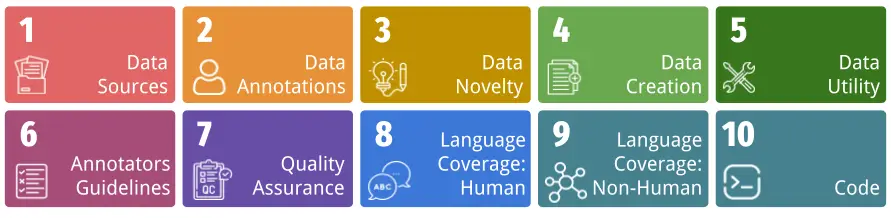

Figure 1: We study the datasheets and checklists in 10 dimensions of
data quality.

To support our position, we conduct a comprehensive analysis of
datasheets and checklists used in leading academic conferences across
ML, NLP, computer vision (CV), and speech. Our findings reveal
significant gaps in the information provided to assess data quality and
enable effective benchmarking—ultimately undermining the reliability of
current evaluation practices. We examine the challenges of assessing
data quality across multiple dimensions and advocate for a set of key
principles and best practices to guide more effective and consistent
evaluations. As a call to action, we introduce DataRubrics, a systematic
evaluation metric designed to measure the quality of both human- and
model-generated datasets. Based on our analysis, we identify ten
critical aspects of data quality and develop DataRubrics as a
structured, rubric-based framework grounded in quantifiable
criteria—such as data source, annotation methods, quality assurance
processes, originality, reproducibility, and documentation. We observe
that major ML and NLP conferences lack standardized, quantifiable
criteria for data quality assessment in their submission checklists and
datasheets, a gap that may contribute to the acceptance of low-quality
datasets. To investigate this further, we use DataRubrics to manually
annotate 100 papers submitted to the NeurIPS Datasets and Benchmarks
Track, followed by a quality assurance process. We also apply LLM-based
evaluation using DataRubrics to papers from a range of top-tier
conferences in NLP, CV, ML, and speech, analyzing patterns and trends in
data quality over time.

## 2 Datasheets Are Not Enough

### 2.1 Standardized, but Lacking Qualitative Evaluation

In recent years, the research community has introduced datasheets as a
tool to promote standardization and raise awareness among authors of
dataset papers. These datasheets aim to encourage thoughtful reflection
on what constitutes a high-quality dataset. Standardization has been
beneficial—not only for authors, but also for reviewers tasked with
assessing dataset quality. However, while datasheets enhance
transparency and documentation, they do not offer a systematic framework
for objectively evaluating dataset quality.

The datasheet template proposed by Gebru et al. \[8\] outlines several
key dimensions: (1) motivation for dataset creation, (2) dataset
composition, (3) data collection process, (4) data preprocessing, (5)
dataset distribution, (6) dataset maintenance, and (7) legal and ethical
considerations. Understanding the motivation and composition of a
dataset is undeniably valuable, as it sheds light on its intended use,
relevance to downstream tasks, size, and structure. However, while these
categories enhance transparency, they do not inherently facilitate
measurable quality assessment. The framework lacks standardized rubrics
or scoring mechanisms that would enable consistent, systematic
evaluation across datasets. Moreover, in the era of large-scale
pre-trained models, the existing datasheet categories fall short in
addressing model-specific considerations that are increasingly important
in dataset design. As LLMs are often both the consumers and generators
of data, evaluation frameworks must adapt accordingly. A datasheet
approach tailored to the unique challenges and evaluation needs of
LLM-centric workflows would be more relevant and impactful for modern
dataset development.

Another valuable contribution is the “Data Statements for NLP” framework
by Bender and Friedman \[5\], which emphasizes that not only dataset
composition and distribution matter, but also the role and background of
annotators—highlighting that sociolinguistic and ethical considerations
are often overlooked. Despite this, our analysis of recent dataset
papers published at major NLP and ML conferences reveals that reporting
on annotator demographics and perspectives remains sparse and
inconsistent. Such guidelines exist, but many authors engage only
superficially with annotator-related documentation, limiting the
transparency and reproducibility of the data annotation process.

### 2.2 The State of Academic Conferences

Datasheet frameworks have been increasingly encouraged by conference
organizers to ensure comprehensive documentation of dataset creation
processes. In this paper, we examine the policies and initiatives
adopted by academic conferences to promote reproducibility and uphold
responsible standards for dataset and benchmark submissions.
Additionally, we analyze conferences that have not yet adopted or
advocated for the use of datasheets or data checklists, highlighting
gaps and opportunities for broader standardization across the research
community.

##### NeurIPS Dataset and Benchmark Track.

Since launching its Datasets and Benchmarks track in 2021, NeurIPS has
progressively introduced policies to improve documentation,
transparency, and accountability in dataset submissions. Authors have
been encouraged to adopt established frameworks such as Datasheets for
Datasets \[8\], Dataset Nutrition Labels \[9\], Data Statements for
NLP \[5\], and broader accountability frameworks \[10\]. Submissions are
also required to include a public URL to the dataset or benchmark and a
clearly defined data license—both essential for ensuring reproducibility
and reuse. In 2022, NeurIPS strengthened its licensing policy by
requiring authors to explicitly specify a valid data license. That same
year, it introduced a new policy mandating the use of structured
metadata standards (e.g., schema.org, DCAT) to enhance
machine-readability and discoverability. In 2023, the track added a
requirement for disclosing any use of large language models (LLMs), a
policy that continued into 2024. Looking ahead, the 2025 track
introduces two additional requirements: the use of structured metadata
and the submission of a formal checklist to improve transparency.
Notably, authors must now format metadata according to the Croissant
standard \[1\], a step toward greater standardization and
interoperability. While these evolving policies represent significant
progress in promoting high-quality documentation and responsible dataset
practices, they still primarily emphasize descriptive metadata. As a
result, they provide transparency but fall short of offering evaluative
insights—they do not directly measure the quality of the dataset itself.
There remains considerable room for improvement, particularly in making
the metadata more actionable and useful for reviewers seeking to assess
the quality and reliability of a dataset.

##### ICML and ICLR.

According to Figure 2, ICML and ICLR have relatively few accepted
dataset and benchmark papers compared to other conferences, and they do
not require authors to submit any accompanying checklists or datasheets
for these submissions.

##### NLP Conferences.

In NLP conferences such as \*CL and EMNLP, authors are encouraged—but
not required—to complete Responsible NLP forms and datasheets when
submitting their papers.¹¹ 1
[https://aclrollingreview.org/responsibleNLPresearch](https://aclrollingreview.org/responsibleNLPresearch).
This practice is particularly emphasized within the ARR system, which
functions as the unified submission portal for \*CL, EMNLP, and
affiliated workshops. These forms are intended to promote transparency
and responsible research practices. In contrast, conferences focused on
language resources, such as LREC, require authors to disclose dataset
information at the time of submission. However, unlike NeurIPS 2025,
LREC has not yet mandated the use of structured datasheets or
standardized metadata.

##### CV Conferences.

To the best of our knowledge, major computer vision conferences such as
CVPR, ECCV, and ICCV do not currently enforce or actively advocate for
the inclusion of datasheets or checklists as part of supplementary
materials. This lack of emphasis suggests a limited focus on
systematically measuring and documenting dataset quality within the CV
research community.

##### Speech Conferences.

The Interspeech conference began implementing a checklist in 2024, with
continued use in 2025. This checklist collects detailed information
about the models and datasets used, including dataset statistics.
Authors are expected to disclose whether the datasets are publicly
available or not, promoting transparency and helping readers understand
the scope and accessibility of the data. Additionally, the checklist
requires authors to report key details such as the languages covered,
total audio duration, number of examples, and label distributions. These
elements provide valuable insights that enable readers to better assess
and compare dataset quality.

### 2.3 Limited Coverage

The absence of both qualitative and quantitative rubrics has led to
limited coverage in evaluating dataset quality. As shown in Table 1,
most existing datasheet frameworks lack sufficient scope.
BetterBench \[16\] represents the most comprehensive effort to date,
primarily due to its use of rubrics that enable more structured and
quantifiable assessments. However, it still falls short in evaluating
important dimensions such as data novelty and language diversity, and
its evaluations are conducted manually rather than automatically,
limiting scalability. Therefore, we advocate developing a more robust
and automated set of metrics to enable comprehensive, systematic, and
scalable evaluation of dataset quality.

Another notable limitation of BetterBench is its lack of support for
non-human language coverage—such as scientific datasets using structured
representations like molecular schemas (e.g., proteins) or neurosymbolic
formats that rely on domain-specific grammars. In contrast, DataRubrics
explicitly incorporates non-human language dimensions, making it
extensible to a broader range of knowledge domains beyond human-centric
language data.

|                       | Data           |                |                |                |                | Annotators     | Quality        | Languages Coverage |                | Code           | Rubrics        |
| --------------------- | -------------- | -------------- | -------------- | -------------- | -------------- | -------------- | -------------- | ------------------ | -------------- | -------------- | -------------- |
|                       | Sources        | Annotation     | Novelty        | Creation       | Utility        | Guidelines     | Assurance      | Human              | Non-Human      | Provided       |                |
| Datasheets \[8\]      | $`\checkmark`$ |                |                | $`\checkmark`$ | $`\checkmark`$ |                |                |                    |                |                |                |
| Data Nutrition \[9\]  | $`\checkmark`$ |                |                |                |                |                |                |                    |                |                |                |
| Data Statements \[5\] | $`\checkmark`$ | $`\checkmark`$ |                |                |                |                |                | $`\checkmark`$     |                |                |                |
| BetterBench \[16\]    | $`\checkmark`$ | $`\checkmark`$ |                | $`\checkmark`$ | $`\checkmark`$ | $`\checkmark`$ | $`\checkmark`$ |                    |                | $`\checkmark`$ | $`\checkmark`$ |
| DataRubrics           | $`\checkmark`$ | $`\checkmark`$ | $`\checkmark`$ | $`\checkmark`$ | $`\checkmark`$ | $`\checkmark`$ | $`\checkmark`$ | $`\checkmark`$     | $`\checkmark`$ | $`\checkmark`$ | $`\checkmark`$ |

Table 1: Coverage of several popular dataset documentation schemas,
including DataRubrics.

### 2.4 Rubrics and Scoring Matter

The checklists currently used in conferences are not based on rigorous
rubrics. They typically rely on binary responses such as “yes,” “no,” or
“N/A,” which lack explainability and fail to capture the complex,
multi-faceted characteristics of datasets. For example, a dataset might
be annotated both by humans and with assistance from LLMs, but such
hybrid methods are difficult to identify using existing checklists or
most datasheets—unless a more detailed framework like BetterBench is
employed. However, some of BetterBench’s scoring systems may not
generalize well across all contexts. For instance, a dataset accepted at
a workshop is not necessarily of lower quality than one presented at a
major conference, and domain-specific datasets may not fit uniform
metric standards. To address these challenges, we propose a more general
set of attributes and dimensions for assessing datasets and benchmark
papers. These are designed to be robust across domains and better suited
for automated evaluation, including LLM-as-a-judge scenarios.

## 3 Automating Dataset Quality Assessment: A Call to Action

Initially, Datasheets \[8\] were designed not as an automated evaluation
framework, but to encourage dataset creators to thoughtfully reflect on
the processes of creating, distributing, and maintaining a dataset.
However, with the growing volume of conference submissions (see
Figure 2) and varying reviewer expertise, providing a clear automated
evaluation could help reviewers quickly assess dataset utility and
quality. While this rubric is not meant to replace human expert
judgment, it can guide reviewers to key aspects, such as the extent of
synthetic data usage, dataset modalities, and quality control measures
implemented by the authors.

### 3.1 Reviewers May Overlook or Struggle to Assess the Quality of the Datasets

Anecdotal stories have emerged of papers being rejected due to having
too few languages or small dataset sizes. With the rise of LLMs and the
increasing use of synthetic data generation, reviewers may overlook the
fact that dataset quality arguably matters more than quantity, and
should avoid judging datasets solely based on size. In many cases, a
small dataset with few languages may be sufficient to prove a point
based on statistical power analysis, or to serve the purpose outlined by
the authors. Conversely, a large dataset with many languages may be
insufficient for the purposes proposed by the authors. A data resource
must be judged clearly by its intended purpose, and whether its
construction is sufficient to serve as a resource for that purpose.

Without proper quality assessment, reviewers may focus on more visible
aspects, such as dataset size or language coverage, rather than
critically evaluating the data itself. This issue is even more
pronounced when reviewers do not speak the target language, making it
difficult to directly assess data quality. Additionally, it is important
to note that synthetic data is not inherently low-quality, just as
human-annotated data is not automatically high-quality. A clearer and
more standardized quality rubric would help reviewers evaluate
data-centric work more fairly, beyond surface-level numbers such as data
size or language coverage.

### 3.2 Surge in Paper Submissions

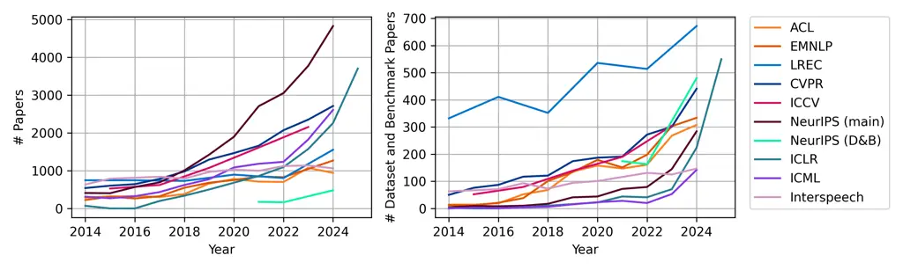

Figure 2: Comparison of yearly trends: all accepted papers (left) and
dataset or benchmark papers (right). The number of dataset and benchmark
papers is determined by classifying paper titles and abstracts. As of
the time of writing, only the ICLR 2025 proceedings had been published
and are therefore the only 2025 data included.

In recent years, AI conferences have seen a massive surge in submissions
(see Figure 2). As the number of submissions grows, so does the number
of required reviews, leading to an increased reviewer pool and load and,
in some cases, more relaxed reviewer eligibility criteria. With this
rising review burden, maintaining review quality becomes increasingly
challenging. To support reviewers, especially in evaluating
dataset-related work, more comprehensive and up-to-date data cards that
highlight dataset quality are needed. Additionally, automated tools that
assist in the review process by providing proxies for dataset quality
could be valuable, helping reviewers make more informed assessments.
AI-assisted reviews for data-related work are helpful, given the
increasing scale of paper submissions. This tool can be used to quickly
highlight data quality issues, including references to the relevant
parts of the article for the reviewer to check.

## 4 DataRubrics

We have discussed the limitations of existing datasheets and checklists
used in conferences and strongly advocate for improvements.
Specifically, we propose developing new automated rubrics that cover a
broader range of data quality dimensions not addressed by current
methods. In this section, we present our proposal in detail, focusing on
three key concepts to aid reviewers and users in evaluating datasets:
(1) Data composition and creation, (2) Quality assurance and
reproducibility, and (3) Novelty and differentiation in terms of
utility. We summarize our framework’s components in Figure 1 and define
these facets below.

### 4.1 Dimensions

We define 10 distinct dimensions to capture the key aspects necessary
for evaluating data quality.

##### (1) Data Sources.

It is important to specify the original data source—whether the content
is human-written or machine-generated. This distinction has become
increasingly relevant with the rise of AI-generated content, which
facilitates the creation of large-scale synthetic datasets. Documenting
the data source helps ensure that datasets are used appropriately and in
line with their intended purpose, particularly when determining whether
machine-generated or human-written data is more suitable.

##### (2) Data Annotators.

Clear documentation of annotators is essential, as human-annotated
labels do not inherently guarantee high quality. Inadequate annotation
protocols or reliance on non-experts can result in low-quality data. It
is important to provide information about the annotators’ demographics
and their domain-specific expertise. For instance, native speakers or
individuals familiar with local cultures are critical for multilingual
or culturally nuanced data, while subject-matter experts are necessary
for scientific benchmarks. Similarly, machine-generated data may reflect
the biases of the underlying models, which could be
problematic—especially if the dataset is intended to fill gaps in
existing AI capabilities, such as those involving low-resource
languages. Therefore, those involved in dataset construction must
understand the limitations of the models used.

##### (3) Data Novelty.

Data work should also clearly indicate the novelty of the dataset,
whether it is constructed from scratch, translated from existing data,
derived from other datasets, or simply collected and collated from
various sources. This information is important because it provides
context on the originality, potential biases, and limitations of the
dataset. For instance, translated or derived datasets may carry over
biases or assumptions from the source material, while collated datasets
might introduce inconsistencies due to differing annotation standards
and data qualities.

##### (4) Data Creation.

This metric assesses the transparency and thoroughness of the dataset
creation documentation—key factors for ensuring reproducibility,
facilitating ethical evaluation, and supporting downstream usability.

##### (5) Task Utility.

This metric evaluates how the dataset is utilized within the ML
pipeline. Understanding its role helps clarify the dataset’s purpose,
relevance, and integration into model development and evaluation
workflows.

##### (6) Annotation Guidelines.

Annotation guidelines are essential for aligning annotators and helping
readers understand dataset creation. Machine-generated data also
requires annotation guidelines, typically describing how the data or
labels were produced, including specific prompts used. These guidelines
should provide clear instructions and well-defined rubrics for each
category to minimize disagreement. Additionally, annotation examples are
also important to enhance annotation quality.

##### (7) Quality Assurance.

Beyond construction, validation is a vital step in improving dataset
quality. Information about who performed the quality assurance—whether
an expert or a machine—should be provided. Additionally, a clear
guideline outlining how the quality assurance was conducted is
necessary, including some notation on the quality itself, for example
via annotators’ agreement. Machine-generated data may require
documentation on how well the machine performs the annotation task. This
can be supported by a performance report on similar tasks using
third-party benchmarks or by showing correlation with high-quality human
annotations. This information helps to ensure that the machine-generated
data is aligned with the expectations of human annotators.

##### (8) Human Language Coverage.

With the growing focus on NLP research beyond English, it is
increasingly important to consider language coverage in dataset
development. We recognize that data are not always sourced from English,
but also from a wide range of non-English languages.

##### (9) Non-Human Language Coverage.

Not all data originates from human languages—some datasets are based on
abstract, structured, or symbolic representations, such as those found
in scientific or formal languages. Therefore, we also track and include
information on non-human languages in our analysis.

##### (10) Code.

This metric pertains to whether the code used for constructing the
dataset is made publicly available or not for reproducibility.

### 4.2 Rubric-Based Design

##### Multi-label with Reasoning and Reference.

To enable more precise and meaningful evaluation, our rubrics go beyond
simple numerical scores by providing clear criteria to distinguish
different labels. A key design goal is support for multi-label
classification. For example, a dataset may combine human-annotated data
with synthetic data generated by LLMs, requiring metrics that accurately
capture these multifaceted characteristics. We also emphasize the
importance of reasoning and evidence in annotation: since verifying
label correctness can be difficult without justification, annotators are
required to provide explanations along with references to specific
sections of the paper. This improves transparency and enables more
verifiable evaluations.

##### Schema and Structured Decoding.

Given the rubric’s many dimensions, manual assessment by authors,
annotators, or reviewers can be overwhelming. To address this and enable
scalable LLM-assisted evaluation, we design the rubric to be both
human-readable and machine-interpretable. Specifically, we provide a
structured schema that guides LLMs during generation via constrained
structured decoding. This ensures consistent, rubric-aligned outputs
while making evaluation more efficient and scalable. Details about the
schema can be found in Appendix B.

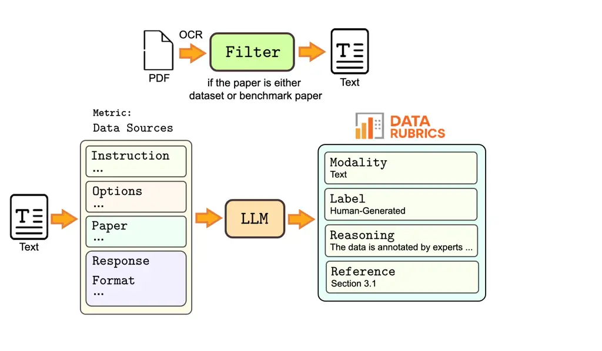

Figure 3: Inference pipeline using DataRubrics. We use OCR to extract
text from PDFs, filter papers by title and abstract to select dataset or
benchmark papers, then use an LLM to predict labels, reasoning, and
references according to the categories in
$`\lx@sectionsign\ref{category_defn}`$.

## 5 Resources and Evaluation

As shown in Figure 3, our dataset collection involves several key steps:
high-quality text extraction using OCR, filtering with a reward model,
and automatic evaluation through LLM-as-a-judge. We describe each step
in detail below:

### 5.1 Dataset Collection

We collect text and metadata, including titles and abstracts, from
papers published at major conferences across ML/AI (i.e., NeurIPS, ICLR,
ICML), NLP (i.e., ACL, EMNLP, LREC), CV (i.e., CVPR), and speech
processing (i.e., Interspeech), spanning the years 2021 to 2024, since
at the time of writing, not all proceedings from 2025 have been
released.

##### Filtering Using a Reward Model.

To identify relevant papers, we first narrow the corpus using titles and
abstracts to isolate works potentially related to novel datasets or
benchmarks. We employ a generative reward model, R3-Qwen3-14B-4k \[4\],
which performs rubric-guided reasoning and reward-based classification.
This model helps detect papers that (i) introduce new datasets, (ii)
modify or extend existing datasets, or (iii) conduct benchmarking on
existing datasets. The model is prompted using a structured template
described in Section C of the Appendix. This filtering process yields a
substantial set of relevant papers, as illustrated in Figure 2.

##### High-Quality Text Extraction via OCR.

For the filtered papers, standard PDF text extraction methods often
yield noisy or incomplete results due to formatting inconsistencies,
embedded figures or tables, and anonymization artifacts in under-review
manuscripts. To ensure high-quality and structured text extraction, we
apply a robust Optical Character Recognition (OCR) model, OlmOCR \[14\],
specifically designed for academic document parsing.

##### Sampling.

In our study, we limit the analysis to a maximum of 100 papers per year
for each conference category (ARR, ICML, ICLR, NeurIPS Datasets and
Benchmarks Track, CVPR, Interspeech, and LREC), selected through random
sampling. For the human evaluation, we specifically focus on 100 papers
from the NeurIPS Datasets and Benchmarks Track, sampling data only from
the years 2022 to 2024.

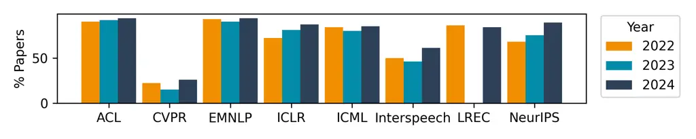

(a) Percentage of papers with guidelines for data collection.

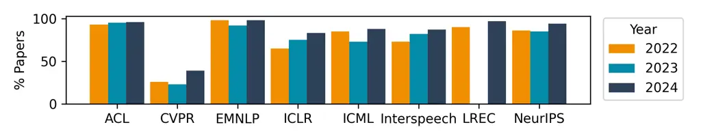

(b) Percentage of papers with quality assurance.

Figure 4: Paper statistics across conferences. Only the 2022 and 2024
editions of LREC are included, as it is held biennially.

### 5.2 Automatic Evaluation via LLM-as-a-judge

With high-quality paper texts in hand, we perform automatic evaluation
using LLM-as-a-judge, following the DataRubrics methodology. The models
are prompted using a structured template described in Section B of the
Appendix. We evaluate responses using a proprietary model GPT-4.1-mini.

### 5.3 Manual Evaluation

To evaluate the usefulness of the metric and the assessment pipeline, we
engaged domain experts to perform rubric-based annotations. Each paper
was assigned to one expert with specialization in ML, NLP, CV, or
Speech, who annotated the relevant aspects covered by our metrics. This
was followed by a quality assurance step, in which a second expert
reviewed the annotations to identify and correct any issues. The human
evaluation was conducted on a sample of 100 NeurIPS papers from 2022 to
2024, comprising both accepted and rejected submissions from the
Datasets and Benchmarks Track.

### 5.4 Analysis

We analyze annotations from both human annotators and AI model-based
evaluations to assess the effectiveness of the rubrics and to examine
trends in papers over the past several years.

#### 5.4.1 Trends in Dataset Papers Across Academic Conferences

##### Data Annotation and Quality Assurance.

Figure 4 illustrates trends in dataset papers across various academic
conferences from 2022 to 2024. Several conferences show an upward trend
in the inclusion of guidelines and quality assurance practices,
indicating growing awareness of the importance of data standards.
However, CVPR consistently exhibits the lowest proportion of such
papers, with only a slight improvement observed in 2024. This aligns
with our broader findings that CVPR currently lacks strict policies or
standardization regarding datasheets and data checklists. We advocate
for CVPR to adopt similar initiatives to those introduced by conferences
like NeurIPS.

##### Accepted vs. Rejected NeurIPS Papers.

Figure 5 shows the percentage of NeurIPS papers across different
acceptance and rejection categories. The number of papers in each
category is relatively similar, indicating that NeurIPS’ policy on
maintaining quality in the dataset and benchmark track is enforced even
among rejected submissions. However, there is still room for improvement
in raising awareness about the importance of following guidelines during
data collection.

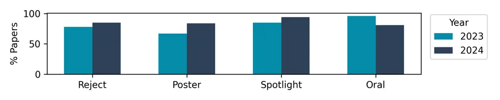

Figure 5: Percentage of papers on NeurIPS with Guidelines on their data
collection.

##### Model-generated Data.

Figure 6 shows the trend of papers proposing new data generated by
models. There is a clear and consistent increase in the percentage of
such papers over time across all conferences.

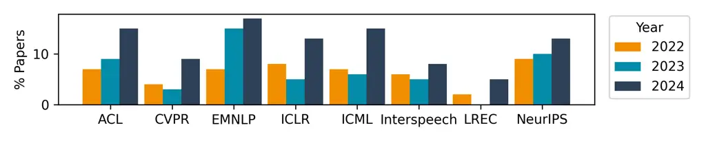

Figure 6: Percentage of papers with proposed new data generated from
model.

#### 5.4.2 Automatic Evaluation vs. Human Evaluation

We find that human annotations still contain errors even after
undergoing quality assurance (QA) procedures. To better understand the
nature of these errors, we reannotate a set of 100 data points using
outputs from GPT-4.1 mini, focusing on NeurIPS papers. As shown in
Figure 7, 26% of the annotations remain incorrect, despite having passed
QA by human annotators tasked with identifying whether a paper includes
specific annotations. Our analysis suggests that human annotators
frequently overlook fine-grained details, especially when subtle or
nuanced aspects of a paper are involved. To investigate these
discrepancies further, we compare annotations across multiple
perspectives, including both model and human annotation guidelines. This
comparison reveals that a substantial portion of errors stem from
misclassifying human-written annotations as model-generated ones.
Similar patterns of misclassification are also observed in automatic
evaluation metrics. These findings indicate that model-assisted
annotation could play a valuable role in reducing human error during the
review process. Alternatively, authors should strive to report
annotations as clearly and accurately as possible to minimize ambiguity.

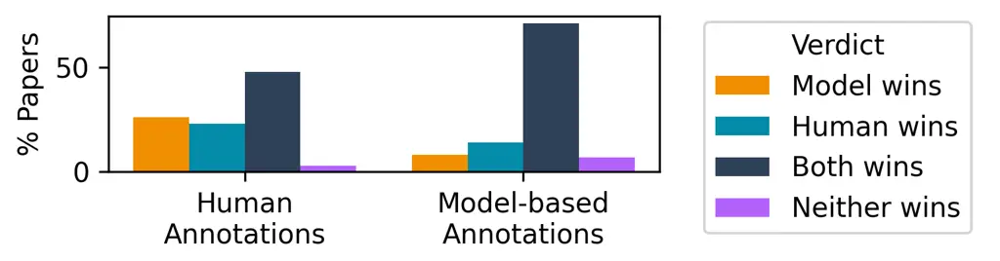

Figure 7: Comparison of human–LLM annotation agreement.

## 6 Conclusion

Moving forward, we offer several recommendations for the AI community,
particularly those developing datasets and benchmarks. First,
documenting all aspects of data work—from sources to annotation
processes—is crucial. Our findings highlight the importance of such
transparency. Second, data quality must be evaluated beyond surface
metrics like size or language fluency. While LLMs enable large-scale
dataset creation, quality remains paramount. Machine-generated data
should be rigorously validated for human alignment and bias, while human
annotations demand clear guidelines and expert oversight to reduce
error. As dataset submissions grow, maintaining review quality is
increasingly difficult. AI-assisted reviewing—where models summarize
data quality based on structured rubrics—could ease this burden. We hope
DataRubrics contributes to this goal by offering a schema that aids both
annotators and reviewers in assessing dataset quality and utility at a
glance.

## Acknowledgments

We would like to thank Graham Neubig for his valuable insights and
constructive discussions, which were instrumental in shaping our rubric
design. We also appreciate Blair Yang for helpful conversations
regarding the experimental setup.

## References

- \[1\] M. Akhtar, O. Benjelloun, C. Conforti, L. Foschini,
  J. Giner-Miguelez, P. Gijsbers, S. Goswami, N. Jain,
  M. Karamousadakis, M. Kuchnik, et al. Croissant: A metadata format for
  ml-ready datasets. _Advances in Neural Information Processing
  Systems_, 37:82133–82148, 2024.
- \[2\] Z. Ankner, M. Paul, B. Cui, J. D. Chang, and P. Ammanabrolu.
  Critique-out-loud reward models. _arXiv preprint
  arXiv:2408.11791_, 2024.
- \[3\] D. Anugraha, G. I. Winata, C. Li, P. A. Irawan, and E.-S. A.
  Lee. Proxylm: Predicting language model performance on multilingual
  tasks via proxy models. _arXiv preprint arXiv:2406.09334_, 2024.
- \[4\] D. Anugraha, Z. Tang, L. J. V. Miranda, H. Zhao, M. R.
  Farhansyah, G. Kuwanto, D. Wijaya, and G. I. Winata. R3: Robust
  rubric-agnostic reward models. _arXiv preprint
  arXiv:2505.13388_, 2025.
- \[5\] E. M. Bender and B. Friedman. Data statements for natural
  language processing: Toward mitigating system bias and enabling better
  science. _Transactions of the Association for Computational
  Linguistics_, 6:587–604, 2018.
- \[6\] X. Chen, G. Li, Z. Wang, B. Jin, C. Qian, Y. Wang, H. Wang,
  Y. Zhang, D. Zhang, T. Zhang, et al. Rm-r1: Reward modeling as
  reasoning. _arXiv preprint arXiv:2505.02387_, 2025.
- \[7\] M. R. Farhansyah, I. Darmawan, A. Kusumawardhana, G. I. Winata,
  A. F. Aji, and D. T. Wijaya. Do language models understand honorific
  systems in javanese? _arXiv preprint arXiv:2502.20864_, 2025.
- \[8\] T. Gebru, J. Morgenstern, B. Vecchione, J. W. Vaughan,
  H. Wallach, H. D. Iii, and K. Crawford. Datasheets for datasets.
  _Communications of the ACM_, 64(12):86–92, 2021.
- \[9\] S. Holland, A. Hosny, S. Newman, J. Joseph, and K. Chmielinski.
  The dataset nutrition label: A framework to drive higher data quality
  standards. _arXiv preprint arXiv:1805.03677_, 2018.
- \[10\] B. Hutchinson, A. Smart, A. Hanna, E. Denton, C. Greer,
  O. Kjartansson, P. Barnes, and M. Mitchell. Towards accountability for
  machine learning datasets: Practices from software engineering and
  infrastructure. In _Proceedings of the 2021 ACM conference on
  fairness, accountability, and transparency_, pages 560–575, 2021.
- \[11\] R. Mihalcea, O. Ignat, L. Bai, A. Borah, L. Chiruzzo, Z. Jin,
  C. Kwizera, J. Nwatu, S. Poria, and T. Solorio. Why ai is weird and
  shouldn’t be this way: Towards ai for everyone, with everyone, by
  everyone. In _Proceedings of the AAAI Conference on Artificial
  Intelligence_, pages 28657–28670, 2025.
- \[12\] T. Naous, M. J. Ryan, A. Ritter, and W. Xu. Having beer after
  prayer? measuring cultural bias in large language models. In
  _Proceedings of the 62nd Annual Meeting of the Association for
  Computational Linguistics (Volume 1: Long Papers)_, pages
  16366–16393, 2024.
- \[13\] A. H. Nasution and A. Onan. Chatgpt label: Comparing the
  quality of human-generated and llm-generated annotations in
  low-resource language nlp tasks. _IEEE Access_, 12:71876–71900, 2024.
- \[14\] J. Poznanski, J. Borchardt, J. Dunkelberger, R. Huff, D. Lin,
  A. Rangapur, C. Wilhelm, K. Lo, and L. Soldaini. olmocr: Unlocking
  trillions of tokens in pdfs with vision language models. _arXiv
  preprint arXiv:2502.18443_, 2025.
- \[15\] R. A. Putri, F. G. Haznitrama, D. Adhista, and A. Oh. Can llm
  generate culturally relevant commonsense qa data? case study in
  indonesian and sundanese. _arXiv preprint arXiv:2402.17302_, 2024.
- \[16\] A. Reuel, A. Hardy, C. Smith, M. Lamparth, M. Hardy, and M. J.
  Kochenderfer. Betterbench: Assessing ai benchmarks, uncovering issues,
  and establishing best practices. _arXiv preprint
  arXiv:2411.12990_, 2024.
- \[17\] I. Shumailov, Z. Shumaylov, Y. Zhao, et al. Ai models collapse
  when trained on recursively generated data. _Nature_,
  631:755–759, 2024. doi: 10.1038/s41586-024-07566-y.
- \[18\] V. Veselovsky, M. H. Ribeiro, and R. West. Artificial
  artificial artificial intelligence: Crowd workers widely use large
  language models for text production tasks. _arXiv preprint
  arXiv:2306.07899_, 2023.
- \[19\] T. Vu, K. Krishna, S. Alzubi, C. Tar, M. Faruqui, and Y.-H.
  Sung. Foundational autoraters: Taming large language models for better
  automatic evaluation. In _Proceedings of the 2024 Conference on
  Empirical Methods in Natural Language Processing_, pages
  17086–17105, 2024.
- \[20\] X. Wang, H. Kim, S. Rahman, K. Mitra, and Z. Miao. Human-llm
  collaborative annotation through effective verification of llm labels.
  In _Proceedings of the 2024 CHI Conference on Human Factors in
  Computing Systems_, pages 1–21, 2024.
- \[21\] G. I. Winata, D. Anugraha, L. Susanto, G. Kuwanto, and D. T.
  Wijaya. Metametrics: Calibrating metrics for generation tasks using
  human preferences. In _The Thirteenth International Conference on
  Learning Representations_, 2025. URL
  [https://openreview.net/forum?id=slO3xTt4CG](https://openreview.net/forum?id=slO3xTt4CG).
- \[22\] M. Wu and A. F. Aji. Style over substance: Evaluation biases
  for large language models. In _Proceedings of the 31st International
  Conference on Computational Linguistics_, pages 297–312, 2025.

## Appendix A Paper Statistics via Automatic Evaluation

We present paper trends from 2022 to 2024, based on data generated by
GPT-4.1 mini using the DataRubrics framework. The orange, blue, and dark
blue bars indicate papers from 2022, 2023, and 2024, respectively.

### A.1 Data Annotations

Figures 8 and 9 show the paper trends on Data Annotations at ACL, CVPR,
EMNLP, ICLR, ICML, Interspeech, LREC, and NeurIPS.

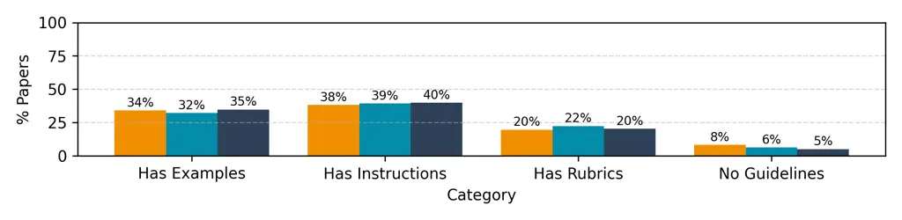

(a) Trends in Data Annotations of Papers at ACL (2022-2024).

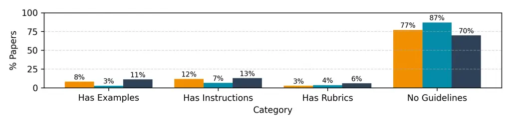

(b) Trends in Data Annotations of Papers at CVPR (2022-2024).

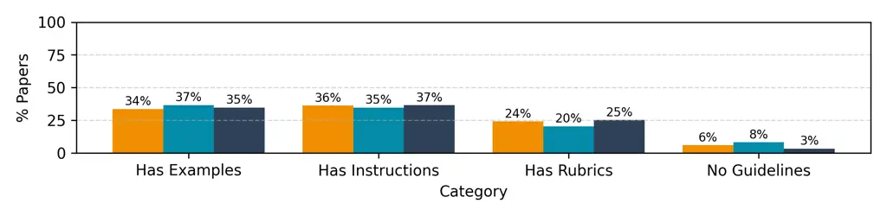

(c) Trends in Data Annotations of Papers at EMNLP (2022-2024).

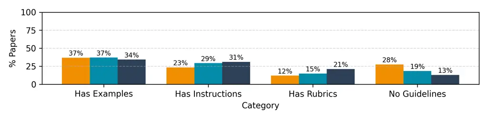

(d) Trends in Data Annotations of Papers at ICLR (2022-2024).

Figure 8: Paper statistics across conferences on Data Annotations at
ACL, CVPR, EMNLP, and ICLR (2022-2024).

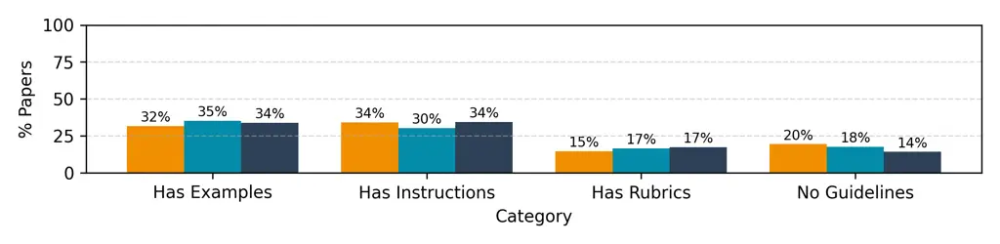

(a) Trends in Data Annotations of Papers at ICML (2022-2024).

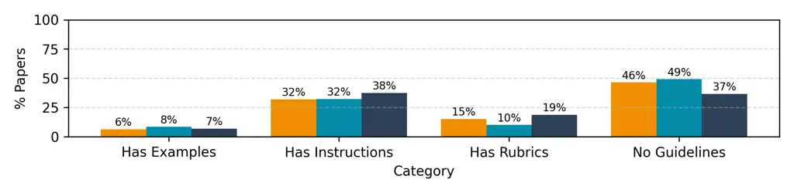

(b) Trends in Data Annotations of Papers at Interspeech (2022-2024).

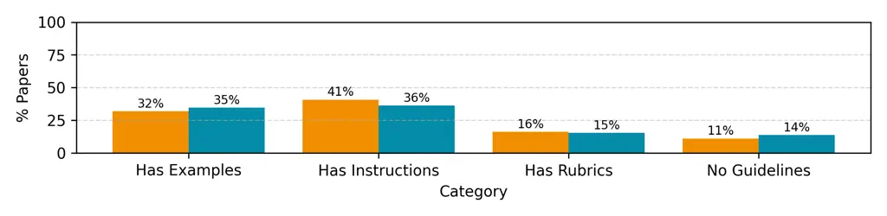

(c) Trends in Data Annotations of Papers at LREC (2022-2024).

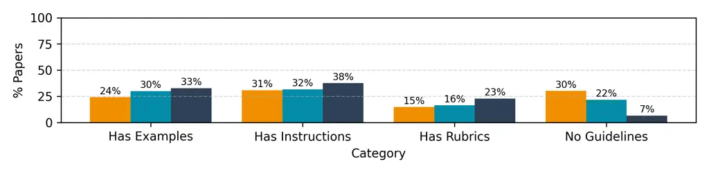

(d) Trends in Data Annotations of Papers at NeurIPS (2022-2024).

Figure 9: Paper statistics across conferences on Data Annotations at
ICML, Interspeech, LREC, and NeurIPS (2022-2024).

### A.2 Data Novelty

Figures 10 and 11 show the paper trends on Data Novelty at ACL, CVPR,
EMNLP, ICLR, ICML, Interspeech, LREC, and NeurIPS.

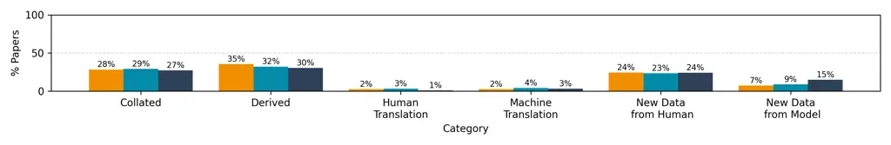

(a) Trends in Data Novelty of Papers at ACL (2022-2024).

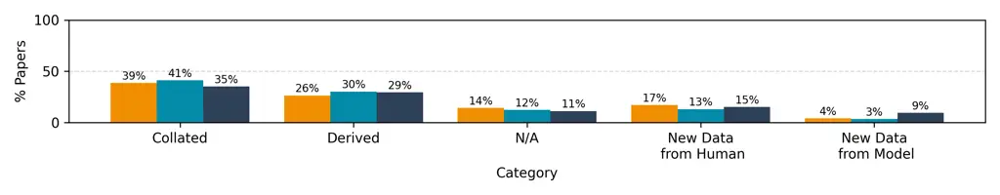

(b) Trends in Data Novelty of Papers at CVPR (2022-2024).

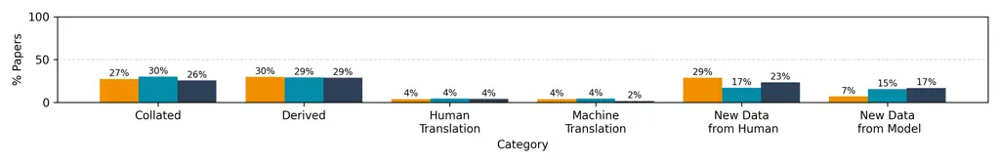

(c) Trends in Data Novelty of Papers at EMNLP (2022-2024).

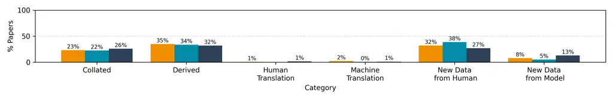

(d) Trends in Data Novelty of Papers at ICLR (2022-2024).

Figure 10: Paper statistics across conferences on Data Novelty at ACL,
CVPR, EMNLP, and ICLR (2022-2024).

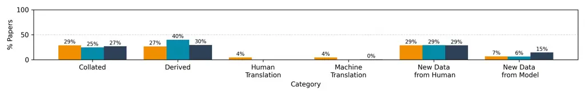

(a) Trends in Data Novelty of Papers at ICML (2022-2024).

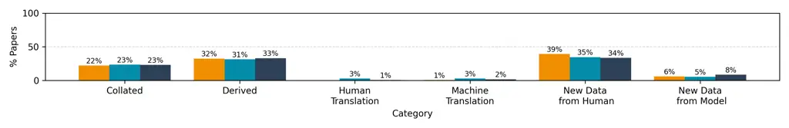

(b) Trends in Data Novelty of Papers at Interspeech (2022-2024).

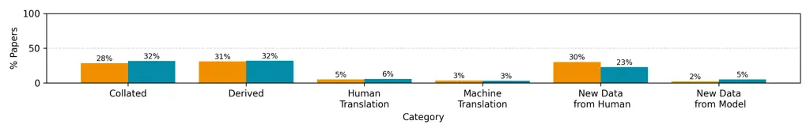

(c) Trends in Data Novelty of Papers at LREC (2022-2024).

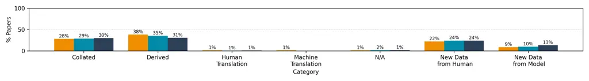

(d) Trends in Data Novelty of Papers at NeurIPS (2022-2024).

Figure 11: Paper statistics across conferences on Data Novelty at ICML,
Interspeech, LREC, and NeurIPS (2022-2024).

### A.3 Languages

Figures 12 and 13 show the paper trends on Languages at ACL, CVPR,
EMNLP, ICLR, ICML, Interspeech, LREC, and NeurIPS.

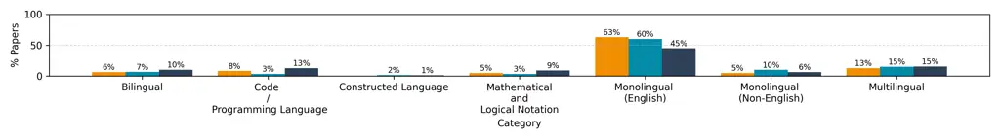

(a) Trends in Languages of Papers at ACL.

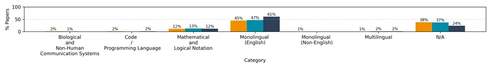

(b) Trends in Languages of Papers at CVPR.

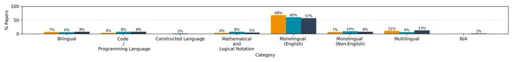

(c) Trends in Languages of Papers at EMNLP.

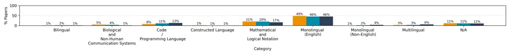

(d) Trends in Languages of Papers at ICLR.

Figure 12: Paper statistics across conferences on Languages at ACL,
CVPR, EMNLP, and ICLR (2022-2024).

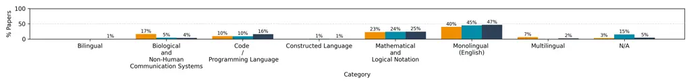

(a) Trends in Languages of Papers at ICML.

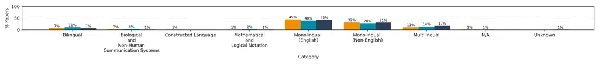

(b) Trends in Languages of Papers at Interspeech.

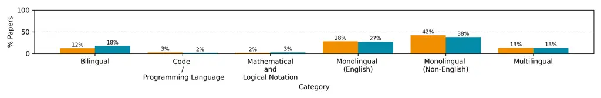

(c) Trends in Languages of Papers at LREC.

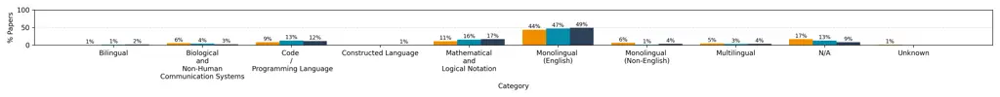

(d) Trends in Languages of Papers at NeurIPS.

Figure 13: Paper statistics across conferences on Languages at ICML,
Interspeech, LREC, and NeurIPS (2022-2024).

### A.4 Quality Assurance

Figures 14 and 15 show the paper trends on Quality Assurance at ACL,
CVPR, EMNLP, ICLR, ICML, Interspeech, LREC, and NeurIPS.

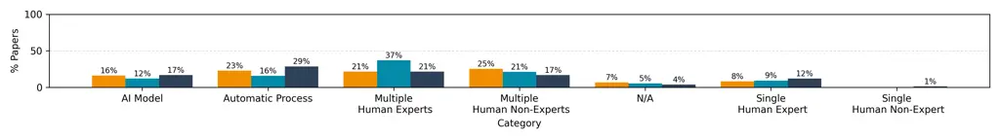

(a) Trends in Quality Assurance of Papers at ACL.

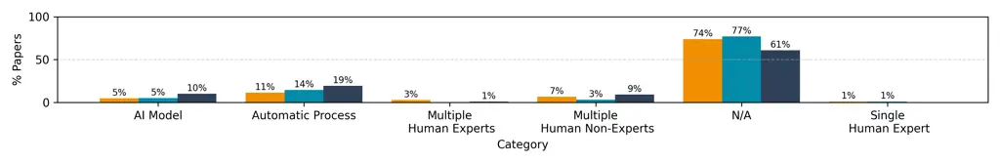

(b) Trends in Quality Assurance of Papers at CVPR.

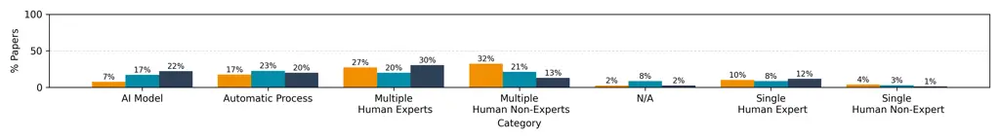

(c) Trends in Quality Assurance of Papers at EMNLP.

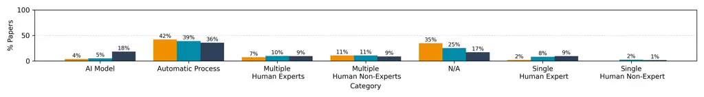

(d) Trends in Quality Assurance of Papers at ICLR.

Figure 14: Paper statistics across conferences on Quality Assurance at
ACL, CVPR, EMNLP, and ICLR (2022-2024).

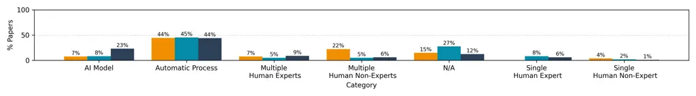

(a) Trends in Quality Assurance of Papers at ICML.

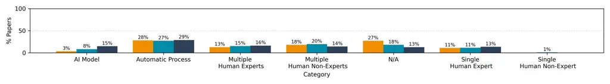

(b) Trends in Quality Assurance of Papers at Interspeech.

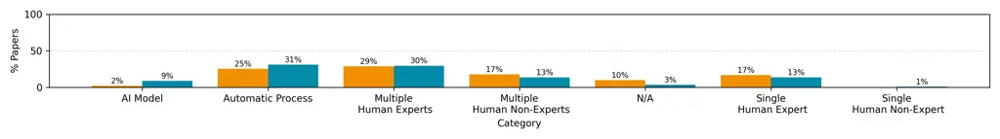

(c) Trends in Quality Assurance of Papers at LREC.

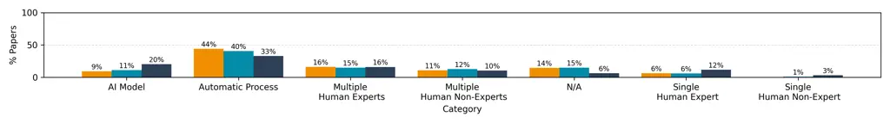

(d) Trends in Quality Assurance of Papers at NeurIPS.

Figure 15: Paper statistics across conferences on Quality Assurance at
ICML, Interspeech, LREC, and NeurIPS (2022-2024).

### A.5 Reproducibility: Data Creation and Code

Figures 16 and 17 show the paper trends on Data Creation and Code
criterion at ACL, CVPR, EMNLP, ICLR, ICML, Interspeech, LREC, and
NeurIPS.

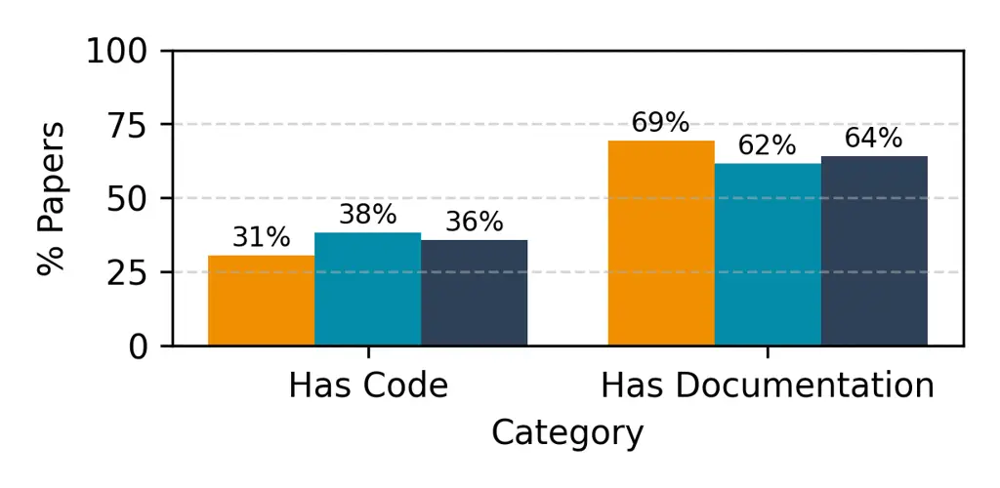

(a) Trends in Data Creation and Code of Papers at ACL.

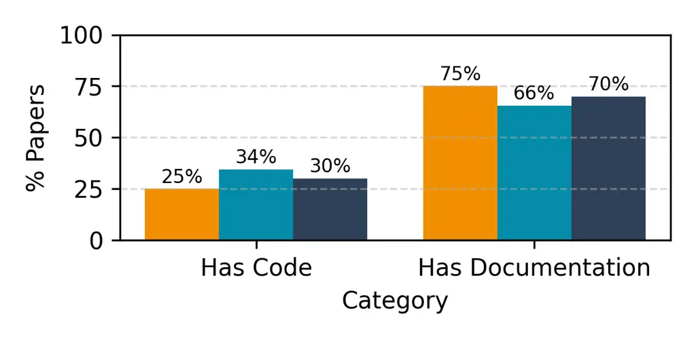

(b) Trends in Data Creation and Code of Papers at CVPR.

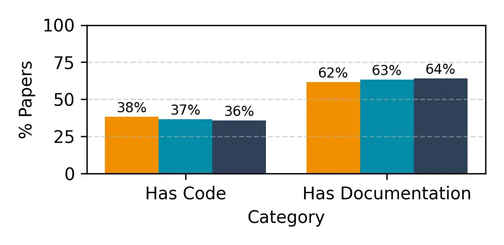

(c) Trends in Data Creation and Code of Papers at EMNLP.

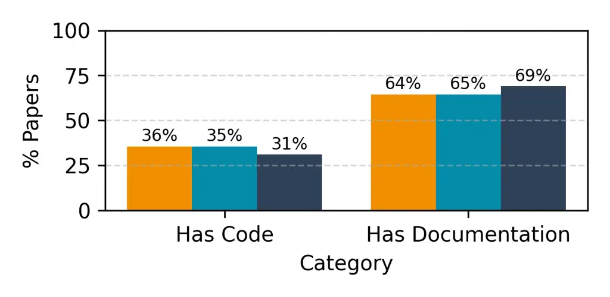

(d) Trends in Data Creation and Code of Papers at ICLR.

Figure 16: Paper statistics across conferences on Data Creation and Code
at ACL, CVPR, EMNLP, and ICLR (2022-2024).

(a) Trends in Data Creation and Code of Papers at ICML.

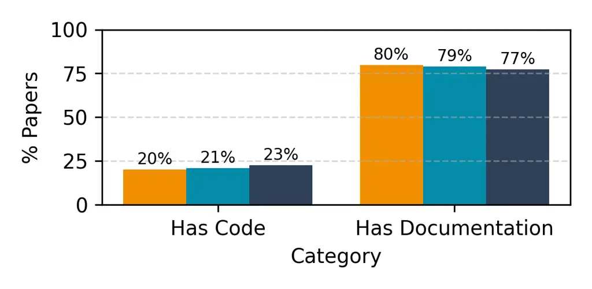

(b) Trends in Data Creation and Code of Papers at Interspeech.

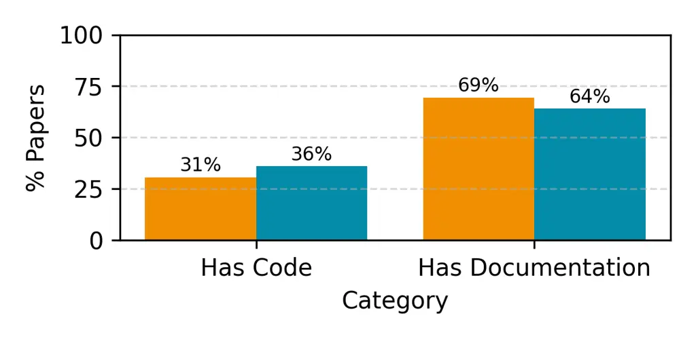

(c) Trends in Data Creation and Code of Papers at LREC.

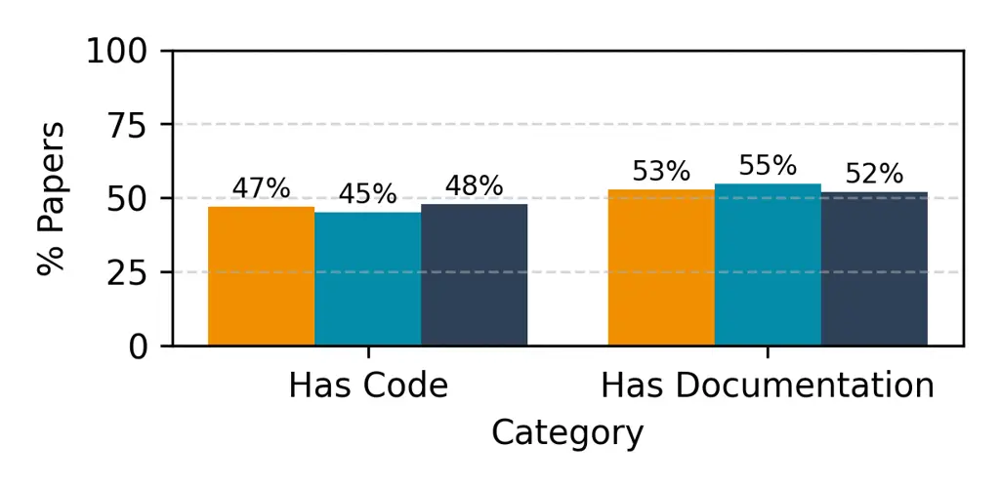

(d) Trends in Data Creation and Code of Papers at NeurIPS.

Figure 17: Paper statistics across conferences on Data Creation and Code
at ICML, Interspeech, LREC, and NeurIPS (2022-2024).

### A.6 Task Utility

Figures 18 and 19 show the paper trends on Task Utility at ACL, CVPR,
EMNLP, ICLR, ICML, Interspeech, LREC, and NeurIPS.

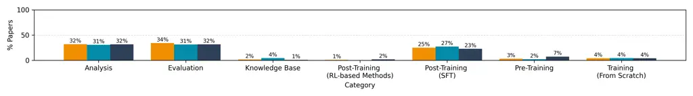

(a) Trends in Task Utility of Papers at ACL.

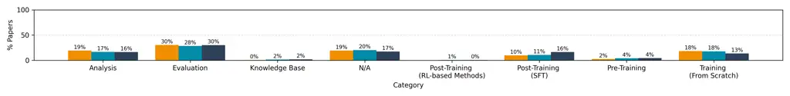

(b) Trends in Task Utility of Papers at CVPR.

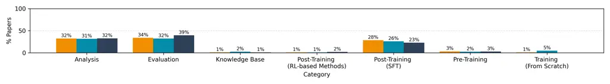

(c) Trends in Task Utility of Papers at EMNLP.

(d) Trends in Task Utility of Papers at ICLR.

Figure 18: Paper statistics across conferences on Task Utility at ACL,
CVPR, EMNLP, and ICLR (2022-2024).

(a) Trends in Task Utility of Papers at ICML.

(b) Trends in Task Utility of Papers at Interspeech.

(c) Trends in Task Utility of Papers at LREC.

(d) Trends in Task Utility of Papers at NeurIPS.

Figure 19: Paper statistics across conferences on Task Utility at ICML,
Interspeech, LREC, and NeurIPS (2022-2024).

## Appendix B Metric Evaluation Rubrics

In this section, we present the template and structured schema used to
define each metric dimension in DataRubrics.

### B.1 Data Sources

#### B.1.1 Template

#### B.1.2 Schema

### B.2 Data Annotations

#### B.2.1 Template

#### B.2.2 Schema

### B.3 Quality Assurance

#### B.3.1 Template

#### B.3.2 Schema

### B.4 Data Novelty

#### B.4.1 Template

#### B.4.2 Schema

### B.5 Task Utility

#### B.5.1 Template

#### B.5.2 Schema

### B.6 Language Coverage

#### B.6.1 Template

#### B.6.2 Schema

### B.7 Reproducibility

#### B.7.1 Template

#### B.7.2 Schema

## Appendix C Benchmark Filtering Template

