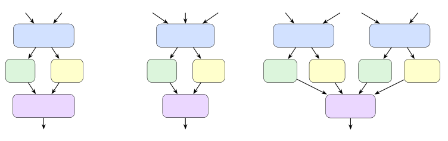

# Quantitative LLM Judges

Aishwarya Sahoo^(\*)    Jeevana Kruthi Karnuthala^(\*)    Tushar
Parmanand Budhwani ^(†)^(†)thanks: Equal contribution.
Affiliation: University of Massachusetts Amherst    Pranchal
Agarwal^(\*)    Sankaran Vaidyanathan Affiliation: University of
Massachusetts Amherst    Alexa Siu    Franck Dernoncourt    Jennifer
Healey    Nedim Lipka    Ryan Rossi Affiliation: Adobe Research   
Uttaran Bhattacharya    Branislav Kveton Affiliation: Adobe Research

###### Abstract

LLM-as-a-judge is a framework where a large language model (LLM)
evaluates the output of another LLM. While LLMs excel at producing
qualitative textual evaluations, they often struggle to predict human
preferences and numeric scores. We propose _quantitative LLM judges_,
which align evaluation scores of existing LLM judges to humans in a
given domain using regression models. The models are trained to improve
the score of the original judge using its rationale and score. We
present four quantitative judges for different types of absolute and
relative feedback, which showcases the _generality_ and _versatility_ of
our framework. Our framework is more _computationally efficient_ than
supervised fine-tuning and can be more _statistically efficient_ when
human feedback is limited, which is expected in practice. We validate
these claims empirically on four datasets using two base judges. Our
experiments show that quantitative judges can improve the predictive
power of existing judges through post-hoc modeling.

|     |
| --- |
|     |

## 1 Introduction

Measuring the quality of generated natural language presents several
challenges due to the diverse range of generation methods and evaluation
criteria (Gehrmann et al., 2023). The LLM-as-a-judge paradigm has
recently emerged as a compelling approach to these evaluation
challenges. By leveraging the reasoning capabilities of _large language
models (LLMs)_, this approach can provide more nuanced assessments that
correlate better with human judgments across diverse tasks (Gu et al.,
2025). LLM judges typically output both rationales and numeric scores,
thus combining the comprehensiveness of human evaluation with the
scalability of automated metrics.

Recent studies highlight issues with LLM judges such as low alignment
with human scores, miscalibration, score compression, high variance,
prompt sensitivity, and leniency bias (Thakur et al., 2025; Wei et al.,
2025). To address these issues, various approaches have been proposed to
fine-tune LLMs to improve score prediction on specific tasks (Chiang
et al., 2025; Lukasik et al., 2025). However, fine-tuning is often
impractical, due to requiring large datasets and having a high
computational cost. As a result, many users continue to rely on
off-the-shelf models like GPT-4 or Claude (Bavaresco et al., 2024; Huang
et al., 2024).

The main issue with current LLM judges is that they conflate qualitative
reasoning with quantitative assessment. For example, fine-tuned LLM
judges like Prometheus (Kim et al., 2024b) are trained with the
cross-entropy (CE) loss on gold-standard textual evaluations to generate
both qualitative rationales and numeric scores. This is an inherent
mismatch in objectives, as LLMs optimized for next-token prediction are
tasked with producing accurate numeric scores, a fundamentally different
statistical problem. While LLMs excel at producing structured textual
evaluations, they are poorly suited for regressing human scores or
preferences (Chiang et al., 2025).

This mismatch raises a natural question: _can qualitative rationales be
decoupled from quantitative scores to achieve more accurate judgment?_
This decoupling allows the LLM produce high-quality rationales while
numeric scores are predicted by classic machine learning models that are
robust and loved by practitioners. This perspective is supported by
prior works in interpretability and probing, which show that when model
representations encode information relevant for downstream tasks, simple
linear decoders can recover this information effectively (Alain and
Bengio, 2017; Hewitt and Manning, 2019; Hupkes et al., 2018; Belinkov,
2022).

Building on this insight, we present quantitative judges, a framework
that enhances the original base judge to predict more accurate numeric
scores. We introduce four different quantitative judges for absolute
rating and relative preference prediction. Each judge has two stages: in
the _qualitative stage_, a frozen LLM judge generates a rationale and
initial score, and in the _quantitative stage_, these outputs are used
to predict a better score. Our design is general, efficient, and applies
to any base LLM judge. Specifically:

1.  1.  General: Our judges predict human scores using the base judge’s
        rationale and score. The predictor is a _generalized linear model
        (GLM)_ (Wolke and Schwetlick, 1988) trained on human scores in the
        domain. The judges can be applied to absolute rating prediction,
        such as regression and classification, or relative preference
        prediction. They can also be applied to any base judge because we
        treat it as a black box. We show the versatility of our framework by
        proposing four quantitative judges.
2.  2.  Statistically efficient: Our judges are based on GLMs, which can be
        learned from limited data. This is expected in most applications of
        our work. Our judges are designed such that the base judge’s score
        or a distribution of it serves as a bias term in our model. This
        allows us, at least in principle, to always learn at least as good
        judges as the base judge.
3.  3.  Computationally efficient: Learning of classic machine learning
        models on the top of frozen LLM embeddings is more computationally
        efficient, and can also be more statistically efficient, than
        fine-tuning. We report an order of magnitude speedups in
        Section 5.4.

We comprehensively evaluate all proposed quantitative judges on both
absolute rating and relative preference datasets. The quantitative
judges consistently outperform their base judges. They can also
outperform fine-tuning of the base judges on both quality and
computational efficiency at the same time; and outperform an order of
magnitude larger judge and specialized judges on quality. These results
are complemented with additional studies on key components of our
design. We conclude that quantitative judges are a practical and
effective approach for improving LLM-based evaluation.

## 2 Background

LLMs are increasingly used not only to generate outputs but also to
evaluate them, a paradigm known as LLM-as-a-judge (Kim et al., 2024b;
Trivedi et al., 2024; Gu et al., 2025; Zhang et al., 2024; Thakur
et al., 2025; Zhu et al., 2025). This approach uses the natural language
capabilities of LLMs to simulate human evaluations, offering a scalable,
cost-effective, and reproducible alternative. The output of the LLM
judge can be a natural language assessment, a quantitative score, or a
pairwise preference. Both the text assessment and a numeric score are
often generated (Kim et al., 2024b). While efficient, scores that the
LLM judges produce have been criticized as not consistently aligned with
human assessments (Chiang and Lee, 2023; Gehrmann et al., 2023).

LLM-as-a-judge and fine-tuning: Early methods, such as Prometheus (Kim
et al., 2024b), introduced LLMs fine-tuned for both absolute rating and
pairwise ranking. These models tried to replicate human judgment, often
outperforming heuristic metrics in aligning with human preferences.
Recent works, like LLMEval (Zhang et al., 2024) and others (Wang et al.,
2024b; Li et al., 2024), further refined this setup by training on
diverse instruction-response datasets, such as Alpaca52k (Bommasani
et al., 2021), LMSYS-Chat (Zheng et al., 2024), and ToxicChat (Lin
et al., 2023), using feedback from GPT-4 or GPT-3.5. To improve the
consistency and depth of judging, CritiqueLLM (Ke et al., 2024) proposed
multi-path prompting that combines pointwise and pairwise strategies and
JudgeLM (Zhu et al., 2025) explored reference-free fine-tuning.

Self-curation methods have been proposed to improve the alignment of
judges. Yuan et al. (2024) introduced self-rewarding LMs that generate
both responses and reward signals to create preference datasets for
_direct preference optimization (DPO)_ (Rafailov et al., 2023). Pang
et al. (2024) and Trivedi et al. (2024) explored rationalization-based
preferences by generating multiple CoT explanations from a fixed seed
model. Other works (Xu et al., 2023; Zhang et al., 2023) integrated
iterative feedback from stronger models or humans to refine evaluation
granularity. While these methods improve alignment, they often rely on
aggressive fine-tuning, which can introduce variance and bias. Small
changes in the training data can lead to noticeable shifts in outputs,
particularly when human feedback is limited. Moreover, strong priors
from pre-training may be inadvertently distorted, undermining the
consistency of judgments.

LLM benchmarks and calibration challenges: Evaluating the effectiveness
of LLM judges has become an active area of study. JudgeBench (Tan
et al., 2024) and Eval4NLP (Zeng et al., 2024) proposed benchmarks where
LLMs evaluate paired responses, aiming to reflect model reasoning and
preference ranking. BigGenBench (Kim et al., 2024a) expanded this by
covering $`77`$ diverse tasks, although with limited instances per task,
affecting statistical robustness. Thakur et al. (2025) showed that while
large judges align well with humans, smaller models often under-perform.
To reduce evaluation variance, some methods compute mean scores by
averaging outputs across multiple runs or implement voting schemes.
FLEUR (Lee et al., 2024) integrated logit-based probability weighting to
enhance score reliability for multi-modal evaluation. However,
evaluations still suffer from dataset limitations and inconsistent
generalization, especially since judges are often trained on general
world knowledge and not calibrated to the particular domain being
evaluated.

Drawbacks of LLM-as-a-judge: Recent studies have surfaced critical
limitations in LLM-as-a-judge systems. Goel et al. (2025) found that the
judges tend to favor models similar in architecture or training data,
creating blind spots due to shared inductive biases. Li et al. (2025a)
revealed the preference leakage problem, where evaluation outcomes are
skewed by overlap between judge training data and model-generated
responses. The issues such as overconfidence (Tian et al., 2023; Chen
et al., 2024; Xiong et al., 2024) and bias (OpenAI, 2023) persist even
after extensive fine-tuning, which additionally decreases the model’s
generalization (Jeong et al., 2024). Despite ongoing efforts using
_reinforcement learning from human feedback (RLHF)_, robust, unbiased,
and well-calibrated evaluation remains elusive (Leng et al., 2025;
Kadavath et al., 2022; Li et al., 2025b). As noted in a recent survey
(Gu et al., 2025), LLM evaluators are still unreliable in high-stakes or
open-ended judgment scenarios.

We propose an alternative framework that sidesteps instability from
direct fine-tuning by decomposing LLM-based evaluation into qualitative
(rationale-based) and quantitative (score-calibrated) components.
Instead of generating new rationales for each training iteration, we fix
rationales from a base LLM judge and align them with human scores using
classic machine learning models. This structured approach is reliable
and robust, as we show empirically in Section 5.

## 3 Setting

We study two types of LLM judges: for evaluating a single response and
comparing two responses.

Absolute LLM judge: The absolute judge evaluates a single LLM response.
The evaluation can have various forms: text, score, or both. The score
can evaluate various aspects of the response, such as coherence,
correctness, factual consistency, relevance, and adherence to
task-specific guidelines. In this work, we assume that the judge
generates both a rationale and its score. Specifically, let $`(x,y)`$ be
a prompt-response pair from a judged LLM. The _absolute judge_ maps
$`(x,y)`$ to $`(e,b)`$, where $`e`$ is a _rationale_ that judges $`y`$
given $`x`$ and $`b\in\mathbb{R}`$ is the associated _absolute score_.

The primary advantage of an absolute judge is its consistency and
standardization in scoring across different responses. However, it may
require extensive prompt engineering or fine-tuning to align with human
scores (Kadavath et al., 2022). The relative judge, which we introduce
next, mitigates it by making a direct comparison. However, it may
introduce biases such as sensitivity to the order of the compared
responses (Jeong et al., 2024).

Relative LLM judge: The relative judge compares two or more LLM
responses, and ranks them or selects the best one. It is commonly used
in ranking-based assessments, preference modeling, and pairwise
comparisons. Formally, let $`(x,y_{1},y_{2})`$ be a prompt-responses
tuple from two judged LLMs. The _relative judge_ maps
$`(x,y_{1},y_{2})`$ to $`(e,b)`$, where $`e`$ is the _rationale_ that
judges $`y_{1}`$ and $`y_{2}`$ given $`x`$, and
$`b\in\left\{0,1\right\}`$ is the associated _relative preference
score_. When $`b=1`$, the judge prefers the first response $`y_{1}`$;
otherwise it prefers the second response $`y_{2}`$. We consider pairwise
comparisons to simplify exposition and discuss an extension to multiple
responses in Section D.1.

## 4 Quantitative LLM Judges

This work is motivated by the observation that the scores of pre-trained
LLM judges (Section 3) are not calibrated to any given domain, simply
because they are trained on general world knowledge. To obtain better
scores, we learn to predict them from rationales of existing judges and
human scores in the domain. Our predictors are _generalized linear
models (GLMs)_ (Wolke and Schwetlick, 1988), which generalize linear
models to non-linear functions while inheriting their efficiency. We
obtain a more quantitative judge by using the predicted score, and thus
call our judges _quantitative_.

We introduce four quantitative judges and each has the following
high-level structure. The existing judge is called a _base judge_, and
we assume that its evaluation comprises both a rationale and score. We
denote its _rationale_ by $`e`$ and its vector _embedding_ by
$`\phi(e)\in\mathbb{R}^{d}`$, where $`d`$ is the embedding size. We
denote the _base judge’s score_ by $`b`$. When the base judge assigns
probabilities to its scores, we denote them by $`p`$. At _inference
time_, when we judge, a human score is predicted from $`\phi(e)`$, along
with $`b`$ or $`p`$. At _training time_, we use _ground-truth human
scores_ to train the predictor and denote them by $`s`$. We show
architectures of our quantitative judges in Figure 1 and present them
next.



Figure 1: Architectures of the least-squares (LS), multinomial (MN),
Bradley-Terry-Luce (BTL), and two-headed BTL (BTL2) judges described in
Section 4.

### 4.1 Least-Squares Judge

The _least-squares (LS) judge_ is an absolute judge that predicts the
score of a single response as

```math
\displaystyle f(e,b;\theta)=(\phi(e)\oplus b)^{\top}\theta+c\,, \tag{1}
```

where $`\phi(e)\in\mathbb{R}^{d}`$ is the embedding of base judge’s
rationale, $`b\in\mathbb{R}`$ is its score, $`u\oplus v`$ represents a
concatenated vector of $`u`$ and $`v`$, $`\theta\in\mathbb{R}^{d+1}`$ is
a learned model parameter, and $`c`$ is a population bias. The
population bias plays the same role as the bias term in linear
regression. We introduce $`b`$ so that we can always learn a judge that
performs at least as well as the base judge. More specifically, when
$`\theta=\mathbf{0}_{d}\oplus 1`$ and $`c=0`$, (1) becomes the base
judge’s score $`b`$. While this is certainly true, we also prove in
Section D.2 that this happens with a high probability when learning
$`\theta`$.

We learn the judge by minimizing the squared loss, which lends the judge
its name. Specifically, we minimize a _regularized squared loss_
$`\mathcal{L}(\theta)=\sum_{t=1}^{n}(f(e_{t},b_{t};\theta)-s_{t})^{2}+\gamma\|\theta\|_{2}^{2}`$
over $`n`$ data points, where $`e_{t}`$ is the base judge’s rationale,
$`b_{t}`$ is its score, and $`s_{t}`$ is the human score in data point
$`t\in[n]`$. The regularization strength $`\gamma>0`$ is set
automatically by cross-validation.

### 4.2 Multinomial Judge

The _multinomial (MN) judge_ is an absolute judge designed for
predicting categorical scores, such as on the Likert scale. The Likert
score can be viewed as an absolute score or as a ranking among options
(Carifio and Perla, 2008). The MN judge is designed for the former. Our
relative judges in Sections 4.3 and 4.4 are designed for the latter.

The MN judge predicts the most likely score from a set $`\mathcal{S}`$.
The probability of score $`s\in\mathcal{S}`$ is

```math
\displaystyle\pi(s\mid e,p;\Theta)=\frac{\exp[(\phi(e)\oplus\log p_{s})^{\top}\theta_{s}+c_{s}]}{\sum_{s\in\mathcal{S}}\exp[(\phi(e)\oplus\log p_{s})^{\top}\theta_{s}+c_{s}]}\,, \tag{2}
```

where $`\phi(e)\in\mathbb{R}^{d}`$ is the embedding of base judge’s
rationale, $`p_{s}`$ is the probability that the base judge predicts
score $`s`$, $`p=(p_{s})_{s\in\mathcal{S}}\in\Delta^{\mathcal{S}}`$ is a
probability vector, $`\theta_{s}\in\mathbb{R}^{d+1}`$ is a learned model
parameter for score $`s`$, and $`c_{s}`$ is a population bias towards
$`s`$. We denote all learned parameters by
$`\Theta=(\theta_{s})_{s\in\mathcal{S}}`$ and estimate $`p_{s}`$ using
the next token probability in $`e`$ (Gu et al., 2025, Section 2.3.3).

Since (2) is equivalent to the probability of outcome $`s`$ in
_multinomial logistic regression_ (Murphy, 2012, Chapter 8), the
population bias $`c_{s}`$ plays the same role. We introduce $`p`$ so
that we can always learn a judge that performs at least as well as the
base judge. Specifically, when $`\theta_{s}=\mathbf{0}_{d}\oplus 1`$ and
$`c_{s}=0`$ for all $`s\in\mathcal{S}`$, the predicted probability
becomes the base judge’s probability because

```math
\displaystyle\frac{\exp[\log p_{s}]}{\sum_{s\in\mathcal{S}}\exp[\log p_{s}]}=\frac{p_{s}}{\sum_{s\in\mathcal{S}}p_{s}}=p_{s}\,.
```

The last equality holds because $`p`$ is a probability vector and thus
$`\sum_{s\in\mathcal{S}}p_{s}=1`$.

We learn the judge by maximizing the probability of correct score
predictions. This is equivalent to minimizing a _regularized
cross-entropy loss_
$`\mathcal{L}(\Theta)=-\sum_{t=1}^{n}\log\pi(s_{t}\mid e_{t},p_{t};\Theta)+\gamma\|\Theta\|_{2}^{2}`$,
where $`e_{t}`$ is the base judge’s rationale, $`p_{t}`$ is a
distribution over its scores, and $`s_{t}`$ is the human score in data
point $`t\in[n]`$. The regularization strength $`\gamma>0`$ is set
automatically by cross-validation.

We consider both LS and MN judges because they provide two different
perspectives on predicting an absolute score: regression versus
classification. The LS judge treats the scores as real numbers and
minimizes the squared error. The MN judge treats the scores as discrete
choices and maximizes the accuracy of predicting them.

### 4.3 Bradley-Terry-Luce Judge

The _Bradley-Terry-Luce (BTL) judge_ is a relative judge that estimates
the preference of one response over another from its evaluation by a
relative base judge. The judge is motivated by the most popular discrete
choice model in human preference modeling (Bradley and Terry, 1952). The
probability that the first response is preferred is computed as

```math
\displaystyle\pi(e,p;\theta)=\mu\left(\left(\phi(e)\oplus\log\frac{p}{1-p}\right)^{\top}\theta+c\right)\,, \tag{3}
```

where $`\mu`$ denotes a _sigmoid function_, $`\phi(e)\in\mathbb{R}^{d}`$
is the embedding of base judge’s rationale, $`p`$ is the probability
that the base judge prefers the first response,
$`\theta\in\mathbb{R}^{d+1}`$ is a learned model parameter, and $`c`$ is
a population bias. We estimate $`p`$ using the next token probability in
$`e`$ (Gu et al., 2025, Section 2.3.3). The first response is preferred
when $`\pi(e,p;\theta)>0.5`$; otherwise the second one is preferred.

The population bias $`c`$ plays the same role as the bias term in
logistic regression. We introduce $`p`$ so that we can always learn a
judge that performs at least as well as the base judge. Specifically,
when $`\theta=\mathbf{0}_{d}\oplus 1`$ and $`c=0`$, the predicted
probability becomes the base judge’s probability because

```math
\displaystyle\mu\left(\log\frac{p}{1-p}\right)=\frac{1}{1+\exp\left[-\log\frac{p}{1-p}\right]}=\frac{1}{1+\frac{1-p}{p}}=p\,.
```

We learn the judge by maximizing the probability of ranking correctly.
We pose this as minimizing a _regularized logistic loss_
$`\mathcal{L}(\theta)=-\sum_{t=1}^{n}[s_{t}\log\pi(e_{t},p_{t};\theta)+(1-s_{t})\log(1-\pi(e_{t},p_{t};\theta))]+\gamma\|\theta\|_{2}^{2}`$,
where $`e_{t}`$ is the base judge’s rationale, $`p_{t}`$ is the
probability that the judge prefers the first response, and
$`s_{t}\in\left\{0,1\right\}`$ is the human score in data point
$`t\in[n]`$. When $`s_{t}=1`$, the human prefers the first response; and
when $`s_{t}=0`$, the human prefers the second one. The regularization
strength $`\gamma>0`$ is set automatically by cross-validation.

### 4.4 Two-Headed BTL Judge

The _two-headed BTL (BTL2) judge_ is a BTL judge that estimates the
preferred response from two separate absolute evaluations. This builds
on the findings that pointwise evaluators tend to be more robust (Jeong
et al., 2024), while pairwise evaluators are more susceptible to
superficial cues due to inherent biases in LLMs (Wang et al., 2024a;
Chiang and Lee, 2023). Our empirical results in Table 2 strongly support
this approach.

We instantiate BTL2 within the framework of Section 4.3 as follows. Let
$`\phi(e_{1}),\phi(e_{2})\in\mathbb{R}^{d}`$ be the embeddings of base
judge’s rationales $`e_{1}`$ and $`e_{2}`$, respectively; and
$`b_{1},b_{2}>0`$ be the associated scores. We define the probability
that the first response is preferred as (3), where
$`\phi(e)=\phi(e_{1})-\phi(e_{2})`$ and $`p=b_{1}/(b_{1}+b_{2})`$. This
representation is motivated by the fact that the difference of the
embeddings $`\phi(e)=\phi(e_{1})-\phi(e_{2})`$ reflects the difference
of word affinities in the two responses. The probability $`p`$ biases
the response towards the base judge. Specifically, when $`b_{1}>b_{2}`$,
$`\log\frac{p}{1-p}>0`$ and the first response is preferred; otherwise
the second response is preferred. The judge is learned exactly as in
Section 4.3. We set $`p_{t}=b_{t,1}/(b_{t,1}+b_{t,2})`$, where
$`b_{t,1},b_{t,2}>0`$ are the base judge’s scores for both responses in
data point $`t\in[n]`$. We extend BTL2 beyond a binary comparison in
Section D.1.

## 5 Experiments

To validate the performance of our quantitative judges, we
comprehensively evaluate them on four tasks: two for absolute rating and
two for relative preference prediction. We compare them to their base
judges, fine-tuning them, an order of magnitude larger judge, and
specialized judges.

### 5.1 Datasets and Metrics

We experiment with $`4`$ datasets. The first two provide absolute
ratings for language quality and are widely adopted in the LLM
evaluation literature. The last two are synthetic datasets that focus on
relative comparison, testing robustness to adversarial scenarios and
scalability. Our dataset selection ensures that we test on both
calibrated human judgments and challenging synthetic ground truth. We
provide more details next.

Summarize from Feedback (Stiennon et al., 2020) is a human-annotated
dataset with summary responses rated on a $`7`$-point Likert scale. We
use its axis subset, which contains absolute scores for overall
helpfulness, accuracy, coverage, and coherence. We use the overall score
in our experiments, train on their validation set ($`8.59`$k data
points), and test on their test set ($`6.31`$k data points).

HelpSteer2 (Wang et al., 2024c; Wang et al., 2024d) is a dataset of
absolute ratings for instruction-response pairs with correctness,
coherence, complexity, verbosity, and overall helpfulness scores. The
helpfulness is a score on a $`5`$-point Likert scale and we use it in
our experiments. We train on their training set ($`20.3`$k data points)
and test on their validation set ($`1.04`$k data points).

Offset Bias (Park et al., 2024) is a synthetic pairwise preference
dataset composed of instruction-response triplets $`(x,y_{1},y_{2})`$,
where $`x`$ is a prompt, $`y_{1}`$ is a good response, and $`y_{2}`$ is
a high-quality flawed response. This dataset is designed to confuse
judges by injecting critical errors into otherwise fluent outputs,
targeting off-topic and erroneous behavior. We create our own training
($`6.8`$k data points) and test ($`1.7`$k data points) sets from their
publicly available training set.

Nectar (Zhu et al., 2023) is a large-scale preference dataset where
GPT-4 ranks responses from seven different models. We convert each data
point into $`\binom{7}{2}`$ pairwise comparisons required by our BTL and
BTL2 judges. We create our own training ($`83.9`$k data points) and test
($`21`$k data points) sets from their publicly available training set.

We consider three types of metrics. For rating prediction tasks, we
report the _mean squared error (MSE)_, _mean absolute error (MAE)_, and
_accuracy_. For preference prediction tasks, we report _accuracy_
(probability that the judge agrees with the ground-truth preference),
_precision_ $`\Big(\frac{TP}{TP+FP}\Big)`$, _recall_
$`\Big(\frac{TP}{TP+FN}\Big)`$, and the _F1 score_, where _TP_, _FP_,
and _FN_ are the number of true positives, false positives, and false
negatives, respectively. In addition, we report three correlation
metrics: _Pearson’s $`r`$_, _Spearman’s $`\rho`$_, and _Kendall’s
$`\tau`$_. The correlation metrics show the utility of the predicted
scores, if they can be used for ranking responses.

### 5.2 Implementation Details

We experiment with two base judges: Llama-3.1-8B-Instruct (Grattafiori
et al., 2024) (_Llama_) and Prometheus-7B-V2 (Kim et al., 2024b)
(_Prometheus_). Prometheus is the most popular fine-tuned model for
evaluation. We choose Llama because it is a popular generic model that
can follow the same evaluation instructions as Prometheus. We employ
both models as both absolute and relative judges (Section 3). The judges
are implemented using the prompts in Appendix A, which we borrow from
Kim et al. (2024b). Both prompts ask the model to reason and then output
a score. Embeddings in our judges $`\phi(e)`$ are obtained from the base
judge’s final layer. The regularization strength $`\gamma`$ in the
quantitative judges is set by $`5`$-fold cross-validation and we use SGD
(Robbins and Monro, 1951) to learn them. Unless explicitly stated, we
train on $`10\%`$ of training sets to mimic a real-world setting where
the number of human ratings is relatively small: from hundreds (Offset
Bias) to thousands (Nectar). All results are averaged over $`10`$ random
training sets to avoid bias to a given split.

Beyond the base judges, we consider three baselines. The first baseline
is a supervised fine-tuned base judge to human scores from prompts
instantiated with evaluated responses. We call it _SFT_. The second
baseline is Llama-3.1-70B-Instruct as a base judge and we call it _70B_.
The last baseline is another specialized judge _JudgeLM_ (Zhu et al.,
2025). These baselines cover more computationally costly alternatives as
well as another specialized judge. To have a fair comparison, all models
are queried using vLLM with the same decoding configuration:
$`\textsf{temperature}=0.1`$, $`\textsf{top\_p}=0.9`$, and
$`\textsf{top\_k}=-1`$ (unrestricted sampling). All reported metrics are
on test sets.

### 5.3 Results

|            |               |                         |       |       |       |          |          |            |       |       |       |          |          |
| ---------- | ------------- | ----------------------- | ----- | ----- | ----- | -------- | -------- | ---------- | ----- | ----- | ----- | -------- | -------- |
|            |               | Summarize from Feedback |       |       |       |          |          | HelpSteer2 |       |       |       |          |          |
|            | Method        | MSE                     | MAE   | Acc.  | $`r`$ | $`\rho`$ | $`\tau`$ | MSE        | MAE   | Acc.  | $`r`$ | $`\rho`$ | $`\tau`$ |
| Prometheus | Absolute base | 6.346                   | 2.041 | 0.168 | 0.317 | 0.315    | 0.272    | 2.232      | 1.039 | 0.355 | 0.197 | 0.152    | 0.134    |
|            | LS            | 2.626                   | 1.362 | 0.195 | 0.323 | 0.292    | 0.214    | 1.431      | 0.967 | 0.291 | 0.295 | 0.244    | 0.187    |
|            | MN            | 3.237                   | 1.425 | 0.229 | 0.318 | 0.289    | 0.212    | 1.657      | 1.068 | 0.416 | 0.171 | 0.148    | 0.114    |
|            | SFT           | 3.622                   | 1.445 | 0.275 | 0.370 | 0.330    | 0.285    | 2.133      | 0.923 | 0.437 | 0.336 | 0.300    | 0.271    |
| Llama      | Absolute base | 4.697                   | 1.804 | 0.158 | 0.277 | 0.212    | 0.184    | 2.188      | 1.115 | 0.303 | 0.223 | 0.186    | 0.160    |
|            | LS            | 2.700                   | 1.387 | 0.189 | 0.225 | 0.176    | 0.128    | 1.366      | 0.951 | 0.297 | 0.290 | 0.243    | 0.184    |
|            | MN            | 3.680                   | 1.515 | 0.203 | 0.202 | 0.162    | 0.118    | 2.116      | 1.304 | 0.419 | 0.020 | 0.032    | 0.024    |
|            | SFT           | 3.067                   | 1.442 | 0.191 | 0.225 | 0.211    | 0.182    | 2.156      | 0.977 | 0.397 | 0.225 | 0.153    | 0.138    |
| 70B        | Absolute base | 5.143                   | 1.861 | 0.161 | 0.448 | 0.476    | 0.380    | 1.804      | 0.997 | 0.415 | 0.274 | 0.391    | 0.244    |
| JudgeLM    | Absolute base | 3.820                   | 1.577 | 0.184 | 0.153 | 0.140    | 0.129    | 1.639      | 0.939 | 0.320 | 0.066 | 0.074    | 0.060    |

Table 1: Evaluation on rating prediction tasks. We report three
prediction metrics (MSE, MAE, and accuracy) and three correlation
metrics (Pearson’s $`r`$, Spearman’s $`\rho`$, and Kendall’s $`\tau`$).
The best result for each dataset and base judge is reported in bold. The
underlined numbers are statistically significant gains over the
corresponding absolute base judge at $`p<0.05`$.

Comparison to base judges and fine-tuning them: Our results on absolute
rating prediction tasks are reported in Table 1. We start with Summarize
from Feedback dataset and Prometheus base judge. The MSE of the LS judge
($`2.626`$) is less than a half of that of the base judge ($`6.346`$),
and the lowest of all methods. This is expected because we optimize the
MSE (Section 4.1). The LS judge has also the lowest MAE. The accuracy of
the MN judge ($`0.229`$) is $`36\%`$ higher than that of the base judge
($`0.168`$). The MN judge is outperformed by SFT, which also maximizes
the probability of predicting the correct score but using supervised
fine-tuning (Section 5.2). Note that the training time of the MN judge
is a fraction of that of SFT (Appendix C). Finally, although we optimize
for rating prediction, the correlation metrics are similar to the base
judge, except for a drop in Kendall’s $`\tau`$. We observe similar
trends for LS and MN judges with Llama base judge, except that the MN
judge has the highest accuracy and all correlation metrics drop. On
HelpSteer2 dataset, with both Prometheus and Llama base judges, there
are two changes. First, the LS judge significantly improves over the
correlation metrics of the base judges. Second, SFT attains the lowest
MAE with Prometheus base judge.

Our results on relative preference prediction tasks are reported in
Table 2. On Offset Bias dataset with Prometheus base judge, the BTL
judge outperforms the relative base judge in all metrics. While the
absolute judge outperforms the BTL judge, the BTL2 judge bests it in all
metrics. Notably, the Pearson’s $`r`$ and Spearman’s $`\rho`$ double
when compared to the base judge. We observe the same major improvements
for BTL and BTL2 judges with Llama base judge. The results on Nectar
dataset are less conclusive. The BTL2 judge performs comparably to SFT
when the base judge is Prometheus, but is outperformed when the base
judge is Llama. Note that the training times of BTL and BTL2 judges are
a fraction of that of SFT (Appendix C).

Our results in Tables 1 and 2 show that quantitative judges, despite
their simplicity, can outperform pre-trained base judges on optimized
metrics, as well as more computationally costly alternatives. The
correlation metrics in Table 1 are much lower than in Table 2 because
the quantitative judges in Table 1 are optimized to predict scores, not
to rank them. The correlation metrics in Table 2 are high enough to be
useful: a Kendall’s $`\tau`$ of $`0.5`$ corresponds to $`75\%`$ ranking
accuracy when there are no ties. We attain a higher value than that in
two experiments out of four.

Comparison to $`10`$-times larger judges: The absolute and relative
variants of the 70B judge often outperform our original base judges
because of a larger base model. Nevertheless, the quantitative judges
remain mostly superior. In rating prediction tasks (Table 1), we improve
over the 70B judge in MSE (LS judge), MAE (LS judge), and accuracy (MN
judge). On Offset Bias dataset (Table 2), BTL2 significantly improves
over the absolute 70B judge in $`4`$ metrics out of $`7`$ and is worse
in $`2`$; and over the relative 70B judge in $`6`$ metrics out of $`7`$.
On Nectar dataset (Table 2), BTL2 improves over the absolute 70B judge
in all metrics. The relative 70B judge outperforms even SFT and is the
best method on Nectar dataset.

Comparison to JudgeLM: Unlike the 70B judge, JudgeLM is not clearly
better than our original base judges. In rating prediction tasks
(Table 1), we improve over JudgeLM in MSE (LS judge), MAE (LS judge on
Summarize from Feedback), and accuracy (MN judge). The correlation
metrics of our judges are superior to those of JudgeLM. On Offset Bias
dataset (Table 2), BTL2 significantly improves over both absolute and
relative JudgeLM in all metrics. On Nectar dataset (Table 2), we observe
the same trend with the absolute JudgeLM. The relative JudgeLM slightly
outperforms BTL and both are ultimately outperformed by SFT.

|            |               |             |       |       |       |       |          |          |        |       |       |       |       |          |          |     |
| ---------- | ------------- | ----------- | ----- | ----- | ----- | ----- | -------- | -------- | ------ | ----- | ----- | ----- | ----- | -------- | -------- | --- |
|            |               | Offset Bias |       |       |       |       |          |          | Nectar |       |       |       |       |          |          |     |
|            | Method        | Acc.        | Pre.  | Rec.  | F1    | $`r`$ | $`\rho`$ | $`\tau`$ | Acc.   | Pre.  | Rec.  | F1    | $`r`$ | $`\rho`$ | $`\tau`$ |     |
| Prometheus | Absolute base | 0.648       | 0.658 | 0.648 | 0.650 | 0.298 | 0.298    | 0.298    | 0.625  | 0.625 | 0.625 | 0.625 | 0.250 | 0.250    | 0.250    |     |
|            | Relative base | 0.535       | 0.535 | 0.535 | 0.535 | 0.049 | 0.049    | 0.049    | 0.707  | 0.723 | 0.707 | 0.702 | 0.430 | 0.430    | 0.430    |     |
|            | BTL           | 0.605       | 0.613 | 0.605 | 0.567 | 0.206 | 0.224    | 0.183    | 0.691  | 0.693 | 0.691 | 0.690 | 0.418 | 0.416    | 0.340    |     |
|            | BTL2          | 0.783       | 0.800 | 0.657 | 0.721 | 0.634 | 0.628    | 0.513    | 0.711  | 0.721 | 0.696 | 0.708 | 0.504 | 0.503    | 0.411    |     |
|            | SFT           | 0.788       | 0.784 | 0.614 | 0.688 | 0.541 | 0.541    | 0.541    | 0.751  | 0.734 | 0.721 | 0.727 | 0.497 | 0.497    | 0.497    |     |
| Llama      | Absolute base | 0.615       | 0.624 | 0.615 | 0.617 | 0.229 | 0.229    | 0.229    | 0.642  | 0.642 | 0.642 | 0.642 | 0.284 | 0.284    | 0.284    |     |
|            | Relative base | 0.531       | 0.543 | 0.531 | 0.532 | 0.073 | 0.073    | 0.073    | 0.710  | 0.723 | 0.710 | 0.705 | 0.433 | 0.433    | 0.433    |     |
|            | BTL           | 0.636       | 0.633 | 0.636 | 0.630 | 0.311 | 0.319    | 0.261    | 0.694  | 0.695 | 0.694 | 0.694 | 0.440 | 0.439    | 0.358    |     |
|            | BTL2          | 0.800       | 0.802 | 0.702 | 0.749 | 0.657 | 0.645    | 0.527    | 0.635  | 0.637 | 0.628 | 0.632 | 0.339 | 0.338    | 0.276    |     |
|            | SFT           | 0.723       | 0.725 | 0.604 | 0.659 | 0.435 | 0.435    | 0.435    | 0.770  | 0.773 | 0.764 | 0.769 | 0.541 | 0.541    | 0.541    |     |
| 70B        | Absolute base | 0.802       | 0.863 | 0.629 | 0.731 | 0.611 | 0.611    | 0.611    | 0.640  | 0.640 | 0.642 | 0.642 | 0.284 | 0.284    | 0.284    |     |
|            | Relative base | 0.680       | 0.811 | 0.468 | 0.593 | 0.397 | 0.397    | 0.397    | 0.784  | 0.793 | 0.753 | 0.772 | 0.569 | 0.569    | 0.569    |     |
| JudgeLM    | Absolute base | 0.585       | 0.484 | 0.167 | 0.248 | 0.060 | 0.060    | 0.060    | 0.568  | 0.414 | 0.277 | 0.332 | 0.032 | 0.032    | 0.032    |     |
|            | Relative base | 0.584       | 0.464 | 0.478 | 0.471 | 0.086 | 0.086    | 0.086    | 0.731  | 0.734 | 0.777 | 0.755 | 0.457 | 0.457    | 0.457    |     |

Table 2: Evaluation on preference prediction tasks. We report four
prediction metrics (accuracy, precision, recall, and F1 score) and three
correlation metrics (Pearson’s $`r`$, Spearman’s $`\rho`$, and Kendall’s
$`\tau`$). The best result for each dataset and base judge is reported
in bold. The underlined numbers are statistically significant gains over
the best corresponding base judge at $`p<0.05`$.

### 5.4 Additional Studies

We conduct more experiments in Appendices B and C, and summarize their
results here.

Human feedback: The amount of human feedback to learn from has a major
impact on quantitative judges. By design, we can improve over base
judges with very little data. As an example, in Tables 1 and 2, we learn
from $`10\%`$ of training data, which is $`859`$ examples in Summarize
from Feedback, $`2030`$ examples in HelpSteer2, $`680`$ examples in
Offset Bias, and $`8390`$ examples in Nectar. We ablate how some metrics
change with training data size in Figures 2, 3 and 4 (last two in
Section B.1). The $`1\%`$ of training data in these figures corresponds
to $`86`$ examples in Summarize from Feedback, $`203`$ examples in
HelpSteer2, $`68`$ examples in Offset Bias, and $`839`$ examples in
Nectar. Even at this operating point, our best judges (LS in Figure 2,
MN in Figure 3, and BTL2 in Figure 4) outperform the best base judges in
Tables 1 and 2. Note that when LLM judges are deployed, a small number
of human scores is typically available because they are used to evaluate
the judge. Our work gives a recipe for learning a better judge from
these scores and provides empirical support for it.

Regularization: Automatic choice of the regularization strength
$`\gamma`$ by cross-validation ensures that our judges perform well on
test sets in Tables 1 and 2. Without it, our judges could perform
poorly. For instance, Figure 5 in Section B.2 shows that the LS judge
would have a higher MSE than the base judge when the regularization
strength is high. On the other hand, the optimal regularization strength
of the MN judge is dataset-dependent.

Embedding quality: Section B.3 studies the impact of embeddings
$`\phi(e)`$ on quantitative judges. We conduct two experiments. First,
we show that quantitative judges can be implemented with other
embeddings than those of the base judge. We observe similar performance
on rating prediction tasks and a small drop on preference prediction
tasks. Second, we show that as the embeddings get worse, the
quantitative judges get worse.

Alignment to human preferences: Quantitative judges predict scores from
rationales and numeric scores of a frozen LLM. One way of measuring how
the scores align with human preferences are the correlation metrics in
Tables 1 and 2. In Table 1, the alignment may moderately improve or
worsen, because we do not optimize it. We observe a major improvement in
Table 2 though. On Offset Bias dataset with Llama base judge, the BTL2
judge doubles Pearson’s $`r`$, Spearman’s $`\rho`$, and Kendall’s
$`\tau`$ of the base judges. We delve deeper into how the improvements
arise in Section B.4, where we report confusion matrices between human
and predicted scores. In Figure 10, the base judge fails to predict
frequent scores $`5`$ and $`6`$. Both the LS and MN judges learn to
predict them, and in this way improve upon the base judge.

Computation time: We report the training and inference times of
quantitative judges, and compare them to those of base judges and
fine-tuning them, in Appendix C. The quantitative judges can be trained
in an order of magnitude less time than supervised fine-tuning. The
inference time overhead of the quantitative judges, dominated by
computing the embedding of the base judge’s rationale, is about $`25\%`$
of that of generating the rationale; and thus not huge.

Figure 2: Test MSE of the LS and MN judges, and SFT, as a function of
the training set size.

## 6 Conclusions

We introduce quantitative judges, a family of LLM judges that
disentangle qualitative reasoning from quantitative score prediction in
LLM-as-a-judge. Our approach has two stages: the _qualitative stage_,
where a frozen LLM judge generates an evaluation, and the _quantitative
stage_, where these outputs are used by a lightweight model to predict a
human score. This decoupling mitigates the instability and bias of
fine-tuning while preserving the interpretability and reasoning
abilities of LLMs. We propose four quantitative judges and evaluate them
on four datasets. We show that the quantitative judges consistently
outperform the base judges, and can even outperform their fine-tuning on
both quality and computational efficiency simultaneously. As such,
quantitative judges offer a promising new direction for quantitative and
interpretable LLM evaluation at minimal additional cost.

Limitations: When compared to pre-trained LLM judges, the main
limitation of our approach is that it requires human data for training.
We conduct ablation studies on training set size in Figure 2 and
Section B.1. The quality of our judges also depends on how good the
embedding of the base judge’s rationale is. We ablate this choice in
Section B.3.

Future work: Our work can be extended in several directions. For
instance, the BTL and BTL2 judges can be extended beyond pairwise
comparisons by replacing the Bradley-Terry-Luce model (Bradley and
Terry, 1952) in (3) with the Plackett-Luce model (Plackett, 1975). We
propose such an extension for the BTL2 judge in Section D.1 but do not
experiment with it. One assumption in our work is that the LLM
embeddings are frozen. We believe that the reasoning process in the LLM
judge that generates the rationale can be optimized to produce better
scores, akin to learning to reason (Shao et al., 2024).

## References

- Alain and Bengio \[2017\] Guillaume Alain and Yoshua Bengio.
  Understanding intermediate layers using linear classifier
  probes, 2017. URL
  [https://openreview.net/forum?id=ryF7rTqgl](https://openreview.net/forum?id=ryF7rTqgl).
- Bavaresco et al. \[2024\] Anna Bavaresco, Raffaella Bernardi, Leonardo
  Bertolazzi, Desmond Elliott, Raquel Fernández, Albert Gatt, Esam
  Ghaleb, Mario Giulianelli, Michael Hanna, Alexander Koller, André
  F. T. Martins, Philipp Mondorf, Vera Neplenbroek, Sandro Pezzelle,
  Barbara Plank, David Schlangen, Alessandro Suglia, Aditya K Surikuchi,
  Ece Takmaz, and Alberto Testoni. Llms instead of human judges? a large
  scale empirical study across 20 nlp evaluation tasks, 2024. URL
  [https://arxiv.org/abs/2406.18403](https://arxiv.org/abs/2406.18403).
- Belinkov \[2022\] Yonatan Belinkov. Probing classifiers: Promises,
  shortcomings, and advances. _Computational Linguistics_,
  48(1):207–219, March 2022. doi: 10.1162/coli_a_00422. URL
  [https://aclanthology.org/2022.cl-1.7/](https://aclanthology.org/2022.cl-1.7/).
- Bommasani et al. \[2021\] Rishi Bommasani, Drew A. Hudson, Ehsan
  Adeli, et al. On the opportunities and risks of foundation models.
  _ArXiv_, 2021. URL
  [https://crfm.stanford.edu/assets/report.pdf](https://crfm.stanford.edu/assets/report.pdf).
- Bradley and Terry \[1952\] Ralph Allan Bradley and Milton Terry. Rank
  analysis of incomplete block designs: I. the method of paired
  comparisons. _Biometrika_, 39(3-4):324–345, 1952.
- Carifio and Perla \[2008\] James Carifio and Rocco Perla. Resolving
  the 50-year debate around using and misusing likert scales. _Medical
  Education_, 42:1150–1152, 2008.
- Chen et al. \[2024\] Lihu Chen, Alexandre Perez-Lebel, Fabian M.
  Suchanek, and Gaël Varoquaux. Reconfidencing LLMs from the grouping
  loss perspective, 2024. URL
  [https://arxiv.org/abs/2402.04957](https://arxiv.org/abs/2402.04957).
- Chiang and Lee \[2023\] Cheng-Han Chiang and Hung-yi Lee. Can large
  language models be an alternative to human evaluations? In Anna
  Rogers, Jordan Boyd-Graber, and Naoaki Okazaki, editors, _Proceedings
  of the 61st Annual Meeting of the Association for Computational
  Linguistics (Volume 1: Long Papers)_, pages 15607–15631, Toronto,
  Canada, July 2023. Association for Computational Linguistics. doi:
  10.18653/v1/2023.acl-long.870. URL
  [https://aclanthology.org/2023.acl-long.870/](https://aclanthology.org/2023.acl-long.870/).
- Chiang et al. \[2025\] Cheng-Han Chiang, Hung yi Lee, and Michal
  Lukasik. Tract: Regression-aware fine-tuning meets chain-of-thought
  reasoning for llm-as-a-judge, 2025. URL
  [https://arxiv.org/abs/2503.04381](https://arxiv.org/abs/2503.04381).
- Gehrmann et al. \[2023\] Sebastian Gehrmann, Elizabeth Clark, and
  Thibault Sellam. Repairing the cracked foundation: A survey of
  obstacles in evaluation practices for generated text. _Journal of
  Artificial Intelligence Research_, 77:103–166, 2023.
- Goel et al. \[2025\] Shashwat Goel, Joschka Struber, Ilze Amanda
  Auzina, Karuna K Chandra, Ponnurangam Kumaraguru, Douwe Kiela, Ameya
  Prabhu, Matthias Bethge, and Jonas Geiping. Great models think alike
  and this undermines ai oversight, 2025. URL
  [https://arxiv.org/abs/2502.04313](https://arxiv.org/abs/2502.04313).
- Grattafiori et al. \[2024\] Aaron Grattafiori, Abhimanyu Dubey, et al.
  The llama 3 herd of models, 2024. URL
  [https://arxiv.org/abs/2407.21783](https://arxiv.org/abs/2407.21783).
- Gu et al. \[2025\] Jiawei Gu, Xuhui Jiang, Zhichao Shi, Hexiang Tan,
  Xuehao Zhai, Chengjin Xu, Wei Li, Yinghan Shen, Shengjie Ma, Honghao
  Liu, Saizhuo Wang, Kun Zhang, Yuanzhuo Wang, Wen Gao, Lionel Ni, and
  Jian Guo. A survey on llm-as-a-judge, 2025. URL
  [https://arxiv.org/abs/2411.15594](https://arxiv.org/abs/2411.15594).
- Hewitt and Manning \[2019\] John Hewitt and Christopher D. Manning. A
  structural probe for finding syntax in word representations. In Jill
  Burstein, Christy Doran, and Thamar Solorio, editors, _Proceedings of
  the 2019 Conference of the North American Chapter of the Association
  for Computational Linguistics: Human Language Technologies, Volume 1
  (Long and Short Papers)_, pages 4129–4138, Minneapolis, Minnesota,
  June 2019. Association for Computational Linguistics. doi:
  10.18653/v1/N19-1419. URL
  [https://aclanthology.org/N19-1419/](https://aclanthology.org/N19-1419/).
- Huang et al. \[2024\] Hui Huang, Yingqi Qu, Xingyuan Bu, Hongli Zhou,
  Jing Liu, Muyun Yang, Bing Xu, and Tiejun Zhao. An empirical study of
  llm-as-a-judge for llm evaluation: Fine-tuned judge model is not a
  general substitute for gpt-4, 2024. URL
  [https://arxiv.org/abs/2403.02839](https://arxiv.org/abs/2403.02839).
- Hupkes et al. \[2018\] Dieuwke Hupkes, Sara Veldhoen, and Willem
  Zuidema. Visualisation and ‘diagnostic classifiers’ reveal how
  recurrent and recursive neural networks process hierarchical
  structure. _J. Artif. Int. Res._, 61(1):907–926, January 2018. ISSN
  1076-9757.
- Jeong et al. \[2024\] Hawon Jeong, ChaeHun Park, Jimin Hong, Hojoon
  Lee, and Jaegul Choo. The Comparative Trap: Pairwise Comparisons
  Amplifies Biased Preferences of LLM Evaluators. _arXiv e-prints_, art.
  arXiv:2406.12319, June 2024. doi: 10.48550/arXiv.2406.12319.
- Kadavath et al. \[2022\] Saurav Kadavath, Tom Conerly, Amanda Askell,
  Tom Henighan, Dawn Drain, Ethan Perez, Nicholas Schiefer, Zac
  Hatfield-Dodds, Nova DasSarma, Eli Tran-Johnson, Scott Johnston, Sheer
  El-Showk, Andy Jones, Nelson Elhage, Tristan Hume, Anna Chen, Yuntao
  Bai, Sam Bowman, Stanislav Fort, Deep Ganguli, Danny Hernandez, Josh
  Jacobson, Jackson Kernion, Shauna Kravec, Liane Lovitt, Kamal Ndousse,
  Catherine Olsson, Sam Ringer, Dario Amodei, Tom Brown, Jack Clark,
  Nicholas Joseph, Ben Mann, Sam McCandlish, Chris Olah, and Jared
  Kaplan. Language models (mostly) know what they know, 2022. URL
  [https://arxiv.org/abs/2207.05221](https://arxiv.org/abs/2207.05221).
- Ke et al. \[2024\] Pei Ke, Bosi Wen, Zhuoer Feng, Xiao Liu, Xuanyu
  Lei, Jiale Cheng, Shengyuan Wang, Aohan Zeng, Yuxiao Dong, Hongning
  Wang, Jie Tang, and Minlie Huang. CritiqueLLM: Towards an informative
  critique generation model for evaluation of large language model
  generation, 2024. URL
  [https://arxiv.org/abs/2311.18702](https://arxiv.org/abs/2311.18702).
- Kim et al. \[2024a\] Seungone Kim, Juyoung Suk, Ji Yong Cho, Shayne
  Longpre, Chaeeun Kim, Dongkeun Yoon, Guijin Son, Yejin Cho, Sheikh
  Shafayat, Jinheon Baek, Sue Hyun Park, Hyeonbin Hwang, Jinkyung Jo,
  Hyowon Cho, Haebin Shin, Seongyun Lee, Hanseok Oh, Noah Lee, Namgyu
  Ho, Se June Joo, Miyoung Ko, Yoonjoo Lee, Hyungjoo Chae, Jamin Shin,
  Joel Jang, Seonghyeon Ye, Bill Yuchen Lin, Sean Welleck, Graham
  Neubig, Moontae Lee, Kyungjae Lee, and Minjoon Seo. The biggen bench:
  A principled benchmark for fine-grained evaluation of language models
  with language models, 2024a. URL
  [https://arxiv.org/abs/2406.05761](https://arxiv.org/abs/2406.05761).
- Kim et al. \[2024b\] Seungone Kim, Juyoung Suk, Shayne Longpre,
  Bill Yuchen Lin, Jamin Shin, Sean Welleck, Graham Neubig, Moontae Lee,
  Kyungjae Lee, and Minjoon Seo. Prometheus 2: An open source language
  model specialized in evaluating other language models. _arXiv preprint
  arXiv:2405.01535_, 2024b.
- Lee et al. \[2024\] Yebin Lee, Imseong Park, and Myungjoo Kang. Fleur:
  An explainable reference-free evaluation metric for image captioning
  using a large multimodal model, 2024. URL
  [https://arxiv.org/abs/2406.06004](https://arxiv.org/abs/2406.06004).
- Leng et al. \[2025\] Jixuan Leng, Chengsong Huang, Banghua Zhu, and
  Jiaxin Huang. Taming overconfidence in llms: Reward calibration in
  rlhf, 2025. URL
  [https://arxiv.org/abs/2410.09724](https://arxiv.org/abs/2410.09724).
- Li et al. \[2025a\] Dawei Li, Renliang Sun, Yue Huang, Ming Zhong,
  Bohan Jiang, Jiawei Han, Xiangliang Zhang, Wei Wang, and Huan Liu.
  Preference leakage: A contamination problem in llm-as-a-judge, 2025a.
  URL
  [https://arxiv.org/abs/2502.01534](https://arxiv.org/abs/2502.01534).
- Li et al. \[2024\] Lijun Li, Bowen Dong, Ruohui Wang, Xuhao Hu,
  Wangmeng Zuo, Dahua Lin, Yu Qiao, and Jing Shao. Salad-bench: A
  hierarchical and comprehensive safety benchmark for large language
  models, 2024. URL
  [https://arxiv.org/abs/2402.05044](https://arxiv.org/abs/2402.05044).
- Li et al. \[2025b\] Miaomiao Li, Hao Chen, Yang Wang, Tingyuan Zhu,
  Weijia Zhang, Kaijie Zhu, Kam-Fai Wong, and Jindong Wang.
  Understanding and mitigating the bias inheritance in llm-based data
  augmentation on downstream tasks, 2025b. URL
  [https://arxiv.org/abs/2502.04419](https://arxiv.org/abs/2502.04419).
- Lin et al. \[2023\] Zi Lin, Zihan Wang, Yongqi Tong, Yangkun Wang,
  Yuxin Guo, Yujia Wang, and Jingbo Shang. ToxicChat: Unveiling hidden
  challenges of toxicity detection in real-world user-ai
  conversation, 2023. URL
  [https://arxiv.org/abs/2310.17389](https://arxiv.org/abs/2310.17389).
- Lukasik et al. \[2025\] Michal Lukasik, Zhao Meng, Harikrishna
  Narasimhan, Yin-Wen Chang, Aditya Krishna Menon, Felix Yu, and Sanjiv
  Kumar. Better autoregressive regression with LLMs via regression-aware
  fine-tuning. In _The Thirteenth International Conference on Learning
  Representations_, 2025. URL
  [https://openreview.net/forum?id=xGs7Ch3Vyo](https://openreview.net/forum?id=xGs7Ch3Vyo).
- Murphy \[2012\] Kevin P Murphy. _Machine Learning: A Probabilistic
  Perspective_. MIT Press, 2012. ISBN 9780262018029.
- OpenAI \[2023\] OpenAI. Gpt-4 technical report, 2023. URL
  [https://arxiv.org/abs/2303.08774](https://arxiv.org/abs/2303.08774).
- Pang et al. \[2024\] Richard Yuanzhe Pang, Weizhe Yuan, Kyunghyun Cho,
  He He, Sainbayar Sukhbaatar, and Jason Weston. Iterative reasoning
  preference optimization, 2024. URL
  [https://arxiv.org/abs/2404.19733](https://arxiv.org/abs/2404.19733).
- Park et al. \[2024\] Junsoo Park, Seungyeon Jwa, Meiying Ren, Daeyoung
  Kim, and Sanghyuk Choi. Offsetbias: Leveraging debiased data for
  tuning evaluators, 2024. URL
  [https://arxiv.org/abs/2407.06551](https://arxiv.org/abs/2407.06551).
- Plackett \[1975\] Robin Lewis Plackett. The analysis of permutations.
  _Journal of the Royal Statistical Society: Series C (Applied
  Statistics)_, 24(2):193–202, 1975.
- Rafailov et al. \[2023\] Rafael Rafailov, Archit Sharma, Eric
  Mitchell, Christopher Manning, Stefano Ermon, and Chelsea Finn. Direct
  preference optimization: Your language model is secretly a reward
  model. In _Advances in Neural Information Processing Systems
  36_, 2023.
- Robbins and Monro \[1951\] Herbert Robbins and Sutton Monro. A
  stochastic approximation method. _The Annals of Mathematical
  Statistics_, 22(3):400–407, 1951. doi: 10.1214/aoms/1177729586.
- Shao et al. \[2024\] Zhihong Shao, Peiyi Wang, Qihao Zhu, Runxin Xu,
  Junxiao Song, Xiao Bi, Haowei Zhang, Mingchuan Zhang, Y. K. Li, Y. Wu,
  and Daya Guo. DeepSeekMath: Pushing the limits of mathematical
  reasoning in open language models. _CoRR_, abs/2402.03300, 2024. URL
  [https://arxiv.org/abs/2402.03300](https://arxiv.org/abs/2402.03300).
- Stiennon et al. \[2020\] Nisan Stiennon, Long Ouyang, Jeff Wu,
  Daniel M. Ziegler, Ryan Lowe, Chelsea Voss, Alec Radford, Dario
  Amodei, and Paul Christiano. Learning to summarize from human
  feedback. In _NeurIPS_, 2020.
- Tan et al. \[2024\] Sijun Tan, Siyuan Zhuang, Kyle Montgomery,
  William Y. Tang, Alejandro Cuadron, Chenguang Wang, Raluca Ada Popa,
  and Ion Stoica. Judgebench: A benchmark for evaluating llm-based
  judges, 2024. URL
  [https://arxiv.org/abs/2410.12784](https://arxiv.org/abs/2410.12784).
- Thakur et al. \[2025\] Aman Singh Thakur, Kartik Choudhary,
  Venkat Srinik Ramayapally, Sankaran Vaidyanathan, and Dieuwke Hupkes.
  Judging the judges: Evaluating alignment and vulnerabilities in
  llms-as-judges, 2025. URL
  [https://arxiv.org/abs/2406.12624](https://arxiv.org/abs/2406.12624).
- Tian et al. \[2023\] Katherine Tian, Eric Mitchell, Allan Zhou, Archit
  Sharma, Rafael Rafailov, Huaxiu Yao, Chelsea Finn, and Christopher D.
  Manning. Just ask for calibration: Strategies for eliciting calibrated
  confidence scores from language models fine-tuned with human
  feedback, 2023. URL
  [https://arxiv.org/abs/2305.14975](https://arxiv.org/abs/2305.14975).
- Trivedi et al. \[2024\] Prapti Trivedi, Aditya Gulati, Oliver
  Molenschot, Meghana Arakkal Rajeev, Rajkumar Ramamurthy, Keith
  Stevens, Tanveesh Singh Chaudhery, Jahnavi Jambholkar, James Zou, and
  Nazneen Rajani. Self-rationalization improves llm as a fine-grained
  judge, 2024. URL
  [https://arxiv.org/abs/2410.05495](https://arxiv.org/abs/2410.05495).
- Wang et al. \[2024a\] Peiyi Wang, Lei Li, Liang Chen, Zefan Cai, Dawei
  Zhu, Binghuai Lin, Yunbo Cao, Lingpeng Kong, Qi Liu, Tianyu Liu, and
  Zhifang Sui. Large language models are not fair evaluators. In Lun-Wei
  Ku, Andre Martins, and Vivek Srikumar, editors, _Proceedings of the
  62nd Annual Meeting of the Association for Computational Linguistics
  (Volume 1: Long Papers)_, pages 9440–9450, Bangkok, Thailand, August
  2024a. Association for Computational Linguistics. doi:
  10.18653/v1/2024.acl-long.511. URL
  [https://aclanthology.org/2024.acl-long.511/](https://aclanthology.org/2024.acl-long.511/).
- Wang et al. \[2024b\] Yidong Wang, Zhuohao Yu, Zhengran Zeng, Linyi
  Yang, Cunxiang Wang, Hao Chen, Chaoya Jiang, Rui Xie, Jindong Wang,
  Xing Xie, Wei Ye, Shikun Zhang, and Yue Zhang. Pandalm: An automatic
  evaluation benchmark for llm instruction tuning optimization, 2024b.
  URL
  [https://arxiv.org/abs/2306.05087](https://arxiv.org/abs/2306.05087).
- Wang et al. \[2024c\] Zhilin Wang, Alexander Bukharin, Olivier
  Delalleau, Daniel Egert, Gerald Shen, Jiaqi Zeng, Oleksii Kuchaiev,
  and Yi Dong. Helpsteer2-preference: Complementing ratings with
  preferences, 2024c. URL
  [https://arxiv.org/abs/2410.01257](https://arxiv.org/abs/2410.01257).
- Wang et al. \[2024d\] Zhilin Wang, Yi Dong, Olivier Delalleau, Jiaqi
  Zeng, Gerald Shen, Daniel Egert, Jimmy J. Zhang, Makesh Narsimhan
  Sreedhar, and Oleksii Kuchaiev. Helpsteer2: Open-source dataset for
  training top-performing reward models, 2024d.
- Wei et al. \[2025\] Hui Wei, Shenghua He, Tian Xia, Fei Liu, Andy
  Wong, Jingyang Lin, and Mei Han. Systematic evaluation of
  llm-as-a-judge in llm alignment tasks: Explainable metrics and diverse
  prompt templates, 2025. URL
  [https://arxiv.org/abs/2408.13006](https://arxiv.org/abs/2408.13006).
- Wolke and Schwetlick \[1988\] R. Wolke and H. Schwetlick. Iteratively
  reweighted least squares: Algorithms, convergence analysis, and
  numerical comparisons. _SIAM Journal on Scientific and Statistical
  Computing_, 9(5):907–921, 1988.
- Xiong et al. \[2024\] Miao Xiong, Zhiyuan Hu, Xinyang Lu, Yifei Li,
  Jie Fu, Junxian He, and Bryan Hooi. Can llms express their
  uncertainty? an empirical evaluation of confidence elicitation in
  llms, 2024. URL
  [https://arxiv.org/abs/2306.13063](https://arxiv.org/abs/2306.13063).
- Xu et al. \[2023\] Wenda Xu, Danqing Wang, Liangming Pan, Zhenqiao
  Song, Markus Freitag, William Yang Wang, and Lei Li. Instructscore:
  Explainable text generation evaluation with finegrained
  feedback, 2023. URL
  [https://arxiv.org/abs/2305.14282](https://arxiv.org/abs/2305.14282).
- Yuan et al. \[2024\] Weizhe Yuan, Richard Yuanzhe Pang, Kyunghyun Cho,
  Xian Li, Sainbayar Sukhbaatar, Jing Xu, and Jason Weston.
  Self-rewarding language models, 2024. URL
  [https://arxiv.org/abs/2401.10020](https://arxiv.org/abs/2401.10020).
- Zeng et al. \[2024\] Zhiyuan Zeng, Jiatong Yu, Tianyu Gao, Yu Meng,
  Tanya Goyal, and Danqi Chen. Evaluating large language models at
  evaluating instruction following, 2024. URL
  [https://arxiv.org/abs/2310.07641](https://arxiv.org/abs/2310.07641).
- Zhang et al. \[2023\] Mi Zhang, Xudong Pan, and Min Yang. JADE: A
  linguistics-based safety evaluation platform for large language
  models, 2023. URL
  [https://arxiv.org/abs/2311.00286](https://arxiv.org/abs/2311.00286).
- Zhang et al. \[2024\] Yue Zhang, Ming Zhang, Haipeng Yuan, Shichun
  Liu, Yongyao Shi, Tao Gui, Qi Zhang, and Xuanjing Huang. Llmeval: A
  preliminary study on how to evaluate large language models.
  _Proceedings of the AAAI Conference on Artificial Intelligence_,
  38(17):19615–19622, Mar. 2024. doi: 10.1609/aaai.v38i17.29934.
- Zheng et al. \[2024\] Lianmin Zheng, Wei-Lin Chiang, Ying Sheng,
  Tianle Li, Siyuan Zhuang, Zhanghao Wu, Yonghao Zhuang, Zhuohan Li,
  Zi Lin, Eric P. Xing, Joseph E. Gonzalez, Ion Stoica, and Hao Zhang.
  Lmsys-chat-1m: A large-scale real-world llm conversation
  dataset, 2024. URL
  [https://arxiv.org/abs/2309.11998](https://arxiv.org/abs/2309.11998).
- Zhu et al. \[2023\] Banghua Zhu, Evan Frick, Tianhao Wu, Hanlin Zhu,
  and Jiantao Jiao. Starling-7b: Improving llm helpfulness &
  harmlessness with rlaif, November 2023.
- Zhu et al. \[2025\] Lianghui Zhu, Xinggang Wang, and Xinlong Wang.
  JudgeLM: Fine-tuned large language models are scalable judges, 2025.
  URL
  [https://arxiv.org/abs/2310.17631](https://arxiv.org/abs/2310.17631).

## Appendix A Prompts

The prompts for absolute and relative judges are presented below.


The score rubrics in Table 3 mimic the original annotation guidelines,
for humans in Summarize from Feedback and HelpSteer2 datasets, and GPT-4
in Nectar dataset. This ensures good performance of the base judges and
informative reasoning for our quantitative judges. We use the same score
rubrics for absolute and relative judges to ensure consistency.

[TABLE]

Table 3: Rubric scores for base judges.

## Appendix B Additional Studies

We conduct additional studies on key components of our quantitative
judges to gain deeper insights into their behavior.

### B.1 Training Set Size

Figure 3: Test accuracy of the LS and MN judges, and SFT, as a function
of the training set size.

Figure 4: Test accuracy of the LS and MN judges, and SFT, as a function
of the training set size.

We start with varying the training set size. In Figure 2, we report the
MSE on rating prediction tasks. We observe that the LS judge has a lower
MSE than SFT in all settings except for Summarize from Feedback dataset
with $`100\%`$ data. The MN judge has a lower MSE than SFT at smaller
sample sizes in $`3`$ plots out of $`4`$.

In Figure 3, we report accuracy on rating prediction tasks. Our results
are mixed. We observe that SFT has a higher accuracy than our judges
with Prometheus base judge. With Llama base judge, the MN judge has a
higher accuracy than SFT in up to $`20\%`$ data. By this operating
point, learning of a smaller regressor is clearly more statistically
efficient.

In Figure 4, we report accuracy on preference prediction tasks. Our
results are mixed. We observe that SFT has a higher accuracy than our
judges on Nectar dataset. On the other hand, on Offset Bias dataset, the
BTL2 judge has a higher accuracy than SFT in up to $`10\%`$ data. By
this operating point, learning of a smaller regressor is clearly more
statistically efficient.

These results highlight that while our models are sample efficient and
therefore perform well with limited data, SFT can outperform them when
ample supervision is available. This happens because our models have
$`O(d)`$ parameters, where $`d=4096`$ is the embedding size. Fine-tuning
of an LLM optimizes billions of parameters.

### B.2 Regularization Strength

Figure 5: MSE of the LS judge and accuracy of the MN judge as a function
of the regularization strength $`\gamma`$. The base judge is Prometheus.

Figure 6: MSE of the LS judge and accuracy of the MN judge as a function
of the regularization strength $`\gamma`$. The base judge is Llama.

Figure 7: Accuracy on Offset Bias and Nectar datasets with Prometheus
and Llama base judges as a function of the regularization strength
$`\gamma`$.

The impact of the regularization strength $`\gamma`$ on our judges is
investigated in Figures 5, 6 and 7. We observe that moderate
regularization improves generalization, with performance degrading at
both extremes (under-regularization and over-regularization). This
points to the importance of tuning $`\gamma`$. To avoid putting this
burden on a human, we suggest setting the regularization strength
$`\gamma`$ automatically based on $`k`$-fold cross-validation. We use
$`k=5`$ in our experiments.

### B.3 Embeddings

Figure 8: MSE and accuracy of LS and MN judges for Prometheus and
all-MiniLM-L6-v2 embeddings on rating prediction tasks.

Figure 9: Accuracy and F1 score of BTL and BTL2 judges for Prometheus
and all-MiniLM-L6-v2 embeddings on preference prediction tasks.

The impact of embeddings on our judges is investigated in Figures 8
and 9. Specifically, we reduce the dimensionality of Prometheus
embeddings from $`4096`$ dimensions to $`384`$ using PCA and compare
them to those of
[all-MiniLM-L6-v2](https://huggingface.co/sentence-transformers/all-MiniLM-L6-v2),
which also have $`384`$ dimensions. We start with the discussion of
Figure 8, which reports metrics on rating prediction tasks. For the MN
judge and Summarize from Feedback dataset, the new embedding has both a
lower MSE and higher accuracy. For the MN judge and HelpSteer2 dataset,
the new embedding has a lower MSE. In all other cases, the new embedding
is either comparable or worse. Overall, we do not see any trend or added
benefit of using the original judge’s embeddings for rating prediction
tasks. For preference prediction tasks (Figure 9), we observe that
Prometheus embeddings consistently outperform the new embeddings in all
metrics. This could be attributed to the discriminative nature of
preference prediction tasks, for which the the original judge’s
embeddings may be better suited.

|            | Dropped  | Summarize from Feedback |       |       |       | HelpSteer2 |       |       |       |
| ---------- | -------- | ----------------------- | ----- | ----- | ----- | ---------- | ----- | ----- | ----- |
|            | features | LS                      |       | MN    |       | LS         |       | MN    |       |
|            | \[%\]    | MSE                     | Acc   | MSE   | Acc   | MSE        | Acc   | MSE   | Acc   |
| Prometheus | 0        | 2.601                   | 0.220 | 3.222 | 0.220 | 1.397      | 0.429 | 1.400 | 0.429 |
|            | 50       | 2.685                   | 0.182 | 3.214 | 0.182 | 1.455      | 0.404 | 1.461 | 0.404 |
|            | 75       | 3.091                   | 0.183 | 3.610 | 0.183 | 1.510      | 0.424 | 1.518 | 0.424 |
|            | 87.5     | 3.526                   | 0.188 | 4.003 | 0.188 | 1.582      | 0.415 | 1.546 | 0.415 |
| Llama      | 0        | 2.538                   | 0.197 | 3.526 | 0.214 | 1.321      | 0.286 | 1.357 | 0.415 |
|            | 50       | 2.596                   | 0.188 | 2.903 | 0.180 | 1.351      | 0.292 | 1.436 | 0.422 |
|            | 75       | 2.674                   | 0.192 | 3.133 | 0.181 | 1.417      | 0.286 | 1.423 | 0.395 |
|            | 87.5     | 2.869                   | 0.186 | 2.821 | 0.179 | 1.670      | 0.206 | 1.441 | 0.382 |

Table 4: Test MSE and accuracy of LS and MN judges on rating prediction
tasks as a function of embedding quality.

|            | Dropped  | Offset Bias |       |       |       | Nectar |       |       |       |
| ---------- | -------- | ----------- | ----- | ----- | ----- | ------ | ----- | ----- | ----- |
|            | features | BTL         |       | BTL2  |       | BTL    |       | BTL2  |       |
|            | \[%\]    | Acc         | F1    | Acc   | F1    | Acc    | F1    | Acc   | F1    |
| Prometheus | 0        | 0.712       | 0.711 | 0.828 | 0.784 | 0.712  | 0.711 | 0.724 | 0.722 |
|            | 50       | 0.585       | 0.446 | 0.743 | 0.597 | 0.684  | 0.681 | 0.623 | 0.588 |
|            | 75       | 0.470       | 0.381 | 0.616 | 0.191 | 0.707  | 0.703 | 0.616 | 0.595 |
|            | 87.5     | 0.575       | 0.419 | 0.574 | 0.006 | 0.679  | 0.667 | 0.569 | 0.466 |
| Llama      | 0        | 0.692       | 0.691 | 0.835 | 0.797 | 0.716  | 0.715 | 0.664 | 0.659 |
|            | 50       | 0.649       | 0.649 | 0.805 | 0.758 | 0.672  | 0.672 | 0.646 | 0.635 |
|            | 75       | 0.557       | 0.641 | 0.720 | 0.563 | 0.707  | 0.705 | 0.618 | 0.474 |
|            | 87.5     | 0.557       | 0.641 | 0.587 | 0.525 | 0.689  | 0.688 | 0.621 | 0.463 |

Table 5: Test accuracy and F1 of BTL and BTL2 judges on preference
prediction tasks as a function of embedding quality.

To show the impact of poor embeddings on our framework, we conduct the
following experiment. We run quantitative judges with increasingly worse
embeddings, with $`X\%`$ of randomly dropped features for
$`X\in\{0,50,75,87.5\}`$. We report our results with LS and MN judges on
rating prediction tasks in Table 4, and with BTL and BTL2 judges on
preference prediction tasks in Table 5. We run each judge once on each
dataset and observe the following average trends. As the number of
dropped features increases, the MSE increases; and the accuracy and F1
score decrease. This validates our hypothesis that poor embeddings
impact the quality of learned quantitative judges.

### B.4 Confusion Matrices

Figure 10: Confusion matrices of base, LS, and MN judges on Summarize
from Feedback dataset.

Figure 11: Confusion matrices of base, LS, and MN judges on HelpSteer2
dataset.

The confusion matrices of base, LS, and MN judges on Summarize from
Feedback and HelpSteer2 datasets are reported in Figures 10 and 11,
respectively. These matrices provide a deeper insight on how our judges
improve over the base judge in rating prediction tasks. Specifically, we
observe that the base judge is poorly calibrated because it is unaware
of the score distribution in the domain. For instance, it never predicts
Likert scores $`5`$ and $`6`$ in Figure 10, and barely predicts Likert
scores $`3`$ and $`2`$ in Figures 10 and 11, respectively. On the other
hand, predictions of the LS judge concentrate around the mean score
because it minimizes the MSE. The mean score is around $`6`$ in
Figure 10 and $`4`$ in Figure 11. The MN judge addresses this limitation
by treating Likert scores as separate categories. Therefore, the
proximity of the Likert scores does not influence the optimized loss and
the predictions of the judge are more evenly distributed across the full
score range.

## Appendix C Computation Times

|       |                         |                       |                       |                        |
| ----- | ----------------------- | --------------------- | --------------------- | ---------------------- |
| Judge | Summarize from Feedback | HelpSteer2            | Offset Bias           | Nectar                 |
| LS    | $`0.320`$ / $`0.455`$   | $`0.880`$ / $`0.450`$ | \-                    | \-                     |
| MN    | $`0.320`$ / $`0.468`$   | $`0.880`$ / $`0.461`$ | \-                    | \-                     |
| BTL   | \-                      | \-                    | $`1.569`$ / $`0.457`$ | $`21.483`$ / $`1.249`$ |
| BTL2  | \-                      | \-                    | $`2.247`$ / $`0.538`$ | $`34.731`$ / $`1.221`$ |
| SFT   | $`14.160`$              | $`27.460`$            | $`19.300`$            | $`276.700`$            |

Table 6: Training times of quantitative judges are separated into
embedding computation / training the generalized linear model. The times
are reported in GPU minutes.

|       |                                 |                                 |                                 |                                 |
| ----- | ------------------------------- | ------------------------------- | ------------------------------- | ------------------------------- |
| Judge | Summarize from Feedback         | HelpSteer2                      | Offset Bias                     | Nectar                          |
| LS    | $`135.5`$ / $`22.9`$ / $`10.3`$ | $`147.0`$ / $`26.6`$ / $`10.2`$ | \-                              | \-                              |
| MN    | $`135.5`$ / $`22.9`$ / $`10.6`$ | $`147.0`$ / $`26.6`$ / $`10.2`$ | \-                              | \-                              |
| BTL   | \-                              | \-                              | $`146.1`$ / $`34.5`$ / $`10.2`$ | $`160.2`$ / $`32.5`$ / $`10.2`$ |
| BTL2  | \-                              | \-                              | $`209.1`$ / $`57.2`$ / $`11.3`$ | $`240.7`$ / $`53.8`$ / $`11.4`$ |

Table 7: Inference times of quantitative judges separated into base
judge’s run time / embedding computation / GLM inference. The times are
reported in GPU seconds per $`1000`$ requests.

Our quantitative judges have both inference and training time components
(Section 4). We start with discussing the training time.

We report the total GPU training times of our quantitative judges and
SFT in Table 6. The times are measured on an NVIDIA-A100-SXM4-80GB GPU.
We observe two major trends. First, the times of our judges are often
dominated by that of computing the base judge’s embeddings $`\phi(e)`$.
Second, our times could be an order of magnitude smaller than those of
SFT. Notably, our training time on Offset Bias dataset is
$`19.3/(2.247+0.538)=6.93`$ times lower and yet we outperform SFT in all
metrics in Table 2. This is a direct benefit of the statistical and
computational efficiency of simpler models at smaller sample sizes.

We report inference times in Table 7. The most costly part is clearly
running the base judge. The cost of embedding its output and using the
quantitative judge is about $`25\%`$ of the total cost. We note that our
current implementation computes the embedding separately and not as a
byproduct of base judge’s inference, which would have a near-zero
additional cost. The overhead of quantitative judges in this
implementation would be less than $`10\%`$.

## Appendix D Technical Contributions

We extend the BTL2 judge into $`K`$-way feedback in Section D.1 and
prove that our judges are not worse than their base judges with a high
probability in Section D.2.

### D.1 $`K`$-Way Feedback in BTL2

The BTL2 judge needs to be modified at two places: training and
inference.

Training: Let $`\phi(e_{1}),\dots,\phi(e_{K})`$ be the embeddings of
base judge’s rationales for $`K`$ responses and $`b_{1},\dots,b_{K}>0`$
be their scores. The responses are ordered such that
$`b_{1}\geq\dots\geq b_{K}`$. The feature vector of evaluation
$`k\in[K]`$ is $`\phi(e_{k})\oplus b_{k}`$. With these data, a
Placket-Luce model with parameter $`\theta\in\mathbb{R}^{d+1}`$ is
learned to maximize the probability of the observed permutation, which
is defined as

```math
\displaystyle\prod_{k=1}^{K-1}\frac{\exp[(\phi(e_{k})\oplus b_{k})^{T}\theta]}{\sum_{i=k}^{K}\exp[(\phi(e_{i})\oplus b_{i})^{T}\theta]}\,.
```

Inference: The most probable choice is sampled from a categorical
distribution

```math
\displaystyle p(k)=\frac{\exp[(\phi(e_{k})\oplus b_{k})^{T}\theta]}{\sum_{i=1}^{K}\exp[(\phi(e_{i})\oplus b_{i})^{T}\theta]}
```

and returned by the judge.

### D.2 Analysis

We prove that as the sample size $`n`$ increases, the quantitative judge
performs at least as well as its base judge with a high probability. The
proof is under the assumption of no regularization.

Let $`L(\theta)`$ be the expected loss of the quantitative judge with
parameter $`\theta`$ and $`L_{n}(\theta)`$ be its empirical loss on a
dataset of size $`n`$ with regularization strength $`\gamma=0`$. A
standard generalization bound for machine learning models \[Murphy,
2012\], which also holds for GLMs, says that

```math
\displaystyle|L(\theta)-L_{n}(\theta)|=O\left(\sqrt{C\log(1/\delta)/n}\right)
```

holds for any $`\theta`$ with probability at least $`1-\delta`$, where
$`C`$ is some notion of complexity.

Let $`\theta_{*}=\arg\min_{\theta}L(\theta)`$ and
$`\hat{\theta}=\arg\min_{\theta}L_{n}(\theta)`$. From the properties of
$`\theta_{*}`$ and $`\hat{\theta}`$, and the triangle inequality, we get
that

```math
\displaystyle|L(\hat{\theta})-L(\theta_{*})| \displaystyle=|L(\hat{\theta})-L_{n}(\hat{\theta})+L_{n}(\hat{\theta})-L(\theta_{*})|
```

```math
\displaystyle\leq|L(\hat{\theta})-L_{n}(\hat{\theta})+L_{n}(\theta_{*})-L(\theta_{*})|
```

```math
\displaystyle\leq|L(\hat{\theta})-L_{n}(\hat{\theta})|+|L_{n}(\theta_{*})-L(\theta_{*})|
```

```math
\displaystyle=O\left(\sqrt{C\log(1/\delta)/n}\right)
```

holds with probability at least $`1-2\delta`$. Therefore, as $`n`$
increases, $`\hat{\theta}`$ performs similarly to $`\theta_{*}`$. Now
note that $`\hat{\theta}`$ is the learned quantitative judge parameter.
Moreover, the base judge cannot perform better than $`\theta_{*}`$
because it can be instantiated using our parameters and $`\theta_{*}`$
is the optimal solution. Therefore, as the sample size $`n`$ increases,
the quantitative judge is guaranteed to perform at least as well as its
base judge with a high probability.
