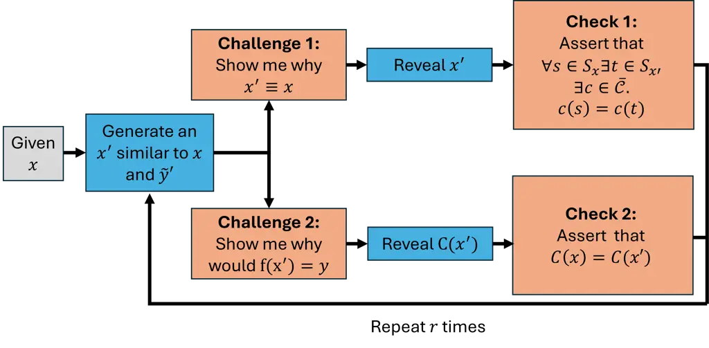

# Algorithmically Establishing Trust in Evaluators

Adrian de Wynter Affiliation: Microsoft Affiliation: The University of
York Correspondence to: <adewynter@microsoft.com>

###### Abstract

An evaluator, such as an LLM-as-a-judge, is trustworthy when there
exists some agreed-upon way to measure its performance as a labeller.
Traditional approaches either rely on testing the evaluator against
references or assume that it ‘knows’ somehow the correct labelling. Both
approaches fail when references are unavailable: the former requires
data, and the latter is an assumption, not evidence. To address this, we
introduce the ‘No-Data Algorithm’, which provably establishes trust in
an evaluator without requiring any labelled data. Our algorithm works by
successively posing challenges to said evaluator. We prove that after
$`r`$ challenge rounds, it accepts an evaluator which knows the correct
labels with probability $`\geq 1-(1/4)^{r}`$, and reliably flags
untrustworthy ones. We present formal proofs of correctness, empirical
tests, and applications to assessing trust in LLMs-as-judges for
low-resource language labelling. Our work enables
scientifically-grounded evaluator trust in low-data domains, addressing
a critical bottleneck for scalable, trustworthy LLM deployment.

###### Keywords: 

evaluation, trust, LLMs-as-judges

## 1 Introduction

One of the most fundamental problems in AI is the question of
measurement. Many commonly used metrics have a certain level of
unreliability; for example, by not corresponding to human judgements
(Reiter, 2018; Gehrmann et al., 2023; Bavaresco et al., 2024; Hada
et al., 2024). With the rise of LLMs as evaluators, typically known as
LLMs-as-judges, scaling measurement to multiple subproblems has become
ubiquitous (De Wynter, 2025). However, their reliability and
trustworthiness as measurement tools has led to division within the
research community, specifically, about the validity of some results
(Gehrmann et al., 2023; Rabinovich & Anaby Tavor, 2025; Moghe et al.,
2023).

A key issue on the question of measurement is whether the evaluation
tool (the evaluator) may be trusted. This trust is typically established
with a ground truth artifact, such as a labelled dataset for statistical
analysis, or a benchmark. However, references may not exist or be
scarce, due to annotation cost or uniqueness of the problem. In this
case, statistical conclusions would not be meaningful. Even when
references exist, contamination of benchmarks has become a major concern
(see, e.g., Sainz et al. 2023). Hence, when no references exist,
scientifically establishing trust on an evaluator can only be done with
a formal proof.

We introduce an algorithm (the ‘No-Data Algorithm’) which allows trust
assessment without any reference data. It is designed for contemporary
settings, such as LLMs-as-judges, where an evaluator claims knowledge of
the correct labels, and constrained to a binary classification setting.
A verifier then decides, based on the evaluator’s successful responses
to specific challenges, whether it is trustworthy. This requires a
linear number of queries, no labelled datasets (e.g., development or
training sets), or prior knowledge of the labels. The method is inspired
by zero-knowledge proof protocols, such as two-factor authentication.

### 1.1 Contributions

Our contributions are theoretical and experimental. Theoretically, we
prove that after $`r`$ calls, the No-Data Algorithm establishes
trustworthiness on the evaluator to a $`(1/4)^{r}`$ probability of
error. This measure robustly reflects whether the evaluator actually has
label knowledge. A knowledgeable evaluator will have high accuracy and
success rate. Conversely, a lying evaluator¹¹ 1 In this work we use
‘lying’ to denote both uninformed and sycophantic evaluators, and we
evaluate both cases. may achieve high accuracy only by chance, but will
not attain a high success rate.

Empirically, we test the No-Data Algorithm with traditional
machine-learning (i.e., a decision tree) and contemporary (r. LLMs)
evaluators. We demonstrate an application to assessing an
LLM-as-a-judge’s trustworthiness in a novel dataset in West Frisian, a
low-resource language. We also include ablation studies with
LLMs-as-judges, prompts, algorithm components, and extend our approach
to $`k`$-ary label sets.²² 2 All data is in
[https://github.com/adewynter/no_data_algorithm](https://github.com/adewynter/no_data_algorithm).

Our work shows that trust in an evaluator may be established formally
without references, enabling scientific evaluation in domains with
extremely scarce labels, such as market research, low-resource languages
(the subject of our experiments), medicine. To our knowledge, ours is
the first mathematically rigorous approach to establishing trust in an
LLM-as-a-judge without labelled references.

## 2 Related Work

There has been considerable work on attempting to create reliable
evaluators. Most of contemporary work relies on LLMs and various
prompting strategies or call stacks, although the problem of
(un)reliability/trustworthiness of an evaluator is older than generative
models. For example, it has been known that the use of BLEU for tasks
other than English-based machine translation is not accurate (Liu
et al., 2016; Novikova et al., 2017); and even then, that it does not
correspond well to human judgements (Reiter, 2018; Gehrmann et al.,
2023).

More generally, it is known that metric choice, and hence the choice of
evaluator, is system-dependent (Chen et al., 2024; Moghe et al., 2023;
Flamich et al., 2025; von Däniken et al., 2024; Pombal et al., 2025).
Poorly-developed rubrics also lead to unreliable human judgements (Clark
et al., 2021; van der Lee et al., 2019), and thus the evaluator
trustworthiness problem is also a rubric problem. There are algorithms
(Northcutt et al., 2017; Zhang & Sabuncu, 2018) and paradigms (Northcutt
et al., 2021) for learning with noisy teachers. Likewise, provable
methods have been used with success in other areas, such as
representation learning (Jovanović et al., 2023), and to improve
robustness via synthetic data generation (Dimitrov et al., 2022; Fischer
et al., 2022). However, they all assume that a (perhaps noisily)
labelled dataset exists.

Relevant to our work, the use of LLMs as evaluators has promised
extraordinary scaling capabilities, such as fast data generation and
evaluation without humans (Open AI, 2023; Chiang et al., 2024; Chiang &
Lee, 2023; Liu et al., 2023; Wei et al., 2024; Zheng et al., 2023). Some
of these criticisms are that they do not correlate with human judgements
well (Bavaresco et al., 2024; Hada et al., 2024; Chen et al., 2024;
De Wynter et al., 2025; Tjuatja et al., 2024); are sensitive to their
prompt (Lu et al., 2022; Hida et al., 2024; Ye & Durrett, 2022); their
performance could be the product of memorisation (Lee et al., 2023;
De Wynter et al., 2023; Sainz et al., 2023); and even that they do not
understand the task at all (De Wynter & Yuan, 2024; Webson & Pavlick,
2022; Ye & Durrett, 2022). Their reasoning capabilities have been put
into question, from the results being strongly dependent on the choice
of metrics (Schaeffer et al., 2023; Chen et al., 2024), to findings that
their output reasoning steps contain spurious reasoning (Turpin et al.,
2023; Lanham et al., 2023; Wu et al., 2024). Most of the work on
improving trust, however, relies on prompting strategies or call stacks
to other LLMs (Li et al., 2024).

The main subroutine from the No-Data Algorithm, which we call the
Evaluator-Verifier (EV) protocol, is based off the well-known
Arthur-Merlin (AM) protocol from Babai (1985). It is a type of
zero-knowledge proof; see Goldreich (2009) and Arora & Barak (2009) for
primers on the subject. That said, the EV protocol is different in many
regards to the AM protocol, since it is designed to fit arbitrary inputs
and the larger No-Data Algorithm. In particular, it does not provide
privacy or secrecy as other cryptographic protocols do; instead, we
adapt the challenge-response game to evaluation. Likewise, our use of
the rubric and the aggregator functions are generalisations to partial
functions that are not present (or needed) in previous works.

## 3 Definitions and Problem Setup

### 3.1 Notation

Our work relates to datapoints $`x\in X`$ and labels $`y\in Y`$.
Whenever the label set $`Y`$ is unspecified, it is the binary label set
$`Y=\{0,1\}`$. We also let $`X\subset\{0,1\}^{n}`$; that is, every
datapoint is a $`n`$-bit binary string modelling a phenomenon. The
assumptions on $`X`$ and $`Y`$ are to simplify our proofs; see Section 7
for a discussion on their relevancy. Experimentally, $`X`$ may be other
(concrete) data types, such as natural language strings. For an
$`x\in\{0,1\}^{n}`$, we denote its relevant subset set as
$`S_{x}\subset 2^{x}`$. The construction of this specific set will
depend on the setup, and will be discussed in detail in Section 4.1.

For two functions $`f\colon B\rightarrow C`$, $`g\colon A\rightarrow B`$
we write the composition $`f\circ g\colon A\rightarrow C`$ as $`fg`$.
For two sets $`A`$, $`B`$, we denote equality up to isomorphism as
$`A\cong B`$, where $`A\cong B`$ if $`f(A)=f(B)`$ but $`A\neq B`$ for
some $`f\colon U\rightarrow V`$. We also consider the special case of
equality up to permutation over subsets as $`A\equiv B`$, where
$`A\equiv B`$ if
$`\forall a\in S_{A},\exists b\in S_{B}\,.\,g(a)=g(b)`$, for some fixed
function $`g\colon U\rightarrow V`$. We assume all functions to be
deterministic throughout, unless stated otherwise.

### 3.2 Definitions

In line with standard learning theory (Valiant, 1984), we assume that
there exists an unknown map $`f\colon X\rightarrow Y`$ taking datapoints
to labels faithfully–that is, $`f`$ provides the true labelling. Our
task is to determine whether a function $`E\colon X\rightarrow Y`$ (a
labeller, or evaluator) is equivalent to $`f`$, without any knowledge of
the map itself. This is measured with its error rate, or, conversely,
its accuracy.

We also introduce the following definitions:

A criterion $`c\colon X\rightarrow\{0,1\}`$ classifies datapoints.

A rubric $`C\colon\times_{i,\dots,n}\{0,1\}\rightarrow\{0,1\}^{n}`$ maps
the binary outputs from an ordered set of criteria
$`\mathcal{C}=\{c_{1},\dots,c_{n}\}`$ to a bitstring which is the
concatenation of these outputs: $`C=c_{1}|c_{2}|\dots|c_{n}`$. We say a
rubric is total if it explicitly decomposes nonlinear criteria with
arity $`>1`$ (e.g. the xor $`c_{i}=c_{a}\oplus c_{b}`$), and write it as
$`\bar{\mathcal{C}}`$. When the evaluation of said criteria may be done
separately (e.g., by testing first $`c_{a}`$, then $`c_{b}`$, and then
their xor $`c_{a}\oplus c_{b}`$), we say it is a total evaluation.

The aggregator $`\sigma\colon\{0,1\}^{n}\rightarrow Y`$ is a function
that maps $`n`$-bit binary strings (rubric outputs) to $`Y`$.

For two $`x,x^{\prime}\in X`$, we say that $`x`$ is similar to
$`x^{\prime}`$ if both $`x\cong x^{\prime}`$ and $`x\equiv x^{\prime}`$.

Finally, in line with the AM protocol, we use lying to refer to any
evaluator that presents unsubstantiated claims of correctness, including
both uninformed (random guessing) and sycophantic (overconfident without
knowledge) behaviour. The difference is that the latter could perform
well in-distribution, but fail otherwise. The former, on the other hand,
will simply not know how to solve the problem and fail at both. Without
labels it is difficult to discern both cases, although we show that our
algorithm is capable of it.

Remark that, intuitively, the rubric is the set of reasons why a
datapoint belongs to a certain label class (e.g, an annotation rubric
passed in to human labellers). The label is thus based on evaluating the
rubric and aggregating its criteria with $`\sigma`$ (e.g., with a
majority vote). Natural-language examples are in Appendix E.1;
experiment with potential rubric weaknesses in Section 6.2; and discuss
them further in Section 7.

We are now ready to introduce our main assumption:

###### Assumption 3.1.

The map $`f\colon X\rightarrow Y`$ is a composition of the rubric and
the aggregator:

```math
f=\sigma C. \tag{1}
```

This is not a strong assumption: after all, datapoints must have a
reason (criterion) to acquire a label. This reason must be clearly
stated; and, when there is more than one reason, there must be a way to
decide how to aggregate them. In realistic scenarios, $`C`$ or
$`\sigma`$ may not be known. There, our method may still be applied with
user-defined surrogates, but derived trust bounds are with respect to
these surrogates rather than any ‘true’ but unknown ground truth. We
come back to this in Section 7.

## 4 The No-Data Algorithm

The No-Data Algorithm is an algorithm with two components, or players:
the evaluator and the verifier. Throughout the algorithm’s run, for
every datapoint $`x\in X`$, the evaluator must convince the verifier
that its choice of label for $`x`$ is correct (i.e., that it knows
$`f`$).

For this, the players run a multi-round sub-game which we refer to as
the Evaluator-Verifier (EV) protocol. The EV protocol takes in $`x`$,
and either succeeds or fails, w.h.p., based on challenges posed by the
verifier on a $`x^{\prime}`$ similar to $`x`$ generated by the
evaluator. The EV protocol returns the proposed label and the status
(success or failure).

The No-Data Algorithm then flips the label with probability $`\phi`$ in
case of failure. After observing all $`X`$, it returns the success count
and final labelling. The evaluator’s trustworthiness (and hence the
final labelling’s) is established via the average success rate.

The full algorithm is in Algorithm 1. We provide proofs of correctness
in Section 5.

1:  Input: Unlabelled data $`X`$, evaluator $`E`$, verifier $`V`$,
criterion $`C`$, flip probability $`\phi`$, rounds $`r`$

2:  $`predictions\leftarrow\{\}`$

3:  $`successes\leftarrow\{\}`$

4:  for $`x\in X`$ do

5:   $`success,y\leftarrow\textsc{EV}(x,E,V,C,r)`$// Run for $`r`$
rounds

6:   if $`success`$ then

7:    $`predictions\leftarrow predictions\cup\{y\}`$

8:    $`successes\leftarrow successes\cup\{1\}`$

9:   else

10:    $`\tilde{y}\leftarrow\lnot y\text{ with probability }\phi`$ //
The opposite label

11:    $`predictions\leftarrow predictions\cup\{\tilde{y}\}`$

12:    $`successes\leftarrow successes\cup\{0\}`$

13:   end if

14:  end for

15:  Return $`predictions`$, $`successes`$

Algorithm 1 The No-Data Algorithm. For every $`x\in X`$ it calls the EV
protocol to determine the trustworthiness of the label returned by the
evaluator, $`y=E(x)`$. Based on its output, the algorithm flips $`y`$
w.p. $`\phi`$ in case of failure. Finally, it returns the success count
and the labels.

### 4.1 The Evaluator-Verifier (EV) Protocol

In the EV protocol both players are given a datapoint $`x\in X`$ and
rubric $`C`$. The aggregator $`\sigma`$ is not given. The evaluator
claims to know $`f\colon X\rightarrow Y`$; and, since $`C`$ is known,
the claim reduces to the evaluator having knowledge of $`\sigma`$. The
verifier’s goal is thus to be sufficiently sure that the evaluator’s
labelling of a given $`x\in X`$ may be trusted.

#### 4.1.1 Setup

The EV protocol is played for $`r`$ rounds. At every round, the
evaluator generates a similar datapoint $`x^{\prime}`$ to $`x`$, and a
‘partial’ label $`\tilde{y}^{\prime}`$ that–supposedly–is equal to
$`y`$.³³ 3 Remark that the process by which the evaluator comes up with
$`x^{\prime}`$ does not need to be generation in the LLM sense. It is
instead left up to the evaluator, not unlike other zero-knowledge
proofs. It is partial because there is no access to $`f`$, and hence the
best the evaluator can do is to guess $`\tilde{y}^{\prime}`$ based on
$`C(x^{\prime})`$. Once it has generated the tuple
$`\langle x^{\prime},\tilde{y}^{\prime}\rangle`$, the evaluator may not
change it in this round. The verifier poses one of two challenges,
selected uniformly at random. Both challenges measure equality between
$`x^{\prime}`$ and $`x`$, either up to isomorphism (validating the
label) or up to permutation (structurally validating the criteria). If
the evaluator fails, the protocol terminates and returns failure.
Otherwise, it starts over. Regardless of the outcome, the protocol also
returns $`\tilde{y}^{\prime}`$. See Figure 1 for a diagram of the
protocol.



Figure 1: EV protocol flow. At every round, the evaluator (blue)
generates an $`x^{\prime}`$ similar to $`x`$, and a partial label
$`\tilde{y}^{\prime}`$. It then answers one of two (chosen uniformly at
random) challenges by the verifier (orange). If the evaluator does not
pass the challenge, the protocol returns failure. Otherwise, the game is
repeated. If the rounds are over, it returns a succeeded state. In
either case, it also returns $`\tilde{y}^{\prime}`$.

##### Challenge 1 (Equality up to Permutation)

Setup: The verifier tests the evaluator by asking it to show a similar
point that leads to the same total evaluation of $`C`$, namely, whether
$`x\equiv x^{\prime}`$ over $`\bar{\mathcal{C}}`$.

Check: The verifier asserts that

```math
\displaystyle\forall s\in S_{x},\exists t\in S_{x^{\prime}}\,.\,\forall c\in\bar{\mathcal{C}},\,c(s)=c(t); \tag{2}
```

that is, if there is at least one substring in $`x^{\prime}`$ matching
the (total) evaluation of a criterion from $`x`$.

##### Challenge 2 (Equality up to Isomorphism)

Setup: The verifier asks why $`f(x^{\prime})=y`$. Since $`y`$ is not
available, it checks whether $`x^{\prime}\cong x`$.

Check: The verifier asserts that $`C(x^{\prime})=C(x)`$.

###### Remark 4.1.

Since the challenges are public, the evaluator could cheat and generate
an $`x^{\prime}`$ to pass one of the challenges, but not both.
Otherwise, the implication is that it knows $`f`$, and it will pass the
challenges every time. This is why the challenges assert both structure
($`x\equiv x^{\prime}`$) and final encoding ($`x\cong x^{\prime}`$).
This observation is central to our correctness proofs from Section 5.

## 5 Correctness

###### Lemma 5.1 (EV Protocol Correctness Bound).

The probability that the verifier fails to detect a lie by the evaluator
in the the EV protocol sub-game after $`r`$ rounds is $`(1/4)^{r}`$.

###### Proof.

(Sketch; a complete proof is in Appendix A.1). We split the proof in
two: (1) whether the challenges are necessary and sufficient to detect
if the evaluator is lying; and (2) the probability bound to which this
detection occurs.

For the first part, note that Challenge 1 determines the internal
structure of the string, but does not account for the valuation of
$`C(x^{\prime})`$. This challenge is necessary because two
$`x,x^{\prime}`$ could lead to the same evaluation of some
$`c\in\mathcal{C}`$ (e.g., disjunctive clauses), yet this does not imply
that they are equal up to permutation.

However, Challenge 2 requires strict equality in $`C(x^{\prime})=C(x)`$.
It is indeed order-dependent, but does not account for internal
structure. Hence both challenges provide some, but not all, information
about $`x,x^{\prime}`$ and the claimed $`f(x),f(x^{\prime})`$. Thus they
are together sufficient and necessary to determine if an evaluator is
lying.

Since they are mutually exclusive in the information they provide, it
follows that an evaluator passing both challenges will not be lying.
Thus, a lying evaluator may only be able to pass one challenge. Hence we
handle two cases where the evaluator could lie (or cheat): either (1) it
can generate an appropriate $`x^{\prime}`$, but not a correct
$`C(x^{\prime})`$; or (2) it provides a correct $`C(x^{\prime})`$ but an
incorrect $`x^{\prime}`$. In either case, the probability that it gets
lucky and/or passes the challenge by cheating is $`1/4`$; after $`r`$
rounds, it is $`(1/4)^{r}`$. ∎

###### Theorem 5.2 (No-Data Algorithm Correctness Bound).

Suppose an evaluator has accuracy $`\alpha`$ on a balanced dataset $`X`$
of size $`n`$ with binary labels $`Y=\{0,1\}`$. Assume the evaluator
always lies on any $`x\in X`$ iff it incorrectly labels the datapoint.
Then if the EV protocol is ran for $`r`$ rounds, the expected accuracy
of the No-Data Algorithm is given by

```math
\mathrm{E}[\text{correct}]\leq 1-(1-\alpha)\left(1-\phi+\phi\left(\frac{1}{4}\right)^{r}\right), \tag{3}
```

for a chosen value of $`\phi`$ and over the same dataset $`X`$.

###### Proof.

(Sketch; a complete proof is in Appendix A.4). The accuracy of any
evaluator is directly tied to its success in the EV protocol: if it
knows the label, then the checks will pass and $`\tilde{y}^{\prime}=y`$.
From Lemma 5.1, this holds with probability $`1-(1/4)^{r}`$. An
application of the union bound yields the desired result.∎

Theorem 5.2 implies that a good evaluator with relatively high accuracy
and success rate, and a well-calibrated $`\phi`$, will have a true
accuracy higher than what the No-Data Algorithm outputs. Hence, reliable
evaluators, as per the algorithm, may be used with the expectation that
their ‘true’ performance will be better. Another interpretation of this
result is that there is no way to recover unknowable labels when the
evaluator is unable to convince the verifier.

Remark that the assumption for Theorem 5.2 for the evaluator always
lying when mislabelling (and hence always being wrong) is not
necessarily applicable to all evaluators. A particularly tricky
evaluator could still guess the right label, yet not pass the
challenges. We consider this out of scope, since the ability to guess a
label without explaining how is not a viable way to establish trust,
especially in scenarios without any references.

## 6 Experiments

We present two experiments: an empirical test of the theory
(Section 6.1), and an application to a realistic scenario (Section 6.2).
Ablation experiments and extensions are in Appendices C.1 and D. We used
two corpora: one which the evaluators know how to label (in-phenomenon,
or IP), and one they do not (out-of-phenomenon; OOP). This naming is to
highlight that the measurement is altered by changing the
dataset–semantically we are modelling different phenomena (i.e.,
distinct $`f\colon X\rightarrow Y`$). We refer to the hypothetical setup
where we know the labels as knowable (r. unknowable). Knowable setups
are only to illustrate how the algorithm’s labelling adheres to the
‘true’ predictions. In practice, they would be unavailable. We run the
No-Data Algorithm with $`r=3`$. Remark that algorithmic baselines for
this scenario are challenging, since approaches such as ensembling do
not provide formal bounds of correctness, nor account for lying
evaluators. See Appendix D.5 for a baseline analysis, and Appendix E for
prompts and methodology details.

### 6.1 Experiment 1: Synthetic Data without Natural Language

In this experiment we aim to understand the behaviour of the No-Data
Algorithm in a setup close to that of the theory (binary strings). For
this, we created two disjoint synthetic datasets over $`\{0,1\}`$. This
allows us to ablate any potential memorisation concerns, and to control
the rubrics. The rubrics are in Table 1. For both OOP and IP, $`\sigma`$
is the majority vote. The test sets for both IP and OOP included 498
entries and are balanced.

#### 6.1.1 Setup: Evaluators and Verifiers

Evaluators: We used a decision tree (DT), and the highest-performing LLM
we tested (o3-mini; OpenAI 2025a).⁴⁴ 4 The full results, in Appendix D,
further include another closed- and two open-source models. Both
observed a balanced training split of the IP dataset. That is, we
trained the DT to ensure that the evaluator learnt both IP’s $`\sigma`$
and $`C`$, even though during generation it only had access to $`C`$,
and not $`\sigma`$. The LLM, as ‘training’, observed the rubric in the
prompt, plus five exemplars, and was made aware of the aggregation
function only for the labelling step. For generation it was asked to
pick the best candidate from the (training) dataset instead of
outputting a new point, as we observed marked performance decreases
otherwise (Appendix D). During OOP, the LLM was given the rubric for IP
and an OOP datapoint. We tuned $`\phi`$ to $`\phi=0.4,0.1`$ for the DT
and the LLM, respectively. These are the worst-case scenarios, since, as
per Theorem 5.2, it is preferable to have $`\phi`$ close to the knowable
accuracy.

Verifier: We used a rule-matching algorithm matching the test set to its
appropriate rubric.

| Rubric            | Definition                                                                          |
| ----------------- | ----------------------------------------------------------------------------------- |
| In-Phenomenon     |                                                                                     |
| $`c_{0}`$         | $`y=1`$ if $`x`$ has an even number of ones; else $`0`$                             |
| $`c_{1}`$         | $`y=1`$ if $`x`$ starts with a zero or contains $`10101`$, but not both; else $`0`$ |
| $`c_{2}`$         | $`y=1`$ if $`x`$ has strictly more than five ones; else $`0`$                       |
| Out-of-Phenomenon |                                                                                     |
| $`c_{0}`$         | $`y=1`$ if $`x`$ contains the substring $`111`$; else $`0`$                         |
| $`c_{1}`$         | $`y=1`$ if $`x`$ ends with a one; else $`0`$                                        |
| $`c_{2}`$         | $`y=1`$ if $`x`$ contains the substring $`110001`$; else $`0`$                      |

Table 1: Rubrics and criteria for our first experiment. Note that
$`c_{1}`$ for the IP rubric is an exclusive-or operation: while this
rubric contains three criteria, the total rubric contains five:
$`\{c_{0},c_{2},c_{1,a},c_{1,b},c_{1}\}`$; where $`c_{1,a},c_{1,b}`$ are
the clauses for $`c_{1}`$, and $`c_{1}`$ is the exclusive-or itself.

#### 6.1.2 Results

The results are in Table 2. The DT and the LLM adjusted to the
predictions: accuracies with the No-Data Algorithm were within $`-2`$
and $`0`$% of the knowable case in both IP and OOP. The success rate
differences between IP (100% for DT; 81% for the LLM) and OOP (r. 5% and
28%) provided better information as to which setup was the one the
evaluator truly knew.

We also performed ablation studies on the relationship of lying with
evaluators and generators; the need for flipping the labels; and the
effectiveness of generation strategies in various LLMs. Full details for
all studies are available in Appendix D. We found that not flipping the
labels led to lower accuracies in the No-Data Algorithm, especially when
the evaluator lied and within IP. When the evaluator lied about knowing
$`\sigma`$ or $`f`$, the success rates were lower in the IP case, but
remained steady in OOP. These results align with the expectations from
Section 5. The final study showed that LLM generation in this problem
was slightly lower-performing (-3%) when compared to picking a string
from the dataset. This is expected for non-natural language problems,
does not impact the results, and does not extend to natural language. We
discuss this further in Section 7.

|                 | DT (known)  | DT (unknown) | LLM (known) | LLM (unknown) |
| --------------- | ----------- | ------------ | ----------- | ------------- |
| IP              |             |              |             |               |
| Successes/Flips | — / —       | 100.0 / 0.0  | — / —       | 81.3 / 1.8    |
| Accuracy/F₁     | 62.2 / 58.8 | 62.2 / 59.8  | 99.8 / 99.8 | 97.6 / 97.6   |
| OOP             |             |              |             |               |
| Successes/Flips | — / —       | 4.8 / 46.4   | — / —       | 28.0 / 6.0    |
| Accuracy/F₁     | 54.2 / 54.2 | 52.8 / 52.1  | 60.6 / 66.2 | 59.0 / 64.0   |

Table 2: Results for the known (test score if the labels were known) and
unknown (output of the No-Data Algorithm) cases. The known case is a
reference that in practice does not exist. The flip $`\phi`$ is set near
the error rate in the known case ($`0.4`$ for the DT; $`0.1`$ for the
LLM), since it is arguably the worst value it can have. This is needed
in this experiment because the generator acts as an oracle, convincing
the verifier every time, and hence the No-Data algorithm reduces to
simple evaluation (the known case). However, the success rate is
extremely low in DT OOP (unknown): even though there is no way for us to
know whether the evaluator’s score is trustworthy, the success rate
indicates deception.

### 6.2 Experiment 2: Low-Resource Language Labelling

This experiment evaluates a setup much closer to a realistic scenario.
The goal is to evaluate a chatbot’s suitability for deployment in a
low-resource language. Added to that, the rubric contains ambiguous
criteria, and the criteria values are not known to the verifier or the
evaluator. Both components are LLMs-as-judges.

#### 6.2.1 Data

We created a multi-domain dataset (1,015 entries total) with
randomly-drawn prompts from OpenOrca (Lian et al., 2023), MMLU
(Hendrycks et al., 2021), OpenCode (Ahmad et al., 2025), and WildChat
(Zhao et al., 2024). The task is to judge whether the output of an LLM
(GPT-4o) to these prompts is correct based on a rubric. Hence, every
entry in the corpus is a pair of prompts and outputs professionally
translated into West Frisian and annotated by four native speakers. West
Frisian is a language that, albeit spoken by half a million people, is
within the class of ‘exceptionally limited resources’ with ‘virtually no
labelled data to use’, as per the taxonomy from Joshi et al. (2020). See
Section 9 and Appendix E for details on annotation.

The rubric is written in natural language and consists of six criteria
standard for chatbots deployed in user-facing applications, ranging from
‘the response must be in West Frisian’ to ‘the response must be correct
and without syntax errors’. For OOP we wrote a separate,
almost-orthogonal rubric (e.g. ‘the response must be in Dutch’, as the
model often responded in Dutch), and included a compound entry (‘one of
B or C must be correct, otherwise the response is zero’), bringing the
total OOP criteria to seven. Full rubrics are in Appendix E.1. The
$`\sigma`$ for this corpus is 1 if all criteria are 1, otherwise 0.

The evaluator and verifier is GPT-4.1 (OpenAI, 2025b), although with
different prompts, and thus different functions. We split the dataset
into train (500) and test (515). Ahead of running the experiments, we
calibrated the prompt strategies that worked best under the IP known
case for both the final labels and the per-criterion breakdown. This is
analogous to the setting where a user would tune their verifier prior to
deployment on the unknown cases.

This experiment is by design more challenging than the one from
Section 6.1. Here neither the verifier nor the evaluator know the label
or the criteria values: instead, both create their own label sets, and
generate their own datapoints. The rubric has also ambiguity present
(e.g., the IP rubric requests that the model must always answer ‘even if
its answer is wrong’; but also that the response ‘must be correct’), and
only the OOP rubric is decomposable. The ambiguity was unintentional,
although not uncommon for realistic scenarios. We discuss this further
in Section 7.

#### 6.2.2 Results

The results are in Table 3. The LLMs tested had high success rates and
accuracies in the IP setting, and the converse in the OOP case. There
were some nuanced differences when compared to the synthetic experiments
from Section 6.1. Namely, the difference in performance was higher when
$`\phi`$ was low (up to -3.9% and -2.2% accuracy in IP and OOP, r.).
Nonetheless, as expected, success rates remained steady regardless of
value of $`\phi`$.

To further probe the impact of LLM choice on the results we also tested
an evaluator not proficient in West Frisian (Qwen 2.5B VL 7B; Qwen Team
2025). This would be an evaluator which does not lie, but will be wrong
regardless. We found that in the IP case, when the model was given the
correct rubric, the success rate was still low, hovering at around 35%
in IP; and 2% for OOP (where it did lie), for all values of $`\phi`$.
The full results are in Appendix D.4. We also probed the effects of
ternary label classification setup on the same dataset (Appendix C.1).
Our findings largely adjusted to our other results, with the No-Data
Algorithm spotting lying evaluators effectively.

|                          |              |               |                  |                   |
| ------------------------ | ------------ | ------------- | ---------------- | ----------------- |
|                          | IP Acc. / F1 | OOP Acc. / F1 | IP Succ. / Flips | OOP Succ. / Flips |
| Known                    |              |               |                  |                   |
| Predicting $`y`$         | 76.3 / 80.3  | 51.5 / 67.2   | –/–              | –/–               |
| Avg. per $`c\in\bar{C}`$ | 89.5 / 94.0  | 45.3 / 46.5   | –/–              | –/–               |
| Unknown                  |              |               |                  |                   |
| $`\phi=0.7`$             | 72.4 / 76.6  | 49.3 / 57.8   | 87.8 / 9. 3      | 1.4 / 70.3        |
| $`\phi=0.3`$             | 74.4 / 78.1  | 49.1 / 39.1   | 86.8 / 4.9       | 1.2 / 33.6        |
| $`\phi=0.1`$             | 76.9 / 79.8  | 50.7 / 16.4   | 86.2 / 1.8       | 1.2 / 9.1         |

Table 3: Performance of the No-Data Algorithm with GPT-4.1 as evaluator
and verifier, and the natural-language setup as dataset. It can be seen
that the performance of the evaluator adjusts to the predictions, with
near-random accuracy in OOP and close-to-known accuracy in IP. Remark
that the success rate remains comparatively stable, regardless of the
chosen value of $`\phi`$. Hence the most appropriate quantity to measure
is the success rate, while $`\phi`$ may be tuned later for higher
accuracy gains.

## 7 Discussion

### 7.1 Theory

Theorem 5.2 states that when the labeller has high accuracy, a low
$`\phi`$ will be able to reproduce the label set. It is then possible to
measure the successes to establish a confidence bound on the aggregate
labels provided by the evaluator. It, however, has a different
interpretation: when the accuracy of the evaluator is zero, there is no
way to determine the labelling, regardless of $`\phi`$–it is completely
unknowable. We argue that this makes sense: otherwise, it would be
possible to create information out of thin air, and without any prior
knowledge of $`f`$. Hence the primary purpose of the No-Data Algorithm
is to establish trustworthiness, not to label data.

Our requirement that $`Y`$ is binary is sufficient from a theoretical
angle, but worth discussing further. Arities larger than $`2`$ may be
addressed with class-based separation, at the expense of a linear-time
increase in runtime. This is an upper bound, and we conjecture that
there exist versions of the No-Data Algorithm with smaller overheads. We
expand upon this and other extensions to the theory in Appendix C. There
we also show that, experimentally, our algorithm retains its guarantees
of correctness under this setup. We leave its theoretical
characterisation for further work.

### 7.2 Experiments

In both experiments both the LLM and DT evaluators consistently had
accuracies close to the known cases in IP/OOP, but distinct success
rates in IP and OOP. This indicates that the No-Data Algorithm is robust
to evaluator strategies attempting deception.

The large number of flips in the $`\phi=0.5`$ DT OOP case (Section 6.1)
and $`\phi=0.3`$ LLM OOP (Section 6.2) support our interpretation of
Theorem 5.2. Since the model’s accuracy is near-random in the OOP
dataset, the verifier will almost always catch a lie. Hence, most labels
were flipped and no information was gained from the labelling. It is
worth noting that the success rate remained steady regardless of the
value of $`\phi`$, even when the flips and accuracies didn’t. Thus,
success rate is the main metric to measure: $`\phi`$ may be tuneable
post-hoc to attain better performance.

In our synthetic data scenario (Section 6.1), we noted that LLMs
struggled with generating data for that problem, and picking it from a
set was more effective. However, this was not the case in the
natural-language scenario (Section 6.2). We argue that this is because
LLMs are primarily trained with natural language, and identification
(classification) and generation are two distinct problems (Kleinberg &
Mullainathan, 2024); and certain automata-based problems like ours are
harder for LLMs (De Wynter, 2026). From the perspective of our work,
however, how an evaluator generates a datapoint makes no difference, so
long as it can prove that it knows what it is doing.

Finally, remark that the evaluation of LLMs with LLMs, as in
Section 6.2, depends strongly on the LLMs themselves. This is not a
circular argument: the verifier (i.e., the prompt) was tuned on the IP
case, and asked to evaluate an unknown LLM (r. evaluation prompt) in the
OOP case, as done in Section 6.2 and Appendix D.4, even when it had
near-random performance in this task. This is because the evaluator and
verifier are solving different tasks, and hence why the accuracies
adjusted to the known cases. We provide experiments in Appendix D–and
specifically, Appendix D.4–to confirm this with different LLMs. However,
from the perspective of future research directions, it raises the
question on what are the (literature’s) results measuring. We come back
to this point in the next section.

### 7.3 The Need for a Rubric

A key limitation of the No-Data Algorithm is the requirement of a
well-designed rubric, and its performance hinges on it. If the rubric or
aggregator is poorly defined, confidence in the algorithm’s results may
be misplaced, and its reliability bounded by rubric quality. In other
words, the No-Data Algorithm measures what it is told to measure.

Having a rubric is a fundamental aspect of the scientific method:
verifying a hypothesis $`H_{0}`$ requires measuring a set of
experimental outcomes, which are then used to accept or reject
$`H_{0}`$. For this, outcomes must be interpreted (i.e., evaluated as
criteria) and then aggregated. Thus, the responsibility for designing an
effective rubric depends on the scientist (user), not the algorithm.
This requirement is not unique to our work, or even annotation in
machine learning. For example, there is work on rubric-based learning in
reinforcement learning (He et al., 2025; Shao et al., 2025; Huang
et al., 2025; Masters et al., 2025); and in evaluation with (not of)
LLMs-as-judges (Lei et al., 2025).

However, needing a rubric and characterising it are two distinct
considerations. For the latter, there are two cases that merit special
attention: decomposability, and ambiguity. For decomposability, note
that the algorithm requires this property for the proofs, but not
necessarily at runtime. For example, the experiments from Section 6.2
used a decomposable rubric only in the OOP case. Since the No-Data
Algorithm is agnostic to the data labels ($`\sigma`$ is unknown), it
worked as intended.

Regarding ambiguity, recall that the rubrics from Appendix E.1 were
ambiguous, and the experiments nevertheless succeeded. This further
illustrates our argument on $`H_{0}`$: the performance of the LLMs on
the (human-annotated) data was measured with respect to the human
labels, which themselves were based on the rubric. Both annotators and
LLMs used the same rubric. Hence, the measurement performed in
Section 6.2 is whether the evaluator could act as a labeller the same
way a human would.

## 8 Conclusion

Trust in a measurement, although foundational to the scientific method,
is difficult to determine when labelled data is scarce. In this work we
introduced the No-Data Algorithm to formally establish trust in an
evaluator when labelled data does not exist. This algorithm works by
posing carefully-designed challenges, inspired by zero-knowledge proofs,
to an evaluator. We proved mathematically and empirically that this
method is sufficient to establish an evaluator’s trustworthiness, or,
alternatively, to detect deception by either sycophantic or uninformed
models.

Our experiments in synthetic and natural-language scenarios showed close
agreement to the theory, as well as some robustness to realistic
settings (e.g., ambiguous rubrics and undefined criteria). Ablation
studies with other LLMs and label arities showed extensibility and
reinforced the findings.

In our theoretical work we noted that an implication of the No-Data
Algorithm is that, when the evaluator cannot be fully trusted, the data
cannot be annotated. This is because there is no prior information on
the data, and hence it would be effectively creating information out of
thin air. This is why the algorithm’s focus is on the success rate. If
an evaluator has low accuracy, but high success rate, it is very likely
uninformed (e.g., the IP case in the experiments). High accuracy but low
success rate indicates deception (r. OOP). Hence, it is up to the user
to decide (to their own margin of trust) whether to accept or reject the
labelling with respect to the rubric they designed. As noted in
Section 9, we urge caution when interpreting the algorithm’s outputs, as
they depend on the rubric itself.

We argue that our work reframes how evaluator reliability can be
measured in situations with scarcely-labelled data. By establishing
formal measures of trust, it is now possible to perform rigorous
evaluations of ‘hard’ domains such as low-resource languages and
medicine. This is particularly important due to the debates on the
reliability and deployment-readiness of LLMs-as-judges, especially in
sensitive applications.

In terms of further work, there are two open questions remaining, not
addressed here due to scope: (1) how can one fully evaluate a model’s
(not a prompt’s) trustworthiness? This is particularly important for
open-ended scenarios, such as dialogue. Here, the principles behind the
EV protocol still apply, albeit the probabilistic guarantees and
challenges would differ. Hence, (2) what practical adaptations are
needed for other data types and output signatures? Mathematically the
full problem is solvable by assuming a binary string, but empirically
this is often not feasible.

Our work shows that it is possible to judge an evaluator’s–such as an
LLM-as-a-judge’s– trustworthiness with formal guarantees of correctness.
It also enables practitioners to transition from assumed evaluator
competence, to provable trust, thus enabling the building of more robust
and trustworthy AI systems.

## 9 Impact Statement

This work’s contributions involve the ability to establish trust in an
LLM. A possible risk is over-reliance on this algorithm’s measures of
trust, especially if the underlying rubric is ill-posed. Users should
understand that the No-Data Algorithm is only as valid as the rubrics
provided. We thus urge users to not correlate high success rates with
LLM infallibility. For the data annotation, all annotators were
contracted through an annotator services company, and compensated based
on seniority, at a rate starting at 28.7 USD/hr. Annotators were
encouraged to take breaks and emphasised quality over speed through the
annotation instructions.

## References

- Ahmad et al. (2025) Ahmad, W. U., Narenthiran, S., Majumdar, S.,
  Ficek, A., Jain, S., Huang, J., Noroozi, V., and Ginsburg, B.
  OpenCodeReasoning: Advancing data distillation for competitive coding. 2025. URL
  [https://arxiv.org/abs/2504.01943](https://arxiv.org/abs/2504.01943).
- Arora & Barak (2009) Arora, S. and Barak, B. _Computational
  Complexity: A Modern Approach_. Cambridge University Press, 2009.
- Babai (1985) Babai, L. Trading group theory for randomness. In _STOC
  ’85: Proceedings of the seventeenth annual ACM symposium on Theory of
  computing_, pp. 421–429. ACM, 1985.
- Bavaresco et al. (2024) Bavaresco, A., Bernardi, R., Bertolazzi, L.,
  Elliott, D., Fernández, R., Gatt, A., Ghaleb, E., Giulianelli, M.,
  Hanna, M., Koller, A., Martins, A. F. T., Mondorf, P., Neplenbroek,
  V., Pezzelle, S., Plank, B., Schlangen, D., Suglia, A., Surikuchi,
  A. K., Takmaz, E., and Testoni, A. LLMs instead of human judges? a
  large scale empirical study across 20 NLP evaluation tasks, 2024. URL
  [https://arxiv.org/abs/2406.18403](https://arxiv.org/abs/2406.18403).
- Braylan et al. (2022) Braylan, A., Alonso, O., and Lease, M. Measuring
  annotator agreement generally across complex structured, multi-object,
  and free-text annotation tasks. In _Proceedings of the ACM Web
  Conference 2022_, WWW ’22, pp. 1720–1730, New York, NY, USA, 2022.
  Association for Computing Machinery. ISBN 9781450390965. doi:
  10.1145/3485447.3512242. URL
  [https://doi.org/10.1145/3485447.3512242](https://doi.org/10.1145/3485447.3512242).
- Chen et al. (2024) Chen, G. H., Chen, S., Liu, Z., Jiang, F., and
  Wang, B. Humans or LLMs as the judge? a study on judgement bias. In
  Al-Onaizan, Y., Bansal, M., and Chen, Y.-N. (eds.), _Proceedings of
  the 2024 Conference on Empirical Methods in Natural Language
  Processing_, pp. 8301–8327, Miami, Florida, USA, November 2024.
  Association for Computational Linguistics. doi:
  10.18653/v1/2024.emnlp-main.474. URL
  [https://aclanthology.org/2024.emnlp-main.474/](https://aclanthology.org/2024.emnlp-main.474/).
- Chiang & Lee (2023) Chiang, C.-H. and Lee, H.-y. Can large language
  models be an alternative to human evaluations? In Rogers, A.,
  Boyd-Graber, J., and Okazaki, N. (eds.), _Proceedings of the 61st
  Annual Meeting of the Association for Computational Linguistics
  (Volume 1: Long Papers)_, pp. 15607–15631, Toronto, Canada, July 2023.
  Association for Computational Linguistics. doi:
  10.18653/v1/2023.acl-long.870. URL
  [https://aclanthology.org/2023.acl-long.870](https://aclanthology.org/2023.acl-long.870).
- Chiang et al. (2024) Chiang, W.-L., Zheng, L., Sheng, Y.,
  Angelopoulos, A. N., Li, T., Li, D., Zhang, H., Zhu, B., Jordan, M.,
  Gonzalez, J. E., and Stoica, I. Chatbot arena: An open platform for
  evaluating LLMs by human preference, 2024. URL
  [https://arxiv.org/abs/2403.04132](https://arxiv.org/abs/2403.04132).
- Cicchetti & Feinstein (1990) Cicchetti, D. V. and Feinstein, A. R.
  High agreement but low kappa: II. resolving the paradoxes. _Journal of
  Clinical Epidemiology_, 43(6):551–558, 1990. ISSN 0895-4356. doi:
  https://doi.org/10.1016/0895-4356(90)90159-M. URL
  [https://www.sciencedirect.com/science/article/pii/089543569090159M](https://www.sciencedirect.com/science/article/pii/089543569090159M).
- Clark et al. (2021) Clark, E., August, T., Serrano, S., Haduong, N.,
  Gururangan, S., and Smith, N. A. All that’s ‘human’ is not gold:
  Evaluating human evaluation of generated text. In Zong, C., Xia, F.,
  Li, W., and Navigli, R. (eds.), _Proceedings of the 59th Annual
  Meeting of the Association for Computational Linguistics and the 11th
  International Joint Conference on Natural Language Processing (Volume
  1: Long Papers)_, pp. 7282–7296, Online, August 2021. Association for
  Computational Linguistics. doi: 10.18653/v1/2021.acl-long.565. URL
  [https://aclanthology.org/2021.acl-long.565](https://aclanthology.org/2021.acl-long.565).
- DeepSeek-AI et al. (2025) DeepSeek-AI, Guo, D., Yang, D., Zhang, H.,
  Song, J., Zhang, R., Xu, R., Zhu, Q., Ma, S., Wang, P., Bi, X., Zhang,
  X., Yu, X., Wu, Y., Wu, Z. F., Gou, Z., Shao, Z., Li, Z., Gao, Z.,
  Liu, A., Xue, B., Wang, B., Wu, B., Feng, B., Lu, C., Zhao, C., Deng,
  C., Zhang, C., Ruan, C., Dai, D., Chen, D., Ji, D., Li, E., Lin, F.,
  Dai, F., Luo, F., Hao, G., Chen, G., Li, G., Zhang, H., Bao, H., Xu,
  H., Wang, H., Ding, H., Xin, H., Gao, H., Qu, H., Li, H., Guo, J., Li,
  J., Wang, J., Chen, J., Yuan, J., Qiu, J., Li, J., Cai, J. L., Ni, J.,
  Liang, J., Chen, J., Dong, K., Hu, K., Gao, K., Guan, K., Huang, K.,
  Yu, K., Wang, L., Zhang, L., Zhao, L., Wang, L., Zhang, L., Xu, L.,
  Xia, L., Zhang, M., Zhang, M., Tang, M., Li, M., Wang, M., Li, M.,
  Tian, N., Huang, P., Zhang, P., Wang, Q., Chen, Q., Du, Q., Ge, R.,
  Zhang, R., Pan, R., Wang, R., Chen, R. J., Jin, R. L., Chen, R., Lu,
  S., Zhou, S., Chen, S., Ye, S., Wang, S., Yu, S., Zhou, S., Pan, S.,
  Li, S. S., Zhou, S., Wu, S., Ye, S., Yun, T., Pei, T., Sun, T., Wang,
  T., Zeng, W., Zhao, W., Liu, W., Liang, W., Gao, W., Yu, W., Zhang,
  W., Xiao, W. L., An, W., Liu, X., Wang, X., Chen, X., Nie, X., Cheng,
  X., Liu, X., Xie, X., Liu, X., Yang, X., Li, X., Su, X., Lin, X., Li,
  X. Q., Jin, X., Shen, X., Chen, X., Sun, X., Wang, X., Song, X., Zhou,
  X., Wang, X., Shan, X., Li, Y. K., Wang, Y. Q., Wei, Y. X., Zhang, Y.,
  Xu, Y., Li, Y., Zhao, Y., Sun, Y., Wang, Y., Yu, Y., Zhang, Y., Shi,
  Y., Xiong, Y., He, Y., Piao, Y., Wang, Y., Tan, Y., Ma, Y., Liu, Y.,
  Guo, Y., Ou, Y., Wang, Y., Gong, Y., Zou, Y., He, Y., Xiong, Y., Luo,
  Y., You, Y., Liu, Y., Zhou, Y., Zhu, Y. X., Xu, Y., Huang, Y., Li, Y.,
  Zheng, Y., Zhu, Y., Ma, Y., Tang, Y., Zha, Y., Yan, Y., Ren, Z. Z.,
  Ren, Z., Sha, Z., Fu, Z., Xu, Z., Xie, Z., Zhang, Z., Hao, Z., Ma, Z.,
  Yan, Z., Wu, Z., Gu, Z., Zhu, Z., Liu, Z., Li, Z., Xie, Z., Song, Z.,
  Pan, Z., Huang, Z., Xu, Z., Zhang, Z., and Zhang, Z. DeepSeek-R1:
  Incentivizing reasoning capability in LLMs via reinforcement
  learning, 2025. URL
  [https://arxiv.org/abs/2501.12948](https://arxiv.org/abs/2501.12948).
- Dimitrov et al. (2022) Dimitrov, D. I., Singh, G., Gehr, T., and
  Vechev, M. Provably robust adversarial examples. In _International
  Conference on Learning Representations_, 2022. URL
  [https://openreview.net/forum?id=UMfhoMtIaP5](https://openreview.net/forum?id=UMfhoMtIaP5).
- Fischer et al. (2022) Fischer, M., Sprecher, C., Dimitrov, D. I.,
  Singh, G., and Vechev, M. Shared certificates for neural network
  verification. In _Computer Aided Verification: 34th International
  Conference, CAV 2022, Haifa, Israel, August 7–10, 2022, Proceedings,
  Part I_, pp. 127–148, Berlin, Heidelberg, 2022. Springer-Verlag. ISBN
  978-3-031-13184-4. doi: 10.1007/978-3-031-13185-1_7. URL
  [https://doi.org/10.1007/978-3-031-13185-1_7](https://doi.org/10.1007/978-3-031-13185-1_7).
- Flamich et al. (2025) Flamich, G., Vilar, D., Peter, J.-T., and
  Freitag, M. You cannot feed two birds with one score: the
  accuracy-naturalness tradeoff in translation, 2025. URL
  [https://arxiv.org/abs/2503.24013](https://arxiv.org/abs/2503.24013).
- Fleiss & Cohen (1973) Fleiss, J. L. and Cohen, J. The equivalence of
  weighted kappa and the intraclass correlation coefficient as measures
  of reliability. _Educational and Psychological Measurement_,
  33(3):613–619, 1973. doi: 10.1177/001316447303300309. URL
  [https://doi.org/10.1177/001316447303300309](https://doi.org/10.1177/001316447303300309).
- Gehrmann et al. (2023) Gehrmann, S., Clark, E., and Sellam, T.
  Repairing the cracked foundation: A survey of obstacles in evaluation
  practices for generated text. _Journal of Artificial Intelligence
  Research_, 77:103–166, 2023. doi: 10.1613/jair.1.13715.
- Goldreich (2009) Goldreich, O. _Foundations of Cryptography: Volume 1:
  Basic Tools_. Cambridge University Press, 2009. doi:
  10.1017/CBO9780511546891.
- Gwet (2010) Gwet, K. L. Computing inter-rater reliability and its
  variance in the presence of high agreement. _British Journal of
  Mathematical and Statistical Psychology_, 61:29–48, 2010. doi:
  https://doi.org/10.1348/000711006X126600.
- Hada et al. (2024) Hada, R., Gumma, V., De Wynter, A., Diddee, H.,
  Ahmed, M., Choudhury, M., Bali, K., and Sitaram, S. Are large language
  model-based evaluators the solution to scaling up multilingual
  evaluation? In Graham, Y. and Purver, M. (eds.), _Findings of the
  Association for Computational Linguistics: EACL 2024_, pp. 1051–1070,
  St. Julian’s, Malta, March 2024. Association for Computational
  Linguistics. URL
  [https://aclanthology.org/2024.findings-eacl.71](https://aclanthology.org/2024.findings-eacl.71).
- He et al. (2025) He, Y., Li, W., Zhang, H., Li, S., Mandyam, K.,
  Khosla, S., Xiong, Y., Wang, N., Peng, X., Li, B., Bi, S., Patil,
  S. G., Qi, Q., Feng, S., Katz-Samuels, J., Pang, R. Y., Gonugondla,
  S., Lang, H., Yu, Y., Qian, Y., Fazel-Zarandi, M., Yu, L., Benhalloum,
  A., Awadalla, H., and Faruqui, M. AdvancedIF: Rubric-based
  benchmarking and reinforcement learning for advancing LLM instruction
  following, 2025. URL
  [https://arxiv.org/abs/2511.10507](https://arxiv.org/abs/2511.10507).
- Hendrycks et al. (2021) Hendrycks, D., Burns, C., Basart, S., Zou, A.,
  Mazeika, M., Song, D., and Steinhardt, J. Measuring massive multitask
  language understanding. _Proceedings of the International Conference
  on Learning Representations (ICLR)_, 2021.
- Hida et al. (2024) Hida, R., Kaneko, M., and Okazaki, N. Social bias
  evaluation for large language models requires prompt variations, 2024.
  URL
  [https://arxiv.org/abs/2407.03129](https://arxiv.org/abs/2407.03129).
- Huang et al. (2025) Huang, Z., Zhuang, Y., Lu, G., Qin, Z., Xu, H.,
  Zhao, T., Peng, R., Hu, J., Shen, Z., Hu, X., Gu, X., Tu, P., Liu, J.,
  Chen, W., Fu, Y., Fan, Z., Gu, Y., Wang, Y., Yang, Z., Li, J., and
  Zhao, J. Reinforcement learning with rubric anchors, 2025. URL
  [https://arxiv.org/abs/2508.12790](https://arxiv.org/abs/2508.12790).
- Joshi et al. (2020) Joshi, P., Santy, S., Budhiraja, A., Bali, K., and
  Choudhury, M. The state and fate of linguistic diversity and inclusion
  in the NLP world. In Jurafsky, D., Chai, J., Schluter, N., and
  Tetreault, J. (eds.), _Proceedings of the 58th Annual Meeting of the
  Association for Computational Linguistics_, pp. 6282–6293, Online,
  July 2020. Association for Computational Linguistics. doi:
  10.18653/v1/2020.acl-main.560. URL
  [https://aclanthology.org/2020.acl-main.560/](https://aclanthology.org/2020.acl-main.560/).
- Jovanović et al. (2023) Jovanović, N., Balunovic, M., Dimitrov, D. I.,
  and Vechev, M. FARE: Provably fair representation learning. In
  _International Conference on Learning Representations_, 2023. URL
  [https://openreview.net/forum?id=vzdrgR2nomD](https://openreview.net/forum?id=vzdrgR2nomD).
- Kleinberg & Mullainathan (2024) Kleinberg, J. and Mullainathan, S.
  Language Generation in the Limit. In Oh, A., Neumann, T., Globerson,
  A., Saenko, K., Hardt, M., and Levine, S. (eds.), _Advances in Neural
  Information Processing Systems_, volume 37, pp. 46595–46623. Curran
  Associates, Inc., 2024. URL
  [https://papers.neurips.cc/paper_files/paper/2024/file/7988e9b3876ad689e921ce05d711442f-Paper-Conference.pdf](https://papers.neurips.cc/paper_files/paper/2024/file/7988e9b3876ad689e921ce05d711442f-Paper-Conference.pdf).
- Lanham et al. (2023) Lanham, T., Chen, A., Radhakrishnan, A., Steiner,
  B., Denison, C., Hernandez, D., Li, D., Durmus, E., Hubinger, E.,
  Kernion, J., Lukošiūtė, K., Nguyen, K., Cheng, N., Joseph, N.,
  Schiefer, N., Rausch, O., Larson, R., McCandlish, S., Kundu, S.,
  Kadavath, S., Yang, S., Henighan, T., Maxwell, T., Telleen-Lawton, T.,
  Hume, T., Hatfield-Dodds, Z., Kaplan, J., Brauner, J., Bowman, S. R.,
  and Perez, E. Measuring faithfulness in chain-of-thought
  reasoning, 2023. URL
  [https://arxiv.org/abs/2307.13702](https://arxiv.org/abs/2307.13702).
- Lee et al. (2023) Lee, J., Le, T., Chen, J., and Lee, D. Do language
  models plagiarize? In _Proceedings of the ACM Web Conference 2023_,
  WWW ’23, pp. 3637–3647, New York, NY, USA, 2023. Association for
  Computing Machinery. ISBN 9781450394161. doi: 10.1145/3543507.3583199.
  URL
  [https://doi.org/10.1145/3543507.3583199](https://doi.org/10.1145/3543507.3583199).
- van der Lee et al. (2019) van der Lee, C., Gatt, A., van Miltenburg,
  E., Wubben, S., and Krahmer, E. Best practices for the human
  evaluation of automatically generated text. In van Deemter, K., Lin,
  C., and Takamura, H. (eds.), _Proceedings of the 12th International
  Conference on Natural Language Generation_, pp. 355–368, Tokyo, Japan,
  October–November 2019. Association for Computational Linguistics. doi:
  10.18653/v1/W19-8643. URL
  [https://aclanthology.org/W19-8643](https://aclanthology.org/W19-8643).
- Lei et al. (2025) Lei, F., Meng, J., Huang, Y., Zhao, J., Zhang, Y.,
  Luo, J., Zou, X., Yang, R., Shi, W., Gao, Y., He, S., Wang, Z., Liu,
  Q., Wang, Y., Wang, K., Zhao, J., and Liu, K. DAComp: Benchmarking
  data agents across the full data intelligence lifecycle, 2025. URL
  [https://arxiv.org/abs/2512.04324](https://arxiv.org/abs/2512.04324).
- Li et al. (2024) Li, H., Dong, Q., Chen, J., Su, H., Zhou, Y., Ai, Q.,
  Ye, Z., and Liu, Y. LLMs-as-Judges: A comprehensive survey on
  LLM-based evaluation methods, 2024. URL
  [https://arxiv.org/abs/2412.05579](https://arxiv.org/abs/2412.05579).
- Lian et al. (2023) Lian, W., Goodson, B., Pentland, E., Cook, A.,
  Vong, C., and ”Teknium”. OpenOrca: An open dataset of GPT augmented
  FLAN reasoning traces.
  [https://https://huggingface.co/datasets/Open-Orca/OpenOrca](https://https://huggingface.co/datasets/Open-Orca/OpenOrca), 2023.
- Liu et al. (2016) Liu, C.-W., Lowe, R., Serban, I., Noseworthy, M.,
  Charlin, L., and Pineau, J. How NOT to evaluate your dialogue system:
  An empirical study of unsupervised evaluation metrics for dialogue
  response generation. In Su, J., Duh, K., and Carreras, X. (eds.),
  _Proceedings of the 2016 Conference on Empirical Methods in Natural
  Language Processing_, pp. 2122–2132, Austin, Texas, November 2016.
  Association for Computational Linguistics. doi: 10.18653/v1/D16-1230.
  URL
  [https://aclanthology.org/D16-1230](https://aclanthology.org/D16-1230).
- Liu et al. (2023) Liu, Y., Iter, D., Xu, Y., Wang, S., Xu, R., and
  Zhu, C. G-eval: NLG evaluation using GPT-4 with better human
  alignment. In Bouamor, H., Pino, J., and Bali, K. (eds.), _Proceedings
  of the 2023 Conference on Empirical Methods in Natural Language
  Processing_, pp. 2511–2522, Singapore, December 2023. Association for
  Computational Linguistics. doi: 10.18653/v1/2023.emnlp-main.153. URL
  [https://aclanthology.org/2023.emnlp-main.153](https://aclanthology.org/2023.emnlp-main.153).
- Lu et al. (2022) Lu, Y., Bartolo, M., Moore, A., Riedel, S., and
  Stenetorp, P. Fantastically ordered prompts and where to find them:
  Overcoming few-shot prompt order sensitivity. In _Proceedings of the
  60th Annual Meeting of the Association for Computational Linguistics
  (Volume 1: Long Papers)_, pp. 8086–8098, Dublin, Ireland, May 2022.
  Association for Computational Linguistics. doi:
  10.18653/v1/2022.acl-long.556. URL
  [https://aclanthology.org/2022.acl-long.556](https://aclanthology.org/2022.acl-long.556).
- Masters et al. (2025) Masters, C., Grześkiewicz, M., and Albrecht,
  S. V. ARCANE: A multi-agent framework for interpretable and
  configurable alignment, 2025. URL
  [https://arxiv.org/abs/2512.06196](https://arxiv.org/abs/2512.06196).
- Moghe et al. (2023) Moghe, N., Sherborne, T., Steedman, M., and
  Birch, A. Extrinsic evaluation of machine translation metrics. In
  Rogers, A., Boyd-Graber, J., and Okazaki, N. (eds.), _Proceedings of
  the 61st Annual Meeting of the Association for Computational
  Linguistics (Volume 1: Long Papers)_, pp. 13060–13078, Toronto,
  Canada, July 2023. Association for Computational Linguistics. doi:
  10.18653/v1/2023.acl-long.730. URL
  [https://aclanthology.org/2023.acl-long.730/](https://aclanthology.org/2023.acl-long.730/).
- Northcutt et al. (2021) Northcutt, C., Jiang, L., and Chuang, I.
  Confident learning: Estimating uncertainty in dataset labels. _Journal
  of Artificial Intelligence Research_, 70, 2021. doi:
  10.1613/jair.1.12125.
- Northcutt et al. (2017) Northcutt, C. G., Wu, T., and Chuang, I. L.
  Learning with confident examples: Rank pruning for robust
  classification with noisy labels. In _Proceedings of the Thirty-Third
  Conference on Uncertainty in Artificial Intelligence_, UAI’17. AUAI
  Press, 2017. URL
  [http://auai.org/uai2017/proceedings/papers/35.pdf](http://auai.org/uai2017/proceedings/papers/35.pdf).
- Novikova et al. (2017) Novikova, J., Dušek, O., Cercas Curry, A., and
  Rieser, V. Why we need new evaluation metrics for NLG. In Palmer, M.,
  Hwa, R., and Riedel, S. (eds.), _Proceedings of the 2017 Conference on
  Empirical Methods in Natural Language Processing_, pp. 2241–2252,
  Copenhagen, Denmark, September 2017. Association for Computational
  Linguistics. doi: 10.18653/v1/D17-1238. URL
  [https://aclanthology.org/D17-1238](https://aclanthology.org/D17-1238).
- Open AI (2023) Open AI. GPT-4 technical report. Technical report, Open
  AI, 2023. URL
  [https://arxiv.org/abs/2303.08774v2](https://arxiv.org/abs/2303.08774v2).
- OpenAI (2024) OpenAI. GPT-4o system card, 2024. URL
  [https://openai.com/index/gpt-4o-system-card/](https://openai.com/index/gpt-4o-system-card/).
- OpenAI (2025a) OpenAI. OpenAI o3-mini, 2025a. URL
  [https://openai.com/index/openai-o3-mini/](https://openai.com/index/openai-o3-mini/).
- OpenAI (2025b) OpenAI. Introducing GPT-4.1 in the API, 2025b. URL
  [https://openai.com/index/gpt-4-1/](https://openai.com/index/gpt-4-1/).
- Pombal et al. (2025) Pombal, J., Guerreiro, N. M., Rei, R., and
  Martins, A. F. T. Adding chocolate to mint: Mitigating metric
  interference in machine translation, 2025. URL
  [https://arxiv.org/abs/2503.08327](https://arxiv.org/abs/2503.08327).
- Qwen Team (2025) Qwen Team. Qwen2.5-VL, January 2025. URL
  [https://qwenlm.github.io/blog/qwen2.5-vl/](https://qwenlm.github.io/blog/qwen2.5-vl/).
- Rabinovich & Anaby Tavor (2025) Rabinovich, E. and Anaby Tavor, A. On
  the robustness of agentic function calling. In Cao, T., Das, A.,
  Kumarage, T., Wan, Y., Krishna, S., Mehrabi, N., Dhamala, J.,
  Ramakrishna, A., Galystan, A., Kumar, A., Gupta, R., and Chang, K.-W.
  (eds.), _Proceedings of the 5th Workshop on Trustworthy NLP (TrustNLP 2025)_, pp. 298–304, Albuquerque, New Mexico, May 2025. Association
  for Computational Linguistics. ISBN 979-8-89176-233-6. URL
  [https://aclanthology.org/2025.trustnlp-main.20/](https://aclanthology.org/2025.trustnlp-main.20/).
- Reiter (2018) Reiter, E. A structured review of the validity of BLEU.
  _Computational Linguistics_, 44(3):393–401, September 2018. doi:
  10.1162/coli_a_00322. URL
  [https://aclanthology.org/J18-3002](https://aclanthology.org/J18-3002).
- Sainz et al. (2023) Sainz, O., Campos, J., García-Ferrero, I.,
  Etxaniz, J., de Lacalle, O. L., and Agirre, E. NLP evaluation in
  trouble: On the need to measure LLM data contamination for each
  benchmark. In Bouamor, H., Pino, J., and Bali, K. (eds.), _Findings of
  the Association for Computational Linguistics: EMNLP 2023_, pp.
  10776–10787, Singapore, December 2023. Association for Computational
  Linguistics. doi: 10.18653/v1/2023.findings-emnlp.722. URL
  [https://aclanthology.org/2023.findings-emnlp.722](https://aclanthology.org/2023.findings-emnlp.722).
- Schaeffer et al. (2023) Schaeffer, R., Miranda, B., and Koyejo, S. Are
  emergent abilities of large language models a mirage? In
  _Thirty-seventh Conference on Neural Information Processing
  Systems_, 2023. URL
  [https://openreview.net/forum?id=ITw9edRDlD](https://openreview.net/forum?id=ITw9edRDlD).
- Shao et al. (2025) Shao, R., Asai, A., Shen, S. Z., Ivison, H.,
  Kishore, V., Zhuo, J., Zhao, X., Park, M., Finlayson, S. G., Sontag,
  D., Murray, T., Min, S., Dasigi, P., Soldaini, L., Brahman, F., tau
  Yih, W., Wu, T., Zettlemoyer, L., Kim, Y., Hajishirzi, H., and Koh,
  P. W. DR Tulu: Reinforcement learning with evolving rubrics for deep
  research, 2025. URL
  [https://arxiv.org/abs/2511.19399](https://arxiv.org/abs/2511.19399).
- Sim & Wright (2005) Sim, J. and Wright, C. C. The Kappa statistic in
  reliability studies: Use, interpretation, and sample size
  requirements. _Physical Therapy_, 85(3):257–268, 03 2005. ISSN
  1538-6724. doi: 10.1093/ptj/85.3.257. URL
  [https://doi.org/10.1093/ptj/85.3.257](https://doi.org/10.1093/ptj/85.3.257).
- Tjuatja et al. (2024) Tjuatja, L., Chen, V., Wu, T., Talwalkwar, A.,
  and Neubig, G. Do LLMs exhibit human-like response biases? a case
  study in survey design. _Transactions of the Association for
  Computational Linguistics_, 12:1011–1026, 09 2024. ISSN 2307-387X.
  doi: 10.1162/tacl_a_00685. URL
  [https://doi.org/10.1162/tacl_a_00685](https://doi.org/10.1162/tacl_a_00685).
- Turpin et al. (2023) Turpin, M., Michael, J., Perez, E., and Bowman,
  S. R. Language models don’t always say what they think: unfaithful
  explanations in chain-of-thought prompting. In _Proceedings of the
  37th International Conference on Neural Information Processing
  Systems_, NIPS ’23, Red Hook, NY, USA, 2023. Curran Associates Inc.
- Valiant (1984) Valiant, L. G. A theory of the learnable. _Commun.
  ACM_, 27(11):1134–1142, November 1984. ISSN 0001-0782. doi:
  10.1145/1968.1972. URL
  [https://doi.org/10.1145/1968.1972](https://doi.org/10.1145/1968.1972).
- von Däniken et al. (2024) von Däniken, P., Deriu, J., and
  Cieliebak, M. A measure of the system dependence of automated
  metrics, 2024. URL
  [https://arxiv.org/abs/2412.03152](https://arxiv.org/abs/2412.03152).
- Webson & Pavlick (2022) Webson, A. and Pavlick, E. Do prompt-based
  models really understand the meaning of their prompts? In _Proceedings
  of the 2022 Conference of the North American Chapter of the
  Association for Computational Linguistics: Human Language
  Technologies_, pp. 2300–2344, Seattle, United States, July 2022.
  Association for Computational Linguistics. doi:
  10.18653/v1/2022.naacl-main.167. URL
  [https://aclanthology.org/2022.naacl-main.167](https://aclanthology.org/2022.naacl-main.167).
- Wei et al. (2024) Wei, F., Chen, X., and Luo, L. Rethinking generative
  large language model evaluation for semantic comprehension. _ArXiv_,
  abs/2403.07872, 2024. doi: 10.48550/arXiv.2403.07872. URL
  [https://arxiv.org/abs/2403.07872](https://arxiv.org/abs/2403.07872).
- Wu et al. (2024) Wu, J., Yu, T., Chen, X., Wang, H., Rossi, R., Kim,
  S., Rao, A., and McAuley, J. DeCoT: Debiasing chain-of-thought for
  knowledge-intensive tasks in large language models via causal
  intervention. In Ku, L.-W., Martins, A., and Srikumar, V. (eds.),
  _Proceedings of the 62nd Annual Meeting of the Association for
  Computational Linguistics (Volume 1: Long Papers)_, pp. 14073–14087,
  Bangkok, Thailand, August 2024. Association for Computational
  Linguistics. doi: 10.18653/v1/2024.acl-long.758. URL
  [https://aclanthology.org/2024.acl-long.758/](https://aclanthology.org/2024.acl-long.758/).
- De Wynter (2025) De Wynter, A. Awes, laws, and flaws from today’s LLM
  research. In Che, W., Nabende, J., Shutova, E., and Pilehvar, M. T.
  (eds.), _Findings of the Association for Computational Linguistics:
  ACL 2025_, pp. 12834–12854, Vienna, Austria, July 2025. Association
  for Computational Linguistics. ISBN 979-8-89176-256-5. doi:
  10.18653/v1/2025.findings-acl.664. URL
  [https://aclanthology.org/2025.findings-acl.664/](https://aclanthology.org/2025.findings-acl.664/).
- De Wynter (2026) De Wynter, A. Is in-context learning learning? In
  _The Fourteenth International Conference on Learning
  Representations_, 2026. URL
  [https://openreview.net/forum?id=bIS0BbYjjd](https://openreview.net/forum?id=bIS0BbYjjd).
  To appear.
- De Wynter & Yuan (2024) De Wynter, A. and Yuan, T. ”I’d Like to Have
  an Argument, Please”: Argumentative Reasoning in Large Language
  Models. In Reed, C., Thimm, M., and Rienstra, T. (eds.), _Proceedings
  of COMMA 2024_, pp. 73–84. Frontiers in Artificial Intelligence and
  Applications, 2024. doi: 10.3233/FAIA240311. URL
  [https://ebooks.iospress.nl/doi/10.3233/FAIA240311](https://ebooks.iospress.nl/doi/10.3233/FAIA240311).
- De Wynter et al. (2023) De Wynter, A., Wang, X., Sokolov, A., Gu, Q.,
  and Chen, S.-Q. An evaluation on large language model outputs:
  Discourse and memorization. _Natural Language Processing Journal_,
  4:100024, 2023. ISSN 2949-7191. doi:
  https://doi.org/10.1016/j.nlp.2023.100024. URL
  [https://www.sciencedirect.com/science/article/pii/S2949719123000213](https://www.sciencedirect.com/science/article/pii/S2949719123000213).
- De Wynter et al. (2025) De Wynter, A., Watts, I., Wongsangaroonsri,
  T., Zhang, M., Farra, N., Altıntoprak, N. E., Baur, L., Claudet, S.,
  Gajdušek, P., Gu, Q., Kaminska, A., Kaminski, T., Kuo, R., Kyuba, A.,
  Lee, J., Mathur, K., Merok, P., Milovanović, I., Paananen, N.,
  Paananen, V.-M., Pavlenko, A., Vidal, B. P., Strika, L. I., Tsao, Y.,
  Turcato, D., Vakhno, O., Velcsov, J., Vickers, A., Visser, S. F.,
  Widarmanto, H., Zaikin, A., and Chen, S.-Q. RTP-LX: Can LLMs evaluate
  toxicity in multilingual scenarios? 39:27940–27950, Apr. 2025. doi:
  10.1609/aaai.v39i27.35011. URL
  [https://ojs.aaai.org/index.php/AAAI/article/view/35011](https://ojs.aaai.org/index.php/AAAI/article/view/35011).
- Ye & Durrett (2022) Ye, X. and Durrett, G. The unreliability of
  explanations in few-shot prompting for textual reasoning. In Oh,
  A. H., Agarwal, A., Belgrave, D., and Cho, K. (eds.), _Advances in
  Neural Information Processing Systems_, 2022. URL
  [https://openreview.net/forum?id=Bct2f8fRd8S](https://openreview.net/forum?id=Bct2f8fRd8S).
- Zhang & Sabuncu (2018) Zhang, Z. and Sabuncu, M. Generalized cross
  entropy loss for training deep neural networks with noisy labels. In
  Bengio, S., Wallach, H., Larochelle, H., Grauman, K., Cesa-Bianchi,
  N., and Garnett, R. (eds.), _Advances in Neural Information Processing
  Systems_, volume 31. Curran Associates, Inc., 2018. URL
  [https://proceedings.neurips.cc/paper_files/paper/2018/file/f2925f97bc13ad2852a7a551802feea0-Paper.pdf](https://proceedings.neurips.cc/paper_files/paper/2018/file/f2925f97bc13ad2852a7a551802feea0-Paper.pdf).
- Zhao et al. (2024) Zhao, W., Ren, X., Hessel, J., Cardie, C., Choi,
  Y., and Deng, Y. Wildchat: 1m chatGPT interaction logs in the wild. In
  _The Twelfth International Conference on Learning
  Representations_, 2024. URL
  [https://openreview.net/forum?id=Bl8u7ZRlbM](https://openreview.net/forum?id=Bl8u7ZRlbM).
- Zheng et al. (2023) Zheng, L., Chiang, W.-L., Sheng, Y., Zhuang, S.,
  Wu, Z., Zhuang, Y., Lin, Z., Li, Z., Li, D., Xing, E., Zhang, H.,
  Gonzalez, J. E., and Stoica, I. Judging LLM-as-a-Judge with MT-Bench
  and Chatbot Arena. In Oh, A., Neumann, T., Globerson, A., Saenko, K.,
  Hardt, M., and Levine, S. (eds.), _Advances in Neural Information
  Processing Systems_, volume 36, pp. 46595–46623. Curran Associates,
  Inc., 2023. URL
  [https://proceedings.neurips.cc/paper_files/paper/2023/file/91f18a1287b398d378ef22505bf41832-Paper-Datasets_and_Benchmarks.pdf](https://proceedings.neurips.cc/paper_files/paper/2023/file/91f18a1287b398d378ef22505bf41832-Paper-Datasets_and_Benchmarks.pdf).

## Appendix A Detailed Proofs

In this section we provide more careful treatments of the proofs of
Lemma 5.1 (Appendix A.1) and Theorem 5.2 (Appendix A.4).

### A.1 Correctness of the EV protocol

The key in this proof is to note that accepting a label does not mean it
will be the correct label, but that the challenges in the EV protocol
are sufficient to ascertain said correctness with some probability.

We separate our proof in two: the first part concerns itself with
completeness, or whether the challenges will provide sufficient
information to determine if the evaluator can be lying. The second part
deals with robustness under lying, cheating, or lucky scenarios by the
evaluator.

#### A.1.1 Part 1 (Completeness)

We prove the following lemma:

###### Lemma A.1.

Let $`x,x^{\prime}\in X`$ be two binary strings such that
$`x\neq x^{\prime}`$. To determine if the evaluator is lying, the checks
from Challenge 1 and Challenge 2 are necessary and sufficient. In other
words, it is necessary and sufficient to check if $`x`$ is similar to
$`x^{\prime}`$.

###### Proof.

(Necessary) It follows from the definition of $`C`$. Since
$`f(x)=f(x^{\prime})`$, the check for $`x\equiv x^{\prime}`$ is a
necessary condition, but not sufficient. This challenge yields
information around the internal structure of $`x,x^{\prime}`$ up to
permutation. It is necessary because it is possible to have two
$`x,x^{\prime}`$ such that $`x^{\prime}\not\in\{\pi_{i}(x)\}`$ (i.e.,
two strings that aren’t permutations of one another), and yet
$`C(x^{\prime})=C(x)`$. However, this does not prove that $`x`$ is
similar to $`x^{\prime}`$, since there could be a subset
$`t\in S_{x^{\prime}}.t\not\in S_{x}`$ and $`c(t)=c(s)`$ for some
$`c\in\mathcal{C}`$ (for example, if $`c`$ contains a disjunctive
clause). Hence running this challenge provides information as to whether
the encoding of $`C(x^{\prime})`$ contains all information fed into
$`\sigma`$ for a specific $`x,x^{\prime}`$. It accounts for variation in
internal structure of the string so that $`C(x)=C(x^{\prime})`$, but
does not account for the ordering of these bitstrings.

On the other hand, $`x\equiv x^{\prime}`$ will determine whether the
encoding for the bitstrings lead to the same valuation, by checking
strict equality. This is because, under our setup, the definition of
similarity for $`x,x^{\prime}`$ implies
$`\sigma C(x^{\prime})=\sigma C(x)`$. This makes it order-sensitive, but
does not account for the internal structure of the string.

Since neither of them provide information about the other, it follows
that both are needed to fully determine $`f(x)=f(x^{\prime})`$.

(Sufficient) It follows directly from the above. Knowing
$`C(x)=C(x^{\prime})`$ solely implies that the final encodings for $`x`$
and $`x^{\prime}`$ are equivalent, not that they are structurally
equivalent. Conversely, knowing $`\bar{C}(x),\bar{C}(x)`$ does not
necessarily yield information as to how these are converted into
$`C(x)`$ and $`C(x^{\prime})`$. Hence it is sufficient to know both
quantities to determine if $`x`$ is similar to $`x^{\prime}`$.

Consequentially, testing if $`x`$ is similar to $`x^{\prime}`$ naturally
implies that these challenges are sufficient to test
$`f(x)=f(x^{\prime})`$ (via $`x\equiv x^{\prime}`$), and necessary (via
$`x\cong x^{\prime}`$) to determine if the evaluator is lying.

This concludes the proof. ∎

#### A.1.2 Part 2 (Robustness)

We prove the following lemma:

###### Lemma A.2.

The probability of error (i.e., the verifier accepts a
$`y^{\prime}\neq y`$) at the $`r^{\text{th}}`$ round is
$`\left(1/4\right)^{r}`$.

###### Proof.

In here we have two scenarios: either the evaluator knows $`f`$, or it
doesn’t, and hence it is lying or cheating.

Knowing $`f`$ implies that the evaluator will generate a ‘good’
$`x^{\prime}`$ every time, such that $`\tilde{y^{\prime}}=y`$; and hence
it will pass the checks from the verifier w.p.1. For the proof we focus
then on the second case: that the evaluator is lying or cheating.

There are then two (disjoint) possibilities for a generated
$`\langle x^{\prime},y^{\prime}\rangle`$: either that the evaluator is
lying, but gets lucky; or that it is cheating and can generate the
answer for one of the challenges. Remark that generating an answer to
pass both challenges is equivalent to knowing $`f`$. We thus focus on
the two possible lies from the evaluator, which would allow it to pass
either challenge.

### A.2 Lie 1: Generate a ‘good’ $`x^{\prime}`$

Suppose that the evaluator generates an $`x^{\prime}`$ such that
$`S_{x^{\prime}}=S_{x}`$, and thus can pass Challenge 1. It cannot pass
Challenge 2, since $`S_{x^{\prime}}=S_{x}`$ implies that either
$`C(x^{\prime})\neq C(x)`$ (and hence it fails it); or
$`C(x^{\prime})=C(x)`$ (and hence either it gets lucky, or it knows
$`f`$). Since the challenges appear with probability $`1/2`$, the
likelihood that the evaluator gets lucky in this round is $`1/4`$.

### A.3 Lie 2: $`f(x^{\prime})\neq y^{\prime}`$

Now suppose that the evaluator anticipates Challenge 2, and picks an
$`x^{\prime}`$ such that $`C(x^{\prime})=C(x)`$. Similar to Lie 1, then
either $`S_{x^{\prime}}\neq S_{x}`$ (and thus it fails Challenge 1); or
$`S_{x}=S_{x^{\prime}}`$ (and hence it gets lucky or it knows $`f`$).
The likelihood of getting lucky this round is again $`1/4`$.

Therefore, the probability of the verifier to not catch the evaluator’s
lie is $`1/4`$ in any round. At the $`r^{\text{th}}`$ round,
$`\left(1/4\right)^{r}`$. This concludes the proof. ∎

It follows from Lemma A.1 that both challenges are necessary and
sufficient to decide if an evaluator is lying; and from Lemma A.2 that
the ability of the verifier to do this is bounded by a probability of
error of $`(1/4)^{r}`$. Putting both lemmas together we obtain the proof
for Lemma 5.1.

### A.4 Correctness Bounds of the No-Data Algorithm

By a simple application of the union bound on the probability that the
evaluator was wrong, but not detected by the verifier, and the
probability that the evaluator was wrong, detected by the verifier, but
without having its label flipped.

For this, it is easier to work with errors $`\epsilon=1-\alpha`$, and
remark that, from Lemma 5.1 the first term (undetected, no flip) is
given by

```math
\displaystyle\Pr[\text{undetected}] \displaystyle=\sum_{f(x)\neq y}\left(\frac{1}{4}\right)^{r}\text{, and hence} \tag{4}
```

```math
\displaystyle\mathrm{E}[\text{undetected}] \displaystyle=\epsilon\left(\frac{1}{4}\right)^{r}. \tag{5}
```

Likewise, the second term accounts only for the situation where the
mislabelling was detected and the label was not flipped:

```math
\mathrm{E}[\text{detected, no flip}]=\epsilon\left(1-\phi\right)\left(1-\left(\frac{1}{4}\right)^{r}\right). \tag{6}
```

This yields:

```math
\displaystyle\bigcup\Pr[\text{wrong}] \displaystyle\leq\Pr[\text{undetected}]+\Pr[\text{detected, no flip}] \tag{7}
```

```math
\displaystyle\leq\left(\frac{1}{4}\right)^{r}+\left(1-\phi\right)\left(1-\left(\frac{1}{4}\right)^{r}\right) \tag{8}
```

```math
\displaystyle\mathrm{E}[\text{wrong}] \displaystyle\leq\epsilon\left(1-\phi+\phi\left(\frac{1}{4}\right)^{r}\right)\text{, by linearity of expectation.} \tag{9}
```

Substituting back $`\Pr[\text{wrong}]=1-\Pr[\text{right}]`$ and
$`\epsilon=1-\alpha`$ yields the desired value. This concludes the
proof.

## Appendix B Characterisation Bounds

###### Lemma B.1.

Suppose the evaluator and verifier run in polynomial time for any input
$`x\in X`$. Then, if the No-Data Algorithm is ran with a dataset of size
$`\lvert D\rvert`$ and with $`r`$ rounds of EV protocol, the runtime is
then $`\operatorname{O}\!\left(r\lvert D\rvert\right)`$.

###### Proof.

Straightforward by noting the number of calls in the algorithm. ∎

###### Remark B.2.

The runtime of the No-Data Algorithm is linear (up to a factor of
$`r`$), but this algorithm is designed to calibrate an evaluator, not
label a full dataset. Thus, $`D`$ and $`r`$ may be small, as in
Section 6.2.

## Appendix C Extensions

### C.1 $`k`$-ary Label Sets

To convert a dataset of arity $`k>2`$, it is simply a matter of
following a ‘one-vs-all’ breakdown, rerunning the No-Data algorithm
$`k-1`$ times. On each run, the label set $`\{l_{1},\dots,l_{k}\}`$ is
mapped as $`\{l_{1}\},\{l_{2},\dots,l_{k}\}\mapsto\{0\},\{1\}`$. In
these cases, the runtime of the algorithm is increased by a factor of
$`k-1`$, but the theoretical guarantees hold.

It is then worthwhile considering whether it is possible to circumvent
the runtime by simply running the No-Data algorithm without any
modifications, except the label flip, and still obtain similar results.
To test this, we ran the same setup from Section 6.2, but splitting the
aggregator into three labels:

1.  1.  Label 0: All of the $`c_{i}\in\bar{C}`$ evaluate to zero.
2.  2.  Label 1: All, except one, of the $`c_{i}\in\bar{C}`$ evaluate to
        zero.
3.  3.  Label 2: None of the $`c_{i}\in\bar{C}`$ are zero.

The results are in Table 4. Overall, it is possible to see that the
results largely adhere to the previously-observed binary label settings.
Namely, lying evaluators have near-zero successes and their original
performance is close to the known case, with a best-of difference of 6%
accuracy. This difference is comparable to the binary case in Table 8
for an untuned $`\phi`$. Indeed can observe a slight improvement with
respect to the known case when the label flip is disabled. As shown in
Section 5 (and experimentally in Appendix D.3), the label flip is
required to achieve full restoration of the original score, which will
require further algorithmic developments for a $`k`$-ary setting, and
are beyond the scope of this work. In sum, while empirically the No-Data
Algorithm may be used for $`k>2`$, further theoretical development is
needed to extend this algorithm to non-‘one-vs-all’ strategies with the
same guarantees.

We then may pose the following:

##### Conjecture 1:

Let $`Y`$ be a label set with arity $`k>2`$, and $`D`$ a dataset. Then,
for any number of rounds $`r`$, there exists an $`n`$ such that a
version of the No-Data Algorithm runs in $`\text{O}(nr|D|)`$ steps,
where $`1<m<n<k-1`$ and $`m`$ depends on $`k`$.

For a ‘version’ of the No-Data Algorithm, we mean that it maintains the
same correctness bounds from Theorem 5.2.

|                  |                  |                   |                  |                   |
| ---------------- | ---------------- | ----------------- | ---------------- | ----------------- |
|                  | IP Acc. / F\_(μ) | OOP Acc. / F\_(μ) | IP Succ. / Flips | OOP Succ. / Flips |
| Known            |                  |                   |                  |                   |
| Predicting $`y`$ | 71.8 / 61.1      | 10.5 / 7.0        | –/–              | –/–               |
| Unknown          |                  |                   |                  |                   |
| $`\phi=0.1`$     |                  |                   |                  |                   |
|    Flip          | 66.0 / 55.7      | 12.2 / 10.8       | 39.4 / 4.3       | 0.4 / 11.3        |
|    No flip       | 67.0 / 57.1      | 10.1 / 6.4        | 39.4 / –         | 0.4 / –           |
| $`\phi=0.3`$     |                  |                   |                  |                   |
|    Flip          | 59.8 / 52.3      | 20.0 / 17.8       | 38.1 / 18.1      | 0.8 / 34.2        |
|    No flip       | 61.6 / 55.1      | 10.5 / 7.0        | 38.1 / –         | 0.8 / –           |
| $`\phi=0.7`$     |                  |                   |                  |                   |
|    Flip          | 39.5 / 40.0      | 30.9 / 21.1       | 35.3 / 47.4      | 0.8 / 71.6        |
|    No flip       | 46.8 / 43.4      | 0.10 / 6.7        | 35.3 / –         | 0.8 / –           |

Table 4: Ablation study reframing the setup from Section 6.2 into a
ternary-labelled experiment ($`{0,1,2}`$). We report the results with
accuracy and $`F_{\mu}`$ (macro) score. For comparison, a random guesser
obtains 33 accuracy and 30 $`F_{\mu}`$. In this experiment, the known
case was still reconstructable from the algorithm’s run, although with
more noise. Disabling label flips improved restoration of the original
scores. Full reconstruction would require the development of further
algorithmic strategies to retain all guarantees from the No-Data
Algorithm.

### C.2 Distance-based Constraints

The constraint that $`C(x)=C(x^{\prime})`$ is too strict for some
applications. We sketch out in this section a variant of the No-Data
Algorithm where, instead of requiring equality, we request closeness
with respect to some arbitrary metric $`\delta`$ in Challenge 2. Suppose
now that the failure is given whenever
$`\delta(C(x),C(x^{\prime}))\geq\epsilon`$, for some
$`\epsilon\in[0,1/2]`$. The bounds of correctness are roughly equivalent
to these described in Lemma 5.1 and Theorem 5.2. However, the term
$`(1/4)^{r}`$ now takes a dependency on the probability of generating a
string that is far (based on $`\delta`$) from the desired constraint,
and thus the bounds become weaker when said probability is larger than
$`1/2`$.

## Appendix D Full Results

### D.1 LLM-Based Results

In a full version of our study from Section 6.1, we evaluated multiple
open and closed LLMs. The LLMs studied were o3-mini (as reported in the
main section), DeepSeek (DeepSeek-AI et al., 2025), GPT-4o, and Qwen 2.5
VL 7B (Qwen Team, 2025), all under the same experimental setup from
Section 6.1. The results can be found in Table 5. Outside of o3-mini,
all models struggled with this problem, even in the known case.
Consequentially, their performance in the unknown case also adjusted to
the predictions. It is worth noting that, even when their accuracy was
(relatively) high in OOP, their success rate was low–as expected. This
is particularly noticeable in o3-mini, GPT-4o, and DeepSeek.

|                    |             |             |             |             |
| ------------------ | ----------- | ----------- | ----------- | ----------- |
|                    | o3-mini     | DeepSeek    | GPT-4o      | Qwen        |
| Known Case         |             |             |             |             |
| IP                 |             |             |             |             |
| Accuracy/$`F_{1}`$ | 99.8 / 99.8 | 61.0 / 70.8 | 60.1 / 69.7 | 50.0 / 66.7 |
| Successes/Flips    | –/–         | –/–         | –/–         | –/–         |
| OOP                |             |             |             |             |
| Accuracy/$`F_{1}`$ | 59.0 / 70.0 | 54.4 / 65.6 | 55.8 / 66.4 | 50.2 / 66.8 |
| Successes/Flips    | –/–         | –/–         | –/–         | –/–         |
| Unknown Case       |             |             |             |             |
| ($`\phi=0`$)       |             |             |             |             |
| IP                 |             |             |             |             |
| Accuracy/$`F_{1}`$ | 54.0 / 58.9 | 46.8 / 18.0 | 42.8 / 23.6 | 54.1 / 27.3 |
| Successes/Flips    | 53.8 / 46.2 | 12.9 / 87.1 | 6.6 / 93.4  | 13.3 / 87   |
| OOP                |             |             |             |             |
| Accuracy/$`F_{1}`$ | 58.4 / 56.6 | 55.0 /39.5  | 78.7 / 78.1 | 33.5 / 0.0  |
| Successes/Flips    | 26.3 / 73.7 | 16.5 / 39.5 | 34.1 / 65.9 | 16.3 / 83.7 |
| ($`\phi=0.5`$)     |             |             |             |             |
| IP                 |             |             |             |             |
| Accuracy/$`F_{1}`$ | 81.6 / 82.4 | 53.2 / 52.4 | 48.6 / 48.8 | 53.2 / 54.2 |
| Successes/Flips    | 55.4 / 5.0  | 12.5 / 44.2 | 6.6 / 47.8  | 13.1 / 47.8 |
| OOP                |             |             |             |             |
| Accuracy/$`F_{1}`$ | 56.4 / 59.3 | 55.4 / 58.0 | 63.3 / 67.4 | 44.4 / 54.2 |
| Successes/Flips    | 28.7 / 59.3 | 19.5 / 37.8 | 33.7 / 34.1 | 16.3 / 47.8 |
| ($`\phi=0.9`$)     |             |             |             |             |
| IP                 |             |             |             |             |
| Accuracy/$`F_{1}`$ | 94.2 / 94.2 | 60.0 /68.4  | 56.6 / 63.8 | 51.2 / 65.4 |
| Successes/Flips    | 55.4 / 5.0  | 11.9 / 9.4  | 5.8 / 10.8  | 13.1 / 8.8  |
| OOP                |             |             |             |             |
| Accuracy/$`F_{1}`$ | 60.6 / 65.5 | 53.2 / 63.9 | 53.4 / 63.6 | 50.2 / 64.9 |
| Successes/Flips    | 28.7 / 7.8  | 18.1 / 7.6  | 34.5 / 4.6  | 16.3 / 8.0  |

Table 5: Comparison of the No-Data algorithm with respect to various
LLMs and values of $`\phi`$. The known case reflects the LLM’s expected
performance in the dataset, while the unknown case shows what the
No-Data Algorithm outputs. All LLMs broadly adjusted to their known
case. The LLMs also showed on average low accuracies across the board.
However, success rates were markedly different between the known and
unknown cases under high accuracy, indicating possible deception. When
the accuracy was low, success rates remained low regardless of the
setting.

### D.2 Ablation: Lying Evaluators and Lying Generators

In this study we evaluated the impact of various aspects of lying in
evaluation, both during generation and evaluation (of $`C`$). The
results are in Table 6. The lies tested were when the model claims to:

1.  1.  know $`\sigma`$: that is, it can output an encoding $`C(x)`$, but
        does not necessarily know $`\bar{C}(x)`$;
2.  2.  know $`f`$: that is, it can retrieve a datapoint $`x^{\prime}\in X`$
        such that $`y^{\prime}=y`$, but nothing else; and
3.  3.  approximately know $`f`$ up to a probability $`p=1/10`$ (r. it could
        pass both challenges with probability $`1-p`$).

The last ‘lie’ is more akin to how a realistic generator would behave
(e.g., an LLM), sometimes understanding the challenges well, but failing
them with some probability.

As before, the results indicate that lying evaluators tend to score low
in the success rate, even when their accuracies are close to the known
case. Remark that (a) the evaluator that lies on knowing $`\sigma`$ had
a success rate much higher than that of lying of knowing $`f`$; and (b)
the evaluator with approximately knowledge of $`f`$ had a comparatively
low (44%) success rate.

This success rate depends on the cardinality of $`\bar{C}`$: when it is
equal to $`\mathcal{C}`$, the model will always pass Challenge 1 (and
fail Challenge 2). However, when $`\lvert\bar{C}\rvert>\lvert C\rvert`$,
there will be criteria that the evaluator cannot possibly solve without
knowing how $`C(x)`$ is constructed based on its internal structure, and
hence it will fail them with some probability.

|                                  | IP (Flips)  | IP (No Flips) | OOP (Flips) | OOP (No Flips) |
| -------------------------------- | ----------- | ------------- | ----------- | -------------- |
| No Lie: DT                       |             |               |             |                |
| Successes / Flips                | 100.0 / 0.0 | 100.0 / —-    | 6.0 / 35.3  | 6.4 / —-       |
| Accuracy/ F₁                     | 60.6 / 58.8 | 59.0 / 57.4   | 48.6 / 47.3 | 45.6 / 44.8    |
| Lie 1: $`\sigma`$ unknown        |             |               |             |                |
| Successes / Flips                | 17.0 / 35.1 | 15.1 / —-     | 2.8 / 35.1  | 2.2 / —-       |
| Accuracy/ F₁                     | 58.6 / 58.8 | 42.6 / 45.0   | 52.4 / 53.8 | 49.0 / 49.4    |
| Lie 2: $`f`$ unknown             |             |               |             |                |
| Successes / Flips                | 0.6 / 37.4  | 0.2 / —-      | 3.0 / 35.7  | 2.8 / —-       |
| Accuracy/ F₁                     | 50.6 / 48.1 | 39.4 / 42.4   | 51.4 / 52.2 | 51.2 / 52.8    |
| Lie 3: generator w.p. $`p=1/10`$ |             |               |             |                |
| Successes / Flips                | 43.6 / 24.9 | 51.3 / —-     | 4.4 / 37.9  | 4.6 / —-       |
| Accuracy/ F₁                     | 55.8 / 54.2 | 49.0 / 49.4   | 47.6 / 49.5 | 46.6 / 48.6    |

Table 6: Performance for a lying DT evaluator on the No-Data Algorithm
with $`\phi=0.4`$. From top to bottom: Lie 1: $`\sigma`$ unknown. Lie 2:
$`f`$ unknown. Lie 3: $`f`$ approximately known (lying with probability
$`p=1/10`$) in the generation step. In all these calls, the evaluator
itself also outputs the incorrect label with probability $`p=1/10`$.
Note the comparatively high success rates in the IP case of Lies 1 and 2. We discuss these findings in Section 7. Also note the consistently
low success rate for OOP across all experiments, thus indicating the
robustness of this algorithm to any evaluator strategy in scenarios
where the data is completely unknown to the evaluator.

### D.3 Ablation: LLM Generation Strategies

In this study we accounted for the sensitivity to the prompt. This is
because it is likely that an LLM’s performance in the EV protocol could
be marked by how it generates the datapoints. We tested two different
generation strategies: picking a matching datapoint from the data, as in
Section 6.1.2; and actually generating a datapoint from the rubric. The
dataset is the synthetic dataset, and we compared the performance of the
LLM from Section 6.1 (o3-mini); and GPT-4o (OpenAI, 2024). The results
are in Table 7. We found that, again, the experimental results adjusted
to the predictions, with lying and low-performing models being easily
spotted by the No-Data Algorithm. However, we also found that actual
generation (versus picking) led to lower performance in both LLMs; with
o3-mini having a slightly lower drop (-3%) than GPT-4o (-5%).

|                 | o3-mini (IP) | o3-mini (OOP) | GPT-4o (IP) | GPT-4o (OOP) |
| --------------- | ------------ | ------------- | ----------- | ------------ |
| Picking         |              |               |             |              |
| Accuracy/F₁     | 97.6 / 97.6  | 59.0 / 70.0   | 58.0 / 67.1 | 56.4 / 65.4  |
| Successes/Flips | 81.3 / 1.8   | 27.9 / 6.0    | 28.7 / 71.3 | 10.8 / 8.8   |
| Generating      |              |               |             |              |
| Accuracy/F₁     | 94.2 / 94.2  | 60.6 / 65.5   | 56.6 / 63.8 | 53.4 / 63.6  |
| Successes/Flips | 55.4 / 5.0   | 28.7 / 7.8    | 5.8 / 10.8  | 34.5 / 4.6   |

Table 7: Ablation study on LLM generation strategies, comparing a
high-performing model (o3-mini) with a lower-performing model (GPT-4o).
We report the results at $`\phi=0.1`$. Both LLMs were able to broadly
adjust to their original accuracy, but success rates are different when
they are generating a datapoint versus picking it.

### D.4 Ablation: Linguistic Competency

In this section we present an expanded version of the results from
Section 6.2, including the performance of Qwen 2.5B VL 7B on the same
corpus, with GPT-4.1 as a verifier. This model has no indications of
being proficient in West Frisian. On the other hand, the calibration of
GPT-4.1 in IP through the known case indicates that this verifier is
capable of acting as a comparatively reliable component. Indeed, in the
IP case, where the model was given the correct rubric (i.e., it did not
lie), the success rate for the Qwen-based evaluator was low–thus
indicating inability to solve the problem, as opposed to deception.
Consequentially, in the OOP case (where it was set up to lie), the
success rate was lowest. As before, this number remained steady
throughout the experimentation. The full results are in Table 8.

|                          |              |               |                  |                   |
| ------------------------ | ------------ | ------------- | ---------------- | ----------------- |
|                          | IP Acc. / F₁ | OOP Acc. / F₁ | IP Succ. / Flips | OOP Succ. / Flips |
| Known                    |              |               |                  |                   |
| Predicting $`y`$         | 76.3 / 80.3  | 51.5 / 67.2   | –/–              | –/–               |
| Avg. per $`c\in\bar{C}`$ | 89.5 / 94.0  | 45.3 / 46.5   | –/–              | –/–               |
| Unknown                  |              |               |                  |                   |
| GPT-4.1                  |              |               |                  |                   |
| $`\phi=0.7`$             | 72.4 / 76.6  | 49.3 / 57.8   | 87.8 / 9. 3      | 1.4 / 70.3        |
| $`\phi=0.3`$             | 74.4 / 78.1  | 49.1 / 39.1   | 86.8 / 4.9       | 1.2 / 33.6        |
| $`\phi=0.1`$             | 76.9 / 79.8  | 50.7 / 16.4   | 86.2 / 1.8       | 1.2 / 9.1         |
| Qwen 2.5B                |              |               |                  |                   |
| $`\phi=0.7`$             | 62.5 / 63.9  | 51.7 / 59.5   | 34.4 / 46.0      | 1.8 / 70.3        |
| $`\phi=0.3`$             | 55.9 / 64.8  | 51.5 / 43.2   | 34.2 / 21.4      | 2.1 / 34.4        |
| $`\phi=0.1`$             | 55.5 / 67.7  | 49.7 / 19.8   | 35.0 / 6.2       | 2.1 / 11.5        |

Table 8: Performance of Qwen 2.5B and GPT-4.1 on the natural-language
version of the No-Data Algorithm with our ablation study. In this setup,
Qwen 2.5B and GPT-4.1 act as evaluators, and GPT-4.1 as a verifier. The
success rate for Qwen 2.5B was low in both the IP case (implying that
the the model is not lying; just wrong) and the OOP case (where Qwen
2.5B was lying and wrong). Since the success rate is much lower in the
latter, it follows that the No-Data Algorithm is particularly proficient
at detecting confident-but-wrong evaluators.

### D.5 Comparison With Baselines

It was noted in Section 6 that baselines for this problem remain
challenging, as they are unable to spot lying evaluators. Ensemble
methods, for example, provide ‘a’ label, but not a measure of trust.
Typically, this would be given by agreement metrics such as pairwise
Cohen’s $`\kappa`$ or percentage agreement (PA). However, these metrics
must be interpreted and calibrated, which in turn depends on the problem
at hand (Braylan et al., 2022). Likewise, they have other drawbacks,
such as sensitivity to class imbalance (Cicchetti & Feinstein, 1990;
Gwet, 2010). These issues are hard to circumvent when there do not exist
labels or references for calibration. On the other hand, in this
scenario the No-Data Algorithm matches the known-case performance,
provides a trust metric (the success rate), and spots deception.

In this section we illustrate this by comparing two consensus-based
strategies (ensembles): aggregating the predictions of three evaluators
(GPT-4.1, o3-mini, and Qwen-2.5) by averaging them, and by taking a
majority vote. The comparisons are with respect to the known case from
Section 6.2, for GPT-4.1 and including IP and OOP. The agreement metrics
are Cohen’s $`\kappa`$ and PA. The full results are in Table 9.

Perhaps unsurprisingly, in terms of baselines, ensembling three
evaluators matched or outperformed the accuracy and F₁ for the (single
model) IP known case. Nonetheless, they were marked as presenting poor
agreement ($`\kappa=0.38`$; PA = $`0.72`$), as per Fleiss & Cohen
(1973). Without calibration, poor agreement would indicate caution.
Indeed, this value should be on average higher since the classes are
balanced and the ensemble performances are good (Sim & Wright, 2005).

Moreover, when in the presence of lying evaluators (OOP), ensembling
methods had a difficult time. Averaging their predictions correctly
predicted random performance (50.1% accuracy); but majority vote
aggregation reported accuracies well above what would be expected
(61.6%), thus indicating vulnerability to deception. Even though Cohen’s
$`\kappa`$ was reliable in this case (noting only chance agreement,
$`\kappa=0.0`$), PA reported a moderate agreement ($`0.37`$). In
practice, these contradictory findings would require calibrating the
metrics, especially if the IP case’s $`\kappa`$ is used as justification
for the OOP case. This is not possible without labels.⁵⁵ 5
Realistically, in an imbalanced-labels or multi-class scenario, metrics
such as PA and Cohen’s $`\kappa`$ are even more sensitive, thus further
complicating calibration (Cicchetti & Feinstein, 1990).

In contrast, the No-Data Algorithm provided a way to accept/reject the
evaluator’s predictions (the success rate; 86.2 for IP and 1.2 for OOP)
as well as a slightly higher accuracy (76.9%) when compared to the
single-model IP case. Since no calibration is needed for any parameter,
we argue that, in the unknown case (the focus of our work), it is much
more helpful to use this method over other algorithms.

|                         | IP trust    | OOP trust  | IP Acc. / F₁ | OOP Acc. / F₁ |
| ----------------------- | ----------- | ---------- | ------------ | ------------- |
| Known                   | –           | –          |              |               |
| GPT-4.1                 |             |            | 76.3 / 80.3  | 51.5 / 67.2   |
| No-Data Algorithm       | 86.2        | 1.2        |              |               |
| GPT-4.1 at $`\phi=0.1`$ |             |            | 76.9 / 79.8  | 50.7 / 16.4   |
| Ensembles               | 0.39 / 0.72 | 0.0 / 0.37 |              |               |
| Average                 |             |            | 80.6 / 81.3  | 50.1 / 0.0    |
| Majority vote           |             |            | 75.5 / 79.9  | 61.6 / 48.7   |

Table 9: Baseline comparisons between two ensemble methods and the
results of the No-Data Algorithm from Table 8. For measures of trust, we
report Cohen’s $`\kappa`$ and PA for the ensembles and success rate for
the No-Data Algorithm. In the IP case, Cohen’s $`\kappa`$ marks
agreement as poor (as per Fleiss & Cohen 1973); even when the ensemble’s
performance nears or surpasses the known case. In OOP, the ensembles
obtained above-random performance, which is impossible given the setup.
Thus, trusting the value of a calibrated $`\kappa`$ in IP for OOP would
yield spurious results. Hence better calibration is needed, since the
information provided by the agreement metrics is insufficient (i.e., it
is either contradictory or does not indicate full agreement). This is,
however, not possible in the unknown case. In contrast, the No-Data
Algorithm does not rely on calibrations and is robust to lying
evaluators, while also being able to restore the known case accuracy.

## Appendix E Detailed Experimental Methods

For our first experiment, we used o3-mini (version 2025-01-31) with
maximum tokens set to 50,000 and left all other parameters as default.
GPT-4o (version 2024-05-13) and Qwen 2.5 VL 7B were called with maximum
tokens set to 1,024 and temperature set to zero. DeepSeek (version
r1-distill-qwen-32b) also had the temperature set to zero, but the
maximum tokens set to 2,048 to account for the longer reasoning trace.
For the decision tree we used the implementation from sklearn⁶⁶ 6
[https://scikit-learn.org/stable/index.html](https://scikit-learn.org/stable/index.html)
with all parameters, except the random seed, left as default.

We carried out the second experiment (natural language) with GPT-4.1
(version longco-2025-04-14). The evaluator (labelling, criteria) and
verifier were set at 256 maximum tokens, while the generator (i.e., the
evaluator generating similar datapoints) was set at 5,000 tokens. All
models were called with temperature set to zero.

LLMs were sometimes prone to return unparseable outputs. To mitigate
this, in case of failure, we re-queried the models up to five times.

All LLMs were called via the Azure OpenAI API. All data analysis was
performed on a consumer-grade laptop. Random seeds are set for the
training in the code and indicated in the repository.

### E.1 Rubrics

We present the full rubrics used in our experiments. Tables 10 and 11
have the specifications for the natural-language experiments. Both
rubrics were used by the human annotators, and passed verbatim to the
LLMs.

| Criterion | Definition                                                                                                                                                                                                                                                                                                                                                  |
| --------- | ----------------------------------------------------------------------------------------------------------------------------------------------------------------------------------------------------------------------------------------------------------------------------------------------------------------------------------------------------------- |
| c1)       | The response must be in West Frisian.                                                                                                                                                                                                                                                                                                                       |
| c2a)      | The response must be culturally (e.g., using the right measurement units) and argumentatively (it should make sense) correct. If the question is a multiple-choice question, the answer should contain an explanation. If it requests code, it should also contain an explanation that is clear. Grammar or accuracy of the response are not measured here. |
| c2b)      | The response must be correct. If it is code, it should not have syntax errors.                                                                                                                                                                                                                                                                              |
| c3)       | The response must be grammatically correct: coherent, good spelling, etc. Code syntax is not measured here.                                                                                                                                                                                                                                                 |
| c4)       | The response must not be cut off.                                                                                                                                                                                                                                                                                                                           |
| c5)       | The model must follow the instructions from the user (the prompt) exactly and completely, even if its answer is wrong. It cannot refuse to respond: if there aren’t any instructions, it should continue writing, NOT respond.                                                                                                                              |

Table 10: Rubric for the natural-language evaluation (IP) experiment.
This rubric is meant to evaluate the quality of the output of an LLM.
The rubric above was given to both the human annotators and the LLM from
the No-Data Algorithm.

| Criterion | Definition                                                                                                                                                                                                     |
| --------- | -------------------------------------------------------------------------------------------------------------------------------------------------------------------------------------------------------------- |
| c1)       | The response must be in Dutch (West Frisian Dutch)                                                                                                                                                             |
| c2a)      | The response must not be cut off.                                                                                                                                                                              |
| c2b)      | The response must make as many references as possible to Dutch culture.                                                                                                                                        |
| c3)       | The response must continue writing if there is no prompt.                                                                                                                                                      |
| c4)       | (A) The response must not be cut off, or (B) The response must make as many references as possible to Dutch culture. At least one of them must be correct. If they are both zero or one, the response is zero. |
| c5)       | The response must provide a summary or conclusion. It must be explicitly marked as ‘summary’ or ‘conclusion’.                                                                                                  |

Table 11: Rubric for the natural-language evaluation setup (OOP). This
rubric was designed to be mostly orthogonal to the IP version. That
meant measuring a different problem altogether, albeit with some
overlaps (e.g., part of c2b overlaps with c2a in IP, c2a here is c4 in
IP). Some criteria are completely different, such as c1 and c5.

### E.2 Prompts

The prompts we used for our LLM evaluation on synthetic experiments are
in Table 12 (evaluation) and Table 13 (generation). All exemplars are
omitted for brevity. Whenever a parsing error occurred, we retried the
call up to five times. If it failed on the fifth, we returned a random
string. For the natural language experiments the prompts are in Table 15
(evaluator/verifier) and Table 16 (generator; part of the evaluator).
These prompts required no exemplars. When parsing errors occurred, we
retried up to five times, and otherwise returned a zero-labelled value.

|                                                                                |
| ------------------------------------------------------------------------------ | ----------- | --- |
| You are labelling binary strings based on a rubric (given below).              |
| First return the parts of the criterion that match the string, and the values. |
| Then return the label based on the aggregate function.                         |
| \# Rubric:                                                                     |
| NATURAL-LANGUAGE RUBRIC GOES HERE                                              |
| \# Aggregation Function:                                                       |
| Majority vote                                                                  |
| Return your answer in the form:                                                |
| $`                                                                             | `$reasons$` | `$  |
| (list of reasons)                                                              |
| $`                                                                             | `$reasons$` | `$  |
| $`                                                                             | `$label$`   | `$  |
| (the label)                                                                    |
| $`                                                                             | `$label$`   | `$  |

Table 12: System prompt for the evaluator (synthetic experiment).
Anchors (‘—reasons—’, ‘—label—’) are used for parsing. The text
contained within ‘—reasons—’ is, as specified by the exemplars (not
pictured) a chain-of-thought approach determining criterion-by-criterion
matching. The rubric, explained in natural language, is inserted in the
marker. Throughout the experiments we only used the IP rubric.

|                                                                         |
| ----------------------------------------------------------------------- | ------------- | --- |
| You are given five datapoints and a set of criteria.                    |
| Based on these, pick the datapoint that matches the criteria exactly.   |
| \# Rubric:                                                              |
| NATURAL-LANGUAGE RUBRIC GOES HERE                                       |
| \# Datapoints:                                                          |
| DATAPOINTS GO HERE                                                      |
| Return your rationale, and then your chosen datapoint ONLY in the form: |
| $`                                                                      | `$datapoint$` | `$  |
| (the datapoint)                                                         |
| $`                                                                      | `$datapoint$` | `$  |

Table 13: System prompt for the generator (synthetic experiment). This
prompt does not utilise exemplars. The rubric, explained in natural
language, is inserted in the marker. Throughout the experiments we only
used the IP rubric and selected datapoints from the IP training dataset,
ensuring that at least one of the entries matched the criterion. Given
that the model did not follow the output format exactly, some
trial-and-error was needed to ensure a comparatively high parse success
rate.

|                                                                                                      |
| ---------------------------------------------------------------------------------------------------- | ------------- | --- |
| You are a datapoint generator over binary strings.                                                   |
| Given a rubric (given below), a datapoint, and a label, return a similar datapoint that has the same |
| label, and fulfils the same conditions as the rubric.                                                |
| For convenience, always start with the same datapoint: 0100. It will be easier to work with.         |
| \# Rubric:                                                                                           |
| NL RUBRIC GOES HERE                                                                                  |
| Return your rationale, and then the final datapoint in the form:                                     |
| $`                                                                                                   | `$datapoint$` | `$  |
| (the datapoint)                                                                                      |
| $`                                                                                                   | `$datapoint$` | `$  |

Table 14: System prompt for generation used in the ablation study from
Appendix D.3. Unlike Prompt , this prompt does take exemplars (not
pictured): the first five entries in the training dataset, along with
chain-of-thought-style rationale.

|                                                                                                                       |
| --------------------------------------------------------------------------------------------------------------------- |
| You are an LLM evaluator. You will be given a prompt and an response in West Frisian, meant for West Frisian readers. |
| Your job will be to verify if the response follows certain criteria and give a final binary score.                    |
|                                                                                                                       |
| Check the output against the criteria below. If it fulfils the criteria, it should be a 1. Otherwise, 0.              |
| If any of the criteria score a zero, the response must be zero.                                                       |
|                                                                                                                       |
| \# Criteria:                                                                                                          |
| CRITERIA GO HERE                                                                                                      |
|                                                                                                                       |
| \# Output format:                                                                                                     |
| OUTPUT FORMAT GOES HERE                                                                                               |

Table 15: System prompt for the natural-language evaluator and verifier.
The output format requested is always in JSON. Depending on the setup,
the output format and criteria will vary. For example, if it is meant to
evaluate a single criterion, say, c2b, the definition will include only
the definition of said criterion and the schema will specify solely
‘c2b’ as a key. Remark that the verifier will always expect the criteria
from the IP rubric.

|                                                                                                                                             |
| ------------------------------------------------------------------------------------------------------------------------------------------- |
| You are a paraphraser evaluating a prompt and an output for an LLM.                                                                         |
| You will be given a datapoint (prompt/output), a label, and a list of reasons why that datapoint’s output has that label.                   |
| Your job will be to return a SIMILAR prompt and output, such that the OUTPUT (1) it matches the list of reasons, and (2) matches the label. |
| The output must match the values in the list of reasons.                                                                                    |
|                                                                                                                                             |
| Here’s the rubric used for these reasons:                                                                                                   |
| RUBRIC GOES HERE                                                                                                                            |
|                                                                                                                                             |
| Your response must be in JSON using the following schema:                                                                                   |
| {                                                                                                                                           |
| ”Prompt”: the new, paraphrased user prompt.                                                                                                 |
| ”Output”: the new, paraphrased output fulfiling the criteria.                                                                               |
| }                                                                                                                                           |
| Only use the keys ”Prompt” and ”Output”                                                                                                     |

Table 16: System prompt for the natural-language generator. In this
scenario the prompt will always include the rubric (either IP or OOP),
as labelled by the evaluator itself.
