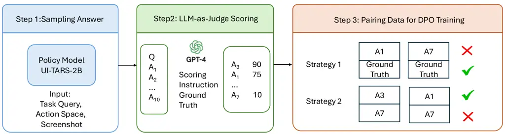
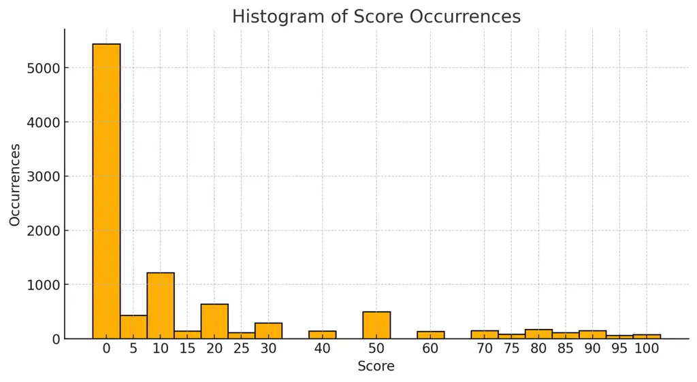

# DPO Learning with LLMs-Judge Signal for Computer Use Agents

Man Luo Affiliation: Intel Email: <xin.su@intel.com>    David Cobbley
Affiliation: Intel Email: <man.luo@intel.com>    Xin Su
Affiliation: Intel Email: <david.j.cobbley@intel.com>    Shachar
Rosenman Affiliation: Intel Email: <shachar.rosenman@intel.com>   
Vasudev Lal Affiliation: Intel Email: <vasudev.lal@intel.com>   
Shao-Yen Tseng Affiliation: Intel Email: <shao-yen.tseng@intel.com>   
Phillip Howard Affiliation: Thoughtworks
Email: <phillip.howard@thoughtworks.com>

###### Abstract

Computer use agents (CUA) are systems that automatically interact with
graphical user interfaces (GUIs) to complete tasks. CUA have made
significant progress with the advent of large vision-language models
(VLMs). However, these agents typically rely on cloud-based inference
with substantial compute demands, raising critical privacy and
scalability concerns, especially when operating on personal devices. In
this work, we take a step toward privacy-preserving and
resource-efficient agents by developing a lightweight vision-language
model that runs entirely on local machines. To train this compact agent,
we introduce an LLM-as-Judge framework that automatically evaluates and
filters synthetic interaction trajectories, producing high-quality data
for reinforcement learning without human annotation. Experiments on the
OS-World benchmark demonstrate that our fine-tuned local model
outperforms existing baselines, highlighting a promising path toward
private, efficient, and generalizable GUI agents.

## 1 Introduction

Computer Use Agents (CUAs) aim to automate user interactions with
graphical user interfaces (GUIs), offering potential to revolutionize
how humans interact with software \[5, 25, 19, 1\]. These agents can
perform a wide range of tasks such as navigating applications, clicking
buttons, entering data, and monitoring workflows, making them valuable
tools for software testing, digital productivity, accessibility, and
even robotic process automation. The emergence of large vision-language
models (VLMs) \[2, 9\] has recently accelerated progress in this space,
as VLMs can jointly reason over visual elements and natural language
instructions, making them ideal candidates for GUI understanding and
interaction.

Despite this progress, current state-of-the-art GUI agents typically
rely on cloud-hosted VLMs with large computational workload. These
systems require GPU-backed infrastructure, fast network connections, and
remote data transfer, raising significant concerns about latency, cost,
scalability, and most critically, privacy, especially when interacting
with personal data on user-facing applications.

To address these limitations, we present a privacy-preserving and
resource-efficient GUI agent designed to operate entirely on local
machines. Our agent is built on a compact vision-language model that
maintains task competence while fitting within the constraints of
consumer hardware. This local-first design eliminates the need for
network communication during inference, providing strong privacy
guarantees and enabling deployment in security-critical or
bandwidth-limited environments.

Training such a lightweight agent, however, poses a major challenge: how
to obtain high-quality GUI interaction data without extensive human
labeling. To solve this, we propose an LLM-as-Judge framework \[24, 7\],
where an LLM automatically scores the synthetic interaction
trajectories. This scored and ranked dataset serves as a foundation for
reinforcement learning \[12, 4\], allowing the compact model to learn
GUI interaction policies without requiring costly manual annotations.
The pipeline of generating the data is shown in Figure 1 and illustrated
in §3.

We then fine-tune a 2B-model on our generated data using Direct
Preference Optimization (DPO) training \[17\] and evaluate our approach
on the OS-World benchmark \[19\] with baseline. Our local agent
outperforms the baseline significantly. These findings suggest that it
is not only feasible but advantageous to shift toward local,
privacy-aware computer use agents. Our work lays the groundwork for
efficient, deployable, and generalizable GUI agents—capable of
empowering a wide range of real-world applications.

Figure 1: Pipeline of creating DPO training data for the policy model
(UI-TARs-2B) using LLM-as-judge method.

## 2 Related Work

#### Reinforcement Learning

Reinforcement learning has become a central approach for aligning
language and multimodal models with human preferences. Christiano et al.
\[4\] introduce Reinforcement Learning from Human Feedback (RLHF),
proposing a framework in which a reward model is trained using pairwise
human preference comparisons. This approach is later adapted to language
generation tasks by Ziegler et al. \[26\], demonstrating that
preference-informed fine-tuning of large language models (LLMs) can
significantly improve alignment with user expectations. Ouyang et al.
\[12\] introduce a multi-stage pipeline: starting with supervised
fine-tuning on demonstration data, followed by reward model training
using human-labeled preference pairs, and finally optimizing the policy
via Proximal Policy Optimization (PPO) \[16\]. The resulting InstructGPT
models exhibits enhanced truthfulness and user satisfaction relative to
larger, non-aligned baselines. Despite PPO’s effectiveness, its
computational complexity and reliance on reward model rollouts have
motivated the development of simplified alternatives. Rafailov et al.
\[14\] propose DPO, which reframes preference-based alignment as a
classification problem, thereby eliminating the need for explicit reward
modeling or inference. Under DPO, the optimal policy is derived via a
softmax over reward differences, enabling efficient end-to-end
gradient-based training. Empirical results have demonstrated that DPO
achieves comparable or superior alignment to PPO across tasks such as
summarization, dialogue generation, and sentiment control, while
offering greater training stability and reduced resource consumption.
Building on these insights, recent research has extended DPO into the
multimodal domain \[8, 6\]. Zhang et al. \[22\] apply a DPO-based
strategy to video-language instruction tuning using GPT-4V-based
preference signals. Addressing the challenge of unconditional
preferences in multimodal learning, Wang et al. \[17\] propose mDPO, an
extension that incorporates image-conditioned preference modeling and
reward anchoring. Their approach reduces hallucinations and improved
visual grounding across multiple vision-language models (VLMs).

#### Computer Use Agent Training

The development of agents capable of interacting with graphical user
interfaces (GUIs) has been significantly advanced by recent progress in
multimodal learning. Such agents, often referred to as computer-use
agents, are required to resolve key challenges such as long-horizon
planning, multimodal grounding, partial observability, and efficient
memory management in dynamic, temporally extended environments. Early
approaches in this area have targeted specific domains, including web
navigation \[5, 25, 23\], desktop environments \[3, 19, 18\], and mobile
platforms  \[21, 15\]. While effective within their respective domains,
these systems often lacked generalization across diverse GUI
distributions. Recent methodological trends have shifted toward building
general-purpose agents that abstract over specific interface modalities.
For instance, AGUVIS \[20\] and InfiGUIAgent \[10\] propose two-stage
training paradigms that explicitly decouple low-level GUI grounding from
high-level task planning and reasoning. This modularization enables
improved scalability and transferability across heterogeneous platforms.
UI-TARS \[13\] introduces a self-reflective task-aware decision-making
framework that employs DPO to refine action selection through recursive
evaluation. Complementarily, Agent-S2 \[1\] leverages a
generalist-specialist architectural decomposition, in which a
domain-agnostic planner is paired with a set of domain-specific
execution modules. The inclusion of a Mixture-of-Grounding-Experts
mechanism facilitates policy reuse across multiple interface
distributions, contributing to improved sample efficiency and transfer
learning. Collectively, these approaches represent significant progress
toward building general-purpose, robust multimodal agents. Despite these
advances, state-of-the-art GUI agents predominantly rely on
computationally intensive cloud-based inference services, which present
substantial privacy and scalability limitations. Our work addresses
these limitations by developing a lightweight vision-language model that
can be operate entirely on local hardware, thereby preserving user
privacy while maintaining robust performance under computational
constraints.

## 3 LLM-as-Judge DPO Training Pipeline

Improving the performance of computer use agents requires high-quality
preference data, but collecting such data through human annotation is
costly and difficult to scale. To address this, we propose an
LLM-as-Judge framework that leverages GPT-4o \[11\] to automatically
assess and rank model-generated responses for UI-based tasks. Using this
approach, we construct a scalable dataset of preference-labeled examples
derived from the AGUVIS benchmark \[20\], which consists of real-world
GUI interaction tasks. These preference pairs are then used to fine-tune
our policy model, UI-TARS-2B \[13\], via Direct Preference Optimization
(DPO) \[14\], encouraging it to better emulate expert behavior in
completing interface-based instructions. Figure 1 shows the overall
pipeline of our data collection strategy and we will detail each step in
the following.

#### Data Sampling.

To construct preference-labeled training data for DPO fine-tuning, we
first sampled multiple responses from our base policy model, UI-TARS-2B,
using task instances from the AGUVIS dataset. This dataset consists of
natural language instructions paired with GUI screenshots, with the goal
of predicting the next interaction step within the graphical interface.
For each task instance, we generate a set of 10 diverse candidate
completions using a hybrid decoding strategy that combines
temperature-controlled nucleus sampling with top-k filtering
(temperature = 0.7, top k = 10, top p = 0.9). This strategy constrains
token selection to high-probability regions while introducing controlled
randomness, striking a balance between output diversity and task
relevance.

#### Response Scoring.

To assess the quality of model-generated responses, we employ GPT-4o as
an automatic evaluator. For each task in the AGUVIS dataset, we present
GPT-4o with 10 sampled responses from UI-TARS-2B alongside the ground
truth answer, all within a single prompt. We instruct GPT-4o to assign a
quality score between 0 and 100 to each response based on its relevance,
accuracy, and alignment with the task instruction. This setup enables
GPT-4o to compare all responses in context and produce consistent,
relative scores across candidates. Figure 2 shows the prompt to instruct
the GPT-4o model. Note that the term instruction refers to the input
originally provided to UI-TARS-2B model during response sampling, which
includes the task description, available action space, and the required
output format.

Figure 2: Prompt used to obtain GPT-4o scores for candidate responses.

#### Pairing for DPO Training.

We explore two strategies for constructing preference pairs based on the
GPT-4o-generated scores. The first strategy pairs each model-generated
response with a score below 80 against the corresponding ground-truth
answer. In these pairs, the lower-scoring model output is treated as the
rejected sample, while the ground-truth answer serves as the preferred
one. The second strategy constructs preference pairs directly between
model-generated responses. For each task, we compare model outputs with
different scores and form pairs in which the higher-scoring response is
designated as the preferred sample and the lower-scoring one as the
rejected sample. These approaches enabled us to create a diverse set of
preference pairs for DPO training. Using the quality scores produced by
GPT-4o, we construct these preference pairs and apply DPO to further
train the UI-TARS-2B model.

## 4 Experiments

### 4.1 OSWorld Benchmark

The OSWorld benchmark is a diverse evaluation suite designed to assess
the performance of computer use agents which comprises 369 real-world
computer tasks involving web and desktop applications in open domains,
OS file I/O, and workflows spanning 10 distinct domains (see Table 1.),
including commonly used programs like Chrome, GIMP, LibreOffice tools
(Calc, Impress, Writer), VS Code, VLC, and system-level operations
(e.g., OS utilities and Thunderbird email). The diversity is critical
because it challenges agents to generalize beyond single-task
performance and instead demonstrate robustness, flexibility, and
adaptability across heterogeneous user interfaces and workflows.

### 4.2 Experiments Setup

#### Model Inference Parameters Setup

For all models, we set the temperature parameter to 1.0, and top_p to
0.7, and the maximum number of tokens for generation is set to 1500
(while in practice, models generate much shorter length than this
maximum value). Given the variance of the generated output due to the
temperature, for each models, we run the evaluation three times and
average the performance.

#### Hardware Setup

To comprehensively evaluate and benchmark multiple vision-language
models in parallel, we leverage a scalable infrastructure hosted on the
Intel^(®) Tiber AI Cloud. Our environment consists of five dedicated
servers, each with dual Intel^(®) Xeon^(®) Platinum 8468 Processors, 1TB
of RAM, connected to a high-performance network file system, as well as
several local hosted vLLM inference endpoints. This robust
infrastructure allows us to execute over 140 concurrent evaluations
simultaneously. By optimizing the parallel execution of jobs and
employing multiple local vLLM inference endpoints, we achieve efficient
throughput and scalability. This setup enables the completion of all 369
examples in under 30 minutes for 15-step interactions and 90 minutes for
50-steps, significantly reducing the total evaluation time compared to
traditional single node setups.

### 4.3 GPT-4 Scoring Baseline Analysis

Figure 3 shows the distribution of GPT-4o scores on responses generated
by the baseline UI-TAR-2B model. The scores are heavily concentrated
near zero, with the vast majority of samples receiving a score of 0 and
only a small fraction scoring between 5 and 50. Responses above 50 are
extremely rare. This distribution highlights that the baseline model,
despite being state-of-the-art for its size, frequently generates
low-quality outputs and still has significant room for improvement. The
abundance of poor responses enables effective preference pair
construction when contrasted with the ground truth, forming the basis
for learning through DPO.

### 4.4 Benchmark Experiments Results

We refer to the models trained using the first and second pairing
strategies as DPO-1 and DPO-2, respectively, and the model trained on
their combined dataset as DPO-3. We conduct experiments under two
settings: 15-Steps, where the agent can take up to 15 actions to
complete a task, and 50-Steps, where the limit is increased to 50. We
analyze the results for each setting separately.

Figure 3: LLM-as-judge Score distribution.

#### 15-Steps Results

Table 1 compares our three DPO models with the baseline under the
15-step setting. All DPO models outperform the baseline, with weighted
average improvements of 32.86%, 22.43%, and 35.03% for DPO-1, DPO-2, and
DPO-3, respectively. Notably, different DPO models excel in different
domains—DPO-3 leads in Chrome and Thunderbird, while DPO-2 outperforms
others in OS and VLC—indicating complementary strengths across
strategies. DPO-3 achieves the highest overall score (9.33) and delivers
the best performance in 4 out of 10 domains. Overall, DPO-3 demonstrates
the most consistent and robust gains, validating the benefit of
integrating both preference supervision schemes.

#### 50-Steps Results

Table 2 presents the model performance under the 50-step setting.
Although DPO-1 leads in 4 out of 10 domains, the overall performance
gains across all DPO models are relatively modest in this setting.
Interestingly, we observe that all DPO models perform worse under the
50-step setting compared to their 15-step counterparts. One possible
explanation is that longer action horizons increase the likelihood of
error accumulation, making it harder for the model to remain aligned
with task goals—especially if training was more biased toward shorter
trajectories. Additionally, our system did experience hardware failures
during inference in some 50-step runs, which could have contributed to
degraded performance. We plan to investigate both hypotheses further by
analyzing failure cases and rerunning affected evaluations under
controlled conditions. Nevertheless, a noteworthy finding is that DPO
models in the 15-step setting still outperform the baseline even when it
operates under the more flexible 50-step setting. This demonstrates that
DPO fine-tuning can lead to more efficient and reliable behavior with
shorter interaction budgets, providing practical benefits in both
performance and inference efficiency.

|                   |       |       |       |          |           |
| ----------------- | ----- | ----- | ----- | -------- | --------- |
| Domain            | DPO-1 | DPO-2 | DPO-3 | Baseline | Max Diff. |
| Chrome            | 10.87 | 7.97  | 12.43 | 5.07     | 10.48     |
| GIMP              | 29.49 | 24.36 | 27.28 | 30.77    | 7.69      |
| LO Calc           | 3.55  | 2.13  | 3.55  | 2.13     | 4.26      |
| LO Impress        | 4.96  | 4.27  | 3.59  | 3.59     | 2.93      |
| LO Writer         | 5.79  | 7.24  | 5.80  | 4.35     | 4.35      |
| Multi Apps        | 0.66  | 1.32  | 1.17  | 1.32     | 0.66      |
| OS                | 22.22 | 27.78 | 27.78 | 19.44    | 13.89     |
| Thunderbird       | 8.89  | 13.33 | 13.33 | 6.67     | 13.33     |
| VLC               | 16.50 | 10.40 | 8.21  | 1.96     | 21.57     |
| VS Code           | 24.24 | 19.70 | 23.78 | 18.18    | 12.25     |
| Weighted Avg.     | 9.18  | 8.46  | 9.33  | 6.91     | 3.14      |
| \# Best of Domain | 3     | 4     | 4     | 2        | -         |
| % improvement     | 32.86 | 22.43 | 35.03 | -        | -         |

Table 1: Success rates of our models vs. baseline across 10 application
domains in OS-World benchmark. Each agent has maximum 15 steps. LO
stands for LibreOffice. Success rates are calculated independently for
each domain. Max Diff is computed based on the best performance compared
to the average baseline

|                   |        |        |        |          |           |
| ----------------- | ------ | ------ | ------ | -------- | --------- |
| Domain            | DPO-1  | DPO-2  | DPO-3  | Baseline | Max Diff. |
| Chrome            | 9.37   | 7.25   | 8.64   | 5.07     | 9.99      |
| GIMP              | 28.62  | 30.77  | 24.36  | 31.18    | 3.44      |
| LO Calc           | 2.13   | 4.26   | 2.85   | 2.84     | 1.42      |
| LO Impress        | 2.90   | 3.58   | 5.01   | 4.26     | 2.19      |
| LO Writer         | 11.59  | 7.24   | 8.82   | 4.34     | 8.70      |
| Multi Apps        | 1.32   | 0.99   | 1.17   | 0.99     | 0.99      |
| OS                | 27.78  | 25.00  | 20.83  | 26.39    | 6.94      |
| Thunderbird       | 11.11  | 6.67   | 15.56  | 20.00    | 0.00      |
| VLC               | 7.97   | 14.22  | 6.70   | 15.27    | 2.37      |
| VS Code           | 24.00  | 25.03  | 19.37  | 21.94    | 8.50      |
| Weighted Avg      | 9.01   | 8.88   | 8.24   | 8.83     | 1.52      |
| \# Best of Domain | 4      | 2      | 1      | 3        | \-        |
| % improvement     | +2.04% | +0.57% | -6.68% | \-       | \-        |

Table 2: Success rates of our models vs. baseline across 10 application
domains in OS-World benchmark. Each agent has maximum 50 steps. LO
stands for LibreOffice. Success rates are calculated independently for
each domain.

### 4.5 Failure Case Analysis

To better understand the limitations of models, we conduct a qualitative
analysis of failure cases by manually inspecting samples where the agent
failed to complete the task. We categorize the observed failures into
three main groups:

#### Invalid Coordination.

In this category, the model generates syntactically incorrect actions
that cannot be executed by the parsing system (e.g. PyAutoGUI). For
example, the model may output a coordinate in an incorrect format such
as ”click(start_box=’\[19,60)’)”. which yield parsing error “could not
convert string to float: ’\[19”’. Although the intended target may be
correct, the formatting error renders the action invalid.

#### Wrong Coordination.

In this case, the model generates syntactically valid but semantically
incorrect coordinates. The predicted location does not correspond to the
intended UI element, leading the agent to click on irrelevant or empty
areas. These errors suggest gaps in spatial grounding of visual context
in the screenshot.

#### Repeat Wrong Action.

In this failure mode, the model produces an invalid or incorrect action
and then gets stuck repeating the same faulty step across multiple
timesteps. This behavior indicates insufficient corrective mechanisms
during generation, where the model fails to revise its plan even after
repeated failure signals.

These categories highlight key areas for improvement in model
robustness, including syntax enforcement, spatial grounding, and
recovery from invalid states. We plan to explore explicit action
validation, visual feedback mechanisms, or trajectory-level supervision
to mitigate these issues in the future.

## 5 Conclusion

We propose an LLM-as-Judge framework to improve lightweight,
locally-executed computer use agents without requiring human-labeled
data. By leveraging GPT-4 to automatically evaluate model-generated
interaction trajectories, we construct high-quality preference pairs for
Direct Preference Optimization. Our experiments on the OS-World
benchmark show that DPO-trained models consistently outperform the
baseline, particularly in short action trajectory (maximum 15 steps)
settings where efficient interaction is critical. Moreover, our
qualitative analysis reveals actionable failure patterns, offering
guidance for future improvements in coordination accuracy and recovery
behavior. This work demonstrates a scalable and privacy-preserving
approach to training compact GUI agents, paving the way toward more
capable and generalizable systems deployable on personal devices.

## References

- \[1\] Saaket Agashe, Kyle Wong, Vincent Tu, Jiachen Yang, Ang Li, and
  Xin Eric Wang. Agent s2: A compositional generalist-specialist
  framework for computer use agents. _arXiv preprint
  arXiv:2504.00906_, 2025.
- \[2\] Jinze Bai, Shuai Bai, Shusheng Yang, Shijie Wang, Sinan Tan,
  Peng Wang, Junyang Lin, Chang Zhou, and Jingren Zhou. Qwen-vl: A
  versatile vision-language model for understanding, localization, text
  reading, and beyond. _arXiv preprint arXiv:2308.12966_, 2023.
- \[3\] Rogerio Bonatti, Dan Zhao, Francesco Bonacci, Dillon Dupont,
  Sara Abdali, Yinheng Li, Yadong Lu, Justin Wagle, Kazuhito Koishida,
  Arthur Bucker, et al. Windows agent arena: Evaluating multi-modal os
  agents at scale. _arXiv preprint arXiv:2409.08264_, 2024.
- \[4\] Paul F Christiano, Jan Leike, Tom Brown, Miljan Martic, Shane
  Legg, and Dario Amodei. Deep reinforcement learning from human
  preferences. _Advances in neural information processing systems_,
  30, 2017.
- \[5\] Xiang Deng, Yu Gu, Boyuan Zheng, Shijie Chen, Sam Stevens, Boshi
  Wang, Huan Sun, and Yu Su. Mind2web: Towards a generalist agent for
  the web. _Advances in Neural Information Processing Systems_,
  36:28091–28114, 2023.
- \[6\] Anisha Gunjal, Jihan Yin, and Erhan Bas. Detecting and
  preventing hallucinations in large vision language models. In
  _Proceedings of the AAAI Conference on Artificial Intelligence_, pages
  18135–18143, 2024.
- \[7\] Dawei Li, Bohan Jiang, Liangjie Huang, Alimohammad Beigi,
  Chengshuai Zhao, Zhen Tan, Amrita Bhattacharjee, Yuxuan Jiang, Canyu
  Chen, Tianhao Wu, et al. From generation to judgment: Opportunities
  and challenges of llm-as-a-judge. _arXiv preprint
  arXiv:2411.16594_, 2024.
- \[8\] Lei Li, Zhihui Xie, Mukai Li, Shunian Chen, Peiyi Wang, Liang
  Chen, Yazheng Yang, Benyou Wang, and Lingpeng Kong. Silkie: Preference
  distillation for large visual language models. _arXiv preprint
  arXiv:2312.10665_, 2023.
- \[9\] Haotian Liu, Chunyuan Li, Qingyang Wu, and Yong Jae Lee. Visual
  instruction tuning. _Advances in neural information processing
  systems_, 36:34892–34916, 2023.
- \[10\] Yuhang Liu, Pengxiang Li, Zishu Wei, Congkai Xie, Xueyu Hu,
  Xinchen Xu, Shengyu Zhang, Xiaotian Han, Hongxia Yang, and Fei Wu.
  Infiguiagent: A multimodal generalist gui agent with native reasoning
  and reflection. _arXiv preprint arXiv:2501.04575_, 2025.
- \[11\] OpenAI. Hello gpt-4o.
  [https://openai.com/index/hello-gpt-4o/](https://openai.com/index/hello-gpt-4o/), 2024.
  Accessed: 2025-05-16.
- \[12\] Long Ouyang, Jeffrey Wu, Xu Jiang, Diogo Almeida, Carroll
  Wainwright, Pamela Mishkin, Chong Zhang, Sandhini Agarwal, Katarina
  Slama, Alex Ray, et al. Training language models to follow
  instructions with human feedback. _Advances in neural information
  processing systems_, 35:27730–27744, 2022.
- \[13\] Yujia Qin, Yining Ye, Junjie Fang, Haoming Wang, Shihao Liang,
  Shizuo Tian, Junda Zhang, Jiahao Li, Yunxin Li, Shijue Huang, et al.
  Ui-tars: Pioneering automated gui interaction with native agents.
  _arXiv preprint arXiv:2501.12326_, 2025.
- \[14\] Rafael Rafailov, Archit Sharma, Eric Mitchell, Christopher D
  Manning, Stefano Ermon, and Chelsea Finn. Direct preference
  optimization: Your language model is secretly a reward model.
  _Advances in Neural Information Processing Systems_,
  36:53728–53741, 2023.
- \[15\] Christopher Rawles, Alice Li, Daniel Rodriguez, Oriana Riva,
  and Timothy Lillicrap. Androidinthewild: A large-scale dataset for
  android device control. _Advances in Neural Information Processing
  Systems_, 36:59708–59728, 2023.
- \[16\] John Schulman, Filip Wolski, Prafulla Dhariwal, Alec Radford,
  and Oleg Klimov. Proximal policy optimization algorithms. _arXiv
  preprint arXiv:1707.06347_, 2017.
- \[17\] Fei Wang, Wenxuan Zhou, James Y Huang, Nan Xu, Sheng Zhang,
  Hoifung Poon, and Muhao Chen. mdpo: Conditional preference
  optimization for multimodal large language models. _arXiv preprint
  arXiv:2406.11839_, 2024.
- \[18\] Zhiyong Wu, Chengcheng Han, Zichen Ding, Zhenmin Weng,
  Zhoumianze Liu, Shunyu Yao, Tao Yu, and Lingpeng Kong. Os-copilot:
  Towards generalist computer agents with self-improvement. _arXiv
  preprint arXiv:2402.07456_, 2024.
- \[19\] Tianbao Xie, Danyang Zhang, Jixuan Chen, Xiaochuan Li, Siheng
  Zhao, Ruisheng Cao, Toh J Hua, Zhoujun Cheng, Dongchan Shin, Fangyu
  Lei, et al. Osworld: Benchmarking multimodal agents for open-ended
  tasks in real computer environments. _Advances in Neural Information
  Processing Systems_, 37:52040–52094, 2024.
- \[20\] Yiheng Xu, Zekun Wang, Junli Wang, Dunjie Lu, Tianbao Xie,
  Amrita Saha, Doyen Sahoo, Tao Yu, and Caiming Xiong. Aguvis: Unified
  pure vision agents for autonomous gui interaction. _arXiv preprint
  arXiv:2412.04454_, 2024.
- \[21\] An Yan, Zhengyuan Yang, Wanrong Zhu, Kevin Lin, Linjie Li,
  Jianfeng Wang, Jianwei Yang, Yiwu Zhong, Julian McAuley, Jianfeng Gao,
  et al. Gpt-4v in wonderland: Large multimodal models for zero-shot
  smartphone gui navigation. _arXiv preprint arXiv:2311.07562_, 2023.
- \[22\] Ruohong Zhang, Liangke Gui, Zhiqing Sun, Yihao Feng, Keyang Xu,
  Yuanhan Zhang, Di Fu, Chunyuan Li, Alexander Hauptmann, Yonatan Bisk,
  et al. Direct preference optimization of video large multimodal models
  from language model reward. _arXiv preprint arXiv:2404.01258_, 2024.
- \[23\] Boyuan Zheng, Boyu Gou, Jihyung Kil, Huan Sun, and Yu Su.
  Gpt-4v (ision) is a generalist web agent, if grounded. In
  _International Conference on Machine Learning_, pages 61349–61385.
  PMLR, 2024.
- \[24\] Lianmin Zheng, Wei-Lin Chiang, Ying Sheng, Siyuan Zhuang,
  Zhanghao Wu, Yonghao Zhuang, Zi Lin, Zhuohan Li, Dacheng Li, Eric
  Xing, et al. Judging llm-as-a-judge with mt-bench and chatbot arena.
  _Advances in Neural Information Processing Systems_,
  36:46595–46623, 2023.
- \[25\] Shuyan Zhou, Frank F Xu, Hao Zhu, et al. Webarena: A realistic
  web environment for building autonomous agents. _arXiv preprint
  arXiv:2307.13854_, 2023.
- \[26\] Daniel M Ziegler, Nisan Stiennon, Jeffrey Wu, Tom B Brown, Alec
  Radford, Dario Amodei, Paul Christiano, and Geoffrey Irving.
  Fine-tuning language models from human preferences. _arXiv preprint
  arXiv:1909.08593_, 2019.
