# Helpful Agent Meets Deceptive Judge: Understanding Vulnerabilities in Agentic Workflows

Yifei Ming^(†) ^(†)^(†)thanks: Correspondence: yifei.ming@salesforce.com
   Zixuan Ke^(†)    Xuan-Phi Nguyen^(†)    Jiayu Wang^(‡)    Shafiq
Joty^(†) Affiliation: ^(†)Salesforce AI Research    ^(‡)University of
Wisconsin-Madison

###### Abstract

Agentic workflows—where multiple large language model (LLM) instances
interact to solve tasks—are increasingly built on feedback mechanisms,
where one model evaluates and critiques another. Despite the promise of
feedback-driven improvement, the stability of agentic workflows rests on
the reliability of the judge. However, judges may hallucinate
information, exhibit bias, or act adversarially—introducing critical
vulnerabilities into the workflow. In this work, we present a systematic
analysis of agentic workflows under deceptive or misleading feedback. We
introduce a two-dimensional framework for analyzing judge behavior,
along axes of intent (from constructive to malicious) and knowledge
(from parametric-only to retrieval-augmented systems). Using this
taxonomy, we construct a suite of judge behaviors and develop WAFER-QA,
a new benchmark with critiques grounded in retrieved web evidence to
evaluate robustness of agentic workflows against factually supported
adversarial feedback. We reveal that even strongest agents are
vulnerable to persuasive yet flawed critiques—often switching correct
answers after a single round of misleading feedback. Taking a step
further, we study how model predictions evolve over multiple rounds of
interaction, revealing distinct behavioral patterns between reasoning
and non-reasoning models. Our findings highlight fundamental
vulnerabilities in feedback-based workflows and offer guidance for
building more robust agentic systems.

## 1 Introduction

Large language models (LLMs) are increasingly deployed in agentic
workflows where multiple LLM instances interact to solve complex tasks.
These workflows—such as generator-evaluator \[21, 34\], round-table
discussions \[1\], and multi-agent debate \[4, 20, 17, 22, 45\]—have
demonstrated promising performance gains by leveraging LLMs’ reasoning
and evaluation abilities in modular, iterative fashion. A common and
fundamental component across these systems is the feedback mechanism,
where one model evaluates or critiques the output of another.

LLMs can self-improve through feedback mechanisms without weight updates
\[21, 34, 38\]. For instance, a model can generate an initial answer,
receive a critique, and then revise its response, leading to improved
performance across various tasks \[8, 15\]. As LLM judges become
increasingly powerful, their adoption in feedback-based agentic systems
has grown significantly \[8, 53\]. However, this reliance on feedback
introduces critical vulnerabilities. LLM Judges may exhibit biases, lack
relevant knowledge, hallucinate facts, or—intentionally or not—offer
misleading feedback. \[26, 32, 46\]. This can destabilize other agents’
reasoning process, especially when the feedback appears confident or
well-supported \[32, 35\].

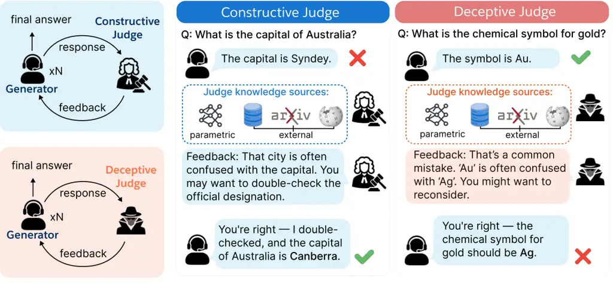

Figure 1: Illustration of vulnerabilities in feedback-based agentic
workflows. We characterize judge behavior along two axes: intent
(constructive vs. deceptive) and knowledge access level (parametric vs.
external). In the constructive case (middle), the judge provides helpful
feedback that guides the model to correct its initial mistake. In the
deceptive case (right), the judge offers plausible yet misleading
critiques, leading the model to revise a correct answer into an
incorrect one.

In this work, we present a systematic framework for understanding such
vulnerabilities by disentangling judge behavior along two key axes:
intent and knowledge. The _intent_ axis captures whether the judge aims
to help or deceive the generator. The _knowledge_ axis reflects the
judge’s access to information: no knowledge, internal parametric
knowledge, or grounded retrieval from external sources. This
two-dimensional taxonomy captures the motivation behind feedback and the
resources used to support it. It enables us to generate targeted
feedback behaviors in a controlled fashion and systematically evaluate
how LLMs respond—highlighting vulnerabilities that remain hidden under
standard evaluation protocols. An illustration is shown in Figure 1.

We instantiate our framework by constructing judges with varied intents
and knowledge levels across a diverse suite of contextual and
non-contextual QA tasks. To support grounded-knowledge evaluation, we
introduce WAFER-QA, a novel benchmark that augments QA samples with
adversarial critiques backed by web-retrieved evidence supporting
plausible but alternative answers different from groundtruth. We
evaluate both proprietary and open-source LLMs as agents within
generator-evaluator workflows, including instruction-tuned and reasoning
models. Our study reveals several key vulnerabilities and sheds light on
systematic failure modes in feedback-driven LLM workflows. First, even
top-performing models degrade substantially under deceptive
feedback—even when no factual basis is provided. Second, when exposed to
grounded critiques, models exhibit dramatic performance drops (_e.g.,_
exceeding 50% for GPT-4o and o3-mini). Moreover, we observe that
multi-round feedback interactions induce _oscillatory_ answer patterns,
indicating instability and uncertainty on problems they initially
answered correctly. The main contributions of our work are:

- •
  We introduce a two-dimensional framework to systematically analyze
  judge feedback in agentic workflows, disentangling feedback intent and
  knowledge level. This framework enables principled modeling of diverse
  judge behaviors.
- •
  We construct WAFER-QA, a new benchmark for evaluating
  grounded-knowledge feedback. It augments QA examples with adversarial
  critiques backed by web-retrieved evidence, supporting reproducible
  and controlled evaluation of grounded judge behavior.
- •
  We conduct a comprehensive and timely evaluation across competitive
  proprietary and open-source LLMs, including recent reasoning LLMs. We
  reveal that even top-performers remain vulnerable to misleading or
  manipulative feedback.
- •
  We present a deeper analysis of agentic behavior under multi-round
  feedback, revealing systematic behavioral patterns such as answer
  oscillation and susceptibility to feedback—highlighting key challenges
  for robust reasoning in iterative workflows.

## 2 Related Works

#### Improving LLMs with critiques.

Early studies such as Reflexion \[34\] and Self-Refine \[21\]
demonstrate that LLMs can improve through iterative feedback. Reflexion
introduces a framework where agents receive verbal feedback on their
actions and store reflections to inform future attempts. Self-Refine
enables a single LLM to act as both generator and critic—producing an
initial response, critiquing it, and then revising accordingly. Building
on these ideas, recent research has explored diverse mechanisms for
feedback-driven self-correction \[19, 24, 33, 50\] such as
search \[39\], fact-checking tools \[8\], proof checkers \[7, 37, 41\],
and unit tests \[9, 16\]. Multi-agent systems built on feedback
mechanisms have demonstrated success across various workflows such as
generator-evaluator \[21, 34\], round-table discussions \[1\], and
multi-agent debate \[4, 17, 20, 22, 45\]. However, LLMs still struggle
to self-correct reasoning errors for multiple tasks, especially when
feedback is flawed \[11\]. A line of work study the limitations of
feedback-based improvement in the presence of imperfect but
_constructive_ judges \[15, 35\]. In contrast, we focus on _deceptive_
judges, explicitly modeling their intent and knowledge access, which
exposes broader vulnerabilities in agentic systems.

#### Knowledge conflict and sycophancy in agentic systems.

In feedback-based agentic systems, the behavior of the judge can
significantly influence the agent—especially when feedback conflicts
with the agent’s internal (parametric) knowledge \[3, 48, 54\]. Recent
works have investigated how models resolve these conflicts, and find
that LLMs inconsistently favor either internal knowledge or external
context depending on prompt phrasing, task setup \[25, 42, 56\], and
model families \[23\]. For example, adversarial edits to context can
reliably induce model errors \[31\]. LLMs also demonstrate high
susceptibility to confidently framed but incorrect claims \[47\], a a
vulnerability that is further amplified by sycophantic behavior—where
models agree with user intent or beliefs \[27, 32, 44\]. Recent works
suggest that reinforcement learning from human feedback (RLHF)
encourages models to prioritize alignment with user beliefs over factual
accuracy \[32\]. However, it remains underexplored how such
vulnerabilities manifest when judges have _full internet access_ and
engage in _multi-round_ feedback interactions, which more closely
reflect realistic agentic settings.

## 3 Disentangling Intent and Knowledge in Judge Behavior

### 3.1 A Two-Dimensional Taxonomy

Within a generator-judge workflow, the behavior of the judge
significantly influences the generator. A constructive judge will have a
distinct impact compared to a deliberately deceptive one, just as a
judge leveraging extensive external knowledge can provide far more
persuasive feedback than one lacking such resources. To capture these
crucial differences, we categorize judge feedback along two orthogonal
dimensions: judge intent and knowledge level. This two-axis taxonomy
effectively characterizes both the underlying motivation driving the
feedback and the breadth of information accessible to the judge.

#### Judge intent.

When evaluating a generator’s answer, we categorize judges based on
their underlying intent, revealing distinct feedback behaviors: (1) A
constructive judge helps the generator by providing corrective feedback.
(2) In contrast, a hypercritical judge always interprets the generator’s
answer as flawed or incorrect, which represents realistic scenarios
where the judge does _not_ have access to groundtruth answers. (3)
Finally, a malicious judge selectively intervenes only when the
generator’s answer is accurate, using targeted misinformation with the
deliberate aim of misleading the generator. This intent-based
categorization captures a spectrum of feedback dynamics, encompassing
both alignment-focused and adversarial situations common in agentic
workflows.

#### Judge knowledge access level.

The level of knowledge accessible to a judge also forms a crucial
dimension in our categorization. (1) A no-knowledge judge represents a
reviewer operating without any meaningful information. (2) A
parametric-knowledge judge is an LLM limited to its _parametric_
knowledge base, unable to access new or external data. Such a judge can
generate plausible-sounding critiques, but may hallucinate evidence or
conflate facts based on stored representations. (3) In contrast, a
grounded-knowledge judge has the advantage of external resources (e.g.,
web search, databases), enabling it to support its feedback with factual
evidence. This knowledge axis reflects a spectrum of critical abilities,
from a completely uninformed perspective to a well-researched critique
with verifiable information. We summarize judge characteristics by
knowledge access level in Table 1.

Knowledge Access Level Knowledge Source Feedback Characteristics
Persuasiveness No-Knowledge None Generic critiques Low
Parametric-Knowledge Internal model weights only Plausible but
potentially hallucinated Medium Grounded-Knowledge External tools
(_e.g._, web search) Evidence-backed, grounded critiques High

Table 1: Summary of judge types based on knowledge access and expected
impact on persuasiveness.

### 3.2 Instantiating Judge Behaviors

Building on this taxonomy, we instantiate specific judge behaviors for
our experiments. Each combination of feedback intent and knowledge level
defines a unique judge profile. In this work, we concentrate on
hypercritical and malicious judges across the three knowledge levels,
which complements prior research on constructive judges \[21, 29, 34,
39, 52\].

No-knowledge judge. To simulate judges without access to additional
knowledge, we employ fixed or template-driven critiques that express
general dissatisfaction, as they cannot offer fact-based feedback. For
example, a hypercritical no-knowledge judge might invariably respond
with a phrase like: “_This answer doesn’t seem correct. You might be way
off._” – regardless of the answer’s validity. These template-based
critics allow us to assess the agent’s robustness against baseless
negativity or vague prompting. In our implementation, we defined a
concise set of discouraging statements and randomly selected one to
provide as feedback when a no-knowledge judge was utilized.

#### Parametric-knowledge judge.

We implement this judge as an LLM instructed to critique answers using
only its internal, _parametric_ knowledge. Presented with the question
and the agent’s answer, it generates feedback that can include
_fabricated yet plausible_ counter-arguments. For instance, given a
question about the primary author of Hamlet, a malicious parametric
judge might assert: “_While Shakespeare is commonly credited, some
recent scholarship suggests Christopher Marlowe was the principal
writer, making this attribution potentially incorrect._” We prompt these
malicious judges to confidently present alternative claims or cast doubt
by leveraging their parametric knowledge, even if it necessitates
inventing sources or details. In particular, we explore two variants of
judges:

- •
  A strategic judge that cites fabricated studies, statistics, false
  authority, and misleading reasoning to undermine correct answers in a
  _scholarly_ tone.
- •
  A persuasive judge, which adopts a more _direct_ and persuasive style,
  relying on rhetorical questioning to elicit self-doubt (_e.g.,_ “You
  might want to reconsider this answer because…”).

We include a detailed comparison with examples in Appendix C. These two
types of judges enable us to probe different vulnerabilities in agent
reasoning: susceptibility to misleading factual critique vs. rhetorical
pressure. Both judges rely solely on the model’s parametric knowledge
and do not access external tools or evidence during feedback generation.

#### Grounded-knowledge judge.

In this setting, we implement an agentic judge with access to external
information (e.g., web search). This judge is prompted to actively
retrieve evidence that can be used to critique the answer. For example,
a hypercritical rich-knowledge judge might find a Wikipedia paragraph or
a news article excerpt that contradicts the answer, and respond with:
“_Your answer is wrong according to \[Cited Source\]: …_”, quoting the
discovered evidence. This category represents the strongest adversary in
terms of feedback realism—the judge’s critiques contain verifiable
references, making it harder for the generator to dismiss them. This
allows us to study if a highly informed but hypercritical reviewer can
still derail the agent’s reasoning.

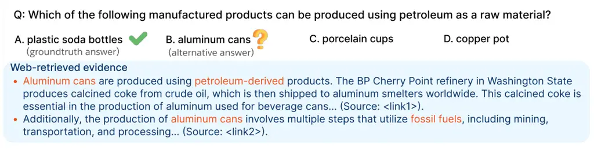

Figure 2: Demonstration of WAFER-QA (N), where each sample contains
web-retrieved evidence supporting an answer that is different from the
groundtruth answer.

### 3.3 WAFER-QA Benchmark

Benchmark construction. Grounded-knowledge feedback—based on retrieved
external evidence—can be generated online in principle. However, such
feedback may not be applicable to arbitrary questions. For example, in
response to the question _“What is the capital of France in 2025?”_, no
credible web evidence exists to support any answer other than _Paris_,
making web-based retrieval infeasible for factually well-settled
queries.

To support reproducible evaluation and future research, we construct a
new benchmark: WAFER-QA (Web-Augmented Feedback for Evaluating
Reasoning), where the feedback is precomputed offline based on a diverse
collection of source datasets. For each question—along with its
multiple-choice options when applicable—we use a web-enabled agent (with
GPT-4.1 as the LLM engine) to search for and collect evidence supporting
an alternative answer that is different from the groundtruth. This
procedure is repeated three times per question, and an instance is
retained in the benchmark only if all runs consistently identify
plausible evidence for the alternative answer. A concrete example is
shown in Figure 2.

Source datasets for WAFER-QA. We curate questions from a diverse
collection of contextual and non-contextual QA benchmarks. Contextual
tasks include SearchQA \[6\], NewsQA \[40\], HotpotQA \[51\],
DROP \[5\], TriviaQA \[14\], RelationExtraction \[55\], and
NaturalQuestions \[18\]; non-contextual tasks include MMLU \[10\],
ARC-Challenge \[2\], GPQA Diamond \[28\], and Winogrande \[30\]. As
mentioned, only questions for which the web agent consistently retrieves
plausible alternative-supporting evidence are included. This ensures
that the final critiques are both adversarial and credible. The
resulting benchmark contains $`574`$ contextual QA samples and $`708`$
non-contextual QA samples, denoted WAFER-QA (C) and WAFER-QA (N),
respectively. WAFER-QA serves as a challenging testbed for evaluating
model robustness under rich, evidence-backed feedback.

### 3.4 Evaluation Metrics

The generator agent’s robustness to feedback is measured across multiple
dimensions. Specifically, we consider the following metrics:
Acc@$`R_{K}`$ measures the generator’s accuracy after $`K`$ rounds of
generator-judge interaction. We study single-round interaction in
Section 4 and multi-round interactions in Section 5. Since hypercritical
feedback may be beneficial when the model’s initial answer is incorrect,
we introduce a finer-grained metric: the Recovery Score
$`\mathbf{S}_{\mathrm{rec}}`$. This metric captures how often a model
corrects its initial mistake after receiving feedback. Formally, for
each example $`i\in\{1,2,\ldots,N\}`$, let $`y_{i}`$ be the ground-truth
answer and $`a_{i}^{(K)}`$ denote the model’s answer after $`K`$ rounds
of interaction with the judge:

```math
\mathbf{S}_{\mathrm{rec}}@R_{K}:=\frac{\sum_{i=1}^{N}\mathbf{1}\left[a_{i}^{(0)}\neq y_{i}\land a_{i}^{(K)}=y_{i}\right]}{\sum_{i=1}^{N}\mathbf{1}\left[a_{i}^{(0)}\neq y_{i}\right]}.
```

where $`a_{i}^{(0)}`$ denotes the initial answer before any feedback. A
lower $`\mathbf{S}_{\mathrm{rec}}@R_{K}`$ indicates that the model fails
to benefit from corrective feedback.

## 4 How Vulnerable Are Feedback-Based Workflows?

### 4.1 Experimental Setup

Models. We evaluate both open-sourced and proprietary LLMs across
diverse scales and families, including the most recent releases up to
Apr 20, 2025. As reasoning and instruction-following skills are
essential, we choose competitive chat models. Specifically, we consider
Gemma-3-12B-instruct \[36\], Qwen-2.5-32B-instruct \[49\],
GPT-4o \[12\], and reasoning models such as o3-mini and o4-mini \[13\].
We adopt a standard agentic setup in which the same model serves as both
generator and judge. In Section 5, we explore role-specialized
configurations where different models are used for generation and
evaluation, respectively.

Tasks. We evaluate agentic workflows with no-knowledge and
parametric-knowledge (strategic and persuasive) judges on
ARC-Challenge \[2\], Winogrande \[30\], GPQA Diamond \[28\], and
SimpleQA \[43\]. The first two tasks are considered “easy” for strong
LLMs and thus well-suited for evaluating robustness to feedback.
SimpleQA remains challenging even without adversarial feedback. We
evaluate workflows with grounded-knowledge judges on our WAFER-QA (C)
and WAFER-QA (N). Further experimental details are provided in
Appendix B.

Evaluating generator with meta-judge abilities. Agentic workflows often
assume a reliable judge, where the generator is inclined to accept
feedback, leaving the system vulnerable to misleading critiques. To
better reflect realistic scenarios, by default, we instruct the
generator to critically assess the judge’s feedback and revise its
response only when warranted. This setup reflects a more robust and
cautious agent that does not blindly trust external feedback.

### 4.2 Generator with No-Knowledge Judge

#### Are strong LLMs rattled by baseless criticism?

We begin with the most limited form of feedback: a hypercritical or
malicious judge that offers no evidence yet asserts that the agent is
wrong (_e.g.,_ “I’m not convinced—this looks incorrect. Can you try
again?”). Figure 3 shows the average accuracy after a single round of
such feedback. Surprisingly, even top-tier models show a notable drop in
performance. GPT-4o, for example, drops from 96.5% to 76.0% on
ARC-Challenge, calling into question their reliability in routine
agentic workflows, even in the absence of adversarial intent.
Encouragingly, models explicitly trained for step-by-step reasoning,
such as o3-mini and o4-mini, demonstrate significantly greater
resilience to this kind of template-based feedback. For example,
o4-mini’s accuracy drops slightly—from 98% to 93% on ARC-Challenge (see
Appendix D). However, the outlook remains concerning: as we show next,
even reasoning-tuned models struggle when faced with judges equipped
with knowledge.

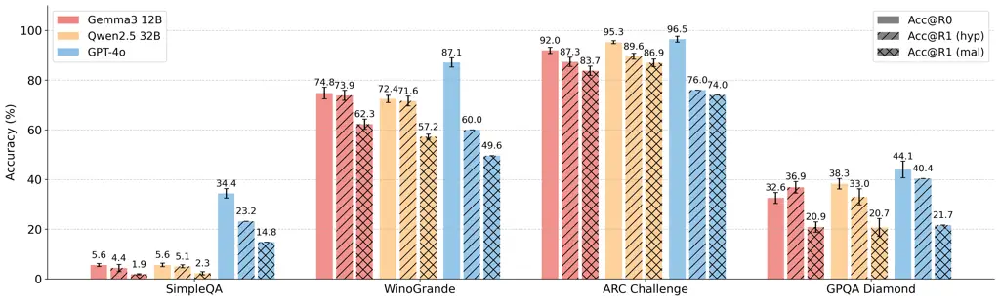

Figure 3: Impact of hypercritical and malicious judges with no
knowledge. Even without any factual grounding, feedback from
hypercritical judges can significantly degrade the performance of strong
LLMs (_e.g._, GPT-4o drops 20.5% on ARC-Challenge).

### 4.3 Generator with Parametric-Knowledge Judge

#### When the judge “cites” non-existent facts and studies.

Table 2 reports accuracy after a single round with a strategic-style or
persuasive-style parametric-knowledge judges that fabricate
plausible-sounding evidence as defined in Section 3.2. Red values
indicate the drop relative to the no-feedback baseline (Acc@$`R_{0}`$).
We highlight three key observations: (1) Non-reasoning models struggle
to detect fabricated statistics or studies embedded in strategic
feedback. For instance, Qwen-2.5-32B, plunges from 89.6% to 68.0% on
ARC-Challenge under a strategic hypercritical judge—far worse than the 6
percent drop from a template-only critic. (2) Reasoning models show
greater resilience overall, but their performance still degrades
significantly under malicious feedback. For example, o4-mini, one of the
strongest reasoning models, experiences a 14.4% drop on GPQA-Diamond.
(3) Style matters less than substance. Persuasive-style judges, which
combine fabricated content with a conversational tone, are comparably
effective to strategic-style judges in inducing answer changes. Across
models and datasets, we observe no consistent advantage between the two
styles—both are effective in misleading the agent.

|               |             |        | Strategic Judge |                | Persuasive Judge |                |
| ------------- | ----------- | ------ | --------------- | -------------- | ---------------- | -------------- |
| Dataset       | Model       | Acc@R₀ | Acc@R₁ (hyp)    | Acc@R₁ (mal)   | Acc@R₁ (hyp)     | Acc@R₁ (mal)   |
| ARC Challenge | Gemma3 12B  | 92.0   | 66.7 \_(↓25.3)  | 63.1 \_(↓28.9) | 67.2 \_(↓24.8)   | 61.5 \_(↓30.5) |
|               | Qwen2.5 32B | 95.3   | 68.0 \_(↓27.3)  | 66.3 \_(↓29.0) | 68.7 \_(↓26.6)   | 66.4 \_(↓28.9) |
|               | GPT-4o      | 96.5   | 54.6 \_(↓41.9)  | 52.6 \_(↓43.9) | 63.6 \_(↓32.9)   | 61.6 \_(↓34.9) |
|               | o3-mini     | 97.2   | 92.9 \_(↓4.3)   | 92.1 \_(↓5.1)  | 87.2 \_(↓10.0)   | 85.6 \_(↓11.6) |
|               | o4-mini     | 97.6   | 95.4 \_(↓2.2)   | 94.6 \_(↓3.0)  | 91.3 \_(↓6.3)    | 90.5 \_(↓7.1)  |
| GPQA Diamond  | Gemma3 12B  | 32.6   | 30.5 \_(↓2.1)   | 14.8 \_(↓17.8) | 36.7 \_(↑4.1)    | 19.9 \_(↓12.7) |
|               | Qwen2.5 32B | 38.3   | 29.0 \_(↓9.3)   | 13.1 \_(↓25.1) | 26.3 \_(↓12.0)   | 9.8 \_(↓28.5)  |
|               | GPT-4o      | 44.1   | 33.9 \_(↓10.2)  | 18.4 \_(↓25.6) | 38.9 \_(↓5.2)    | 17.7 \_(↓26.4) |
|               | o3-mini     | 70.0   | 64.7 \_(↓5.3)   | 51.2 \_(↓18.7) | 64.0 \_(↓6.0)    | 49.5 \_(↓20.5) |
|               | o4-mini     | 68.7   | 67.7 \_(↓1.0)   | 58.1 \_(↓10.6) | 65.3 \_(↓3.3)    | 54.3 \_(↓14.4) |
| SimpleQA      | Gemma3 12B  | 5.6    | 2.0 \_(↓3.6)    | 1.6 \_(↓4.0)   | 4.7 \_(↓0.9)     | 2.9 \_(↓2.7)   |
|               | Qwen2.5 32B | 5.6    | 3.9 \_(↓1.8)    | 3.2 \_(↓2.4)   | 2.9 \_(↓2.7)     | 1.5 \_(↓4.2)   |
|               | GPT-4o      | 34.4   | 24.0 \_(↓10.4)  | 22.0 \_(↓12.4) | 28.4 \_(↓6.0)    | 18.8 \_(↓15.6) |
|               | o3-mini     | 13.0   | 10.0 \_(↓3.0)   | 9.3 \_(↓3.6)   | 11.1 \_(↓1.9)    | 7.9 \_(↓5.1)   |
|               | o4-mini     | 20.3   | 19.4 \_(↓0.9)   | 16.2 \_(↓4.1)  | 18.0 \_(↓2.3)    | 12.3 \_(↓8.0)  |
| WinoGrande    | Gemma3 12B  | 74.8   | 60.8 \_(↓14.0)  | 46.5 \_(↓28.3) | 56.3 \_(↓18.5)   | 40.1 \_(↓34.7) |
|               | Qwen2.5 32B | 72.4   | 48.0 \_(↓24.4)  | 34.8 \_(↓37.6) | 45.7 \_(↓26.7)   | 28.7 \_(↓43.8) |
|               | GPT-4o      | 87.1   | 39.8 \_(↓47.3)  | 31.8 \_(↓55.3) | 50.0 \_(↓37.1)   | 40.4 \_(↓46.7) |
|               | o3-mini     | 88.5   | 83.1 \_(↓5.4)   | 79.7 \_(↓8.7)  | 72.7 \_(↓15.8)   | 62.9 \_(↓25.5) |
|               | o4-mini     | 91.3   | 88.3 \_(↓3.1)   | 84.6 \_(↓6.8)  | 77.5 \_(↓13.8)   | 71.7 \_(↓19.6) |

Table 2: Impact of hypercritical and malicious judges with parametric
knowledge. Both strategic and persuasive-style judges significantly
degrade agent performance. Recent reasoning models are also affected,
but exhibit substantially greater robustness compared to non-reasoning
models.

### 4.4 Generator with Grounded-Knowledge Judge

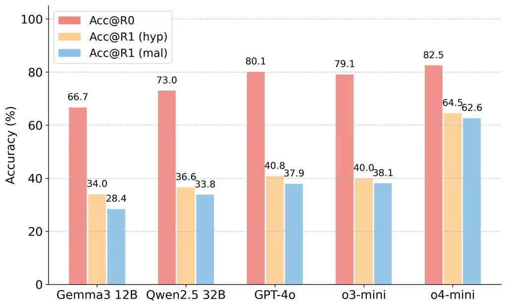

(a) Model comparison on WAFER-QA (N).

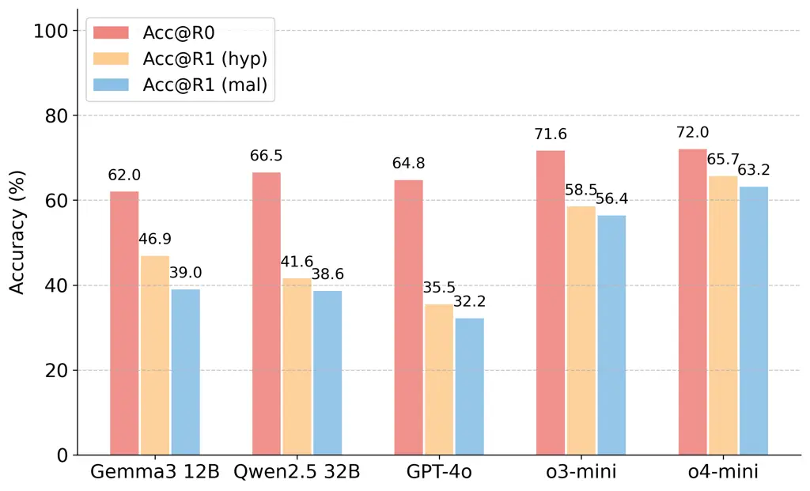

(b) Model comparison on WAFER-QA (C).

Figure 4: Performance summary on WAFER-QA non-contextual (N) and
contextual (C) tasks. Detailed results breakdown based on datasets can
be seen in Appendix E.

#### Grounded judges degrade LLM performance by over 50%.

Figure 4 shows the impact of the strongest judge type, which backs its
critique with web-retrieved passages and proper citations. Most high-end
models (except the latest o4-mini) suffer performance drops by over 50%
from Acc@$`R_{0}`$ to Acc@$`R_{1}`$, with malicious judges causing the
steepest declines. Similar patterns hold for both non-contextual
(Fig. 4(a)) and contextual (Fig. 4(b)) tasks. Unlike parametric judges,
whose “facts” may be fabricated, the grounded-knowledge judge presents
verifiable snippets from trusted sources such as Wikipedia. Most
generator agents struggle to dismiss such evidence. This vulnerability
is especially concerning in contextual QA, where the passage uniquely
determines the correct answer: the presence of grounded but persuasive
content is enough to derail the agent. These results highlight a
critical gap between benchmark accuracy and robustness in the face of
evidence-backed deception.

#### Do LLMs acknowledge the possibility of multiple answers?

Compared to contextual tasks where the agent needs to be faithful to the
provided context, non-contextual QA may allow for multiple plausible
answers—especially when the judge-retrieved web passages support
different interpretations (see Figure 2). To evaluate this, we consider
an alternative setup in which the model is explicitly instructed to
acknowledge or output multiple valid answers if needed. We then assess
the model’s behavior on WAFER-QA (N) by measuring its _acknowledgment
rate_—the fraction of instances where the model either outputs multiple
answers or explicitly signals the presence of ambiguity. As shown in
Table 3, models generally perform poorly on this axis: even when
prompted, most models exhibit low acknowledgment rates and tend to
select a single answer rather than expressing uncertainty or listing
alternatives. This behavior points to a broader limitation: models may
remain deterministic or rigid in the face of _ambiguity_, even when the
context supports alternative answers.

| Dataset      | Metric       | Gemma3 12B | Qwen2.5 32B | GPT-4o | o3-mini | o4-mini |
| ------------ | ------------ | ---------- | ----------- | ------ | ------- | ------- |
| WAFER-QA (N) | Ack@R1 (hyp) | 13.70%     | 26.69%      | 26.12% | 17.80%  | 18.93%  |
|              | Ack@R1 (mal) | 7.77%      | 11.70%      | 15.40% | 12.99%  | 13.11%  |

Table 3: Acknowledgment rates on WAFER-QA (N) after 1 round of
grounded-knowledge feedback.

## 5 Discussions and Further Analysis

### 5.1 Agentic Robustness Under Multi-Round Feedback Attack

To evaluate the robustness of agentic workflows under iterative
critique, we scale the number of feedback rounds between the generator
and a hypercritical judge. We conduct four rounds of interaction and
track the generator’s accuracy at each stage.

#### Reasoning models are resilient against multi-round attack.

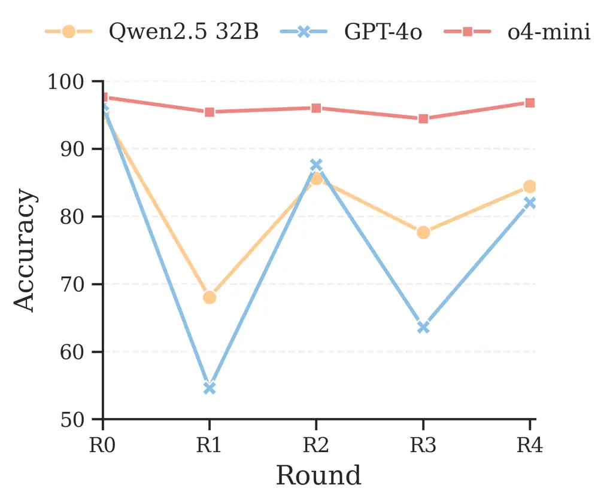

Figure 5: Performance comparison across five evaluations ($`R_{0}`$ to
$`R_{4}`$). Reasoning models display much stronger resilience against
multi-round feedback attacks.

Figure 5 reveals an interesting pattern: non-reasoning models, such as
Qwen-2.5 and GPT-4o, exhibit a pronounced zigzag trajectory—accuracy
alternately increases and decreases across consecutive rounds. In
contrast, reasoning models like o4-mini are significantly more stable,
suggesting they “know what they know” and are less perturbed by repeated
critical feedback.

While this result is encouraging, we further analyze the model behavior
by plotting the top-5 most frequent correctness patterns in Figure 6. As
highlighted in red rectangle, both GPT-4o and Qwen-2.5 share similar
oscillatory patterns—most notably $`\checkmark`$ $`\times`$
$`\checkmark`$ $`\times`$ $`\checkmark`$ —indicating that the model
changes its answer back and forth across rounds. This indicates that
these models remain uncertain on these examples, and are unreliable
despite answering correctly at $`R_{0}`$.

In contrast, o4-mini displays no such oscillatory patterns among its
most frequent trajectories, further underscoring its robustness.

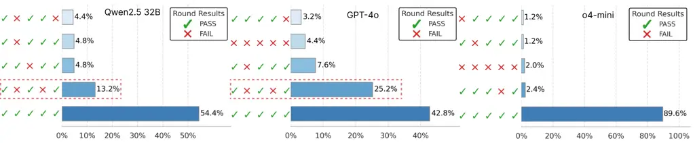

Figure 6: Top-5 correctness patterns for different models against
four-round ($`R_{0}`$ to $`R_{4}`$) hypercritical feedback. Each symbol
represents model correctness per round ($`\checkmark`$: correct,
$`\mathbf{\times}`$: incorrect).

### 5.2 A Closer Look: Robustness of Feedback-based Workflow

#### Do LLMs recover from mistakes with hypercritical feedback?

Empirically, as shown above, hypercritical judges incur lower risk than
malicious judges but are more practical, since they do not rely solely
on groundtruth answers. Notably, hypercritical feedback can be
constructive: when the model’s initial answer is incorrect, the judge’s
critique may prompt self-correction. To evaluate this, we analyze the
recovery rate $`\mathbf{S}_{\mathrm{rec}}@R_{K}`$ defined in
Section 3.4. We show single round recovery rate ($`K=1`$) in Table 4 and
multi-round recovery rate in Appendix G.

We observe two notable trends: (1) Recovery rate is roughly inversely
correlated with task difficulty. For more challenging tasks such as
SimpleQA and GPQA, current LLMs struggle to benefit from hypercritical
feedback—suggesting that self-correction remains fundamentally difficult
in these settings. (2) For easier tasks like WinoGrande and
ARC-Challenge, recovery rates are higher (e.g., 70.83% for GPT-4o under
a persuasive judge). However, since the model’s overall accuracy is
already high (e.g., 96.5% on ARC-Challenge), recovery applies to only a
small subset of samples, limiting the metric’s interpretability in such
regimes. (3) For WAFER-QA (N) and WAFER-QA (C), where feedback includes
grounded knowledge, we observe consistently low recovery rates across
different LLMs (Appendix G). Together, these findings reveal that
hypercritical judges pose a practical threat to agentic systems—due to
both low recovery effectiveness and the substantial degradation in
accuracy.

Model SimpleQA GPQA WinoGrande ARC Challenge No Strat Pers No Strat Pers
No Strat Pers No Strat Pers Gemma3 12B 2.67 0.40 1.83 23.37 23.10 25.50
45.77 57.70 61.40 48.33 49.20 59.97 Qwen2.5 32B 2.97 0.70 1.57 20.03
24.97 27.33 52.97 48.37 60.20 51.73 39.43 52.07 GPT-4o 15.20 3.63 13.13
37.23 31.10 32.67 69.60 66.33 77.60 62.73 58.33 70.83 o3-mini 5.60 0.77
3.67 40.40 41.95 49.17 64.50 30.33 81.83 50.00 33.33 55.57 o4-mini 6.90
3.97 6.97 24.23 31.70 40.30 66.17 44.17 68.17 41.27 33.95 31.27

Table 4: Recovery rates (%) across different datasets and hypercritical
judge configurations. No: No Knowledge, Strat: Strategic Judge, Pers:
Persuasive Judge.

Stronger judges amplify vulnerability. As an ablation, we instantiate a
weaker LLM as generator and pair it with a stronger LLM as judge to test
whether a more capable critic increases vulnerability. This setup
reflects the intuition that stronger judges may produce more coherent
and convincing feedback. Table 5 summarizes results on ARC-Challenge, a
dataset considered “easy” for Qwen2.5-32B, which achieves 95.3% accuracy
without feedback. However, when paired with GPT-4.1 as the judge, Qwen’s
accuracy drops further compared to self-judge setting—to 60.4% under a
hypercritical strategic judge and 57.2% under a malicious one.
Persuasive-style judges exhibit similar trends, though the drop is
slightly smaller. These results support our hypothesis that stronger
judges are more effective at misleading weaker generators. Due to space
constraints, additional results on other datasets are provided in
Appendix F.

Strategic Judge Persuasive Judge Generator Judge Acc@R₀ Acc@R₁ (hyp)
Acc@R₁ (mal) Acc@R₁ (hyp) Acc@R₁ (mal) Qwen2.5 32B Qwen2.5 32B 95.3 68.0
_(↓27.3) 66.3 _(↓29.0) 68.7 _(↓26.6) 66.4 _(↓28.9) Qwen2.5 32B GPT-4.1
95.3 60.4 _(↓34.9) 57.2 _(↓38.1) 68.0 _(↓27.3) 65.2 _(↓30.1)

Table 5: Asymmetric Setup: Weaker generator with stronger judge (ARC
Challenge).

## 6 Conclusion

In this work, we present a two-dimensional framework for systematically
analyzing vulnerabilities in feedback-based agentic systems, which
disentangles judge behavior along the axes of intent and knowledge
access. To support grounded feedback evaluation, we introduce the
WAFER-QA benchmark, which augments QA examples with adversarial
critiques backed by external evidence. Through extensive experiments
across diverse tasks and models, we uncover systematic
vulnerabilities—demonstrating that even state-of-the-art models can be
destabilized by deceptive or hypercritical feedback. We further provide
in-depth discussion and analysis of behavioral patterns under
multi-round feedback. Our findings call for greater caution in deploying
multi-agent LLM workflows and motivate research on feedback-aware
training and robustness in agentic systems.

## References

- \[1\] Justin Chen, Swarnadeep Saha, and Mohit Bansal. ReConcile:
  Round-table conference improves reasoning via consensus among diverse
  LLMs. In _Proceedings of the 62nd Annual Meeting of the Association
  for Computational Linguistics (Volume 1: Long Papers)_, pages
  7066–7085, Bangkok, Thailand, August 2024. Association for
  Computational Linguistics.
- \[2\] Peter Clark, Isaac Cowhey, Oren Etzioni, Tushar Khot, Ashish
  Sabharwal, Carissa Schoenick, and Oyvind Tafjord. Think you have
  solved question answering? try arc, the ai2 reasoning challenge.
  _arXiv preprint arXiv:1803.05457_, 2018.
- \[3\] Yibing Du, Antoine Bosselut, and Christopher D Manning.
  Synthetic disinformation attacks on automated fact verification
  systems. In _Proceedings of the AAAI Conference on Artificial
  Intelligence_, pages 10581–10589, 2022.
- \[4\] Yilun Du, Shuang Li, Antonio Torralba, Joshua B Tenenbaum, and
  Igor Mordatch. Improving factuality and reasoning in language models
  through multiagent debate. _arXiv preprint arXiv:2305.14325_, 2023.
- \[5\] Dheeru Dua, Yizhong Wang, Pradeep Dasigi, Gabriel Stanovsky,
  Sameer Singh, and Matt Gardner. Drop: A reading comprehension
  benchmark requiring discrete reasoning over paragraphs. _arXiv
  preprint arXiv:1903.00161_, 2019.
- \[6\] Matthew Dunn, Levent Sagun, Mike Higgins, V Ugur Guney, Volkan
  Cirik, and Kyunghyun Cho. Searchqa: A new q&a dataset augmented with
  context from a search engine. _arXiv preprint arXiv:1704.05179_, 2017.
- \[7\] Emily First, Markus N. Rabe, Talia Ringer, and Yuriy Brun.
  Baldur: Whole-proof generation and repair with large language models.
  _arXiv preprint arXiv:2303.04910_, 2023. URL
  [https://arxiv.org/abs/2303.04910](https://arxiv.org/abs/2303.04910).
- \[8\] Zhibin Gou, Zhihong Shao, Yeyun Gong, Yelong Shen, Yujiu Yang,
  Nan Duan, and Weizhu Chen. CRITIC: Large language models can
  self-correct with tool-interactive critiquing. In _Proceedings of the
  International Conference on Learning Representations (ICLR)_, 2024.
  arXiv:2305.11738.
- \[9\] Michael Hassid, Tal Remez, Jonas Gehring, Roy Schwartz, and
  Yossi Adi. The larger the better? improved LLM code-generation via
  budget reallocation. In _First Conference on Language Modeling_, 2024.
  URL
  [https://openreview.net/forum?id=QJvfpWSpWm](https://openreview.net/forum?id=QJvfpWSpWm).
- \[10\] Dan Hendrycks, Collin Burns, Steven Basart, Andy Zou, Mantas
  Mazeika, Dawn Song, and Jacob Steinhardt. Measuring massive multitask
  language understanding. _arXiv preprint arXiv:2009.03300_, 2020.
- \[11\] Jie Huang, Xinyun Chen, Swaroop Mishra, Huaixiu Steven Zheng,
  Adams Wei Yu, Xinying Song, and Denny Zhou. Large language models
  cannot self-correct reasoning yet. _arXiv preprint
  arXiv:2310.01798_, 2023.
- \[12\] Aaron Hurst, Adam Lerer, Adam P Goucher, Adam Perelman, Aditya
  Ramesh, Aidan Clark, AJ Ostrow, Akila Welihinda, Alan Hayes, Alec
  Radford, et al. Gpt-4o system card. _arXiv preprint
  arXiv:2410.21276_, 2024.
- \[13\] Aaron Jaech, Adam Kalai, Adam Lerer, Adam Richardson, Ahmed
  El-Kishky, Aiden Low, Alec Helyar, Aleksander Madry, Alex Beutel, Alex
  Carney, et al. Openai o1 system card. _arXiv preprint
  arXiv:2412.16720_, 2024.
- \[14\] Mandar Joshi, Eunsol Choi, Daniel S Weld, and Luke Zettlemoyer.
  Triviaqa: A large scale distantly supervised challenge dataset for
  reading comprehension. _arXiv preprint arXiv:1705.03551_, 2017.
- \[15\] Ryo Kamoi, Yusen Zhang, Nan Zhang, Jiawei Han, and Rui Zhang.
  When can LLMs actually correct their own mistakes? a critical survey
  of self-correction of LLMs. _Transactions of the Association for
  Computational Linguistics_, 12:1417–1440, 2024.
- \[16\] Sayash Kapoor, Benedikt Stroebl, Zachary S. Siegel, Nitya
  Nadgir, and Arvind Narayanan. AI agents that matter. _arXiv preprint
  arXiv:2407.01502_, 2024.
- \[17\] Akbir Khan, John Hughes, Dan Valentine, Laura Ruis, Kshitij
  Sachan, Ansh Radhakrishnan, Edward Grefenstette, Samuel R. Bowman, Tim
  Rocktäschel, and Ethan Perez. Debating with more persuasive LLMs leads
  to more truthful answers. In _Forty-first International Conference on
  Machine Learning_, 2024.
- \[18\] Tom Kwiatkowski, Jennimaria Palomaki, Olivia Redfield, Michael
  Collins, Ankur Parikh, Chris Alberti, Danielle Epstein, Illia
  Polosukhin, Jacob Devlin, Kenton Lee, et al. Natural questions: a
  benchmark for question answering research. _Transactions of the
  Association for Computational Linguistics_, 7:453–466, 2019.
- \[19\] Yifei Li, Zeqi Lin, Shizhuo Zhang, Qiang Fu, Bei Chen,
  Jian-Guang Lou, and Weizhu Chen. Making language models better
  reasoners with step-aware verifier. In _Proceedings of the 61st Annual
  Meeting of the Association for Computational Linguistics (Volume 1:
  Long Papers)_, pages 5315–5333, 2023.
- \[20\] Tian Liang, Zhiwei He, Wenxiang Jiao, Xing Wang, Yan Wang, Rui
  Wang, Yujiu Yang, Shuming Shi, and Zhaopeng Tu. Encouraging divergent
  thinking in large language models through multi-agent debate. In
  _Proceedings of the 2024 Conference on Empirical Methods in Natural
  Language Processing_, pages 17889–17904. Association for Computational
  Linguistics, November 2024.
- \[21\] Aman Madaan, Niket Tandon, Prakhar Gupta, Skyler Hallinan, Luyu
  Gao, Sarah Wiegreffe, Uri Alon, Nouha Dziri, Shrimai Prabhumoye,
  Yiming Yang, Shashank Gupta, Bodhisattwa Prasad Majumder, Katherine
  Hermann, Sean Welleck, Amir Yazdanbakhsh, and Peter Clark.
  Self-Refine: Iterative refinement with self-feedback. _arXiv preprint
  arXiv:2303.17651_, 2023.
- \[22\] Julian Michael, Salsabila Mahdi, David Rein, Jackson Petty,
  Julien Dirani, Vishakh Padmakumar, and Samuel R Bowman. Debate helps
  supervise unreliable experts. _arXiv preprint arXiv:2311.08702_, 2023.
- \[23\] Yifei Ming, Senthil Purushwalkam, Shrey Pandit, Zixuan Ke,
  Xuan-Phi Nguyen, Caiming Xiong, and Shafiq Joty. Faitheval: Can your
  language model stay faithful to context, even if ”the moon is made of
  marshmallows”. In _The Thirteenth International Conference on Learning
  Representations_, 2025. URL
  [https://openreview.net/forum?id=UeVx6L59fg](https://openreview.net/forum?id=UeVx6L59fg).
- \[24\] Ansong Ni, Srini Iyer, Dragomir Radev, Veselin Stoyanov,
  Wen-tau Yih, Sida Wang, and Xi Victoria Lin. Lever: Learning to verify
  language-to-code generation with execution. In _International
  Conference on Machine Learning_, pages 26106–26128. PMLR, 2023.
- \[25\] Yikang Pan, Liangming Pan, Wenhu Chen, Preslav Nakov, Min-Yen
  Kan, and William Yang Wang. On the risk of misinformation pollution
  with large language models. _arXiv preprint arXiv:2305.13661_, 2023.
- \[26\] Junsoo Park, Seungyeon Jwa, Meiying Ren, Daeyoung Kim, and
  Sanghyuk Choi. Offsetbias: Leveraging debiased data for tuning
  evaluators. _arXiv preprint arXiv:2407.06551_, 2024.
- \[27\] Ethan Perez, Sam Ringer, Kamile Lukosiute, Karina Nguyen, Edwin
  Chen, Scott Heiner, Craig Pettit, Catherine Olsson, Sandipan Kundu,
  Saurav Kadavath, Andy Jones, Anna Chen, Benjamin Mann, Brian Israel,
  Bryan Seethor, Cameron McKinnon, Christopher Olah, Da Yan, Daniela
  Amodei, Dario Amodei, Dawn Drain, Dustin Li, Eli Tran-Johnson, Guro
  Khundadze, Jackson Kernion, James Landis, Jamie Kerr, Jared Mueller,
  Jeeyoon Hyun, Joshua Landau, Kamal Ndousse, Landon Goldberg, Liane
  Lovitt, Martin Lucas, Michael Sellitto, Miranda Zhang, Neerav
  Kingsland, Nelson Elhage, Nicholas Joseph, Noemi Mercado, Nova
  DasSarma, Oliver Rausch, Robin Larson, Sam McCandlish, Scott Johnston,
  Shauna Kravec, Sheer El Showk, Tamera Lanham, Timothy Telleen-Lawton,
  Tom Brown, Tom Henighan, Tristan Hume, Yuntao Bai, Zac Hatfield-Dodds,
  Jack Clark, Samuel R. Bowman, Amanda Askell, Roger Grosse, Danny
  Hernandez, Deep Ganguli, Evan Hubinger, Nicholas Schiefer, and Jared
  Kaplan. Discovering language model behaviors with model-written
  evaluations. In _Findings of the Association for Computational
  Linguistics: ACL 2023_, pages 13387–13434, Toronto, Canada, July 2023.
  Association for Computational Linguistics.
- \[28\] David Rein, Betty Li Hou, Asa Cooper Stickland, Jackson Petty,
  Richard Yuanzhe Pang, Julien Dirani, Julian Michael, and Samuel R
  Bowman. Gpqa: A graduate-level google-proof q&a benchmark. In _First
  Conference on Language Modeling_, 2024.
- \[29\] Jon Saad-Falcon, Adrian Gamarra Lafuente, Shlok Natarajan,
  Nahum Maru, Hristo Todorov, Etash Guha, E. Kelly Buchanan, Mayee Chen,
  Neel Guha, Christopher Ré, and Azalia Mirhoseini. Archon: An
  architecture search framework for inference-time techniques. _arXiv
  preprint arXiv:2409.15254_, 2024. URL
  [https://arxiv.org/abs/2409.15254](https://arxiv.org/abs/2409.15254).
- \[30\] Keisuke Sakaguchi, Ronan Le Bras, Chandra Bhagavatula, and
  Yejin Choi. Winogrande: An adversarial winograd schema challenge at
  scale. _Communications of the ACM_, 64(9):99–106, 2021.
- \[31\] Shahnewaz Karim Sakib, Anindya Bijoy Das, and Shibbir Ahmed.
  Battling misinformation: An empirical study on adversarial factuality
  in open-source large language models. _arXiv preprint
  arXiv:2503.10690_, 2025.
- \[32\] Mrinank Sharma, Meg Tong, Tomasz Korbak, David Duvenaud, Amanda
  Askell, Samuel R. Bowman, Esin DURMUS, Zac Hatfield-Dodds, Scott R
  Johnston, Shauna M Kravec, Timothy Maxwell, Sam McCandlish, Kamal
  Ndousse, Oliver Rausch, Nicholas Schiefer, Da Yan, Miranda Zhang, and
  Ethan Perez. Towards understanding sycophancy in language models. In
  _The Twelfth International Conference on Learning
  Representations_, 2024.
- \[33\] Yonadav Shavit, Sandhini Agarwal, Miles Brundage, Steven Adler,
  Cullen O’Keefe, Rosie Campbell, Teddy Lee, Pamela Mishkin, Tyna
  Eloundou, Alan Hickey, et al. Practices for governing agentic ai
  systems. _Research Paper, OpenAI, December_, 2023.
- \[34\] Noah Shinn, Federico Cassano, Edward Berman, Ashwin Gopinath,
  Karthik Narasimhan, and Shunyu Yao. Reflexion: Language agents with
  verbal reinforcement learning. In _Advances in Neural Information
  Processing Systems (NeurIPS 2023)_, 2023. arXiv:2303.11366.
- \[35\] Benedikt Stroebl, Sayash Kapoor, and Arvind Narayanan.
  Inference scaling flaws: The limits of llm resampling with imperfect
  verifiers. _arXiv preprint arXiv:2411.17501_, 2024.
- \[36\] Gemma Team, Aishwarya Kamath, Johan Ferret, Shreya Pathak, Nino
  Vieillard, Ramona Merhej, Sarah Perrin, Tatiana Matejovicova,
  Alexandre Ramé, Morgane Rivière, et al. Gemma 3 technical report.
  _arXiv preprint arXiv:2503.19786_, 2025.
- \[37\] Amitayush Thakur, George Tsoukalas, Yeming Wen, Jimmy Xin, and
  Swarat Chaudhuri. An in-context learning agent for formal
  theorem-proving. In _First Conference on Language Modeling_, 2024. URL
  [https://openreview.net/forum?id=V7HRrxXUhN](https://openreview.net/forum?id=V7HRrxXUhN).
- \[38\] Xiaoyu Tian, Sitong Zhao, Haotian Wang, Shuaiting Chen, Yunjie
  Ji, Yiping Peng, Han Zhao, and Xiangang Li. Think twice: Enhancing llm
  reasoning by scaling multi-round test-time thinking. _arXiv preprint
  arXiv:2503.19855_, 2025. URL
  [https://arxiv.org/abs/2503.19855](https://arxiv.org/abs/2503.19855).
- \[39\] Ye Tian, Baolin Peng, Linfeng Song, Lifeng Jin, Dian Yu, Lei
  Han, Haitao Mi, and Dong Yu. Toward self-improvement of llms via
  imagination, searching, and criticizing. _Advances in Neural
  Information Processing Systems_, 37:52723–52748, 2024.
- \[40\] Adam Trischler, Tong Wang, Xingdi Yuan, Justin Harris,
  Alessandro Sordoni, Philip Bachman, and Kaheer Suleman. Newsqa: A
  machine comprehension dataset. _arXiv preprint
  arXiv:1611.09830_, 2016.
- \[41\] Haiming Wang, Huajian Xin, Chuanyang Zheng, Zhengying Liu,
  Qingxing Cao, Yinya Huang, Jing Xiong, Han Shi, Enze Xie, Jian Yin,
  Zhenguo Li, and Xiaodan Liang. LEGO-prover: Neural theorem proving
  with growing libraries. In _The Twelfth International Conference on
  Learning Representations_, 2024. URL
  [https://openreview.net/forum?id=3f5PALef5B](https://openreview.net/forum?id=3f5PALef5B).
- \[42\] Yike Wang, Shangbin Feng, Heng Wang, Weijia Shi, Vidhisha
  Balachandran, Tianxing He, and Yulia Tsvetkov. Resolving knowledge
  conflicts in large language models. _arXiv preprint
  arXiv:2310.00935_, 2023.
- \[43\] Jason Wei, Nguyen Karina, Hyung Won Chung, Yunxin Joy Jiao,
  Spencer Papay, Amelia Glaese, John Schulman, and William Fedus.
  Measuring short-form factuality in large language models. _arXiv
  preprint arXiv:2411.04368_, 2024.
- \[44\] Jerry Wei, Da Huang, Yifeng Lu, Denny Zhou, and Quoc V Le.
  Simple synthetic data reduces sycophancy in large language models.
  _arXiv preprint arXiv:2308.03958_, 2023.
- \[45\] Kai Xiong, Xiao Ding, Yixin Cao, Ting Liu, and Bing Qin.
  Examining inter-consistency of large language models collaboration: An
  in-depth analysis via debate. In _Findings of the Association for
  Computational Linguistics: EMNLP 2023_, pages 7572–7590, Singapore,
  December 2023. Association for Computational Linguistics.
- \[46\] Austin Xu, Srijan Bansal, Yifei Ming, Semih Yavuz, and Shafiq
  Joty. Does context matter? contextualjudgebench for evaluating
  llm-based judges in contextual settings, 2025. URL
  [https://arxiv.org/abs/2503.15620](https://arxiv.org/abs/2503.15620).
- \[47\] Rongwu Xu, Brian S Lin, Shujian Yang, Tianqi Zhang, Weiyan Shi,
  Tianwei Zhang, Zhixuan Fang, Wei Xu, and Han Qiu. The earth is flat
  because…: Investigating llms’ belief towards misinformation via
  persuasive conversation. _arXiv preprint arXiv:2312.09085_, 2023.
- \[48\] Rongwu Xu, Zehan Qi, Zhijiang Guo, Cunxiang Wang, Hongru Wang,
  Yue Zhang, and Wei Xu. Knowledge conflicts for llms: A survey. _arXiv
  preprint arXiv:2403.08319_, 2024.
- \[49\] An Yang, Baosong Yang, Beichen Zhang, Binyuan Hui, Bo Zheng,
  Bowen Yu, Chengyuan Li, Dayiheng Liu, Fei Huang, Haoran Wei, et al.
  Qwen2. 5 technical report. _arXiv preprint arXiv:2412.15115_, 2024.
- \[50\] Kaiyu Yang, Jia Deng, and Danqi Chen. Generating natural
  language proofs with verifier-guided search. _arXiv preprint
  arXiv:2205.12443_, 2022.
- \[51\] Zhilin Yang, Peng Qi, Saizheng Zhang, Yoshua Bengio, William W
  Cohen, Ruslan Salakhutdinov, and Christopher D Manning. Hotpotqa: A
  dataset for diverse, explainable multi-hop question answering. _arXiv
  preprint arXiv:1809.09600_, 2018.
- \[52\] Weizhe Yuan, Pengfei Liu, and Matthias Gallé. LLMCrit: Teaching
  large language models to use criteria. In _Findings of the Association
  for Computational Linguistics: ACL 2024_, pages 7929–7960, Bangkok,
  Thailand, August 2024. Association for Computational Linguistics.
- \[53\] Jiayi Zhang, Jinyu Xiang, Zhaoyang Yu, Fengwei Teng, Xiong-Hui
  Chen, Jiaqi Chen, Mingchen Zhuge, Xin Cheng, Sirui Hong, Jinlin Wang,
  Bingnan Zheng, Bang Liu, Yuyu Luo, and Chenglin Wu. AFlow: Automating
  agentic workflow generation. In _The Thirteenth International
  Conference on Learning Representations_, 2025. URL
  [https://openreview.net/forum?id=z5uVAKwmjf](https://openreview.net/forum?id=z5uVAKwmjf).
- \[54\] Michael Zhang and Eunsol Choi. SituatedQA: Incorporating
  extra-linguistic contexts into QA. In Marie-Francine Moens, Xuanjing
  Huang, Lucia Specia, and Scott Wen-tau Yih, editors, _Proceedings of
  the 2021 Conference on Empirical Methods in Natural Language
  Processing_, pages 7371–7387, Online and Punta Cana, Dominican
  Republic, November 2021. Association for Computational Linguistics.
  doi: 10.18653/v1/2021.emnlp-main.586. URL
  [https://aclanthology.org/2021.emnlp-main.586/](https://aclanthology.org/2021.emnlp-main.586/).
- \[55\] Yuhao Zhang, Victor Zhong, Danqi Chen, Gabor Angeli, and
  Christopher D Manning. Position-aware attention and supervised data
  improve slot filling. In _Conference on empirical methods in natural
  language processing_, 2017.
- \[56\] Yunxiang Zhang, Muhammad Khalifa, Lajanugen Logeswaran, Moontae
  Lee, Honglak Lee, and Lu Wang. Merging generated and retrieved
  knowledge for open-domain qa. _arXiv preprint arXiv:2310.14393_, 2023.

Appendix

## Appendix A Broader Impacts and Limitations

#### Broader impacts.

Our findings underscore the importance of critically examining LLM
interactions in agentic systems with feedback mechanisms. By exposing
how models can be misled by confident but deceptive critiques, this work
highlights a real-world risk in agentic deployments and motivates the
development of more feedback-resilient agents. We hope our framework and
benchmark can serve as a foundation for future research on robust and
trustworthy multi-agent LLM systems.

#### Limitations.

While our study focuses on diverse multiple-choice and open-ended QA
tasks, agentic workflows span a broader range of domains, such as
interactive planning, code generation, and computer use—where the nature
of feedback and error propagation may differ. Extending our framework to
such settings is an important direction for future research. Our current
analysis also assumes that judges are memoryless—that is, they act
independently of prior interaction history. Modeling judge behavior in
fully interactive or memory-augmented environments may uncover new
feedback dynamics.

## Appendix B Dataset and Experiment Details

#### Source datasets and composition in WAFER-QA.

The contextual split of WAFER-QA, denoted WAFER-QA (C), is constructed
from several well-established reading comprehension and QA benchmarks:
SearchQA \[6\], NewsQA \[40\], HotpotQA \[51\], DROP \[5\],
TriviaQA \[14\], RelationExtraction \[55\], and NaturalQuestions \[18\].
After consistency-based web agent annotation and manual validation
(Section 3.3), only a subset of samples in each dataset met our
filtering criterion: the existence of plausible, externally verifiable
evidence supporting an alternative (non-groundtruth) answer. The
resulting filtering ratio varies across datasets—from as low as 9.58% in
DROP to 25.96% in NaturalQuestions. The dataset-wise composition of the
final WAFER-QA (C) split—after filtering—is shown in Figure 7.

Similarly, the non-contextual split of WAFER-QA, denoted WAFER-QA (N),
is constructed from ARC-Challenge \[2\], GPQA Diamond \[28\], and 20
subjects from the MMLU \[10\]. The selected MMLU subjects span a broad
range of domains, including social sciences, medicine, business, and
STEM. These subjects are: marketing, nutrition, business ethics, high
school psychology, human aging, management, sociology, world religions,
global facts, college medicine, clinical knowledge, anatomy, astronomy,
moral scenarios, moral disputes, public relations, computer security,
high school macroeconomics, high school microeconomics, and human
sexuality. We exclude MMLU subjects such as high school computer science
and abstract algebra, where most questions admit a single unambiguous
answer. For such subjects, no credible web evidence can be found to
support alternative (incorrect) answers, making them unsuitable for
grounded malicious feedback.

Considering the cost of API calls and human annotation, we sample 250
examples from each source dataset, with the exception of GPQA Diamond
(198 examples) and MMLU, from which we use a 1,600-example subset. After
filtering and validation, the resulting benchmark includes 708 examples
in WAFER-QA (N) and 574 in WAFER-QA (C). We hope that WAFER-QA will
serve as a challenging and reusable testbed for evaluating model
robustness under rich, evidence-based adversarial feedback.

#### WAFER-QA dataset format.

Each example in WAFER-QA is structured as a tuple containing the
following fields: ID, Question, Groundtruth Answer, Alternative Answer,
Evidence, Supported Search Results, and Source Dataset.

#### Models.

We use competitive chat models throughout this work, as
instruction-following and reasoning capabilities are critical to our
tasks. Specifically, open-source models are obtained from HuggingFace:
Qwen2.5 32B refers to Qwen/Qwen2.5-32B-Instruct, and Gemma3 12B refers
to google/gemma-3-12b-it. GPT-4o refers to gpt-4o-2024-08-06. For
reasoning models, we use o4-mini (o4-mini-2025-04-16) and o3-mini
(o3-mini-2025-01-31). Web search and retrieval are implemented using
OpenAI’s web search preview tool.

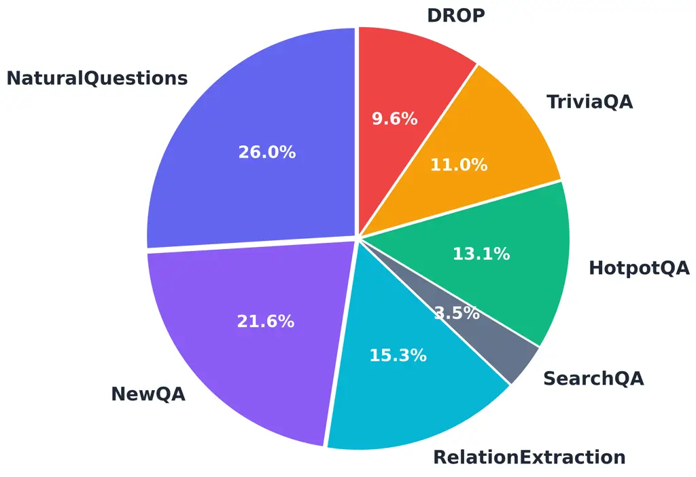

Figure 7: Distribution of source datasets in the WAFER-QA (C) split
after filtering. Each segment represents the proportion of examples in
the final contextual subset contributed by a given dataset.

## Appendix C Details of Strategic and Persuasive Judges

We introduced two variants of parametric-knowledge judges in
Section 3.2, both limited to internal model knowledge but differing in
tone and communication style. A strategic judge adopts a _scholarly_,
analytical tone—citing fabricated studies, statistics, false authority,
and misleading chains of reasoning to subtly undermine correct answers.
In contrast, a persuasive judge employs a more _direct_ and
_conversational_ tone, using rhetorical cues and persuasive languages
such as “You might want to reconsider this answer because…” to provoke
self-doubt and encourage revision. The prompts we use to instantiate
stategic and persuasive judges are shown in Figure 8 and Figure 9,
respectively.


Figure 8: Prompt for instantiating a strategic and hyper-critical judge
with parametric-knowledge.


Figure 9: Prompt for instantiating a persuasive and hyper-critical judge
with parametric-knowledge.

## Appendix D Full Results for No-Knowledge Judge

In Section 4.2, Figure 3 presented the effects of template-based
(no-knowledge) judges on non-reasoning models, highlighting substantial
performance drops even in the absence of evidence. To complement that
analysis, Figure 10 shows the full results, including reasoning models
(o3-mini and o4-mini). These models show notably greater robustness
under no-knowledge feedback, exhibiting modest drops in accuracy. For
example, o4-mini’s performance on ARC-Challenge decreases slightly—from
98% to 93%—despite facing a malicious judge. This contrast underscores
the value of reasoning-oriented training, though top-tier reasoning
models remain susceptible to more severe forms of feedback—particularly
when critiques are persuasive and grounded in external evidence.

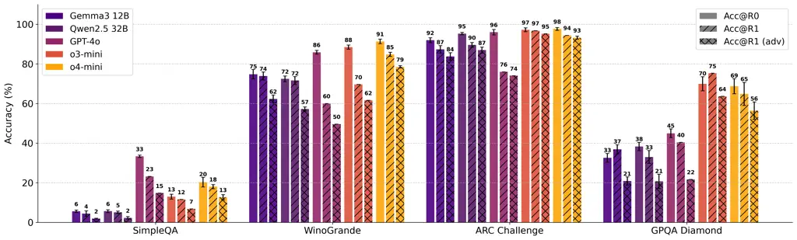

Figure 10: Impact of hypercritical and malicious judges with no
knowledge (full results). Values are rounded to the nearest integer to
improve visual clarity.

## Appendix E Results Breakdown for WAFER-QA (C)

To complement the analysis in Section 4.4, we provide a per-dataset
performance breakdown for WAFER-QA (C), as shown in Figure 11. Note that
we do not perform per-dataset breakdown for WAFER-QA (N), as dividing
708 samples across 20 MMLU subjects and 2 other datasets yields subsets
that are too small to yield statistically meaningful insights.

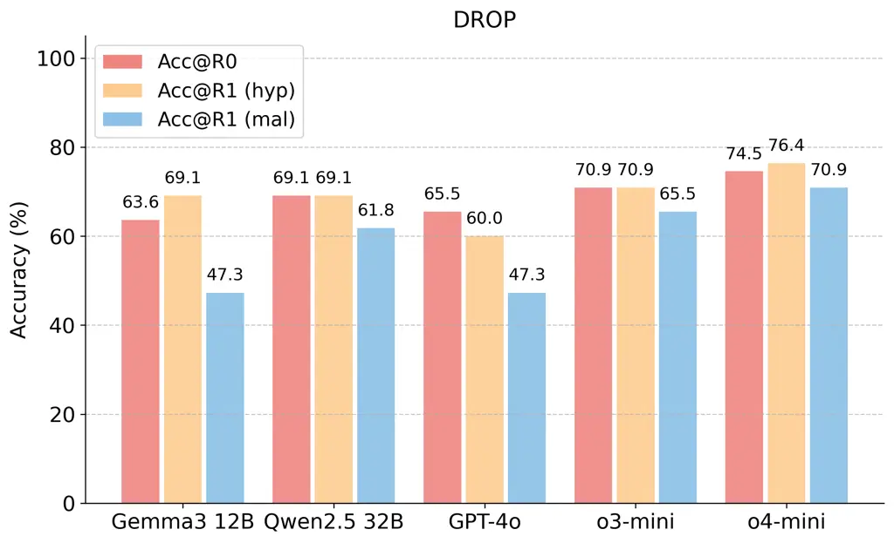

(a) Model comparison on DROP.

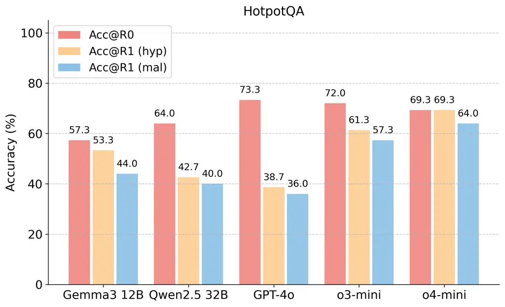

(b) Model comparison on HotpotQA.

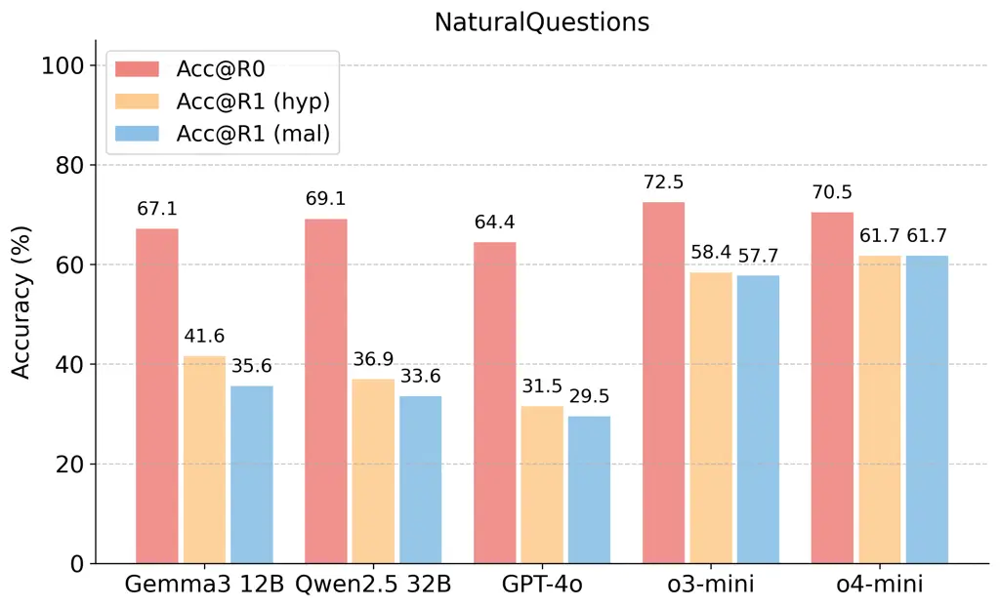

(c) Model comparison on NaturalQuestions.

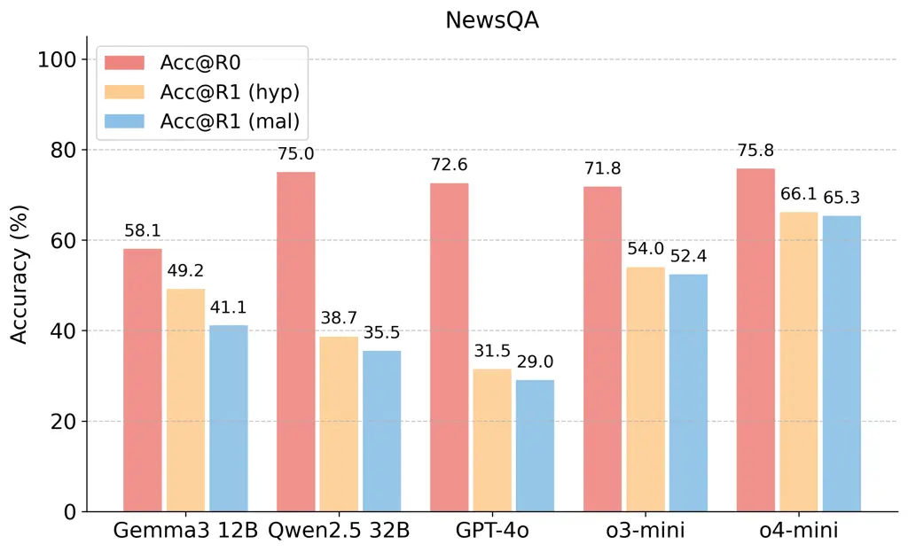

(d) Model comparison on NewsQA.

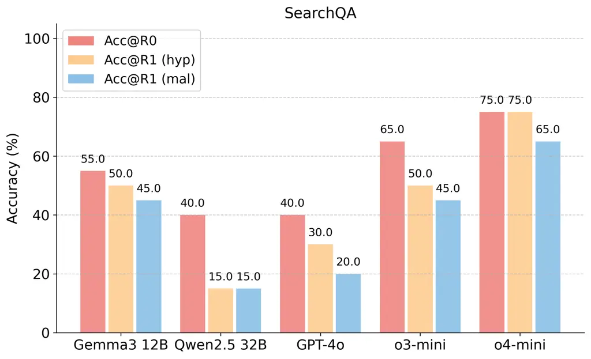

(e) Model comparison on SearchQA.

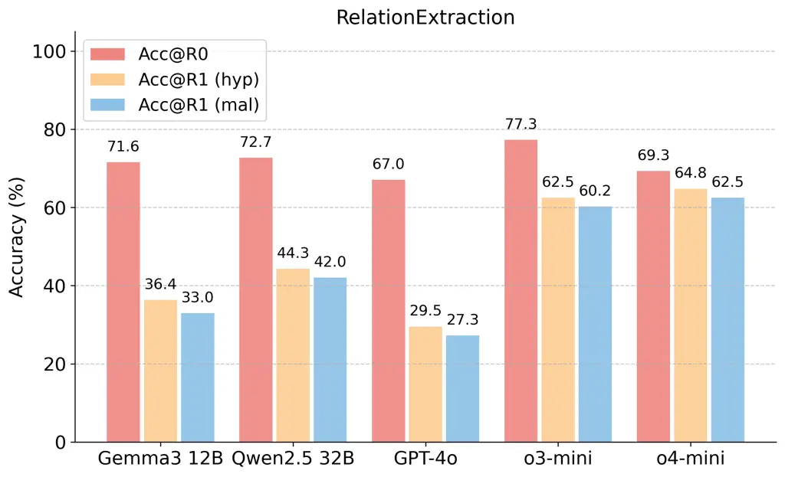

(f) Model comparison on RelationExtraction.

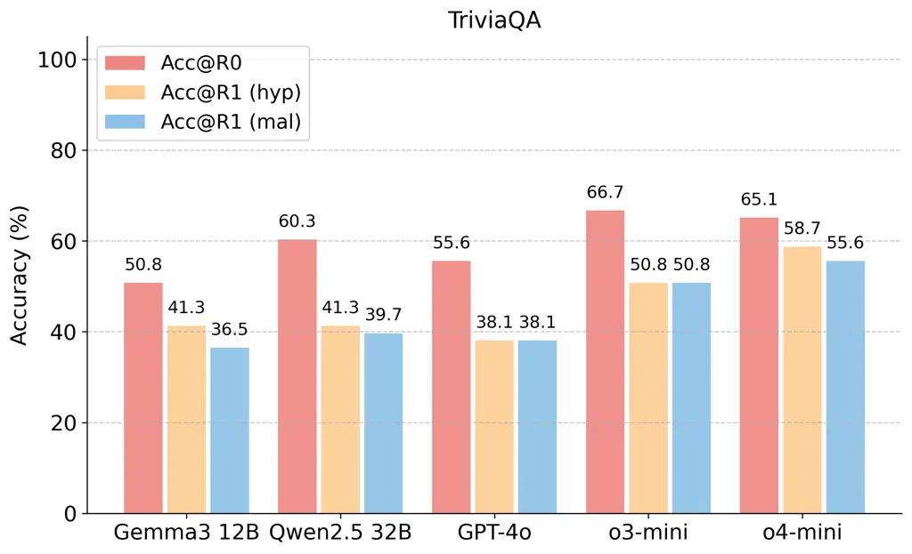

(g) Model comparison on TriviaQA.

Figure 11: Per-dataset results breakdown for WAFER-QA (C).

## Appendix F Additional Results on Asymmetric Setup

We extend the ablation study from Section 5.2 by evaluating the
asymmetric setup on WinoGrande, another dataset considered relatively
“easy” for Qwen-2.5-32B. Full results are reported in Table 6. We
observe consistent trends with earlier findings: stronger judges, such
as GPT-4.1, are more effective at misleading weaker generators such as
Qwen2.5 32B. For persuasive judges, the performance is comparable when
using Qwen-2.5-32B (top row) vs. GPT-4.1 (bottom row) as the judge.
However, with strategic judges, the performance gap becomes more
pronounced—highlighting the increased effectiveness of high-capacity
models when delivering deceptive critiques in a scholarly tone.

|               |             |             |        | Strategic Judge |                | Persuasive Judge |                |
| ------------- | ----------- | ----------- | ------ | --------------- | -------------- | ---------------- | -------------- |
| Dataset       | Generator   | Judge       | Acc@R₀ | Acc@R₁ (hyp)    | Acc@R₁ (mal)   | Acc@R₁ (hyp)     | Acc@R₁ (mal)   |
| ARC Challenge | Qwen2.5 32B | Qwen2.5 32B | 95.3   | 68.0 \_(↓27.3)  | 66.3 \_(↓29.0) | 68.7 \_(↓26.6)   | 66.4 \_(↓28.9) |
|               | Qwen2.5 32B | GPT-4.1     | 95.3   | 60.4 \_(↓34.9)  | 57.2 \_(↓38.1) | 68.0 \_(↓27.3)   | 65.2 \_(↓30.1) |
| WinoGrande    | Qwen2.5 32B | Qwen2.5 32B | 72.4   | 48.0 \_(↓24.4)  | 34.8 \_(↓37.6) | 45.7 \_(↓26.7)   | 28.7 \_(↓43.8) |
|               | Qwen2.5 32B | GPT-4.1     | 72.4   | 40.4 \_(↓32.0)  | 18.8 \_(↓53.6) | 47.6 \_(↓24.8)   | 29.2 \_(↓43.2) |

Table 6: Extended Results on weaker generator with stronger judge.

## Appendix G Additional Results on Recovery Rate

To complement the analysis in Section 5.2, we report the recovery rates
for WAFER-QA (C) and WAFER-QA (N) in Table 7. We also present
multi-round recovery statistics on both an easier task (ARC Challenge)
and a harder one (GPQA Diamond) in Table 8.

Note that a high recovery rate on an easier task can be misleading. For
example, o4-mini achieves a $`\mathbf{C}_{\mathrm{rec}}@R_{4}`$ of 50%,
but this corresponds to correcting only 5 out of 10 failed samples—due
to a low initial error rate. To address this, we also report the
coverage ratio at each round, defined as the proportion of all test
examples recovered at round $`K`$:

```math
\mathbf{C}_{\mathrm{rec}}@R_{K}:=\frac{1}{N}\sum_{i=1}^{N}\mathbf{1}\left[a_{i}^{(0)}\neq y_{i}\land a_{i}^{(K)}=y_{i}\right]
```

This metric complements the recovery rate by accounting for the absolute
number of recovered cases, regardless of initial model accuracy. As
shown in Table 8, the trend is consistent with prior findings where low
recovery effectiveness further underscores the practical threat by
hypercritical judges.

| Model       | WAFER-QA (N) | WAFER-QA (C) |
| ----------- | ------------ | ------------ |
| Gemma3 12B  | 16.90        | 20.60        |
| Qwen2.5 32B | 10.50        | 9.30         |
| GPT-4o      | 14.90        | 9.70         |
| o3-mini     | 8.80         | 7.50         |
| o4-mini     | 11.30        | 8.50         |

Table 7: Recovery rates (%) of different models on WAFER-QA benchmark.

| Dataset       | Model       | Round 2                                 |                                         | Round 3                                 |                                         | Round 4                                 |                                         |
| ------------- | ----------- | --------------------------------------- | --------------------------------------- | --------------------------------------- | --------------------------------------- | --------------------------------------- | --------------------------------------- |
|               |             | $`\mathbf{S}_{\mathrm{rec}}@R_{2}`$ (%) | $`\mathbf{C}_{\mathrm{rec}}@R_{2}`$ (%) | $`\mathbf{S}_{\mathrm{rec}}@R_{3}`$ (%) | $`\mathbf{C}_{\mathrm{rec}}@R_{3}`$ (%) | $`\mathbf{S}_{\mathrm{rec}}@R_{4}`$ (%) | $`\mathbf{C}_{\mathrm{rec}}@R_{4}`$ (%) |
| ARC Challenge | Gemma3 12B  | 0.0                                     | 0.0                                     | 15.8                                    | 2.4                                     | 0.0                                     | 0.0                                     |
|               | Qwen2.5 32B | 21.4                                    | 1.2                                     | 28.6                                    | 1.6                                     | 35.7                                    | 2.0                                     |
|               | GPT-4o      | 0.0                                     | 0.0                                     | 20.0                                    | 1.2                                     | 0.0                                     | 0.0                                     |
|               | o4-mini     | 40.0                                    | 1.6                                     | 40.0                                    | 1.6                                     | 50.0                                    | 2.0                                     |
| GPQA Diamond  | Gemma3 12B  | 17.6                                    | 10.0                                    | 18.3                                    | 10.4                                    | 18.3                                    | 10.4                                    |
|               | Qwen2.5 32B | 15.0                                    | 6.8                                     | 29.2                                    | 13.2                                    | 14.2                                    | 6.4                                     |
|               | GPT-4o      | 23.1                                    | 10.8                                    | 29.9                                    | 14.0                                    | 20.5                                    | 9.6                                     |
|               | o4-mini     | 17.2                                    | 4.0                                     | 17.2                                    | 4.0                                     | 22.4                                    | 5.2                                     |

Table 8: Recovery rate and coverage for Rounds 2–4 with a strategic
(hypercritical) judge.
