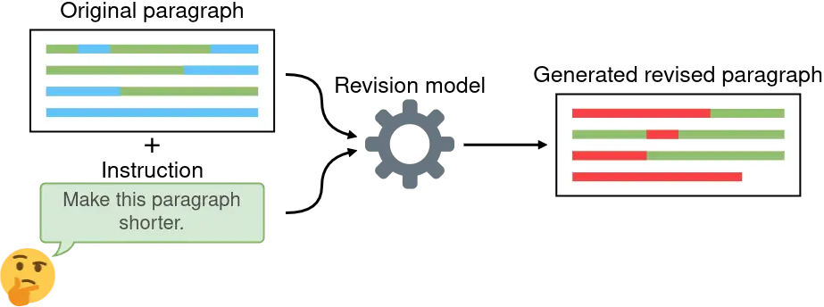
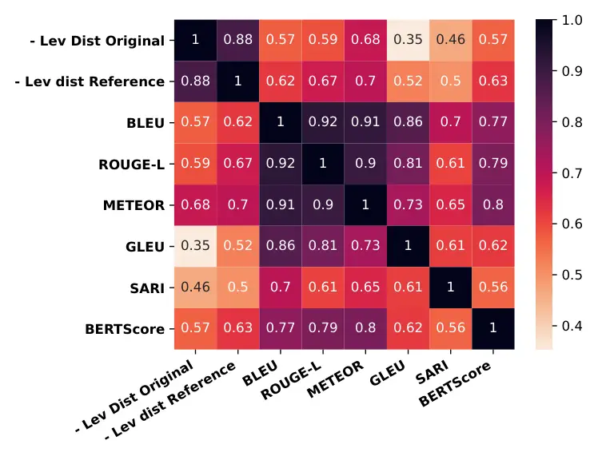
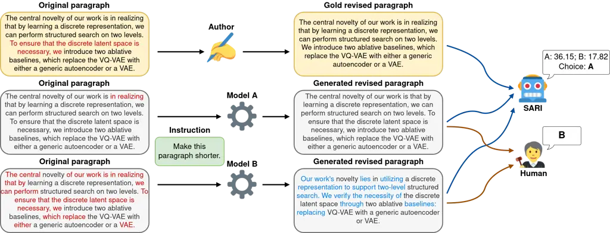
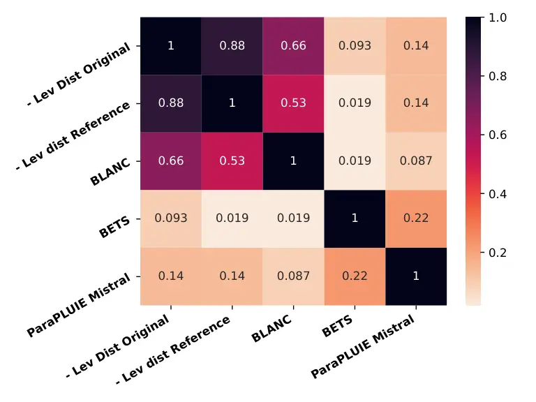
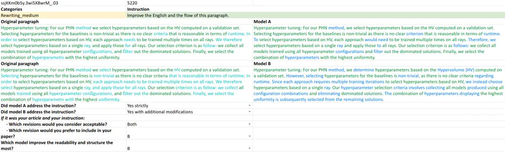
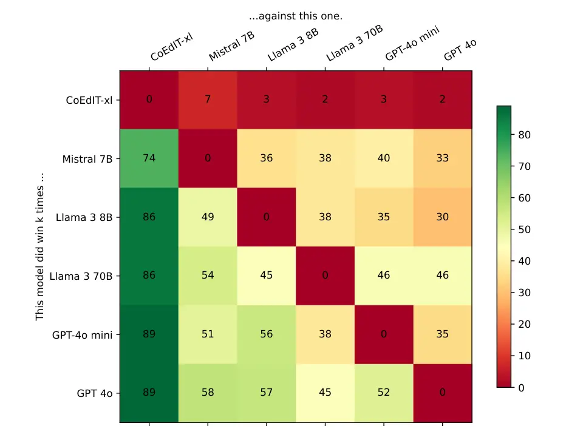
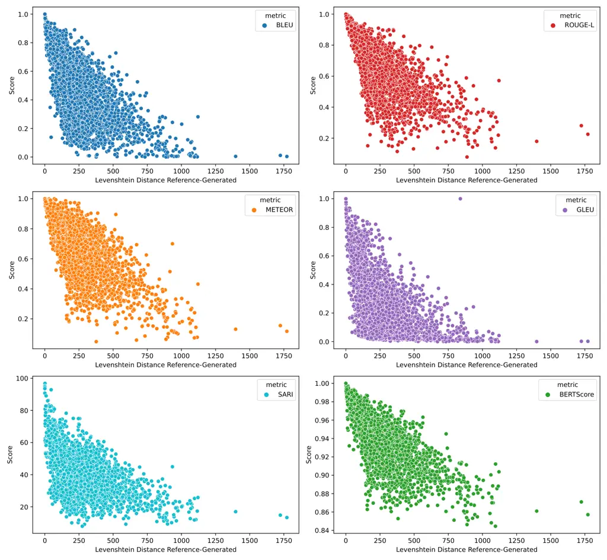
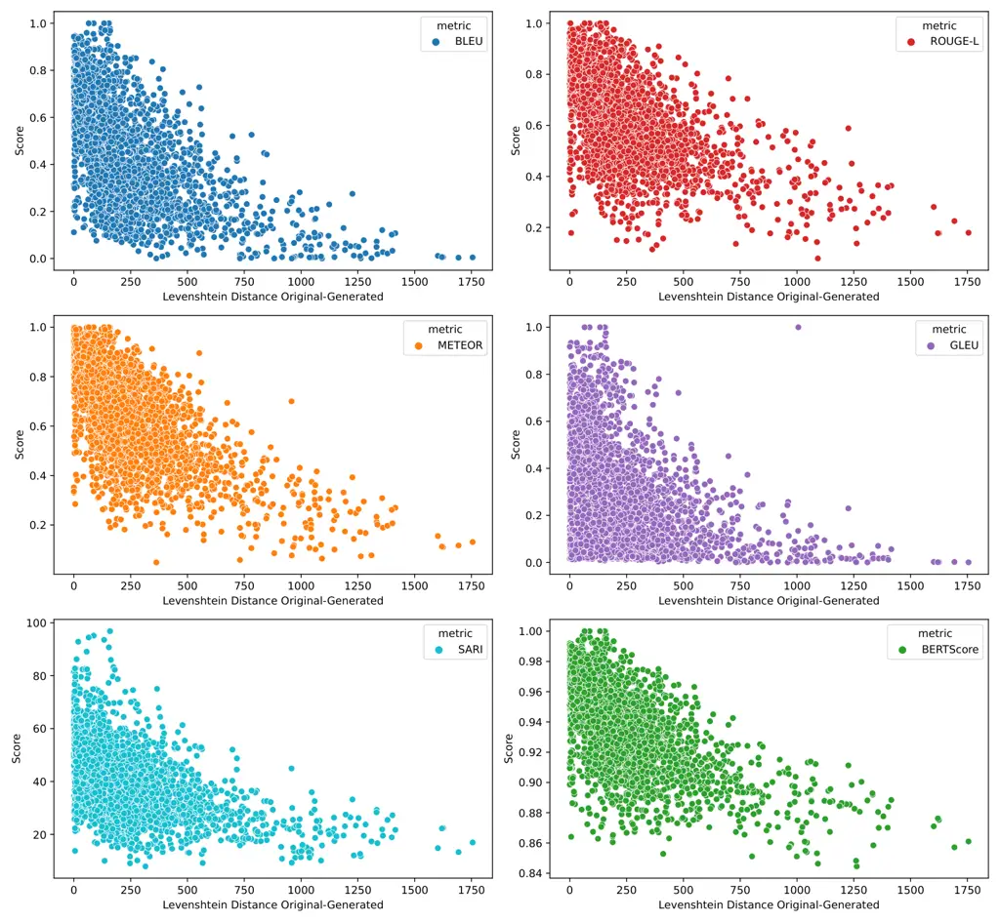
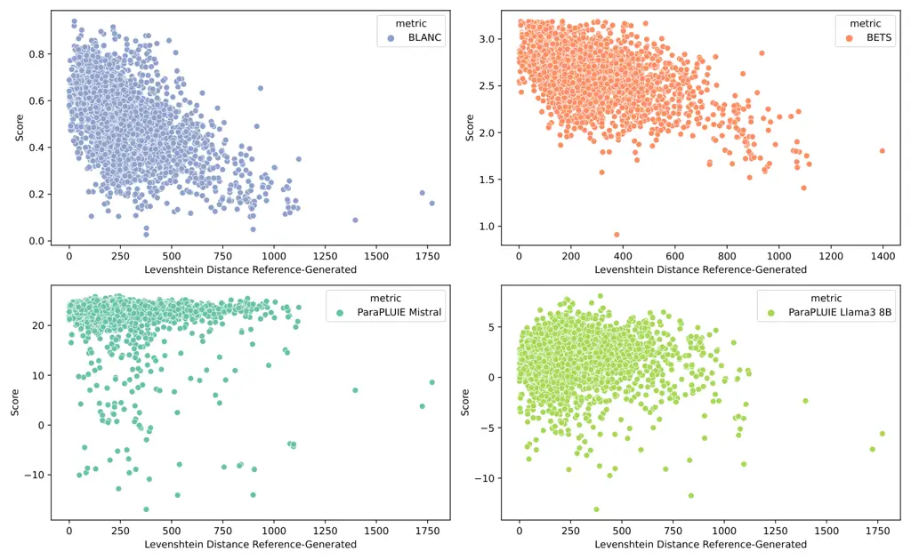
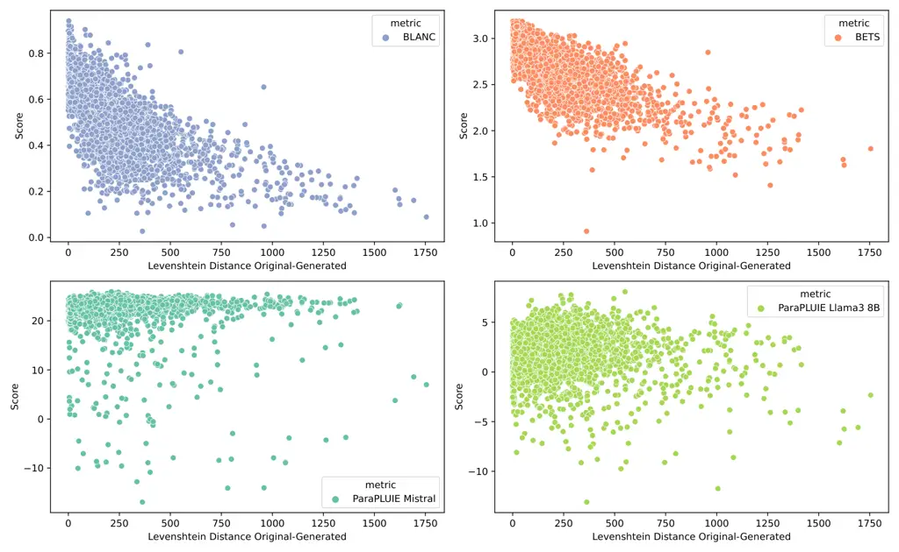

# Identifying Reliable Evaluation Metrics for Scientific Text Revision

Léane Jourdan Affiliation: Nantes Université, École Centrale Nantes,
CNRS, LS2N, UMR 6004, F-44000 Nantes, France    Florian Boudin
Affiliation: Nantes Université, École Centrale Nantes, CNRS, LS2N, UMR
6004, F-44000 Nantes, France Affiliation: JFLI, CNRS, Nantes University,
France
Correspondence:[leane.jourdan@univ-nantes.fr](mailto:leane.jourdan@univ-nantes.fr)
   Nicolas Hernandez Affiliation: Nantes Université, École Centrale
Nantes, CNRS, LS2N, UMR 6004, F-44000 Nantes, France    Richard Dufour
Affiliation: Nantes Université, École Centrale Nantes, CNRS, LS2N, UMR
6004, F-44000 Nantes, France

###### Abstract

Evaluating text revision in scientific writing remains a challenge, as
traditional metrics such as ROUGE and BERTScore primarily focus on
similarity rather than capturing meaningful improvements. In this work,
we analyse and identify the limitations of these metrics and explore
alternative evaluation methods that better align with human judgments.
We first conduct a manual annotation study to assess the quality of
different revisions. Then, we investigate reference-free evaluation
metrics from related NLP domains. Additionally, we examine
LLM-as-a-judge approaches, analysing their ability to assess revisions
with and without a gold reference. Our results show that LLMs
effectively assess instruction-following but struggle with correctness,
while domain-specific metrics provide complementary insights. We find
that a hybrid approach combining LLM-as-a-judge evaluation and
task-specific metrics offers the most reliable assessment of revision
quality.

## 1 Introduction

Effective revision is a critical step in scientific writing, ensuring
clarity, coherence, and adherence to academic standards. The writing
process typically consists of four stages: 1) Prewriting, 2) Drafting, 3) Revising, and 4) Editing (Jourdan et al., ). The revision stage
involves substantial modifications to improve readability, style, and
formality (Du et al., 2022; Li et al., 2022). This step is particularly
critical, as poor writing quality can obscure research findings and
often contributes to paper rejection (Amano et al., 2023). As
illustrated in Figure 1, the revision task takes an original paragraph
and an instruction specifying the required modification as input. The
expected output is a revised paragraph that aligns with the given
instruction.

Figure 1: Overview of the text revision task

Given the importance of this task, reliable evaluation is crucial. Like
other text generation tasks, text revision is assessed using
well-established metrics such as ROUGE (Lin, 2004) or BERTScore (Zhang
et al., 2020). While embedding-based metrics (e.g., BERTScore) capture
some semantic similarity, they still primarily focus on surface-level
features and lexical overlap, rather than capturing deeper aspects of
text quality.

In text revision, similarity-based metrics alone fail to fully capture
revision quality. Beyond surface similarity to a reference text,
revision assessment requires considering improvements over the original
version, meaning preservation, and adherence to the instruction. Several
studies have relied on human evaluation to assess text revision
systems (Du et al., 2022; Raheja et al., 2023; Raheja et al., 2024; Ito
et al., 2020; Schick et al., 2023). However, human evaluation is costly
and time-consuming, making it impractical for large-scale or iterative
assessments during system development. To address this limitation, we
explore alternative automatic evaluation approaches that provide a more
reliable and scalable assessment of revision quality.

Since text revision encompasses various subtasks (e.g., paraphrasing,
summarization, text simplification, style transfer, grammar error
correction (GEC)) (Li et al., 2022; Raheja et al., 2024; Ito et al.,
2019; Kim et al., 2022), we first explore reference-free evaluation
metrics commonly used to assess these tasks. These metrics compare the
original and revised texts directly, rather than relying on a gold
reference. Additionally, we explore different LLM-as-a-judge approaches,
which can incorporate the revision instruction and potentially
approximate human reasoning. With the rapid growth of LLMs, these
approaches are increasingly used for evaluating diverse tasks (Gu et
al., 2024). However, prior studies have shown that LLMs experience
performance drops when no gold reference is provided, sometimes being
outperformed by simpler methods, making them less
appealing (Doostmohammadi et al., 2024; Mita et al., 2024). In this
work, we aim to evaluate whether these results generalise to the text
revision task and investigate the impact of providing a gold reference.
Our contributions are as follows:

- •
  We release ParaReval, a dataset of human pairwise evaluations of
  generated revisions.¹¹ 1
  [https://github.com/JourdanL/parareval](https://github.com/JourdanL/parareval)
- •
  We show that traditional similarity metrics fail to accurately
  evaluate text revision.
- •
  We demonstrate that LLM-as-a-judge can effectively assess instruction
  following without the need for a gold reference.
- •
  We find that similarity metrics complement LLM-as-a-judge in
  addressing challenging cases.
- •
  While LLM-as-a-judge performs best, we show that the ParaPLUIE
  metric Lemesle et al. (2025) can serve as a cost-effective alternative
  for measuring meaning preservation.

## 2 Related Work

In this section, we categorise evaluation approaches into three types:
n-gram similarity metrics, embedding-based similarity metrics, and
LLM-as-a-judge methods.

### 2.1 N-grams Similarity Metrics

N-gram-based similarity metrics have been the standard for evaluating
text generation tasks. These metrics primarily measure lexical overlap
between the generated text and the reference. However, they cannot
capture semantic equivalence or improvements made over the original
text. The most commonly used n-gram-based metrics are:

- •
  BLEU (Papineni et al., 2002): Initially developed for machine
  translation evaluation, BLEU has been widely used in text revision
  tasks (Du et al., 2022; Raheja et al., 2024; Jourdan et al., 2024;
  Dwivedi-Yu et al., 2024; Mücke et al., 2023).
- •
  ROUGE (Lin, 2004): Designed for summarization evaluation, ROUGE
  includes several variants, with ROUGE-L being the most commonly used
  in text revision (Du et al., 2022; Jourdan et al., 2024; Jourdan et
  al., 2025; Dwivedi-Yu et al., 2024).
- •
  METEOR (Banerjee and Lavie, 2005): A unigram matching metric for
  machine translation, less sensitive to paraphrasing than BLEU. Used in
  text revision by Mücke et al. (2023).
- •
  GLEU (Napoles et al., 2015): A variant of BLEU tailored for GEC, and
  used for text revision in (Dwivedi-Yu et al., 2024; Raheja et al.,
  2023). It takes the source text into account, rewarding corrections
  and crediting unchanged parts, while also penalizing ungrammatical
  edits.
- •
  SARI (Xu et al., 2016): Designed for automatic text simplification, it
  is the most commonly used metric for evaluating text revision (Du et
  al., 2022; Raheja et al., 2023; Raheja et al., 2024; Jourdan et al.,
  2024; Jourdan et al., 2025; Dwivedi-Yu et al., 2024). It compares the
  system’s output to both the reference and the source texts, rewarding
  correct additions, deletions, and retention of words.

BLEU, ROUGE and METEOR metrics score the similarity between the
generated output and a reference text. SARI and GLEU are the only
metrics that consider the source text, which is essential for assessing
improvements in text revision. However, while they are interpretable,
they struggle with tasks requiring deeper semantic understanding, such
as evaluating instruction following or measuring improvements over the
original text.

### 2.2 Embedding Similarity Metrics

Embedding-based metrics like BERTScore (Zhang et al., 2020),
MoverScore (Zhao et al., 2019) or SemDist (Kim et al., 2021) are
designed to capture semantic similarity beyond surface-level lexical
overlap. These methods compare the embeddings of generated and reference
texts to assess their alignment. In text revision, only BERTScore has
been used (Mücke et al., 2023; Jourdan et al., 2024). It computes cosine
similarity between contextualised embeddings from BERT for corresponding
words in reference and generated sentences.

### 2.3 LLM-as-a-Judge Approaches

Recent works have explored the use of LLM-as-a-judge for evaluating
generation tasks to go beyond surface similarity. These approaches treat
evaluation as a judgment task, where an LLM assesses generated text
based on multiple criteria. Several classification schemes have been
proposed: Gu et al. (2024) propose to categorise them into _Scores_,
_Yes or No_, _Pair_ and _Multiple choice_. Zheng et al. (2023) propose
three different variations: _pairwise comparison_, _single-answer
grading_(score) and _reference-guided grading_.

Notably, Doostmohammadi et al. (2024) proposed evaluating generated text
on three dimensions: _naturalness_ (does the generation sound natural
and fluent?), _relatedness_ (is the generation related to the prompt and
follow the required format?), and _correctness_ (is the generation
correct?, with meaning varying by task). For text revision
evaluation, Mita et al. (2024) designed a one-question pairwise
comparison prompt and tested it in a zero and few-shot settings.
However, their results showed that this approach underperformed compared
to a fine-tuned BERT classifier.

For our LLM-as-a-judge approaches, we build on these works and we
propose a combination of the three variations from (Zheng et al., 2023).

## 3 Experimental Setup

To examine the limitations of traditional similarity metrics, we first
generate multiple revised outputs using various LLMs and manually
evaluate them.

### 3.1 Dataset

We use the evaluation split of the ParaRev dataset Jourdan et al.
(2025), which contains 258 pairs of revised paragraphs extracted from
scientific articles revised by the authors themselves. Each paragraph is
annotated with two different revision instructions, resulting in a total
of 516 data points. Additionally, each paragraph is labelled with its
revision intention type, which will be used in our analysis, the
taxonomy is provided in Table 1.

| Type      |          | Description                       |
| --------- | -------- | --------------------------------- |
|           | Light    | Minor changes in word choice      |
|           |          | or phrasing.                      |
| Rewriting | Medium   | Complete rephrasing of sentences  |
|           |          | within the paragraph.             |
|           | Heavy    | Significant rephrasing, affecting |
|           |          | at least half of the paragraph.   |
| Concision |          | Same idea, stated more briefly by |
|           |          | removing unnecessary details.     |
| Content   | Deletion | Modification of content through   |
|           |          | the deletion of an idea.          |

Table 1: Taxonomy of revisions at paragraph level

### 3.2 Revision Models

To ensure a diverse set of revision outputs in terms of quality, we
generate revised paragraphs for each original paragraph + instruction
pair using 6 different models. The models used are the following:

- •
  [CoEdIT-XL](https://huggingface.co/grammarly/coedit-xl), a T5-based
  model fine-tuned for sentence revision (Raheja et al., 2023)
- •
  Open LLMs: [Llama 3 8B
  Instruct](https://huggingface.co/meta-llama/Meta-Llama-3-8B-Instruct),
  [Llama 3 70B
  Instruct](https://huggingface.co/meta-llama/Meta-Llama-3-70B-Instruct),
  [Mistral 7B Instruct
  v0.2](https://huggingface.co/mistralai/Mistral-7B-Instruct-v0.2)
- •
  Closed-source LLMs: GPT 4o mini, GPT 4o

The prompts are provided in Appendix A.

### 3.3 Annotation Task

To identify which metrics best reflect the true quality of revisions, we
conducted a manual evaluation comparing human judgments with automatic
metric scores. For this, we designed an annotation task where human
annotators compared pairs of revision candidates and selected their
preferred version.

We carried out the annotation with the help of 10 annotators: 3
professors and 7 PhD students, all non-native English speakers but
experienced in both reading and writing scientific papers in NLP. Each
annotation instance consisted of two revision suggestions for a given
paragraph, produced in Section 3.1, along with the corresponding
revision instruction. Annotators answered a series of questions to
assess the quality of the revisions:

- •
  Q1A and Q1B Relatedness x2: Did model A/B address the instruction?
  {Yes strictly, Yes with additional modifications, No}
- •
  If it was your article and your instruction:
  - –
    Q2 Correctness: Which revisions would you consider acceptable?
    {Both, A only, B only, None}
  - –
    Q3 Preference: Which revision would you prefer to include in your
    paper? {Both, A, B, None}

- •
  Category-Specific Evaluation, {Both, A, B, None} are possible answers
  for each question:
  - –
    Rewriting light: Which model improves the academic style and English
    the most?
  - –
    Rewriting medium: Which model improves the readability and structure
    the most?
  - –
    Rewriting heavy: Which model improves the readability and clarity
    the most?
  - –
    Concision: Which model manages the most to give a shorter version
    while keeping all the important ideas?

A screenshot of the annotation environment is available in Appendix B.
To ensure fair evaluation, we balanced the pairwise comparisons across
models, ensuring that each model was compared to the others a similar
number of times.

### 3.4 Annotation Phase Results

From the evaluation subset of the dataset, we generated 1,548 pairs of
revised paragraphs for annotation. Among these, 129 pairs (8.33%)
received double annotations to measure inter-annotator agreement. The
agreement scores (Cohen’s Kappa $`\kappa`$) for each question are
reported in Table 2.

For our analysis, as we are studying the metrics’ capacity to identify
the best revision among two propositions, we introduce the notion of
Extended Preference. Even if annotators select _None_ for the Preference
question, a model is still considered preferable if it is the only one
_Correct_ or _Related_ to the instruction. We then consider the
leftovers _Both_ and _None_ as _Ties_.

| Question         | $`\kappa`$ | Agreement |
| ---------------- | ---------- | --------- |
| Relatedness      | 0.54       | Moderate  |
| Correctness      | 0.55       | Moderate  |
| Preference       | 0.33       | Fair      |
| Concision        | 0.22       | Fair      |
| Rewriting light  | 0.41       | Moderate  |
| Rewriting medium | 0.48       | Moderate  |

Table 2: Cohen’s Kappa ($`\kappa`$) for each question.

Figure 2 presents the distribution of human preferences across models.
Based on human annotations, GPT-4o emerges as the best-performing
revision model, being strictly favoured in 58.33% of comparisons. Llama
3 70B follows, with a preference rate of 53.68%. When doing pairwise
comparison of revision models, we observe that Llama 3 70B is in a tie
with GPT-4o. For more details, we also report the pairwise preferences
on revision models in Appendix C.

Figure 2: Distribution of human extended preference for each revision
model. The green area indicates cases where the model is preferred.

## 4 Limitations of Similarity-based Metrics

In this section, we evaluate generated revisions and study the
weaknesses of similarity-based metrics.

### 4.1 Performance of Revision Models with Similarity-based Metrics

To determine the best revision model, we evaluate each generated
revision using traditional similarity-based metrics by comparing it to a
reference. Additionally, we compare the scores of these models with a
no-edits baseline that simply recopies the input as output. Results are
presented in Table 3. We observe that all metrics, except GLEU, consider
the no edits baseline to be the best-performing approach, with CoEdIT-XL
also being a strong contender. However, upon manual inspection, we find
that CoEdIT-XL tends to perform minimal revisions, such as correcting
grammar and typos or, in some cases, excessively deleting parts of the
paragraph. This suggests that these metrics favour not making any
changes rather than rewarding meaningful, in-depth revisions.

| Rev. Model       | BLEU  | ROUGE-L | METEOR | GLEU  | SARI  | Bertscore | BLANC | BETS  | ParaPLUIE |
| ---------------- | ----- | ------- | ------ | ----- | ----- | --------- | ----- | ----- | --------- |
| no edits \| gold | 66.00 | 78.30   | 83.80  | 25.78 | 60.63 | 95.95     | 55.21 | 2.461 | 20.93     |
| CoEdIT-XL        | 50.24 | 67.46   | 66.66  | 23.84 | 39.60 | 93.90     | 58.96 | 1.554 | 19.35     |
| Mistral-7B       | 27.77 | 50.79   | 54.02  | 15.38 | 31.63 | 92.14     | 41.59 | 2.491 | 23.02     |
| Llama-3-8B       | 41.66 | 62.07   | 62.00  | 25.78 | 39.33 | 93.53     | 49.09 | 2.364 | 22.67     |
| Llama-3-70B      | 46.78 | 65.61   | 67.20  | 30.31 | 42.74 | 93.90     | 52.27 | 2.386 | 22.58     |
| GPT4o-mini       | 51.68 | 69.54   | 72.70  | 32.67 | 45.06 | 94.80     | 54.89 | 2.497 | 22.74     |
| GPT4o            | 49.34 | 68.20   | 69.88  | 31.35 | 43.54 | 94.45     | 53.62 | 2.454 | 22.86     |

Table 3: Results on the paragraph revision task with traditional and
alternative metrics.

### 4.2 Redundancy and Correlation Among Metrics

To further investigate this issue, we analyse the correlation between
different metrics and their relationship with edit distance (Levenshtein
distance). We compute the Pearson correlation coefficient between all
metrics (see Figure 3). We observe that most metrics are highly
correlated, suggesting they provide redundant information. The only
exception is SARI, which differs from most other metrics because it
considers the original text, the generated revision, and the reference.
These results suggest that, although we aim to use different metrics to
study the revisions from various angles, most of them ultimately convey
the same information.

Figure 3: Correlation of the similarity metrics against each other and
to the negative edit distance.

### 4.3 Sensitivity of Metrics to Edit Distance

The first two columns of Figure 3 show a strong correlation between
similarity metrics and negative edit distance, both in relation to the
original and the reference paragraph. This relation is further
illustrated in Appendix D. Two key observations emerge:

- •
  First, metrics only capture surface similarity. The high correlation
  with the distance between the reference and generated revision
  suggests that traditional metrics mostly reflect how closely a model
  replicates the reference revision, rather than evaluating the quality
  of the revision itself. Even BERTScore, despite being based on
  embeddings and computationally more expensive, ultimately provides
  similar information to simpler distance-based metrics.
- •
  Second, substantial revisions are penalised. The strong correlation
  between metric scores and the distance between the original and
  generated text indicates that the more a revision deviates from the
  original paragraph, the lower its score. This suggests that
  traditional metrics do not reward substantial, qualitative
  improvements, such as restructuring sentences or enhancing clarity.
  Instead, they encourage conservative edits that closely match the
  reference.

This phenomenon creates a major evaluation bias: Models that produce
minimal edits receive higher scores and valid, but different,
improvements are penalised. In many cases, making no revision at all
results in a higher score than making meaningful changes, as exemplified
in Figure 4.

Figure 4: Overview of the evaluation in a case where automatic
evaluation (here SARI) and human judgment don’t align.

Among all metrics, SARI and GLEU stand out by having a lower correlation
to edit distance ($`\leq 0.52`$), as they explicitly penalise unchanged
text edits, thereby encouraging revision.

## 5 Exploring Alternative Evaluation Approaches

The goal of this section is to identify evaluation metrics that better
correlate with human assessments of text revision quality.

### 5.1 Metrics from Related NLP Domains

We hypothesise that in text revision, an essential factor is the
comparison to the original text, as the metrics computing the similarity
to a reference revision tend to overlook whether the modification
effectively improves the original text. SARI and GLEU are widely used in
text revision because they consider both the original and reference
texts.

Additionally, text revision encompasses various subtasks depending on
the type of modification conducted. Raheja et al. (2024) classified
revisions into three main categories: GEC, Simplification, and
Paraphrasing. They evaluated each with a distinct set of metrics. This
suggests that a single metric may not be sufficient for text revision,
as we are not trying to capture the same phenomenon depending on the
type of revision.

Inspired by these ideas, we explore metrics from related NLP domains,
selecting those that consider the original text and align with specific
types of revision (e.g., text summarization metrics for concision tasks
or paraphrase evaluation metrics for rewriting tasks). We identify three
candidate metrics, taking the original and generated revised paragraph
as input:

- •
  BETS Zhao et al. (2023): Designed for text simplification to assess
  meaning preservation and comparative simplicity at the level of
  modified word pairs, using BERT embeddings.
- •
  BLANC Vasilyev et al. (2020) (BLANC-help variant): Designed for
  document summarization as a replacement for ROUGE. It measures how
  _helpful_ a summary is to understand a text, using a BERT-based model.
- •
  ParaPLUIE Lemesle et al. (2025): A metric for paraphrase detection
  that prompts Mistral 7B and uses perplexity scores when suggesting a
  Yes or No answer- instead of the generated text.

Table 3 presents the evaluation results using these three candidate
metrics, we also add the results comparing the original paragraph to the
gold revision for comparison. BETS and ParaPLUIE present a similar
ranking of their preferred models and rank CoEdIT-XL last like human
annotation. Conversely, BLANC follows the one of similarity-based
metrics.

Figure 5 reports the correlations between these new metrics and negative
edit distance. Except for BLANC, these metrics showcase a low
correlation to the edit distance. Additionally, in Appendix D, we
visualise these correlation relations.

BETS and ParaPLUIE emerge as promising candidates for evaluating text
revision, while BLANC appears less suitable. We further investigate
their alignment with human annotations to confirm their effectiveness in
Sections 5.3 and 6.

Figure 5: Correlation of the out-of-domain metrics against each other
and to the negative edit distance.

### 5.2 LLM-as-a-Judge

An additional hypothesis is that text revision should not only account
for the original text but also assess the model’s ability to follow
instructions effectively. We explore LLM-as-a-Judge approaches to
evaluate both these aspects.

We experiment with different approaches for LLM-as-a-judge, based on the
work of Doostmohammadi et al. (2024), who employed GPT-4 as a judge to
evaluate three key criteria in generated text: 1) _Naturalness_, 2)
_Relatedness_, and 3) _Correctness_. Since our task involves modifying
existing text rather than generating it from scratch, _Naturalness_ is
not relevant to our evaluation. However, _Relatedness_ (whether the
revision follows the instruction), aligns with Q1A and Q1B from our
human annotation and _Correctness_ (whether the revision is acceptable)
aligns directly with Q2. We structure our prompt similarly to the human
annotation task to evaluate these two aspects.

We explore two approaches from Gu et al. (2024) for using LLMs as
judges: Generating scores (_LLM-Likert_) where the model is presented
individual revisions to grade them, and Yes or No questions + Pairwise
comparisons (_LLM-Choice_) where the model is presented with pairs of
revisions to select its preferred one or declare a tie.
As Doostmohammadi et al. (2024) pointed out a drop in performance when
GPT-4o was not provided a gold reference, we experimented with these two
approaches with and without a gold reference. The prompts are provided
in Appendix E.

Since our revision candidates were generated by multiple LLMs, we ensure
a fair evaluation by also using multiple LLMs as judges. This helps to
reduce potential bias, where a model might favour its own outputs. In
Appendix F, we analyse the preferences of each LLM judge and discuss
this potential bias.

We averaged agreements over three runs for all models except GPT-4o due
to cost constraints. However, in the main body of the paper, we further
average the results of all models per approach to present them more
concisely.

The results with LLM-as-a judge approaches are reported in Table 4. All
approaches agree with human annotation on CoEdIT-XL being the less
performing revision model and on LLama70B being a strong option for the
task. However, LLM-likert scores are really close.

|             | LLM-choice |         | LLM-likert |         |
| ----------- | ---------- | ------- | ---------- | ------- |
| Rev. Model  | base       | w. gold | base       | w. gold |
| CoEdIT-XL   | 6.15       | 8.82    | 3.385      | 3.487   |
| Mistral-7B  | 64.95      | 56.73   | 4.816      | 4.497   |
| Llama-3-8B  | 58.88      | 57.08   | 4.789      | 4.472   |
| Llama-3-70B | 59.34      | 60.20   | 4.784      | 4.479   |
| GPT4o-mini  | 50.52      | 52.33   | 4.750      | 4.447   |
| GPT4o       | 50.85      | 51.41   | 4.743      | 4.443   |

Table 4: Results on the paragraph revision task with LLM-as-a-judge
evaluation. For LLM-choice, we report the extended preference and for
LLM-likert, we report the average of all criteria.

### 5.3 Results

After identifying all the candidate metrics, we assess their alignment
with human judgement using three distinct measures to convey this
agreement: Cohen’s Kappa ($`\kappa`$), Cramér’s V ($`V`$), and Pairwise
Accuracy to account for ties (Deutsch et al., 2023). Table 5 reports the
alignment of automatic evaluation methods with human judgments, we add a
random baseline for comparison. As BLEU, ROUGE-L and METEOR are highly
correlated, we report only ROUGE-L results in the main body of this
paper.

LLM-Choice emerges as the most reliable evaluation option, followed by
ParaPLUIE. LLM-Likert and GLEU also exhibit strong alignment. However,
while LLM-Likert achieves higher accuracy when making a decision, it
tends to overclassify cases as ties (See Appendix G).

| Judge           | Pair acc. | $`V`$ | $`\kappa`$ |
| --------------- | --------- | ----- | ---------- |
| Avg. LLM choice | 0.564     | 0.244 | 0.247      |
| Avg. LLM likert | 0.436     | 0.240 | 0.181      |
| ParaPLUIE       | 0.551     | 0.241 | 0.218      |
| BETS            | 0.492     | 0.152 | 0.127      |
| BLANC           | 0.357     | 0.117 | -0.080     |
| BERTScore       | 0.445     | 0.161 | 0.034      |
| SARI            | 0.465     | 0.183 | 0.071      |
| GLEU            | 0.504     | 0.193 | 0.138      |
| ROUGE-L         | 0.414     | 0.179 | -0.013     |
| Random          | 0.334     | 0.027 | 0.003      |

Table 5: Alignment of automatic metrics with human judgements across all
data. Pairwise accuracy and Cramér’s V are defined on \[0:1\] and
Cohen’s Kappa on \[-1:1\].

## 6 Performance by Aspects

In this section, we further analyse performance at a finer granularity
on two aspects to see if the performances vary with the type of revision
or the difficulty to discriminate the pair of propositions.

### 6.1 Performance by Revision Category

Figure 6: Alignment of automatic metrics with human annotations by
revision category

To test our hypothesis from Section 5.1, we analyse the alignment of
human and automatic judgments across different revision types using
ParaRev label annotations (see Figure 6). For most categories,
LLM-Choice is the most reliable evaluation approach. However, for cases
where paragraph content is minimally altered (Rewriting Light, Rewriting
Medium and Concision), ParaPLUIE appears as a good alternative to
capture meaning-preservation, as it is less costly than LLM-as-a-judge
approaches. For instance, it processed our dataset in just 11 minutes,
compared to 1 hour and 22 minutes required for Mistral 7B-Choice on a
V100 GPU.

For Content Deletion, n-gram similarity-based metrics such as GLEU and
SARI offer cost-efficient alternatives, aligning as well as or better
than LLM-Choice with human preferences by leveraging reference-based
deletion information.

Finally, for Rewriting Heavy, BETS outperforms other metrics and aligns
better to human annotation than in other categories of revisions. In
this category, the meaning of the paragraph must remain the same, while
undergoing in-depth restructuring and rephrasing of most of the content.
In the dataset, many of the instructions associated with these
paragraphs focus on making them clearer, more readable, or easier to
understand, which can be linked to the task of text simplification. BETS
is a balanced score between meaning preservation and text
simplification, which likely explains its strong performance in this
category.

### 6.2 Performance by Difficulty

To further assess metric effectiveness, we analyse performance across
varying difficulty levels. We categorise revision pairs based on human
annotation difficulty levels:

- •
  Easy Cases (530 pairs): defined by Q1A and Q1B, one model followed the
  instruction while the other did not.
- •
  Medium Cases (214 pairs): defined by Q2, both models followed the
  instruction, but only one produced an acceptable revision.
- •
  Hard Cases (575 pairs): defined by Q3: Both revisions were acceptable,
  but one was preferred.

Figure 7: Alignment of automatic metrics with human annotations, by
difficulty. The triangles in the first column represent the agreement on
the total dataset from Table 5

We report the alignment by difficulty in Figure 7. We observe that
LLM-Choice performs best in easy cases, achieving 0.821 accuracy. This
suggests that LLMs are particularly effective at recognising whether a
revision follows the given instruction, an ability that none of the
other metrics possess. However, for medium cases, where both revisions
comply with the instruction, similarity-based metrics outperform LLMs in
identifying the best option. We posit that these metrics can leverage
information from the gold reference to assess the expected revision more
effectively.

For hard cases, none of the metrics perform well, with all methods
showing low alignment with human judgments, as the task becomes even
more subjective. In such situations, the preference for one revision
over another may depend largely on the original author’s writing style
and intent, making automatic evaluation difficult. However, ParaPLUIE
seems to be the best option for evaluating these hard cases, ensuring
that the original meaning of the paragraph is preserved during the
revision process and preventing the revision model from hallucinating.

Since LLMs struggle with correctness assessment, we further analyse this
aspect in Appendix H, correlating results with preliminary human
annotation questions. A full alignment breakdown including all metrics
is available in Appendix I.

### 6.3 Impact of Providing Gold Reference for LLM-as-a-Judge Approaches

We examine whether providing the gold reference influences the
performance of LLM-as-a-judge methods and find minimal impact.
LLM-Choice accuracy vary slightly from 0.564 to 0.563 when provided with
the gold reference and LLM-Likert from 0.436 to 0.457. Our findings
contrast with Doostmohammadi et al. (2024), who reported that in the
absence of a reference, GPT-4o exhibited weaker alignment with human
judgments. This suggests that LLMs rely heavily on their own internal
reasoning rather than direct comparisons to a gold-standard revision.
More details in Appendix J.

## 7 Discussion and Conclusion

In this article, we identified the most reliable metrics to evaluate
scientific text revision. The identification of those metrics will allow
a better analyse- of existing text revisions strategies and designing
new models for this task.

Our results suggest that LLMs-as-a-judge methods effectively assess
whether a revision follows instructions but struggle to distinguish
between two strong candidates and need to be completed by other metrics.
Traditional similarity metrics, while not designed to assess
instruction-following, prove valuable in differentiating between valid
revisions. Their ability to compare revisions against a reference
provides a tie-breaking mechanism when LLMs fail to make a clear
distinction.

However, LLM-as-a-judge methods remain computationally expensive. To
mitigate this, we recommend using a smaller, complementary set of
metrics that strikes a balance between cost, interpretability, and
alignment with human judgments. This subset could include a small LLM to
evaluate instruction-following, ParaPLUIE for meaning preservation, and
similarity-based metrics like SARI and GLEU, which leverage information
from the gold reference to help differentiate between more challenging
cases.

## 8 Limitations

The primary limitation of this work is the size of the dataset, as we
were limited by the size of the evaluation split of ParaRev dataset and
only had a limited number of volunteer researchers for manual
annotation. As it need to be conducted with qualified annotators
(researchers) our human resources are very limited, leading to a smaller
double-annotated subset. A larger amount of annotated data would enhance
the reliability of our analysis, strengthening the claims we made in
this paper.

Additionally, preference-based annotation is inherently subjective, as
reflected in the Cohen’s Kappa scores in Table 2. For the ParaReval
dataset, we first annotated a double-annotated subset and retained the
annotations from researchers with the highest agreement. Those with the
highest agreement scores continued the annotation process to enhance
reliability. The choice of annotators (similar background) may also
introduce a bias.

We were also limited by computational resources, as LLMs use a lot of
energy. Our priority was to ensure that our results were
model-independent, so we conducted the same experience with different
models but using only one prompt. However, it would have been preferable
to also check the prompt-independent aspect (Mizrahi et al., 2024).

Finally, numerous methods and metrics have been proposed to evaluate
tasks in text generation throughout the years. To keep our analysis
clear, we considered a limited number of them. For the LLM-based
approaches, a larger number of runs would have been preferable for
GPT-4o but due to cost issues, we had to limit it to one run per
approach.

## 9 Ethical Considerations

#### Data availability

All the data are from the ParaRev corpus, the paragraphs are extracted
from scientific articles collected on OpenReview where they fall under
different "non-exclusive, perpetual, and royalty-free license" ²² 2
[https://openreview.net/legal/terms](https://openreview.net/legal/terms).

#### Computational resources

- •
  To generate revisions with Co-edit and experiment with BERT-based
  metrics, we used a local GeForce RTX 2080 11Go GPU for approximately
  12 hours.
- •
  To use ParaPLUIE and the different open LLMs to generate revisions and
  evaluation, we used V100 and A100 GPUs for a total of 249 hours on a
  supercomputer, equivalent to 0.009 tons of $`CO_{2}`$.
- •
  To use GPT-4o mini and GPT-4o we spent 29.01\$ spent on GPT API
  credits.

## Acknowledgments

We thank Anas Belfathi, Maël Houbre, Trung Hieu Ngo, Xavier Pillet,
Mohamed Reda Marzouk and Thomas Sebbag for their participation in human
evaluation.

We thank Thomas Sebbag for proof-reading this paper.

This work was granted access to the HPC resources of IDRIS under the
allocations 2023-AD011013901R1, 2024-AD011013901R2 and
2024-AD011014882R1 made by GENCI.

## References

- Amano et al. (2023) T. Amano, V. Ramírez-Castañeda, V.
  Berdejo-Espinola, I. Borokini, S. Chowdhury, M. Golivets, J. D.
  González-Trujillo, F. Montaño-Centellas, K. Paudel, R. L. White, et
  al. The manifold costs of being a non-native english speaker in
  science. PLoS Biology 21 (7), pp. e3002184. Cited by: §1.
- Banerjee and Lavie (2005) S. Banerjee and A. Lavie METEOR: an
  automatic metric for MT evaluation with improved correlation with
  human judgments. In Proceedings of the ACL Workshop on Intrinsic and
  Extrinsic Evaluation Measures for Machine Translation and/or
  Summarization, J. Goldstein, A. Lavie, C. Lin, and C. Voss (Eds.), Ann
  Arbor, Michigan, pp. 65–72. External Links:
  [Link](https://aclanthology.org/W05-0909/) Cited by: 3rd item.
- Deutsch et al. (2023) D. Deutsch, G. Foster, and M. Freitag Ties
  matter: meta-evaluating modern metrics with pairwise accuracy and tie
  calibration. In Proceedings of the 2023 Conference on Empirical
  Methods in Natural Language Processing, pp. 12914–12929. Cited by:
  §5.3.
- Doostmohammadi et al. (2024) E. Doostmohammadi, O. Holmström, and M.
  Kuhlmann How reliable are automatic evaluation methods for
  instruction-tuned LLMs?. In Findings of the Association for
  Computational Linguistics: EMNLP 2024, Y. Al-Onaizan, M. Bansal,
  and Y. Chen (Eds.), Miami, Florida, USA, pp. 6321–6336. External
  Links: [Link](https://aclanthology.org/2024.findings-emnlp.367) Cited
  by: Appendix E, §1, §2.3, §5.2, §5.2, §6.3.
- Du et al. (2022) W. Du, Z. M. Kim, V. Runderstandaheja, D. Kumar,
  and D. Kang Read, revise, repeat: a system demonstration for
  human-in-the-loop iterative text revision. In Proceedings of the First
  Workshop on Intelligent and Interactive Writing Assistants (In2Writing
  2022), Dublin, Ireland, pp. 96–108. External Links:
  [Link](https://aclanthology.org/2022.in2writing-1.14),
  [Document](https://dx.doi.org/10.18653/v1/2022.in2writing-1.14) Cited
  by: §1, §1, 1st item, 2nd item, 5th item.
- Dwivedi-Yu et al. (2024) J. Dwivedi-Yu, T. Schick, Z. Jiang, M.
  Lomeli, P. Lewis, G. Izacard, E. Grave, S. Riedel, and F. Petroni
  EditEval: an instruction-based benchmark for text improvements. In
  Proceedings of the 28th Conference on Computational Natural Language
  Learning, L. Barak and M. Alikhani (Eds.), Miami, FL, USA, pp. 69–83.
  External Links: [Link](https://aclanthology.org/2024.conll-1.7/),
  [Document](https://dx.doi.org/10.18653/v1/2024.conll-1.7) Cited by:
  1st item, 2nd item, 4th item, 5th item.
- I. Frommholz, P. Mayr, G. Cabanac, S. Verberne, and J. Brennan
  (Eds.) (2023) I. Frommholz, P. Mayr, G. Cabanac, S. Verberne, and J.
  Brennan (Eds.) Proceedings of the 13th international workshop on
  bibliometric-enhanced information retrieval (bir). CEUR Workshop
  Proceedings, Aachen. External Links: ISSN 1613-0073,
  [Link](http://ceur-ws.org/Vol-3617/) Cited by: 12.
- Gu et al. (2024) J. Gu, X. Jiang, Z. Shi, H. Tan, X. Zhai, C. Xu, W.
  Li, Y. Shen, S. Ma, H. Liu, et al. A survey on llm-as-a-judge. arXiv
  preprint arXiv:2411.15594. Cited by: §1, §2.3, §5.2.
- Ito et al. (2020) T. Ito, T. Kuribayashi, M. Hidaka, J. Suzuki, and K.
  Inui Langsmith: an interactive academic text revision system. In
  Proceedings of the 2020 Conference on Empirical Methods in Natural
  Language Processing: System Demonstrations, Q. Liu and D. Schlangen
  (Eds.), Online, pp. 216–226. External Links:
  [Link](https://aclanthology.org/2020.emnlp-demos.28/),
  [Document](https://dx.doi.org/10.18653/v1/2020.emnlp-demos.28) Cited
  by: §1.
- Ito et al. (2019) T. Ito, T. Kuribayashi, H. Kobayashi, A.
  Brassard, M. Hagiwara, J. Suzuki, and K. Inui Diamonds in the rough:
  generating fluent sentences from early-stage drafts for academic
  writing assistance. In Proceedings of the 12th International
  Conference on Natural Language Generation, K. van Deemter, C. Lin,
  and H. Takamura (Eds.), Tokyo, Japan, pp. 40–53. External Links:
  [Link](https://aclanthology.org/W19-8606/),
  [Document](https://dx.doi.org/10.18653/v1/W19-8606) Cited by: §1.
- Jourdan et al. (2025) L. Jourdan, F. Boudin, R. Dufour, N. Hernandez,
  and A. Aizawa ParaRev : building a dataset for scientific paragraph
  revision annotated with revision instruction. In Proceedings of the
  First Workshop on Writing Aids at the Crossroads of AI, Cognitive
  Science and NLP (WRAICOGS 2025), M. Zock, K. Inui, and Z. Yuan (Eds.),
  Abu Dhabi, UAE, pp. 35–44. External Links:
  [Link](https://aclanthology.org/2025.wraicogs-1.4/) Cited by: 2nd
  item, 5th item, §3.1.
- \[12\] L. Jourdan, F. Boudin, R. Dufour, and N. Hernandez Text
  revision in scientific writing assistance: an overview. See 7,
  pp. 22–36. External Links:
  [Link](http://ceur-ws.org/Vol-3617/#paper-04) Cited by: §1.
- Jourdan et al. (2024) L. Jourdan, F. Boudin, N. Hernandez, and R.
  Dufour CASIMIR: a corpus of scientific articles enhanced with multiple
  author-integrated revisions. In Proceedings of the 2024 Joint
  International Conference on Computational Linguistics, Language
  Resources and Evaluation (LREC-COLING 2024), N. Calzolari, M. Kan, V.
  Hoste, A. Lenci, S. Sakti, and N. Xue (Eds.), Torino, Italia,
  pp. 2883–2892. External Links:
  [Link](https://aclanthology.org/2024.lrec-main.257/) Cited by: 1st
  item, 2nd item, 5th item, §2.2.
- Kim et al. (2021) S. Kim, A. Arora, D. Le, C. Yeh, C. Fuegen, O.
  Kalinli, and M. L. Seltzer Semantic distance: a new metric for asr
  performance analysis towards spoken language understanding. In
  Interspeech 2021, pp. 1977–1981. External Links:
  [Document](https://dx.doi.org/10.21437/Interspeech.2021-1929), ISSN
  2958-1796 Cited by: §2.2.
- Kim et al. (2022) Z. M. Kim, W. Du, V. Raheja, D. Kumar, and D. Kang
  Improving iterative text revision by learning where to edit from other
  revision tasks. In Proceedings of the 2022 Conference on Empirical
  Methods in Natural Language Processing, Y. Goldberg, Z. Kozareva,
  and Y. Zhang (Eds.), Abu Dhabi, United Arab Emirates, pp. 9986–9999.
  External Links: [Link](https://aclanthology.org/2022.emnlp-main.678/),
  [Document](https://dx.doi.org/10.18653/v1/2022.emnlp-main.678) Cited
  by: §1.
- Lemesle et al. (2025) Q. Lemesle, J. Chevelu, P. Martin, D. Lolive, A.
  Delhay, and N. Barbot Paraphrase generation evaluation powered by an
  LLM: a semantic metric, not a lexical one. In Proceedings of the 31st
  International Conference on Computational Linguistics, O. Rambow, L.
  Wanner, M. Apidianaki, H. Al-Khalifa, B. D. Eugenio, and S. Schockaert
  (Eds.), Abu Dhabi, UAE, pp. 8057–8087. External Links:
  [Link](https://aclanthology.org/2025.coling-main.538/) Cited by: 5th
  item, 3rd item.
- Li et al. (2022) J. Li, Z. Li, T. Ge, I. King, and M. Lyu Text
  revision by on-the-fly representation optimization. In Proceedings of
  the First Workshop on Intelligent and Interactive Writing Assistants
  (In2Writing 2022), T. ’. Huang, V. Raheja, D. Kang, J. J. Y. Chung, D.
  Gissin, M. Lee, and K. I. Gero (Eds.), Dublin, Ireland, pp. 58–59.
  External Links: [Link](https://aclanthology.org/2022.in2writing-1.7),
  [Document](https://dx.doi.org/10.18653/v1/2022.in2writing-1.7) Cited
  by: §1, §1.
- Lin (2004) C. Lin ROUGE: a package for automatic evaluation of
  summaries. In Text Summarization Branches Out, Barcelona, Spain,
  pp. 74–81. External Links: [Link](https://aclanthology.org/W04-1013)
  Cited by: §1, 2nd item.
- Mita et al. (2024) M. Mita, K. Sakaguchi, M. Hagiwara, T. Mizumoto, J.
  Suzuki, and K. Inui Towards automated document revision: grammatical
  error correction, fluency edits, and beyond. In Proceedings of the
  19th Workshop on Innovative Use of NLP for Building Educational
  Applications (BEA 2024), E. Kochmar, M. Bexte, J. Burstein, A.
  Horbach, R. Laarmann-Quante, A. Tack, V. Yaneva, and Z. Yuan (Eds.),
  Mexico City, Mexico, pp. 251–265. External Links:
  [Link](https://aclanthology.org/2024.bea-1.21) Cited by: §1, §2.3.
- Mizrahi et al. (2024) M. Mizrahi, G. Kaplan, D. Malkin, R. Dror, D.
  Shahaf, and G. Stanovsky State of what art? a call for multi-prompt
  LLM evaluation. Transactions of the Association for Computational
  Linguistics 12, pp. 933–949. External Links:
  [Link](https://aclanthology.org/2024.tacl-1.52/),
  [Document](https://dx.doi.org/10.1162/tacl%5Fa%5F00681) Cited by: §8.
- Mücke et al. (2023) J. Mücke, D. Waldow, L. Metzger, P. Schauz, M.
  Hoffman, N. Lell, and A. Scherp Fine-tuning language models
  for scientific writing support. In Machine Learning and Knowledge
  Extraction, A. Holzinger, P. Kieseberg, F. Cabitza, A.
  Campagner, A. M. Tjoa, and E. Weippl (Eds.), Cham, pp. 301–318.
  External Links: ISBN 978-3-031-40837-3 Cited by: 1st item, 3rd item,
  §2.2.
- Napoles et al. (2015) C. Napoles, K. Sakaguchi, M. Post, and J.
  Tetreault Ground truth for grammatical error correction metrics. In
  Proceedings of the 53rd Annual Meeting of the Association for
  Computational Linguistics and the 7th International Joint Conference
  on Natural Language Processing (Volume 2: Short Papers), Beijing,
  China, pp. 588–593. External Links:
  [Link](http://www.aclweb.org/anthology/P15-2097) Cited by: 4th item.
- Papineni et al. (2002) K. Papineni, S. Roukos, T. Ward, and W. Zhu
  Bleu: a method for automatic evaluation of machine translation. In
  Proceedings of the 40th Annual Meeting of the Association for
  Computational Linguistics, Philadelphia, Pennsylvania, USA,
  pp. 311–318. External Links:
  [Link](https://aclanthology.org/P02-1040),
  [Document](https://dx.doi.org/10.3115/1073083.1073135) Cited by: 1st
  item.
- Raheja et al. (2024) V. Raheja, D. Alikaniotis, V. Kulkarni, B.
  Alhafni, and D. Kumar MEdIT: multilingual text editing via instruction
  tuning. In Proceedings of the 2024 Conference of the North American
  Chapter of the Association for Computational Linguistics: Human
  Language Technologies (Volume 1: Long Papers), K. Duh, H. Gomez,
  and S. Bethard (Eds.), Mexico City, Mexico, pp. 979–1001. External
  Links: [Link](https://aclanthology.org/2024.naacl-long.56/),
  [Document](https://dx.doi.org/10.18653/v1/2024.naacl-long.56) Cited
  by: §1, §1, 1st item, 5th item, §5.1.
- Raheja et al. (2023) V. Raheja, D. Kumar, R. Koo, and D. Kang CoEdIT:
  text editing by task-specific instruction tuning. In Findings of the
  Association for Computational Linguistics: EMNLP 2023, H. Bouamor, J.
  Pino, and K. Bali (Eds.), Singapore, pp. 5274–5291. External Links:
  [Link](https://aclanthology.org/2023.findings-emnlp.350),
  [Document](https://dx.doi.org/10.18653/v1/2023.findings-emnlp.350)
  Cited by: §1, 4th item, 5th item, 1st item.
- Schick et al. (2023) T. Schick, J. A. Yu, Z. Jiang, F. Petroni, P.
  Lewis, G. Izacard, Q. You, C. Nalmpantis, E. Grave, and S. Riedel
  PEER: a collaborative language model. In The Eleventh International
  Conference on Learning Representations, External Links:
  [Link](https://openreview.net/forum?id=KbYevcLjnc) Cited by: §1.
- Vasilyev et al. (2020) O. Vasilyev, V. Dharnidharka, and J. Bohannon
  Fill in the BLANC: human-free quality estimation of document
  summaries. In Proceedings of the First Workshop on Evaluation and
  Comparison of NLP Systems, S. Eger, Y. Gao, M. Peyrard, W. Zhao,
  and E. Hovy (Eds.), Online, pp. 11–20. External Links:
  [Link](https://aclanthology.org/2020.eval4nlp-1.2/),
  [Document](https://dx.doi.org/10.18653/v1/2020.eval4nlp-1.2) Cited by:
  2nd item.
- Xu et al. (2016) W. Xu, C. Napoles, E. Pavlick, Q. Chen, and C.
  Callison-Burch Optimizing statistical machine translation for text
  simplification. Transactions of the Association for Computational
  Linguistics 4, pp. 401–415. External Links:
  [Link](https://aclanthology.org/Q16-1029),
  [Document](https://dx.doi.org/10.1162/tacl%5Fa%5F00107) Cited by: 5th
  item.
- Zhang et al. (2020) T. Zhang, V. Kishore, F. Wu, K. Q. Weinberger,
  and Y. Artzi BERTScore: evaluating text generation with bert. In
  International Conference on Learning Representations, External Links:
  [Link](https://openreview.net/forum?id=SkeHuCVFDr) Cited by: §1, §2.2.
- Zhao et al. (2019) W. Zhao, M. Peyrard, F. Liu, Y. Gao, C. M. Meyer,
  and S. Eger MoverScore: text generation evaluating with contextualized
  embeddings and earth mover distance. In Proceedings of the 2019
  Conference on Empirical Methods in Natural Language Processing and the
  9th International Joint Conference on Natural Language Processing
  (EMNLP-IJCNLP), K. Inui, J. Jiang, V. Ng, and X. Wan (Eds.), Hong
  Kong, China, pp. 563–578. External Links:
  [Link](https://aclanthology.org/D19-1053/),
  [Document](https://dx.doi.org/10.18653/v1/D19-1053) Cited by: §2.2.
- Zhao et al. (2023) X. Zhao, E. Durmus, and D. Yeung Towards
  reference-free text simplification evaluation with a BERT Siamese
  network architecture. In Findings of the Association for Computational
  Linguistics: ACL 2023, A. Rogers, J. Boyd-Graber, and N. Okazaki
  (Eds.), Toronto, Canada, pp. 13250–13264. External Links:
  [Link](https://aclanthology.org/2023.findings-acl.838/),
  [Document](https://dx.doi.org/10.18653/v1/2023.findings-acl.838) Cited
  by: 1st item.
- Zheng et al. (2023) L. Zheng, W. Chiang, Y. Sheng, S. Zhuang, Z.
  Wu, Y. Zhuang, Z. Lin, Z. Li, D. Li, E. P. Xing, H. Zhang, J. E.
  Gonzalez, and I. Stoica Judging llm-as-a-judge with mt-bench and
  chatbot arena. In Proceedings of the 37th International Conference on
  Neural Information Processing Systems, NIPS ’23, Red Hook, NY, USA.
  Cited by: §2.3, §2.3.

## Appendix A Text Revision Prompt

system_message= """You are a writing assistant specialised in academic
writing.

Your task is to revise the original paragraph from a research paper
draft that will be given according to the author’s instruction. The
input will follow the pattern ’ \<author_instruction\> :
"\<Original_paragraph\>" ’.

Please answer only by "Revised paragraph:
\<revised_version_of_the_paragraph\>". Please limit your modifications
only to what is requested in the author’s instruction. Do not make any
other modifications to the rest of the paragraph."""

user_message= """(\*@\\textcolor{blue}{\\instruct\\}@\*) :
\\(\*@\\textcolor{blue}{\\parag\\}@\*)\\ """

## Appendix B Annotation Environment

See Figure 8

Figure 8: Screenshot of the annotation environment

## Appendix C Human Pairwise Revision Model Preferences

See Figure 9

Figure 9: Pairwise comparison of human preferences on revision models.

## Appendix D Relation between Metrics and Levenshtein Distance

See Figures 10, 11, 12 and 13.

Figure 10: Distribution of similarity metrics scores based on
Levenshtein distance between the reference and generated paragraph.

Figure 11: Distribution of similarity metrics scores based on
Levenshtein distance between the original and generated paragraph.

Figure 12: Distribution of alternative metrics scores based on
Levenshtein distance between the reference and generated paragraph.

Figure 13: Distribution of alternative metrics scores based on
Levenshtein distance between the original and generated paragraph.

## Appendix E LLM-as-a-Judge Prompts

Our prompts are inspired by the ones used in Doostmohammadi et al.
(2024). See Figures 14, 15 and 16for longer prompt sections.

You are an evaluator of academic writing on the task of text revision.

In this task, two revision models have been provided with the original
paragraph written for a scientific article and a revision instruction on
how to revise the paragraph.

You will be given the proposition from the two different models and
several questions to determine the quality of those propositions and
identify the best one. In your answer please only provide the answers to
the questions.

You are an evaluator of academic writing on the task of text revision.

In this task, two revisions models have been provided with the original
paragraph written for a scientific article and a revision instruction on
how to revise the paragraph.

You will be given the proposition from the two different models and
several questions to determine the quality of those proposition and
identify the best one. (\*@\\textbf{To help you in this task you will
also be given the gold paragraph which is the version revised by the
author themselves.}@\*)

In your answer please only provide the answers to the questions.

Rewriting_light:"""Which model improves the academic style and English
the most?"""

Rewriting_medium:"""Which model improves the readability and structure
the most?"""

Rewriting_heavy:"""Which model improves the readability and clarity the
most?"""

Concision:"""Which model manages the most to give a shorter version
while keeping all the important ideas?"""

\[BEGIN DATA\]

\*\*\*

\[Original paragraph\]:
\\(\*@\\textcolor{blue}{\\original\\\_paragraph\\}@\*)\\

\*\*\*

\[Revision instruction\]: \\(\*@\\textcolor{blue}{\\instruction\\}@\*)\\

\*\*\*

\[Model A\]:
\\(\*@\\textcolor{blue}{\\modelA\\\_generated\\\_revised\\\_paragraph\\}@\*)\\

\*\*\*

\[Model B\]:
\\(\*@\\textcolor{blue}{\\modelB\\\_generated\\\_revised\\\_paragraph\\}@\*)\\

\*\*\*

\[END DATA\]

1. Did model A address the instruction? Answer "Yes strictly", "Yes with
   additional modifications" or "No":

- Yes strictly : The model proposition matches what is required in the
  instruction. Here, the quality of the revision does not matter.

- Yes with additional modifications : The model proposed additional
  modifications to the one required in the instruction. But some of the
  modification address the needs stated in the instruction.

\- No : The model proposition does not match the instruction.

2. Did model B address the instruction? (Answer "Yes strictly", "Yes
   with additional modifications" or "No")

3. Is model A revision acceptable? Answer "Yes" or "No". Answer "Yes" if
   the model made a good quality revision proposition that should replace
   the original paragraph in the scientific article.

4. Is model B revision acceptable? (Answer "Yes" or "No")

5. Which model proposed the best revision? (Answer preferably "A" or
   "B", you can answer "Both" if it is really a tie. Answer "None" if you
   answered "No" to question 3 and 4.)"""

\<Additional category questions depending on the revision intention
labels of the instance\>

"""For all questions, you do not need to explain the reason.

Your response must be RFC8259 compliant JSON following this schema:

{{"1": str, "2": str , "3": str , "4": str , "5": str """

\< """ "6": str """ and """, "7": str """ can be added depending on the
number of labels of the instance.\>

"""}}

Figure 14: User message for prompting LLM Choice with and without Gold

Rewriting_light:"""The academic style and english has been improved."""

Rewriting_medium:"""The readability and structure has been improved."""

Rewriting_heavy:"""The paragraph has been rewritten in a more well
organized and clear version, fitting the academic style."""

Concision:"""The generated revision is a shorter version that kept all
the important ideas."""

You are an evaluator of academic writing on the task of text revision.

In this task, (\*@\\textbf{a revision model}@\*) have been provided with
the original paragraph written for a scientific article and a revision
instruction on how to revise the paragraph.

You will be given the proposition from the (\*@\\textbf{revision
model}@\*) and several (\*@\\textbf{affirmations}@\*) to determine the
quality of (\*@\\textbf{this}@\*) proposition(\*@\\textbf{.}@\*)

(\*@\\textbf{You will answer each affirmation with a grade (int) from 1
to 5 as following: 1 = Strongly disagree , 2 = Disagree , 3 = Neutral ,4
= Agree , 5 = Strongly agree }@\*)

In your answer please only provide the answers to the
(\*@\\textbf{affirmations}@\*).

\[BEGIN DATA\]

\*\*\*

\[Original paragraph\]:
\\(\*@\\textcolor{blue}{\\original\\\_paragraph\\}@\*)\\

\*\*\*

\[Revision instruction\]: \\(\*@\\textcolor{blue}{\\instruction\\}@\*)\\

\*\*\*

(\*@\\textbf{\[Model proposed revision\]:
}@\*)\\(\*@\\textbf{\\textcolor{blue}{\\model\\\_generated\\\_revised\\\_paragraph\\}}@\*)\\

\*\*\*

\[END DATA\]

(\*@\\textbf{1. Relatedness: The generated revision correctly addressed
the instruction.}@\*)

(\*@\\textbf{2. Correctness: The generated revision is better than
original version in my opinion.}@\*)"""

\<Additional category questions depending on the revision intention
labels of the instance\>

"""For all questions, you do not need to explain the reason.

Your response must be RFC8259 compliant JSON following this schema:

{{"1": str, "2": str , "3": str , "4": str , "5": str """

\< """ "6": str """ and """, "7": str """ can be added depending on the
number of labels of the instance.\>

"""}}

Figure 15: User message for prompting LLM Likert without Gold

You are an evaluator of academic writing on the task of text revision.

In this task, a revision model have been provided with the original
paragraph written for a scientific article and a revision instruction on
how to revise the paragraph.

You will be given the proposition from the revision model and several
affirmations to determine the quality of this proposition.

You will answer each affirmation with a grade (int) from 1 to 5 as
following: 1 = Strongly disagree , 2 = Disagree , 3 = Neutral ,4 = Agree
, 5 = Strongly agree

(\*@\\textbf{To help you in this task you will also be given the gold
paragraph which is the version revised by the author themselves.}@\*)

In your answer please only provide the answers to the affirmations.

\[BEGIN DATA\]

\*\*\*

\[Original paragraph\]:
\\(\*@\\textcolor{blue}{\\original\\\_paragraph\\}@\*)\\

\*\*\*

\[Revision instruction\]: \\(\*@\\textcolor{blue}{\\instruction\\}@\*)\\

\*\*\*

\[Model proposed revision\]:
\\(\*@\\textcolor{blue}{\\model\\\_generated\\\_revised\\\_paragraph\\}@\*)\\

\*\*\*

(\*@\\textbf{\[Gold revised paragraph\]:
}@\*)\\(\*@\\textcolor{blue}{\\textbf{\\gold\\}}@\*)\\

(\*@\\textbf{\*\*\*}@\*)

\[END DATA\]

(\*@\\textbf{1. Gold similarity: The generated revision is similar to
gold revision.}@\*)

(\*@\\textbf{2.}@\*) Relatedness: The generated revision correctly
addressed the instruction.

(\*@\\textbf{3.}@\*) Correctness: The generated revision is better than
original version in my opinion."""

\<Additional category questions depending on the revision intention
labels of the instance\>

"""For all questions, you do not need to explain the reason.

Your response must be RFC8259 compliant JSON following this schema:

{{"1": str, "2": str , "3": str , "4": str , "5": str """

\< """ "6": str """ and """, "7": str """ can be added depending on the
number of labels of the instance.\>

"""}}

Figure 16: User message for prompting LLM Likert with Gold

## Appendix F Bias of LLM Models on their own Revisions

As we used several LLM for revision that we reused as judges, we check
in Table 6 if they are biased towards their own proposition. We don’t
observe such bias, and even notice that results tend to be consistent
across judge models. However, as they all tend to favour Mistral 7B we
also computed the average edit distance between the original and
generated revised texts for all revision models. As Mistral has the
highest average, this could indicate an opposite bias as the one
conveyed in similarity metrics: LLM-as-a-judge approaches tend to favour
propositions with more important revisions.

|                                                   |        |            |            |             |             |        |
| ------------------------------------------------- | ------ | ---------- | ---------- | ----------- | ----------- | ------ |
| Judge$`\downarrow`$/Revision model$`\rightarrow`$ | CoEdIT | Mistral 7B | Llama 3 8B | Llama 3 70B | GPT-4o mini | GPT 4o |
| Human                                             | 3.29   | 42.83      | 46.12      | 53.68       | 52.13       | 58.33  |
| Mistral 7B Choice                                 | 21.58  | 60.92      | 56.20      | 55.17       | 50.65       | 52.65  |
| Llama 3 8B Choice                                 | 3.94   | 64.66      | 58.98      | 62.02       | 58.08       | 52.07  |
| Llama 3 70B Choice                                | 1.49   | 73.00      | 61.76      | 59.23       | 46.06       | 48.13  |
| GPT-4o mini Choice                                | 1.81   | 66.86      | 58.53      | 57.30       | 47.61       | 48.90  |
| GPT-4o Choice                                     | 1.94   | 59.30      | 58.91      | 62.98       | 50.19       | 52.52  |
| Mistral 7B Gold Choice                            | 23.64  | 54.65      | 56.33      | 56.52       | 51.16       | 54.07  |
| Llama 3 8B Gold Choice                            | 14.67  | 51.62      | 59.24      | 60.06       | 53.68       | 50.74  |
| Llama 3 70B Gold Choice                           | 1.49   | 64.47      | 58.85      | 61.95       | 51.10       | 48.19  |
| GPT-4o mini Gold Choice                           | 2.00   | 62.73      | 58.08      | 59.50       | 51.61       | 51.16  |
| GPT-4o Gold Choice                                | 2.33   | 50.19      | 52.91      | 62.98       | 54.07       | 52.91  |
| Mistral 7B Likert                                 | 5.04   | 25.65      | 24.55      | 23.84       | 25.97       | 23.25  |
| Llama 3 8B Likert                                 | 6.98   | 38.11      | 39.99      | 36.24       | 38.56       | 36.05  |
| Llama 3 70B Likert                                | 2.26   | 40.38      | 37.40      | 32.69       | 29.20       | 30.10  |
| GPT-4o mini Likert                                | 1.87   | 36.95      | 33.85      | 31.98       | 31.52       | 29.39  |
| GPT-4o Likert                                     | 1.36   | 41.28      | 47.87      | 49.61       | 47.67       | 46.90  |
| Mistral 7B Likert Gold                            | 11.24  | 18.41      | 17.89      | 19.64       | 19.05       | 19.77  |
| Llama 3 8B Likert Gold                            | 10.92  | 46.25      | 41.15      | 42.96       | 42.18       | 39.60  |
| Llama 3 70B Likert Gold                           | 2.45   | 46.19      | 47.22      | 44.51       | 39.28       | 38.76  |
| GPT-4o mini Likert Gold                           | 2.58   | 44.06      | 43.99      | 45.41       | 46.51       | 44.19  |
| GPT-4o Likert Gold                                | 3.88   | 42.25      | 49.22      | 49.22       | 48.45       | 51.16  |
| ParaPLUIE Mistral                                 | 17.83  | 72.48      | 56.20      | 52.91       | 47.67       | 50.39  |
| ParaPLUIE Llama3 8B                               | 20.35  | 70.74      | 52.33      | 54.84       | 52.33       | 46.90  |
| Edit distance (Original-Generated)                | 190.82 | 342.69     | 270.47     | 234.95      | 175.02      | 197.36 |

Table 6: Distribution of extended strict preference of each LLM judge by
revision model

## Appendix G Distribution of Extended Preference of each LLM Judge

See Table 7.

|                                           |       |       |       |
| ----------------------------------------- | ----- | ----- | ----- |
| Judge$`\downarrow`$/Choice$`\rightarrow`$ | Tie   | A     | B     |
| Human                                     | 14.53 | 44.25 | 41.21 |
| Mistral 7B Choice                         | 0.95  | 82.43 | 16.63 |
| Llama 3 8B Choice                         | 0.08  | 53.92 | 46.00 |
| Llama 3 70B Choice                        | 03.45 | 52.97 | 43.58 |
| GPT-4o mini Choice                        | 06.33 | 39.28 | 54.39 |
| GPT-4o Choice                             | 04.72 | 53.62 | 41.67 |
| Mistral 7B Gold Choice                    | 01.21 | 77.76 | 21.04 |
| Llama 3 8B Gold Choice                    | 03.33 | 23.79 | 72.85 |
| Llama 3 70B Gold Choice                   | 04.65 | 51.14 | 44.21 |
| GPT-4o mini Gold Choice                   | 4.98  | 39.27 | 55.75 |
| GPT-4o Gold Choice                        | 08.21 | 49.94 | 41.86 |
| Mistral 7B Likert                         | 57.24 | 22.37 | 20.39 |
| Llama 3 8B Likert                         | 34.69 | 34.28 | 31.03 |
| Llama 3 70B Likert                        | 42.66 | 28.71 | 28.64 |
| GPT-4o mini Likert                        | 44.81 | 27.99 | 27.2  |
| GPT-4o Likert                             | 21.77 | 39.02 | 39.21 |
| Mistral 7B Likert Gold                    | 64.66 | 17.29 | 18.05 |
| Llama 3 8B Likert Gold                    | 25.65 | 38.20 | 36.16 |
| Llama 3 70B Likert Gold                   | 27.20 | 35.44 | 37.36 |
| GPT-4o mini Likert Gold                   | 24.42 | 37.96 | 37.62 |
| GPT-4o Likert Gold                        | 18.60 | 41.54 | 39.86 |

Table 7: Distribution of extended preference of each LLM judge

## Appendix H Distribution on Relatedness and Correctness for LLM-as-a-Judge Approaches

See Table 8

|                  | Relatedness | Relatedness | Correctness |
| ---------------- | ----------- | ----------- | ----------- |
| Model            | Strict Acc. | Soft Acc.   | Acc.        |
| gpt-4o           | 67.03       | 84.69       | 76.78       |
| gpt-4o-gold      | 62.99       | 84.66       | 76.94       |
| gpt-4o-mini      | 62.26       | 85.30       | 76.04       |
| gpt-4o-mini-gold | 58.95       | 85.14       | 75.91       |
| llama3-70b       | 66.66       | 82.11       | 75.96       |
| llama3-70b-gold  | 66.48       | 82.37       | 76.10       |
| llama3-8b        | 45.41       | 80.16       | 72.30       |
| llama3-8b-gold   | 40.55       | 77.70       | 61.93       |
| mistral-gold     | 58.78       | 75.19       | 62.37       |
| mistral          | 58.98       | 75.27       | 62.58       |

Table 8: Accuracy of LLM-Choice on the preliminary Relatedness and
Correctness questions. For relatedness, in soft accuracy, we merge "Yes
stricly" and "Yes with additional modifications" categories.

## Appendix I Alignment of all Metrics

See Figures 17 and 18

Figure 17: Alignment of metrics to human annotations by metric by type
of metric and type of revision.

Figure 18: Alignment of metrics to human annotations by metric by types
of difficulty

## Appendix J Impact of using Gold References on the Alignment of LLM-as-a-Judge Approaches

See Figures 19 and 20.

Figure 19: Alignment of LLM-as-a-judge approaches with human annotations
by revision category

Figure 20: Alignment of LLM-as-a-judge approaches with human
annotations, by difficulty. The triangles in the first column represent
the agreement on the total dataset.
