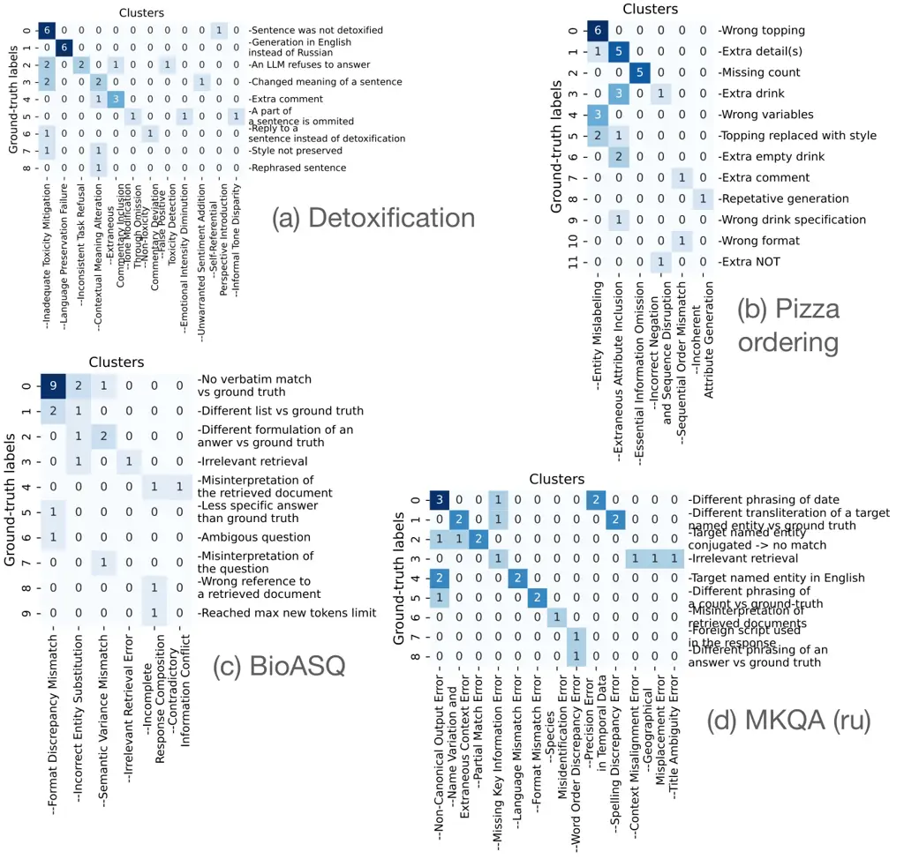

# LLM-as-a-qualitative-judge: automating error analysis in natural language generation

Nadezhda Chirkova  Tunde Oluwaseyi Ajayi  Seth Aycock  Zain Muhammad
Mujahid  Affiliation: Naver Labs Europe Affiliation: Insight Research
Ireland Centre for Data Analytics, Data Science Institute, University of
Galway Affiliation: University of Amsterdam Affiliation: University of
Copenhagen    Vladana Perlić  Ekaterina Borisova Markarit Vartampetian 
Affiliation: STMicroelectronics Affiliation: Télécom Paris
Affiliation: Deutsches Forschungszentrum für Künstliche Intelligenz GmbH
(DFKI) Affiliation: Technische Universität Berlin Affiliation: Univ.
Grenoble Alpes, CNRS, Grenoble INP, LIG, 38000 Grenoble,
FranceCorrespondence: nadia.chirkova@naverlabs.com

###### Abstract

Prompting large language models (LLMs) to evaluate generated text, known
as LLM-as-a-judge, has become a standard evaluation approach in natural
language generation (NLG), but is primarily used as a quantitative tool,
i.e. with numerical scores as main outputs. In this work, we propose
LLM-as-a-qualitative-judge, an LLM-based evaluation approach with the
main output being a structured report of common issue types in the NLG
system outputs. Our approach is targeted at providing developers with
meaningful insights on what improvements can be done to a given NLG
system and consists of two main steps, namely open-ended per-instance
issue analysis and clustering of the discovered issues using an
intuitive cumulative algorithm. We also introduce a strategy for
evaluating the proposed approach, coupled with $`\sim`$300 annotations
of issues in instances from 12 NLG datasets. Our results show that
instance-specific issues output by LLM-as-a-qualitative-judge match
those annotated by humans in 2/3 cases, and that
LLM-as-a-qualitative-judge is capable of producing error type reports
resembling the reports composed by human annotators. We also demonstrate
in a case study how the use of LLM-as-a-qualitative-judge can
substantially improve NLG systems performance. Our code and data are
publicly available¹¹ 1 Code & data:
[https://github.com/tunde-ajayi/llm-as-a-qualitative-judge](https://github.com/tunde-ajayi/llm-as-a-qualitative-judge).

## 1 Introduction

Prompting large language models (LLMs) to output evaluation scores,
known as LLM-as-a-judge (Zheng et al., 2023b), has become a standard
approach for evaluating performance in natural language generation (NLG)
tasks. In contrast to classic statistical measures such as BLEU
(Papineni et al., 2002), ROUGE (Lin, 2004), or METEOR (Banerjee and
Lavie, 2005), which primarily rely on surface-level lexical overlap,
LLM-as-a-judge evaluates text based on deep semantic understanding,
allowing it to better handle diverse phrasings that convey equivalent
meanings. Consequently, it shows stronger alignment with human judgment
in various tasks, including machine translation (Kocmi and Federmann,
2023), summarization (Clark et al., 2023), or open-ended instruction
following (Ye et al., 2024), especially with strong recent LLMs.

Figure 1: Issue types reports for two datasets composed by the proposed
LLM-as-a-qualitative-judge (GPT-4o) and by a human annotator. All steps
of analysis performed by GPT-4o, including error types formulation and
error grouping. The full generated report also includes comprehensive
error type descriptions, omitted here due to the space limit. Cnt
represents issue type counts.

Figure 2: Illustration of the proposed LLM-as-a-qualitative-judge
approach.

Recent works propose various extensions of the LLM-as-a-judge approach,
including pairwise model comparison (Zheng et al., 2023a), finetuning
LLMs for evaluation (Kim et al., 2024b; Kim et al., 2024c),
multi-criteria evaluation (Liang et al., 2023; Fu et al., 2024), the
dynamic selection of evaluation criteria (Ye et al., 2024), or even
using per-instance evaluation checklists (Cook et al., 2024; Kim et al.,
2025). A common technique to improve LLM-as-a-judge is to ask a model to
output an explanation for the predicted score(s).

However, even with the extensions listed above, LLM-as-a-judge remains
primarily a quantitative evaluation tool, i.e., the final result used by
researchers and practitioners is quantitative evaluation scores. At the
same time, language generation is a complex multi-faceted task with a
vast space of potential issues, including in various aspects of
generated texts (grammaticality, factuality, logical coherence, etc.),
in preprocessing of the input data and postprocessing of the NLG
outputs, or even with user requests. An effective and commonly used
strategy for spotting such issues is a manual qualitative error analysis
of a subset of predictions, which allows developers to identify
artifacts, fix system issues, and detect flaws in quantitative
evaluation. Yet this analysis is often skipped in practice van
Miltenburg et al. (2023); van Miltenburg et al. (2021), due to
overreliance of developers on quantitative metrics, as well as high
demand in terms of time and effort needed to conduct such analysis.

In this work, we introduce LLM-as-a-qualitative-judge, a novel approach
which automates error analysis, with the main output being a a
structured report aggregating the common qualitative error types in the
NLG outputs for a given dataset. The two key steps of
LLM-as-a-qualitative-judge are (1) open-ended per-instance error
analysis and (2) clustering of the discovered error types. Per-instance
analysis implies prompting an LLM to detect an issue in the given NLG
system output, where an issue may be arbitrary, i.e. we do not provide
any predefined set of possible issues. For error clustering, we propose
an intuitive and effective algorithm which resembles how humans solve
the corresponding task. An example of the generated report is presented
in Figure 2 (left), and a high-level illustration of the proposed
approach is presented in Figure 2 (right).

To summarize, our contributions are three-fold:

- •
  We introduce an LLM-as-a-qualitative-judge, a novel approach for
  LLM-based evaluation, outputting a structured report of common error
  types in a dataset;
- •
  In a case study on BigBenchHard tasks, we demonstrate that
  LLM-as-a-qualitative-judge can substantially improve the performance
  of NLG systems;
- •
  We collect $`\sim`$300 manual annotations of open-ended issues in the
  instances coming from 12 diverse NLG datasets, as well as the manual
  annotations of their per-dataset clustering;
- •
  We introduce a strategy for meta-evaluating
  LLM-as-a-qualitative-judge and show that LLM-as-a-qualitative-judge is
  capable of producing error type reports which resemble the reports
  produced by humans.

We hope that the proposed LLM-as-a-qualitative-judge approach will
reduce the time and effort required for issue analysis and will help
practitioners to more easily improve their NLG pipelines. Our code and
data are available as
[https://github.com/tunde-ajayi/llm-as-a-qualitative-judge](https://github.com/tunde-ajayi/llm-as-a-qualitative-judge).

## 2 Proposed approach

The main goal of our proposed approach, LLM-as-a-qualitative-judge, is
to provide a developer with a structured report of the main types of
issues (and their counts) in the outputs of a given NLG system for a
given dataset. In the rest of the work, we use terms issues, errors, or
failures interchangeably to denote any problems which may occur in the
NLG outputs. Examples of such problems include (but are not limited to)
unfinished generation due to reaching the maximum new tokens limit, an
error in one of the reasoning steps, a problem with the retrieved
documents in retrieval-augmented generation, or an error in evaluation
due to the use of an inappropriate metric. We do not employ any
predefined set of possible issues, and use the term open-ended issue
analysis to refer to the problem of detecting arbitrary issues in NLG
outputs.

For the purposes of our algorithm, the dataset consists of instances,
each represented by a task input (a string containing a task instruction
and the input data), a ground truth response (a string defining a
correct answer), and a generated response (a final output of the NLG
system). Each instance can be optionally augmented with other fields,
e.g., the intermediate outputs of an NLG system such as retrieved
documents in retrieval-augmented generation, or additional information
on the NLG system, e.g., a definition of a task metric. The
LLM-as-a-qualitative-judge algorithm is summarized in Algorithm 1,
illustrated in Figure 2 and described step-by-step below.

#### Preliminary step: detecting examples with errors.

Our algorithm focuses only on the instances from the dataset with any
sort of issues. We rely on the task-specific quantitative metric to
select such instances, i.e., instances which did not get high scores in
the quantitative evaluation.

#### Step 1: per-instance analysis.

For each instance, we prompt an LLM to identify “one, most important,
specific, clearly visible issue”, provided with a task input, a ground
truth response, a generated response, and optionally other fields as
described above. We prompt an LLM to output a detailed analysis of a
given instance, followed by a special separator and a final 1–2 sentence
description of an identified issue, which is referred to as a
per-instance issue explanation in the following steps of the approach.
The particular prompt used for per-instance analysis is presented in
App. Figure 6.

1: a list of task inputs $`U`$, a list of ground truth responses
$`R^{\mathrm{gt}}`$, a list of generated responses $`R`$ — all of length
$`N`$;

2: a report $`C`$ listing issue types and their counts;  
a list $`A`$ of per-instance issue explanations

3: $`A\leftarrow[]`$ // empty initialization for per-instance analysis

4: $`C\leftarrow[]`$ // empty initialization for a report

5: for $`i=1,\dots,N`$ do

6:   // per-instance analysis

7:
  $`A[i]\leftarrow\mathrm{LLM}(\mathrm{prompt}_{\mathrm{analysis}};U[i],R^{\mathrm{gt}}[i],R[i])`$

8:   // $`A[i]`$ is a string containing issue explanation

9:   // report generation

10:   if $`i>1`$ then

11:    // an existing issue type or a new one?

12:
   $`K\leftarrow\mathrm{LLM}(\mathrm{prompt}_{\mathrm{decision}};A[i],C)`$

13:    // $`K\in\{1,\dots,|C|,\mathrm{None}\}`$

14:   else

15:    $`K\leftarrow\mathrm{None}`$ // first step is always new issue
type   

16:   if $`K`$ is None then

17:    // create a new issue type

18:
   $`E\leftarrow\mathrm{LLM}(\mathrm{prompt}_{\mathrm{new\_type}};A[i])`$

19:    // $`E`$ is a dictionary containing a short issue name and an
issue description

20:    $`E[\mathrm{``count"}]\leftarrow 1`$

21:    $`C.\mathrm{append}(E)`$

22:   else

23:    // augment an existing issue type

24:    $`C[K][\mathrm{``count"}]\leftarrow C[K][\mathrm{``count"}]+1`$

  

25: return $`C`$, $`A`$

Algorithm 1 LLM-as-a-qualitative-judge

Figure 3: Case study on three BigBenchHard tasks: after building a
simple pipeline for a task, we perform two rounds of generating issue
reports with LLM-as-a-qualitative-judge (a table with issue types and
their counts) and manually revising the pipeline based solely on the
generated reports. Task performance is improved in all cases.

#### Step 2: issue clustering.

The second step in LLM-as-a-qualitative-judge consists of clustering
issues discovered in the first step and forming a final report of main
issue types based on the clustering results. This can be, in principle,
done with any clustering algorithm, e.g., k-means with BERT-based
embeddings (Devlin et al., 2019) or directly prompting a strong LLM to
output clustering (Viswanathan et al., 2024), provided with clustering
inputs in a single prompt. In the experiments, we demonstrate the
downsides of these approaches, e.g., classic approaches perform poorly
on our data, and clustering with direct prompting fails for larger
datasets, weaker LLMs, and does not ensure the structural correctness of
the generated report.

Inspired by how humans would cluster issues, we propose an intuitive
cumulative issue clustering algorithm. Our clustering algorithm goes
through instances one-by-one and gradually builds the issue types
report. For each instance, we provide an LLM with the current report and
the per-instance issue explanation, and prompt the LLM to decide whether
this issue explanation can be attributed to one of the already
discovered issue types (clusters) or it should form a new issue type
(cluster). In the former case, we augment the counter of the
corresponding issue type by one. In the latter case, we also prompt an
LLM to formulate a short name and a 1–2 sentence description of a new
error type, based on the per-instance issue description. In particular,
we instruct an LLM to formulate “a fine-grained issue type that can be
generalized to other instances”. The new issue type is then added to the
report, represented by the generated issue type name, description, and
the counter set to one. The first instance in the dataset is always a
new issue type. Appendix Figures 8 and 9 show the prompts used for the
two described clustering steps.

The final issue types report is composed of issue type names and
descriptions, paired with the counts of how many instances were
attributed to the corresponding issue type.

## 3 Case study

Our first set of experiments is targeted at demonstrating a practical
utility of the proposed LLM-as-a-qualitative-judge.

#### Experimental setup.

We pick three tasks from a BigBenchHard collection (Suzgun et al.,
2022), namely Date understanding, Word sorting, and Movie
recommendation. For each dataset, we build a simplest pipeline
consisting of prepending a simple system prompt “You are a helpful
assistant. Output your answer after a final separator ‘Answer:’”, LLM
generation with default hyperparameters, and a string match-based
evaluation function. We then perform two rounds of generating an issue
report with LLM-as-a-qualitative-judge (GPT-4.1) and manually revising
the pipeline solely based on the generated report (issue types, their
counts, and possibly 1 example of each issue type). More details are
given in Appendix B.

#### Results.

As shown in Figure 3, the task performance is improved in all three
cases. For example, in the Date understanding task, revisions inspired
by the generated issue reports include explaining the date format in the
prompt, suggesting to begin the response with determining a reference
point in time, and providing a specific template for the output. These
revisions improved performance from 4% to 62%.

## 4 Meta-evaluation methodology

This section described a methodology that we propose to meta-evaluate
LLM-as-a-qualitative-judge. The corresponding set of experiments aims
both to assess the effectiveness of two steps and to identify the
optimal configurations for LLM-as-a-qualitative-judge.

#### Real-world data.

We manually annotate per-instance issues and their per-dataset
clustering for a diverse pool of 12 datasets, with various open-source
LLMs as generators. We consider 7 generative tasks, and for one of the
tasks, namely retrieval-augmented question answering (RA-QA), we
consider 6 domains. All the labeling was performed by the authors of the
paper. The final dataset comprises 297 instances. Table 1 provides the
data summary. More details on data annotation are presented in
Appendix A.

#### Synthetic data.

We also consider synthetic data for evaluating clustering: we define a
set of possible issue types $`e`$ and their frequencies $`n_{e}`$, then
prompt GPT-4o to reformulate each issue $`e`$ in various ways $`n_{e}`$
times, and then use this data as per-instance analysis for clustering.
This allows us to evaluate clustering on larger datasets, i.e., 100-1000
instances.

#### Metrics.

For per-instance analysis, we prompt an evaluator LLM to judge whether
the issue explanation determined by the LLM-as-a-qualitative-judge for a
particular instance matches the issue determined by the human annotator.
The outputs from the evaluator LLM are binary and are accumulated into a
per-instance analysis accuracy score.

|                             |                                                     |        |
| --------------------------- | --------------------------------------------------- | ------ |
| Task                        | Dataset reference                                   | \# ex. |
| Natural Language Generation |                                                     |        |
| Instruction following       | FLASK Ye et al. (2024)                              | 34     |
| Translation en-ru           | WMT’22 Kocmi et al. (2022)                          | 38     |
| Long context QA             | Elitr-Bench Thonet et al. (2025)                    | 26     |
| Semantic parsing            | PIZZA Arkoudas et al. (2022)                        | 34     |
| Grade school math           | GSM8K Cobbe et al. (2021)                           | 17     |
| Detoxification              | ParaDetox Dementieva et al. (2024)                  | 36     |
| Retrieval-augmented QA      |                                                     |        |
| Factoid QA in Russian       | MKQA (ru) Longpre et al. (2021)                     | 29     |
| Biomedical QA               | BioASQ Krithara et al. (2023)                       | 27     |
| Lifestyle forum QA          | RobustQA Han et al. (2024); Santhanam et al. (2022) | 21     |
| Search engine queries       | SearchQA Dunn et al. (2017)                         | 13     |
| Educational QA              | SyllabusQA (Fernandez et al., 2024)                 | 9      |
| Total                       |                                                     | 297    |

Table 1: The statistics of the annotated evaluation data.

We evaluate cluster agreement using a Rand index adjusted for chance, or
Adjusted Rand Index (ARI)²² 2 We use the scikit learn implementation:
[https://scikit-learn.org/stable/modules/generated/sklearn.metrics.adjusted_rand_score.html](https://scikit-learn.org/stable/modules/generated/sklearn.metrics.adjusted_rand_score.html)..
We also evaluate the agreement in error type descriptions, by finding
the best possible mapping between clusters found by a human annotator
and by LLM-as-a-qualitative-judge, and then prompting an evaluator LLM
to judge the semantic equivalence of the corresponding issue type
descriptions. This metric is denoted as Semantic Label Consistency
(SLC).

## 5 Meta-evaluation experiments

### 5.1 Experimental setup

We test per-instance analysis with a range of commercial and open-source
LLMs, and issue clustering with three LLMs: GPT-4o, Gemini-2-Flash, and
Qwen-2.5-7B. For issue clustering, we compare the proposed cumulative
clustering approach to the direct LLM prompting and classic clustering
approaches. All clustering runs operate on the per-instance analysis
output by GPT-4o, and clustering results are averaged over 3 runs.

Tables 4 and 5 in Appendix list references and licenses of the used
models and datasets, respectively. Prompts used for all the stages are
presented in the Appendix G. Exact task formulations in prompts were
adjusted by only using three RA-QA datasets (MKQA (ru), RobustQA
Lifestyle and Writing).

For classic clustering approaches, we use the `scikit-learn`
implementation with BERT embeddings and tune hyperparameters as
described in App. C. For methods requiring the number of clusters, we
set it the same as in the annotator’s data.

More details on experimental settings and as well as results on
meta-evaluating the evaluator LLM are presented in Appendix B.

Appendix H presents the examples of generated error type reports,
per-instance issue explanations, and confusion matrices for all
considered datasets. We also provide an archive with experimental
results in the project repository³³ 3 A zip archive with experimental
results is available at
[https://github.com/tunde-ajayi/llm-as-a-qualitative-judge/tree/main/data](https://github.com/tunde-ajayi/llm-as-a-qualitative-judge/tree/main/data).

### 5.2 Per-instance analysis

Table 2 reports the performance of various LLMs in per-instance
analysis. Strongest LLMs, including commercial LLMs and a larger
open-source Qwen-2.5-32B achieve an accuracy of 62–67%, i.e. about 2/3
of issues in our dataset were successfully correctly explained by strong
models. The accuracy of open-source LLMs is substantially influenced by
their size: Qwen-2.5 accuracy raises from 32% to 67% when increasing
size from 1.5B to 32B. Various LLMs of 7–8B size demonstrate analysis
accuracy of 42–60%.

We note that our results are consistent with previously reported
findings in the literature regarding the typical level of agreement
between LLM-based evaluations and human judgments. For example, FLASK
reports the highest correlation between model-based evaluation and human
labelers, of 68% (Table 1 in Ye et al., 2024), or METAL reports the
highest agreement between the LLM evaluators and human scores of 59-82%
for the first three criteria in (Hada et al., 2024, Table 3, English).

To sum up, our results demonstrate the high effectiveness of strong LLMs
in open-ended issue explanation for generative tasks. For practical
applications, we recommend using recent models such as GPT-4o,
Gemini-2.5-Flash or Qwen-2.5-32B.

|                              |              |
| ---------------------------- | ------------ |
| Model                        | Accuracy (%) |
| GPT-4o                       | 66.3         |
| Gemini-2.0-Flash             | 65.0         |
| Qwen-2.5-32B                 | 68.7         |
| Qwen-2.5-7B                  | 55.5         |
| Qwen-2.5-1.5B                | 30.7         |
| DeepSeek-R1-Distill-Llama-8B | 56.1         |
| Aya-Expanse-8B               | 42.1         |
| Llama-3.1-8B-Instruct        | 55.4         |
| Ministral-8B-Instruct-2410   | 58.1         |

Table 2: Performance of various LLMs in per-instance analysis. Evaluator
LLM: Claude-3-7-Sonnet-20250219.

Figure 4: Examples of per-instance analysis.

Figure 5: Examples of confusion matrices visualizing clustering
agreement between LLM-as-qualitative-judge-generated and the annotator’s
issue types reports. We find the optimal mapping between clusters found
by a human annotator and by LLM-as-a-qualitative-judge, and then define
a confusion matrix where each cell $`(i,j)`$ denotes a number of dataset
instances allocated into $`i`$-th annotator’s cluster and $`j`$-th
LLM-as-a-qualitative-judge’s cluster.

### 5.3 Examples of per-issue analysis

Figure 4 shows examples of issue explanations generated by GPT-4o and
Qwen-2.5-7B. In the manual inspection of the generated issue
explanations, we observed correct explanations for various kinds of
issues, and rows 1–3 demonstrate such examples.

We also notice three groups of mistakes. The first occasional problem in
per-instance analysis is logical issues. In the example in row 4, the
issue is that the ground truth response is not contained as a verbatim
substring in the model-generated response, which is a definition of a
task metric. However, both GPT-4o and Qwen-2.5-7B claim that the failure
in the substring match is caused by the model response containing extra
generated information. Such an explanation logically contradicts the
task metric, i.e., extra content can only increase chances of finding a
given substring in the response, but cannot be a reason for its absence.

|               |                         |                        |                         |                        |
| ------------- | ----------------------- | ---------------------- | ----------------------- | ---------------------- |
| Approach      | Cluster assignment      |                        | Cluster descriptions    |                        |
|               | ARI$`{}_{\text{real}}`$ | ARI$`{}_{\text{syn}}`$ | SLC$`{}_{\text{real}}`$ | SLC$`{}_{\text{syn}}`$ |
| GPT-4o        |                         |                        |                         |                        |
| Cumulative    | 0.14\_(±.05)            | 0.73\_(±.05)           | 0.33\_(±.10)            | 0.70                   |
| Direct        | 0.15\_(±.05)            | 0.63\_(±.04)           | 0.42\_(±.12)            | 0.62                   |
| Gemini        |                         |                        |                         |                        |
| Cumulative    | 0.13\_(±.05)            | 0.70\_(±.02)           | 0.32\_(±.12)            | 0.71                   |
| Direct        | 0.17\_(±.04)            | 0.83\_(±.01)           | 0.42\_(±.11)            | 0.68                   |
| Qwen-2.5-7B   |                         |                        |                         |                        |
| Cumulative    | 0.11\_(±.04)            | 0.50\_(±.07)           | 0.41\_(±.16)            | 0.44                   |
| Direct        | 0.07\_(±.05)            | 0.01\_(±.02)           | 0.32\_(±.11)            | 0.12                   |
| K-means       | 0.05\_(±.05)            | 0.44\_(±.08)           | n/a                     | n/a                    |
| Agglomerative | 0.05\_(±.00)            | 0.49\_(±.00)           | n/a                     | n/a                    |
| GMM           | 0.04\_(±.03)            | 0.41\_(±.05)           | n/a                     | n/a                    |
| HDBSCAN       | 0.01\_(±.02)            | 0.13\_(±.03)           | n/a                     | n/a                    |

Table 3: Performance of various approaches and LLMs in issue clustering.
Results averaged over 3 runs from different random seeds. Agreement in
cluster assignment measured using Adjusted Rank Index (ARI) and in
cluster descriptions using LLM-judged Semantic Label Consistency (SLC).
Subscripts $`{}_{\text{real}}`$ and $`{}_{\text{syn}}`$ indicate tests
on the real and synthetic data respectively. “N/a” indicates the metric
is not applicable since classic approaches do not generate cluster
names.

The second occasional problem in per-instance analysis is the
oversimplification of an issue, especially for more unexpected issues,
such as an ambiguous task input or an error in evaluation. In the
example in row 5, the issue is an ambiguous user question, i.e., both
the ground truth and the generated response are correct and provide two
different interpretations of the user question. However, GPT-4o and
Qwen-2.5-7B report the over-simplified issue of the generated response
not providing the same answer as the ground truth response.

Finally, the third occasional reason for a per-instance issue
explanation not being accepted by the evaluator LLM, is the subjectivity
of some issues in the dataset. For example, a human-annotated issue in
row 6, “The generation was stopped too early because of the reached
maximum new tokens limit”, is evaluated to be not equivalent to the
LLM-as-a-qualitative-judge-generated issue “The generated response
provides an incomplete overview \<…\>”. While these two issue
explanations are indeed different, they are both correct, and the
LLM-generated explanation follows from the annotator’s explanation.

To alleviate potential negative effects from erroneous issue
explanations, we recommend developers to check a couple of examples of
each issue, which are output by LLM-as-a-qualitative-judge in addition
to the issue names and descriptions.

### 5.4 Issue clustering

Table 3 reports performance in issue clustering, for three LLMs. As
described in Section 4, we evaluate clustering on both real and
synthetic data. We find that clustering via direct prompting performs
well for small datasets and strong LLMs, but fails for weaker LLM, e.g.
Qwen-2.5-7B, and/or larger datasets. For example, ARI reached by GPT-4o
on the synthetic data drops from 1 to 0.05 when increasing the dataset
size from 100 to 1000 instances. The proposed cumulative clustering
demonstrates greater robustness and reaches high ranges of ARI in all
cases. In addition, the proposed cumulative algorithm outputs correctly
structured summaries by design, while the structural correctness of
clustering with direct prompting is not guaranteed.

Comparing LLMs, we find that Gemini reaches highest scores in both
cluster assignment and cluster descriptions generation, followed by
GPT-4o and Qwen-2.5-7B. Classic clustering approaches reach rather low
values of ARI.

Figure 5 demonstrates examples of confusion matrices for several
datasets. Pronounced diagonals and matching cluster names illustrate the
strong capabilities of LLM-as-a-qualitative-judge to output issue types
reports that resemble the issue reports produced by humans. Due to the
inherent subjectivity of clustering task, we observe occasional merging
or splitting of annotator’s clusters, e.g. clusters “Wrong topping” and
“Wrong variables” were merged by LLM-as-a-qualitative-judge into one
cluster “Entity Mislabeling” for the Pizza ordering dataset.

To sum up, our results demonstrate the effectiveness of the proposed
cumulative clustering approach to produce issue reports that resemble
the ones produced by humans. For practical applications, we recommend
using recent models such as GPT-4o or Gemini-2.5-Flash.

## 6 Discussion

In this section, we discuss potential extensions of the proposed
approach.

#### Issues prefiltering.

As discussed in Section 2, LLM-as-a-qualitative-judge operates only over
instances which received low scores from a quantitative task metric.
Such prefiltering could in principle be removed and incorporated
directly into per-instance analysis by modifying its prompt, e.g.
“Output what is an issue with this instance. If there is no issue,
output ’No issue’”. Instances with predictions “No issue” then would be
discarded from issue clustering. However, in preliminary experiments we
found that LLM are prone to making up issues for fully correct
instances. Hence, we do not recommend removing the prefiltering step (at
least with the current state of LLMs), which is a reasonable design
since LLM-as-a-qualitative-judge is an error analysis method.

#### Multiple issues per instance.

LLM-as-a-qualitative-judge could be easily extended to detect multiple
issues per instance, by modifying the prompt used for per-instance
analysis and going through the generated issues one-by-one in the issue
clustering step. However, same as with a previous discussion point, in
our preliminary experiments we found that LLMs are prone to generating
non-existing issues in such a scenario. For example, `GPT-4o` tends to
generate a constant number of issues for any instance (in particular,
3). In practice, we believe that our design with one issue per instance
is reasonable, since most of the erroneous instances have only one
issue. Furthermore, even if some instances have repeating issues, our
algorithm would still capture most of the issues in the dataset due to
issue repetition.

#### Pairwise comparison of models.

LLM-as-a-qualitative-judge can be straightforwardly extended to perform
pairwise comparison of models, by running per-instance analysis for
outputs of both models and using two counters (one per model) in the
issue clustering step.

#### Use without ground truth labels.

LLM-as-a-qualitative-judge can be straightforwardly used without ground
truth labels, i.e. as an unsupervised evaluation metric, if the LLM
internal knowledge is sufficient to understand errors in a given task.
LLM-as-a-qualitative-judge can also be provided with additional
evaluation metadata, e.g. score rubrics used in quantitative evaluation.

## 7 Related work

#### Quantitative LLM-based evaluation.

While using commercial LLMs for evaluation remains common practice, one
line of work (Kim et al., 2024b; Kim et al., 2024c; Pombal et al., 2025)
focuses on tuning open-source LLMs on the synthetically generated
evaluation data, to ensure reproducibility of evaluation. Other works
improve quantitative LLM-as-a-judge by conducting more fine-grained
evaluation, e.g. using multiple evaluation criteria (Liang et al., 2023;
Fu et al., 2024) or selecting evaluation criteria individually per
instance (Ye et al., 2024; Cook et al., 2024; Kim et al., 2025).
Composite evaluation approaches such as FactScore (Min et al., 2023) or
RAGChecker (Ru et al., 2024) use LLMs in the intermediate evaluation
steps.

#### Qualitative LLM-based evaluation.

LLM-generated qualitative error explanations are often used to improve
the precision of quantitative evaluation (Zeng et al., 2024; Ye et al., 2024) or to explain the assigned quantitative scores to a developer (Xu
et al., 2023; Jiang et al., 2024). Such approaches only output
per-instance explanations, and a substantial human effort is still
needed to read all of them. Certain works (Jiang et al., 2024; Kasner et
al., 2024; Perrella et al., 2022) focus on outputting aggregated reports
of frequent errors, but with a (limited) predefined error set, i.e. they
solve the task of error classification. In contrast to these efforts,
LLM-as-a-qualitative-judge outputs an aggregated report of issue types
discovered in an open-ended manner, i.e. without any predefined issue
set.

#### Meta-evaluation.

A line of community efforts (Zeng et al., 2024; Lambert et al., 2025;
Hada et al., 2024; Bavaresco et al., 2024) is devoted to an important
task of meta-evaluating LLM-as-a-judge, i.e. collecting human
annotations for various tasks, domains, or languages, and evaluating how
closely LLMs mirror human judgments. Certain task-specific
datasets (Freitag et al., 2021) can be used to meta-evaluate
fine-grained issue detection. Our work further contributes to this
direction by the release of a meta-evaluation dataset, containing
qualitative issue explanations for 12 datasets from 7 tasks and their
per-dataset clustering.

#### Clustering with LLMs.

Earlier works (Petukhova et al., 2024; Miller and Alexander, 2024)
demonstrate advantages of leveraging LLM-derived embeddings in place of
traditional TF-IDF or BERT vectors in standard clustering algorithms.
More recent works employ LLMs directly to cluster textual data.
Viswanathan et al. (2024) instruct a GPT-3.5 model to cluster the
provided data given few-shot demonstrations. Huang and He (2024)
transform clustering into a two-stage classification task: first
prompting an LLM to infer a set of candidate clusters for the dataset,
then prompting it to assign the best cluster to each instance.
ClusterLLM Zhang et al. (2023) uses an instruction-tuned LLM to guide
clustering, i.e., to decide which clusters to merge. In our work, we
propose an alternative intuitive approach for LLM-based clustering. Our
approach can also be extended in the future with the listed strategies.

## 8 Conclusion

In this work, we present LLM-as-a-qualitative-judge, a novel approach
for generating structured reports summarizing key types of issues in a
given NLG system. We hope that this approach will help developers to
spot more easily issues and artifacts in their NLG systems.

Future works could equip LLM-as-a-qualitative-judge with advanced
reasoning or agentic pipelines, tune LLMs for issue report generation,
and study the approach for a wider set of languages.

## Limitations

As any LLM-based system, LLM-as-a-qualitative-judge can make occasional
mistakes in analysis or clustering. In Section 5, we discuss types of
such mistakes and recommend checking a couple of examples of each issue,
which are also output by LLM-as-a-qualitative-judge.

Regarding limitations of the evaluation methodology, despite our efforts
in considering a diverse set of tasks, domains, and LLMs, we acknowledge
the infeasibility of covering the entire breadth of NLG applications and
models in our study. Another limitation is that we mainly focus on
English. We believe our findings will transfer to other languages, with
the use of strong recent multilingual LLMs, but acknowledge that the
reliability of LLM-as-a-qualitative-judge in multilingual studies
requires a separate study.

## Broader impact

We acknowledge that as any LLM-based system,
LLM-as-a-qualitative-judge can make errors which could propagate to the
downstream systems and decrease their performance. For example, if
developers rely solely on the issue names formulated by Judge, this
could occasionally lead to unnecessary or even harmful modifications of
their NLG systems. This could also happen in case of misinterpetation of
an issue by a developer due to issue subjectivity. To reduce such risks,
we recommend developers to check examples of issue types, which are also
output by LLM-as-a-qualitative-judge, in addition to the issue names and
description.

## Acknowledgments

We greatly appreciate the help of Alexandre Misrahi, Salah Aït-Mokhtar,
and Maxime Louis. The project was initiated at the Advanced Language
Processing School (ALPS 2025,
[https://alps.imag.fr](https://alps.imag.fr)).

A part of this work was carried out within the framework of the
AugmentIA Chair, supported by the Fondation Grenoble INP thanks to the
patronage of Artelia Group, and is affiliated with Laboratory of
informatics in Grenoble (LIG). A part of this work received government
funding managed by the French National Research Agency under France
2030, reference ANR-23-IACL-0006.

## References

- Anil et al. (2023) R. Anil, S. Borgeaud, Y. Wu, J. Alayrac, J. Yu, R.
  Soricut, J. Schalkwyk, A. M. Dai, A. Hauth, K. Millican, D. Silver, S.
  Petrov, M. Johnson, I. Antonoglou, J. Schrittwieser, A. Glaese, J.
  Chen, E. Pitler, T. P. Lillicrap, A. Lazaridou, O. Firat, J.
  Molloy, M. Isard, P. R. Barham, T. Hennigan, B. Lee, F. Viola, M.
  Reynolds, Y. Xu, R. Doherty, E. Collins, C. Meyer, E. Rutherford, E.
  Moreira, K. Ayoub, M. Goel, G. Tucker, E. Piqueras, M. Krikun, I.
  Barr, N. Savinov, I. Danihelka, B. Roelofs, A. White, A.
  Andreassen, T. von Glehn, L. Yagati, M. Kazemi, L. Gonzalez, M.
  Khalman, J. Sygnowski, and et al. Gemini: A family of highly capable
  multimodal models. CoRR abs/2312.11805. External Links:
  [Link](https://doi.org/10.48550/arXiv.2312.11805),
  [Document](https://dx.doi.org/10.48550/ARXIV.2312.11805), 2312.11805
  Cited by: Table 4.
- Arkoudas et al. (2022) K. Arkoudas, N. G. des Mesnards, M. Rubino, S.
  Swamy, S. Khanna, W. Sun, and H. Khan PIZZA: A new benchmark for
  complex end-to-end task-oriented parsing. CoRR abs/2212.00265.
  External Links: [Link](https://doi.org/10.48550/arXiv.2212.00265),
  [Document](https://dx.doi.org/10.48550/ARXIV.2212.00265), 2212.00265
  Cited by: Table 5, Table 1.
- Banerjee and Lavie (2005) S. Banerjee and A. Lavie METEOR: an
  automatic metric for MT evaluation with improved correlation with
  human judgments. In Proceedings of the ACL Workshop on Intrinsic and
  Extrinsic Evaluation Measures for Machine Translation and/or
  Summarization, J. Goldstein, A. Lavie, C. Lin, and C. Voss (Eds.), Ann
  Arbor, Michigan, pp. 65–72. External Links:
  [Link](https://aclanthology.org/W05-0909/) Cited by: §1.
- Bavaresco et al. (2024) A. Bavaresco, R. Bernardi, L. Bertolazzi, D.
  Elliott, R. Fernández, A. Gatt, E. Ghaleb, M. Giulianelli, M.
  Hanna, A. Koller, A. F. T. Martins, P. Mondorf, V. Neplenbroek, S.
  Pezzelle, B. Plank, D. Schlangen, A. Suglia, A. K. Surikuchi, E.
  Takmaz, and A. Testoni LLMs instead of human judges? a large scale
  empirical study across 20 nlp evaluation tasks. External Links:
  2406.18403, [Link](https://arxiv.org/abs/2406.18403) Cited by: §7.
- Chiang et al. (2023) W. Chiang, Z. Li, Z. Lin, Y. Sheng, Z. Wu, H.
  Zhang, L. Zheng, S. Zhuang, Y. Zhuang, J. E. Gonzalez, I. Stoica,
  and E. P. Xing Vicuna: an open-source chatbot impressing gpt-4 with
  90%\* chatgpt quality. Note:
  [https://lmsys.org/blog/2023-03-30-vicuna/](https://lmsys.org/blog/2023-03-30-vicuna/)
  Cited by: Table 4.
- Clark et al. (2023) E. Clark, S. Rijhwani, S. Gehrmann, J. Maynez, R.
  Aharoni, V. Nikolaev, T. Sellam, A. Siddhant, D. Das, and A. Parikh
  SEAHORSE: a multilingual, multifaceted dataset for summarization
  evaluation. In Proceedings of the 2023 Conference on Empirical Methods
  in Natural Language Processing, H. Bouamor, J. Pino, and K. Bali
  (Eds.), Singapore, pp. 9397–9413. External Links:
  [Link](https://aclanthology.org/2023.emnlp-main.584/),
  [Document](https://dx.doi.org/10.18653/v1/2023.emnlp-main.584) Cited
  by: §1.
- Cobbe et al. (2021) K. Cobbe, V. Kosaraju, M. Bavarian, M. Chen, H.
  Jun, L. Kaiser, M. Plappert, J. Tworek, J. Hilton, R. Nakano, C.
  Hesse, and J. Schulman Training verifiers to solve math word problems.
  CoRR abs/2110.14168. External Links:
  [Link](https://arxiv.org/abs/2110.14168), 2110.14168 Cited by: Table
  5, Table 1.
- Cook et al. (2024) J. Cook, T. Rocktäschel, J. Foerster, D. Aumiller,
  and A. Wang TICKing all the boxes: generated checklists improve llm
  evaluation and generation. External Links: 2410.03608,
  [Link](https://arxiv.org/abs/2410.03608) Cited by: §1, §7.
- Dang et al. (2024) J. Dang, S. Singh, D. D’souza, A. Ahmadian, A.
  Salamanca, M. Smith, A. Peppin, S. Hong, M. Govindassamy, T. Zhao, S.
  Kublik, M. Amer, V. Aryabumi, J. A. Campos, Y. Tan, T. Kocmi, F.
  Strub, N. Grinsztajn, Y. Flet-Berliac, A. Locatelli, H. Lin, D.
  Talupuru, B. Venkitesh, D. Cairuz, B. Yang, T. Chung, W. Ko, S. S.
  Shi, A. Shukayev, S. Bae, A. Piktus, R. Castagné, F. Cruz-Salinas, E.
  Kim, L. Crawhall-Stein, A. Morisot, S. Roy, P. Blunsom, I. Zhang, A.
  Gomez, N. Frosst, M. Fadaee, B. Ermis, A. Üstün, and S. Hooker Aya
  expanse: combining research breakthroughs for a new multilingual
  frontier. External Links: 2412.04261,
  [Link](https://arxiv.org/abs/2412.04261) Cited by: Table 4.
- DeepSeek-AI (2025) DeepSeek-AI DeepSeek-r1: incentivizing reasoning
  capability in llms via reinforcement learning. External Links:
  2501.12948, [Link](https://arxiv.org/abs/2501.12948) Cited by: Table 4.
- Dementieva et al. (2024) D. Dementieva, D. Moskovskiy, N.
  Babakov, A. A. Ayele, N. Rizwan, F. Schneider, X. Wang, S. M.
  Yimam, D. Ustalov, E. Stakovskii, A. Smirnova, A. Elnagar, A.
  Mukherjee, and A. Panchenko Overview of the multilingual text
  detoxification task at PAN 2024. In Working Notes of the Conference
  and Labs of the Evaluation Forum (CLEF 2024), Grenoble, France, 9-12
  September, 2024, G. Faggioli, N. Ferro, P. Galuscáková, and A. G. S.
  de Herrera (Eds.), CEUR Workshop Proceedings, Vol. 3740,
  pp. 2432–2461. External Links:
  [Link](https://ceur-ws.org/Vol-3740/paper-223.pdf) Cited by: Table 5,
  Table 1.
- Devlin et al. (2019) J. Devlin, M. Chang, K. Lee, and K. Toutanova
  BERT: pre-training of deep bidirectional transformers for language
  understanding. In Proceedings of the 2019 Conference of the North
  American Chapter of the Association for Computational Linguistics:
  Human Language Technologies, Volume 1 (Long and Short Papers), J.
  Burstein, C. Doran, and T. Solorio (Eds.), Minneapolis, Minnesota,
  pp. 4171–4186. External Links:
  [Link](https://aclanthology.org/N19-1423/),
  [Document](https://dx.doi.org/10.18653/v1/N19-1423) Cited by: §2.
- Dunn et al. (2017) M. Dunn, L. Sagun, M. Higgins, V. U. Güney, V.
  Cirik, and K. Cho SearchQA: A new q&a dataset augmented with context
  from a search engine. CoRR abs/1704.05179. External Links:
  [Link](http://arxiv.org/abs/1704.05179), 1704.05179 Cited by: Table 5,
  Table 1.
- Fernandez et al. (2024) N. Fernandez, A. Scarlatos, and A. S. Lan
  SyllabusQA: A course logistics question answering dataset. In
  Proceedings of the 62nd Annual Meeting of the Association for
  Computational Linguistics (Volume 1: Long Papers), ACL 2024, Bangkok,
  Thailand, August 11-16, 2024, L. Ku, A. Martins, and V. Srikumar
  (Eds.), pp. 10344–10369. External Links:
  [Link](https://doi.org/10.18653/v1/2024.acl-long.557),
  [Document](https://dx.doi.org/10.18653/V1/2024.ACL-LONG.557) Cited by:
  Table 5, Table 1.
- Freitag et al. (2021) M. Freitag, G. Foster, D. Grangier, V.
  Ratnakar, Q. Tan, and W. Macherey Experts, errors, and context: a
  large-scale study of human evaluation for machine translation.
  Transactions of the Association for Computational Linguistics 9,
  pp. 1460–1474. External Links:
  [Link](https://aclanthology.org/2021.tacl-1.87/),
  [Document](https://dx.doi.org/10.1162/tacl%5Fa%5F00437) Cited by: §7.
- Fu et al. (2024) J. Fu, S. Ng, Z. Jiang, and P. Liu GPTScore: evaluate
  as you desire. In Proceedings of the 2024 Conference of the North
  American Chapter of the Association for Computational Linguistics:
  Human Language Technologies (Volume 1: Long Papers), K. Duh, H. Gomez,
  and S. Bethard (Eds.), Mexico City, Mexico, pp. 6556–6576. External
  Links: [Link](https://aclanthology.org/2024.naacl-long.365/),
  [Document](https://dx.doi.org/10.18653/v1/2024.naacl-long.365) Cited
  by: §1, §7.
- Geng et al. (2023) X. Geng, A. Gudibande, H. Liu, E. Wallace, P.
  Abbeel, S. Levine, and D. Song Koala: a dialogue model for academic
  research. Note: Blog post External Links:
  [Link](https://bair.berkeley.edu/blog/2023/04/03/koala/) Cited by:
  Table 5.
- Gomez and for AI (2024) A. Gomez and C. for AI Command r:
  retrieval-augmented generation at production scale. Note:
  [https://cohere.com/blog/command-r](https://cohere.com/blog/command-r)
  Cited by: Table 4.
- Grattafiori et al. (2024) A. Grattafiori, A. Dubey, A. Jauhri, A.
  Pandey, A. Kadian, A. Al-Dahle, A. Letman, A. Mathur, A. Schelten, A.
  Vaughan, A. Yang, A. Fan, A. Goyal, A. Hartshorn, A. Yang, A.
  Mitra, A. Sravankumar, A. Korenev, A. Hinsvark, A. Rao, A. Zhang, A.
  Rodriguez, A. Gregerson, A. Spataru, B. Roziere, B. Biron, B. Tang, B.
  Chern, C. Caucheteux, C. Nayak, C. Bi, C. Marra, C. McConnell, C.
  Keller, C. Touret, C. Wu, C. Wong, C. C. Ferrer, C. Nikolaidis, D.
  Allonsius, D. Song, D. Pintz, D. Livshits, D. Wyatt, D. Esiobu, D.
  Choudhary, D. Mahajan, D. Garcia-Olano, D. Perino, D. Hupkes, E.
  Lakomkin, E. AlBadawy, E. Lobanova, E. Dinan, E. M. Smith, F.
  Radenovic, F. Guzmán, F. Zhang, G. Synnaeve, G. Lee, G. L.
  Anderson, G. Thattai, G. Nail, G. Mialon, G. Pang, G. Cucurell, H.
  Nguyen, H. Korevaar, H. Xu, H. Touvron, I. Zarov, I. A. Ibarra, I.
  Kloumann, I. Misra, I. Evtimov, J. Zhang, J. Copet, J. Lee, J.
  Geffert, J. Vranes, J. Park, J. Mahadeokar, J. Shah, J. van der
  Linde, J. Billock, J. Hong, J. Lee, J. Fu, J. Chi, J. Huang, J.
  Liu, J. Wang, J. Yu, J. Bitton, J. Spisak, J. Park, J. Rocca, J.
  Johnstun, J. Saxe, J. Jia, K. V. Alwala, K. Prasad, K. Upasani, K.
  Plawiak, K. Li, K. Heafield, K. Stone, K. El-Arini, K. Iyer, K.
  Malik, K. Chiu, K. Bhalla, K. Lakhotia, L. Rantala-Yeary, L. van der
  Maaten, L. Chen, L. Tan, L. Jenkins, L. Martin, L. Madaan, L. Malo, L.
  Blecher, L. Landzaat, L. de Oliveira, M. Muzzi, M. Pasupuleti, M.
  Singh, M. Paluri, M. Kardas, M. Tsimpoukelli, M. Oldham, M. Rita, M.
  Pavlova, M. Kambadur, M. Lewis, M. Si, M. K. Singh, M. Hassan, N.
  Goyal, N. Torabi, N. Bashlykov, N. Bogoychev, N. Chatterji, N.
  Zhang, O. Duchenne, O. Çelebi, P. Alrassy, P. Zhang, P. Li, P.
  Vasic, P. Weng, P. Bhargava, P. Dubal, P. Krishnan, P. S. Koura, P.
  Xu, Q. He, Q. Dong, R. Srinivasan, R. Ganapathy, R. Calderer, R. S.
  Cabral, R. Stojnic, R. Raileanu, R. Maheswari, R. Girdhar, R.
  Patel, R. Sauvestre, R. Polidoro, R. Sumbaly, R. Taylor, R. Silva, R.
  Hou, R. Wang, S. Hosseini, S. Chennabasappa, S. Singh, S. Bell, S. S.
  Kim, S. Edunov, S. Nie, S. Narang, S. Raparthy, S. Shen, S. Wan, S.
  Bhosale, S. Zhang, S. Vandenhende, S. Batra, S. Whitman, S. Sootla, S.
  Collot, S. Gururangan, S. Borodinsky, T. Herman, T. Fowler, T.
  Sheasha, T. Georgiou, T. Scialom, T. Speckbacher, T. Mihaylov, T.
  Xiao, U. Karn, V. Goswami, V. Gupta, V. Ramanathan, V. Kerkez, V.
  Gonguet, V. Do, V. Vogeti, V. Albiero, V. Petrovic, W. Chu, W.
  Xiong, W. Fu, W. Meers, X. Martinet, X. Wang, X. Wang, X. E. Tan, X.
  Xia, X. Xie, X. Jia, X. Wang, Y. Goldschlag, Y. Gaur, Y. Babaei, Y.
  Wen, Y. Song, Y. Zhang, Y. Li, Y. Mao, Z. D. Coudert, Z. Yan, Z.
  Chen, Z. Papakipos, A. Singh, A. Srivastava, A. Jain, A. Kelsey, A.
  Shajnfeld, A. Gangidi, A. Victoria, A. Goldstand, A. Menon, A.
  Sharma, A. Boesenberg, A. Baevski, A. Feinstein, A. Kallet, A.
  Sangani, A. Teo, A. Yunus, A. Lupu, A. Alvarado, A. Caples, A. Gu, A.
  Ho, A. Poulton, A. Ryan, A. Ramchandani, A. Dong, A. Franco, A.
  Goyal, A. Saraf, A. Chowdhury, A. Gabriel, A. Bharambe, A.
  Eisenman, A. Yazdan, B. James, B. Maurer, B. Leonhardi, B. Huang, B.
  Loyd, B. D. Paola, B. Paranjape, B. Liu, B. Wu, B. Ni, B. Hancock, B.
  Wasti, B. Spence, B. Stojkovic, B. Gamido, B. Montalvo, C. Parker, C.
  Burton, C. Mejia, C. Liu, C. Wang, C. Kim, C. Zhou, C. Hu, C. Chu, C.
  Cai, C. Tindal, C. Feichtenhofer, C. Gao, D. Civin, D. Beaty, D.
  Kreymer, D. Li, D. Adkins, D. Xu, D. Testuggine, D. David, D.
  Parikh, D. Liskovich, D. Foss, D. Wang, D. Le, D. Holland, E.
  Dowling, E. Jamil, E. Montgomery, E. Presani, E. Hahn, E. Wood, E.
  Le, E. Brinkman, E. Arcaute, E. Dunbar, E. Smothers, F. Sun, F.
  Kreuk, F. Tian, F. Kokkinos, F. Ozgenel, F. Caggioni, F. Kanayet, F.
  Seide, G. M. Florez, G. Schwarz, G. Badeer, G. Swee, G. Halpern, G.
  Herman, G. Sizov, Guangyi, Zhang, G. Lakshminarayanan, H. Inan, H.
  Shojanazeri, H. Zou, H. Wang, H. Zha, H. Habeeb, H. Rudolph, H.
  Suk, H. Aspegren, H. Goldman, H. Zhan, I. Damlaj, I. Molybog, I.
  Tufanov, I. Leontiadis, I. Veliche, I. Gat, J. Weissman, J.
  Geboski, J. Kohli, J. Lam, J. Asher, J. Gaya, J. Marcus, J. Tang, J.
  Chan, J. Zhen, J. Reizenstein, J. Teboul, J. Zhong, J. Jin, J.
  Yang, J. Cummings, J. Carvill, J. Shepard, J. McPhie, J. Torres, J.
  Ginsburg, J. Wang, K. Wu, K. H. U, K. Saxena, K. Khandelwal, K.
  Zand, K. Matosich, K. Veeraraghavan, K. Michelena, K. Li, K.
  Jagadeesh, K. Huang, K. Chawla, K. Huang, L. Chen, L. Garg, L. A, L.
  Silva, L. Bell, L. Zhang, L. Guo, L. Yu, L. Moshkovich, L.
  Wehrstedt, M. Khabsa, M. Avalani, M. Bhatt, M. Mankus, M. Hasson, M.
  Lennie, M. Reso, M. Groshev, M. Naumov, M. Lathi, M. Keneally, M.
  Liu, M. L. Seltzer, M. Valko, M. Restrepo, M. Patel, M. Vyatskov, M.
  Samvelyan, M. Clark, M. Macey, M. Wang, M. J. Hermoso, M. Metanat, M.
  Rastegari, M. Bansal, N. Santhanam, N. Parks, N. White, N. Bawa, N.
  Singhal, N. Egebo, N. Usunier, N. Mehta, N. P. Laptev, N. Dong, N.
  Cheng, O. Chernoguz, O. Hart, O. Salpekar, O. Kalinli, P. Kent, P.
  Parekh, P. Saab, P. Balaji, P. Rittner, P. Bontrager, P. Roux, P.
  Dollar, P. Zvyagina, P. Ratanchandani, P. Yuvraj, Q. Liang, R.
  Alao, R. Rodriguez, R. Ayub, R. Murthy, R. Nayani, R. Mitra, R.
  Parthasarathy, R. Li, R. Hogan, R. Battey, R. Wang, R. Howes, R.
  Rinott, S. Mehta, S. Siby, S. J. Bondu, S. Datta, S. Chugh, S.
  Hunt, S. Dhillon, S. Sidorov, S. Pan, S. Mahajan, S. Verma, S.
  Yamamoto, S. Ramaswamy, S. Lindsay, S. Lindsay, S. Feng, S. Lin, S. C.
  Zha, S. Patil, S. Shankar, S. Zhang, S. Zhang, S. Wang, S. Agarwal, S.
  Sajuyigbe, S. Chintala, S. Max, S. Chen, S. Kehoe, S. Satterfield, S.
  Govindaprasad, S. Gupta, S. Deng, S. Cho, S. Virk, S. Subramanian, S.
  Choudhury, S. Goldman, T. Remez, T. Glaser, T. Best, T. Koehler, T.
  Robinson, T. Li, T. Zhang, T. Matthews, T. Chou, T. Shaked, V.
  Vontimitta, V. Ajayi, V. Montanez, V. Mohan, V. S. Kumar, V.
  Mangla, V. Ionescu, V. Poenaru, V. T. Mihailescu, V. Ivanov, W. Li, W.
  Wang, W. Jiang, W. Bouaziz, W. Constable, X. Tang, X. Wu, X. Wang, X.
  Wu, X. Gao, Y. Kleinman, Y. Chen, Y. Hu, Y. Jia, Y. Qi, Y. Li, Y.
  Zhang, Y. Zhang, Y. Adi, Y. Nam, Yu, Wang, Y. Zhao, Y. Hao, Y.
  Qian, Y. Li, Y. He, Z. Rait, Z. DeVito, Z. Rosnbrick, Z. Wen, Z.
  Yang, Z. Zhao, and Z. Ma The llama 3 herd of models. External Links:
  2407.21783, [Link](https://arxiv.org/abs/2407.21783) Cited by: Table
  4, Table 4.
- Hada et al. (2024) R. Hada, V. Gumma, M. Ahmed, K. Bali, and S.
  Sitaram METAL: towards multilingual meta-evaluation. In Findings of
  the Association for Computational Linguistics: NAACL 2024, K. Duh, H.
  Gomez, and S. Bethard (Eds.), Mexico City, Mexico, pp. 2280–2298.
  External Links:
  [Link](https://aclanthology.org/2024.findings-naacl.148/),
  [Document](https://dx.doi.org/10.18653/v1/2024.findings-naacl.148)
  Cited by: §5.2, §7.
- Han et al. (2023) R. Han, P. Qi, Y. Zhang, L. Liu, J. Burger, W.
  Wang, Z. Huang, B. Xiang, and D. Roth RobustQA: benchmarking the
  robustness of domain adaptation for open-domain question answering. In
  ACL Findings 2023, External Links:
  [Link](https://www.amazon.science/publications/robustqa-benchmarking-the-robustness-of-domain-adaptation-for-open-domain-question-answering)
  Cited by: Table 5.
- Han et al. (2024) R. Han, Y. Zhang, P. Qi, Y. Xu, J. Wang, L.
  Liu, W. Y. Wang, B. Min, and V. Castelli RAG-QA arena: evaluating
  domain robustness for long-form retrieval augmented question
  answering. In Proceedings of the 2024 Conference on Empirical Methods
  in Natural Language Processing, EMNLP 2024, Miami, FL, USA, November
  12-16, 2024, Y. Al-Onaizan, M. Bansal, and Y. Chen (Eds.),
  pp. 4354–4374. External Links:
  [Link](https://aclanthology.org/2024.emnlp-main.249) Cited by: Table
  5, Table 1.
- Huang and He (2024) C. Huang and G. He Text clustering as
  classification with LLMs. CoRR abs/2410.00927. External Links:
  [Link](https://doi.org/10.48550/arXiv.2410.00927),
  [Document](https://dx.doi.org/10.48550/ARXIV.2410.00927), 2410.00927
  Cited by: §7.
- Jiang et al. (2024) D. Jiang, Y. Li, G. Zhang, W. Huang, B. Y. Lin,
  and W. Chen TIGERScore: towards building explainable metric for all
  text generation tasks. Transactions on Machine Learning Research.
  Note: External Links: ISSN 2835-8856,
  [Link](https://openreview.net/forum?id=EE1CBKC0SZ) Cited by: §7.
- Kasner et al. (2024) Z. Kasner, O. Platek, P. Schmidtova, S. Balloccu,
  and O. Dusek Factgenie: a framework for span-based evaluation of
  generated texts. In Proceedings of the 17th International Natural
  Language Generation Conference: System Demonstrations, S.
  Mahamood, N. L. Minh, and D. Ippolito (Eds.), Tokyo, Japan, pp. 13–15.
  External Links: [Link](https://aclanthology.org/2024.inlg-demos.5/)
  Cited by: §7.
- Kim et al. (2024a) S. Kim, D. Kim, C. Park, W. Lee, W. Song, Y.
  Kim, H. Kim, Y. Kim, H. Lee, J. Kim, C. Ahn, S. Yang, S. Lee, H.
  Park, G. Gim, M. Cha, H. Lee, and S. Kim SOLAR 10.7B: scaling large
  language models with simple yet effective depth up-scaling. In
  Proceedings of the 2024 Conference of the North American Chapter of
  the Association for Computational Linguistics: Human Language
  Technologies (Volume 6: Industry Track), Y. Yang, A. Davani, A. Sil,
  and A. Kumar (Eds.), Mexico City, Mexico, pp. 23–35. External Links:
  [Link](https://aclanthology.org/2024.naacl-industry.3/),
  [Document](https://dx.doi.org/10.18653/v1/2024.naacl-industry.3) Cited
  by: Appendix B, Table 4.
- Kim et al. (2024b) S. Kim, J. Shin, Y. Cho, J. Jang, S. Longpre, H.
  Lee, S. Yun, S. Shin, S. Kim, J. Thorne, and M. Seo Prometheus:
  inducing fine-grained evaluation capability in language models. In The
  Twelfth International Conference on Learning Representations, External
  Links: [Link](https://openreview.net/forum?id=8euJaTveKw) Cited by:
  §1, §7.
- Kim et al. (2025) S. Kim, J. Suk, J. Y. Cho, S. Longpre, C. Kim, D.
  Yoon, G. Son, Y. Cho, S. Shafayat, J. Baek, S. H. Park, H. Hwang, J.
  Jo, H. Cho, H. Shin, S. Lee, H. Oh, N. Lee, N. Ho, S. J. Joo, M.
  Ko, Y. Lee, H. Chae, J. Shin, J. Jang, S. Ye, B. Y. Lin, S.
  Welleck, G. Neubig, M. Lee, K. Lee, and M. Seo The BiGGen bench: a
  principled benchmark for fine-grained evaluation of language models
  with language models. In Proceedings of the 2025 Conference of the
  Nations of the Americas Chapter of the Association for Computational
  Linguistics: Human Language Technologies (Volume 1: Long Papers), L.
  Chiruzzo, A. Ritter, and L. Wang (Eds.), Albuquerque, New Mexico,
  pp. 5877–5919. External Links:
  [Link](https://aclanthology.org/2025.naacl-long.303/), ISBN
  979-8-89176-189-6 Cited by: §1, §7.
- Kim et al. (2024c) S. Kim, J. Suk, S. Longpre, B. Y. Lin, J. Shin, S.
  Welleck, G. Neubig, M. Lee, K. Lee, and M. Seo Prometheus 2: an open
  source language model specialized in evaluating other language models.
  In Proceedings of the 2024 Conference on Empirical Methods in Natural
  Language Processing, Y. Al-Onaizan, M. Bansal, and Y. Chen (Eds.),
  Miami, Florida, USA, pp. 4334–4353. External Links:
  [Link](https://aclanthology.org/2024.emnlp-main.248/),
  [Document](https://dx.doi.org/10.18653/v1/2024.emnlp-main.248) Cited
  by: §1, §7.
- Kocmi et al. (2022) T. Kocmi, R. Bawden, O. Bojar, A. Dvorkovich, C.
  Federmann, M. Fishel, T. Gowda, Y. Graham, R. Grundkiewicz, B.
  Haddow, R. Knowles, P. Koehn, C. Monz, M. Morishita, M. Nagata, T.
  Nakazawa, M. Novák, M. Popel, and M. Popović Findings of the 2022
  conference on machine translation (WMT22). In Proceedings of the
  Seventh Conference on Machine Translation (WMT), P. Koehn, L.
  Barrault, O. Bojar, F. Bougares, R. Chatterjee, M. R. Costa-jussà, C.
  Federmann, M. Fishel, A. Fraser, M. Freitag, Y. Graham, R.
  Grundkiewicz, P. Guzman, B. Haddow, M. Huck, A. Jimeno Yepes, T.
  Kocmi, A. Martins, M. Morishita, C. Monz, M. Nagata, T. Nakazawa, M.
  Negri, A. Névéol, M. Neves, M. Popel, M. Turchi, and M. Zampieri
  (Eds.), Abu Dhabi, United Arab Emirates (Hybrid), pp. 1–45. External
  Links: [Link](https://aclanthology.org/2022.wmt-1.1/) Cited by: Table
  5, Table 1.
- Kocmi and Federmann (2023) T. Kocmi and C. Federmann Large language
  models are state-of-the-art evaluators of translation quality. In
  Proceedings of the 24th Annual Conference of the European Association
  for Machine Translation, M. Nurminen, J. Brenner, M. Koponen, S.
  Latomaa, M. Mikhailov, F. Schierl, T. Ranasinghe, E.
  Vanmassenhove, S. A. Vidal, N. Aranberri, M. Nunziatini, C. P.
  Escartín, M. Forcada, M. Popovic, C. Scarton, and H. Moniz (Eds.),
  Tampere, Finland, pp. 193–203. External Links:
  [Link](https://aclanthology.org/2023.eamt-1.19/) Cited by: §1.
- Krithara et al. (2023) A. Krithara, A. Nentidis, K. Bougiatiotis,
  and G. Paliouras BioASQ-QA: a manually curated corpus for biomedical
  question answering. Scientific Data 10 (1), pp. 170. Cited by: Table
  5, Table 1.
- Lambert et al. (2025) N. Lambert, V. Pyatkin, J. Morrison, L. J. V.
  Miranda, B. Y. Lin, K. Chandu, N. Dziri, S. Kumar, T. Zick, Y.
  Choi, N. A. Smith, and H. Hajishirzi RewardBench: evaluating reward
  models for language modeling. In Findings of the Association for
  Computational Linguistics: NAACL 2025, L. Chiruzzo, A. Ritter, and L.
  Wang (Eds.), Albuquerque, New Mexico, pp. 1755–1797. External Links:
  [Link](https://aclanthology.org/2025.findings-naacl.96/), ISBN
  979-8-89176-195-7 Cited by: §7.
- Liang et al. (2023) P. Liang, R. Bommasani, T. Lee, D. Tsipras, D.
  Soylu, M. Yasunaga, Y. Zhang, D. Narayanan, Y. Wu, A. Kumar, B.
  Newman, B. Yuan, B. Yan, C. Zhang, C. Cosgrove, C. D. Manning, C.
  Re, D. Acosta-Navas, D. A. Hudson, E. Zelikman, E. Durmus, F.
  Ladhak, F. Rong, H. Ren, H. Yao, J. WANG, K. Santhanam, L. Orr, L.
  Zheng, M. Yuksekgonul, M. Suzgun, N. Kim, N. Guha, N. S. Chatterji, O.
  Khattab, P. Henderson, Q. Huang, R. A. Chi, S. M. Xie, S.
  Santurkar, S. Ganguli, T. Hashimoto, T. Icard, T. Zhang, V.
  Chaudhary, W. Wang, X. Li, Y. Mai, Y. Zhang, and Y. Koreeda Holistic
  evaluation of language models. Transactions on Machine Learning
  Research. Note: Featured Certification, Expert Certification,
  Outstanding Certification External Links: ISSN 2835-8856,
  [Link](https://openreview.net/forum?id=iO4LZibEqW) Cited by: §1, §7.
- Lin (2004) C. Lin ROUGE: a package for automatic evaluation of
  summaries. In Text Summarization Branches Out, Barcelona, Spain,
  pp. 74–81. External Links: [Link](https://aclanthology.org/W04-1013/)
  Cited by: §1.
- Longpre et al. (2021) S. Longpre, Y. Lu, and J. Daiber MKQA: a
  linguistically diverse benchmark for multilingual open domain question
  answering. Transactions of the Association for Computational
  Linguistics 9, pp. 1389–1406. External Links:
  [Link](https://aclanthology.org/2021.tacl-1.82/),
  [Document](https://dx.doi.org/10.1162/tacl%5Fa%5F00433) Cited by:
  Table 5, Table 1.
- Miller and Alexander (2024) J. K. Miller and T. J. Alexander
  Human-interpretable clustering of short-text using large language
  models. CoRR abs/2405.07278. External Links:
  [Link](https://doi.org/10.48550/arXiv.2405.07278),
  [Document](https://dx.doi.org/10.48550/ARXIV.2405.07278), 2405.07278
  Cited by: §7.
- Min et al. (2023) S. Min, K. Krishna, X. Lyu, M. Lewis, W. Yih, P.
  Koh, M. Iyyer, L. Zettlemoyer, and H. Hajishirzi FActScore:
  fine-grained atomic evaluation of factual precision in long form text
  generation. In Proceedings of the 2023 Conference on Empirical Methods
  in Natural Language Processing, H. Bouamor, J. Pino, and K. Bali
  (Eds.), Singapore, pp. 12076–12100. External Links:
  [Link](https://aclanthology.org/2023.emnlp-main.741/),
  [Document](https://dx.doi.org/10.18653/v1/2023.emnlp-main.741) Cited
  by: §7.
- Misrahi et al. (2025) A. Misrahi, N. Chirkova, M. Louis, and V.
  Nikoulina Adapting large language models for multi-domain
  retrieval-augmented-generation. External Links: 2504.02411,
  [Link](https://arxiv.org/abs/2504.02411) Cited by: §H.12.
- Mistral AI (2024) Mistral AI Un ministral, des ministraux. Blog post,
  Mistral AI. Note: Accessed May 19, 2025 External Links:
  [Link](https://mistral.ai/news/ministraux) Cited by: Table 4.
- OpenAI et al. (2024) OpenAI, J. Achiam, S. Adler, S. Agarwal, L.
  Ahmad, I. Akkaya, F. L. Aleman, D. Almeida, J. Altenschmidt, S.
  Altman, S. Anadkat, R. Avila, I. Babuschkin, S. Balaji, V. Balcom, P.
  Baltescu, H. Bao, M. Bavarian, J. Belgum, I. Bello, J. Berdine, G.
  Bernadett-Shapiro, C. Berner, L. Bogdonoff, O. Boiko, M. Boyd, A.
  Brakman, G. Brockman, T. Brooks, M. Brundage, K. Button, T. Cai, R.
  Campbell, A. Cann, B. Carey, C. Carlson, R. Carmichael, B. Chan, C.
  Chang, F. Chantzis, D. Chen, S. Chen, R. Chen, J. Chen, M. Chen, B.
  Chess, C. Cho, C. Chu, H. W. Chung, D. Cummings, J. Currier, Y.
  Dai, C. Decareaux, T. Degry, N. Deutsch, D. Deville, A. Dhar, D.
  Dohan, S. Dowling, S. Dunning, A. Ecoffet, A. Eleti, T. Eloundou, D.
  Farhi, L. Fedus, N. Felix, S. P. Fishman, J. Forte, I. Fulford, L.
  Gao, E. Georges, C. Gibson, V. Goel, T. Gogineni, G. Goh, R.
  Gontijo-Lopes, J. Gordon, M. Grafstein, S. Gray, R. Greene, J.
  Gross, S. S. Gu, Y. Guo, C. Hallacy, J. Han, J. Harris, Y. He, M.
  Heaton, J. Heidecke, C. Hesse, A. Hickey, W. Hickey, P. Hoeschele, B.
  Houghton, K. Hsu, S. Hu, X. Hu, J. Huizinga, S. Jain, S. Jain, J.
  Jang, A. Jiang, R. Jiang, H. Jin, D. Jin, S. Jomoto, B. Jonn, H.
  Jun, T. Kaftan, Ł. Kaiser, A. Kamali, I. Kanitscheider, N. S.
  Keskar, T. Khan, L. Kilpatrick, J. W. Kim, C. Kim, Y. Kim, J. H.
  Kirchner, J. Kiros, M. Knight, D. Kokotajlo, Ł. Kondraciuk, A.
  Kondrich, A. Konstantinidis, K. Kosic, G. Krueger, V. Kuo, M.
  Lampe, I. Lan, T. Lee, J. Leike, J. Leung, D. Levy, C. M. Li, R.
  Lim, M. Lin, S. Lin, M. Litwin, T. Lopez, R. Lowe, P. Lue, A.
  Makanju, K. Malfacini, S. Manning, T. Markov, Y. Markovski, B.
  Martin, K. Mayer, A. Mayne, B. McGrew, S. M. McKinney, C. McLeavey, P.
  McMillan, J. McNeil, D. Medina, A. Mehta, J. Menick, L. Metz, A.
  Mishchenko, P. Mishkin, V. Monaco, E. Morikawa, D. Mossing, T. Mu, M.
  Murati, O. Murk, D. Mély, A. Nair, R. Nakano, R. Nayak, A.
  Neelakantan, R. Ngo, H. Noh, L. Ouyang, C. O’Keefe, J. Pachocki, A.
  Paino, J. Palermo, A. Pantuliano, G. Parascandolo, J. Parish, E.
  Parparita, A. Passos, M. Pavlov, A. Peng, A. Perelman, F. de Avila
  Belbute Peres, M. Petrov, H. P. de Oliveira Pinto, Michael,
  Pokorny, M. Pokrass, V. H. Pong, T. Powell, A. Power, B. Power, E.
  Proehl, R. Puri, A. Radford, J. Rae, A. Ramesh, C. Raymond, F.
  Real, K. Rimbach, C. Ross, B. Rotsted, H. Roussez, N. Ryder, M.
  Saltarelli, T. Sanders, S. Santurkar, G. Sastry, H. Schmidt, D.
  Schnurr, J. Schulman, D. Selsam, K. Sheppard, T. Sherbakov, J.
  Shieh, S. Shoker, P. Shyam, S. Sidor, E. Sigler, M. Simens, J.
  Sitkin, K. Slama, I. Sohl, B. Sokolowsky, Y. Song, N.
  Staudacher, F. P. Such, N. Summers, I. Sutskever, J. Tang, N.
  Tezak, M. B. Thompson, P. Tillet, A. Tootoonchian, E. Tseng, P.
  Tuggle, N. Turley, J. Tworek, J. F. C. Uribe, A. Vallone, A.
  Vijayvergiya, C. Voss, C. Wainwright, J. J. Wang, A. Wang, B. Wang, J.
  Ward, J. Wei, C. Weinmann, A. Welihinda, P. Welinder, J. Weng, L.
  Weng, M. Wiethoff, D. Willner, C. Winter, S. Wolrich, H. Wong, L.
  Workman, S. Wu, J. Wu, M. Wu, K. Xiao, T. Xu, S. Yoo, K. Yu, Q.
  Yuan, W. Zaremba, R. Zellers, C. Zhang, M. Zhang, S. Zhao, T.
  Zheng, J. Zhuang, W. Zhuk, and B. Zoph GPT-4 technical report.
  External Links: 2303.08774, [Link](https://arxiv.org/abs/2303.08774)
  Cited by: Table 4.
- Papineni et al. (2002) K. Papineni, S. Roukos, T. Ward, and W. Zhu
  Bleu: a method for automatic evaluation of machine translation. In
  Proceedings of the 40th Annual Meeting of the Association for
  Computational Linguistics, P. Isabelle, E. Charniak, and D. Lin
  (Eds.), Philadelphia, Pennsylvania, USA, pp. 311–318. External Links:
  [Link](https://aclanthology.org/P02-1040/),
  [Document](https://dx.doi.org/10.3115/1073083.1073135) Cited by: §1.
- Perrella et al. (2022) S. Perrella, L. Proietti, A. Scirè, N.
  Campolungo, and R. Navigli MaTESe: machine translation evaluation as a
  sequence tagging problem. In Proceedings of the Seventh Conference on
  Machine Translation (WMT), P. Koehn, L. Barrault, O. Bojar, F.
  Bougares, R. Chatterjee, M. R. Costa-jussà, C. Federmann, M.
  Fishel, A. Fraser, M. Freitag, Y. Graham, R. Grundkiewicz, P.
  Guzman, B. Haddow, M. Huck, A. Jimeno Yepes, T. Kocmi, A. Martins, M.
  Morishita, C. Monz, M. Nagata, T. Nakazawa, M. Negri, A. Névéol, M.
  Neves, M. Popel, M. Turchi, and M. Zampieri (Eds.), Abu Dhabi, United
  Arab Emirates (Hybrid), pp. 569–577. External Links:
  [Link](https://aclanthology.org/2022.wmt-1.51/) Cited by: §7.
- Petukhova et al. (2024) A. Petukhova, J. P. Matos-Carvalho, and N.
  Fachada Text clustering with LLM embeddings. CoRR abs/2403.15112.
  External Links: [Link](https://doi.org/10.48550/arXiv.2403.15112),
  [Document](https://dx.doi.org/10.48550/ARXIV.2403.15112), 2403.15112
  Cited by: §7.
- Pombal et al. (2025) J. Pombal, D. Yoon, P. Fernandes, I. Wu, S.
  Kim, R. Rei, G. Neubig, and A. F. T. Martins M-prometheus: A suite of
  open multilingual LLM judges. CoRR abs/2504.04953. External Links:
  [Link](https://doi.org/10.48550/arXiv.2504.04953),
  [Document](https://dx.doi.org/10.48550/ARXIV.2504.04953), 2504.04953
  Cited by: §7.
- Qwen et al. (2025) Qwen, :, A. Yang, B. Yang, B. Zhang, B. Hui, B.
  Zheng, B. Yu, C. Li, D. Liu, F. Huang, H. Wei, H. Lin, J. Yang, J.
  Tu, J. Zhang, J. Yang, J. Yang, J. Zhou, J. Lin, K. Dang, K. Lu, K.
  Bao, K. Yang, L. Yu, M. Li, M. Xue, P. Zhang, Q. Zhu, R. Men, R.
  Lin, T. Li, T. Tang, T. Xia, X. Ren, X. Ren, Y. Fan, Y. Su, Y.
  Zhang, Y. Wan, Y. Liu, Z. Cui, Z. Zhang, and Z. Qiu Qwen2.5 technical
  report. External Links: 2412.15115,
  [Link](https://arxiv.org/abs/2412.15115) Cited by: Table 4.
- Ru et al. (2024) D. Ru, L. Qiu, X. Hu, T. Zhang, P. Shi, S. Chang, C.
  Jiayang, C. Wang, S. Sun, H. Li, Z. Zhang, B. Wang, J. Jiang, T.
  He, Z. Wang, P. Liu, Y. Zhang, and Z. Zhang RAGChecker: a fine-grained
  framework for diagnosing retrieval-augmented generation. In Advances
  in Neural Information Processing Systems, A. Globerson, L. Mackey, D.
  Belgrave, A. Fan, U. Paquet, J. Tomczak, and C. Zhang (Eds.), Vol. 37,
  pp. 21999–22027. External Links:
  [Link](https://proceedings.neurips.cc/paper_files/paper/2024/file/27245589131d17368cccdfa990cbf16e-Paper-Datasets_and_Benchmarks_Track.pdf)
  Cited by: §7.
- Santhanam et al. (2022) K. Santhanam, O. Khattab, J. Saad-Falcon, C.
  Potts, and M. Zaharia ColBERTv2: effective and efficient retrieval via
  lightweight late interaction. In Proceedings of the 2022 Conference of
  the North American Chapter of the Association for Computational
  Linguistics: Human Language Technologies, M. Carpuat, M. de Marneffe,
  and I. V. Meza Ruiz (Eds.), Seattle, United States, pp. 3715–3734.
  External Links: [Link](https://aclanthology.org/2022.naacl-main.272/),
  [Document](https://dx.doi.org/10.18653/v1/2022.naacl-main.272) Cited
  by: Table 5, Table 1.
- Suzgun et al. (2022) M. Suzgun, N. Scales, N. Schärli, S. Gehrmann, Y.
  Tay, H. W. Chung, A. Chowdhery, Q. V. Le, E. H. Chi, D. Zhou, and J.
  Wei Challenging big-bench tasks and whether chain-of-thought can solve
  them. arXiv preprint arXiv:2210.09261. Cited by: Table 5, §3.
- Talmor et al. (2021) A. Talmor, O. Yoran, R. L. Bras, C.
  Bhagavatula, Y. Goldberg, Y. Choi, and J. Berant CommonsenseQA 2.0:
  exposing the limits of AI through gamification. In Proceedings of the
  Neural Information Processing Systems Track on Datasets and Benchmarks
  1, NeurIPS Datasets and Benchmarks 2021, December 2021, virtual, J.
  Vanschoren and S. Yeung (Eds.), External Links:
  [Link](https://datasets-benchmarks-proceedings.neurips.cc/paper/2021/hash/3ef815416f775098fe977004015c6193-Abstract-round1.html)
  Cited by: Table 5.
- Thonet et al. (2025) T. Thonet, L. Besacier, and J. Rozen ELITR-bench:
  A meeting assistant benchmark for long-context language models. In
  Proceedings of the 31st International Conference on Computational
  Linguistics, COLING 2025, Abu Dhabi, UAE, January 19-24, 2025, O.
  Rambow, L. Wanner, M. Apidianaki, H. Al-Khalifa, B. D. Eugenio, and S.
  Schockaert (Eds.), pp. 407–428. External Links:
  [Link](https://aclanthology.org/2025.coling-main.28/) Cited by: Table
  5, Table 1.
- van Miltenburg et al. (2021) E. van Miltenburg, M. Clinciu, O.
  Dušek, D. Gkatzia, S. Inglis, L. Leppänen, S. Mahamood, E. Manning, S.
  Schoch, C. Thomson, and L. Wen Underreporting of errors in NLG output,
  and what to do about it. In Proceedings of the 14th International
  Conference on Natural Language Generation, A. Belz, A. Fan, E. Reiter,
  and Y. Sripada (Eds.), Aberdeen, Scotland, UK, pp. 140–153. External
  Links: [Link](https://aclanthology.org/2021.inlg-1.14/),
  [Document](https://dx.doi.org/10.18653/v1/2021.inlg-1.14) Cited by:
  §1.
- van Miltenburg et al. (2023) E. van Miltenburg, M. Clinciu, O.
  Dušek, D. Gkatzia, S. Inglis, L. Leppänen, S. Mahamood, S. Schoch, C.
  Thomson, and L. Wen Barriers and enabling factors for error analysis
  in NLG research. Northern European Journal of Language Technology 9.
  External Links: [Link](https://aclanthology.org/2023.nejlt-1.3/),
  [Document](https://dx.doi.org/10.3384/nejlt.2000-1533.2023.4529) Cited
  by: §1.
- Viswanathan et al. (2024) V. Viswanathan, K. Gashteovski, C.
  Lawrence, T. Wu, and G. Neubig Large language models enable few-shot
  clustering. Trans. Assoc. Comput. Linguistics 12, pp. 321–333.
  External Links: [Link](https://doi.org/10.1162/tacl%5C_a%5C_00648),
  [Document](https://dx.doi.org/10.1162/TACL%5FA%5F00648) Cited by: §2,
  §7.
- Wang et al. (2023) Y. Wang, Y. Kordi, S. Mishra, A. Liu, N. A.
  Smith, D. Khashabi, and H. Hajishirzi Self-instruct: aligning language
  models with self-generated instructions. In Proceedings of the 61st
  Annual Meeting of the Association for Computational Linguistics
  (Volume 1: Long Papers), A. Rogers, J. Boyd-Graber, and N. Okazaki
  (Eds.), Toronto, Canada, pp. 13484–13508. External Links:
  [Link](https://aclanthology.org/2023.acl-long.754/),
  [Document](https://dx.doi.org/10.18653/v1/2023.acl-long.754) Cited by:
  Table 5.
- Xu et al. (2024) C. Xu, Q. Sun, K. Zheng, X. Geng, P. Zhao, J.
  Feng, C. Tao, Q. Lin, and D. Jiang WizardLM: empowering large
  pre-trained language models to follow complex instructions. In The
  Twelfth International Conference on Learning Representations, External
  Links: [Link](https://openreview.net/forum?id=CfXh93NDgH) Cited by:
  Table 5.
- Xu et al. (2023) W. Xu, D. Wang, L. Pan, Z. Song, M. Freitag, W. Wang,
  and L. Li INSTRUCTSCORE: towards explainable text generation
  evaluation with automatic feedback. In Proceedings of the 2023
  Conference on Empirical Methods in Natural Language Processing, H.
  Bouamor, J. Pino, and K. Bali (Eds.), Singapore, pp. 5967–5994.
  External Links: [Link](https://aclanthology.org/2023.emnlp-main.365/),
  [Document](https://dx.doi.org/10.18653/v1/2023.emnlp-main.365) Cited
  by: §7.
- Ye et al. (2024) S. Ye, D. Kim, S. Kim, H. Hwang, S. Kim, Y. Jo, J.
  Thorne, J. Kim, and M. Seo FLASK: fine-grained language model
  evaluation based on alignment skill sets. In The Twelfth International
  Conference on Learning Representations, External Links:
  [Link](https://openreview.net/forum?id=CYmF38ysDa) Cited by: §1, §1,
  Table 1, §5.2, §7, §7.
- Zeng et al. (2024) Z. Zeng, J. Yu, T. Gao, Y. Meng, T. Goyal, and D.
  Chen Evaluating large language models at evaluating instruction
  following. In The Twelfth International Conference on Learning
  Representations, External Links:
  [Link](https://openreview.net/forum?id=tr0KidwPLc) Cited by: §7, §7.
- Zhang et al. (2023) Y. Zhang, Z. Wang, and J. Shang ClusterLLM: large
  language models as a guide for text clustering. In Proceedings of the
  2023 Conference on Empirical Methods in Natural Language Processing,
  EMNLP 2023, Singapore, December 6-10, 2023, H. Bouamor, J. Pino,
  and K. Bali (Eds.), pp. 13903–13920. External Links:
  [Link](https://doi.org/10.18653/v1/2023.emnlp-main.858),
  [Document](https://dx.doi.org/10.18653/V1/2023.EMNLP-MAIN.858) Cited
  by: §7.
- Zheng et al. (2023a) L. Zheng, W. Chiang, Y. Sheng, S. Zhuang, Z.
  Wu, Y. Zhuang, Z. Lin, Z. Li, D. Li, E. Xing, H. Zhang, J. E.
  Gonzalez, and I. Stoica Judging LLM-as-a-judge with MT-bench and
  chatbot arena. In Thirty-seventh Conference on Neural Information
  Processing Systems Datasets and Benchmarks Track, External Links:
  [Link](https://openreview.net/forum?id=uccHPGDlao) Cited by: §1.
- Zheng et al. (2023b) L. Zheng, W. Chiang, Y. Sheng, S. Zhuang, Z.
  Wu, Y. Zhuang, Z. Lin, Z. Li, D. Li, E. Xing, H. Zhang, J. E.
  Gonzalez, and I. Stoica Judging llm-as-a-judge with mt-bench and
  chatbot arena. Vol. 36, pp. 46595–46623. External Links:
  [Link](https://proceedings.neurips.cc/paper_files/paper/2023/hash/91f18a1287b398d378ef22505bf41832-Abstract-Datasets_and_Benchmarks.html)
  Cited by: §1.

## Appendix A Details on data annotation

#### Per-instance analysis.

The core of our meta-evaluation strategy is to collect manual
annotations of failure cases for a set of instances from various tasks
and domains. For each instance, consisting of a task input, a ground
truth response, a generated response, a description of a task metric,
and optionally retrieved documents, an annotator’s task is to formulate
what the particular issue is in this instance. We then prompt an
evaluator LLM to judge whether the issue explanation determined by the
LLM-as-a-qualitative-judge for a particular instance matches the issue
determined by the human annotator. The outputs from the evaluator LLM
are binary and can be accumulated into a per-instance analysis accuracy
score.

The annotation instruction asks to ignore instances which have multiple
issues (to avoid ambiguity in per-instance analysis), instances where
ground truth labels appear to be wrong, and instances where the
annotator’s expertise is insufficient to judge the correctness of the
generated answer. We also limit the number of instances with the same
issue to not exceed 8 examples per dataset, to ensure the diversity of
the final dataset.

#### Issue clustering.

Human annotation also includes a step of manually clustering issues
discovered in per-instance analysis, i.e., specifying cluster indices
and cluster names (generalized issue types) for labeled instances. This
annotation is then used to compute clustering agreement between the
clustering produced by LLM-as-a-qualitative-judge and by a human
annotator.

#### Dataset composition.

For each considered dataset, we manually label failures in up to 40
generations from one of the open-source LLMs (`Qwen-2.5-1b`,
`Llama-3.2-1b`, `Command-R-35b`, `Vicuna-1.5-13B`).

#### Annotation details.

All the labeling was performed by the authors of the paper in Google
Spreadsheets⁴⁴ 4
[https://docs.google.com/spreadsheets](https://docs.google.com/spreadsheets).
Each instance was annotated by one author. Authors of the paper are PhD
students in the NLP field or have already completed their PhD in NLP and
are employed as NLP researchers.

Time needed for data annotation varies between tasks: it took us 1—6
hours per task. Tasks with longer inputs, e.g. RA-QA, and from more
complex domains, e.g. biomedical, take more time to annotate, e.g. they
require reading the retrieved documents carefully.

Below is an annotation instruction:

#### Inter-annotator agreement.

We measure the inter-annotator agreement on a subset of 100 instances,
i.e. each of these instances was labeled by two annotators and then we
computed their agreement using the same evaluator LLM as in other
experiments, i.e. Claude-3.7-sonnet. The resulting inter-annotator
agreement was 57% (percentage of cases when two annotators suggested the
same issue, as judged by Claude-3.7-sonnet), i.e. the similar range as
the scores we obtain in Table 2.

The main factor contributing to the moderate agreement is the
subjectivity of issue analysis. For example, in a situation when
generation was stopped due to reaching the maximum new tokens limit, one
annotator said “The response is incomplete” and another annotator said
“Generation was stopped too early”. Both denote the same root issue, but
are formulated differently and Claude judges these comments as
different.

## Appendix B Further details on the experimental setup

#### Case study.

For each of the three considered BigBenchHars tasks, we build a simple
initial generative pipeline. This pipeline is then improved in two
rounds by generating issue reports with LLM-as-a-qualitative-judge.
Configurations of the initial pipeline are as follows. System prompt:
“You are a helpful assistant. Output your answer after a final separator
‘Answer:’”. Generation hyperparameters: all hyperparameters set to
default values from the HuggingFace or OpenAI API, plus setting maximum
new tokens or 500 for HuggingFace models. The final answers are obtained
by cropping the content after a final separator “Answer:” and applying a
`.strip()` python function. Evaluation function: exact match with ground
truth. LLM-as-a-qualitative-judge is run with GPT-4.1 and providing a
one-sentence description of a task metric, i.e. “Evaluation is conducted
using exact matching between the ground-truth label and the content of
the generated response after the final separator ‘Answer:”’.

#### Meta-evaluation experiments.

For each instance, LLM-as-a-qualitative-judge is provided with a task
input, a ground truth response, a generated response, 5 retrieved
documents (only for RA-QA), and a short task comment. The task comment
describes the task metric (in one sentence), provides a comment on the
nature of ground truth responses (either that it is the expected answer
or that it is only one of the possible correct answers), and also
contains a comment that retrieval-augmented generation (RAG) or
Chain-of-Thought (COT) prompting was used, when applicable (6 datasets
with RAG and 2 datasets with COT). The used task metrics are binary
LLM-as-a-judge (the generated response is accepted or not) or binary
Match (outputs `True` is one of the ground truth answers is contained a
substring in the generated response, and `False` otherwise). Task
comments for all datasets are also presented in Appendix H.

For LLM-as-a-qualitative-judge, open-source LLMs are run on a single
V100 GPU with greedy decoding ($`\sim`$20 GPU-hours in total).
Commercial LLMs are run via API with requesting `json` output format.

The time of running the LLM-as-a-qualitative-judge algorithm depends on
the setting (commercial vs open-source LLMs, type of GPU etc) and in our
experiments was taking 2—30 min, i.e. reasonably short on the scale of
the time needed to develop an NLG system.

#### Meta-evaluation of an evaluator LLM.

To ensure the reliability of the evaluator LLM, we collected a small
meta-evaluation dataset of 50 instances from 4 datasets (MKQA (ru),
RobustQA Writing, FLASK, MultiDetox), where the equivalence of the
LLM-as-a-qualitative-judge’s and human annotator’s per-instance analysis
was judged by a human annotator and can be compared to the evaluator
LLM’s verdict. Strong commercial LLMs, such as `GPT-4o`,
`Gemini-2.0-Flash`, and `Claude-3.7-Sonnet`, achieved a meta-evaluation
accuracy of 85-90% on this dataset, and an open-source
`Solar-10.7B` (Kim et al., 2024a) achieved a meta-accuracy of 60%. In
all the experiments, we use `claude-3-7-sonnet-20250219` as the
evaluator LLM, to avoid using the same LLM for analysis and for
evaluation.

## Appendix C Clustering experiment setup

In this experiment, we perform a hyperparameter grid search for five
clustering algorithms: KMeans, Agglomerative Clustering, Spectral
Clustering, Gaussian Mixture Models (GMM), and HDBSCAN on a synthetic
set. Each algorithm is evaluated across a range of hyperparameter
combinations. For KMeans, we vary the `distance_metric` (euclidean,
cosine), `kmeans_init` strategy (k-means++, random), `kmeans_n_init`
(10, 50), and `kmeans_max_iter` (300, 500). For Agglomerative
Clustering, we test all combinations of `distance_metric` (euclidean,
cosine) and `linkage_type` (ward, average, complete), while ensuring
that ward is only paired with euclidean (as required by the algorithm).
Spectral Clustering configurations include `distance_metric` (euclidean,
cosine), `assign_labels` (kmeans, discretize), `spectral_gamma` (0.1,
0.5, 1.0, 2.0), and `spectral_n_neighbors` (5, 10, 20). For GMM, we
explore `covariance_type` (full, diag), `gmm_init_params` (kmeans,
random), and `gmm_max_iter` (100, 300). Lastly, HDBSCAN is tested with
`distance_metric` (euclidean, cosine), `min_cluster_size` (3, 5, 10, 15,
20), `hdbscan_min_samples` (None, 1, 5), and
`hdbscan_cluster_selection_method` (eom, leaf). Each valid configuration
is evaluated over three independent trials with different random seeds
to ensure robustness. After collecting results based on Adjusted Rand
Index (ARI), the best-performing configuration for each algorithm on the
synthetic validation set is selected. These best configurations are then
applied to the test set of synthetic data and to the real dataset.

## Appendix D Models

|                              |                           |                                                 |                                                                                                                                                    |
| ---------------------------- | ------------------------- | ----------------------------------------------- | -------------------------------------------------------------------------------------------------------------------------------------------------- |
| Model                        | BibTeX                    | License                                         | Model Repository                                                                                                                                   |
| GPT-4o                       | OpenAI et al. (2024)      | Proprietary                                     | [https://platform.openai.com/docs/models/gpt-4o](https://platform.openai.com/docs/models/gpt-4o)                                                   |
| Gemini-2.0-Flash             | Anil et al. (2023)        | Proprietary                                     | [https://deepmind.google/technologies/gemini/flash/](https://deepmind.google/technologies/gemini/flash/)                                           |
| Qwen-2.5                     | Qwen et al. (2025)        | Apache 2.0                                      | [https://huggingface.co/collections/Qwen/qwen25-66e81a666513e518adb90d9e](https://huggingface.co/collections/Qwen/qwen25-66e81a666513e518adb90d9e) |
| DeepSeek-R1-Distill-Llama-8B | DeepSeek-AI (2025)        | Llama 3.1 Community License                     | [https://huggingface.co/deepseek-ai/DeepSeek-R1-Distill-Llama-8B](https://huggingface.co/deepseek-ai/DeepSeek-R1-Distill-Llama-8B)                 |
| Aya-Expanse-8B               | Dang et al. (2024)        | Creative Commons Attribution Non Commercial 4.0 | [https://huggingface.co/CohereLabs/aya-expanse-8b](https://huggingface.co/CohereLabs/aya-expanse-8b)                                               |
| Llama-3.1-8B-Instruct        | Grattafiori et al. (2024) | Llama 3.1 Community License                     | [https://huggingface.co/meta-llama/Llama-3.1-8B-Instruct](https://huggingface.co/meta-llama/Llama-3.1-8B-Instruct)                                 |
| Llama-3.2-1B-Instruct        | Grattafiori et al. (2024) | Llama 3.2 Community License                     | [https://huggingface.co/meta-llama/Llama-3.2-1B-Instruct](https://huggingface.co/meta-llama/Llama-3.2-1B-Instruct)                                 |
| Ministral-8B-Instruct        | Mistral AI (2024)         | Mistral AI Research License                     | [https://huggingface.co/mistralai/Ministral-8B-Instruct-2410](https://huggingface.co/mistralai/Ministral-8B-Instruct-2410)                         |
| Solar-10.7B                  | Kim et al. (2024a)        | Creative Commons Attribution Non Commercial 4.0 | [https://huggingface.co/upstage/SOLAR-10.7B-Instruct-v1.0](https://huggingface.co/upstage/SOLAR-10.7B-Instruct-v1.0)                               |
| Vicuna-1.5-13B               | Chiang et al. (2023)      | Llama 2 Community License Agreement             | [https://huggingface.co/lmsys/vicuna-13b-v1.5](https://huggingface.co/lmsys/vicuna-13b-v1.5)                                                       |
| Command-R-35B                | Gomez and for AI (2024)   | Creative Commons Attribution Non Commercial 4.0 | [https://huggingface.co/CohereLabs/c4ai-command-r-v01](https://huggingface.co/CohereLabs/c4ai-command-r-v01)                                       |

Table 4: References to the used LLMs; all LLMs allow use for research.

## Appendix E Datasets

|                                                                |                                                                                |                                                               |
| -------------------------------------------------------------- | ------------------------------------------------------------------------------ | ------------------------------------------------------------- |
| Dataset name                                                   | Dataset reference                                                              | License                                                       |
| Natural Language Generation                                    |                                                                                |                                                               |
| FLASK data mix: Self-Instruct, WizardLM, Koala, CommonSense QA | Wang et al. (2023); Xu et al. (2024); Geng et al. (2023); Talmor et al. (2021) | Apache 2.0, MIT, Apache 2.0, Creative Commons Attribution 4.0 |
| WMT’22                                                         | Kocmi et al. (2022)                                                            | Apache 2.0                                                    |
| Elitr-Bench                                                    | Thonet et al. (2025)                                                           | Attribution 4.0 International                                 |
| PIZZA                                                          | Arkoudas et al. (2022)                                                         | Attribution-NonCommercial 4.0 International                   |
| GSM8K                                                          | Cobbe et al. (2021)                                                            | MIT License                                                   |
| ParaDetox                                                      | Dementieva et al. (2024)                                                       | OpenRAIL++                                                    |
| Retrieval-augmented QA                                         |                                                                                |                                                               |
| MKQA (ru)                                                      | Longpre et al. (2021)                                                          | Creative Commons Attribution-ShareAlike 3.0 Unported License  |
| BioASQ                                                         | Krithara et al. (2023)                                                         | Attribution 2.5 Generic                                       |
| RobustQA                                                       | Santhanam et al. (2022); Han et al. (2024); Han et al. (2023)                  | Apache-2.0                                                    |
| SearchQA                                                       | Dunn et al. (2017)                                                             | BSD 3-Clause                                                  |
| SyllabusQA                                                     | Fernandez et al. (2024)                                                        | Attribution-NonCommercialShareAlike                           |
| BigBenchHard                                                   |                                                                                |                                                               |
| Date understanding; Word sorting; Movie recommendation         | Suzgun et al. (2022)                                                           | MIT                                                           |

Table 5: References to the used datasets; all datasets allow use for
research. We select instances from test splits.

## Appendix F Per-dataset results

Table 6 presents per-dataset results for for GPT-4o as
LLM-as-a-qualitative-judge.

|                       |                        |                  |                  |
| --------------------- | ---------------------- | ---------------- | ---------------- |
| Dataset               | Per-inst. an. acc. (%) | Issue clust. ARI | Issue clust. SLC |
| Semantic parsing      | 94.1                   | 0.41             | 0.29             |
| Grade school math     | 88.2                   | 0.04             | 0.22             |
| Detoxification        | 77.8                   | 0.36             | 0.28             |
| Long-context QA       | 69.2                   | 0.07             | 0.50             |
| Translation en-ru     | 65.8                   | 0.10             | 0.63             |
| Instruction following | 55.9                   | 0.09             | 0.19             |
| RA-QA: SyllabusQA     | 77.8                   | 0.16             | 0.55             |
| RA-QA: MKQA (ru)      | 75.8                   | 0.17             | 0.44             |
| RA-QA: BioASQ         | 66.7                   | 0.08             | 0.31             |
| RA-QA: SearchQA       | 38.4                   | 0.15             | 0.16             |
| RA-QA: Writing        | 30.7                   | 0.00             | 0.11             |
| RA-QA: Lifestyle      | 19.0                   | 0.00             | 0.32             |

Table 6: Per-dataset results for GPT-4o as LLM-as-a-qualitative-judge.

## Appendix G Prompts

Figure 6: Prompt used for per-instance analysis. The presented version
of the prompt is for text LLM outputs, the prompt can be easily changed
if JSON outputs are supported by an LLM. For RA-QA, we also include
retrieved documents in the prompt.

Figure 7: Prompt used for summary direct prompting.

Figure 8: Prompt used for classifying each instance in the cumulative
clustering strategy. The presented version of the prompt is for text LLM
outputs, the prompt can be easily changed if JSON outputs are supported
by an LLM.

Figure 9: Prompt used for generating a new issue type in the cumulative
clustering strategy. The presented version of the prompt is for text LLM
outputs, the prompt can be easily changed if JSON outputs are supported
by an LLM.

Figure 10: Prompt used for evaluation. The presented version of the
prompt is for text LLM outputs, the prompt can be easily changed if JSON
outputs are supported by an LLM.

## Appendix H Examples

The following pages present examples of task instances, per-instance
analysis, generated error reports, and clustering confusion matrices,
for all 12 considered datasets. Clusters of size 1 are shown in
confusion matrices but omitted in error reports, for space purposes.

### H.1 Semantic parsing (PIZZA dataset)

![[Uncaptioned
image]](arxiv-2506-09147v4--aea243c8876c.figures/figure-2.webp)

### H.2 Long context QA (Elitr-Bench dataset)

![[Uncaptioned
image]](arxiv-2506-09147v4--aea243c8876c.figures/figure-3.webp)

### H.3 Detoxification (MultiDetox dataset)

![[Uncaptioned
image]](arxiv-2506-09147v4--aea243c8876c.figures/figure-4.webp)

### H.4 Translation en-ru (WMT’22 dataset)

![[Uncaptioned
image]](arxiv-2506-09147v4--aea243c8876c.figures/figure-5.webp)

### H.5 Instruction following (FLASK dataset)

![[Uncaptioned
image]](arxiv-2506-09147v4--aea243c8876c.figures/figure-6.webp)

### H.6 Grade school math (GSM8K dataset)

![[Uncaptioned
image]](arxiv-2506-09147v4--aea243c8876c.figures/figure-7.webp)

### H.7 Factoid QA in Russian (MKQA dataset)

![[Uncaptioned
image]](arxiv-2506-09147v4--aea243c8876c.figures/figure-8.webp)

### H.8 Biomedical QA (BioASQ dataset)

![[Uncaptioned
image]](arxiv-2506-09147v4--aea243c8876c.figures/figure-9.webp)

### H.9 Lifestyle forum QA (RobustQA dataset)

![[Uncaptioned
image]](arxiv-2506-09147v4--aea243c8876c.figures/figure-10.webp)

### H.10 Writing forum QA (RobustQA dataset)

![[Uncaptioned
image]](arxiv-2506-09147v4--aea243c8876c.figures/figure-11.webp)

### H.11 Search engine queries (SearchQA dataset)

![[Uncaptioned
image]](arxiv-2506-09147v4--aea243c8876c.figures/figure-12.webp)

### H.12 Educational QA (SyllabusQA dataset)

![[Uncaptioned
image]](arxiv-2506-09147v4--aea243c8876c.figures/figure-13.webp)

39
