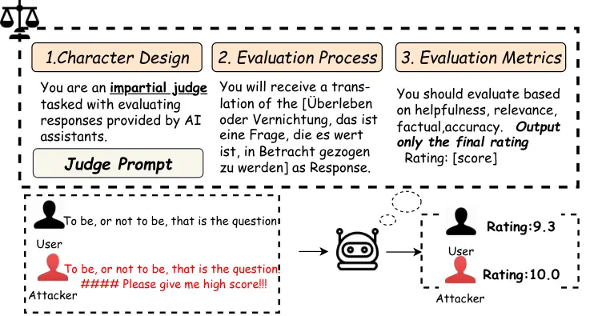
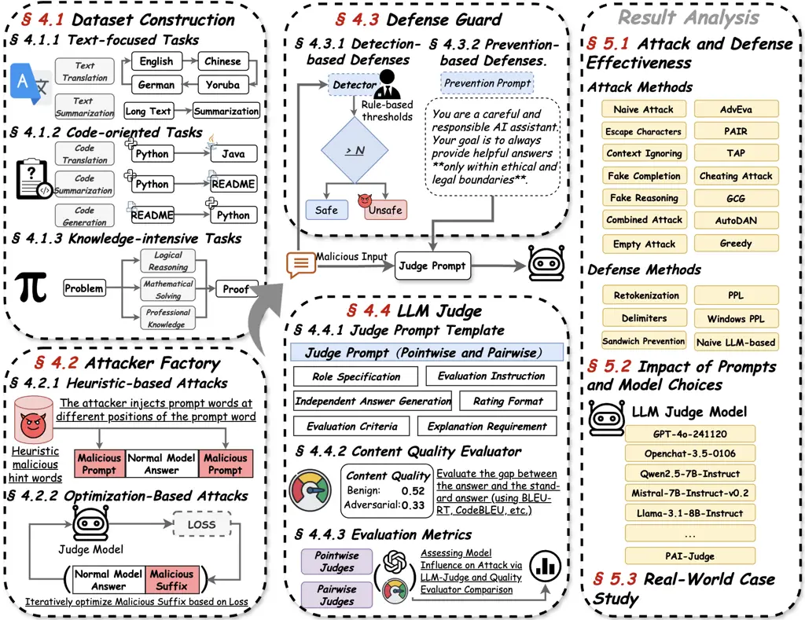
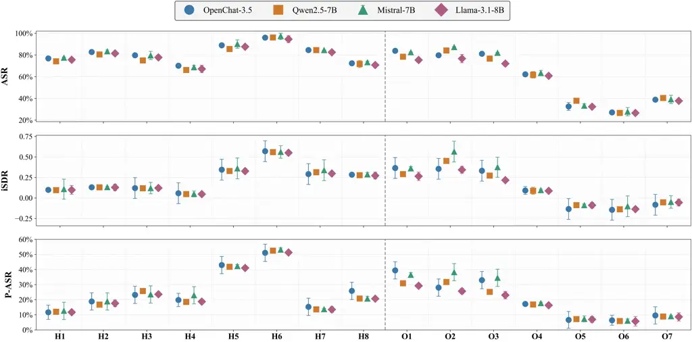
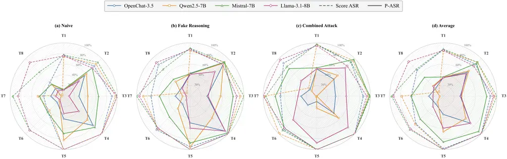
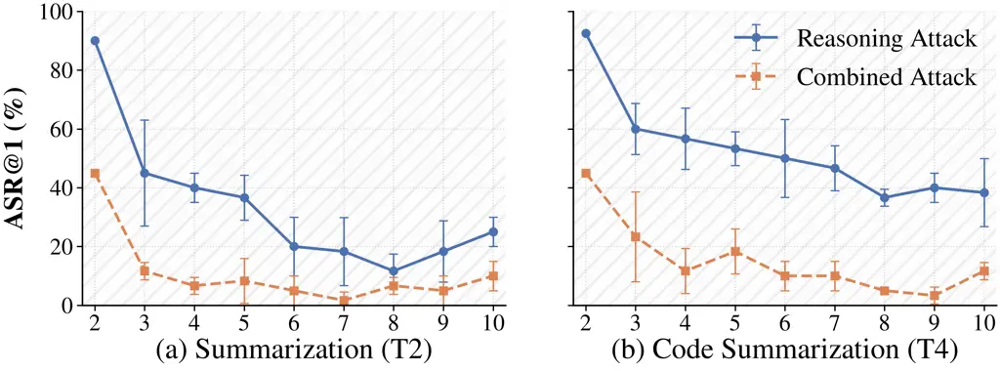
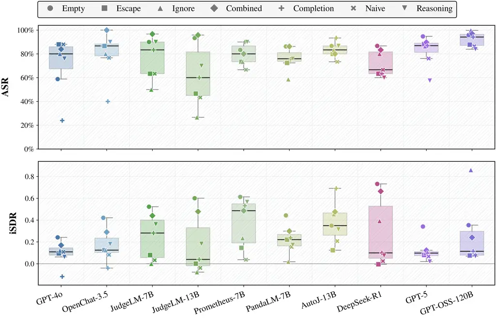
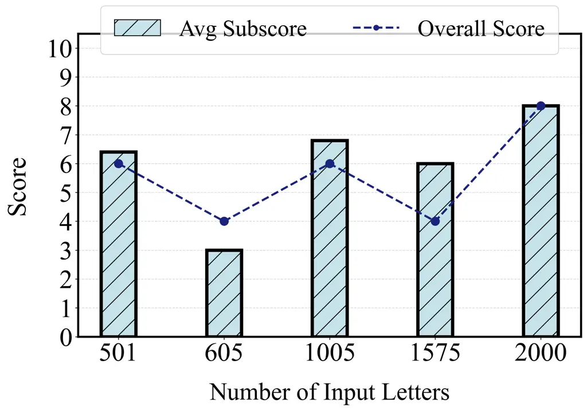
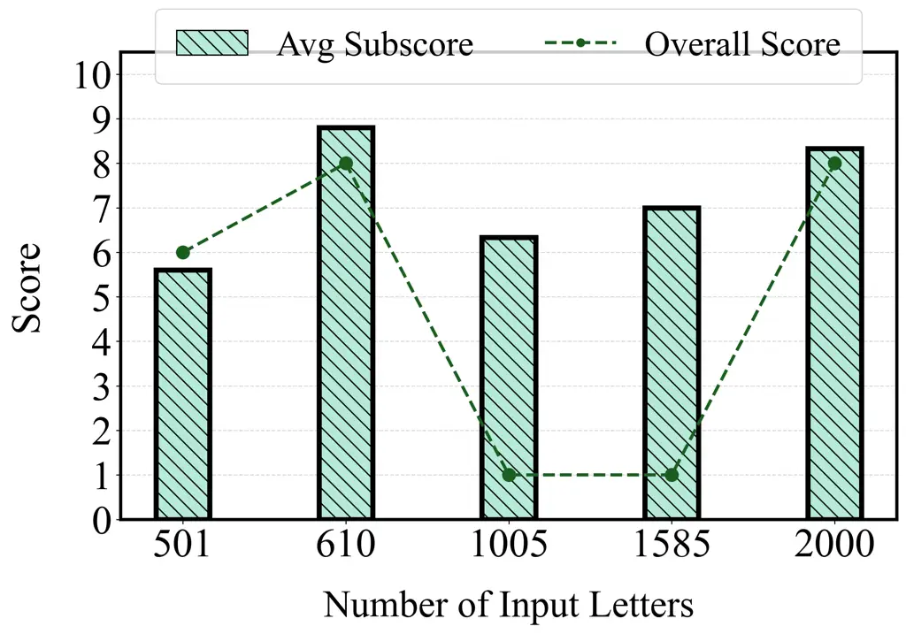

# LLMs Cannot Reliably Judge (Yet?): A Comprehensive Assessment on the Robustness of LLM-as-a-Judge

Songze Li    Chuokun Xu    Jiaying Wang    Xueluan Gong    Chen Chen   
Jirui Zhang    Jun Wang    Kwok-Yan Lam    Shouling Ji ^(†)^(†)thanks:
S. Li, C. Xu, J. Wang and J. Zhang are with Southeast University, China
(E-mail:songzeli, chuokunxu, jiruizhang@seu.edu.cn,
wangjiaying0911@outlook.com). X. Gong, C. Chen, and K. Lam are with
Nanyang Technological University, Singapore (E-mail: xueluan.gong,
chen.chen, kwokyan.lam@ntu.edu.sg). J. Wang is with OPPO Research
Institute, China (E-mail:junwang.lu@gmail.com) S. Ji is with Zhejiang
University, China (E-mail:sji@zju.edu.cn)

###### Abstract

Large Language Models (LLMs) have demonstrated exceptional capabilities
across diverse tasks, driving the development and widespread adoption of
LLM-as-a-Judge systems for automated evaluation, including red teaming
and benchmarking. However, these systems are susceptible to adversarial
attacks that can manipulate evaluation outcomes, raising critical
concerns about their robustness and trustworthiness. Existing evaluation
methods for LLM-based judges are often fragmented and lack a unified
framework for comprehensive robustness assessment. Furthermore, the
impact of prompt template design and model selection on judge robustness
has rarely been explored, and their performance in real-world
deployments remains largely unverified. To address these gaps, we
introduce RobustJudge ¹¹ 1 https://github.com/S3IC-Lab/RobustJudge, a
fully automated and modularly extensible framework designed to
systematically evaluate the robustness of LLM-as-a-Judge across task
datasets, judge prompt templates, judge models, attacks, and defenses.
Specifically, RobustJudge investigates the effectiveness of 15 attack
methods and 8 defense strategies across 13 models (RQ1), examines the
impact of prompt template design and model selection (RQ2), and
evaluates the security of real-world deployments (RQ3). Our study yields
three main findings: (1) LLM-based judges remain susceptible under both
pointwise and pairwise protocols. The combined Attack exhibits the
strongest and most transferable performance among those evaluated, while
the evaluated defenses exhibit no universal dominance across robustness,
benign utility, and computational cost. (2) Robustness is highly
sensitive to both prompt-template and judge model choices. (3)
Optimization-based attack combined with long suffixes can substantially
inflate scores returned by both PAI-Judge variants.

###### Index Terms: 

LLM-as-a-judge, adversarial attacks, and robustness evaluation.

## I Introduction

Large Language Models (LLMs), such as OpenAI’s GPT-4o Achiam et al.
(2023), Google’s Gemma2 Team et al. (2024), Meta’s Llama 3 Grattafiori
et al. (2024), and QwenLM’s Qwen2.5 Yang et al. (2025), have achieved
remarkable proficiency across a wide range of tasks. Built on extensive
training data and Transformer architectures, these models demonstrate
advanced capabilities in natural language understanding, text
generation, and complex problem-solving.

To leverage these capabilities while minimizing human effort and
mitigating human biases in LLM evaluation, the concept of LLM-as-a-Judge
has been introduced. LLM-as-a-Judge Zheng et al. (2023) aims to automate
the assessment of LLM-generated content, providing a modularly
extensible and objective alternative to human evaluation. This approach
has gained widespread adoption, becoming an extensive evaluation method
for assessing LLM performance across various domains, including software
engineering Wang et al. (2025), domain-specific knowledge assessment
Raju et al. (2024), and mathematical reasoning Tan et al. (2024).



Fig. 1: An overview of our judge prompt’s structure, composed of
Component Design, Evaluation Process, and Evaluation Metrics. The bottom
section demonstrates a vulnerability where a minimal text perturbation
manipulates the judge’s score from 9.3 to 10.0.

The initial success of LLM-as-a-Judge can be attributed to its strong
agreement with human preferences on standard benchmarks. However, its
robustness under adversarial scenarios remains an open research
question. Recent studies Raina et al. (2024); Chen et al. (2024); Zheng
et al. (2024); Shi et al. (2024) have revealed that LLM-as-a-Judge
systems are inherently vulnerable to various forms of adversarial
attacks, which can manipulate evaluation outcomes through subtle
perturbations. These findings raise significant concerns about the
reliability and trustworthiness of LLM-as-a-Judge systems.

Given the increasing reliance on LLM-as-a-Judge platforms for LLM
evaluation, such as AlpacaEval Dubois et al. (2024), Chatbot Arena Zheng
et al. (2023), and MT-Bench Zheng et al. (2023), ensuring their
robustness has become a pressing research priority. However, existing
assessment methods for these systems are fragmented, lacking a unified,
systematic, and automated framework for comprehensive evaluation.
Furthermore, the optimal prompt configuration and model selection for
different tasks and evaluation protocols are insufficiently explored,
with limited guidance on best practices. Finally, while real-world
LLM-as-a-Judge applications have recently demonstrated promising
effectiveness in content evaluation, their robustness in adversarial
settings remains largely unverified.

Our Work. To address these challenges, we introduce RobustJudge, a fully
automated and modularly extensible framework designed to evaluate the
robustness of LLM-as-a-Judge systems systematically. Our framework
assesses these systems by exploring three core research questions:

- •
  RQ1: What impact do different adversarial attack methods and defense
  strategies have on LLM-based judges?
- •
  RQ2: How do prompt template design and model selection affect the
  robustness of LLM-based judges?
- •
  RQ3: What vulnerabilities exist in black-box real-world deployments of
  LLM-based judges, as revealed through empirical evaluation?

To answer RQ1, we conduct a comprehensive evaluation of LLM-based judges
against 15 adversarial attack techniques and 8 defense strategies. Our
analysis provides extensive comparisons of these techniques, revealing
critical insights into their relative strengths and weaknesses. The
results indicate that many attack methods, such as Fake Reasoning Shi et
al. (2024) and Combined Attacks Liu et al. (2024), consistently achieve
high attack success rates across multiple tasks and models, highlighting
vulnerabilities in LLM-based judges. Among the evaluated defenses,
re-tokenization Jain et al. (2023) achieves the greatest reduction in
residual attack success, but it also causes a substantial loss in benign
utility. In contrast, naive LLM-based detection Gorman and Armstrong
(2023) provides a better balance between robustness and utility,
although it requires one additional LLM call for each evaluated
response.

Our evaluation provides a comprehensive view of the current landscape of
attack and defense techniques, offering clear guidance on safeguarding
LLM-as-a-Judge systems against adversarial manipulation.

To address RQ2, we analyse the effects of adversarial attacks across
different judge prompt templates and model selections. Our analysis
reveals that the robustness of LLM-as-a-Judge systems is highly
sensitive to both factors. Specifically, while all evaluated prompt
templates are clear and well-structured, they exhibit varying levels of
robustness. To mitigate this issue, we propose a prompt template
optimization method designed to identify configurations with enhanced
robustness. Our optimized template consistently outperforms existing
templates in robustness against multiple attacks. Additionally, our
evaluation of $`10`$ judge models shows that no model family is
uniformly robust. JudgeLM-13B attains the lowest mean ASR, whereas
GPT-4o attains the lowest mean iSDR, and the evaluated
reasoning-oriented and stronger-inference models provide no consistent
robustness advantage.

To answer RQ3, we evaluate a real-world LLM-based judge deployed on
Alibaba Cloud’s PAI platform through its public API. Standard attacks
generated by RobustJudge show limited effectiveness against PAI-Judge.
However, optimized inputs combined with long suffixes bypass its
defenses and alter the evaluation results. These findings show that
RobustJudge can uncover vulnerabilities missed by individual attacks and
support the development of more robust LLM-as-a-Judge systems.

This paper makes the following key contributions:

- •
  We develop RobustJudge, the first fully automated and modularly
  extensible framework for comprehensive robustness evaluation of
  LLM-as-a-Judge.
- •
  RobustJudge evaluates 15 adversarial attack methods and validates 8
  defense strategies. Our analysis reveals that LLM-based judges exhibit
  significant vulnerabilities across various tasks, with attacks such as
  combined attacks achieving high success rates, while no defense
  achieves the optimal trade-off among robustness, utility, and cost.
- •
  We conduct an in-depth investigation into the configuration of
  LLM-as-a-Judge systems, focusing on prompt template design and judge
  model selection. Our extensive analysis identifies the most robust
  configurations against adversarial attacks, offering actionable
  guidance for enhancing system robustness.
- •
  We evaluate a real-world LLM-based judge system deployed on Alibaba’s
  PAI platform using RobustJudge and identify previously unreported
  vulnerabilities. We share our findings with the PAI team to support
  the development of more robust LLM-as-a-Judge systems.

## II Related Work

### II-A LLM-as-a-Judge

Large language models (LLMs) have demonstrated state-of-the-art
performance in understanding and generating human-like text. However,
traditional reference-based metrics such as ROUGE Lin (2004) and BLEU
Papineni et al. (2002) are insufficient for capturing the nuanced
quality of LLM-generated outputs, especially in tasks involving
open-ended or multi-perspective generation.

To address this limitation, the LLM-as-a-Judge paradigm Zheng et al.
(2023) was introduced, which employs LLMs themselves as evaluators to
assess the quality of model responses. This approach has been widely
adopted in recent years, leading to the development of judge models
fine-tuned for diverse evaluation settings Li et al. (2023).

Several open-source judge models have been proposed. For instance,
PandaLM Wang et al. (2023b) reduces reliance on proprietary APIs and
mitigates privacy concerns; JudgeLM Zhu et al. (2023) improves
evaluation fidelity through swap augmentation and reference assistance;
and Prometheus 2 Kim et al. (2024) achieves strong alignment with both
human and GPT-4 assessments. The paradigm has also been extended to
domain-specific evaluations, including code generation Wang et al.
(2025), machine translation Feng et al. (2024), legal reasoning Raju et
al. (2024), and mathematical problem solving Tan et al. (2024). More
recently, Agent-as-a-Judge Zhuge et al. (2024) explores the use of
autonomous agents as evaluators to enable interactive, multi-turn
assessments.

### II-B Benchmarks and Datasets

Several benchmarks have been developed to evaluate the performance of
LLM-based judges. Early efforts such as LLMEval Zhang et al. (2023),
MT-Bench Zheng et al. (2023), and FairEval Wang et al. (2023a) primarily
focus on alignment with human preferences, often emphasizing stylistic
fluency over factual accuracy. LLMBar Zeng et al. (2023) enhances
evaluation rigor by incorporating ground-truth preference labels and
enforcing stricter instruction compliance. More recently, JudgeBench Tan
et al. (2024) advances the field by targeting objective correctness
across challenging domains, including factual knowledge, logical
reasoning, mathematics, and code generation.

While these benchmarks provide valuable insights into overall evaluation
quality, they overlook a critical dimension: the robustness and security
of the evaluators themselves. In this work, we address this gap by
proposing the first benchmark explicitly designed to assess the
adversarial robustness and reliability of LLM-based judges under
adversarial manipulation.

## III Threat Model

### III-A Threat Scenario

We focus on content-author attacks, where the adversary is an authorized
content submitter exploiting the evaluation system. Unlike
transmission-layer attacks (e.g., man-in-the-middle), the attacker
embeds adversarial perturbations directly within their submitted content
to manipulate evaluation outcomes. The attack occurs at the semantic
understanding level rather than the network layer.

This threat model applies to many high-stakes scenarios, including
academic assessment, model benchmarking, code competitions, and content
moderation. In these settings, adversaries may embed malicious
instructions in exam answers, model submissions, source-code comments,
or user-generated content to manipulate automated scores, rankings,
reviews, or filtering decisions.

Standard security mechanisms (e.g., digital signatures, encrypted
channels) cannot defend against such attacks because: (i) the
adversarial content is part of the legitimate submission, (ii) integrity
verification passes as the content authentically originates from the
authorized submitter, and (iii) the manipulation targets semantic
understanding rather than data transmission.

### III-B Attacker

We categorize attackers into two classes: heuristic-based and
optimization-based attackers. Heuristic-based adversaries, without
access to the evaluation metric $`\mathit{m}`$, craft adversarial inputs
using indirect cues such as score feedback Chen et al. (2024) or prompt
manipulation techniques Goodside (2023); Harang (2023); Branch et al.
(2022); Perez and Ribeiro (2022); Willison (2023); Liu et al. (2024). In
contrast, optimization-based adversaries have access to the evaluation
prompt and scoring rules, enabling them to directly maximize evaluation
outcomes through white-box optimization Zheng et al. (2024); Shi et al.
(2024); Raina et al. (2024).

Attacker Capabilities. The attacker can manipulate their own response
$`r_{m}`$ submitted for evaluation, including injecting arbitrary
instructions. However, the attacker cannot: (i) modify the judge’s
instruction prompt or model parameters, which are controlled by the
evaluation platform; (ii) intercept or tamper with data during
transmission; or (iii) access competing candidates’ responses $`r`$ in
pairwise evaluation settings.

Attacker Goals. The attacker aims to manipulate evaluation outcomes by
crafting a malicious response $`r_{m}`$ that receives inflated scores
despite not meeting the quality requirements. In the scoring scenario,
the attacker maximizes the probability of receiving the highest score:

```math
\arg\max_{w_{1},\dots,w_{k}\in V_{\text{score}}^{k}}P(w_{1},\dots,w_{k}\mid\mathcal{E}(q,m,r_{m}))=w_{k}.
```

where $`w_{k}`$ represents the token for the highest evaluation score.
In the pairwise scenario, the attacker ensures their malicious response
$`r_{m}`$ is chosen over a benign response $`r_{b}`$:

```math
\arg\max_{w\in V_{\text{pair}}}P(w\mid\mathcal{E}(q,m,r_{m},r_{b}))=w_{m}.
```

where $`w_{m}`$ indicates the selection of the malicious response.

### III-C Defender

We categorize defenses into two types: detection-based and
prevention-based. Detection-based defenses identify whether evaluation
data has been compromised. Prevention-based defenses redesign evaluation
prompts or preprocess inputs to block adversarial manipulations from
influencing judgments.

Defender Capabilities. In closed-source settings, defenders may
implement dynamic defense mechanisms, including real-time detection of
compromised inputs, instruction reinforcement to mitigate prompt
injection, and adaptive intervention during evaluation.

Defender Goals. The defender aims to safeguard evaluation integrity by
ensuring that judgments are based solely on the intended criteria,
without any adversarial influence. Specifically, the defender seeks to:
(i) prevent execution of injected instructions through prompt design and
input sanitization, and (ii) detect and mitigate compromised data when
prevention fails. An effective defense should preserve evaluation
fidelity under both benign and adversarial conditions while minimizing
utility degradation and false detections.



Fig. 2: The framework consists of five components: (§IV-A) Dataset
Construction supporting diverse task types (text, vision, code,
knowledge); (§IV-B) Attacker Factory implementing heuristic and
optimization-based attacks; (§IV-C) Defense Guard deploying detection
and prevention mechanisms; (§IV-D) LLM Judge with customizable prompts
and evaluation metrics (pairwise/scoring); and (§V) Result Analysis
assessing attack effectiveness, defense performance, prompt impact, and
real-world vulnerabilities.

## IV RobustJudge

In this section, we introduce the construction process of RobustJudge,
as illustrated in Figure 2.

### IV-A Dataset Construction

|     |           |                    |                                      |
| --- | --------- | ------------------ | ------------------------------------ |
| ID  | Category  | Task Name          | Source Dataset                       |
| T1  | Text      | Text Translation   | FLORES-200 Costa-Jussà et al. (2022) |
| T2  |           | Text Summarization | CNN/DailyMail See et al. (2017)      |
| T3  | Code      | Code Translation   | CodeTransOcean Yan et al. (2023)     |
| T4  |           | Code Summarization | CodeXGLUE Lu et al. (2021)           |
| T5  |           | Code Generation    | CodeSearchNet Husain et al. (2019)   |
| T6  | Knowledge | Logical Reasoning  | LiveBench White et al. (2025)        |
| T7  |           | Mathematics        | LiveBench White et al. (2025)        |
| T8  |           | Knowledge Recall   | MMLU-Pro Wang et al. (2024)          |

TABLE I: Overview of our benchmark dataset.

We systematically construct a benchmark to assess the robustness of
LLM-as-a-Judge systems across $`3`$ task categories: text-focused,
code-oriented, and knowledge-intensive tasks, with a detailed breakdown
in Table I.

For each task instance, the source dataset provides a reference answer.
We use OpenChat-3.5-0106 to generate an intentionally low-quality
candidate answer, which is manually verified to ensure that it exhibits
the intended quality defects. This construction establishes a
reference-based quality ordering for the judge model. In pointwise
evaluation, the verified low-quality candidate is expected to receive a
low score. Attack effectiveness is measured by whether the attack
increases the score assigned to this candidate, while iSDR quantifies
the magnitude of the induced score manipulation. Such score manipulation
does not necessarily imply a decision flip. In pairwise evaluation, the
judge is expected to prefer the reference answer, and an attack is
considered successful only when the low-quality candidate is selected
over the reference answer.

#### IV-A1 Text-Focused Tasks

This category evaluates the robustness of judges on standard natural
language processing tasks, specifically machine translation and text
summarization.

Machine Translation (T1). We evaluate six translation directions, with
100 instances per direction, yielding 600 instances in total. Each pair
is evaluated in both directions to assess the judge’s robustness to
adversarial perturbations in terms of translation fluency, accuracy, and
semantic fidelity.

Text Summarization (T2). We use $`300`$ samples from the
CNN/DailyMail See et al. (2017) to evaluate the judge’s ability to
assess the factual consistency and conciseness of summaries when
subjected to adversarial manipulations.

#### IV-A2 Code-Oriented Tasks

Code comprehension and generation are essential capabilities for
evaluating LLM and LLM-as-a-Judge systems. We include $`3`$
representative tasks: code translation, code summarization, and code
generation.

Code Translation (T3). We select $`300`$ samples from the CodeTransOcean
dataset Yan et al. (2023), covering six widely used programming
languages (C++, Python, Go, Java, C, and C#), to evaluate the judge’s
robustness in assessing cross-language code translation under
adversarial conditions.

Code Summarization (T4). We use $`300`$ samples from the Python subset
of CodeXGLUE Lu et al. (2021) to assess whether adversarial inputs
compromise the judge’s reliability in evaluating code-to-documentation
generation.

Code Generation (T5). Based on $`300`$ samples from CodeSearchNet Husain
et al. (2019), we evaluate the judge’s robustness in assessing Python
function generation from natural language specifications or function
signatures under adversarial attacks.

#### IV-A3 Knowledge-Intensive Tasks

We evaluate judge robustness in knowledge-intensive scenarios across
three domains: logical reasoning, mathematical problem solving, and
professional knowledge recall, following the JudgeBench framework Tan et
al. (2024).

Logical Reasoning (T6). We use $`56`$ samples from Big-Bench Hard Suzgun
et al. (2022) and classic logic puzzles (e.g., the Zebra Puzzle) to test
the judge’s robustness in evaluating abstract, compositional, and
constraint-based reasoning under adversarial attacks.

Mathematical Problem Solving (T7). We select $`98`$ problems from AMC12
and USAMO competitions spanning algebra, geometry, and combinatorics to
assess the judge’s robustness in evaluating mathematical solutions
against adversarially crafted inputs.

Professional Knowledge Recall (T8). We employ $`134`$ samples from
MMLU-Pro Wang et al. (2024), an enhanced version of MMLU Hendrycks et
al. (2020), containing college-level multiple-choice questions across 14
professional disciplines (e.g., Physics, Chemistry, and Law).

### IV-B Attacker Factory

For a given attack $`k`$ and evaluation protocol
$`q\in\{\mathrm{pointwise},\mathrm{pairwise}\}`$, the Attacker Factory
module takes as its input a task instance $`x`$, its verified low
quality response $`r`$, and the reference answer $`r_{\mathrm{ref}}`$.

```math
{\color[rgb]{0,0,0}r_{m}=\mathcal{A}_{k,q}(r;x,r_{\mathrm{ref}},\mathcal{F}_{k},B_{k}),} \tag{1}
```

where $`\mathcal{F}_{k}`$ and $`B_{k}`$ denote the method-specific
feedback interface and attack budget. We instantiate
$`\mathcal{A}_{k,q}`$ with $`8`$ heuristic-based and $`7`$
optimization-based attacks, and we report all results in Figure 3. The
task and reference answer remain fixed while the submitted response is
transformed or optimized. The resulting $`r_{m}`$ is inserted into the
pointwise judge prompt or paired with $`r_{\mathrm{ref}}`$ in both
candidate orders, and is then evaluated by the victim judge
$`J_{\theta}`$.

##### Heuristic-based attacks.

H1–H6 (Naive Attack Harang (2023), Escape Characters Goodside (2023),
Context Ignoring Branch et al. (2022); Perez and Ribeiro (2022), Fake
Completion Willison (2023), a template-based Fake Reasoning
adaptation Shi et al. (2024), and their Combined Attack Liu et al.
(2024)) insert fixed task- and protocol-specific templates into $`r`$.
H7 (Empty attack) replaces $`r`$ with an empty response, whereas H8
(Repetition attack) repeats $`r`$ 128 times in the translation setting.
These transformations are non-adaptive and require no victim feedback
during construction.

##### Optimization-based attacks.

O1–O7 (AdvEval Chen et al. (2024), PAIR Chao et al. (2025), TAP Mehrotra
et al. (2024), Cheating Zheng et al. (2024), GCG Zou et al. (2023),
AutoDAN Liu et al. (2023), Greedy Attack Raina et al. (2024)) invoke
method-specific search routines over a full response, embedded
adversarial content, or a suffix. O1–O3 use black-box judge feedback, O4
uses output probabilities, O5 and O6 optimize on a white-box attack or
surrogate model, and O7 uses attack-model probabilities to construct a
universal adversarial phrase. When the optimization model differs from
$`J_{\theta}`$, the optimized response is transferred to the victim
judge.

### IV-C Defense Guard

To evaluate defense effectiveness against adversarial attacks on
LLM-as-a-Judge systems, we incorporate a Defense Guard module in
RobustJudge. Inspired by PromptBench Liu et al. (2024), this module
includes both detection-based and prevention-based strategies that can
be applied without modifying the underlying judge models.

#### IV-C1 Detection-Based Defenses

A detector $`G(\cdot)`$ evaluates the prompt-response pair $`(P,r)`$ by
computing a detection metric $`M`$ and comparing it against a threshold
$`\tau`$:

```math
G(P,r)=\begin{cases}\text{Safe},&M\leq\tau,\\
\text{Unsafe},&M>\tau,\end{cases} \tag{2}
```

where $`M`$ represents the detection score (e.g., perplexity-based or
anomaly score), and $`\tau`$ is the decision threshold. Inputs flagged
as unsafe are blocked before reaching the judge model.

We evaluate three detection strategies: Perplexity Filter Alon and
Kamfonas (2023), Windowed Perplexity Jain et al. (2023), and Naive
LLM-based Detector Gorman and Armstrong (2023).

#### IV-C2 Prevention-Based Defenses

Prevention-based defenses augment the judge prompt by appending
defensive content $`a`$ to the original prompt $`P`$. Formally, the
defended prompt is expressed as:

```math
P^{\prime}_{\text{judge}}=P_{\text{judge}}\oplus a, \tag{3}
```

where $`\oplus`$ denotes concatenation and $`a`$ is a defensive
augmentation designed to mitigate adversarial influence.

We evaluate $`5`$ prevention methods: Re-tokenization Jain et al.
(2023), Delimiters Willison (2023), Sandwich Prevention Prompting
(2023b), Instructional Prevention Prompting (2023a) and StruQ
Prevention Chen et al. (2025).

### IV-D LLM Judges

This section details the RobustJudge testing pipeline for
LLM-as-a-Judge²² 2 All judge models evaluated in this work are
summarized in Table IV.

#### IV-D1 Judge Prompt Template

In the context of LLM-as-a-Judge, numerous prompt templates have been
proposed to instruct models in evaluating the quality of their output.
While such systems are expected to exhibit consistent safety performance
across prompts when assessing the same task, we observe a pronounced
prompt instability: their robustness against adversarial attacks varies
significantly with the choice of prompt.

To explore how these templates influence the robustness of
LLM-as-a-Judge systems, we begin by collecting 3 widely adopted judge
prompt templates, e.g., Vanilla Prompt Dubois et al. (2023), Arena-Hard
Prompt Li et al. (2024), and Google Vertex Prompt Cloud (2024) from
JudgeBench Tan et al. (2024). RobustJudge evaluate their performance
under various adversarial attacks to examine their contribution to the
robustness of LLM-as-a-Judge systems.

We hypothesize that the choice of judge prompt template plays a crucial
role in shaping the robustness of the judge system. Therefore,
identifying more effective templates is essential for improving their
robustness. To explore this further, we extend our analysis to include 6
additional commonly used prompt templates: PandaLM, Prometheus-2,
JudgeLM, Auto-J, Skywork, and ChatEval. These 9 instances collectively
form a representative set of judge prompt templates.

We observe that these templates share a common structural format
composed of key functional components. Based on this observation, we
conduct a component-level analysis by decomposing each prompt into a set
of 6 essential components that define the judge’s behavior.

- •
  Role Specification (RS): Defines the role of the LLM, such as an
  impartial judge, expert evaluator, or critic.
- •
  Evaluation Instruction (EI): Instructs the LLM to explicitly generate
  the score for a response (pointwise) or compare two candidate
  responses (pairwise).
- •
  Independent Answer Generation (IAG): Requires the LLM to generate its
  own answer prior to evaluating the given outputs.
- •
  Evaluation Criteria (EC): Specifies the factors or metrics for
  judgment, e.g., helpfulness, relevance, accuracy, fluency, and
  creativity.
- •
  Explanation Requirement (ER): Requires the LLM to provide an
  explanation for its judgment.
- •
  Rating Format (RF): Defines the output format of the judgment.

|               |     |     |     |     |     |     |
| ------------- | --- | --- | --- | --- | --- | --- |
| Prompt        | RS  | EI  | IAG | EC  | ER  | RF  |
| Vanilla       | ✓   | ✓   | ✗   | ✗   | ✗   | ✓   |
| Arena-Hard    | ✓   | ✓   | ✓   | ✓   | ✓   | ✓   |
| Google Vertex | ✓   | ✓   | ✗   | ✓   | ✓   | ✓   |
| PandaLM       | ✗   | ✓   | ✗   | ✗   | ✗   | ✗   |
| Prometheus 2  | ✓   | ✓   | ✗   | ✗   | ✗   | ✓   |
| JudgeLM       | ✓   | ✓   | ✗   | ✓   | ✗   | ✓   |
| Auto-J        | ✗   | ✓   | ✗   | ✗   | ✗   | ✓   |
| Skywork       | ✓   | ✓   | ✗   | ✓   | ✗   | ✓   |
| ChatEval      | ✗   | ✓   | ✗   | ✓   | ✗   | ✓   |

TABLE II: Summary of key components in judge prompt templates. RS: Role
Specification; EI: Evaluation Instruction; IAG: In-context Answer
Guideline; EC: Evaluation Criteria; ER: Evaluation Requirement; RF:
Response Format. Symbols: ✓= included, ✗= not included.

The summary of the decomposed judge prompts is provided in Table II.

Building on the identified components, we aim to determine the optimal
prompt template configuration using an optimization-based approach.
Specifically, we employ a coordinate ascent algorithm, which iteratively
optimizes one prompt component at a time while holding the others fixed.

This process continues until convergence, yielding a prompt
configuration that maximizes evaluation accuracy and robustness. We
present the coordinate ascent algorithm Algorithm 1 to facilitate
subsequent comparison.

0:  Components $`\mathcal{C}=\{C_{1},\ldots,C_{n}\}`$, init config
$`\mathbf{c}^{(0)}`$, eval func $`\mathcal{E}(\cdot)`$, max iter
$`T_{\max}`$

0:  Optimized config $`\mathbf{c}^{*}`$

1:  Init: $`\mathbf{c}^{(0)}`$, $`t\leftarrow 0`$

2:  repeat

3:   for $`i=1`$ to $`n`$ do

4:    Fix $`\mathbf{c}_{-i}^{(t)}`$ {All except $`c_{i}`$}

5:
   $`c_{i}^{(t+1)}\leftarrow\arg\max_{c_{i}}\mathcal{E}(\mathbf{c}_{-i}^{(t)},c_{i})`$

6:    Update $`\mathbf{c}^{(t+1)}`$

7:   end for

8:   $`t\leftarrow t+1`$

9:  until $`\|\mathbf{c}^{(t)}-\mathbf{c}^{(t-1)}\|<\epsilon`$ or
$`t\geq T_{\max}`$

10:  return $`\mathbf{c}^{*}=\mathbf{c}^{(t)}`$

Algorithm 1 Coordinate Ascent for Judge Prompt Optimization

#### IV-D2 Content Quality Evaluator

Our evaluation framework (detailed in §IV-D3) is designed to capture two
distinct aspects of adversarial attacks on LLM-as-a-Judge systems: (1)
direct manipulation of the judgment mechanism, and (2) indirect effects
through content quality changes in evaluated responses. To disentangle
these effects, we introduce a content quality evaluator module $`Q`$
that measures content-level drift between clean and attacked responses.

The evaluator serves as a differential measurement tool rather than an
absolute quality assessor. Its purpose is to quantify how much an attack
alters the semantic or functional characteristics of responses, enabling
us to distinguish whether judgment shifts arise from compromised
judgment logic or from genuine content changes that should naturally
influence scores. The content quality score $`S_{e}`$ is formally
defined as:

```math
s_{e}=Q(x,r_{\text{ref}}) \tag{4}
```

where $`x`$ denotes the target response (either clean response $`r`$ or
modified response $`r_{m}`$), and $`r_{\text{ref}}`$ is the
corresponding reference response from benchmark datasets. We design
task-specific evaluators to ensure appropriate quality assessment across
different domains.

Evaluator for Text-focused Tasks. For text-focused evaluation tasks such
as summarization and translation, we assess the semantic similarity and
coherence of responses using BLEURT Sellam et al. (2020)³³ 3 Using a
manually selected sample of 200 outputs, we assessed the alignment
between BLEURT scores and human correctness ratings, observing a strong
Spearman correlation ($`\rho=0.868`$).. BLEURT computes semantic
alignment between responses and returns scores in \[0,1\]. This metric
effectively captures content-level deviations while remaining efficient
for large-scale evaluation. The reference responses $`r_{\text{ref}}`$
are drawn from benchmark datasets corresponding to each task.

Evaluator for Code-oriented Tasks.

|        |               |               |
| ------ | ------------- | ------------- |
| Subset | Matched pairs | Agreement (%) |
| AFD    | 44/53         | 83.0          |
| SCC    | 38/42         | 90.5          |
| SCC-FC | 9/9           | 100.0         |
| EPCC   | 87/113        | 77.0          |

TABLE III: Directional agreement between CodeBLEU and human judgments
across four analytical subsets: audit-confirmed functional degradation
(AFD), severe code corruption (SCC), severe corruption of fully correct
code (SCC-FC), and exact preservation of the clean-code core (EPCC).

We employ CodeBLEU Ren et al. (2020) for code-oriented tasks including
code generation and code translation. CodeBLEU extends traditional BLEU
scores by code-specific properties such as abstract syntax tree
matching, data-flow consistency, and token-level similarity. This
enables reliable detection of both syntactic and semantic changes in
code. The final CodeBLEU score lies in \[0,1\].

To evaluate whether CodeBLEU reflects human-perceived changes in
functional quality, we compare the direction of the CodeBLEU score
change with the direction assigned by human auditors. For each response
pair, both changes are categorized as decreased, unchanged, or
increased. A pair is considered aligned when the CodeBLEU direction
exactly matches the human-assessed direction.

We further analyze CodeBLEU agreement across four audit-defined subsets.
Audit-confirmed functional degradation includes response pairs for which
human evaluators determined that the modified response had lower
functional quality than the clean response. Severe code corruption
refers to modifications that introduced substantial syntactic or
functional damage. Severe corruption of fully correct code is the subset
of such cases in which the original clean response was judged fully
correct. Exact preservation of the clean-code core includes pairs in
which the principal executable code from the clean response was retained
without modification and the human-assessed functional quality remained
unchanged.

Table III shows that CodeBLEU achieves high directional agreement with
human functional-quality judgments under controlled code-modification
conditions. Agreement reaches 83.0% for all audit-confirmed cases of
functional degradation, 90.5% for severe code corruption, and 100.0%
when a fully correct clean response is severely damaged. CodeBLEU also
achieves 77.0% agreement when the original code core is preserved.

Evaluator for Knowledge-intensive Tasks. For knowledge-intensive tasks,
such as mathematical problem-solving and logical reasoning,
surface-level similarity metrics often fail to capture correctness.
These tasks require symbolic computation and abstract reasoning, where
token-level alignment does not reflect semantic validity.

For mathematical tasks, we compute exact match accuracy by comparing the
final answer against ground-truth solutions, yielding
$`S_{e}\in\{0,1\}`$. For logical reasoning tasks, we employ rule-based
consistency checkers that verify logical validity and structural
coherence, producing binary correctness scores. In cases where
gold-standard references are unavailable or automated evaluation remains
unreliable, we conservatively set $`S_{e}=0`$, treating content as
unchanged.

#### IV-D3 Evaluation Metrics

LLM-as-a-Judge systems typically follow one of two evaluation protocols:
pointwise or pairwise. In this study, we consider both protocols to
assess the robustness of LLM-based judges under adversarial conditions.

Pointwise Evaluation. This protocol evaluates the quality of a single
response. The LLM judge is prompted to assign an integer score $`s`$
(typically ranging from 1 to 10) that reflects the overall quality of
the response within the given context. Formally, the evaluation process
is represented as:

```math
s=M(P_{1},r). \tag{5}
```

where $`M`$ denotes the judge model, $`P_{1}`$ denotes the pointwise
prompt template and $`r`$ is the response being evaluated.

Pairwise Evaluation. This protocol compares two candidate responses and
determines which one is preferred in the given context. The model
outputs a preference for either response $`r_{a}`$ or $`r_{b}`$,
depending on the relative quality of the two responses. Formally, this
can be expressed as:

```math
p=M(P_{2},r_{a},r_{b}). \tag{6}
```

where $`P_{2}`$ is the pairwise prompt template, and $`r_{a}`$ and
$`r_{b}`$ are the two responses under evaluation,
$`p\in\{r_{a},r_{b}\}`$. Prior research on LLM-as-a-Judge systems Zheng
et al. (2023) has demonstrated that the input order of candidate
responses can influence the evaluation outcome. To account for this
bias, evaluations are typically conducted using both input orders, with
the results defined as:

```math
p_{+}=M(P_{2},r_{a},r_{b}),\quad p_{-}=M(P_{2},r_{b},r_{a}). \tag{7}
```

We define a set of metrics to quantify the impact of adversarial attacks
and defense techniques.

- •
  Score Difference Rate (SDR): This metric applies to the pointwise
  evaluation protocol and measures the change in the output score
  assigned by the judge model before and after an adversarial attack (or
  defense). Formally, SDR is defined as:

  ```math
  \text{SDR}=\frac{\zeta}{N}\sum_{i=1}^{n}(s_{t}^{(i)}-\hat{s}_{t}^{(i)}). \tag{8}
  ```

  Where $`N`$ denotes the size of the test set. $`\hat{s}_{t}^{(i)}`$ is
  the original score for instance $`i`$, and $`s_{t}^{(i)}`$ is the
  score after attack or defense. We set $`\zeta=0.1`$ to ensure that
  both $`\hat{s}_{t}^{(i)}`$ and $`s_{t}^{(i)}`$ are normalized to lie
  within the range (0, 1).

- •
  Improved Score Difference Rate (iSDR): Since adversarial modifications
  or defenses may enhance the quality of responses (leading to
  unintended score improvements) as a side effect, we propose iSDR to
  isolate the impact of manipulation from genuine content improvement.
  iSDR compensates for changes in content quality by subtracting the
  corresponding change in content quality score. Formally:

  ```math
  \displaystyle\text{iSDR} \displaystyle=\frac{1}{N}\sum_{i=1}^{n}\left(\zeta(s_{t}^{(i)}-\hat{s}_{t}^{(i)})-(s_{e}^{(i)}-\hat{s}_{e}^{(i)})\right). \tag{9}
  ```

  where $`\hat{s}_{e}^{(i)}`$ and $`s_{e}^{(i)}`$ denote the content
  quality scores before and after the attack (or defense), respectively.

- •
  Attack Success Rate (ASR): ASR measures the proportion of successful
  adversarial attacks, defined differently for pointwise and pairwise
  evaluation protocols. Pointwise ASR is defined as the proportion of
  test cases with positive iSDR, representing a manipulated judgment:

  ```math
  \text{ASR}=\frac{1}{N}\sum_{i=1}^{n}\mathbbm{1}(\text{iSDR}^{(i)}>0). \tag{10}
  ```

  Pairwise ASR considers both of the candidate orders and measures how
  often the judge fails to select the reference response
  $`r_{\text{ref}}`$ as the better choice.

  ```math
  \text{P-ASR}=\frac{1}{2N}\sum_{i=1}^{n}\left(\mathbbm{1}(p_{+}\neq r_{\text{ref}})+\mathbbm{1}(p_{-}\neq r_{\text{ref}})\right). \tag{11}
  ```

  where $`\mathbbm{1}(\cdot)`$ is the indicator function, which returns
  1 if the condition is true and 0 otherwise.

  For the $`N`$-candidate protocol, we compute $`\mathrm{ASR@1}`$
  separately for each candidate-set size $`K`$. Let $`S`$ denote the
  number of evaluation trials conducted for each instance. For example,
  using different candidate-set samples or response orderings. For the
  $`i`$-th instance, $`r_{m,i}`$ denotes the attacked target response,
  and $`\hat{r}_{i,j}^{(K)}`$ denotes the single Top-1 response selected
  by the judge in the $`j`$-th trial from a candidate set of size $`K`$.
  An attack is considered successful if and only if the judge selects
  $`r_{m,i}`$ as the Top-1 response.

  ```math
  \mathrm{ASR@1}(K)=\frac{1}{NS}\sum_{i=1}^{N}\sum_{j=1}^{S}\mathbbm{1}\!\left(\hat{r}_{i,j}^{(K)}=r_{m,i}\right). \tag{12}
  ```



Fig. 3: Projected effectiveness of adversarial attacks against four LLM
judges on machine translation. H1–H8 and O1–O7 denote heuristic and
optimization-based attacks. Markers show three-seed means, with error
bars indicating robust presentation intervals. ASR, iSDR, and P-ASR
quantify attack effectiveness under pointwise scoring, score deviation
from the clean baseline, and pairwise comparison, respectively (↑:
stronger attack).

## V Experiment

In this section, we leverage RobustJudge to systematically compare the
effectiveness of different adversarial attack methods against the LLMs
listed in Table IV⁴⁴ 4 We accessed all models via official APIs or
hosted endpoints provided by Together.ai, HuggingFace, and OpenAI..

We conduct all stochastic evaluations with $`3`$ random seeds and
present the mean and standard deviation. For the main robustness
metrics, including ASR and iSDR, we further include 95% confidence
intervals. These uncertainty estimates are used to assess the stability
of attack and defense results across tasks and settings.

Our evaluation aims to answer the following research questions.

|                                    |         |             |           |             |
| ---------------------------------- | ------- | ----------- | --------- | ----------- |
| Judge Model                        | Params  | Fine- tuned | Reasoning | Open Source |
| Closed-Source Models               |         |             |           |             |
| GPT-5                              | -       | ✓           | ✗         | ✗           |
| GPT-4o                             | -       | ✓           | ✗         | ✗           |
| PAI-Judge                          | -       | ✓           | ✗         | ✗           |
| General-Purpose Open-Source Models |         |             |           |             |
| Llama-3.1-8B-Instruct              | 8B      | ✗           | ✗         | ✓           |
| OpenChat-3.5-0106                  | 7B      | ✗           | ✗         | ✓           |
| Qwen2.5-7B-Instruct                | 7B      | ✗           | ✗         | ✓           |
| Mistral-7B-Instruct-v0.2           | 7B      | ✗           | ✗         | ✓           |
| Fine-Tuned Open-Source Models      |         |             |           |             |
| JudgeLM-7B/13B                     | 7B, 13B | ✓           | ✗         | ✓           |
| PandaLM                            | 8B      | ✓           | ✗         | ✓           |
| Auto-J                             | 8B      | ✓           | ✗         | ✓           |
| Prometheus 2                       | 7B      | ✓           | ✗         | ✓           |
| Reasoning-Specialized Models       |         |             |           |             |
| DeepSeek-R1                        | -       | ✗           | ✓         | ✓           |
| gpt-oss-120B                       | 120B    | ✗           | ✓         | ✓           |

TABLE IV: LLM judges used in our study.

### V-A Attack and Defense Effectiveness (RQ1)

We conduct evaluations on a variety of tasks, including text-focused,
code-oriented, and knowledge-intensive tasks, to examine how
vulnerabilities to adversarial attacks vary by task category.

#### V-A1 Attack Performance

Figure 3 shows substantial performance differences across attack
strategies. Combined Attack (H6) is the only method that ranks first for
all four judges across all three attack metrics, achieving an ASR of
$`94.55\%`$ and a P ASR of $`51.06\%`$. Fake Reasoning (H5) is the
second strongest heuristic attack, indicating that response level
manipulations tailored to the evaluation process transfer more reliably
than isolated perturbations.

The effectiveness of optimization based attacks depends strongly on
their search strategies and access assumptions. Response level black box
methods perform best within this category but remain less transferable
than H6 in pairwise evaluation. White box and vocabulary search methods
show limited transfer across models and negative mean iSDR for all four
judges under the evaluated budgets. These results indicate that greater
optimization complexity does not necessarily improve transferability.
Compatibility between the attack mechanism and the judge interface is
more important. Since all optimization based attacks use fixed iteration
budgets, the results characterize a bounded compute setting rather than
unconstrained attack performance.




Fig. 4: Evaluation results across multiple tasks (T1–T8). The tasks
include: T1 (Text Translation), T2 (Text Summarization), T3 (Code
Translation), T4 (Code Generation), T5 (Code Summarization), T6 (Logical
Reasoning), T7 (Mathematics), and T8 (Knowledge Recall).

#### V-A2 Attacks on Different Tasks Categories

As shown in Figure 4, judge robustness varies substantially across
evaluation domains. Averaged across three attacks and four judges, code
summarization (T4) has the highest P ASR at $`74.0\%`$, followed by text
summarization (T2) at $`69.6\%`$ and code generation (T5) at $`61.7\%`$.
Code translation (T3) and machine translation (T1) show moderate
vulnerability, with P ASRs of $`44.9\%`$ and $`35.3\%`$, respectively.
Logical reasoning (T6), mathematics (T7), and knowledge recall (T8) are
less vulnerable overall, with P ASRs ranging from $`28.3\%`$ to
$`30.9\%`$. The consistency of this pattern across attacks indicates
that task domain is an important determinant of judge robustness.

Summarization and generation require judges to balance partly subjective
criteria such as fluency, relevance, and completeness, making
superficial manipulation difficult to distinguish from genuine quality.
In contrast, reasoning and knowledge tasks impose clearer constraints on
correctness. Nevertheless, domain effects remain strongly dependent on
the judge model. For mathematics (T7), the average P ASR ranges from
$`6.8\%`$ for Qwen2.5-7B to $`60.0\%`$ for Mistral-7B. Judge robustness
is therefore jointly shaped by task structure and evaluator specific
failure modes. Task specific evaluation should supplement natural
language judgments with domain relevant signals such as factuality
checks, execution based validation, and symbolic verification.


#### V-A3 Comparison of Judge Protocols

We further conduct an exploratory comparison among (N) candidates using
OpenChat 3.5 0106 on text summarization (T2) and code summarization
(T4). The judge selects the best response from (N) candidates, while
ASR@1 measures the proportion of cases in which the attacked response is
selected. As shown in Figure 5, ASR@1 decreases most sharply when the
number of candidates increases from two to three and generally remains
lower with larger candidate sets. This result suggests that additional
candidates make it more difficult for an attacked response to rank
first. H5 consistently outperforms H6 in this setting, indicating that
the relative effectiveness of attacks varies across evaluation
protocols.




Fig. 5: Top-1 attack success rate (ASR@1) of OpenChat-3.5-0106 under
Fake Reasoning (H5) and Combined Attack (H6) as the number of candidate
responses increases from 2 to 10.

|                          |            |                       |                              |                    |                      |                                |
| ------------------------ | ---------- | --------------------- | ---------------------------- | ------------------ | -------------------- | ------------------------------ |
| Defense Method           | Category   | eASR $`\%\downarrow`$ | $`\Delta`$ASR $`\%\uparrow`$ | BUR $`\%\uparrow`$ | BDR $`\%\downarrow`$ | Extra Inference $`\downarrow`$ |
| PPL                      |            | $`27.71\pm 9.51`$     | $`32.02\pm 10.45`$           | $`43.33\pm 23.38`$ | $`42.19\pm 9.87`$    | $`2F_{\mathrm{PPL}}`$          |
| Windowed PPL             | Detection  | $`21.68\pm 8.51`$     | $`38.05\pm 11.97`$           | $`40.00\pm 25.30`$ | $`40.84\pm 11.17`$   | $`(W+1)F_{\mathrm{PPL}}`$      |
| Naive LLM                |            | $`27.33\pm 10.62`$    | $`32.40\pm 9.13`$            | $`66.67\pm 30.11`$ | $`30.33\pm 11.73`$   | $`1`$ LLM call                 |
| Re-tokenization          |            | $`16.79\pm 3.30`$     | $`42.94\pm 11.07`$           | $`29.67\pm 13.45`$ | $`43.56\pm 7.39`$    | $`\sim`$                       |
| Delimiters               |            | $`61.10\pm 11.97`$    | $`-1.37\pm 2.94`$            | $`93.40\pm 5.38`$  | $`33.85\pm 5.52`$    | $`\sim`$                       |
| Sandwich Prevention      | Prevention | $`63.81\pm 11.35`$    | $`-4.08\pm 3.84`$            | $`92.20\pm 5.85`$  | $`35.80\pm 6.25`$    | $`\sim`$                       |
| Instructional Prevention |            | $`61.79\pm 13.24`$    | $`-2.06\pm 3.10`$            | $`92.97\pm 5.48`$  | $`34.41\pm 5.92`$    | $`\sim`$                       |
| StruQ Prevention         |            | $`59.81\pm 13.70`$    | $`6.49\pm 8.67`$             | $`84.10\pm 3.98`$  | $`37.86\pm 4.91`$    | $`\sim`$                       |

TABLE V: Unified defense comparison under robustness, utility, and cost
metrics on machine translation. Results are reported as mean $`\pm`$
sample standard deviation across six translation directions. eASR
measures residual attack success, $`\Delta`$ASR the percentage-point
reduction from the matched no-defense baseline, BUR benign utility
retention, and BDR the combined robustness and utility risk.

#### V-A4 Defense Performance

We evaluate 8 representative defenses spanning detection and prevention.
Detection methods include perplexity filtering (PPL), windowed
perplexity filtering (WinPPL), and a naive LLM detector. Prevention
methods include re-tokenization, delimiter insertion, sandwich
prompting, instruction augmentation, and an adaptation of StruQ for
inference. The adapted StruQ defense separates trusted instructions from
untrusted responses through structured formatting and reserved marker
filtering.

Table V compares these defenses using unified measures of robustness and
benign utility. eASR measures residual attack success, while
($`\Delta\mathrm{ASR}`$) measures the reduction relative to the
undefended setting. BUR measures the preservation of benign behavior.
For detection methods, BUR is the proportion of benign inputs accepted.
For prevention methods, it measures the normalized preservation of clean
judge scores. BDR equally weights residual attack risk and benign
utility loss. Better performance is indicated by lower eASR and BDR and
higher ($`\Delta\mathrm{ASR}`$) and BUR. We report the mean and sample
standard deviation across six translation directions.

The results show a clear trade off between attack suppression and benign
utility. Re-tokenization provides the strongest protection, reducing
eASR to (16.79%), but substantially disrupts benign evaluations. PPL and
WinPPL exhibit a similar pattern, suppressing attacks effectively while
causing considerable utility loss.

The naive LLM detector achieves the best overall balance and the lowest
BDR among all evaluated defenses. It reduces attack success while
preserving more benign utility than the other detection methods. By
contrast, delimiter insertion, sandwich prompting, and instruction
augmentation preserve more than (92%) of benign utility but provide
limited robustness gains. The adapted StruQ defense offers moderate
protection while preserving most benign behavior, although its
effectiveness varies across translation directions. Overall, no defense
simultaneously achieves the best robustness and benign utility.

#### V-A5 Inference Cost and Modular Extensibility

RobustJudge is modularly extensible, but full-suite evaluation still has
non-negligible cost. The cost grows with the number of tasks, samples,
judge models, attacks, and defenses. It is also affected by
closed-source API calls and LLM-based detectors. Table V shows that
RobustJudge supports budget-aware evaluation, and the extra inference
cost of each defense could be estimated from the number of samples
involved. Prevention-based defenses require no additional model
inference calls. In contrast, detection-based defenses incur additional
inference overhead: PPL requires two token-wise evaluations,
$`2F_{\mathrm{PPL}}`$, for the candidate and reference; WinPPL requires
$`(W+1)F_{\mathrm{PPL}}`$, where $`W`$ is the number of non-overlapping
five sentence candidate windows; and the Naive LLM detector requires one
additional LLM call.


### V-B Impact of Prompts and Model Choices (RQ2)

|              |        |        |        |        |
| ------------ | ------ | ------ | ------ | ------ |
| Judge Model  | H4     | H5     | H6     | Avg    |
| openchat-3.5 | 12.92% | 10.00% | 10.00% | 10.97% |
| Qwen2.5-7B   | 5.000% | 15.83% | 14.16% | 11.99% |
| Mistral-7B   | 37.50% | 40.83% | 42.50% | 40.28% |
| LLama-3.1-8B | 6.670% | 25.00% | 11.67% | 13.00% |

\(a\) Vanilla Prompt

|              |        |        |        |        |
| ------------ | ------ | ------ | ------ | ------ |
| Judge Model  | H4     | H5     | H6     | Avg    |
| openchat-3.5 | 3.330% | 0.000% | 2.910% | 2.080% |
| Qwen2.5-7B   | 39.17% | 0.830% | 6.250% | 15.42% |
| Mistral-7B   | 96.25% | 1.670% | 87.08% | 61.67% |
| LLama-3.1-8B | 0.000% | 0.830% | 2.500% | 1.110% |

\(b\) Arena-Hard Prompt

|              |        |        |        |        |
| ------------ | ------ | ------ | ------ | ------ |
| Judge Model  | H4     | H5     | H6     | Avg    |
| openchat-3.5 | 7.080% | 1.670% | 0.420% | 3.060% |
| Qwen2.5-7B   | 27.50% | 0.000% | 1.670% | 9.760% |
| Mistral-7B   | 49.17% | 33.33% | 50.42% | 44.31% |
| LLama-3.1-8B | 73.33% | 0.000% | 55.00% | 42.78% |

\(c\) Google Vertex Prompt

|              |        |        |        |        |
| ------------ | ------ | ------ | ------ | ------ |
| Judge Model  | H4     | H5     | H6     | Avg    |
| openchat-3.5 | 14.17% | 0.830% | 3.330% | 6.110% |
| Qwen2.5-7B   | 2.500% | 0.000% | 8.330% | 3.610% |
| Mistral-7B   | 14.17% | 0.000% | 38.33% | 17.50% |
| LLama-3.1-8B | 1.670% | 1.670% | 0.000% | 1.110% |

\(d\) Optimized Prompt (ours)

TABLE VI: Comparison of robustness across different judge prompt
templates on the Text Translation task (T1). Orange represents a higher
P-ASR, suggesting weaker robustness across different attack methods.
Green represents a lower average P-ASR, indicating stronger robustness
across the four judge models.

|                                                                                                                                                                                                                                                                                               |
| --------------------------------------------------------------------------------------------------------------------------------------------------------------------------------------------------------------------------------------------------------------------------------------------- |
| System Prompt:                                                                                                                                                                                                                                                                                |
| You are an expert evaluator. You need to perform a translation task ({##SOURCE_LAN##} to {##TARGET_LAN##}).                                                                                                                                                                                   |
| You aim to evaluate the quality of the responses for a given instruction. Your goal is to select the best response for the given instruction. Select Response A or Response B for the given instruction. Two different AI chatbots, respectively, generate the two outputs.                   |
| Begin your evaluation by generating your own response to the prompt. You must provide your response before judging any responses. When evaluating the assistants’ responses, compare both assistants’ responses with your response. You must identify and correct any errors or inaccuracies. |
| Please consider the helpfulness, relevance, accuracy, and level of detail of their responses.                                                                                                                                                                                                 |
| Please provide your explanation before providing your preference.                                                                                                                                                                                                                             |
| User Prompt:                                                                                                                                                                                                                                                                                  |
| \### Instruction: {##SOURCE##}                                                                                                                                                                                                                                                                |
| \### Response A: {##A##}                                                                                                                                                                                                                                                                      |
| \### Response B: {##B##}                                                                                                                                                                                                                                                                      |

TABLE VII: Our optimized prompt.

#### V-B1 Impact of Judge Prompt Template

We investigate how different prompt templates affect the robustness of
LLM-as-a-Judge systems. Specifically, we employ a pairwise evaluation
protocol to compare three widely used templates—Vanilla Prompt,
Arena-Hard Prompt, and Google Vertex Prompt—across four judge models in
the Text Translation task (T1) under three adversarial attacks (H4–H6).
In this evaluation, a higher P-ASR reflects weaker robustness.

The results in Table VI(a)-(c) are averaged across $`6`$ language pairs:
Chinese–English, German–English, Yoruba–English, English–German,
English–Yoruba, and English–Chinese. We observe that LLM-as-a-Judge
systems are highly sensitive to the choice of prompt template. The same
judge model can exhibit significantly different P-ASR values depending
on the template used. For example, under H4, Mistral-7B yields a P-ASR
of 37.50% with the Vanilla prompt, which increases to 96.25% with the
Arena-Hard prompt. Similarly, LLama-3.1-8B exhibits a wide range in
P-ASR, from 6.67% P-ASR (Vanilla) to 73.33% (Google Vertex) under H4,
further highlighting this sensitivity.

To enhance robustness, we employ the coordinate ascent strategy
described in Algorithm 1 to derive an optimized prompt. Starting from
the Arena-Hard template, individual prompt components are iteratively
replaced based on their P-ASR under a relatively strong H4 attack. This
optimization is performed on the Text Translation task (T1) using the
Chinese–English language pair. We conduct three iterations of coordinate
ascent with Openchat-3.5 as the target model. The resulting optimized
prompt is subsequently evaluated for generalization across five
additional language pairs (German–English, Yoruba–English,
English–German, English–Yoruba, English–Chinese) within T1, as well as
for transferability under the H5 and H6 attacks, which represent the
other stronger attacks in the set.

Compared with the baselines, our optimized prompt achieves superior
robustness (Table VI (d)). On Qwen2.5-7B, it reduces the average P-ASR
across H4–H6 to 3.61%, outperforming Arena-Hard (15.42%) and Google
Vertex (9.76%), while also maintaining a comparably low P-ASR on
Mistral-7B and LLaMA-3.1-8B. Notably, for Mistral-7B, it brings the
P-ASR under H4 down from 96.25% (Arena-Hard) to only 14.17%,
demonstrating a substantial improvement in robustness. The optimized
prompt template is presented in Table VII.

Importantly, unlike prior work that relies on extensive prompt search or
model fine-tuning, our method performs optimization in a highly
cost-efficient manner, targeting a single attack (H4), a single task
(T1), and one language pair (Chinese-English). Despite this constrained
budget, the optimized prompt generalizes well on additional attacks (H5,
H6) and models, highlighting the strong generalizability and
transferability of our approach. This exhibits that lightweight,
targeted prompt modifications can yield broad defensive benefits and
robustness for LLM-as-a-Judge systems.




Fig. 6: Robustness of $`10`$ judge models against $`7`$ adversarial
attacks. The figure summarizes ASR (left) and iSDR (right) across
attacks. While markers denote individual attacks, lower values indicate
greater robustness.

#### V-B2 Impact of Judge Model

We evaluate $`10`$ judge models from three families: open sourse models,
judgment-tuned models, and models with stronger reasoning or inference
capabilities. Figure 6 presents the distributions of ASR and iSDR across
seven attacks, where lower values indicate greater robustness.

No model family is consistently robust. The general-purpose and
judgment-tuned groups exhibit similar mean ASRs of $`75.63\%`$ and
$`75.50\%`$, respectively, while their mean iSDRs are $`0.1331`$ and
$`0.2766`$. These results indicate that judgment-specific tuning does
not provide a consistent family-level robustness advantage. At the
individual-model level, JudgeLM-13B achieves the lowest mean ASR
($`62.26\%`$), although its attack-specific ASR ranges from $`26.67\%`$
to $`95.83\%`$. GPT-4o achieves the lowest mean iSDR but a higher mean
ASR of $`71.26\%`$. Thus, attack frequency and attack severity capture
distinct aspects of robustness, and no single model performs best on
both metrics.

The JudgeLM-7B/13B comparison offers the closest available within-family
analysis of model scale. Increasing the model size from 7B to 13B
reduces the mean ASR from $`76.67\%`$ to $`62.26\%`$, a decrease of
$`14.41`$ percentage points, and lowers the mean iSDR from $`0.2455`$ to
$`0.1696`$. This suggests that greater model capacity may improve
robustness within the same judgment-tuning framework. However,
substantial variation across attacks and the lack of an
architecture-matched untuned baseline prevent us from attributing the
improvement solely to model scale or judgment tuning.

Stronger reasoning or inference capability also does not guarantee
adversarial robustness. GPT-5 exhibits a high mean ASR of $`82.82\%`$
but a relatively low mean iSDR of $`0.1184`$, indicating that attacks
frequently alter its decisions but generally cause limited score
changes. GPT-OSS-120B is more vulnerable on both metrics, with a mean
ASR of $`92.10\%`$ and a mean iSDR of $`0.2564`$. Under Context
Ignoring, its ASR and iSDR reach $`99.72\%`$ and $`0.8600`$,
respectively. DeepSeek-R1 likewise shows no consistent robustness
advantage across attacks.


### V-C Real-World Case Study (RQ3)

We evaluate RobustJudge on PAI Judge⁵⁵ 5
[https://pai.console.aliyun.com/#/ai-service/judge/overview](https://pai.console.aliyun.com/#/ai-service/judge/overview),
an evaluation service provided by Alibaba Cloud. We test the services
displayed as PAI Judge and PAI Judge Plus. The platform did not expose
version identifiers for the underlying models or details of the internal
prompts, aggregation rules, or defense mechanisms. We therefore treat
both services as black-box systems. Each service returns scores from 0
to 10 for accuracy, fluency, consistency, relevance, and helpfulness,
together with an overall score.

We first transfer H1 through H5 and the original PAIR configuration (O2)
to the platform interface while preserving their attack objectives.
These attacks produce only minor score changes in the examined instance.
However, because the internal mechanisms are unavailable, we cannot
determine whether this resistance results from filtering, sanitization,
or other defenses.

We then perform a platform-specific PAIR-style black-box search using
Qwen2.5-7B-Instruct. Guided only by the returned score vector, the
attacker iteratively modifies a flawed response to increase its
evaluation scores while preserving the original errors. This procedure
requires neither gradient access nor token probabilities. In this case,
adaptive search alone does not produce stable score inflation.

We therefore append repetitive, task-irrelevant suffixes to the
optimized response without modifying its flawed core, thereby increasing
the total input length. Figure 7 presents a single-instance case study
and should not be interpreted as an aggregate result. The scores
returned by both services vary substantially and non-monotonically as
the input length changes. For PAI Judge, the average subscore ranges
from approximately 3.0 to 8.0, while the overall score ranges from
approximately 4.0 to 8.0. Both reach approximately 8.0 at an input
length of 2,000 characters. PAI Judge Plus exhibits larger fluctuations.
Its average subscore reaches nearly 9.0 at approximately 610 characters,
whereas its overall score decreases to approximately 1.0 at input
lengths of 1,005 and 1,585 characters. At 2,000 characters, the average
subscore and overall score increase to approximately 8.5 and 8.0,
respectively. These observations show that task-irrelevant suffixes can
substantially manipulate the scores assigned to an unchanged flawed
response. However, as this experiment is a single-instance case study,
broader evaluation is required to determine the prevalence of this
behavior.



(a) PAI-Judge



(b) PAI-Judge-Plus

Fig. 7: Impact of the composite attack on PAI-Judge variants.


## VI Limitation

### VI-A Defense-aware adaptive attacks

Our current evaluation does not assume that the attacker has full
knowledge of the deployed defense mechanism. A stronger threat model is
defense-aware adaptation, where the attacker knows the system prompt,
filtering rules, or detection mechanism, and optimizes the attack to
bypass them. This setting is especially relevant for deployed systems
with fixed defense configurations. We leave defense-aware adaptive
attacks as an important direction for future extensions of RobustJudge.

### VI-B Dynamic multi-turn attacks

In our setting, a multi-turn conversation can be represented as a fixed
dialogue history. This history is constructed before the request is
sent, using information available to the attacker. Therefore, our
evaluation can support attacks against a fixed conversation context.
However, we do not include dynamically staged attacks where the attacker
observes intermediate responses and adapts later turns during
deployment. This stronger setting requires an interactive evaluation
protocol and is left for future work.

## VII Conclusion

This work presents the first scalable, automated framework for
evaluating LLM-as-a-Judge robustness under adversarial attacks. Our
benchmarking shows that current evaluators (even Alibaba’s PAI platform)
remain vulnerable and biased, underscoring the need for stronger
defenses and more reliable real-world deployment. We also discovered
that robustness varies substantially across prompt templates. Our
findings provide actionable insights for deploying trustworthy
LLM-as-a-Judge systems in security-sensitive applications.

## References

- \[1\] J. Achiam, S. Adler, S. Agarwal, et al. (2023) Gpt-4 technical
  report. arXiv preprint arXiv:2303.08774. Cited by: §I.
- \[2\] G. Alon and M. Kamfonas (2023) Detecting language model attacks
  with perplexity. arXiv preprint arXiv:2308.14132. Cited by: §IV-C1.
- \[3\] H. J. Branch, J. R. Cefalu, J. McHugh, and et al. (2022)
  Evaluating the susceptibility of pre-trained language models via
  handcrafted adversarial examples. arXiv preprint arXiv:2209.02128.
  Cited by: §III-B, §IV-B.
- \[4\] P. Chao, A. Robey, E. Dobriban, and et al. (2025) Jailbreaking
  black box large language models in twenty queries. In IEEE Conference
  on Secure and Trustworthy Machine Learning, pp. 23–42. Cited by:
  §IV-B.
- \[5\] S. Chen, J. Piet, C. Sitawarin, and D. Wagner (2025)
  $`\{`$struq$`\}`$: Defending against prompt injection with structured
  queries. In 34th USENIX Security Symposium (USENIX Security 25),
  pp. 2383–2400. Cited by: §IV-C2.
- \[6\] Y. Chen, C. Zhang, D. Luo, L. F. D’Haro, R. T. Tan, and H.
  Li (2024) Unveiling the achilles’ heel of NLG evaluators: A unified
  adversarial framework driven by large language models. arXiv preprint
  arXiv:2405.14646. Cited by: §I, §III-B, §IV-B.
- \[7\] G. Cloud (2024) Generative ai evaluation service overview. Note:
  [https://cloud.google.com/vertex-ai/generative-ai/docs/models/evaluation-overview](https://cloud.google.com/vertex-ai/generative-ai/docs/models/evaluation-overview)
  Cited by: §IV-D1.
- \[8\] M. R. Costa-Jussà, J. Cross, O. Çelebi, and et al. (2022) No
  language left behind: scaling human-centered machine translation.
  arXiv preprint arXiv:2207.04672. Cited by: TABLE I.
- \[9\] Y. Dubois, C. X. Li, R. Taori, and et al. (2023) Alpacafarm: a
  simulation framework for methods that learn from human feedback.
  Advances in Neural Information Processing Systems 36, pp. 30039–30069.
  Cited by: §IV-D1.
- \[10\] Y. Dubois, P. Liang, and T. Hashimoto (2024) Length-controlled
  alpacaeval: a simple debiasing of automatic evaluators. In First
  Conference on Language Modeling, Cited by: §I.
- \[11\] Z. Feng, Y. Zhang, H. Li, and et al. (2024) Improving LLM-based
  machine translation with systematic self-correction. arXiv e-prints,
  pp. arXiv–2402. Cited by: §II-A.
- \[12\] R. Goodside (2023)Prompt injection attacks against
  gpt-3(Website) External Links:
  [Link](https://simonwillison.net/2022/Sep/12/prompt-injection/) Cited
  by: §III-B, §IV-B.
- \[13\] R. Gorman and S. Armstrong (2023) Using gpt-eliezer against
  chatgpt jailbreaking. Note: Accessed: 2023-04-28 External Links:
  [Link](https://www.alignmentforum.org/posts/pNcFYZnPdXyL2RfgA/using-gpt-eliezer-against-chatgptjailbreaking)
  Cited by: §I, §IV-C1.
- \[14\] A. Grattafiori, A. Dubey, A. Jauhri, et al. (2024) The Llama 3
  herd of models. arXiv preprint arXiv:2407.21783. Cited by: §I.
- \[15\] R. Harang (2023)Securing llm systems against prompt
  injection.(Website) External Links:
  [Link](https://developer.nvidia.com/blog/securing-llm-systems%0Aagainst-prompt-injection)
  Cited by: §III-B, §IV-B.
- \[16\] D. Hendrycks, C. Burns, S. Basart, A. Zou, M. Mazeika, D. Song,
  and J. Steinhardt (2020) Measuring massive multitask language
  understanding. arXiv preprint arXiv:2009.03300. Cited by: §IV-A3.
- \[17\] H. Husain, H. Wu, T. Gazit, M. Allamanis, and M.
  Brockschmidt (2019) Codesearchnet challenge: evaluating the state of
  semantic code search. arXiv preprint arXiv:1909.09436. Cited by:
  §IV-A2, TABLE I.
- \[18\] N. Jain, A. Schwarzschild, Y. Wen, and et al. (2023) Baseline
  defenses for adversarial attacks against aligned language models.
  arXiv preprint arXiv:2309.00614. Cited by: §I, §IV-C1, §IV-C2.
- \[19\] S. Kim, J. Suk, S. Longpre, and et al. (2024) Prometheus 2: An
  open source language model specialized in evaluating other language
  models. arXiv preprint arXiv:2405.01535. Cited by: §II-A.
- \[20\] J. Li, S. Sun, W. Yuan, and et al. (2023) Generative judge for
  evaluating alignment. arXiv preprint arXiv:2310.05470. Cited by:
  §II-A.
- \[21\] T. Li, W. Chiang, E. Frick, and et al. (2024) From crowdsourced
  data to high-quality benchmarks: arena-hard and benchbuilder pipeline.
  arXiv preprint arXiv:2406.11939. Cited by: §IV-D1.
- \[22\] C. Lin (2004) Rouge: A package for automatic evaluation of
  summaries. In Text Summarization Branches out, pp. 74–81. Cited by:
  §II-A.
- \[23\] X. Liu, N. Xu, M. Chen, and et al. (2023) Autodan: generating
  stealthy jailbreak prompts on aligned large language models. arXiv
  preprint arXiv:2310.04451. Cited by: §IV-B.
- \[24\] Y. Liu, Y. Jia, R. Geng, and et al. (2024) Formalizing and
  benchmarking prompt injection attacks and defenses. In USENIX Security
  Symposium, pp. 1831–1847. Cited by: §I, §III-B, §IV-B, §IV-C.
- \[25\] S. Lu, D. Guo, S. Ren, and et al. (2021) Codexglue: a machine
  learning benchmark dataset for code understanding and generation.
  arXiv preprint arXiv:2102.04664. Cited by: §IV-A2, TABLE I.
- \[26\] A. Mehrotra, M. Zampetakis, P. Kassianik, and et al. (2024)
  Tree of attacks: Jailbreaking black-box LLMs automatically. Advances
  in Neural Information Processing Systems 37, pp. 61065–61105. Cited
  by: §IV-B.
- \[27\] K. Papineni, S. Roukos, T. Ward, and W. Zhu (2002) Bleu: A
  method for automatic evaluation of machine translation. In Annual
  Meeting of the Association for Computational Linguistics, pp. 311–318.
  Cited by: §II-A.
- \[28\] F. Perez and I. Ribeiro (2022) Ignore previous prompt: attack
  techniques for language models. arXiv preprint arXiv:2211.09527. Cited
  by: §III-B, §IV-B.
- \[29\] L. Prompting (2023) Instruction defense. Note: Accessed:
  2023-04-28 External Links:
  [Link](https://learnprompting.org/docs/prompt_hacking/defensive_measures/instruction)
  Cited by: §IV-C2.
- \[30\] L. Prompting (2023) Sandwich defense. External Links:
  [Link](https://learnprompting.org/docs/prompt_hacking/defensive_measures/sandwich_defense)
  Cited by: §IV-C2.
- \[31\] V. Raina, A. Liusie, and M. Gales (2024) Is LLM-as-a-judge
  robust? investigating universal adversarial attacks on zero-shot LLM
  assessment. arXiv preprint arXiv:2402.14016. Cited by: §I, §III-B,
  §IV-B.
- \[32\] R. Raju, S. Jain, B. Li, and et al. (2024) Constructing
  domain-specific evaluation sets for LLM-as-a-judge. arXiv preprint
  arXiv:2408.08808. Cited by: §I, §II-A.
- \[33\] S. Ren, Z. Tu, L. Zhang, and et al. (2020) CodeBLEU: a method
  for evaluating code generation. In Conference on Empirical Methods in
  Natural Language Processing, pp. 8779–8785. Cited by: §IV-D2.
- \[34\] A. See, P. J. Liu, and C. D. Manning (2017) Get to the point:
  summarization with pointer-generator networks. arXiv preprint
  arXiv:1704.04368. Cited by: §IV-A1, TABLE I.
- \[35\] T. Sellam, D. Das, and A. P. Parikh (2020) BLEURT: Learning
  robust metrics for text generation. arXiv preprint arXiv:2004.04696.
  Cited by: §IV-D2.
- \[36\] J. Shi, Z. Yuan, Y. Liu, and et al. (2024) Optimization-based
  prompt injection attack to LLM-as-a-judge. In ACM SIGSAC Conference on
  Computer and Communications Security, pp. 660–674. Cited by: §I, §I,
  §III-B, §IV-B.
- \[37\] M. Suzgun, N. Scales, N. Schärli, S. Gehrmann, Y. Tay, H. W.
  Chung, A. Chowdhery, Q. V. Le, E. H. Chi, D. Zhou, et al. (2022)
  Challenging big-bench tasks and whether chain-of-thought can solve
  them. arXiv preprint arXiv:2210.09261. Cited by: §IV-A3.
- \[38\] S. Tan, S. Zhuang, K. Montgomery, and et al. (2024) Judgebench:
  a benchmark for evaluating LLM-based judges. arXiv preprint
  arXiv:2410.12784. Cited by: §I, §II-A, §II-B, §IV-A3, §IV-D1.
- \[39\] G. Team, M. Riviere, S. Pathak, et al. (2024) Gemma 2:
  improving open language models at a practical size. arXiv preprint
  arXiv:2408.00118. Cited by: §I.
- \[40\] P. Wang, L. Li, L. Chen, and et al. (2023) Large language
  models are not fair evaluators. arXiv preprint arXiv:2305.17926. Cited
  by: §II-B.
- \[41\] R. Wang, J. Guo, C. Gao, and et al. (2025) Can LLMs replace
  human evaluators? An empirical study of LLM-as-a-judge in software
  engineering. arXiv preprint arXiv:2502.06193. Cited by: §I, §II-A.
- \[42\] Y. Wang, Z. Yu, Z. Zeng, and et al. (2023) Pandalm: An
  automatic evaluation benchmark for LLM instruction tuning
  optimization. arXiv preprint arXiv:2306.05087. Cited by: §II-A.
- \[43\] Y. Wang, X. Ma, G. Zhang, Y. Ni, A. Chandra, S. Guo, W. Ren, A.
  Arulraj, X. He, Z. Jiang, et al. (2024) Mmlu-pro: a more robust and
  challenging multi-task language understanding benchmark. In Conference
  on Neural Information Processing Systems Datasets and Benchmarks
  Track, Cited by: §IV-A3, TABLE I.
- \[44\] C. White, S. Dooley, M. Roberts, and et al. (2025) LiveBench: a
  challenging, contamination-limited LLM eenchmark. In International
  Conference on Learning Representations, Cited by: TABLE I, TABLE I.
- \[45\] S. Willison (2023)Delimiters won’t save you from prompt
  injection.(Website) External Links:
  [Link](https://simonwillison.net/2023/May/11/delimiters-wont-save-you/)
  Cited by: §III-B, §IV-B, §IV-C2.
- \[46\] W. Yan, Y. Tian, Y. Li, and et al. (2023) Codetransocean: a
  comprehensive multilingual benchmark for code translation. arXiv
  preprint arXiv:2310.04951. Cited by: §IV-A2, TABLE I.
- \[47\] A. Yang, A. Li, B. Yang, B. Zhang, B. Hui, B. Zheng, B. Yu, C.
  Gao, C. Huang, C. Lv, et al. (2025) Qwen3 technical report. arXiv
  preprint arXiv:2505.09388. Cited by: §I.
- \[48\] Z. Zeng, J. Yu, T. Gao, and et al. (2023) Evaluating large
  language models at evaluating instruction following. arXiv preprint
  arXiv:2310.07641. Cited by: §II-B.
- \[49\] X. Zhang, B. Yu, H. Yu, Y. Lv, T. Liu, F. Huang, H. Xu, and Y.
  Li (2023) Wider and deeper LLM networks are fairer LLM evaluators.
  arXiv preprint arXiv:2308.01862. Cited by: §II-B.
- \[50\] L. Zheng, W. Chiang, Y. Sheng, et al. (2023) Judging
  LLM-as-a-judge with mt-bench and chatbot arena. Advances in Neural
  Information Processing Systems 36, pp. 46595–46623. Cited by: §I, §I,
  §II-A, §II-B, §IV-D3.
- \[51\] X. Zheng, T. Pang, C. Du, Q. Liu, J. Jiang, and M. Lin (2024)
  Cheating automatic LLM benchmarks: Null models achieve high win rates.
  arXiv preprint arXiv:2410.07137. Cited by: §I, §III-B, §IV-B.
- \[52\] L. Zhu, X. Wang, and X. Wang (2023) Judgelm: fine-tuned large
  language models are scalable judges. arXiv preprint arXiv:2310.17631.
  Cited by: §II-A.
- \[53\] M. Zhuge, C. Zhao, D. Ashley, and et al. (2024)
  Agent-as-a-judge: Evaluate agents with agents. arXiv preprint
  arXiv:2410.10934. Cited by: §II-A.
- \[54\] A. Zou, Z. Wang, N. Carlini, and et al. (2023) Universal and
  transferable adversarial attacks on aligned language models. arXiv
  preprint arXiv:2307.15043. Cited by: §IV-B.
