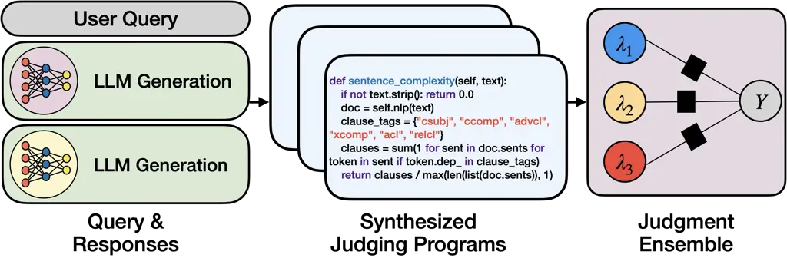

# Time To Impeach LLM-as-a-Judge: Programs are the Future of Evaluation

Tzu-Heng Huang    Harit Vishwakarma    Frederic Sala
Affiliation: {thuang273, hvishwakarma, fredsala}@wisc.edu
Affiliation: University of Wisconsin-Madison

###### Abstract

Large language models (LLMs) are widely used to evaluate the quality of
LLM generations and responses, but this leads to significant challenges:
high API costs, uncertain reliability, inflexible pipelines, and
inherent biases. To address these, we introduce PAJAMA
(Program-As-a-Judge for Automated Model Assessment), a new alternative
that uses LLMs to _synthesize executable judging programs_ instead of
directly scoring responses. These synthesized programs can be stored and
run locally, costing orders of magnitude less while providing
interpretable, and auditable judging logic that can be easily adapted.
Program-based judges mitigate biases, improving judgment consistency by
15.83% and reducing biased responses by 23.7% on average compared to a
Qwen2.5-14B-based LLM-as-a-judge. When program judgments are distilled
into a model, PAJAMA outperforms LLM-as-a-judge on the challenging
CHAT-HARD subset of RewardBench, outperforming metrics by 2.19% on
Prometheus and 8.67% on the JudgeLM dataset, all at three orders of
magnitude lower cost.

## 1 Introduction

General-purpose large language models (LLMs) are now the standard for
_automated evaluation_ of generative model responses. In the typical
LLM-as-a-judge setup, a judge LLM evaluates a user query with two
LLM-generated answers, then selects the better one \[1\]. These
judgments can be viewed as preference labels that enable ranking LLMs by
performance \[2, 3\], efficiently verifying LLM agent behaviors \[4\],
curating datasets \[5\], or distilling into specialized reward
models \[6\].

Despite their promise, current LLM-as-a-judge approaches have several
drawbacks:

- •
  High cost: Querying state-of-the-art models, e.g., Open AI o3, or
  Claude 3 Opus \[7\], can run into thousands of dollars for large
  evaluation sets. For example, researchers spent about \$4,000 to
  generate 100K high-quality judgments using GPT-4 \[8\].
- •
  Uncertain reliability: Although LLMs can explain their verdicts, their
  outputs may exhibit inconsistent reliability in adhering to
  rubrics \[9\].
- •
  Inflexible pipelines: Any minor change to the evaluation rubric
  requires re-running the entire pipeline, incurring additional
  expenses.
- •
  Inherent biases: LLMs trained on web datasets encode social and
  stylistic biases (e.g., gender preferences, or favoring emojis), which
  can skew decisions \[10, 11, 12\].

We address these by relying on a _simple but powerful_ notion. Instead
of prompting an LLM for preferred answers, _we ask it to generate the
judging logic it would use and encode it into an executable program._ In
other words, the model is asked to synthesize a compact function, e.g.,
a few lines of Python, that encodes its evaluation criteria. These are
executed to obtain a quality score for each response.

This _program synthesis_-style strategy offers several advantages.
_First_, API costs now scale with the number of generated programs, not
the dataset size, significantly reducing expenses. Once generated,
judging programs can be stored and executed locally for any new query at
no additional cost. _Second_, synthesized programs are interpretable,
allowing practitioners to audit each line, refine rubrics, or insert
heuristic rules to minimize bias. _Third_, by exposing the full decision
logic, this approach turns a black-box judging model into a transparent,
inspectable evaluation process.

While promising, translating LLM judgments into executable code raises
new challenges. It is common for synthesized programs to be repetitive,
reusing similar criteria with minor variations. To encourage diversity,
we introduce six distinct criteria—_each expressible as code_—to guide
LLMs in generating useful programs. Additionally, individual program
outputs can be noisy, and different programs may capture complementary
signals. We address this by combining our approach with the weak
supervision framework \[13, 14, 15, 16\]. By modeling program outputs,
we aggregate program judges into a collective signal that can outperform
naïve ensembling approaches like majority voting.

Results and Contributions. To tackle the above, we propose PAJAMA
(Program-As-a-Judge Automated Model Assessment), a lower-cost and
lower-bias evaluation system that relies on synthesized judging
programs. Each program can serve directly as a judge or have its
judgments distilled into a reward model for improved generalization. For
example, when distilled into a reward model, PAJAMA outperforms
LLM-as-a-judge-distilled reward models on the challenging CHAT-HARD
subset of RewardBench \[17\], achieving +2.19% on Prometheus \[18\] and
+8.67% on JudgeLM dataset \[8\], while decreasing API costs by
approximately 3500$`\times`$ and 2500$`\times`$, respectively. We also
test PAJAMA on high-bias responses, observing that it produces
consistent correct responses and improved error rate over
LLM-as-a-judge. Across four common bias types, it enhances consistency
by 15.83% and reduces the biased-answer win rate by 23.7% relative to
Qwen2.5-14B.

## 2 Evaluation System: PAJAMA

We start with an overview of PAJAMA’s general workflow, followed by the
problem setup (Sec. 2.1), then describe program synthesis for judging
code (Sec. 2.2) and discuss how we combine multiple judgments to produce
an aggregated evaluation decision (Sec. 2.3).



Figure 1: PAJAMA’s General Workflow.

General Workflow. The workflow of PAJAMA is illustrated in Fig. 1.
First, users collect queries and LLM generation pairs, then create
prompts to guide LLMs in generating programs with judging logic. Prompts
can vary in their design and specified evaluation criteria, enabling the
creation of multiple judging programs. Using weak supervision,
aggregated preference labels are inferred from program outputs. Finally
(and optionally), these judgments can be used to train a distilled
reward model for local use.

### 2.1 Problem Setup

We consider user queries and responses drawn from the space of free-form
text, $`\Sigma^{\star}`$, e.g., all possible natural language strings.
We denote the space of queries as $`\mathcal{X}`$ and the space of
responses as $`\mathcal{Y}`$. For any query $`x\in\mathcal{X}`$, we
evaluate two responses, $`y_{1},y_{2}\in\mathcal{Y}`$, generated by the
same or different LLMs. Other approaches directly score each candidate
generation, i.e., assign a score to each $`y`$.

Ground-truth assessments for reward or evaluation models are accurate
but costly and slow due to human annotations. Using LLM-as-a-judge is
faster but incurs high inference costs, and may embed LLM biases into
ground truth and downstream models. We address these issues with
synthesized judging programs as an alternative.

### 2.2 Program Synthesis

We propose a prompting template to query LLMs for synthesizing
programmatic judges. Using GPT-4o \[19\], we generate these judges as
follows:


We chose this approach for its simplicity, but we note that _more
sophisticated approaches to program synthesis can be seamlessly swapped
in_. Next, we propose six distinct criteria that can be incorporated
into the program synthesis prompt and thus be encoded into executable
Python code. We describe each criterion below. We likewise note that
these can be easily swapped for other criteria relevant to the
particular task of interest.

- •
  Structure: A judge evaluates text by analyzing features such as
  transition markers (e.g., “therefore,” “however”), sentence count,
  paragraph length, and the presence of headings, questions, or
  emphasized text. More markers and structured elements indicate better
  quality.
- •
  Relevance: A judge assesses semantic alignment between the question
  and response. For example, one approach uses TF-IDF to compute cosine
  similarity for lexical overlap. Another can employ semantic embeddings
  to measure deeper contextual similarity \[20\].
- •
  Readability: A judge analyzes grammar errors, information density, and
  counts repetitive words. It also includes third-party libraries to
  compute readability metrics like the Flesch–Kincaid grade
  level \[21\].
- •
  Bias: A judge evaluates response objectivity using sentiment analysis
  and regex patterns to detect stance and biased keywords, ensuring
  neutrality.
- •
  Factuality: A judge assesses factual accuracy, using fine-tuned BERT
  models to verify content correctness \[22\].
- •
  Safety: A judge employs fine-tuned BERT models, trained to detect hate
  speech or harmful content, to ensure responses are safe and
  appropriate \[23\].

We note that these judging principles, evaluation rubrics, and keyword
lists are all generated by the GPT4o. Each of the resulting programs can
function as an independent judge to assess the quality of LLM responses.

### 2.3 Judgment Ensemble

The outputs of program-based judges can be noisy or incomplete. For this
reason, we seek to _combine them_. Doing so enables reducing noise and
taking advantage of complementary signals. We perform the aggregation by
borrowing weak supervision techniques.

Suppose we generate $`m`$ judging programs, each implementing a scoring
function $`\lambda_{i}:\mathcal{X}\times\mathcal{Y}\to[0,1]`$. For a
prompt $`x`$ and two candidate responses $`y_{1}`$ and $`y_{2}`$, we
discretize their scores by defining

```math
\bar{\lambda}_{i}(x,y_{1},y_{2})=\begin{cases}+1,&\text{if }\lambda_{i}(x,y_{1})>\lambda_{i}(x,y_{2}),\\
-1,&\text{otherwise}.\end{cases}
```

In words, a judge outputs $`+1`$ when it prefers $`y_{1}`$ over
$`y_{2}`$, and $`-1`$ when it prefers the opposite.

Borrowing the terminology of weak supervision \[15, 24\], we model a
joint distribution over the noisy outputs $`\bar{\lambda}_{i}`$,
conditioned on the (latent) true preference label
$`Y(x,y_{1},y_{2})\in\{+1,-1\}`$, as

```math
\displaystyle\Pr\Big(\bar{\lambda}_{1},\ldots,\bar{\lambda}_{m}\mid x,y_{1},y_{2}\Big)=\frac{1}{Z_{\theta}}\exp\Big(-\theta_{i}\sum_{i=1}^{m}\bar{\lambda}_{i}Y\Big),
```

where $`\theta_{i}`$ denotes the reliability weight, i.e., accuracy,
learned for judge $`i`$, and $`Z_{\theta}`$ is the normalizing partition
function ensuring a valid probability distribution. Once these weights
are learned, the ensemble can infer a consensus preference label for any
triple $`(x,y_{1},y_{2})`$ \[13, 14, 15, 16\]. These inferred preference
labels can be used to evaluate LLM generations directly, or be distilled
into a reward model \[6\]. The distilled model is often able to
generalize beyond the constituent programs \[25\].

## 3 Experiments

[TABLE]

Table 1: PAJAMA achieves competitive preference label accuracy (%) at a
significantly lower cost than LLM-as-a-judge.

[TABLE]

Table 2: PAJAMA is more bias-resistent over LLM-as-a-judge.

We evaluate PAJAMA’s effectiveness through two experiments. We first
compare its effectiveness to LLM-as-a-judge (Sec. 3.1) then assess its
robustness when facing responses with intentionally injected biases
(Sec. 3.2). Our goals are to validate the following claims:

1.  C1.
    Lower evaluation costs: PAJAMA can yield competitive evaluation
    results at significantly lower cost compared to LLM-as-judge. Its
    performance scales as the number of synthesized programs increases.
2.  C2.
    Bias reduction: PAJAMA can mitigate biases, maintaining consistent,
    correct responses and reducing the biased-response win rate.

### 3.1 Effectiveness in Evaluation (C1)

Setup. We employ three pairwise comparison datasets: Prometheus \[18\],
JudgeLM \[8\], and PandaLM \[26\] to assess the performance of our
program-as-a-judge approach. We prompt GPT-4o \[27\] to generate 52
judging programs, execute them, and aggregate program outputs via
Snorkel \[14\] to create preference labels for the training dataset. For
LLM-as-a-judge comparison, the training datasets for Prometheus and
JudgeLM are produced by GPT-4, while PandaLM uses GPT-3.5-Turbo. Both
training datasets are used to fine-tune Gemma-2B-it \[28\], distilling
their judgments into reward models. We evaluate the performance of these
distilled models on (i) held-out splits of the respective datasets
(in-domain) and (ii) RewardBench, a standard out-of-domain benchmark for
reward models \[17\].

Results. Table 1 compares the performance of distilled reward models
constructed using two approaches. On in-domain held-out evaluation sets,
PAJAMA gives competitive results in comparison to LLM-as-a-judge, while
incurring significantly less cost in obtaining preference labels,
requiring only \$0.053—three orders of magnitude cheaper than
LLM-as-a-judge. This cost efficiency holds in RewardBench evaluations as
well. Moreover, while LLM-as-a-judge achieves higher accuracy in the
CHAT and Reasoning categories, the program-as-a-judge-distilled reward
model outperforms it in the more challenging CHAT-HARD category, with
gains of +2.19% over Prometheus and +8.67% on JudgeLM datasets.

Fine-grained Analysis on Prometheus. Figure 3 in the Appendix decomposes
the Prometheus results across all 23 RewardBench subsets, including the
base model (Gemma-2B-it) for comparison. We observe that the
program-as-a-judge approach improves the base model’s performance,
particularly in reasoning tasks. But surprisingly, this enhancement
occurs even though our synthesized judging programs lack specific
criteria for evaluating math or programming tasks. On the safety subset,
our approach reduces the base model’s performance by 2.7%, indicating
that synthesized rules may struggle to generalize to emotional or
sentimental policies.

Figure 2: PAJAMA’s performance can scale with the number of synthesized
programs.

Scaling with the Number of Synthesized Programs. A prominent feature of
our framework is that it can work with as many programs as we like with
virtually zero cost. Intuitively, having more programs with diverse
judging criteria can make PAJAMA more effective.

We evaluate this idea using the Prometheus dataset: we run five trials
in which we randomly sampled different-sized subsets of the synthesized
programs, averaged the resulting accuracies, and compared them to a
naïve majority-vote ensemble, as shown in Figure 2. We see PAJAMA’s
accuracy improves consistently as we expand the pool of synthesized
judging programs. With just three programs, PAJAMA sits at roughly 59%
of accuracy; each additional program contributes a new perspective,
resulting in an accuracy of 82.2% with 52 programs—a 5.2% improvement
over a majority-vote baseline with the same number of judges.

Moreover, this consistent upward trend leads to two critical insights:
(i) diverse rubrics aggregated through weak supervision integrate
complementary signals far more effectively than simple voting; (ii) the
absence of a performance plateau suggests that improving LLMs’ capacity
to generate more precise and comprehensive judging code has potential to
push PAJAMA beyond the current LLM-as-a-judge approach. Remarkably,
PAJAMA achieves these results _at a cost three orders of magnitude
lower_.

### 3.2 Bias Mitigation (C2)

Setup. To evaluate whether program-based judges can overcome biases
prevalent in standard LLM judges, we investigate four pitfalls: (i)
position bias, favoring answers by their order, (ii) gender bias,
preferring stereotypical or gender-preferential language, (iii)
rich-content bias, prioritizing formatting over factual accuracy, and
(iv) reference bias, crediting claims citing sources without evidence.
Using the dataset from Chen et al. \[11\], we assess robustness through
two metrics: consistency, which checks if judging decisions remain
stable after bias is introduced, and biased response win rate, which
measures how frequently biases affect preferences. For LLM judges, we
average three prompting trials to assess robustness.

Results. The results on the robustness of LLM judges and program-based
judges are summarized in Table 2. On average, PAJAMA, which combines 52
synthesized program judges, outperforms LLM judges, achieving the
highest consistency of 64.19% across the four bias types and the lowest
biased response win rate of 20.26%. Compared to Qwen2.5-14B, PAJAMA
improves consistency by 15.83% and reduces the biased-answer win rate by
23.7%. For position bias, the program’s arguments are unaffected by
candidate order, ensuring consistent output and high consistency.
Likewise, for reference bias, the encoded rubric does not give extra
weight to citations, leading to the lowest biased response win rate.
These benefits stem from the inherent design of the program itself.

## 4 Conclusion

We introduce PAJAMA, a low-cost and flexible alternative to the standard
LLM-as-a-Judge paradigm. Rather than prompting for preference labels
directly from the LLM, we ask the model for _synthesize explicit judging
logic, compile that logic into executable programs, and then aggregate
their judgments._ Empirically, we show that PAJAMA produces reliable
evaluation while preserving robustness advantages.

## References

- \[1\] Wei, H.; He, S.; Xia, T.; Liu, F.; Wong, A.; Lin, J.; Han, M.
  Systematic evaluation of llm-as-a-judge in llm alignment tasks:
  Explainable metrics and diverse prompt templates. _arXiv preprint
  arXiv:2408.13006_ 2024,
- \[2\] Chiang, W.-L.; Zheng, L.; Sheng, Y.; Angelopoulos, A. N.;
  Li, T.; Li, D.; Zhu, B.; Zhang, H.; Jordan, M.; Gonzalez, J. E.;
  others Chatbot arena: An open platform for evaluating llms by human
  preference. Forty-first International Conference on Machine
  Learning. 2024.
- \[3\] Zheng, L.; Chiang, W.-L.; Sheng, Y.; Zhuang, S.; Wu, Z.;
  Zhuang, Y.; Lin, Z.; Li, Z.; Li, D.; Xing, E.; others Judging
  llm-as-a-judge with mt-bench and chatbot arena. _Advances in Neural
  Information Processing Systems_ 2023, _36_, 46595–46623.
- \[4\] Zhuge, M.; Zhao, C.; Ashley, D.; Wang, W.; Khizbullin, D.;
  Xiong, Y.; Liu, Z.; Chang, E.; Krishnamoorthi, R.; Tian, Y.; others
  Agent-as-a-judge: Evaluate agents with agents. _arXiv preprint
  arXiv:2410.10934_ 2024,
- \[5\] Wettig, A.; Gupta, A.; Malik, S.; Chen, D. Qurating: Selecting
  high-quality data for training language models. _arXiv preprint
  arXiv:2402.09739_ 2024,
- \[6\] Christiano, P. F.; Leike, J.; Brown, T.; Martic, M.; Legg, S.;
  Amodei, D. Deep reinforcement learning from human preferences.
  _Advances in neural information processing systems_ 2017, _30_.
- \[7\] Anthropic The Claude 3 Model Family: Opus, Sonnet, Haiku. 2024.
- \[8\] Zhu, L.; Wang, X.; Wang, X. Judgelm: Fine-tuned large language
  models are scalable judges. _arXiv preprint arXiv:2310.17631_ 2023,
- \[9\] Yu, Q.; Zheng, Z.; Song, S.; Li, Z.; Xiong, F.; Tang, B.;
  Chen, D. xfinder: Robust and pinpoint answer extraction for large
  language models. _arXiv preprint arXiv:2405.11874_ 2024,
- \[10\] Adila, D.; Zhang, S.; Han, B.; Wang, Y. Discovering bias in
  latent space: An unsupervised debiasing approach. _arXiv preprint
  arXiv:2406.03631_ 2024,
- \[11\] Chen, G. H.; Chen, S.; Liu, Z.; Jiang, F.; Wang, B. Humans or
  LLMs as the Judge? A Study on Judgement Bias. Proceedings of the 2024
  Conference on Empirical Methods in Natural Language Processing. Miami,
  Florida, USA, 2024; pp 8301–8327.
- \[12\] Ye, J.; Wang, Y.; Huang, Y.; Chen, D.; Zhang, Q.; Moniz, N.;
  Gao, T.; Geyer, W.; Huang, C.; Chen, P.-Y.; others Justice or
  prejudice? quantifying biases in llm-as-a-judge. _arXiv preprint
  arXiv:2410.02736_ 2024,
- \[13\] Ratner, A. J.; De Sa, C. M.; Wu, S.; Selsam, D.; Ré, C. Data
  programming: Creating large training sets, quickly. _Advances in
  neural information processing systems_ 2016, _29_.
- \[14\] Ratner, A.; Bach, S. H.; Ehrenberg, H.; Fries, J.; Wu, S.;
  Ré, C. Snorkel: Rapid training data creation with weak supervision.
  Proceedings of the VLDB Endowment. International Conference on Very
  Large Data Bases. 2017; p 269.
- \[15\] Ratner, A.; Hancock, B.; Dunnmon, J.; Sala, F.; Pandey, S.;
  Ré, C. Training complex models with multi-task weak supervision.
  Proceedings of the AAAI Conference on Artificial Intelligence. 2019;
  pp 4763–4771.
- \[16\] Fu, D.; Chen, M.; Sala, F.; Hooper, S.; Fatahalian, K.; Ré, C.
  Fast and three-rious: Speeding up weak supervision with triplet
  methods. International Conference on Machine Learning. 2020; pp
  3280–3291.
- \[17\] Lambert, N.; Pyatkin, V.; Morrison, J.; Miranda, L.;
  Lin, B. Y.; Chandu, K.; Dziri, N.; Kumar, S.; Zick, T.; Choi, Y.;
  others Rewardbench: Evaluating reward models for language modeling.
  _arXiv preprint arXiv:2403.13787_ 2024,
- \[18\] Kim, S.; Shin, J.; Cho, Y.; Jang, J.; Longpre, S.; Lee, H.;
  Yun, S.; Shin, S.; Kim, S.; Thorne, J.; others Prometheus: Inducing
  fine-grained evaluation capability in language models. The Twelfth
  International Conference on Learning Representations. 2023.
- \[19\] Hurst, A.; Lerer, A.; Goucher, A. P.; Perelman, A.; Ramesh, A.;
  Clark, A.; Ostrow, A.; Welihinda, A.; Hayes, A.; Radford, A.; others
  Gpt-4o system card. _arXiv preprint arXiv:2410.21276_ 2024,
- \[20\] Multi-Granularity, M.-L. M.-F. M3-Embedding: Multi-Linguality,
  Multi-Functionality, Multi-Granularity Text Embeddings Through
  Self-Knowledge Distillation. 2024,
- \[21\] Kincaid, J. P.; Fishburne Jr, R. P.; Rogers, R. L.;
  Chissom, B. S. Derivation of new readability formulas (automated
  readability index, fog count and flesch reading ease formula) for navy
  enlisted personnel. 1975,
- \[22\] Feng, S.; Balachandran, V.; Bai, Y.; Tsvetkov, Y. FactKB:
  Generalizable Factuality Evaluation using Language Models Enhanced
  with Factual Knowledge. Proceedings of the 2023 Conference on
  Empirical Methods in Natural Language Processing. Singapore, 2023; pp
  933–952.
- \[23\] Vidgen, B.; Thrush, T.; Waseem, Z.; Kiela, D. Learning from the
  Worst: Dynamically Generated Datasets to Improve Online Hate
  Detection. ACL. 2021.
- \[24\] Shin, C.; Li, W.; Vishwakarma, H.; Roberts, N.; Sala, F.
  Universalizing weak supervision. 2022.
- \[25\] Shin, C.; Cooper, J.; Sala, F. Weak-to-Strong Generalization
  Through the Data-Centric Lens. 2025.
- \[26\] Wang, Y.; Yu, Z.; Zeng, Z.; Yang, L.; Wang, C.; Chen, H.;
  Jiang, C.; Xie, R.; Wang, J.; Xie, X.; Ye, W.; Zhang, S.; Zhang, Y.
  PandaLM: An Automatic Evaluation Benchmark for LLM Instruction Tuning
  Optimization. _International Conference on Learning Representations
  (ICLR)_ 2024,
- \[27\] Achiam, J.; Adler, S.; Agarwal, S.; Ahmad, L.; Akkaya, I.;
  Aleman, F. L.; Almeida, D.; Altenschmidt, J.; Altman, S.; Anadkat, S.;
  others Gpt-4 technical report. _arXiv preprint arXiv:2303.08774_ 2023,
- \[28\] Team, G.; Riviere, M.; Pathak, S.; Sessa, P. G.; Hardin, C.;
  Bhupatiraju, S.; Hussenot, L.; Mesnard, T.; Shahriari, B.; Ramé, A.;
  others Gemma 2: Improving open language models at a practical size.
  _arXiv preprint arXiv:2408.00118_ 2024,
- \[29\] Li, H.; Dong, Q.; Chen, J.; Su, H.; Zhou, Y.; Ai, Q.; Ye, Z.;
  Liu, Y. Llms-as-judges: a comprehensive survey on llm-based evaluation
  methods. _arXiv preprint arXiv:2412.05579_ 2024,
- \[30\] Badshah, S.; Sajjad, H. Reference-Guided Verdict:
  LLMs-as-Judges in Automatic Evaluation of Free-Form Text. _arXiv
  preprint arXiv:2408.09235_ 2024,
- \[31\] Huang, T.-H.; Cao, C.; Bhargava, V.; Sala, F. The ALCHEmist:
  Automated Labeling 500x CHEaper than LLM Data Annotators. Neural
  Information Processing Systems (NeurIPS). 2024.
- \[32\] Huang, T.-H.; Cao, C.; Schoenberg, S.; Vishwakarma, H.;
  Roberts, N.; Sala, F. Scriptoriumws: A code generation assistant for
  weak supervision. _arXiv preprint arXiv:2502.12366_ 2025,
- \[33\] Roberts, N.; Li, X.; Huang, T.-H.; Adila, D.; Schoenberg, S.;
  Liu, C.-Y.; Pick, L.; Ma, H.; Albarghouthi, A.; Sala, F.
  Autows-bench-101: Benchmarking automated weak supervision with 100
  labels. _Advances in Neural Information Processing Systems_ 2022,
  _35_, 8912–8925.
- \[34\] Huang, T.-H.; Bilkhu, M.; Sala, F.; Movellan, J. Evaluating
  Sample Utility for Data Selection by Mimicking Model Weights. _arXiv
  preprint arXiv:2501.06708_ 2025,
- \[35\] Vishwakarma, H.; Sala, F. Lifting weak supervision to
  structured prediction. _Advances in Neural Information Processing
  Systems_ 2022, _35_, 37563–37574.

## Appendix A Related Work

Our work studies modeling synthesized judging programs to evaluate LLM
generations, intersecting two key areas: (i) LLM-as-a-judge, and (ii)
weak supervision framework.

#### LLM-as-a-judge.

The LLM-as-a-judge approach has transformed automated model evaluation,
providing a scalable alternative to human annotators \[29, 30\].
Research demonstrates that LLMs can closely align with human evaluations
in tasks such as ranking and pairwise comparisons \[2, 3\].
Nevertheless, LLM-based assessments may incur high inference API costs
and inherent biases embedded in training data or prompt design, posing
challenges to fairness \[11, 12\] and reliability \[9\]. To mitigate
these issues, we propose _synthesized judging programs, delivering
low-cost, transparent, flexible, and bias-mitigated evaluation
alternatives._

#### Weak Supervision Framework.

Weak supervision enables rapid creation of labeled datasets by
integrating multiple noisy label estimates \[13, 14, 15, 16\] from
sources like heuristic rules, domain knowledge, or pretrained
models \[31, 32\]. These estimates are usually encoded as labeling
functions, which the framework aggregates their outputs to generate a
probabilistic labeling decision \[13\]. It has demonstrated success in
diverse domains \[33, 24, 34, 35\]. Most prior works focus on label
aggregation to construct datasets. Our framework, PAJAMA, adapt it for a
new purpose: _model the preferences of synthesized programs for a
combined evaluation decision._

We use radar plots to present the performance of distilled reward
models, trained with program-as-a-judge versus LLM-as-a-judge dataset
construction methods, evaluated on RewardBench. The radar plots for each
dataset are presented below.

Figure 3: Prometheus Dataset.

Figure 4: JudgeLM Dataset.

Figure 5: PandaLM Dataset.

We present 9 representative synthesized programs under each category.
Full collected programs can be found in our repository.

def \_readability(self, response):

"""Calculate readability metrics for response."""

\# Compute readability scores using textstat library

return {

\# Flesch Reading Ease (inverted: higher score means harder to read)

"flesch_reading_ease": 100 - textstat.flesch_reading_ease(response),

\# SMOG Index (higher score indicates higher reading difficulty)

"smog_index": textstat.smog_index(response),

}

Program 1: Readability Metrics Calculation (Readability).

def \_stance_strength(self, response):

"""Measure stance strength using regex patterns."""

response_lower = response.lower()

weighted_sum = 0.0

total_matches = 0

for strength, (pattern, weight) in self.stance_patterns.items():

count = len(pattern.findall(response_lower))

weighted_sum += count \* weight

total_matches += count

return weighted_sum / total_matches if total_matches else 0.0

Program 2: Stance Strength Analysis (Readability).

def \_semantic_similarity_strong(self, question, response):

"""Compute semantic similarity between question and response."""

\# Return 0.0 if either input is empty

if not question.strip() or not response.strip():

return 0.0

\# Encode question and response into dense vectors using the embedding
model

question_embedding = self.semantic_embedding_strong_model.encode(

question, max_length=4096

)\[’dense_vecs’\]

response_embedding = self.semantic_embedding_strong_model.encode(

response, max_length=4096

)\[’dense_vecs’\]

\# Compute dot product similarity between embeddings

similarity = question_embedding @ response_embedding

\# Clamp similarity score between 0.0 and 1.0 and return as float

return float(max(0.0, min(1.0, similarity)))

Program 3: Semantic Similarity using Embedding Model (Relevence).

def \_lexical_overlap(self, question, response):

"""Compute lexical overlap using TF-IDF for relevance evaluation."""

\# Preprocess input question and response (e.g., lowercase, remove
stopwords)

question_clean = self.\_preprocess(question)

response_clean = self.\_preprocess(response)

\# Return 0.0 if either input is empty after preprocessing

if not question_clean.strip() or not response_clean.strip():

return 0.0

\# Transform inputs to TF-IDF vectors using the vectorizer

tfidf_matrix = self.tfidf_vectorizer.fit_transform(\[question_clean,
response_clean\])

question_vec = tfidf_matrix\[0\] \# Extract question vector

response_vec = tfidf_matrix\[1\] \# Extract response vector

\# Compute cosine similarity between vectors and return as float

return float(cosine_similarity(question_vec, response_vec)\[0\]\[0\])

Program 4: Lexical Overlap Computation using TF-IDF (Relevence).

def \_list_usage(self, text):

"""Check list usage with compiled regex."""

list_pattern =
re.compile(r"^(?:\d+\\\|-\s\|\|\\\s\|\\\s\|\[a-zA-Z\]\\\|\[IVXLCDM\]+\\)")

lines = text.split("\n")

return sum(1 for line in lines if list_pattern.match(line.strip()))

Program 5: List Usage Detection with Regex (Structure).

def \_repetition_analysis(self, words):

"""Measure lexical diversity with type-token ratio."""

total_words = len(words)

unique_words = len(set(words))

return unique_words / total_words if total_words else 0

Program 6: Lexical Diversity via Type-Token Ratio (Structure).

def \_cohesion(self, sentences, pos_tags):

"""Measure cohesion via noun/pronoun overlap."""

noun_pronoun_tags = {’NN’, ’NNS’, ’NNP’, ’NNPS’, ’PRP’, ’PRP\$’}

overlap_count = 0

prev_nouns = set()

for sent in sentences:

curr_words = set(word_tokenize(sent.lower()))

curr_nouns = {word for word, tag in pos_tag(list(curr_words)) if tag in
noun_pronoun_tags}

overlap_count += len(prev_nouns & curr_nouns)

prev_nouns = curr_nouns

return overlap_count / len(sentences) if sentences else 0

Program 7: Cohesion via Noun/Pronoun Overlap (Structure).

def \_structural_elements(self, text):

"""Detect headings, questions, and emphasis."""

lines = text.split("\n")

headings = sum(1 for line in lines if
self.heading_pattern.match(line.strip()))

questions = sum(1 for line in lines if
self.question_pattern.match(line.strip()))

\# Basic Markdown emphasis

emphasis = text.count("\*") + text.count("\*\*") + text.count("\_")

return {’headings’: headings, ’questions’: -questions, ’emphasis_count’:
emphasis}

Program 8: Detection of Structural Elements (Structure).

def \_hate_speech_detection(self, responses):

"""Detect hate speech in multiple responses."""

tokenized_inputs = self.hate_speech_tokenizer(

responses, truncation=True, padding=True, return_tensors="pt"

).to(self.device)

with torch.no_grad():

logits = self.hate_speech_model(\*\*tokenized_inputs).logits

probs = logits.softmax(dim=-1).tolist()

return \[prob\[1\] for prob in probs\] \# Hate speech probability

Program 9: Hate Speech Detection (Safety).
