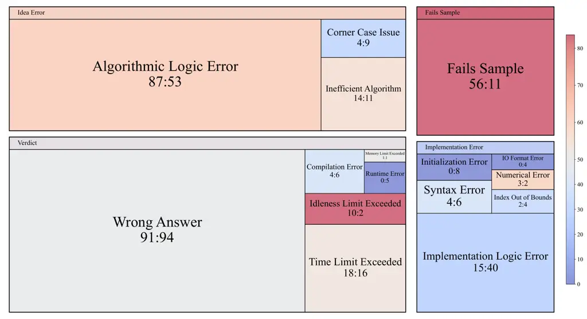

# LiveCodeBench Pro: How Do Olympiad Medalists Judge LLMs in Competitive Programming?

Zihan Zheng ^(1,∗,§)    Zerui Cheng ^(2,∗)    Zeyu Shen ^(2,∗)    Shang
Zhou ^(3,∗)    Kaiyuan Liu ^(4,∗)    Hansen He ^(5,∗)     
Dongruixuan Li ⁶    Stanley Wei ²    Hangyi Hao ⁷    Jianzhu Yao ²   
Peiyao Sheng ⁸    Zixuan Wang ²     
Wenhao Chai ^(2,†,§)    Aleksandra Korolova ^(2,†)    Peter
Henderson ^(2,†)    Sanjeev Arora ^(2,†)    Pramod Viswanath ^(2,8,†)   
Jingbo Shang ^(3,†,‡)    Saining Xie ^(1,†,‡)  
¹ New York University  
² Princeton University  
³ University of California San Diego  
⁴ University of Washington  
⁵ Canyon Crest Academy  
⁶ University of Waterloo  
⁷ McGill University  
⁸ Sentient Foundation  
Link: [Leaderboard](https://www.livecodebenchpro.com)  \|  [Evaluation
Code](https://github.com/GavinZhengOI/LiveCodeBench-Pro)  \|  [Problem
Set](https://huggingface.co/datasets/QAQAQAQAQ/LiveCodeBench-Pro)

###### Abstract

Abstract. Recent reports claim that large language models (LLMs) now
outperform elite humans in competitive programming. Drawing on knowledge
from a group of medalists in international algorithmic contests, we
revisit this claim, examining how LLMs differ from human experts and
where limitations still remain. We introduce LiveCodeBench Pro, a
benchmark composed of problems from Codeforces, ICPC, and IOI that are
continuously updated to reduce the likelihood of data contamination. A
team of Olympiad medalists annotates every problem for algorithmic
categories and conducts a line-by-line analysis of failed
model-generated submissions. Using this new data and benchmark, we find
that frontier models still have significant limitations: without
external tools, the best model achieves only 53% pass@1 on
medium-difficulty problems and 0% on hard problems, domains where expert
humans still excel. We also find that LLMs succeed at
implementation-heavy problems but struggle with nuanced algorithmic
reasoning and complex case analysis, often generating confidently
incorrect justifications. High performance appears largely driven by
implementation precision and tool augmentation, not superior reasoning.
LiveCodeBench Pro thus highlights the significant gap to human
grandmaster levels, while offering fine-grained diagnostics to steer
future improvements in code-centric LLM reasoning.

^(†)^(†) ^(∗) Equal Contributions. ^(§) Project Lead. ^(†) Advisors.
^(‡) Equal Advising.

Figure 1: LiveCodeBench Pro leaderboard. Elo rating versus average cost
per problem for various models. The gray region zooms in on the cluster
of non-reasoning models.

## 1 Introduction

Large Language Models (LLMs) have demonstrated extraordinary advances in
code generation and problem-solving. Modern models can now easily solve
textbook-style puzzles \[14\] and achieve near-perfect accuracy on
HumanEval \[15\], and strong performance on more recent evaluations such
as SWE-Bench \[36\] and LiveCodeBench \[35\]. For instance, Claude 3.5
Sonnet achieves 92% pass@1 on HumanEval \[11\]. Recent releases touted
as reasoning breakthroughs, such as DeepSeek R1 \[31\] and OpenAI
o3 \[34\], have pushed performance towards the upper limits of these
benchmarks. To gauge what headroom remains, researchers increasingly
adopt competitive programming \[35, 49, 51, 16, 29, 33, 53, 32\] as a
benchmark – its mathematically rigorous problems and fully automated,
pass‑fail grading on exhaustive hidden test suites eliminate subjective
judgment and demand end‑to‑end mastery of problem formalization,
algorithm design, and bug‑free implementation. When augmented with
external tools like terminal access and search engines, models such as
o3 and o4-mini-high can reportedly attain Elo ratings above 2,700 \[48\]
on Codeforces \[41\], the premier competitive‑programming platform with
high‑quality problems and frequent contests, placing it in the top 0.1%
of participants.

Yet, these simple quantitative evaluations do not fully capture what it
means to solve complex algorithmic problems. Are LLMs truly capable of
reasoning at the level of elite human competitors? Do current benchmarks
accurately reflect the conceptual difficulty of problems, or are they
skewed toward implementation skill? And how much of the performance is
driven by reasoning, as opposed to tool use? Our work revisits these
questions.

Existing evaluations \[19, 14, 54, 37, 38, 28, 39, 56\] fall short of
answering these questions. Benchmarks like LiveCodeBench \[35\] offer
coding problems, but suffer from inconsistent environments, weak test
cases vulnerable to false positives, unbalanced difficulty
distributions, and the inability to isolate the effects of search
contamination. SWE-Bench \[36\], though valuable for assessing software
engineering scenarios, focuses more on code maintenance than algorithm
design. CodeELO \[49\] introduces a competitive programming-focused
framework using Codeforces problems, but still relies on static
archives, making it difficult to disentangle genuine reasoning from
memorization, especially for models with recent cutoffs or retrieval
capabilities. Moreover, its analysis is largely limited to noisy
user-generated tags \[52\], which obscure the nuanced challenges of
algorithmic reasoning.

To address these limitations, we introduce LiveCodeBench Pro, a
challenging, daily-updated competitive programming benchmark. It
contains 584 high-quality problems before April 25, 2025, drawn from
top-tier contests including Codeforces \[41\], ICPC series \[3\], and
IOI series \[4\]. In contrast to LiveCodeBench, we omit LeetCode
problems, which are easier and especially prone to training-data
contamination, ensuring that our set remains both more challenging and
cleaner. We capture problems as soon as they appear in live contests,
reducing data-contamination risk. Our team of competition coding experts
and Olympiad medalists annotate every problem with key skills required
for each task (e.g., knowledge of combinatorics or dynamic programming),
as well as whether they are knowledge-heavy, observation-heavy, or
logic-heavy problems, where the detailed definition of the
cognitive-focus taxonomy is elaborated in Section 2. This yields
metadata for analyzing trends in model performance, and laying the
groundwork for targeted research into model failures.

|                                   |      |        |       |        |       |        |          |
| --------------------------------- | ---- | ------ | ----- | ------ | ----- | ------ | -------- |
| Model                             | Hard | Medium | Easy  | Rating | Pct.% | AvgTok | AvgCost  |
| _Reasoning Models_                |      |        |       |        |       |        |          |
| o4-mini-high                      | 0.0% | 53.5%  | 83.1% | 2 116  | 1.5%  | 23 819 | \$0.1048 |
| Gemini 2.5 Pro                    | 0.0% | 25.4%  | 70.4% | 1 992  | 2.3%  | 29 879 | \$0.2988 |
| o3-mini                           | 0.0% | 16.9%  | 77.5% | 1 777  | 4.9%  | 18 230 | \$0.0802 |
| DeepSeek R1                       | 0.0% | 9.9%   | 56.3% | 1 442  | 18.0% | 16 716 | \$0.0366 |
| Gemini 2.5 Flash                  | 0.0% | 12.7%  | 47.9% | 1 334  | 30.3% | 35 085 | \$0.0116 |
| DeepSeek R1 Distill-Llama-70B     | 0.0% | 2.8%   | 33.8% | 999    | 56.0% | 12 425 | \$0.0050 |
| Claude 3.7 Sonnet (Max Reasoning) | 0.0% | 1.4%   | 36.6% | 992    | 56.5% | 19 075 | \$0.2861 |
| Gemini 2.0 Flash Reasoning        | 0.0% | 0.0%   | 29.6% | 893    | 63.1% | 11 143 | \$0.0390 |
| _Non-Reasoning Models_            |      |        |       |        |       |        |          |
| GPT-4.1 mini                      | 0.0% | 5.6%   | 28.2% | 1 006  | 55.5% | 2 662  | \$0.0043 |
| DeepSeek V3 0324                  | 0.0% | 5.6%   | 32.4% | 984    | 57.1% | 2 712  | \$0.0030 |
| GPT-4.1                           | 0.0% | 0.0%   | 23.9% | 889    | 64.2% | 2 131  | \$0.0170 |
| GPT-4.5                           | 0.0% | 0.0%   | 26.8% | 881    | 64.8% | 968    | \$0.1452 |
| Qwen-Max                          | 0.0% | 0.0%   | 14.1% | 821    | 69.4% | 1 244  | \$0.0080 |
| Claude 3.7 Sonnet (No Reasoning)  | 0.0% | 1.4%   | 16.9% | 804    | 70.7% | 3 554  | \$0.0533 |
| Llama 4 Maverick                  | 0.0% | 0.0%   | 15.5% | 634    | 80.4% | 1 160  | \$0.0007 |
| Claude 3.5 Sonnet                 | 0.0% | 0.0%   | 14.1% | 617    | 81.4% | 810    | \$0.0122 |
| Gemma 3 27B                       | 0.0% | 0.0%   | 8.5%  | 601    | 82.5% | 668    | \$0.0001 |
| GPT-4o                            | 0.0% | 0.0%   | 9.9%  | 592    | 83.1% | 1 133  | \$0.0227 |
| Meta Llama 3.1 405B Instruct      | 0.0% | 0.0%   | 9.9%  | 574    | 84.3% | 568    | \$0.0005 |
| DeepSeek V3                       | 0.0% | 0.0%   | 12.7% | 557    | 84.9% | 1 020  | \$0.0011 |

Table 1: Pass@1 and Elo rating performance on LiveCodeBench Pro. Each
model’s Elo-based _Rating_ is computed from head-to-head comparisons
with human participants, while the _Pct.%_ column shows the model’s
percentile among all human contestants. _AvgTok_ is the average number
of tokens generated per problem and _AvgCost_ is the approximate \$-cost
per problem. We also test o4-mini, although its release date was later
than the benchmark curation. Additional details are in Section 6.

|                       |                |                 |             |            |                   |
| --------------------- | -------------- | --------------- | ----------- | ---------- | ----------------- |
| Category              | Tag            | Cognitive Focus | \# Problems | % Problems | Difficulty (Elo)  |
| Mathematics           | Number Theory  | Logic           | 77          | 13%        | $`1\,884\pm 825`$ |
|                       | Combinatorics  | Logic           | 62          | 11%        | $`2\,423\pm 666`$ |
|                       | Game Theory    | Observation     | 27          | 5%         | $`1\,900\pm 827`$ |
|                       | Others         | Logic           | 118         | 20%        | $`1\,608\pm 775`$ |
| Greedy                | —              | Observation     | 163         | 28%        | $`1\,708\pm 791`$ |
| Data Structures       | Segment Tree   | Knowledge       | 38          | 7%         | $`2\,629\pm 502`$ |
|                       | Others         | Knowledge       | 101         | 17%        | $`2\,108\pm 689`$ |
| Dynamic Programming   | —              | Logic           | 134         | 23%        | $`2\,431\pm 614`$ |
| Graph Theory          | Tree           | Knowledge       | 53          | 9%         | $`2\,308\pm 528`$ |
|                       | Others         | Knowledge       | 42          | 7%         | $`2\,331\pm 680`$ |
| String                | —              | Logic           | 44          | 8%         | $`1\,595\pm 867`$ |
| Algorithmic Paradigms | Constructive   | Observation     | 120         | 21%        | $`1\,849\pm 894`$ |
|                       | Implementation | Knowledge       | 108         | 18%        | $`2\,057\pm 837`$ |
|                       | Ad-hoc         | Observation     | 103         | 18%        | $`1\,578\pm 814`$ |
|                       | Case Work      | Observation     | 89          | 15%        | $`1\,713\pm 830`$ |
|                       | Binary Search  | Observation     | 80          | 14%        | $`2\,021\pm 652`$ |
|                       | Bitmasking     | Logic           | 46          | 8%         | $`2\,174\pm 679`$ |
|                       | Two Pointers   | Knowledge       | 22          | 4%         | $`1\,777\pm 528`$ |
|                       | Interactive    | Observation     | 21          | 4%         | $`2\,152\pm 643`$ |
| Total                 |                |                 | 584         | 100%       | $`1\,827\pm 822`$ |

Table 2: LiveCodeBench Pro Statistics for annotated tags with
corresponding cognitive‑focus taxonomy. Breakdown by competitive
programming topic, showing problem counts, percentages, and average
Codeforces difficulty ratings (Elo ± std. dev.).

We evaluate a suite of frontier models on LiveCodeBench Pro, including
models such as Gemini 2.5 Pro, o4-mini-high, and DeepSeek R1. For each,
we compute Elo-equivalent ratings for LLMs across our expert-annotated
skill tags. Then we leverage our team of experts to conduct an analysis
of specific model behaviors. We conduct a line-by-line comparison of 125
failed submissions each from o3-mini and human participants of similar
rating to diagnose failure modes. We also compare reasoning models with
their non-reasoning counterparts and identify unusual patterns in
o3-mini-high’s handling of interactive problems. Finally, we analyze the
impact of tool usage (e.g., web search, terminal access) for
o4-mini-high. We find that:

\(1\) Current models excel in more structured and knowledge-heavy
problems that require more logical derivation than deduction, but they
perform significantly worse on observation-heavy problems demanding
observation and creativity. Only problems on combinatorics, segment
tree, and dynamic programming see o4-mini-high perform above a
grandmaster level.

\(2\) Compared to human experts, conceptual errors dominate model
failures, whereas implementation is a relative strength. LLMs frequently
fail even on provided sample inputs, suggesting incomplete utilization
of given information and indicating room for improvement even in simple
settings.

\(3\) Reasoning models show large performance improvements over their
non-reasoning counterparts in combinatorics and knowledge-heavy
problems, while gains are limited for observation-heavy ones.

\(4\) Although multiple attempts (pass@k) substantially improve overall
performance, models still struggle to solve problems in the hard tier.

LiveCodeBench Pro is designed to be live and continuously updated,
providing an ongoing, up-to-date challenge for future models. Our work
shows the importance of granular expert-level analyses, showing where
models still underperform humans, even as aggregate scores paint a
different picture.

## 2 Benchmark Curation

#### Benchmark curation pipeline.

Our 584‑problem corpus is assembled in real time as contests unfold,
capturing each problem before any accepted solutions, editorials, or
discussion threads appear online. Doing so eliminates data leakage
pathways that have plagued earlier coding benchmarks. Every candidate
problem must (i) originate from a premier competition like Codeforces,
ICPC, IOI; (ii) pass the host’s multi‑layer vetting, which typically
involves a coordinator plus two or more expert testers who stress‑test
the judge data until no known buggy or inefficient implementation
survives; and (iii) expose its full, immutable test set at contest end
so that subsequent model runs are evaluated under the same rules as
humans. This pipeline is detailed in Appendix 7.

#### Difficulty tiers.

To streamline navigation, we adopt a Codeforces‑style rating heuristic
for difficulty labels. The Elo difficulty of a problem means that a
contestant of the corresponding rating can solve the problem with a
$`50\%`$ probability. Problems with an official Elo rating $`\leq 2000`$
are flagged Easy: a world‑class contestant can typically solve them in
about 15 minutes using standard textbook techniques and observations.
The Medium tier, $`(2000,3000]`$, contains problems that demand the
fusion of two or more established algorithms together with non‑trivial
mathematical reasoning and observations. Anything rated $`>3000`$ is
deemed Hard. These challenges usually hinge on an extremely involved,
non‑obvious derivation or deductive leap that requires both a masterful
grasp of algorithmic theory and deep mathematical intuition; they elude
more than 99.9% of participants and sometimes remain unsolved even by
the strongest competitors during live contests.

#### Tags and cognitive-focus taxonomy.

We list the definition of each tag shown in Table 2 along with the
example problems in Section 15. In addition to these detailed tags, we
group the problems into three overarching categories based on their
cognitive focus, as described below. Coupling the tutorial‑grade
difficulty tiers with cognitive‑focus tags turns the benchmark from a
mere scoreboard into a diagnostic instrument. In practice, a problem may
straddle categories; annotators therefore assign primary and secondary
labels, reaching consensus through a triple‑blind adjudication process
described in Section 7.2. Through these, we can isolate whether an LLM’s
weakness stems from shallow algorithmic insight or brittle code
generation.

- •
  Knowledge‑heavy. If a contestant comes equipped with ready-to-use
  templates, often very long and structured code snippets, or knows a
  deep mathematical result that’s virtually impossible to re-derive
  during the contest, the apparent difficulty of a problem drops
  sharply. In these cases, the real test is breadth of knowledge and
  implementation, not discovery. With a solid command of the underlying
  techniques, the core idea usually jumps out from the statement or
  samples, and the primary challenge then becomes writing a correct,
  bug-free, and highly optimized implementation.

  

  Example: AtCoder Beginner Contest 196 F. Substring 2 is a direct
  application of Fast Fourier Transform (FFT). The key insight is to
  rephrase “count mismatches” as a convolution where
  $`\sum_{j=1}^{m}\mathbf{1}[\,S_{i+j}\neq T_{j}]=\sum_{j=1}^{m}S_{i+j}\oplus T_{j}=\sum_{j=1}^{m}S_{i+j}(1-T_{j})+\sum_{j=1}^{m}(1-S_{i+j})T_{j}`$.
  Each of the two sums is just a convolution of two binary sequences
  (one derived from $`S`$, one from the reversed $`T`$). By reversing
  $`T`$ and computing these convolutions with FFT, we get every
  mismatch‐count in one pass in $`O\bigl((n+m)\log(n+m)\bigr)`$ instead
  of $`O(nm)`$ brute-force. Solving this task relies heavily on an
  in-depth understanding of convolution and the FFT.

- •
  Logic‑heavy. When a contestant combines strong mathematical reasoning
  with systematic, step-by-step derivations, the apparent difficulty of
  a problem collapses. Success here depends on meticulous logical work,
  often in combinatorics or generating-function algebra, rather than a
  flash of insight. The solver must translate symbolic manipulations
  into an efficient algorithmic recipe (for instance, deriving a
  closed-form recurrence).

  

  Example: Codeforces 626F. Group Projects requires carefully deriving
  and optimizing the state design and transition of dynamic programming
  (DP). After sorting $`a`$, a 3D state design is clear where
  $`\mathrm{dp}[i][j][k]`$ denotes the number of ways to place the first
  $`i`$ elements into $`j`$ open groups with total imbalance $`k`$. Upon
  adding $`a_{i+1}`$, there are two choices: start a new group, which
  increments $`j`$ by 1 and subtracts $`a_{i+1}`$ from the imbalance
  $`k`$; or join one of the $`j`$ open groups where $`j,k`$ remain
  unchanged. We also need to further distinguish whether $`a_{i+1}`$
  becomes the allocated group’s maximum: if it does, we close the group,
  decrementing $`j`$ by 1 and adding $`a_{i+1}`$ back into $`k`$; if it
  doesn’t, then neither $`j`$ nor $`k`$ changes. The naive
  implementation lets $`k`$ range from $`-\sum a_{t}`$ to $`\sum a_{t}`$
  and runs in $`O(n^{2}\sum a_{t})`$, which doesn’t fit into the time
  limit. For optimization, the key insight is
  $`a_{R}-a_{L}=\sum_{i=L}^{R-1}(a_{i+1}-a_{i})`$ where every gap
  $`a_{t+1}-a_{t}\geq 0`$, allowing the total imbalance $`k`$ to stay in
  range $`[0,t]`$, bounding the imbalance dimension by $`t`$ and
  yielding an $`O(n^{2}t)`$ algorithm. Though every step is relatively
  intuitive, solving this task requires a rigorous step-by-step chain of
  thought that demands inventing the right state, carefully tracking
  updates, and spotting a subtle non-negativity bound for optimization,
  making this task logic-heavy.

- •
  Observation‑heavy. When a contestant instantly spots a concise
  insight, typically an “aha” moment straight from the problem
  statement, the apparent difficulty evaporates.

  That single observation dramatically collapses the search space: Once
  the insight is in hand, the implementation is brief and template-free.
  This style of problem rewards creativity, mathematical intuition, and
  deductive leaps rather than long, step-by-step derivations.

  

  Example: Codeforces 1704F. Colouring Game requires deducing each
  player’s optimal move, writing a brute-forcing calculation of
  Sprague-Grundy value on small $`n`$, and observing a subtle pattern in
  the value table. From the deduction on each player’s optimal move, the
  player with more cells of its color always wins, and in the case of an
  equal number of red and blue cells, the only thing that matters is the
  length of the alternating $`RB`$ or $`BR`$ substrings. To solve for
  each substring, we can use Sprague-Grundy theorem \[30\] to compute
  the SG value of each configuration in $`O(n^{2})`$ time where
  $`SG(n)=\text{mex}_{i=0}^{n-2}SG(i)\oplus SG(n-2-i)`$. Then, from the
  value table, a cyclic section of size $`34`$ can be found where
  $`SG(n)=SG(n-34)`$ for $`n\geq 100`$, reducing large $`n`$ to small
  $`\hat{n}\leq 100`$, allowing a brute-forcing $`O(\hat{n}^{2})`$
  implementation to pass. Yet, once that insight is uncovered, the
  entire solution can be coded up within twenty lines.

## 3 Analysis and Discussions

### 3.1 Performance on Different Algorithmic Paradigms

Finding 1. LLMs perform better on knowledge-heavy and logic-heavy
problems, and worse on observation-heavy problems or case work.

Figure 2: Tag-wise model performance. The $`x`$-axis represents
different problem types, ranging from knowledge-heavy problems in blue
(e.g., segment tree, implementation, data structures) to logic-heavy in
red (e.g., combinatorics, dynamic programming, mathematics) to
observation-heavy problems in green (e.g., greedy, interactive, game
theory). The $`y`$-axis corresponds to Codeforces-equivalent Elo
ratings, with human percentile benchmarks labeled (e.g., Master). Models
tend to excel on knowledge-heavy and logic-heavy problems but struggle
on observation-heavy ones.

We present the performance, in terms of ratings computed with the
Bayesian approach in Appendix 7.2, of 6 models in coding in each problem
category based on our annotations. We found that humans exhibit more
consistent performance across different problem tags, while models show
greater variance in their ratings depending on the tag. We summarize our
key findings as:

Knowledge-heavy problems are comfort zones for LLMs. Problems with tags
such as segment tree, graph theory, tree, and data structures exhibit
high performance in most models. These problems are often solvable by
stitching together well-known templates (e.g., Fenwick tree, Dijkstra,
Euler tour), a setting in which LLMs excel because the requisite
patterns appear verbatim in the training data, and generating
syntactically correct templates is much easier for LLMs than for humans.

Logic-heavy problems yield similarly good results. LLMs also perform
well on logic-heavy categories such as combinatorics, mathematics,
dynamic programming, and binary search, which require a more patterned
way of thinking (e.g., applying combinatorial identities for
combinatorics, constructing a state space and deriving transition
functions for dynamic programming) and can benefit from memorized
scaffolds of code.

Bad performance on observation-heavy problems. For game theory, ad-hoc,
greedy, and constructive problems, ratings of most models collapse to
below 1500, which is significantly below knowledge-heavy and logic-heavy
categories. Solving these problems usually hinges on the discovery of
novel insights, something that cannot be retrieved from memorized
snippets alone.

LLMs struggle with case work. Interestingly, all models struggle with
case work. Every model except o4‑mini-high stays below the 1500‑rating
mark, and even o4‑mini-high performs significantly worse compared with
other problem categories. Manual inspection reveals that the inability
to identify and deal with edge cases is a prominent failure mode of all
models.

Interactive problems expose a pronounced weakness. o4-mini-high sees its
rating collapse to around 1500 on interactive problems, and other models
struggle as well. We provide discussions on possible reasons behind such
bad performance and identify unusual behaviors of o3-mini-high when
solving interactive problems in Appendix 12.

### 3.2 Diagnosis of Failure Reasons and Comparison with Humans



Figure 3: Failure reasons in treemap. Comparing rejected submissions
between o3-mini and humans. Each block represents a specific rejection
tag; its size is proportional to the total count of rejections for that
tag, with the inscribed text showing the o3-mini:human ratio. The color
of the block indicates the contribution rate of o3-mini to that tag’s
rejections: red signifies a higher proportion from o3-mini, while blue
indicates a higher proportion from humans.

Finding 2. o3-mini makes significantly more algorithm logic errors and
wrong observations, and much fewer implementation logic errors than
humans.

In this section, we specifically use o3-mini, which is the model with
the best readability, for annotation and in-depth analysis. We present
the results in the treemap in Figure 3.

Conceptual errors dominate the model’s failures. The largest red tile
inside the “Idea Error” branch shows that o3‑mini commits 34 more
algorithm logic errors than human contestants among the 125 annotated
problems. These are genuine conceptual slips, instead of surface bugs.

Implementation is the model’s strong suit. Metrics related to low-level
coding generally favor o3-mini. For instance, o3-mini commits 25 fewer
implementation logic errors than humans among the 125 annotated
problems. Notably, all observed initialization errors and I/O format
errors were found in human submissions. The verdict‑level breakdown also
corroborates this: o3-mini almost makes no “Runtime Error.” underscoring
its comparative immunity to implementation mistakes.

A notable outlier - Idleness Limit Exceeded. One deep‑red rectangle
under “Verdict” shows a spike in “Idleness Limit Exceeded” verdicts.
This stems from the peculiar behavior of o3‑mini on interactive
problems, most of which are judged as “Idleness Limit Exceeded.” More in
Appendix 12.

Failures on sample inputs. The treemap highlights a substantial surplus
of 45 instances for o3-mini in the “Fails Sample” category, where
solutions compile but already fail on the problem’s example inputs.
Unlike humans, o3-mini cannot compile locally or run sample inputs
before submission. Models with terminals and tool calls (e.g., o3 and
o4-mini-high) are expected to make far fewer of these easy-to-catch
mistakes^(†)^(†) Note that all of our evaluations are run through the
OpenAI API, where o4-mini-high lacks tool call and terminal access.
However, its web version does expose these features; we analyze their
impact in Appendix 11..

Taken together, our analysis suggests that LLMs’ code is generally more
syntactically reliable, but struggles with the higher-level reasoning
needed to craft correct algorithms or extract the right observations
from a problem. Although our formal annotations cover only o3-mini’s
submissions, preliminary manual checks suggest that the same error
pattern is shared by most existing LLMs.

### 3.3 Impact of Multiple Attempts (Pass@k) on Model Performance

Finding 3. Increasing the number of attempts (pass@k) significantly
improves the performance of the models while still failing in the hard
tier.

Figure 4: o4-mini performance under pass@k settings. The plot shows the
pass rates for Easy and Medium tier problems, and the corresponding Elo
rating changes as the number of attempts ($`k`$) increases. All variants
show 0% pass rate on the hard tier in the evaluation.

OpenAI’s reported Codeforces Elo rating of 2719 for o4-mini with
terminal access and pass@k \[48\] contrasts with our evaluation of
o4-mini-high, which achieved a rating of 2116 (without terminal access
and pass@1). This discrepancy motivates an investigation into the
performance impact of terminal access and tool calls versus the effect
of allowing multiple attempts (pass@k)^(†)^(†) Due to instability from
excessively long reasoning chains (up to 100K tokens) and prohibitive
costs (~\$200/pass), we limited o4-mini-high evaluation to pass@3..

As illustrated in Figure 4, the models demonstrate a substantial
improvement in ratings as $`k`$ increases. For example, the
o4-mini-medium’s rating rises from 1793 at pass@1 and converges to 2334
as $`k`$ increases to 10. Similar upward trends are observed for
o4-mini-low and o4-mini-high. While these gains from multiple attempts
are significant, the converged rating still falls approximately 400
points short of the reported 2719. We, therefore, conjecture that the
remaining difference is largely attributable to the benefits of tool
calls and terminal access. More details are in Appendix 11.

As shown in Figure 5, we observe that among the five categories with the
greatest improvement, three—Game Theory, Greedy, and Case Work—are
observation-heavy problems and can often be solved by hypothesizing
conclusions. A higher frequency of making educated guesses substantially
increases the probability of solving these problems correctly.

Figure 5: Performance improvement with pass@k setting across tags. The
Elo ratings for pass@1 and pass@10 across different problem categories
show significant performance improvements. The evaluated model is
o4-mini-medium. Error bars representing the 95% confidence intervals.

### 3.4 Comparison Between Reasoning Models and Their Non-reasoning Counterparts

Finding 4. Reasoning brings about the largest improvement in
combinatorics, a large improvement in knowledge-heavy categories, and
relatively low improvement in observation-heavy ones.

In this section, we examine the impact of enabling reasoning in LLMs on
each problem tag. In particular, we directly compare reasoning models
and their non-reasoning counterparts, so that we can control for
variations in model architecture, training data, and other external
factors, and isolate the effect of reasoning. This isolation is crucial
to demonstrate the true impact of additional chain-of-thought or
test-time scaling methods on models’ problem-solving capabilities in
each problem tag. In particular, we choose to compare DeepSeek V3 versus
R1 and Claude 3.7 Sonnet Nonthinking versus Thinking, which are two
major frontier models with a non-reasoning version and a reasoning
counterpart as shown in Figure 6.

Figure 6: Tag-wise Elo rating advantage of reasoning models. Error bars
represent the 95% confidence intervals for the Elo rating differences.
The reasoning models outperform across nearly all tags, though the
magnitude of their advantage varies significantly.

Our key findings are summarized as:

Largest improvement in combinatorics. Both models show the largest
improvement in combinatorics, with DeepSeek R1 exhibiting nearly a
1400-point rating gain over V3.

Large improvement in knowledge-heavy categories. For knowledge-heavy
problems such as data structure and segment tree, enabling reasoning
also results in large improvement (e.g., boosting around 700 points for
DeepSeek on segment tree and 500 points for Claude on data structures).
This is expected since problems in these categories often involve
structured thinking.

Limited improvement in observation-heavy categories. Intriguingly, for
game theory, greedy, ad-hoc and constructive problems, which usually
require significant amounts of observations and LLMs often struggle with
(as shown in Section 3.1), even reasoning brings minimal improvement
(e.g., the improvement in game theory is almost the lowest for DeepSeek
and negative for Claude). This raises the question of whether current
chain-of-thought methods are inherently limited for these types of
problems, or if there is an emergent threshold, that is, a point at
which further advancements in reasoning capabilities might eventually
unlock substantial performance gains in these areas.

## 4 Conclusions and Future Work

In this work, we introduce LiveCodeBench Pro, a rigorously curated and
contamination-free benchmark designed to evaluate the true algorithmic
reasoning capabilities of LLMs in competitive programming. With expert
annotation and fine-grained comparison with human competitors, our study
reveals that current LLMs demonstrate proficiency in
implementation-oriented problems; they exhibit stark limitations in
complex algorithmic reasoning, nuanced problem-solving, and handling
edge cases, failing entirely on the benchmark’s hardest problems.
Despite claims of surpassing elite humans, a significant gap still
remains, particularly in areas demanding novel insights. In future work,
we plan to build a more automated and controllable submission and
analysis pipeline.

## Acknowledgments

We would like to extend our sincere gratitude to the open-source
community whose collective efforts have made this project possible. Our
special thanks go to Chuanjie Luo, Chengrui Han, and Chenran Yang, whose
direct contributions through open-source initiatives have significantly
enriched this work. We are also deeply appreciative of the competitive
programming communities, particularly Codeforces and QOJ, for their
resources and insightful discussions. We also thank Zihan Zheng
_(API-credit sponsor)_ for generously sponsoring the API credits used in
this research.

## References

- \[1\] HumanEval: Hand-Written Evaluation Set. URL
  [https://github.com/openai/human-eval](https://github.com/openai/human-eval).
- \[2\] ICPC Foundation, a. URL
  [https://icpc.foundation/](https://icpc.foundation/).
- \[3\] The ICPC International Collegiate Programming Contest, b. URL
  [https://icpc.global/](https://icpc.global/).
- \[4\] International Olympiad in Informatics. URL
  [https://ioinformatics.org/](https://ioinformatics.org/).
- \[5\] MIT Informatics Tournament. URL
  [https://mitit.org/About](https://mitit.org/About).
- \[6\] Chinese National Olympiad in Informatics. URL
  [https://noi.cn/](https://noi.cn/).
- \[7\] Tsinghua University Programming Contest. URL
  [https://thusaac.com/public](https://thusaac.com/public).
- \[8\] USA Computing Olympiad. URL
  [https://usaco.org/](https://usaco.org/).
- \[9\] ICPC Fact Sheet, 2025. URL
  [https://icpc.global/worldfinals/fact-sheet/ICPC-Fact-Sheet.pdf](https://icpc.global/worldfinals/fact-sheet/ICPC-Fact-Sheet.pdf).
- \[10\] Anthropic. Model card addendum: Claude 3.5 sonnet.
  [https://www-cdn.anthropic.com/fed9cc193a14b84131812372d8d5857f8f304c52/Model_Card_Claude_3_Addendum.pdf](https://www-cdn.anthropic.com/fed9cc193a14b84131812372d8d5857f8f304c52/Model_Card_Claude_3_Addendum.pdf), 2024.
- \[11\] Anthropic. Claude 3.5 Sonnet, 2024. URL
  [https://www.anthropic.com/news/claude-3-5-sonnet](https://www.anthropic.com/news/claude-3-5-sonnet).
- \[12\] Anthropic. System card: Claude 3.7 sonnet (max reasoning).
  [https://assets.anthropic.com/m/785e231869ea8b3b/original/claude-3-7-sonnet-system-card.pdf](https://assets.anthropic.com/m/785e231869ea8b3b/original/claude-3-7-sonnet-system-card.pdf),
  2025a.
- \[13\] Anthropic. System card: Claude 3.7 sonnet (no reasoning
  variant).
  [https://assets.anthropic.com/m/785e231869ea8b3b/original/claude-3-7-sonnet-system-card.pdf](https://assets.anthropic.com/m/785e231869ea8b3b/original/claude-3-7-sonnet-system-card.pdf),
  2025b.
- \[14\] Jacob Austin, Augustus Odena, Maxwell Nye, Maarten Bosma,
  Henryk Michalewski, David Dohan, Ellen Jiang, Carrie Cai, Michael
  Terry, Quoc Le, et al. Program synthesis with large language models.
  _arXiv preprint arXiv:2108.07732_, 2021.
- \[15\] Mark Chen, Jerry Tworek, Heewoo Jun, Qiming Yuan, Henrique
  Ponde De Oliveira Pinto, Jared Kaplan, Harri Edwards, Yuri Burda,
  Nicholas Joseph, Greg Brockman, et al. Evaluating large language
  models trained on code. _arXiv preprint arXiv:2107.03374_, 2021.
- \[16\] China Collegiate Programming Contest. Official website of the
  china collegiate programming contest (ccpc), 2025. URL
  [https://ccpc.io/](https://ccpc.io/). Accessed: 2025-05-11.
- \[17\] Alibaba Cloud. Model card: Qwen‑max (qwen 2.5 max).
  [https://huggingface.co/Qwen](https://huggingface.co/Qwen), 2025.
- \[18\] Codeforces. Interactive Problems: Guide for Participants, 2015.
  URL
  [https://codeforces.com/blog/entry/45307](https://codeforces.com/blog/entry/45307).
- \[19\] Jianbo Dai, Jianqiao Lu, Yunlong Feng, Dong Huang, Guangtao
  Zeng, Rongju Ruan, Ming Cheng, Haochen Tan, and Zhijiang Guo. Mhpp:
  Exploring the capabilities and limitations of language models beyond
  basic code generation. _arXiv preprint arXiv:2405.11430_, 2024.
- \[20\] Google DeepMind. Model card: Gemini 2.0 flash reasoning.
  [https://blog.google/technology/google-deepmind/gemini-model-updates-february-2025/](https://blog.google/technology/google-deepmind/gemini-model-updates-february-2025/),
  2025a.
- \[21\] Google DeepMind. Model card: Gemini 2.5 flash.
  [https://blog.google/products/gemini/gemini-2-5-flash-preview/](https://blog.google/products/gemini/gemini-2-5-flash-preview/),
  2025b.
- \[22\] Google DeepMind. Model card: Gemini 2.5 pro.
  [https://blog.google/technology/google-deepmind/gemini-model-thinking-updates-march-2025/](https://blog.google/technology/google-deepmind/gemini-model-thinking-updates-march-2025/),
  2025c.
- \[23\] Google DeepMind. Model card: Gemma 3 27b.
  [https://blog.google/technology/developers/gemma-3/](https://blog.google/technology/developers/gemma-3/),
  2025d.
- \[24\] DeepSeek AI. Model card: Deepseek v3.
  [https://huggingface.co/deepseek-ai/DeepSeek-V3](https://huggingface.co/deepseek-ai/DeepSeek-V3), 2024.
- \[25\] DeepSeek AI. Model card: Deepseek r1.
  [https://huggingface.co/deepseek-ai/DeepSeek-R1](https://huggingface.co/deepseek-ai/DeepSeek-R1),
  2025a.
- \[26\] DeepSeek AI. Model card: Deepseek‑r1‑distill‑llama‑70b.
  [https://huggingface.co/deepseek-ai/DeepSeek-R1-Distill-Llama-70B](https://huggingface.co/deepseek-ai/DeepSeek-R1-Distill-Llama-70B),
  2025b.
- \[27\] DeepSeek AI. Model card: Deepseek‑v3‑0324.
  [https://huggingface.co/deepseek-ai/DeepSeek-V3-0324](https://huggingface.co/deepseek-ai/DeepSeek-V3-0324),
  2025c.
- \[28\] Yangruibo Ding, Zijian Wang, Wasi Ahmad, Hantian Ding, Ming
  Tan, Nihal Jain, Murali Krishna Ramanathan, Ramesh Nallapati,
  Parminder Bhatia, Dan Roth, et al. Crosscodeeval: A diverse and
  multilingual benchmark for cross-file code completion. _Advances in
  Neural Information Processing Systems_, 36:46701–46723, 2023.
- \[29\] Adrian Marius Dumitran, Adrian Cǎtǎlin Badea, and
  Stefan-Gabriel Muscalu. Evaluating the performance of large language
  models in competitive programming: A multi-year, multi-grade analysis.
  In _2024 International Conference on INnovations in Intelligent
  SysTems and Applications (INISTA)_, pages 1–7. IEEE, 2024.
- \[30\] Patrick M Grundy. Mathematics and games. _Eureka_, 2:6–8, 1939.
- \[31\] Daya Guo, Dejian Yang, Haowei Zhang, Junxiao Song, Ruoyu Zhang,
  Runxin Xu, Qihao Zhu, Shirong Ma, Peiyi Wang, Xiao Bi, et al.
  Deepseek-r1: Incentivizing reasoning capability in llms via
  reinforcement learning. _arXiv preprint arXiv:2501.12948_, 2025.
- \[32\] Md Sifat Hossain, Anika Tabassum, Md Fahim Arefin, and
  Tarannum Shaila Zaman. Llm-pros: Analyzing large language models’
  performance in competitive problem solving. _arXiv preprint
  arXiv:2502.04355_, 2025.
- \[33\] Yiming Huang, Zhenghao Lin, Xiao Liu, Yeyun Gong, Shuai Lu,
  Fangyu Lei, Yaobo Liang, Yelong Shen, Chen Lin, Nan Duan, et al.
  Competition-level problems are effective llm evaluators. _arXiv
  preprint arXiv:2312.02143_, 2023.
- \[34\] Aaron Jaech, Adam Kalai, Adam Lerer, Adam Richardson, Ahmed
  El-Kishky, Aiden Low, Alec Helyar, Aleksander Madry, Alex Beutel, Alex
  Carney, et al. Openai o1 system card. _arXiv preprint
  arXiv:2412.16720_, 2024.
- \[35\] Naman Jain, King Han, Alex Gu, Wen-Ding Li, Fanjia Yan, Tianjun
  Zhang, Sida Wang, Armando Solar-Lezama, Koushik Sen, and Ion Stoica.
  Livecodebench: Holistic and contamination free evaluation of large
  language models for code. _arXiv preprint arXiv:2403.07974_, 2024.
- \[36\] Carlos E Jimenez, John Yang, Alexander Wettig, Shunyu Yao,
  Kexin Pei, Ofir Press, and Karthik R Narasimhan. Swe-bench: Can
  language models resolve real-world github issues? In _The Twelfth
  International Conference on Learning Representations_, 2024.
- \[37\] Yujia Li, David Choi, Junyoung Chung, Nate Kushman, Julian
  Schrittwieser, Rémi Leblond, Tom Eccles, James Keeling, Felix Gimeno,
  Agustin Dal Lago, et al. Competition-level code generation with
  alphacode. _Science_, 378(6624):1092–1097, 2022.
- \[38\] Jiawei Liu, Chunqiu Steven Xia, Yuyao Wang, and Lingming Zhang.
  Is your code generated by chatgpt really correct? rigorous evaluation
  of large language models for code generation. _Advances in Neural
  Information Processing Systems_, 36:21558–21572, 2023a.
- \[39\] Tianyang Liu, Canwen Xu, and Julian McAuley. Repobench:
  Benchmarking repository-level code auto-completion systems. _arXiv
  preprint arXiv:2306.03091_, 2023b.
- \[40\] Meta AI. Model card: Meta llama 3.1 405b instruct.
  [https://huggingface.co/meta-llama/Llama-3.1-405B-Instruct](https://huggingface.co/meta-llama/Llama-3.1-405B-Instruct), 2024.
- \[41\] Mike Mirzayanov. Codeforces, 2010. URL
  [https://codeforces.com/](https://codeforces.com/).
- \[42\] OpenAI. System card: Gpt‑4o.
  [https://openai.com/index/gpt-4o-system-card/](https://openai.com/index/gpt-4o-system-card/), 2024.
- \[43\] OpenAI. Release note: Gpt‑4.1.
  [https://www.theverge.com/news/647896/openai-chatgpt-gpt-4-1-mini-nano-launch-availability](https://www.theverge.com/news/647896/openai-chatgpt-gpt-4-1-mini-nano-launch-availability),
  2025a.
- \[44\] OpenAI. Release note: Gpt‑4.1 mini.
  [https://www.theverge.com/news/647896/openai-chatgpt-gpt-4-1-mini-nano-launch-availability](https://www.theverge.com/news/647896/openai-chatgpt-gpt-4-1-mini-nano-launch-availability),
  2025b.
- \[45\] OpenAI. System card: Gpt‑4.5.
  [https://openai.com/index/gpt-4-5-system-card/](https://openai.com/index/gpt-4-5-system-card/),
  2025c.
- \[46\] OpenAI. System card: Openai o3‑mini.
  [https://openai.com/index/o3-mini-system-card/](https://openai.com/index/o3-mini-system-card/),
  2025d.
- \[47\] OpenAI. System card: Openai o4‑mini (including the o4‑mini‑high
  variant).
  [https://openai.com/index/o3-o4-mini-system-card/](https://openai.com/index/o3-o4-mini-system-card/),
  2025e.
- \[48\] OpenAI. Introducing openai o3 and o4-mini.
  [https://openai.com/index/introducing-o3-and-o4-mini/](https://openai.com/index/introducing-o3-and-o4-mini/),
  2025f.
- \[49\] Shanghaoran Quan, Jiaxi Yang, Bowen Yu, Bo Zheng, Dayiheng Liu,
  An Yang, Xuancheng Ren, Bofei Gao, Yibo Miao, Yunlong Feng, et al.
  Codeelo: Benchmarking competition-level code generation of llms with
  human-comparable elo ratings. _arXiv preprint arXiv:2501.01257_, 2025.
- \[50\] Unsloth (community release). Model card:
  Llama 4 maverick 17b instruct.
  [https://huggingface.co/unsloth/Llama-4-Maverick-17B-128E-Instruct-GGUF](https://huggingface.co/unsloth/Llama-4-Maverick-17B-128E-Instruct-GGUF), 2025.
- \[51\] Quan Shi, Michael Tang, Karthik Narasimhan, and Shunyu Yao. Can
  language models solve olympiad programming? _arXiv preprint
  arXiv:2404.10952_, 2024.
- \[52\] Maxim Shipko. New features: friends, tags and more, 2011. URL
  [https://codeforces.com/blog/entry/1679](https://codeforces.com/blog/entry/1679).
- \[53\] Jiaxin Wen, Ruiqi Zhong, Pei Ke, Zhihong Shao, Hongning Wang,
  and Minlie Huang. Learning task decomposition to assist humans in
  competitive programming. In _Proceedings of the 62nd Annual Meeting of
  the Association for Computational Linguistics (Volume 1: Long
  Papers)_, pages 11700–11723, 2024.
- \[54\] Yunhui Xia, Wei Shen, Yan Wang, Jason Klein Liu, Huifeng Sun,
  Siyue Wu, Jian Hu, and Xiaolong Xu. Leetcodedataset: A temporal
  dataset for robust evaluation and efficient training of code llms.
  _arXiv preprint arXiv:2504.14655_, 2025.
- \[55\] Shang Zhou, Feng Yao, Chengyu Dong, Zihan Wang, and Jingbo
  Shang. Evaluating the smooth control of attribute intensity in text
  generation with llms. In _Findings of the Association for
  Computational Linguistics: ACL 2024_, pages 4348–4362, 2024.
- \[56\] Terry Yue Zhuo, Minh Chien Vu, Jenny Chim, Han Hu, Wenhao Yu,
  Ratnadira Widyasari, Imam Nur Bani Yusuf, Haolan Zhan, Junda He,
  Indraneil Paul, et al. Bigcodebench: Benchmarking code generation with
  diverse function calls and complex instructions. _arXiv preprint
  arXiv:2406.15877_, 2024.

\beginsupplement

Appendix

The appendix is structured as follows:

- •
  Literature review about the related works in Section 5.
- •
  Full model list in Section 6.
- •
  Benchmark curation details in Section 7.
- •
  Detailed evaluation setup in Section 8.
- •
  Performance on different divisions of contest in Section 10.
- •
  Analysis of tool use in Section 11.
- •
  Peculiar behaviors of o3-mini-high when solving interactive problems
  in Section 12.
- •
  LiveCodeBench Pro limitations in Section 13.
- •
  Broader impact in Section 14.
- •
  Problem examples per tag in Section 15.
- •
  Case studies on different models comparison in Section 16.

## 5 Additional Related Works

Evaluating the capabilities of Large Language Models (LLMs) in
programming has been a rapidly evolving area of research. Early efforts
focused on foundational coding abilities. HumanEval \[1\] established a
standard for assessing functional correctness on relatively simple,
standalone programming puzzles, often drawn from introductory contexts.
While influential, benchmarks like HumanEval typically feature a low
reasoning difficulty ceiling and have become increasingly susceptible to
data contamination as models train on vast web scrapes. Similarly,
SWE-Bench \[36\] aimed for greater realism by focusing on resolving
actual issues from GitHub repositories, testing practical software
engineering skills. However, it also primarily targets problems with a
relatively low algorithmic complexity ceiling and faces potential
contamination issues.

Recognizing the limitations of general coding benchmarks for assessing
deeper algorithmic reasoning, researchers developed evaluations centered
on competitive programming problems. USACOBench \[8\], derived from the
USA Computing Olympiad, presented problems with moderate difficulty and
higher-quality unit tests compared to earlier benchmarks. While it
offered partial human comparisons, it still suffered from potential data
contamination. More recently, CodeELO \[49\] significantly raised the
difficulty level, sourcing problems from platforms like Codeforces and
introducing Elo ratings for direct human comparability. CodeELO marked a
step forward in evaluating high-level skills, but its reliance on
potentially noisy, crowd-sourced tags and lack of robust contamination
controls limited the granularity of its insights and its immunity to
models leveraging existing online solutions. Furthermore, its
topic-level analysis relies on pass/fail rates (accuracy) rather than
difficulty-adjusted ratings, which, as discussed in Section 7.2, can
offer limited or potentially misleading insights into model capabilities
across different algorithmic areas. LiveCodeBench \[35\] attempted to
address contamination by using problems released after model knowledge
cutoffs. However, its definition of “live” did not preclude models with
tool access from finding solutions or hints online during inference, its
problem sources were somewhat limited, and it lacked deep, expert-driven
analysis. Notably, LiveCodeBench includes a significant number of
problems from sources like LeetCode, which often test implementation
speed or knowledge of standard library functions rather than deep
algorithmic insight; models might achieve high scores on these problems,
potentially inflating overall performance metrics without demonstrating
strong reasoning. Additionally, like CodeELO’s topic analysis, its
primary reliance on accuracy metrics fails to account for problem
difficulty, limiting the validity of comparisons and insights. Our work
builds upon these efforts while seeking to overcome their limitations,
aiming for the “ultimate” benchmark for evaluating LLMs.

## 6 Model List

|                                               |           |              |               |
| --------------------------------------------- | --------- | ------------ | ------------- |
| Full Model Name                               | Org.      | Lic.         | Cut-off Date  |
| _Reasoning Models_                            |           |              |               |
| o4-mini-high (250416) \[47\]                  | OpenAI    | Proprietary  | May 31 2024   |
| Gemini 2.5 Pro Experimental 03-25 \[22\]      | Google    | Proprietary  | January 2025  |
| o3-mini (250131) \[46\]                       | OpenAI    | Proprietary  | Sep 30 2023   |
| DeepSeek R1 \[25\]                            | DeepSeek  | MIT          | Not specified |
| Gemini 2.5 Flash Preview 04-17 \[21\]         | Google    | Proprietary  | January 2025  |
| DeepSeek R1 Distill-Llama-70B \[26\]          | DeepSeek  | MIT          | Not specified |
| Claude 3.7 Sonnet (Max Reasoning) \[12\]      | Anthropic | Proprietary  | October 2024  |
| Gemini 2.0 Flash Reasoning Experiment \[20\]  | Google    | Proprietary  | June 2024     |
| _Non-Reasoning Models_                        |           |              |               |
| GPT-4.1 Mini \[44\]                           | OpenAI    | Proprietary  | May 31 2024   |
| DeepSeek V3 0324 \[27\]                       | DeepSeek  | MIT          | July 2024     |
| GPT-4.1 \[43\]                                | OpenAI    | Proprietary  | May 31 2024   |
| GPT-4.5 Preview (250227) \[45\]               | OpenAI    | Llama 3.1    | Not specified |
| Qwen-Max \[17\]                               | Alibaba   | Proprietary  | Not specified |
| Claude 3.7 Sonnet (Reasoning Disabled) \[13\] | Anthropic | Proprietary  | October 2024  |
| Llama 4 Maverick \[50\]                       | Meta      | Llama 4      | Not specified |
| Claude 3.5 Sonnet \[10\]                      | Anthropic | Proprietary  | Not specified |
| Gemma 3 27B \[23\]                            | Google    | Gemma        | Not specified |
| GPT-4o (241120) \[42\]                        | OpenAI    | Proprietary  | Sep 30 2023   |
| Meta Llama 3.1 405B Instruct \[40\]           | Meta      | CC BY-NC 4.0 | Not specified |
| DeepSeek V3 \[24\]                            | DeepSeek  | MIT          | Not specified |

Table 3: Model licensing and data cutoff dates. For models that do not
provide a cut-off date, we verify that their release date is earlier
than the release of the problems in our benchmark.

## 7 Benchmark Curation

### 7.1 Problem Set Collection and Evaluation

In total, we have gathered 584 high-quality problems until April 25,
2025, which surpasses any existing benchmark. Sourced from the following
premier contests, they showcase challenges crafted by some of the most
talented and insightful programmers in the world, representing the
current boundaries of human problem‑solving.

- •
  Codeforces \[41\]. Recognized as the most prestigious platform for
  competitive programming, Codeforces is celebrated for its high-quality
  problems and a well-established community of elite competitors. The
  rigor of its rated regular rounds provides a robust foundation for
  benchmarking.
- •
  ICPC Series \[3\]. Short for the International Collegiate Programming
  Contests, the ICPC Series epitomizes the pinnacle of collegiate
  programming challenges. Under the strict oversight and rigorous
  moderation of the ICPC Foundation \[2\], the series encompasses:
  - –
    Regional contests. Conducted across various states (in the U.S. and
    China) or nations (in Europe), these contests attract over 70,000
    contestants from more than 3,000 universities spanning over 100
    countries every year \[9\].
  - –
    Continental championships. Featuring the top approximately 50 teams
    from each continent.
  - –
    World Finals. Where the leading  20 teams from each continent
    compete for global supremacy.

- •
  IOI Series. \[4\] As the premier contest for pre-college students, the
  IOI (International Olympiad in Informatics) provides problems that
  challenge even the most talented young problem solvers. The series
  includes:
  - –
    Provincial or Regional Team Selection Contests.
  - –
    National Team Selection Contests. The flagship events include the
    Chinese National Olympiad in Informatics (NOI) \[6\] and the USA
    Computing Olympiads (USACO) \[8\].
  - –
    IOI Contest. The final global contest brings together the top four
    contestants from each country to determine the final champion.

- •
  Others. This part includes university contests, featuring the most
  interesting and challenging problems that students from the
  universities can come up with, including MITIT (MIT Informatics
  Tournament) \[5\] and THUPC (Tsinghua University Programming Contest)
  \[7\].

We build our problem collection process around three key principles as
follows:

- •
  Broad Spectrum of Topics and Difficulty Levels. The selected problems
  span a diverse range of areas, from dynamic programming and graph
  theory to geometry and number theory. They are designed to challenge a
  wide spectrum of programmers, including problems that more than 80% of
  competitors can solve as well as problems that only the top 1
  (equivalent to top 0.0005%) (or sometimes none, given the active
  community of around 170,000 users) can successfully tackle. This
  diversity ensures a comprehensive evaluation that tests a wide array
  of skills. All problems are from world-class prestigious platforms or
  contests, often used for national team selection, and the quality,
  originality, and innovation behind each problem are assured through
  multi-layer strict inspection by professionals.
- •
  World-class Robust Unit Test Generation Mechanism. Many problems in
  our benchmark originate from Codeforces, which uses the Polygon
  problem‑setting platform. Each problem is then rigorously vetted by a
  team of expert testers—typically drawn from the community’s top 1%,
  and overseen by at least one coordinator, usually among the top 0.1%.
  These specialists verify both the soundness and originality of every
  problem, ensuring it has never appeared elsewhere before. Testers go
  on to craft extensive “false positives,” designing edge‑case and
  extreme‑case inputs that force problem authors to refine their test
  suites until every flawed or inefficient solution the testers can
  think of is uncovered. In addition, Codeforces’ celebrated “Hack”
  feature empowers the community to submit inputs that expose hidden
  weaknesses in correct-looking solutions that pass the original test
  set made by problem authors, and any unit test associated with a
  successful hack is immediately added to the final test set.

  For problems in the ICPC and IOI series, whose outcomes determine
  which students represent their universities or nations on the global
  stage, these problems undergo an even stricter process. A dedicated
  coordinator hand‑picks the strongest problems from a fiercely
  competitive problem pool sourced from global talent, and at least two
  additional testers rigorously validate each problem’s integrity.

  In our benchmark, this multilayered approach ensures the highest
  levels of quality and reliability for both the problems themselves and
  their comprehensive test sets.

- •
  Real-Time Collection Ensuring Evaluation Integrity. By capturing
  problems in real time, at the very moment of their release during live
  contests or their online mirror contests, we ensure that the
  evaluation process is conducted in a truly pristine environment. At
  that point, no correct submissions, hints, or official solutions are
  available on the Internet, significantly mitigating the risk of data
  contamination. This approach preserves evaluation integrity, ensuring
  that the assessments faithfully reflect their genuine coding and
  reasoning skills, free from any influence of pre-existing solutions or
  “search” features during inference.

Recognizing the limitations inherent in existing coding benchmarks, such
as weak unit tests, severe data contamination, and misinterpretations
due to an incomplete understanding of competitive programming, our
framework goes one step further by integrating human-model comparison
and expert human analysis and insight, as detailed in the following.

### 7.2 Human-Model Comparison

In competitive programming parlance, a model’s “raw pass rate” is only
the first step toward understanding its true skill level. The difficulty
distribution of the problems it faces also matters. A key shortcoming of
prior work, for example, in the analysis of CodeELO, the implicit
assumption that higher pass rates directly imply superior reasoning in
the underlying topic. Table 4 shows why this is misleading.

|              |                 |                       |                       |
| ------------ | --------------- | --------------------- | --------------------- |
| Topic        | Mean Difficulty | Pass@1 (o4-mini-high) | Elo-Equivalent Rating |
| Two Pointers | 1777            | 75%                   | 1923                  |
| Segment Tree | 2629            | 37%                   | 2495                  |

Table 4: Illustration of the _difficulty bias_. A higher pass rate on
easy Two Pointers problems does _not_ mean the model is better at Two
Pointers: once problem difficulty is taken into account through Bayesian
Elo calibration, the same model is actually _stronger_ in Segment Tree.

#### Bayesian Elo estimation.

To obtain ratings that are directly comparable with those of Codeforces
contestants, we treat every model as a virtual player and estimate its
skill via Bayesian maximum-a-posteriori (MAP) Elo rating \[55\].
Concretely, on Codeforces, a difficulty rating $`d`$ is assigned for
each problem after the contest, where a contestant with Elo rating $`d`$
has a 50% chance of solving the problem in the contest. Then, for each
submission we observe the binary outcome
$`\{\text{Accepted},\text{Rejected}\}`$ together with the
contest-official problem rating $`d_{i}`$, we can evaluate the
equivalent Elo rating as follows.

Let the observed submissions be

```math
D=\bigl\{(d_{i},\,y_{i})\bigr\}_{i=1}^{n},\quad y_{i}=\begin{cases}1,&\text{accepted},\\
0,&\text{rejected},\end{cases}\quad d_{i}=\text{problem rating}.
```

Assume a Gaussian prior on the model’s true rating $`r`$:

```math
r\sim\mathcal{N}(\mu,\sigma^{2}).
```

The probability of solving problem $`i`$ under the Elo model is

```math
\pi_{i}(r)=\frac{1}{1+10^{(d_{i}-r)/400}}.
```

The (unnormalized) log‐posterior is

```math
\mathcal{L}(r)=\sum_{i=1}^{n}\Bigl[y_{i}\ln\pi_{i}(r)+(1-y_{i})\ln\bigl(1-\pi_{i}(r)\bigr)\Bigr]\;-\;\frac{(r-\mu_{0})^{2}}{2\,\sigma_{0}^{2}}.
```

We obtain the MAP estimate by

```math
\hat{r}=\arg\max_{r}\,\mathcal{L}(r).
```

To quantify uncertainty, approximate the posterior curvature at
$`\hat{r}`$:

```math
I(\hat{r})=-\,\frac{\partial^{2}}{\partial r^{2}}\,\mathcal{L}(r)\Big|_{r=\hat{r}}\approx\frac{\mathcal{L}(\hat{r}+\varepsilon)\,-\,2\,\mathcal{L}(\hat{r})\,+\,\mathcal{L}(\hat{r}-\varepsilon)}{\varepsilon^{2}},\quad\varepsilon=0.1.
```

Then

```math
\mathrm{Std}(r\mid D)\approx\frac{1}{\sqrt{I(\hat{r})}}.
```

In this way, for the Codeforces subset of our benchmark, we obtain the
genuine Elo rating of problem-solving capability for each model.

#### Why Elo beats pass rate.

The resulting $`\hat{r}`$ corrects for problem difficulty _and_ provides
a direct mapping to the human leaderboard. In particular:

- •
  Difficulty-aware assessment. A model that clears many easy problems
  but struggles with hard ones receives a lower rating than one that
  clears fewer but harder problems, even if their raw pass rates are
  identical.
- •
  Human comparability. Matching $`\hat{r}`$ against Codeforces
  percentiles places a model in a familiar talent band (e.g. Expert,
  Candidate Master, Grandmaster), giving an intuitive sense of _where_
  it would rank among humans.
- •
  Speed neutrality. Unlike some technical reports that compute ratings
  under the unrealistic assumption of infinite typing speed, which
  offers a 200–300 point “free boost”, our evaluation method effectively
  eliminates the impact of latency, isolating pure reasoning skill.

In summary, this calibrated framework for rating calculation effectively
reveals the true reasoning capabilities of models.

### 7.3 Expert Annotation and Diagnosis

A team of world-class competitive programmers reviews a subset of
$`584`$ problems in our benchmark and $`125`$ failed submissions each
for o3-mini-high and human contestants, each in three passes:

1.  1.  Topic tagging. Each problem is assigned to a refined taxonomy
        (Figure 2) that corrects the noise and omissions of the crowd-edited
        Codeforces tag system.
2.  2.  Difficulty and pitfalls. Annotators make a fine-grained
        categorization scheme for all problems, classify each problem by
        their underlying algorithmic ideas, and record the official
        Codeforces difficulty rating $`x`$ (50 % success rate at Elo $`x`$),
        and note the key observations, common traps, and corner cases.
3.  3.  Submission triage. For every model or human solution, we log the
        verdict (Accepted, Wrong Answer, Time Limit Exceeded, …), attach a
        root-cause label (idea-level vs. implementation-level error), and
        flag “_Fails Sample_” if the code cannot pass the problem’s own
        sample I/O provided in the statements.

#### Problem-level Statistics.

Although Codeforces offers a native tagging system, the tags are
entirely crowd-sourced. Any user who has submitted an accepted solution,
which can be copied from an editorial or a public repository after the
contest, has access to edit it. This openness introduces substantial
noise as we have documented both inadvertent mistakes and deliberate
“tag trolling.” Because CodeELO treats these tags as ground truth, its
topic-level analysis inherits that contamination. To ensure reliable
labels, we re-tag every problem manually: Each problem is first
annotated by a top-tier competitive programmer and then independently
cross-validated by at least one additional expert. The resulting
taxonomy is therefore as close to ground truth as current human judgment
permits.

For LiveCodeBench Pro, our experts catalog every algorithm, data
structure, and problem paradigm required for a correct solution. To
maintain statistical significance, we retain only those categories that
occur in at least 5% of the problems, merging the rest into “Other.” The
final distribution is presented in Table 2.

#### Benefits of fine-grained annotation.

This dual-view of topic proficiency and error provenance turns the
benchmark into a diagnostic microscope:

- •
  Curriculum design. Educators can target the categories where LLMs lag
  most severely (e.g. corner-case reasoning).
- •
  Model debugging. Developers can prioritize implementation-level
  robustness or algorithmic depth depending on the observed error mix.
- •
  Research insights. Comparing human and model error spectra reveals
  which skills remain uniquely human and which are already automated.

Together with the Bayesian-Elo evaluation in Section 7.2, these
annotations transform the benchmark from a scoreboard into an
_explanatory_ tool for understanding large-scale code reasoning.

## 8 Evaluation Setup

For evaluation, we use the following identical prompt for each of the
assessed models. We also eliminate the impact of the infinite typing
speed assumption and possible data contamination resulting from tool
usage.


## 9 Rating Trend of Frontier Models

Figure 7: Rating trend of o3-mini, Gemini 2.5 Pro, and o4-mini-high.

In this section, we present the rating trajectories of three
state-of-the-art models — o3-mini, Gemini 2.5 Pro, and o4-mini-high — on
recent contests. We see that the ratings of all three models sharply
decreased in more recent contests. For example, o4-mini-high slips from
a peak above 2300 to around 1900, and Gemini 2.5 Pro falls to around
1400 — a loss of nearly 600 ratings in a few rounds. By comparison,
human contestants seldom experience drops of this magnitude. One
possible explanation is an adversarial problem setting: In response to
the public access to highly performing LLM coders, recent rounds appear
to include tasks that deliberately exploit current models’ weaknesses to
mitigate the impact of human contestants using LLMs to cheat during the
contests. Natural distribution shifts in contest styles may also be
contributing to this downward trend.

## 10 Performance on Different Divisions of Contest

|                                   |        |        |        |        |        |           |
| --------------------------------- | ------ | ------ | ------ | ------ | ------ | --------- |
| Model                             | Div 4  | Div 3  | edu    | Div 2  | Div 1  | Div 1 + 2 |
| o4-mini-high                      | 2052   | 2091   | 2235   | 2174   | 2040   | 1840      |
| Gemini 2.5 Pro                    | 1695   | 1834   | 1838   | 1433   | 1402   | 1580      |
| o3-mini                           | 1646   | 1923   | 1644   | 1597   | 1537   | 1492      |
| DeepSeek R1                       | 1502   | 1522   | 1383   | 1191   | 1319   | 1055      |
| Gemini 2.5 Flash                  | 1556   | 1455   | 1476   | 1094   | 1101   | 1065      |
| Claude 3.5 Sonnet                 | 1019   | 892    | 752    | 593    | 805    | 706       |
| GPT-4.1 Mini                      | 1119   | 1246   | 1038   | 782    | 818    | 751       |
| DeepSeek R1 Distill-Llama-70B     | 1204   | 1193   | 1004   | 911    | 1101   | 926       |
| Claude 3.7 Sonnet (Max Reasoning) | 1273   | 1221   | 1055   | 870    | 805    | 848       |
| DeepSeek V3 0324                  | 1158   | 1182   | 900    | 815    | 809    | 846       |
| Average                           | 1422.4 | 1455.9 | 1332.5 | 1146.0 | 1173.7 | 1110.9    |

Table 5: Performance of Each Model by Division

In this section, we evaluate the performance of each model on different
divisions of contests. Though \[49\] presents similar results and trends
in their Table 3, our evaluation augments it with several new SOTA
models, such as o3-mini and Gemini 2.5 Pro, which provides fresh
evidence and finer granularity for the community. In Table 6, we present
the common contest types in Codeforces, along with their rating windows
and typical characteristics. We present each model’s performance on all
contest categories in Table 5.

|                   |                                |                                                                                                                                                     |
| ----------------- | ------------------------------ | --------------------------------------------------------------------------------------------------------------------------------------------------- |
| Contest Type      | Rating window                  | Typical characteristics                                                                                                                             |
| Div 4             | $`\leq 1400`$                  | Entry‑level contest; problems emphasize straightforward implementation, standard algorithms, and basic data structures.                             |
| Div 3             | $`\leq 1600`$                  | Slightly harder but still template‑friendly; sometimes incorporate simple combinatorics and greedy ideas, while mostly implementation‑oriented.     |
| Educational Round | $`\leq 2100`$                  | Problems are crafted for pedagogy: they showcase “textbook” algorithms and patterns in a didactic progression.                                      |
| Div 2             | $`\leq 1900`$ (sometimes 2100) | Mid‑tier difficulty; often requires creative tricks to solve each problem.                                                                          |
| Div 1 + 2         | open to all                    | Mixed difficulty set spanning Div 1 and Div 2 levels.                                                                                               |
| Div 1             | $`\geq 1900`$                  | Expert‑level contest aimed at high‑rated competitors; problems demand original insights, non‑standard data structures, and tight complexity bounds. |

Table 6: Codeforces Contest Types, Rating Ranges, and Characteristics. A
breakdown of the different contest divisions on Codeforces, showing the
intended participant rating levels and the nature of problems typically
encountered in each.

#### Key Patterns.

Most models show their best performance in the first two columns, i.e.,
they perform the best in Div 3/Div 4 contests, which mostly consist of
knowledge-heavy and logic-heavy problems. In addition, ratings on
Educational rounds are generally higher than on Div 2 but lower on
Div 3/Div 4, matching the intuition that problems in Educational Rounds
emphasize standard patterns yet introduce slightly more algorithmic
novelty. Ratings of all models drop sharply once we reach Div 2 and
Div 1 + 2 rounds, whose problems usually require more original
observations. These patterns also match our observations in Section 3.1.

## 11 The Impact of Tool Usage in o4-mini

The official Codeforces rating for o4-mini was reported to be around
2700 when evaluated with terminal access and the ability to freely issue
tool calls, and utilizing pass@k. Our own evaluations in Section 3.3
showed that o4-mini (without terminal access and tool calls) achieved a
rating of 1793 at pass@1, which improved to 2334 at pass@10. This
accounts for a significant portion of the difference from the reported
score. However, a gap of approximately 400 points still remains when
comparing our pass@10 (without terminal access and tool calls) results
to the reported pass@k (with terminal access and tool calls) rating.
This suggests that while multiple attempts (pass@k) offer a substantial
performance boost, terminal access and tool calls remain a primary
driver for reaching the highest reported performance levels for o4-mini.
We identify that terminal access and tool calls can boost the
performance of LLMs in competitive programming in the following ways:

\(1\) Local compilation and sample input checking. With terminal access,
o4-mini-high can immediately surface and repair syntax errors in the
code. It can also execute the problem’s sample inputs, giving fast
feedback on straightforward logical mistakes.

\(2\) Brute-force stress testing. With tool calls, o4-mini-high can
often write a brute-force reference solver for small test cases and then
produce random or adversarial test cases. By diffing outputs between the
reference and its original solution, the model can locate corner-case
bugs - an iterative process that is impossible without a tool call.

\(3\) Pattern discovery. A related benefit is heuristic exploration:
o4-mini-high can run brute-force enumeration on toy instances to detect
invariants, periodicities, or constructive patterns, effectively
exploring its way towards the correct algorithm. This capability is
particularly useful for problems where observations are otherwise hard
to obtain.

In particular, in our evaluation without tool calls, o4-mini-high
exhibited an unprecedented number of compilation errors. We conjecture
that two factors likely contribute: (i) its reinforcement learning may
have overshot calibration, encouraging confident but sometimes
syntactically incorrect guesses; (ii) during training, the model may
have overly relied on local compilation to auto-correct surface-level
errors, reducing the learning pressure to emit flawless code. Without
the safety net of a tool call, these latent weaknesses manifest as
compilation errors in our evaluation. These findings also imply that
future benchmarks should distinguish between native reasoning and tool
augmentation.

## 12 Peculiar Behaviors of o3-mini-high When Solving Interactive Problems

Interactive problems are common in programming contests. In these
problems, the input data given may not be predetermined but is built
specifically for our solution. Jury writes a special program, an
interactor, such that its output is transferred to the input of our
solution, and the output of our program is sent to the interactor’s
input. In other words, our solution and the interactor exchange the
data, and each decides what to print based on the “history of
communication.” \[18\].

Interestingly, we observe that o3-mini-high, in particular, sometimes
exhibits reward hacking when solving interactive problems by taking
advantage of the “hack mode” that many of these problems support. Even
if this does not happen, o3-mini-high often resorts to fallback
solutions without much thinking, compared to when solving other types of
problems. Here, we take the problem from
[https://codeforces.com/contest/2073/problem/E](https://codeforces.com/contest/2073/problem/E)
as an example. This is the problem E of the 2025 ICPC Asia Pacific
Championship, and it is a standard interactive problem. In one query, as
shown in o3-mini-high Response 1, o3-mini-high provides a solution by
attempting to hack the interactive environment.


In another query, as shown in o3-mini-high Response 2, o3-mini-high
provides a fallback solution that only solves for the simplest case,
almost without any concrete real solution. Intriguingly, o3-mini-high
arrives at this dummy solution after less than one minute of thinking,
which is significantly shorter than the thinking time for other
categories of problems.


The reason why o3-mini-high exhibits such unusual behaviors on
interactive problems in particular is worth exploring. Several factors
can contribute to this phenomenon: First, interactive problems
inherently require the solver to simulate an ongoing dialogue with the
jury, a process that demands high levels of adaptive reasoning over
multiple steps. o3-mini-high, despite its performance on static
problems, struggles with such dynamic interactions because its training
did not emphasize this mode of problem solving. When the model finds it
too hard to find a fully correct and verifiable solution, it might
resort to reward hacking by hacking the interactive environment or
simply minimizing its output and providing only a skeleton of a solution
and code. Of course, the phenomenon of reward hacking is in itself an
alignment and safety vulnerability that needs to be addressed by OpenAI.
Furthermore, when solving coding problems in general, models usually
apply some template recognition heuristics to identify recognizable
patterns in the problem and retrieve prelearned, generic code templates
corresponding to that pattern. This approach can be useful when the
problem fits a well-known mold, but it can become problematic when the
problem requires more nuanced logic and unfamiliar strategies. In
effect, the template recognition heuristic might be overshadowing deeper
problem-solving in the case of interactive problems: the model defaults
to a safe and minimal template without integrating the problem-specific
details for the solution.

## 13 Limitations

While LiveCodeBench Pro offers significant advancements in the
evaluation of LLMs for competitive programming, particularly through its
liveness, rigorous Elo-based rating, and expert annotation, we
acknowledge several limitations that offer avenues for future research.

#### Model-Specific Failure Analysis.

Our in-depth diagnosis of failed submissions was primarily conducted for
the o3-mini model because detailed failure reason analysis is very
labor-intensive, and o3-mini had the state-of-the-art performance at the
time of our analysis. Although preliminary checks suggest similar error
patterns in other LLMs, a broader and equally detailed analysis across a
wider range of models would be beneficial to confirm the
generalizability of these failure modes.

#### Absence of an In-house Automated Test Generation Module.

Our current methodology does not include an internally developed module
for the automated construction of robust test data. The creation of such
test suites is notoriously hard, requiring careful design to ensure test
cases adhere to input constraints, address edge-case behaviors, and
effectively distinguish between correct and subtly flawed program logic.
While we currently rely on established third-party online judges (e.g.,
Codeforces, QOJ) for evaluating program correctness, the development of
an in-house automated test generator is an important future research
direction. Such a module would substantially enhance the agility and
control of our evaluation pipeline.

#### Pass@1 as the Primary Metric.

The primary metric for the performance report is pass@1. While widely
used in previous coding benchmarks \[35, 1\], future work could explore
pass@k or other metrics that might provide a more nuanced view of a
model’s problem-solving capabilities.

## 14 Broader Impact

The release of LiveCodeBench Pro has the potential to significantly
shape the future development and evaluation of language models on
rigorous algorithmic reasoning tasks. We encourage the community to move
beyond static datasets and toward more robust, generalizable measures of
machine intelligence. Our benchmark promotes transparency and
reproducibility, offering detailed annotations and open protocols that
can serve as a foundation for future research into failure forensics,
tool use, and reasoning skill development in LLMs. These contributions
may influence the design of both academic and industrial evaluations,
leading to a deeper understanding of the reasoning capabilities and
limitations of current models.

## 15 Problem Examples per Tag

In this section, we present one illustrative problem for each problem
tag. The goal is to give readers a concrete sense of the flavor of
problems that fall under each tag. For each problem, we list its
official Codeforces rating and provide direct links to a human-accepted
submission as well as the corresponding frontier model submission that
was rejected, enabling side-by-side comparison of human and model
behaviors.

#### String

String problems are computational tasks centered on the processing and
analysis of sequences of characters. These problems commonly involve
operations like pattern detection, substring manipulation, string
construction, or transformations aimed at achieving specific structural
or relational properties. Effectively solving string problems
necessitates robust logical reasoning to develop efficient algorithms,
often requiring a deep understanding of string structures, character
dependencies, and the consequences of sequential modifications. For
instance, a problem seeking the lexicographically maximal string through
defined digit-swapping and decrementing operations exemplifies tasks
that scrutinize character manipulation and lexicographical ordering,
hallmarks of string-based challenges.


#### Mathematics

Mathematics problems in competitive programming involve applying
mathematical principles, theories, or rigorous logical deduction, often
from areas like number theory or combinatorics, to design an effective
algorithm. These problems primarily assess logical and analytical
skills. While some are purely mathematical, mathematics often provides
critical insights, proves an approach’s correctness, or offers
complexity advantages, rather than being the sole challenge. The
provided example is mathematics because its solution relies on deriving
bounds with inequalities, using number theory (e.g., modulo) for
construction, and combinatorial reasoning for element preservation.


#### Number Theory

Number Theory problems challenge contestants with integers and their
intricate properties, often demanding the application of concepts such
as divisibility, prime numbers, and modular arithmetic. These problems
primarily test logical deduction and mathematical reasoning.
Participants often need to derive specific number-theoretic formulas or
apply established theorems to devise efficient algorithms, thereby
optimizing solutions beyond brute-force approaches. The example problem
is number theoretic as it concerns the divisibility of a large number,
formed by repeating a digit $`n!`$ times, by odd digits, which requires
applying divisibility rules.


#### Combinatorics

Combinatorics problems are a class of computational tasks centered on
enumeration and counting. These problems typically require determining
the number of ways certain configurations can be formed or calculating
expected values under specified probabilistic scenarios. Solving these
often demands strong logical reasoning and specific combinatorial
knowledge. Participants frequently need to derive recurrence relations
or closed-form expressions, and may employ algorithmic techniques such
as dynamic programming or polynomial multiplication via Fast Fourier
Transform (FFT) to optimize solutions. For instance, a problem asking
for the sum of medians of $`k`$-length binary subsequences necessitates
careful counting of configurations where the median is one, often
involving binomial coefficients.


#### Game Theory

Game Theory problems involve analyzing strategic interactions between
two players. Typically, these are impartial games with perfect
information and no random elements, where the objective is to determine
if the first player possesses a guaranteed winning strategy under
optimal play from both sides. Solving these problems often hinges on
keen observation of game states and transitions. While strategic
thinking is key, the Sprague-Grundy theorem, utilizing Grundy numbers
(or nim-values), is the most frequently applied theoretical concept for
analyzing sums of games. For instance, a problem asking if Alice can win
a game involving selecting numbers from an array based on specific rules
exemplifies a game theory problem, featuring two players, alternating
turns, and a deterministic win/loss condition.


#### Greedy

Greedy problems require constructing a solution through a sequence of
locally optimal choices at each step. The main challenge is identifying
a decision criterion that, when applied repeatedly, guarantees a
globally optimal solution without needing to backtrack or reconsider
previous choices. Solving these problems hinges critically on
observation and insight to formulate a correct greedy strategy.
Participants must rigorously prove that their local choice criterion
consistently maintains the path towards the overall optimum, often using
exchange arguments or demonstrating specific structural properties of
the problem. For instance, minimizing added coins by only increasing the
largest chests is optimal because altering the selection order by
boosting smaller chests requires adding more coins.


#### Data Structures

Data Structures problems center on efficiently organizing and storing
data to support specific operations like querying, insertion, or
deletion. Selecting or adapting suitable structures is key to meet
performance constraints. Core knowledge involves understanding various
structures (e.g., trees, heaps, segment trees) and their time/space
complexity trade-offs, enabling optimal selection based on operational
requirements. For instance, efficiently finding the minimum relevant
endpoint among predictors often uses ordered sets for logarithmic-time
boundary lookups.


#### Segment Tree

Segment Tree problems are computational tasks focused on efficiently
querying aggregate information over array intervals or segments and
performing updates on array elements. These problems involve determining
values like sums, minimums, or maximums within specified dynamic ranges.
Solving these typically demands proficiency with the Segment Tree data
structure, including its construction, query mechanisms, update
procedures, and potentially lazy propagation, along with the ability to
define appropriate merge operations for segment information. For
instance, a problem requiring the maximization of
$`\max(a_{l},\ldots,a_{r})-\min(a_{l},\ldots,a_{r})-(r-l)`$ over
subsegments with point updates exemplifies this, as segment properties
must be efficiently recomputed.


#### Dynamic Programming

Dynamic Programming problems are computational tasks focused on solving
complex problems by decomposing them into a collection of simpler,
overlapping subproblems. The solutions to these subproblems are memoized
or tabulated to avoid redundant calculations, often aiming to find an
optimal solution or enumerate possibilities. These problems heavily
emphasize logical reasoning, demanding the precise definition of states
and the derivation of recurrence relations that dictate the transitions
between them, thereby building up the overall solution. For instance,
calculating the number of valid subsegments where $`dp[i]`$,
representing good subsegments starting at $`i`$, is derived from a
subsequent state $`dp[j+1]`$, showcases this reliance on solutions to
overlapping subproblems.


#### Graph Theory

Graph Theory problems are computational tasks focused on
graphs—structures of vertices and edges. They typically involve
analyzing graph properties, performing traversals, or determining
optimal substructures or transformations to satisfy specified
conditions. Solving these problems demands robust knowledge of graph
representations, fundamental algorithms like Breadth-First Search (BFS)
and Depth-First Search (DFS), shortest path algorithms, and concepts
such as connectivity, cycles, and minimum spanning trees. For instance,
determining minimum edge changes in graph $`F`$ to match graph $`G`$’s
connectivity is graph-theoretic, involving analysis of reachability and
structural graph manipulation.


#### Tree

Tree problems are a class of computational tasks centered on graphs that
are acyclic and connected. These problems typically involve finding
paths, calculating distances, identifying Lowest Common Ancestors
(LCAs), or performing computations on subtrees and their properties.
Solving tree problems often demands a strong understanding of graph
traversal algorithms such as Depth-First Search (DFS) and Breadth-First
Search (BFS), dynamic programming on trees, and occasionally specialized
tree data structures or centroid decomposition. For instance, a problem
asking to maximize connected components by removing a path from a given
tree inherently relies on tree-specific path definitions and
connectivity analysis.


#### Constructive

Constructive problems require you to devise a sequence, graph, or
configuration that satisfies given constraints. Often, multiple valid
solutions exist, and you can output any of them. These problems
primarily test observational skills and creative thinking, with minimal
reliance on prerequisite knowledge. Each constructive problem usually
demands a bespoke insight. The example provided is constructive because
it requires the participant to reconstruct a sequence $`a`$ with
specific arithmetic and distinctness constraints from a shuffled
subsequence $`b`$ where one element is missing. The solution involves
strategically choosing elements for $`a`$ to satisfy the conditions,
rather than deducing a single, predetermined answer.


#### Implementation

Implementation problems are tasks that primarily involve the direct
translation of a given set of rules, a clearly described process, or a
straightforward algorithm into correct and efficient code, often without
requiring novel algorithmic insights. These problems primarily assess a
participant’s attention to detail, ability to handle various specific
conditions and edge cases meticulously, proficiency in a programming
language, and skills in structuring code logically to simulate or
execute the prescribed steps accurately. For instance, a problem
involving reordering column inscriptions through defined, limited moves
to achieve a sorted state, exemplifies an implementation problem as it
stresses careful rule following and state management over complex
algorithmic discovery.


#### Ad-Hoc

Ad-Hoc problems are computational tasks that generally defy
classification under standard algorithmic techniques, necessitating
solutions uniquely tailored to the specific constraints of each problem.
They typically involve direct simulation, careful case analysis, or
clever logical deductions rather than complex established algorithms.
Success in these problems hinges critically on keen observation, pattern
identification, and logical reasoning to uncover underlying
simplifications or direct paths to a solution; the main focus is often
on understanding the problem’s intrinsic properties. For instance,
identifying a substring with an even number of distinct non-empty
substrings often relies on analyzing small cases and specific structural
properties, rather than applying a general algorithm.


#### Case Work

Case Work problems are a class of computational tasks where the solution
involves partitioning the input space into a set of distinct scenarios
or conditions. Each case is then typically analyzed and solved
independently, often using a specific logic or a simpler algorithm
tailored to that particular situation. Successfully tackling these
problems hinges on strong observational skills to discern the critical
patterns or thresholds that differentiate these cases, often by
examining small examples or edge conditions. For instance, determining
if a binary sequence can be reduced to \[1\] requires identifying key
patterns, such as the presence of 111 or specific arrangements of 1’s,
each dictating a direct path to the solution.


#### Binary Search

Binary Search problems are computational tasks focused on efficiently
finding a target value or an optimal solution, such as a minimum or
maximum, within a typically large search space. This is achieved by
repeatedly evaluating a monotonic predicate to narrow the possibilities.
The core intellectual challenge involves identifying a monotonic
property of the problem with respect to the variable being searched.
This observation justifies the halving of the search interval based on a
test function’s outcome at the midpoint. For instance, when minimizing
the longest bench length, if a length $`x`$ is achievable, any length
$`y>x`$ is also achievable, demonstrating the crucial monotonic
property.


#### Bitmasking

Bitmasking problems are computational tasks centered on representing
subsets or discrete states as integers via their binary form (bitmasks).
These problems typically involve using bitwise operations to
systematically explore, enumerate, or optimize solutions, often applied
to combinatorial set problems or to compress states in dynamic
programming. The core of solving bitmasking problems lies in precise
logical reasoning about how bitwise operations (AND, OR, XOR, shifts)
affect the underlying data structures or states represented by the
masks, demanding careful manipulation of bits. For instance, a problem
seeking a sequence where $`a_{i}|a_{i-1}=n`$ is characteristic, as its
constraints are directly defined by the bitwise OR operation on element
representations.


#### Two Pointers

Two Pointers problems involve traversing data structures, commonly
arrays or strings, using two distinct indices. These pointers move based
on specific conditions to efficiently identify elements, pairs, or
contiguous segments that satisfy problem constraints, often optimizing
for linear time complexity. These problems primarily test the ability to
recognize monotonic properties and invariant conditions. Successful
solutions require astute logical reasoning for pointer advancement and
meticulous management of the window or interval defined by the pointers.
For instance, finding the shortest subarray whose sum meets a target
value would utilize two pointers to define a sliding window, adjusting
its boundaries based on the current sum.


#### Interactive.

Interactive problems are defined by a computational model wherein an
algorithm dynamically communicates with an external oracle to solve a
task. Unlike problems with static inputs, the algorithm here iteratively
makes queries or performs actions, receiving feedback that guides its
subsequent steps towards a solution. This interactive process critically
assesses an algorithm’s capacity for adaptive information gathering and
inference from partial, sequentially revealed data. A significant subset
of these problems is query-based, focusing on the deduction of hidden
information; for instance, determining a concealed binary string by
repeatedly querying an oracle about the substring status of various test
strings and utilizing the binary feedback to reconstruct the target.


## 16 Case Studies

In this section, we compare the reasoning process of DeepSeek R1 and
o4-mini-high on solving competitive programming problems. We take
[https://codeforces.com/contest/2046/problem/B](https://codeforces.com/contest/2046/problem/B)
as an example, which belongs to the “Constructive” and “Greedy” category
and is an observation-heavy problem. It has a difficulty rating of 1600.
In the following, we first present its problem statement and official
solution.


In the following, we present the reasoning process of DeepSeek R1. Due
to its extensive length, we omit the repetitive and less meaningful
parts for brevity. DeepSeek R1 identified early in its reasoning process
that a greedy selection from the “suffix minima sequence” could be a
viable strategy. Its progress stalled, however, because it missed the
key condition for stopping this greedy selection—namely, when the next
target element is no longer the next available minimum in the suffix.
Lacking this insight, it fruitlessly revisited variations of its initial
strategy without generating new, effective observations, leading to an
incorrect solution derived from this limited exploration.

We also show the reasoning process of o4-mini-high, detailed below,
which demonstrates a more effective exploration pattern. It investigates
a diverse set of potential strategies — including dynamic programming,
BFS-based brute-force, and greedy methods validated with smaller
instances. Even accounting for the curation of the output log, its
reasoning path is markedly more concise. Crucially, unlike processes
that get stalled in the case of DeepSeek R1, o4-mini-high shows little
evidence of unproductive iteration on failed attempts, instead
progressing efficiently through its varied explorations to arrive at the
correct answer on this problem. This might be due to a combination of
better explorations of problem-solving strategies and more accurate
identification of crucial observations with the aid of terminal access
and tool calls.


