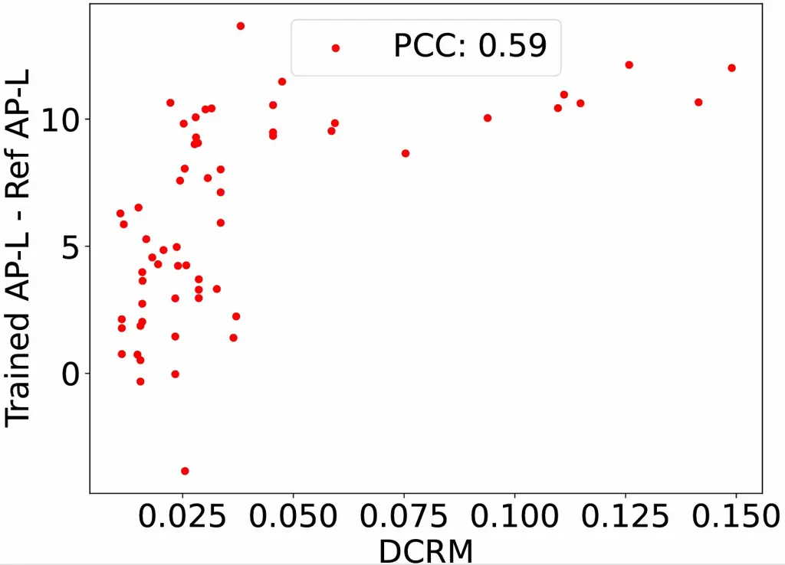
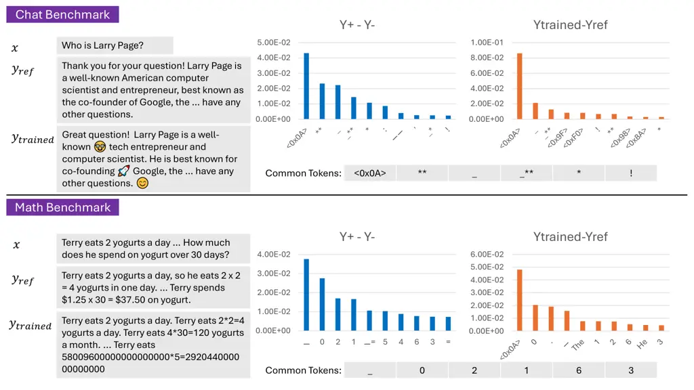
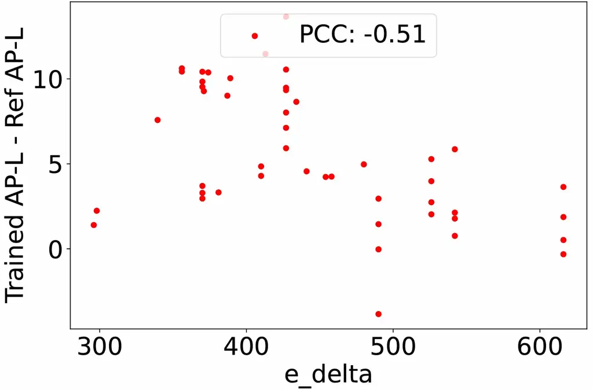
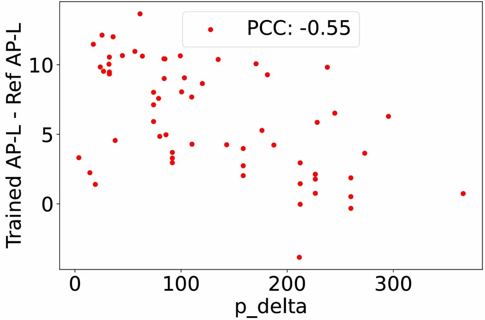
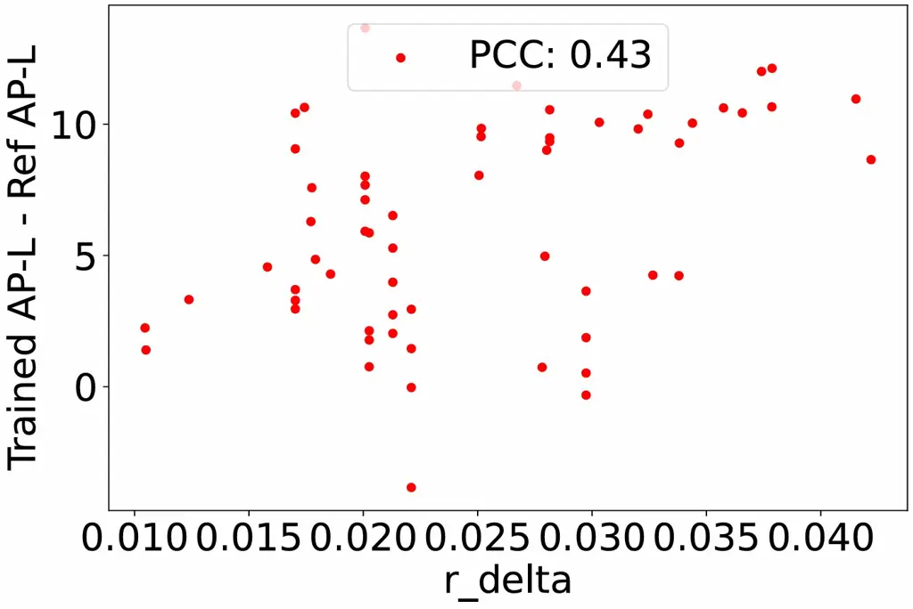
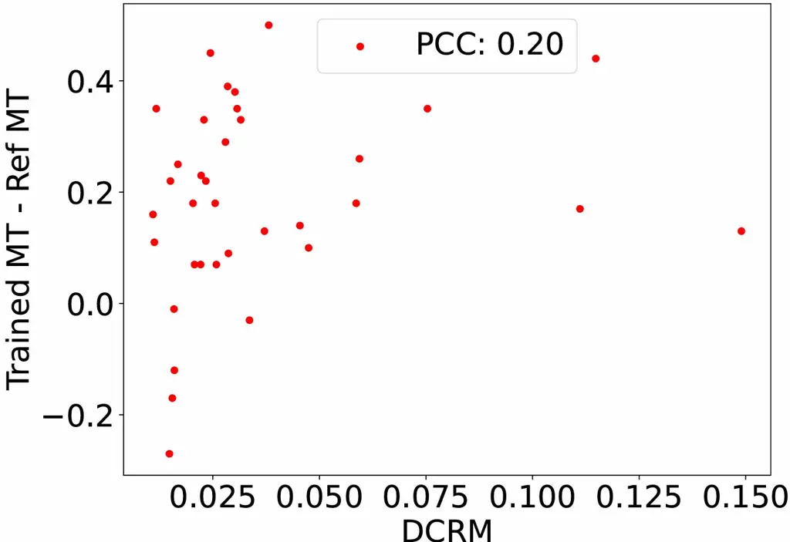
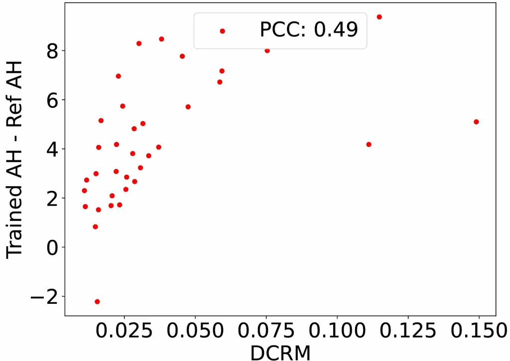

# DCRM: A Heuristic to Measure Response Pair Quality in Preference Optimization

Chengyu Huang Affiliation: Cornell University
Email: [ch2263@cornell.edu](mailto:)    Tanya Goyal Affiliation: Cornell
University Email: [tg436@cornell.edu](mailto:)

###### Abstract

Recent research has attempted to associate preference optimization (PO)
performance with the underlying preference datasets. In this work, our
observation is that the differences between the preferred response
$`y^{+}`$ and dispreferred response $`y^{-}`$ influence what LLMs can
learn, which may not match the desirable differences to learn.
Therefore, we use distance and reward margin to quantify these
differences, and combine them to get Distance Calibrated Reward Margin
(DCRM), a metric that measures the quality of a response pair for PO.
Intuitively, DCRM encourages minimal noisy differences and maximal
desired differences. With this, we study 3 types of commonly used
preference datasets, classified along two axes: the source of the
responses and the preference labeling function. We establish a general
correlation between higher DCRM of the training set and better learning
outcome. Inspired by this, we propose a best-of-$`N^{2}`$ pairing method
that selects response pairs with the highest DCRM. Empirically, in
various settings, our method produces training datasets that can further
improve models’ performance on AlpacaEval, MT-Bench, and Arena-Hard over
the existing training sets.¹¹ 1 Our code is at
[https://github.com/HCY123902/DCRM](https://github.com/HCY123902/DCRM).

## 1 Introduction

Figure 1: Top: Ideal response pairs should have fewer noisy differences
(small distances) and more desired differences (large reward margins).
DCRM measures response pair quality with this intuition; Bottom: Common
preference datasets (SS-RM, DS-RM, DS-Fix; See § 2.2) have varying
locations in the distance-reward margin landscape, but none achieves an
ideal combination.

Preference optimization (PO) methods such as DPO (Rafailov et al., 2024)
have shown success in improving LLMs’ performance in various tasks
(Dubois et al., 2024). These methods usually involve a contrastive
learning objective that encourages LLMs to generate a preferred response
$`y^{+}`$ with higher probability and a dispreferred response $`y^{-}`$
with lower probability, given a query $`x`$.

Prior research (Tang et al., 2024; Razin et al., 2024) has shown the
importance of selecting suitable response pairs for PO training. In
particular, the contrastive training signals sent to LLMs are partly
derived from the differences between $`y^{+}`$ and $`y^{-}`$. These
differences influence what LLMs can learn, which often do not exactly
match the set of desirable differences to learn. This is because, aside
from differences that we want models to learn (useful signals; e.g.,
$`y^{+}`$ is more helpful than $`y^{-}`$ in factoid question answering),
there can be noisy differences (noisy signals). For instance, $`y^{+}`$
and $`y^{-}`$ can differ in features that are irrelevant for a task
(e.g., different writing styles for factoid question answering) or that
the differences are in an incorrect direction (e.g., $`y^{+}`$ is less
correct than $`y^{-}`$). Intuitively, if there are more noisy
differences, then LLMs may not effectively learn the desired differences
(e.g., to be more helpful) (See Figure 1).

Although prior research (D’Oosterlinck et al., 2024; Wu et al., 2024)
has investigated the correlation between certain proxies of
"differences" (e.g., edit distance) and PO learning outcome, it does not
distinguish noisy and desired differences, and therefore cannot
accurately model the relationship.

Therefore, we develop a metric called Distance Calibrated Reward Margin
(DCRM) that aims to measure the density of desired differences among the
total differences present. DCRM is the ratio between the reward margin,
which is a proxy for the amount of desired differences, and two distance
metrics (edit distance, probability difference), which are proxies for
the total amount of differences.

To study DCRM, we study three common types of preference datasets,
categorized by their (1) response sources and (2) preference labeling
scheme. We use Ultrafeedback (Cui et al., 2023) as the seed to construct
the datasets, and find that different types of datasets vary in their
average DCRM values.

We train three base models (LLaMA-2-7B-Chat, LLaMA-3.2-1B-Instruct,
Gemma-2B-IT) on these datasets and use AlpacaEval (Dubois et al., 2024),
MT-Bench (Zheng et al., 2023), and Arena-Hard (Li et al., 2024) for
evaluation. Across all settings, we notice a correlation between higher
DCRM and better training outcomes. We further conduct a feature analysis
to inspect the properties of each dataset and understand qualitatively
what signals (i.e., noisy or desired differences) models learn after
training. Inspired by the aforementioned correlation, we propose a
method called Best of $`N^{2}`$ pairing to select response pairs with
high DCRM, and show that training LLMs on the new datasets gives higher
performance than on the original datasets. Our contribution is
summarized as follows.

- •
  We propose a novel metric DCRM that measures the quality of a response
  pair for PO training.
- •
  We compare three common types of preference datasets and show a
  positive correlation between the average DCRM value of a training
  dataset and the training effectiveness.
- •
  We propose best-of-$`N^{2}`$ pairing, which selects response pairs
  with high DCRM values for effective PO training.

## 2 Task Setup

### 2.1 Problem Definition

Let $`\pi(y|x)`$ be a language model (LM) that places a probability
distribution over response $`y`$ conditioned on input $`x`$. Let
$`\mathcal{D}=\{x_{i},y_{i}^{+},y_{i}^{-}\}`$ be a preference dataset
where responses $`y^{+}`$ are preferred to $`y^{-}`$. Offline preference
optimization, like Direct Preference Optimization (DPO)²² 2 Many
variations of DPO have been proposed (Azar et al., 2023; Park et al.,
2024; Meng et al., 2024; Hong et al., 2024). Since our focus in this
work is investigating the impact of preference dataset choices, we fix
DPO as our PO algorithm. Rafailov et al. (2024), use $`\mathcal{D}`$ to
train model $`\pi_{\theta}`$ starting from the base model
$`\pi_{\mathrm{ref}}`$, by minimizing the following loss:

```math
\mathcal{L}_{DPO}=-E_{(x,y^{+},y-)\sim D}\left[\log\sigma\left(\beta\log\frac{\pi_{\theta}(y^{+}|x)}{\pi_{\mathrm{ref}}(y^{+}|x)}-\beta\log\frac{\pi_{\theta}(y^{-}|x)}{\pi_{\mathrm{ref}}(y^{-}|x)}\right)\right]
```

where $`\beta`$ is a hyperparameter.

In this work, we aim to understand how qualitative and quantitative
differences between $`y^{+}`$ and $`y^{-}`$ influence the learning
behavior of DPO.

### 2.2 Preference Datasets

To guide our investigation, we group common techniques for preference
dataset curation into 3 categories, according to two axes: source
distribution of the response $`y`$, and the preference labeling function
(see Figure 2).

Figure 2: Commonly used preference datasets, categorized into 3 types
according to their responses sources and preference labeling functions.

#### Same Source w/ RM Preference (SS-RM)

The original DPO work (Rafailov et al., 2024) proposed to sample
$`y^{+}`$ and $`y^{-}`$ from the same model, $`\pi_{\mathrm{ref}}`$
(SS$`{}_{\pi_{\mathrm{ref}}}`$), and derive the preference labels using
a reward model. This has been widely adopted in follow-up works (Meng
et al., 2024; Amini et al., 2024; Azar et al., 2023; Lai et al., 2024).
Note that $`y^{+}`$ and $`y^{-}`$ can also be from the same source that
is not $`\pi_{\mathrm{ref}}`$ (SS$`{}_{\pi_{\mathrm{other}}}`$), meaning
that these datasets can be re-used to train a different base LLM too.

#### Diff Source w/ RM Preference (DS-RM)

Earlier work in DPO used output pairs sampled from two different humans
(Köpf et al., 2023) or models (Ultrafeedback binarized (Cui et al.,
2023; Tunstall et al., 2023); Argilla-OpenOrca³³ 3
[https://huggingface.co/datasets/argilla/distilabel-intel-orca-dpo-pairs](https://huggingface.co/datasets/argilla/distilabel-intel-orca-dpo-pairs))
to construct the dataset (i.e., $`y^{+}`$ is from a different source
than $`y^{-}`$). The preference labels were typically assigned using a
reward model or LLM-based judges. This dataset construction is agnostic
to the choice of the policy $`\pi_{\mathrm{ref}}`$. Once created, these
datasets can again be re-used without additional sampling or preference
labeling overhead for any new choice of $`\pi_{\mathrm{ref}}`$ (Wu
et al., 2024; Hong et al., 2024; Bai et al., 2022).

#### Diff Source w/ Fixed Preference (DS-Fix)

It is possible to have a prior estimate of the relative strengths of two
sampling sources (e.g. using rankings on benchmarks like Chatbot-Arena
(Chiang et al., 2024)). In such scenarios, instance-level preference
between 2 responses from different sources can be assigned based on
model-level rankings (i.e., $`y^{+}`$ is always from a "stronger" model
than $`y^{-}`$). Methods such as SPIN (Chen et al., 2024) have
successfully used such strategies (setting
$`y^{-}\sim\pi_{\mathrm{ref}})`$ while others (D’Oosterlinck et al., 2024) report suboptimal performance with these datasets.

### 2.3 Measuring density of desired differences

Our goal is to study how corpus-level differences in preference pairs
impact models’ learned behavior after DPO. We quantify the difference
between $`y^{+}`$ and $`y^{-}`$ using a combination of three metrics,
which we explain and motivate below:

#### Token-level edit distance

($`e_{\Delta}`$) between $`y^{+}`$ and $`y^{-}`$ is the first distance
metric that we use. It is the token-level Levenshtein distance between 2
outputs. $`e_{\Delta}`$ is easily computable and $`\pi_{\mathrm{ref}}`$
agnostic. It captures differences in length, lexicon, syntax, etc.

#### $`\bm{\pi_{\mathrm{ref}}}`$’s LogProb Difference

($`p_{\Delta}`$) is the second distance metric that we use. It is
computed as
$`|\log\pi_{\mathrm{ref}}(y^{+}|x)-\log\pi_{\mathrm{ref}}(y^{-}|x)|`$.
$`p_{\Delta}`$ measures the difference in probability mass placed on
$`y^{+}`$ and $`y^{-}`$ by $`\pi_{\mathrm{ref}}`$. It captures a
different notion of “distance” from edit-distance; two samples can be
very different lexically but be assigned similar probability by
$`\pi_{\mathrm{ref}}`$, or vice versa. These are tougher for the
implicit reward model in DPO to distinguish, and this measure helps us
account for such instances.

#### Reward Margin

($`r_{\Delta}`$) measures the difference in rewards from a reward model
$`\mathrm{RM}`$. It is computed as $`r_{\Delta}=r_{y^{+}}-r_{y^{-}}`$,
where $`r_{y}`$ is the reward score $`\mathrm{RM}`$ assigns to an output
$`y`$. This reward margin quantifies the desired differences in targeted
(relevant) features between the two outputs, irrespective of their
lexical and probability differences.

We combine these to construct a single metric that measures the density
of “desired” differences between two outputs. We call this
distance-calibrated reward margin (DCRM):

```math
\displaystyle\mathrm{DCRM}(y^{+},y^{-})=\frac{\sigma(r_{\Delta})-0.5}{e_{\Delta}+p_{\Delta}+\epsilon} \tag{1}
```

We omit $`(y^{+},y^{-})`$ as the arguments for
$`r_{\Delta},e_{\Delta},p_{\Delta}`$ for brevity and include constant
$`\epsilon=1`$ for numeric stability. The numerator captures the
normalized reward margin⁴⁴ 4 We apply the sigmoid function to normalize
$`r_{\Delta}`$ to be between \[0, 1\] and subtract 0.5 to preserve the
margin sign. between $`y^{+}`$ and $`y^{-}`$ (a 0-centered Bradley-Terry
model (Bradley and Terry, 1952)), and the denominator measures their
distances (i.e., lexical and probabilistic differences).⁵⁵ 5 We do not
adjust the scales of $`e_{\Delta}`$ and $`p_{\Delta}`$ since we find
that these are similar across most settings in our experiments.

We hypothesize that when the useful contrast signals (desired
differences, measured by $`r_{\Delta}`$) are a large fraction of the
total differences (measured by $`e_{\Delta}+p_{\Delta}`$) in the
response pair (i.e., useful signals are dense), training becomes more
effective.

DCRM captures this hypothesis. A high DCRM implies (1) a high reward
margin between $`y^{+}`$ and $`y^{-}`$ (i.e. there are many desired
differences between the two for $`\pi_{\mathrm{ref}}`$ to learn from)
and (2) low distances between the two (i.e., the total differences are
small). In this case, training signals are more meaningful and less
noisy for the LLMs to learn effectively.⁶⁶ 6 See Appendix D for the
properties of DCRM.

## 3 Experiment Setup

### 3.1 Training Setup

#### Models

We experiment with three options for our base model
($`\pi_{\mathrm{ref}}`$). They include LLaMA2 (LLaMA-2-7B-Chat; Touvron
et al. (2023b)), LLaMA3.2 (LLaMA-3.2-1B-Instruct; Grattafiori et al.
(2024), and an extra model from other series Gemma (Gemma-2B-IT; Mesnard
et al. (2024)). We train each of these models using the DPO objective
for 2 epochs, and select the best checkpoint based on validation
performance. Please refer to Appendix B for other training details. Due
to length constraints, we report results for LLaMA2 and LLaMA3.2 in the
main paper, and put the results for Gemma in Appendix E.

We use the overall scores from the reward model ArmoRM Wang et al.
(2024a) to compute $`r\Delta`$.

#### Preference Datasets

|                                                         |                        |                |                |                     |           |
| ------------------------------------------------------- | ---------------------- | -------------- | -------------- | ------------------- | --------- |
| Type                                                    | Dataset                | $`e_{\Delta}`$ | $`p_{\Delta}`$ | $`r_{\Delta}`$(e-2) | DCRM(e-2) |
| $`\pi_{\mathrm{ref}}=`$LLaMA2 (LLaMA-2-7B-Chat)         |                        |                |                |                     |           |
| SS-RM                                                   | $`\pi_{\mathrm{ref}}`$ | 427            | 32.48          | 2.82                | 4.54      |
|                                                         | Gma2                   | 370            | 91.78          | 1.70                | 2.87      |
|                                                         | Mst                    | 526            | 158.54         | 2.13                | 1.59      |
| DS-RM                                                   | Gma2-Mst               | 542            | 226.47         | 2.03                | 1.13      |
| DS-Fix                                                  | Gma2-Mst               | 542            | 226.47         | 1.02                | 0.43      |
| $`\pi_{\mathrm{ref}}=`$LLaMA3.2 (LLaMA-3.2-1B-Instruct) |                        |                |                |                     |           |
| SS-RM                                                   | $`\pi_{\mathrm{ref}}`$ | 434            | 120.07         | 4.22                | 7.53      |
|                                                         | Gma2                   | 370            | 84.78          | 1.70                | 3.15      |
|                                                         | Mst                    | 526            | 176.22         | 2.13                | 1.68      |
| DS-RM                                                   | Gma2-Mst               | 542            | 228.22         | 2.03                | 1.17      |
| DS-Fix                                                  | Gma2-Mst               | 542            | 228.22         | 1.02                | 0.44      |

Table 1: Statistics of the datasets. Each metric value is averaged
across examples. Changing $`\pi_{\mathrm{ref}}`$ changes $`p_{\Delta}`$
and so we report separate statistics for LLaMA2 and LLaMA3.2. The
reported DCRM values are scaled 1k times for visualization, which does
not affect correlation analysis. SS-RM datasets have the highest DCRM
while DS-Fix ones have the lowest DCRM.

We use the 60K prompts from Ultrafeedback (Cui et al., 2023). We create
our preference datasets using responses sampled from four different
models across the three settings (SS-RM, DS-RM, DS-Fix) described in
§ 2.2.

For SS-RM, we sample responses from the base model
$`\pi_{\mathrm{ref}}`$. We also use Gemma-2-9B-IT (Gma2) and
Mistral-7B-Instruct-v0.2 (Mst) as two extra sources of responses. For
each source, we follow Meng et al. (2024) and sample $`N=5`$ responses
and then select the best response pair with the highest $`r_{\Delta}`$
using the reward model $`\mathrm{RM}`$.

For DS-RM, we fix the source distributions to Gemma-2-9B-IT (Gma2) and
Mistral-7B-Instruct-v0.2 (Mst). We sample one response from each, and
decide the preference label using $`\mathrm{RM}`$. We find that roughly
70% of $`y^{+}`$ comes from Gma2 and 70% of $`y^{-}`$ comes from Mst.

For DS-Fix, we use the same response pairs as DS-RM, but always set
$`y^{+}`$ to be from Gemma-2-9B-IT (stronger model) and $`y^{-}`$ to be
from Mistral-7B-Instruct-v0.2 (weaker model), respectively.

#### Dataset Statistics

Table 1 shows the dataset statistics. As expected, SS-RM datasets, which
get the paired responses from the same source, have the lowest
$`e_{\Delta}`$ and $`p_{\Delta}`$, leading to the highest overall DCRM.
DS-RM has higher distances and consequently lower DCRM. Surprisingly, we
find that DS-Fix has the lowest reward margin even though its samples
have a higher lexical difference. This makes it have the lowest DCRM
across the three settings.

### 3.2 Quantitative Evaluation

We evaluate the general conversational and instruction-following
abilities of our trained models $`\pi_{\theta}`$ using three chat
benchmarks, AlpacaEval, MT-Bench, and Arena-Hard. AlpacaEval reports the
models’ win rates against a baseline model, GPT-4-1106-Preview (Achiam
et al., 2024). Arena-Hard run similar evaluations, with GPT-4-0314 as
the baseline model. MT-Bench is a multi-turn conversational benchmark
and uses a judge model to score the model’s responses on a scale of
10.⁷⁷ 7 For all three benchmarks, we use GPT-4o-mini-2024-0718 Hurst
et al. (2024) as the judge to regulate costs.

## 4 Comparing Different Types of Preference Datasets

In this section, we compare models that are trained on different types
of preference datasets, and establish a correlation between the
dataset-level DCRM value and downstream performances. We report the
results in Table 2.

|        |                          |       |       |      |       |
| ------ | ------------------------ | ----- | ----- | ---- | ----- |
|        |                          | AP-L  | AP-R  | MT   | AH    |
|        | LLaMA2                   | 12.57 | 10.43 | 5.41 | 8.90  |
| SS-RM  | \+$`\pi_{\mathrm{ref}}`$ | 22.36 | 16.81 | 5.55 | 16.67 |
|        | +Gma2                    | 15.89 | 13.12 | 5.50 | 11.57 |
|        | +Mst                     | 15.49 | 12.07 | 5.40 | 10.42 |
| DS-RM  | +Gma2-Mst                | 14.13 | 11.51 | 5.52 | 10.55 |
| DS-Fix | +Gma2-Mst                | 13.26 | 8.99  | 5.24 | 6.68  |
|        | LLaMA3.2                 | 14.15 | 15.34 | 4.66 | 10.88 |
| SS-RM  | \+$`\pi_{\mathrm{ref}}`$ | 22.80 | 25.65 | 5.01 | 18.88 |
|        | +Gma2                    | 24.57 | 27.52 | 4.99 | 15.91 |
|        | +Mst                     | 19.43 | 19.94 | 4.91 | 16.03 |
| DS-RM  | +Gma2-Mst                | 20.01 | 21.61 | 5.01 | 13.61 |
| DS-Fix | +Gma2-Mst                | 10.31 | 8.20  | 4.54 | 14.94 |

Table 2: Main Results; AP-L: Length-Controlled Win Rate on AlpacaEval;
AP-R: Raw Win Rate on AlpacaEval; MT: MT-Bench Score; AH: Arena-Hard Win
Rate; SS-RM datasets generally lead to the best performance while DS-Fix
ones lead to the worst performance.

#### Sampling from the same source distribution (SS-RM) outperforms other methods.

Table 2 shows that sampling response pairs from the same distribution
($`\pi_{\mathrm{ref}}`$ and others) and deriving preferences using the
reward model perform better than DS-RM and DS-Fix. In particular,
training with responses from $`{\pi_{\mathrm{ref}}}`$ gives the best
performance, which mirrors findings from prior work (Tang et al., 2024).
Relating back to Table 1, SS-RM datasets also have the highest DCRM
value.

To our surprise, SS-RM Gma2 is on par with SS-RM $`\pi_{\mathrm{ref}}`$
when $`\pi_{\mathrm{ref}}`$=LLaMA3.2. Consulting Table 1, we see that
SS-RM Gma2 has a lower $`p_{\Delta}`$ than that of LLaMA3.2, possibly
explaining this result.

#### DS-Fix performs worse than the base model.

This technique performs the worst among the three dataset settings.
Similar results have also been reported by D’Oosterlinck et al. (2024).
In fact, we find that its performance is worse than even the starting
model. In Appendix A, we show that there are consistent stylistic
differences between the two source distributions (e.g. presence of more
emojis in $`Y^{+}`$ than $`Y^{-}`$), which is reflected in the model’s
output after training. Again, relating back, DS-Fix datasets also have
the lowest DCRM value.



Figure 3: DCRM is positively correlated with models’ performance boost
on AP-L. PCC: Pearson Correlation Coefficient; Y axis: change in AP-L
after training. Each point in the diagram corresponds to a trained
model.

#### DCRM is positively correlated with model performance after training.

With the above observations, we formally quantify the correlation
between DCRM and downstream performance. To include sufficient data
points, we sample multiple outputs from the source distributions and
select response pairs that vary the dataset-level $`p_{\Delta}`$,
$`e_{\Delta}`$, and $`r_{\Delta}`$.⁸⁸ 8 See Appendix F for details. We
compute the performance boost, i.e. the AP-L improvement of
$`\pi_{\theta}`$ against $`\pi_{\mathrm{ref}}`$, and show its
correlation with DCRM in Figure 3.⁹⁹ 9 See MT and AH correlations in
Appendix G.

We find that DCRM and downstream performance are moderately positively
correlated, with a Pearson Correlation of $`0.59`$, which is stronger
than the individual metrics – correlation with $`e_{\Delta}`$,
$`p_{\Delta}`$, and $`r_{\Delta}`$ is -0.51, -0.55, and 0.43
respectively (See Appendix F.1). We observe a saturation effect once
DCRM passes 0.075, and suspect this to be caused by the inherent
limitations of the reward model.

## 5 Operationalizing DCRM

In § 4, we observe that higher DCRM is correlated with better training
outcomes. Can we use this correlation to guide training dataset
selection?

#### Approach

An answer is to sample responses from $`\pi_{\mathrm{ref}}`$. However,
this can be expensive with a large model or dataset. Instead, we want to
investigate how to select the best response pair from an existing pool
of responses, Formally, given $`N`$ responses $`\{y_{1},\cdots,y_{N}\}`$
(and also $`\{y_{N+1},\cdots,y_{2N}\}`$ from a second model in the DS
setting), we propose to select the pair $`(y_{i},y_{j})`$ with the
highest DCRM. We denote this as Best of $`N^{2}`$ pairing (Bo$`N^{2}`$),
since we select the best pair from $`N\times N`$ candidates. Our method
is different from the conventional method (used in SS-RM), which chooses
the pair with the highest reward margin by setting $`y^{+}`$ and
$`y^{-}`$ to the response with the highest and lowest reward scores.

#### Setup

We apply our method to three baselines. In the Same Source (SS-RM)
setting, we reselect the response pair using the existing $`N`$
responses sampled from (1) $`\pi_{\mathrm{ref}}`$, or (2) Mst. In the
Different Sources (DS-RM)¹⁰¹⁰ 10 Applying our method to the DS-Fix
setting leads to the same dataset as DS-RM, so we combine them together
setting, we use (3) Gma2-Mst as the third baseline, and select a
response pair with the highest DCRM while maintaining the condition that
$`y^{+}`$ and $`y^{-}`$ come from different sources.¹¹¹¹ 11 Baseline (3)
is not strictly a fair comparison. In Appendix E we provide a fair
baseline w/ $`BoN^{2}`$ ($`r_{\Delta}`$ only).

|                                                         |                        |                |                |                     |           |
| ------------------------------------------------------- | ---------------------- | -------------- | -------------- | ------------------- | --------- |
| Type                                                    | Dataset                | $`e_{\Delta}`$ | $`p_{\Delta}`$ | $`r_{\Delta}`$(e-2) | DCRM(e-2) |
| $`\pi_{\mathrm{ref}}=`$LLaMA2 (LLaMA-2-7B-Chat)         |                        |                |                |                     |           |
| SS-RM                                                   | $`\pi_{\mathrm{ref}}`$ | 427            | 32.48          | 2.82                | 4.54      |
|                                                         | w/ $`BoN^{2}`$         | 370            | 23.87          | 2.52                | 5.94      |
| SS-RM                                                   | Mst                    | 526            | 158.54         | 2.13                | 1.59      |
|                                                         | w/ $`BoN^{2}`$         | 410            | 79.94          | 1.79                | 2.07      |
| DS-RM                                                   | Gma2-Mst               | 542            | 226.47         | 2.03                | 1.13      |
|                                                         | w/ $`BoN^{2}`$         | 458            | 142.94         | 3.27                | 2.58      |
| $`\pi_{\mathrm{ref}}=`$LLaMA3.2 (LLaMA-3.2-1B-Instruct) |                        |                |                |                     |           |
| SS-RM                                                   | $`\pi_{\mathrm{ref}}`$ | 434            | 120.07         | 4.22                | 7.53      |
|                                                         | w/ $`BoN^{2}`$         | 356            | 63.55          | 3.58                | 11.48     |
| SS-RM                                                   | Mst                    | 526            | 176.22         | 2.13                | 1.68      |
|                                                         | w/ $`BoN^{2}`$         | 339            | 78.81          | 1.78                | 2.44      |
| DS-RM                                                   | Gma2-Mst               | 542            | 228.22         | 2.03                | 1.17      |
|                                                         | w/ $`BoN^{2}`$         | 374            | 134.94         | 3.24                | 3.02      |

Table 3: Statistics of the original and new datasets; w/ $`BoN^{2}`$
indicates datasets whose response pairs are reselected using
best-of-$`N^{2}`$ method. They have a higher DCRM value than their
original counterparts.

Table 3 gives a comparison between the original and reselected datasets.
After reselection with DCRM, both $`e_{\Delta}`$ and $`p_{\Delta}`$
decrease, while $`r_{\Delta}`$ stays in a reasonable range without too
much drop.

### 5.1 Main Results

We compare $`BoN^{2}`$ against the baselines in Table 4.

|       |                          |       |       |      |       |
| ----- | ------------------------ | ----- | ----- | ---- | ----- |
|       |                          | AP-L  | AP-R  | MT   | AH    |
|       | LLaMA2                   | 12.57 | 10.43 | 5.41 | 8.90  |
| SS-RM | \+$`\pi_{\mathrm{ref}}`$ | 22.36 | 16.81 | 5.55 | 16.67 |
|       | w/ $`BoN^{2}`$           | 22.41 | 17.2  | 5.67 | 16.07 |
| SS-RM | +Mst                     | 15.49 | 12.07 | 5.40 | 10.42 |
|       | w/ $`BoN^{2}`$           | 17.42 | 13.29 | 5.48 | 10.99 |
| DS-RM | +Gma2-Mst                | 14.13 | 11.51 | 5.52 | 10.55 |
|       | w/ $`BoN^{2}`$           | 16.82 | 13.6  | 5.48 | 11.75 |
|       | LLaMA3.2                 | 14.15 | 15.34 | 4.66 | 10.88 |
| SS-RM | \+$`\pi_{\mathrm{ref}}`$ | 22.80 | 25.65 | 5.01 | 18.88 |
|       | w/ $`BoN^{2}`$           | 24.77 | 27.64 | 5.10 | 20.25 |
| SS-RM | +Mst                     | 19.43 | 19.94 | 4.91 | 16.03 |
|       | w/ $`BoN^{2}`$           | 21.73 | 21.37 | 5.11 | 16.62 |
| DS-RM | +Gma2-Mst                | 20.01 | 21.61 | 5.01 | 13.61 |
|       | w/ $`BoN^{2}`$           | 24.53 | 27.76 | 5.04 | 19.17 |

Table 4: Main Results; $`BoN^{2}`$ datasets give a stronger performance
than their original counterparts.

#### Best of $`N^{2}`$ pairing increases performance across all settings.

When training LLaMA3.2, we observe a higher performance across all
baselines. When training LLaMA2, performance increases notably on top of
both Mst (SS-RM) and Gma2-Mst (DS-RM), especially for the latter.

However, performance only increases marginally in the LLaMA2
$`\pi_{\mathrm{ref}}`$ (SS-RM) setting. We suspect that most responses
from LLaMA2 are similar to each other. In this case, maximizing the
reward margin will not incur very high distances, so the response pairs
from $`\pi_{\mathrm{ref}}`$ (SS-RM) are already close to the best. There
is little room for improvement no matter how we reselect the pairs. This
is evident in Table 3, where we observe a smaller reduction in
$`e_{\Delta}`$ and $`p_{\Delta}`$ compared with every other setting.

### 5.2 Ablation Study

|                          | AP-L  | AP-R  | MT   | AH    |
| ------------------------ | ----- | ----- | ---- | ----- |
| LLaMA2                   | 12.57 | 10.43 | 5.41 | 8.90  |
| \+$`\pi_{\mathrm{ref}}`$ | 22.36 | 16.81 | 5.55 | 16.67 |
| w/ $`BoN^{2}`$           | 22.41 | 17.20 | 5.67 | 16.07 |
|       -$`p_{\Delta}`$    | 22.1  | 17.27 | 5.59 | 15.62 |
|       -$`e_{\Delta}`$    | 24.04 | 17.14 | 5.51 | 14.61 |
|       -$`r_{\Delta}`$    | 14.81 | 12.11 | 5.54 | 12.97 |

Table 5: Ablation Study on DCRM in the SS-RM setting; Removing
$`p_{\Delta}`$ or $`e_{\Delta}`$ hurts performance slightly, while
removing $`r_{\Delta}`$ significantly reduces performance.

Since DCRM is composed of three metrics, we do an ablation study of our
method in the $`\pi_{\mathrm{ref}}`$ (SS-RM) setting. We remove one of
$`p_{\Delta}`$, $`e_{\Delta}`$, or $`r_{\Delta}`$ from DCRM and reselect
the response pair. Table 5 shows that removing $`p_{\Delta}`$ gives a
performance close to that of the complete metric, while removing
$`e_{\Delta}`$ slightly hurts performance. In Appendix I, we show that
removing either of these in the Mst (SS-RM) and DS-RM settings can still
give a performance boost over the original datasets, which means in
these settings our method can be effective with a cheaper computation.

#### Removing $`r_{\Delta}`$ makes training much less effective.

This is expected, since without $`r_{\Delta}`$ our method selects
response pairs that have the smallest distances and are minimally
different. This not only eliminates noisy differences, but also those
useful ones.

## 6 Qualitative Analysis (Feature-Analysis)

§ 4 and § 5 show the correlation between the DCRM value of a training
set and quantitative performance. We also want to inspect whether these
datasets have qualitative differences, to validate our starting
motivation that connects performance with data quality (i.e., more
desired differences and fewer noisy ones between $`y^{+}`$ and $`y^{-}`$
make PO more effective), and better ground DCRM with this quality.

We analyze the feature differences between $`y^{+}`$ and $`y^{-}`$. We
define relevant features (correctness, helpfulness, etc.) as those that
the LLMs should learn, and irrelevant features (writing style, sarcasm,
tone, etc.) as those not targeted by the task.

#### Features

To align with the reward signals, we use the 11 features (de-duplicated)
from the ArmoRM reward model as the relevant features. These include
helpfulness, truthfulness, etc. We manually define 21 irrelevant
features that are roughly orthogonal to these relevant features (See the
full lists in Appendix C.1). The useful training signals come from
differences between $`y^{+}`$ and $`y^{-}`$ that are along relevant
features and are pointing in the correct direction ($`y^{+}`$ is better
than $`y^{-}`$ for a relevant feature), which we call desired feature
differences.

#### Metrics

We define $`f_{\Delta}`$ as the number of features along which $`y^{+}`$
and $`y^{-}`$ differ. To measure the fraction of desired feature
differences, we define $`f_{\Delta}^{\mathrm{des}}`$ as the fraction of
features in $`f_{\Delta}`$ that are (a) relevant and (b) contrasted in
the correct direction (i.e. $`y^{+}`$ is “better” than $`y^{-}`$ for
that feature). Fraction of features that only satisfy condition (a) is
denoted by $`f_{\Delta}^{\mathrm{rel}}`$. Similar to DCRM,
$`f_{\Delta}^{\mathrm{des}}`$ indicates the ratio of useful contrast
signals among noisy signals.

To compute these, we prompt GPT-4o-mini-0718 to (1) identify the three
most prominent features that differ between the two responses (setting
$`f_{\Delta}`$=$`3`$) and (2) indicate a contrast direction for each
feature if applicable (i.e., whether $`y^{+}`$ is better). Referring to
the list of relevant features, we can then compute
$`f_{\Delta}^{\mathrm{rel}}`$ and $`f_{\Delta}^{\mathrm{des}}`$. Note
that we can use this to study the training dataset (i.e.
$`Y^{+}`$-$`Y^{-}`$), and the learned differences after training
($`Y_{\mathrm{trained}}`$-$`Y_{\mathrm{ref}}`$).

#### Analysis of training datasets ($`Y^{+}-Y^{-}`$)

To study the feature differences LLMs see during training, we compute
the average $`f_{\Delta}^{\mathrm{rel}}`$ and
$`f_{\Delta}^{\mathrm{des}}`$ across 200 randomly sampled
$`(y^{+},y^{-})`$ from the training dataset. Higher
$`f_{\Delta}^{\mathrm{des}}`$ implies higher dataset quality.

#### Analysis of learning outcomes ($`Y_{\mathrm{trained}}-Y_{\mathrm{ref}}`$)

To study what LLMs actually learn after training, we compute
$`f_{\Delta}^{\mathrm{rel}}`$ and $`f_{\Delta}^{\mathrm{des}}`$ for 200
randomly sampled
$`(y_{\mathrm{trained}}\sim\pi_{\theta}(x),y_{\mathrm{ref}}\sim\pi_{\mathrm{ref}}(x))`$
pairs where $`x`$ is a test prompt in the AlpacaEval dataset. Higher
$`f_{\Delta}^{\mathrm{des}}`$ implies that the model learns more useful
signals (e.g., to be more helpful) and fewer noisy ones (e.g., to be
more sarcastic).

Following § 4 and § 5, we compare different preference datasets in
§ 6.1, and then show how $`BoN^{2}`$ can improve response pair quality
in § 6.2.

### 6.1 Comparing Common Preference Datasets

We present the results in Table 6 to understand (1) what the model sees
during training and (2) what it actually learns.

|                                                         |                        |                               |                               |                                               |                               |
| ------------------------------------------------------- | ---------------------- | ----------------------------- | ----------------------------- | --------------------------------------------- | ----------------------------- |
|                                                         |                        | $`Y^{+}`$-$`Y^{-}`$           |                               | $`Y_{\mathrm{trained}}`$-$`Y_{\mathrm{ref}}`$ |                               |
|                                                         |                        | $`f_{\Delta}^{\mathrm{rel}}`$ | $`f_{\Delta}^{\mathrm{des}}`$ | $`f_{\Delta}^{\mathrm{rel}}`$                 | $`f_{\Delta}^{\mathrm{des}}`$ |
| $`\pi_{\mathrm{ref}}=`$LLaMA2 (LLaMA-2-7B-Chat)         |                        |                               |                               |                                               |                               |
| SS-RM                                                   | $`\pi_{\mathrm{ref}}`$ | 63.83                         | 41.83                         | 53.75                                         | 29.81                         |
|                                                         | Gma2                   | 56.42                         | 38.08                         | 53.94                                         | 29.53                         |
|                                                         | Mst                    | 62.83                         | 37.83                         | 54.00                                         | 29.19                         |
| DS-RM                                                   | Gma2-Mst               | 61.75                         | 39.92                         | 53.31                                         | 28.66                         |
| DS-Fix                                                  | Gma2-Mst               | 62.5                          | 36.33                         | 52.22                                         | 18.83                         |
| $`\pi_{\mathrm{ref}}=`$LLaMA3.2 (LLaMA-3.2-1B-Instruct) |                        |                               |                               |                                               |                               |
| SS-RM                                                   | $`\pi_{\mathrm{ref}}`$ | 64.67                         | 43.25                         | 60.08                                         | 37.50                         |
|                                                         | Gma2                   | 56.42                         | 38.08                         | 59.00                                         | 37.58                         |
|                                                         | Mst                    | 62.83                         | 37.83                         | 61.00                                         | 35.58                         |
| DS-RM                                                   | Gma2-Mst               | 61.75                         | 39.92                         | 60.33                                         | 34.17                         |
| DS-Fix                                                  | Gma2-Mst               | 62.50                         | 36.33                         | 60.17                                         | 23.33                         |

Table 6: $`f_{\Delta}^{\mathrm{des}}`$: Percentage of desired feature
differences among the identified feature differences;
$`f_{\Delta}^{\mathrm{rel}}`$: Percentage of relevant feature
differences; $`Y^{+}`$-$`Y^{-}`$: differences identified between
$`y^{+}`$ and $`y^{-}`$ in the training set;
$`Y_{\mathrm{trained}}`$-$`Y_{\mathrm{ref}}`$: differences identified
between model’s output on AlpacaEval after training
($`Y_{\mathrm{trained}}`$) and before training ($`Y_{\mathrm{ref}}`$).
SS-RM datasets typically have the highest $`f_{\Delta}^{\mathrm{des}}`$,
followed by DS-RM and then DS-Fix.

#### DS-Fix datasets have the lowest proportion of desired feature differences in its training data.

Analyzing the training set $`Y^{+}`$-$`Y^{-}`$, we see that response
pairs from $`\pi_{\mathrm{ref}}`$ (SS-RM) have the highest percentage of
desired feature differences, indicating the highest quality. On the
other hand, DS-Fix has the lowest percentage. These results are
consistent with our observations in Table 2. Surprisingly DS-RM has a
higher $`f_{\Delta}^{\mathrm{des}}`$ than Gma2 (SS-RM) and Mst (SS-RM).
A possible explanation will be their actual marginal differences in
dataset quality since at least 1 side of the response sources overlap.

Figure 4: Distributions of relevant (top) and irrelevant (bottom)
feature differences. Each pair of adjacent blue and orange bars
represents the percentage of a kind of feat. diff. ($`y^{+}`$ more
helpful, $`y^{-}`$ less truthful, etc.) among the identified feat. diff.
Blue: training set differences ($`Y^{+}`$-$`Y^{-}`$); Orange:
differences in model outputs on AlpacaEval after or before training
($`Y_{\mathrm{trained}}`$-$`Y_{\mathrm{ref}}`$). $`Y^{+}`$-$`Y^{-}`$ and
$`Y_{\mathrm{trained}}`$-$`Y_{\mathrm{ref}}`$ have similar
distributions.

#### Desired feature differences learned by the model are proportional to their presence in the training set.

Our initial observation is that higher $`f_{\Delta}^{\mathrm{des}}`$ in
the training dataset (i.e. $`Y^{+}`$-$`Y^{-}`$) generally induces higher
$`f_{\Delta}^{\mathrm{des}}`$ in
$`Y_{\mathrm{trained}}`$-$`Y_{\mathrm{ref}}`$. This indicates a
consistency between the training set and learned outcome for desired
feature differences. To analyze this trend in a fine-grained manner and
for more general feature differences, we do the following case study in
the LLaMA2 $`\pi_{\mathrm{ref}}`$ (SS-RM) setting.

#### In general, feature differences learned by the model are proportional to their presence in the training set.

We inspect the distribution of feature differences per category (i.e.,
the percentage of each kind of feat. diff. among all the identified
feat. diff.). Figure 4 shows that for both relevant and irrelevant
features, the distributions for $`Y^{+}`$-$`Y^{-}`$ and
$`Y_{\mathrm{trained}}`$-$`Y_{\mathrm{ref}}`$ are similar, with a KL
divergence of 0.2109 and 0.1284 respectively, so more prominent feature
differences in the training set are picked up by the model more after
training.¹²¹² 12 See Appendix C.3 for more analysis.

### 6.2 Effect of Applying Best-of-$`N^{2}`$ Pairing

|                                                         |                        |                               |                               |                                               |                               |
| ------------------------------------------------------- | ---------------------- | ----------------------------- | ----------------------------- | --------------------------------------------- | ----------------------------- |
|                                                         |                        | $`Y^{+}`$-$`Y^{-}`$           |                               | $`Y_{\mathrm{trained}}`$-$`Y_{\mathrm{ref}}`$ |                               |
|                                                         |                        | $`f_{\Delta}^{\mathrm{rel}}`$ | $`f_{\Delta}^{\mathrm{des}}`$ | $`f_{\Delta}^{\mathrm{rel}}`$                 | $`f_{\Delta}^{\mathrm{des}}`$ |
| $`\pi_{\mathrm{ref}}=`$LLaMA2 (LLaMA-2-7B-Chat)         |                        |                               |                               |                                               |                               |
| SS-RM                                                   | $`\pi_{\mathrm{ref}}`$ | 63.83                         | 41.83                         | 53.75                                         | 29.81                         |
|                                                         | w/ $`BoN^{2}`$         | 64.17                         | 41.50                         | 54.58                                         | 31.58                         |
| SS-RM                                                   | Mst                    | 62.83                         | 37.83                         | 54.00                                         | 29.19                         |
|                                                         | w/ $`BoN^{2}`$         | 66.25                         | 39.08                         | 54.08                                         | 30.25                         |
| DS-RM                                                   | Gma2-Mst               | 61.75                         | 39.92                         | 53.31                                         | 28.66                         |
|                                                         | w/ $`BoN^{2}`$         | 62.83                         | 42.75                         | 55.67                                         | 30.83                         |
| $`\pi_{\mathrm{ref}}=`$LLaMA3.2 (LLaMA-3.2-1B-Instruct) |                        |                               |                               |                                               |                               |
| SS-RM                                                   | $`\pi_{\mathrm{ref}}`$ | 64.67                         | 43.25                         | 60.08                                         | 37.50                         |
|                                                         | w/ $`BoN^{2}`$         | 65.00                         | 44.83                         | 59.67                                         | 38.42                         |
| SS-RM                                                   | Mst                    | 62.83                         | 37.83                         | 61.00                                         | 35.58                         |
|                                                         | w/ $`BoN^{2}`$         | 65.17                         | 40.25                         | 59.33                                         | 34.25                         |
| DS-RM                                                   | Gma2-Mst               | 61.75                         | 39.92                         | 60.33                                         | 34.17                         |
|                                                         | w/ $`BoN^{2}`$         | 62.83                         | 41.42                         | 60.33                                         | 36.75                         |

Table 7: Results for feature-based analysis. $`BoN^{2}`$ datasets have a
higher $`f_{\Delta}^{\mathrm{des}}`$ in most settings.

#### Best of $`N^{2}`$ pairing produces datasets with a higher proportion of desired feature differences.

We conduct the same feature-based analysis as in § 6.1. Table 7
indicates that in most settings, the datasets produced by our method
have a higher percentage of desired feature differences (See
$`f_{\Delta}^{\mathrm{des}}`$ in $`Y^{+}`$-$`Y^{-}`$), which guides the
models to learn effectively and do better in relevant features after
training (See $`f_{\Delta}^{\mathrm{des}}`$ in
$`Y_{\mathrm{trained}}`$-$`Y_{\mathrm{ref}}`$). In the LLaMA2
 $`\pi_{\mathrm{ref}}`$ (SS-RM) setting, $`f_{\Delta}^{\mathrm{des}}`$
in $`Y^{+}`$-$`Y^{-}`$ remains approximately the same after applying our
method, which can be caused by what we discuss in § 5.1.

## 7 Related Work

#### Preference Optimization

Preference Optimization is an alternative to traditional RLHF methods
(Ouyang et al., 2022) such as PPO (Schulman et al., 2017). It avoids the
need for an explicit reward model. Popular PO algorithms includes DPO
(Rafailov et al., 2024), IPO (Azar et al., 2023), KTO (Ethayarajh
et al., 2024), R-DPO (Park et al., 2024), SimPO (Meng et al., 2024), CPO
(Xu et al., 2024), ORPO (Hong et al., 2024), and so on. Many papers
report performance increases on AlpacaEval when training LLMs using PO
methods on chat datasets (Ding et al., 2023; Cui et al., 2023).

#### Response Pairs

The choice of response pairs in PO affects training outcomes. Tajwar
et al. (2024) and Tang et al. (2024) investigate response sources and
illustrate the benefits of sampling responses on policy. Another line of
work focuses on the differences between $`y^{+}`$ and $`y^{-}`$. Prior
work (Fisch et al., 2024; Amini et al., 2024; Furuta et al., 2024)
suggests that LLMs should learn a different reward margin for each
example, since different response pairs can vary in their
contrastiveness (i.e., $`y^{+}`$ is much or only a little better than
$`y^{-}`$).

In reality, however, $`y^{+}`$ and $`y^{-}`$ often differ in features
irrelevant for the task, and a larger gap between them is not always
desirable. Certain work focuses on eliminating specific irrelevant
differences such as length (Singhal et al., 2023). Others take a more
general perspective. Wu et al. (2024) use reward margins to measure
differences and dynamically scales the training signals for each
example. D’Oosterlinck et al. (2024) and Guo et al. (2024) construct
minimally different pairs by revising $`y^{-}`$ with a stronger LLM to
get $`y^{+}`$. However, these methods either do not accurately model the
relationship between response pair differences and quality, or require a
stronger LLM to be present.

## 8 Conclusion

We propose a metric called DCRM that measures the density of useful
training signals in response pairs and show its correlation with the PO
training outcome. Inspired by this correlation, we design a Best of
$`N^{2}`$ pairing method, which can curate high-quality datasets to
train LLMs with PO effectively. In addition, we provide a feature
analysis to inspect the characteristics of various common datasets with
varying DCRM values.

## Limitations

Due to time constraints, we only focus on general chat datasets and
benchmarks for training and evaluation. While we do provide evaluation
results for more task-specific benchmarks such as GSM8K, more efforts
can be made to instead train LLMs in these task-specific settings to
validate our claims.

In addition, our $`BoN^{2}`$ method works with an existing pool of
responses. Instead of having to sample multiple responses per prompt, an
alternative to our method will be to use constrained decoding to guide
the response generation process toward a high DCRM value.

## Ethics Statement

After manual inspection, we are confident that our work adheres to
ethical guidelines. We use Ultrafeedback prompts to curate our datasets,
which are open-sourced and publicly available, without the presence of
sensitive or private content.

## References

- Achiam et al. (2024) Josh Achiam, Steven Adler, Sandhini Agarwal, Lama
  Ahmad, Ilge Akkaya, Florencia Leoni Aleman, Diogo Almeida, Janko
  Altenschmidt, Sam Altman, and Shyamal Anadkat et al. 2024. [Gpt-4
  technical report](https://arxiv.org/pdf/2303.08774). _arXiv preprint
  arXiv:2303.08774_.
- Amini et al. (2024) Afra Amini, Tim Vieira, and Ryan Cotterell. 2024.
  [Direct preference optimization with an
  offset](https://arxiv.org/pdf/2402.10571). _arXiv preprint
  arXiv:2402.10571_.
- Azar et al. (2023) Mohammad Gheshlaghi Azar, Mark Rowland, Bilal Piot,
  Daniel Guo, Daniele Calandriello, Michal Valko, and Rémi Munos. 2023.
  [A general theoretical paradigm to understand learning from human
  preferences](https://arxiv.org/pdf/2310.12036). _arXiv preprint
  arXiv:2310.12036_.
- Bai et al. (2022) Yuntao Bai, Andy Jones, Kamal Ndousse, Amanda
  Askell, Anna Chen, Nova DasSarma, Dawn Drain, Stanislav Fort, Deep
  Ganguli, Tom Henighan, and et al. 2022. [Training a helpful and
  harmless assistant with reinforcement learning from human
  feedback](https://arxiv.org/pdf/2204.05862). _arXiv preprint
  arXiv:2204.05862_.
- Bradley and Terry (1952) Ralph Allan Bradley and Milton E.
  Terry. 1952. Rank analysis of incomplete block designs: I. the method
  of paired comparisons. _Biometrika_, 39:324–345.
- Chen et al. (2024) Zixiang Chen, Yihe Deng, Huizhuo Yuan, Kaixuan Ji,
  and Quanquan Gu. 2024. [Self-play fine-tuning converts weak language
  models to strong language models](https://arxiv.org/pdf/2401.01335).
  _arXiv preprint arXiv:2401.01335_.
- Chiang et al. (2024) Wei-Lin Chiang, Lianmin Zheng, Ying Sheng,
  Anastasios Nikolas Angelopoulos, Tianle Li, Dacheng Li, Hao Zhang,
  Banghua Zhu, Michael Jordan, Joseph E. Gonzalez, and Ion Stoica. 2024.
  Chatbot arena: An open platform for evaluating llms by human
  preference. In _International Conference on Machine Learning_.
- Cobbe et al. (2021) Karl Cobbe, Vineet Kosaraju, Mohammad Bavarian,
  Mark Chen, Heewoo Jun, Lukasz Kaiser, Matthias Plappert, Jerry Tworek,
  Jacob Hilton, Reiichiro Nakano, Christopher Hesse, and John
  Schulman. 2021. [Training verifiers to solve math word
  problems](https://arxiv.org/pdf/2110.14168). _arXiv preprint
  arXiv:2110.14168_.
- Cui et al. (2023) Ganqu Cui, Lifan Yuan, Ning Ding, Guanming Yao,
  Bingxiang He, Wei Zhu, Yuan Ni, Guotong Xie, Ruobing Xie, Yankai Lin,
  Zhiyuan Liu, and Maosong Sun. 2023. [Ultrafeedback: Boosting language
  models with scaled ai feedback](https://arxiv.org/pdf/2310.01377).
  _arXiv preprint arXiv:2310.01377_.
- Ding et al. (2023) Ning Ding, Yulin Chen, Bokai Xu, Yujia Qin, Zhi
  Zheng, Shengding Hu, Zhiyuan Liu, Maosong Sun, and Bowen Zhou. 2023.
  [Enhancing chat language models by scaling high-quality instructional
  conversations](https://arxiv.org/pdf/2305.14233). _arXiv preprint
  arXiv:2305.14233_.
- D’Oosterlinck et al. (2024) Karel D’Oosterlinck, Winnie Xu, Chris
  Develder, Thomas Demeester, Amanpreet Singh, Christopher Potts, Douwe
  Kiela, and Shikib Mehri. 2024. [Anchored preference optimization and
  contrastive revisions: Addressing underspecification in
  alignment](https://arxiv.org/pdf/2408.06266). _arXiv preprint
  arXiv:2408.06266_.
- Dubois et al. (2024) Yann Dubois, Balázs Galambosi, Percy Liang, and
  Tatsunori B. Hashimoto. 2024. [Length-controlled alpacaeval: A simple
  way to debias automatic evaluators](https://arxiv.org/pdf/2404.04475).
  _arXiv preprint arXiv:2404.04475_.
- Ethayarajh et al. (2024) Kawin Ethayarajh, Winnie Xu, Niklas
  Muennighoff, Dan Jurafsky, and Douwe Kiela. 2024. [Kto: Model
  alignment as prospect theoretic
  optimization](https://arxiv.org/pdf/2402.01306). _arXiv preprint
  arXiv:2402.01306_.
- Fisch et al. (2024) Adam Fisch, Jacob Eisenstein, Vicky Zayats, Alekh
  Agarwal, Ahmad Beirami, Chirag Nagpal, Pete Shaw, and Jonathan
  Berant. 2024. [Robust preference optimization through reward model
  distillation](https://arxiv.org/pdf/2405.19316). _arXiv preprint
  arXiv:2405.19316_.
- Furuta et al. (2024) Hiroki Furuta, Kuang-Huei Lee, Shixiang Shane Gu,
  Yutaka Matsuo, Aleksandra Faust, Heiga Zen, and Izzeddin Gur. 2024.
  Geometric-averaged preference optimization for soft preference labels.
  In _Advances in Neural Information Processing Systems_.
- Grattafiori et al. (2024) Aaron Grattafiori, Abhimanyu Dubey, Abhinav
  Jauhri, Abhinav Pandey, Abhishek Kadian, Ahmad Al-Dahle, Aiesha
  Letman, Akhil Mathur, Alan Schelten, and Alex Vaughan et al. 2024.
  [The llama 3 herd of models](https://arxiv.org/pdf/2407.21783). _arXiv
  preprint arXiv:2407.21783_.
- Guo et al. (2024) Geyang Guo, Ranchi Zhao, Tianyi Tang, Wayne Xin
  Zhao, and Ji-Rong Wen. 2024. Beyond imitation: Leveraging fine-grained
  quality signals for alignment. In _International Conference on
  Learning Representations_.
- Hong et al. (2024) Jiwoo Hong, Noah Lee, and James Thorne. 2024.
  [Orpo: Monolithic preference optimization without reference
  model](https://arxiv.org/pdf/2403.07691). _arXiv preprint
  arXiv:2403.07691_.
- Hurst et al. (2024) Aaron Hurst, Adam Lerer, Adam P. Goucher, Adam
  Perelman, Aditya Ramesh, Aidan Clark, AJ Ostrow, Akila Welihinda, Alan
  Hayes, and Alec Radford et al. 2024. [Gpt-4o system
  card](https://arxiv.org/pdf/2410.21276). _arXiv preprint
  arXiv:2410.21276_.
- Ji et al. (2023) Jiaming Ji, Mickel Liu, Juntao Dai, Xuehai Pan, Chi
  Zhang, Ce Bian, Chi Zhang, Ruiyang Sun, Yizhou Wang, and Yaodong
  Yang. 2023. Beavertails: Towards improved safety alignment of llm via
  a human-preference dataset. In _Advances in Neural Information
  Processing Systems_.
- Jiang et al. (2023) Albert Q. Jiang, Alexandre Sablayrolles, Arthur
  Mensch, Chris Bamford, Devendra Singh Chaplot, Diego de las Casas,
  Florian Bressand, Gianna Lengyel, Guillaume Lample, and
  Lucile Saulnier et al. 2023. [Mistral
  7b](https://arxiv.org/pdf/2310.06825). _arXiv preprint
  arXiv:2310.06825_.
- Köpf et al. (2023) Andreas Köpf, Yannic Kilcher, Dimitri von Rütte,
  Sotiris Anagnostidis, Zhi-Rui Tam, Keith Stevens, Abdullah Barhoum,
  Nguyen Minh Duc, Oliver Stanley, and Richárd Nagyfi et al. 2023.
  Openassistant conversations – democratizing large language model
  alignment. In _Advances in Neural Information Processing Systems_.
- Lai et al. (2024) Xin Lai, Zhuotao Tian, Yukang Chen, Senqiao Yang,
  Xiangru Peng, and Jiaya Jia. 2024. [Step-dpo: Step-wise preference
  optimization for long-chain reasoning of
  llms](https://arxiv.org/pdf/2406.18629). _arXiv preprint
  arXiv:2406.18629_.
- Li et al. (2024) Tianle Li, Wei-Lin Chiang, Evan Frick, Lisa Dunlap,
  Tianhao Wu, Banghua Zhu, Joseph E. Gonzalez, and Ion Stoica. 2024.
  [From crowdsourced data to high-quality benchmarks: Arena-hard and
  benchbuilder pipeline](https://arxiv.org/pdf/2406.11939). _arXiv
  preprint arXiv:2406.11939_.
- Meng et al. (2024) Yu Meng, Mengzhou Xia, and Danqi Chen. 2024.
  [Simpo: Simple preference optimization with a reference-free
  reward](https://arxiv.org/pdf/2405.14734). _arXiv preprint
  arXiv:2405.14734_.
- Mesnard et al. (2024) Thomas Mesnard, Cassidy Hardin, Robert Dadashi,
  Surya Bhupatiraju, Shreya Pathak, Laurent Sifre, Morgane Rivière,
  Mihir Sanjay Kale, Juliette Love, and Pouya Tafti et al. 2024. [Gemma:
  Open models based on gemini research and
  technology](https://arxiv.org/pdf/2403.08295). _arXiv preprint
  arXiv:2403.08295_.
- Ni et al. (2024) Jinjie Ni, Fuzhao Xue, Xiang Yue, Yuntian Deng, Mahir
  Shah, Kabir Jain, Graham Neubig, and Yang You. 2024. Mixeval: Deriving
  wisdom of the crowd from llm benchmark mixtures. In _Advances in
  Neural Information Processing Systems_.
- Ouyang et al. (2022) Long Ouyang, Jeff Wu, Xu Jiang, Diogo Almeida,
  Carroll L. Wainwright, Pamela Mishkin, Chong Zhang, Sandhini Agarwal,
  Katarina Slama, Alex Ray, and et al. 2022. [Training language models
  to follow instructions with human
  feedback](https://arxiv.org/pdf/2203.02155). _arXiv preprint
  arXiv:2203.02155_.
- Park et al. (2024) Ryan Park, Rafael Rafailov, Stefano Ermon, and
  Chelsea Finn. 2024. [Disentangling length from quality in direct
  preference optimization](https://arxiv.org/pdf/2403.19159). _arXiv
  preprint arXiv:2403.19159_.
- Rafailov et al. (2024) Rafael Rafailov, Archit Sharma, Eric Mitchell,
  Christopher D. Manning, Stefano Ermon, and Chelsea Finn. 2024. Direct
  preference optimization: Your language model is secretly a reward
  model. In _Advances in Neural Information Processing Systems_.
- Razin et al. (2024) Noam Razin, Sadhika Malladi, Adithya Bhaskar,
  Danqi Chen, Sanjeev Arora, and Boris Hanin. 2024. Unintentional
  unalignment: Likelihood displacement in direct preference
  optimization. _arXiv preprint arXiv:2410.08847_.
- Riviere et al. (2024) Morgane Riviere, Shreya Pathak, Pier Giuseppe
  Sessa, Cassidy Hardin, Surya Bhupatiraju, Léonard Hussenot, Thomas
  Mesnard, Bobak Shahriari, Alexandre Ramé, and Johan Ferret
  et al. 2024. [Gemma 2: Improving open language models at a practical
  size](https://arxiv.org/pdf/2408.00118). _arXiv preprint
  arXiv:2408.00118_.
- Schulman et al. (2017) John Schulman, Filip Wolski, Prafulla Dhariwal,
  Alec Radford, , and Oleg Klimov. 2017. [Proximal policy optimization
  algorithms](https://arxiv.org/pdf/1707.06347). _arXiv preprint
  arXiv:1707.06347_.
- Singhal et al. (2023) Prasann Singhal, Tanya Goyal, Jiacheng Xu, and
  Greg Durrett. 2023. A long way to go: Investigating length
  correlations in rlhf. In _Conference on Language Modeling_.
- Tajwar et al. (2024) Fahim Tajwar, Anikait Singh, Archit Sharma,
  Rafael Rafailov, Jeff Schneider, Tengyang Xie, Stefano Ermon, Chelsea
  Finn, and Aviral Kumar. 2024. Preference fine-tuning of llms should
  leverage suboptimal, on-policy data. In _International Conference on
  Machine Learning_.
- Tang et al. (2024) Yunhao Tang, Daniel Guo, Zeyu Zheng, Daniele
  Calandriello, Yuan Cao, Eugene Tarassov, Rémi Munos1, Bernardo Ávila
  Pires, Michal Valko, Yong Cheng, and Will Dabney. 2024. [Understanding
  the performance gap between online and offline alignment
  algorithms](https://arxiv.org/pdf/2405.08448). _arXiv preprint
  arXiv:2405.08448_.
- Touvron et al. (2023b) Hugo Touvron, Louis Martin, Kevin Stone, Peter
  Albert, Amjad Almahairi, Yasmine Babaei, Nikolay Bashlykov, Soumya
  Batra, Prajjwal Bhargava, and Shruti Bhosale et al. 2023b. [Llama 2:
  Open foundation and fine-tuned chat
  models](https://arxiv.org/pdf/2307.09288). _arXiv preprint
  arXiv:2307.09288_.
- Tunstall et al. (2023) Lewis Tunstall, Edward Beeching, Nathan
  Lambert, Nazneen Rajani, Kashif Rasul, Younes Belkada, Shengyi Huang,
  Leandro von Werra, Clementine Fourrier, Nathan Habib, and et al. 2023.
  [Zephyr: Direct distillation of lm
  alignment](https://arxiv.org/pdf/2310.16944). _arXiv preprint
  arXiv:2310.16944_.
- Wang et al. (2024a) Haoxiang Wang, Wei Xiong, Tengyang Xie, Han Zhao,
  and Tong Zhang. 2024a. [Interpretable preferences via multi-objective
  reward modeling and
  mixture-of-experts](https://arxiv.org/pdf/2406.12845). _arXiv preprint
  arXiv:2406.12845_.
- Wang et al. (2024b) Zhilin Wang, Yi Dong, Jiaqi Zeng, Virginia Adams,
  Makesh Narsimhan Sreedhar, Daniel Egert, Olivier Delalleau, Jane Polak
  Scowcroft, Neel Kant, Aidan Swope, and Oleksii Kuchaiev. 2024b.
  Helpsteer: Multi-attribute helpfulness dataset for steerlm. In
  _Nations of the Americas Chapter of the Association for Computational
  Linguistics_.
- Wu et al. (2024) Junkang Wu, Yuexiang Xie, Zhengyi Yang, Jiancan Wu,
  Jinyang Gao, Bolin Ding, Xiang Wang, and Xiangnan He. 2024. [beta-dpo:
  Direct preference optimization with dynamic
  beta](https://arxiv.org/pdf/2407.08639). _arXiv preprint
  arXiv:2407.08639_.
- Xu et al. (2024) Haoran Xu, Amr Sharaf, Yunmo Chen, Weiting Tan,
  Lingfeng Shen, Benjamin Van Durme, Kenton Murray, and Young Jin
  Kim. 2024. [Contrastive preference optimization: Pushing the
  boundaries of llm performance in machine
  translation](https://arxiv.org/pdf/2401.08417). _arXiv preprint
  arXiv:2401.08417_.
- Zheng et al. (2023) Lianmin Zheng, Wei-Lin Chiang, Ying Sheng, Siyuan
  Zhuang, Zhanghao Wu, Yonghao Zhuang, Zi Lin, Zhuohan Li, Dacheng Li,
  Eric P. Xing, Hao Zhang, Joseph E. Gonzalez, and Ion Stoica. 2023.
  Judging llm-as-a-judge with mt-bench and chatbot arena. In _Advances
  in Neural Information Processing Systems_.

## Appendix A Preliminary Study in the DS-Fix setting

Although prior work (D’Oosterlinck et al., 2024) has shown that sampling
responses from different sources gives different performances on chat
benchmarks like AlpacaEval Dubois et al. (2024), a missing piece is a
qualitative understanding of how the choice of these sources shapes the
learned behaviors of LLMs.

In an early pilot study in the DS-Fix setting, we observe a trend for
LLMs to over-exploit benign features when $`y^{+}`$ and $`y^{-}`$ have
consistent stylistic differences, which in turn leads to worse
performance after training. The following are 2 examples that
demonstrate this.



Figure 5: Top: Case Study with Chat Benchmark; Bottom: Case Study with
Math benchmark; Left: Example of LLM’s output before training
($`y_{ref}`$) and after training ($`y_{trained}`$); Middle: Top 10
tokens whose frequency increases the most when changing from $`Y^{-}`$
to $`Y^{+}`$ in the training set; Right: Top 10 tokens whose frequency
increases the most when changing from the model’s output before training
($`Y_{ref}`$) to after training ($`Y_{ref}`$) on the test set.

#### Case Study I: Chat Benchmark

We use the 60K prompts from Ultrafeedback (Cui et al., 2023) and sample
$`y^{+}`$ from a strong model Gemma-2-9B-IT (Riviere et al., 2024) and
$`y^{-}`$ from a weak model Mistral-7B-Instruct-v0.2 (Jiang et al.,
2023). We set $`\pi_{ref}`$ to LLaMA-2-7B-Chat (Touvron et al., 2023b)
and train it with DPO for 2 epochs. We evaluate its performance on
AlpacaEval.

|                 |            |       |        |
| --------------- | ---------- | ----- | ------ |
|                 | AlpacaEval |       |        |
|                 | LC         | WR    | Length |
| LLaMA-2-7B-Chat | 12.57      | 10.43 | 1502   |
| +Gma2-Mst       | 13.26      | 8.99  | 1166   |

Table 8: Result on AlpacaEval. LC: length controlled win rate; WR: raw
win rate. The model’s raw win rate decreases after training.

Surprisingly, the model’s raw win rate decreases after training (See
Table 8). We then closely inspect the model’s output. Compared with
$`\pi_{ref}`$, the trained model tends to generate more emojis and other
stylistic symbols (See example on the top left of Figure 5).

Quantitatively, we conduct a token-level analysis, where we calculate
the average frequency for each token to appear in models’ responses to
AlpacaEval questions before training ($`Y_{ref}`$) or after training
($`Y_{trained}`$) (See details in Appendix A.1). We then check the
tokens whose frequency increases the most when going from $`Y_{ref}`$ to
$`Y_{trained}`$ (See Figure 5 top right). As expected, 5 out of the top
10 tokens are emoji tokens (those surrounded by \<\>). The rest are
mostly also stylistic tokens (\*\* and \* are used to bold text and
create bullet points).

These stylistic features are indeed learned from the training set. We
calculate the same frequency differences for each token when changing
from dispreferred responses $`Y^{-}`$ to preferred responses $`Y^{+}`$,
and found the same emoji token (\<0x0A\>) and other stylistic tokens
(\*\*, \*, etc.) to appear much more frequently in $`Y^{+}`$ than in
$`Y^{-}`$.

#### Case Study II: Math Benchmark

We also conduct experiments on a Math Benchmark, GSM8K Cobbe et al.
(2021). We adopt the setting from SPIN Chen et al. (2024) and set
$`y^{+}`$ to be the responses from human annotators and $`y^{-}`$ to be
the responses from $`\pi_{ref}`$ (LLaMA-2-7B-Chat). We then use DPO to
train $`\pi_{ref}`$ for 5 epochs, on 6,725 examples from GSM8K’s
original training split. We use the remaining 748 examples for
validation and select the best checkpoint. Similar to the previous case
study, we again observe a surprising performance drop on GSM8K’s test
split.

|                      | GSM8K ACC (0-shot) |
| -------------------- | ------------------ |
| LLaMA-2-7B-Chat      | 23.88              |
| +Human-$`\pi_{ref}`$ | 18.20              |

Table 9: Result on GSM8K; ACC: Accuracy; The model’s accuracy decreases
after training.

Manual inspection suggests that the model tends to generate repetitive
sentences that include nonsensical math calculations (Figure 5 bottom
left). The token-level analysis reveals that the model learns to
generate more digits, which is also attributable to the difference
between $`Y^{+}`$ and $`Y^{-}`$ in the training set (Figure 5 bottom
right and middle).

The above suggests that differences between $`y^{+}`$ and $`y^{-}`$ in
irrelevant spurious features in the training set cause LLMs to pick up
these features instead of those targeted ones (correctness, etc.). This
leads us to hypothesize that when the proportion (or density) of truly
useful contrast signals decreases among all the contrast signals in the
response pair, training becomes less effective.

### A.1 Token-level Analysis

We define a length normalized bag of words representation of a sequence
$`y`$ as follows: we count for each token $`t`$ in the vocabulary $`V`$
its number of occurrences in $`y`$, which we denote as $`n(t,y)`$. We
then divide it by the length of $`y`$, $`|y|`$, to get
$`bow_{n}(t,y)=\frac{n(t,y)}{|y|}`$. This tells how much of $`y`$ is
made up of $`t`$. We then compute the average of this value across the
model’s responses to AlpacaEval queries after training ($`Y_{trained}`$)
to get
$`bow_{n}(t,Y_{trained})=\frac{\sum_{y\in Y_{trained}}{bow_{n}(t,y)}}{|Y_{trained}|}`$,
and similarly $`bow_{n}(t,Y_{ref})`$ for model’s responses before
training ($`Y_{ref}`$).

The difference between $`bow_{n}(t,Y_{trained})`$ and
$`bow_{n}(t,Y_{ref})`$ tells how much more frequently $`t`$ appears in
the model’s responses after training. Similarly, we can take the
preferred responses $`Y^{+}`$ and dispreferred responses $`Y^{-}`$ in
the training set, and search for tokens that occur more frequently in
$`Y^{+}`$.

## Appendix B Training Details

We set $`\beta=0.1`$, and train the model for 2 epochs. We use Adam
Optimizer with a learning rate of 5e-7, warmup ratio of 0.1, and a
cosine learning schedule.

## Appendix C Feature Difference Analysis

### C.1 Relevant and Irrelevant Features

| Relevant Features                                                                                                                                                                                                                                                                                                                                                                       |
| --------------------------------------------------------------------------------------------------------------------------------------------------------------------------------------------------------------------------------------------------------------------------------------------------------------------------------------------------------------------------------------- |
| "helpfulness", "correctness", "factuality", "coherence", "verbosity", "instruction following", "truthfulness", "honesty", "harmlessness", "code complexity", "code readability"                                                                                                                                                                                                         |
| Irrelevant Features                                                                                                                                                                                                                                                                                                                                                                     |
| "writing style", "tone", "politeness", "friendliness", "caring or not", "intimacy", "empathy", "language type", "casual or formal", "authoritative or not", "creativity", "certainty", "humor", "passive or active", "pessimistic or optimistic", "explicit or implicit", "sarcastic or not", "passion", "repetitiveness", "word usage diversity", "structure of presentation", "other" |

Table 10: Complete List of Relevant and Irrelevant Features

We define the relevant features to be the 11 features synthesized from
the 19 reward features modeled by ArmoRM. As for the irrelevant
features, we manually select 21 features that are not directly related
to the relevant features and include an additional "other" feature that
refers to all other features not specified in the list. See details in
Table 10.

### C.2 Prompt

The prompt is shown in Table 11. We instruct the judge to identify the
top 3 features in which the 2 given responses differ, and the
corresponding contrast directions if applicable. To avoid potential
biases, we do not reveal the source of each response ($`y^{+}`$ or
$`y^{-}`$; $`y_{trained}`$ or $`y_{ref}`$). Additionally, we ask the
judge to give 2 separate predictions where in the first prediction
$`y_{1}=y^{+}(y_{trained}),y_{2}=y^{-}(y_{ref})`$ and in the second
prediction $`y_{1}=y^{-}(y_{ref}),y_{2}=y^{+}(y_{trained})`$,
respectively.

 

Given 2 responses y1 and y2 to a query x, identify the top 3 most
prominent features in which y1 and y2 differ. Provide a justification
for each feature that you identified. The features that you identified
should only come from the following set of potential features:

{explicit or implicit, instruction following, code readability, caring
or not, pessimistic or optimistic, writing style, certainty,
truthfulness, casual or formal, tone, intimacy, code complexity,
passion, friendliness, passive or active, authoritative or not, word
usage diversity, correctness, politeness, language type, factuality,
empathy, creativity, coherence, repetitiveness, verbosity, sarcastic or
not, structure of presentation, harmlessness, humor, helpfulness,
honesty}

Note that the features "code complexity" and "code readability" are only
applicable for programming or coding tasks. Do not indicate these for
non programming or coding tasks.

If you think none of the feature listed above can explain the
differences between y1 and y2, propose new features that can explain the
differences. Again, provide a justification for each proposed new
feature.

Additionally, for any feature where it makes sense to say y1 is "better"
or "worse" than y2 in terms of that feature (e.g., helpfulness, where
more helpful is better; verbosity, where less verbose is better),
identify which response is better. You should put "y1" or "y2". For
other features where differences do not imply "better" or "worse"
(writing style, tone, formal or casual, language type, etc.), put "Not
applicable".

Give your response in the following JSON format:

{  
    feature 1: {  
       "justification": justification 1,  
       "better response": "y1" or "y2" or "Not applicable"  
    },  
    …  
    feature 3: {  
       "justification": justification 3,  
       "better response": "y1" or "y2" or "Not applicable"  
    }  
}

Query x: {x}

Response y1: {y1}

Response y2: {y2}

Answer:

 

Table 11: Prompt for Sequence-level Analysis.

### C.3 Reward differences for relevant features

Figure 6: The fine-grained, per feature reward score differences in both
settings overlap significantly. X-axis: relevant feature. u:
Ultrafeedback, h: Helpsteer (Wang et al., 2024b), a: Argilla, b:
BeaverTails (Ji et al., 2023); Y-axis: reward score difference per
feature when going from $`Y^{-}`$ ($`Y_{\mathrm{ref}}`$) to $`Y^{+}`$
($`Y_{\mathrm{trained}}`$).

#### Reward differences of relevant features follow similar distributions between $`Y^{+}`$-$`Y^{-}`$ and $`Y_{\mathrm{trained}}`$-$`Y_{\mathrm{ref}}`$.

Since we have the fine-grained reward score for each of the relevant
features from ArmoRM¹³¹³ 13 These are the 19 original, unsynthesized
features, containing duplications., we compute the change in reward
score per feature. Consistent with what we notice in § 6.1, Figure 6
shows that the reward score changes in $`Y^{+}`$-$`Y^{-}`$ and
$`Y_{\mathrm{trained}}`$-$`Y_{\mathrm{ref}}`$ are similar. In
particular, the top 3 features with the highest changes, which explain
over 50 percent of the total reward score changes, are the same for both
settings (i.e., the top 3 are honesty, code complexity, and instruction
following in both settings).

## Appendix D DCRM Properties

Our DCRM metric has the following properties.

#### 1. Encourage high reward margin, low distance.

Denote the distance $`e_{\Delta}+p_{\Delta}`$ as d. For any response
pairs $`p_{ij}`$ and $`p_{i^{\prime}j^{\prime}}`$, if
$`r_{\Delta}(p_{ij})>r_{\Delta}(p_{i^{\prime}j^{\prime}})`$ and
$`d(p_{ij})=d(p_{i^{\prime}j^{\prime}})`$, then
$`DCRM(p_{ij})>DCRM(p_{i^{\prime}j^{\prime}})`$. Similarly, if
$`r_{\Delta}(p_{ij})=r_{\Delta}(p_{i^{\prime}j^{\prime}})`$ and
$`d(p_{ij})<d(p_{i^{\prime}j^{\prime}})`$, then
$`DCRM(p_{ij})>DCRM(p_{i^{\prime}j^{\prime}})`$.

#### 2. Preserve reward margin sign.

DCRM always has the same sign as the reward margin. For any pairs
$`p_{ij}`$, $`p_{i^{\prime}j^{\prime}}`$,
$`p_{i^{\prime\prime}j^{\prime\prime}}`$ where $`r_{\Delta}(p_{ij})<0`$,
$`r_{\Delta}(p_{i^{\prime}j^{\prime}})=0`$, and
$`r_{\Delta}(p_{i^{\prime\prime}j^{\prime\prime}})>0`$, we should have
$`DCRM(p_{i^{\prime\prime}j^{\prime\prime}})>DCRM(p_{i^{\prime}j^{\prime}})>DCRM(p_{ij})`$.
This means any pair with a positive overall training signal has a higher
DCRM value than those with an overall neutral signal, followed by those
with an overall negative signal. Additionally, for any pairs $`p_{ij}`$
and $`p_{i^{\prime}j^{\prime}}`$ where
$`r_{\Delta}(p_{ij})=r_{\Delta}(p_{i^{\prime}j^{\prime}})=0`$, we have
$`DCRM(p_{ij})=DCRM(p_{i^{\prime}j^{\prime}})`$. This means any pairs
with an overall neutral training signal have the same DCRM value.

## Appendix E Complete Results

|        |                                      |             |       |      |       |                    |                |                     |           |
| ------ | ------------------------------------ | ----------- | ----- | ---- | ----- | ------------------ | -------------- | ------------------- | --------- |
|        |                                      | Performance |       |      |       | Dataset Statistics |                |                     |           |
|        |                                      | AP-L        | AP-R  | MT   | AH    | $`e_{\Delta}`$     | $`p_{\Delta}`$ | $`r_{\Delta}`$(e-2) | DCRM(e-2) |
|        | LLaMA-2-7B-Chat                      | 12.57       | 10.43 | 5.41 | 8.90  | \-                 | \-             | \-                  | \-        |
| SS-RM  | \+$`\pi_{\mathrm{ref}}`$             | 22.36       | 16.81 | 5.55 | 16.67 | 427                | 32.48          | 2.82                | 4.54      |
|        | w/ $`BoN^{2}`$                       | 22.41       | 17.2  | 5.67 | 16.07 | 370                | 23.87          | 2.52                | 5.94      |
|        | +Mst                                 | 15.49       | 12.07 | 5.40 | 10.42 | 526                | 158.54         | 2.13                | 1.59      |
|        | w/ $`BoN^{2}`$                       | 17.42       | 13.29 | 5.48 | 10.99 | 410                | 79.94          | 1.79                | 2.07      |
|        | +Lma3                                | 19.59       | 15.49 | 5.38 | 12.62 | 427                | 74.07          | 2.01                | 1.82      |
|        | +Gma2                                | 15.89       | 13.12 | 5.50 | 11.57 | 370                | 91.78          | 1.70                | 2.87      |
| DS-RM  | +Gma2-Mst                            | 14.13       | 11.51 | 5.52 | 10.55 | 542                | 226.47         | 2.03                | 1.13      |
|        | w/ $`BoN^{2}`$ ($`r_{\Delta}`$ only) | 16.20       | 13.17 | 5.48 | 11.98 | 495                | 257.84         | 3.78                | 2.21      |
|        | w/ $`BoN^{2}`$                       | 16.82       | 13.6  | 5.48 | 11.75 | 458                | 142.94         | 3.27                | 2.58      |
| DS-Fix | +Gma2-Lma3                           | 14.02       | 9.53  | 5.63 | 10.62 | 490                | 212.21         | 2.21                | 2.08      |
|        | +Gma2-Mst                            | 13.26       | 8.99  | 5.24 | 6.68  | 542                | 226.47         | 1.02                | 0.43      |

Table 12: Results on LLaMA-2-7B-Chat. Lma3: LLaMA-3-8B-Instruct

|        |                                      |             |       |      |       |                    |                |                     |           |
| ------ | ------------------------------------ | ----------- | ----- | ---- | ----- | ------------------ | -------------- | ------------------- | --------- |
|        |                                      | Performance |       |      |       | Dataset Statistics |                |                     |           |
|        |                                      | AP-L        | AP-R  | MT   | AH    | $`e_{\Delta}`$     | $`p_{\Delta}`$ | $`r_{\Delta}`$(e-2) | DCRM(e-2) |
|        | Gemma-2B-IT                          | 16.07       | 10.31 | 4.80 | 5.40  | \-                 | \-             | \-                  | \-        |
| SS-RM  | \+$`\pi_{\mathrm{ref}}`$             | 27.03       | 18.01 | 4.97 | 9.58  | 229                | 56.48          | 4.15                | 11.11     |
|        | w/ $`BoN^{2}`$                       | 28.08       | 17.64 | 4.93 | 10.50 | 197                | 35.93          | 3.74                | 14.90     |
|        | +Mst                                 | 22.96       | 14.66 | 5.02 | 8.39  | 526                | 244.81         | 2.13                | 1.50      |
|        | w/ $`BoN^{2}`$                       | 26.71       | 16.89 | 5.03 | 9.58  | 342                | 99.29          | 1.74                | 2.22      |
|        | +Lma3                                | 25.49       | 17.04 | 5.15 | 8.63  | 427                | 110.00         | 2.01                | 3.07      |
|        | +Gma2                                | 25.13       | 17.76 | 5.19 | 10.22 | 370                | 103.15         | 1.70                | 2.85      |
| DS-RM  | +Lma3-Mst                            | 22.36       | 15.03 | 4.96 | 7.70  | 466                | 295.38         | 1.77                | 1.10      |
|        | w/ $`BoN^{2}`$ ($`r_{\Delta}`$ only) | 24.41       | 15.16 | 4.98 | 7.09  | 515                | 355.66         | 3.59                | 2.03      |
|        | w/ $`BoN^{2}`$                       | 26.14       | 17.76 | 5.09 | 9.21  | 393                | 170.61         | 3.03                | 2.80      |
| DS-Fix | +Lma3-Mst                            | 16.81       | 16.15 | 4.53 | 6.23  | 466                | 295.38         | 0.71                | 0.32      |

Table 13: Results on Gemma-2B-IT. Note that for symmetrical purposes, we
include an additional Lma3-Mst (DS-RM/DS-Fix) setting in place of the
Gma2-Mst (DS-RM/DS-Fix) setting since Gemma and Gma2 are from the same
series.

|        |                                      |             |       |      |       |                    |                |                     |           |
| ------ | ------------------------------------ | ----------- | ----- | ---- | ----- | ------------------ | -------------- | ------------------- | --------- |
|        |                                      | Performance |       |      |       | Dataset Statistics |                |                     |           |
|        |                                      | AP-L        | AP-R  | MT   | AH    | $`e_{\Delta}`$     | $`p_{\Delta}`$ | $`r_{\Delta}`$(e-2) | DCRM(e-2) |
|        | LLaMA-3.2-1B-Instruct                | 14.15       | 15.34 | 4.66 | 10.88 | \-                 | \-             | \-                  | \-        |
| SS-RM  | \+$`\pi_{\mathrm{ref}}`$             | 22.80       | 25.65 | 5.01 | 18.88 | 434                | 120.07         | 4.22                | 7.53      |
|        | w/ $`BoN^{2}`$                       | 24.77       | 27.64 | 5.10 | 20.25 | 356                | 63.55          | 3.58                | 11.48     |
|        | +Mst                                 | 19.43       | 19.94 | 4.91 | 16.03 | 526                | 176.22         | 2.13                | 1.68      |
|        | w/ $`BoN^{2}`$                       | 21.73       | 21.37 | 5.11 | 16.62 | 339                | 78.81          | 1.78                | 2.44      |
|        | +Lma3                                | 27.81       | 32.73 | 5.16 | 19.35 | 427                | 61.33          | 2.01                | 3.81      |
|        | +Gma2                                | 24.57       | 27.52 | 4.99 | 15.91 | 370                | 84.78          | 1.70                | 3.15      |
| DS-RM  | +Gma2-Mst                            | 20.01       | 21.61 | 5.01 | 13.61 | 542                | 228.22         | 2.03                | 1.17      |
|        | w/ $`BoN^{2}`$ ($`r_{\Delta}`$ only) | 21.72       | 24.66 | 4.99 | 17.84 | 495                | 269.60         | 3.78                | 3.02      |
|        | w/ $`BoN^{2}`$                       | 24.53       | 27.76 | 5.04 | 19.17 | 374                | 134.94         | 3.24                | 3.02      |
| DS-Fix | +Gma2-Lma3                           | 10.31       | 8.20  | 4.84 | 13.23 | 490                | 211.42         | 2.21                | 2.27      |
|        | +Gma2-Mst                            | 17.79       | 13.79 | 4.54 | 14.94 | 542                | 228.22         | 1.02                | 0.44      |

Table 14: Results on LLaMA-3.2-1B-Instruct

Table 12, 13, 14 show the complete results and dataset statistics for
each $`\pi_{\mathrm{ref}}`$ that we have trained.

Similar to the main results in § 5.1, we observe that SS-RM generally
performs the best and DS-Fix generally performs the worst, and that
there is a positive correlation between the average DCRM value of the
training dataset and the model’s performance boost after training.

## Appendix F Correlation Analysis on AlpacaEval

In addition to the 3 SS-RM, 1 DS-RM, and 1 DS-Fix settings discussed in
§ 3, we also include the 8 additional settings for more accurate
computation of the correlation. These include the 3 settings in § 5
where we apply our Best of $`N^{2}`$ method with DCRM and 5 settings
from the ablation study ($`e_{\Delta}`$ only, $`p_{\Delta}`$ only,
$`e_{\Delta}`$+$`p_{\Delta}`$, $`e_{\Delta}`$+$`r_{\Delta}`$,
$`p_{\Delta}`$+$`r_{\Delta}`$).

### F.1 Correlation with individual metrics



Figure 7: Correlation with $`e_{\Delta}`$



Figure 8: Correlation with $`p_{\Delta}`$



Figure 9: Correlation with $`r_{\Delta}`$

In Figure 7, 8, and 9, for each individual component of DCRM
($`e_{\Delta}`$, $`p_{\Delta}`$, and $`r_{\Delta}`$), we show the
correlation between the training set’s metric value and the change in
the model’s length controlled win rate on AlpacaEval post-training. DCRM
has a stronger correlation than these individual metrics.

## Appendix G Correlation with MT-Bench and Arena-Hard



Figure 10: Correlation with MT-Bench Performance



Figure 11: Correlation with Arena-Hard Performance

In Figure 10 and 11 we show the correlations between DCRM and the
model’s performance changes on MT-Bench and Arena-Hard. We observe a
weak positive correlation with MT-Bench scores with a Pearson
Correlation Coefficient of 0.20, possibly due to the fact that MT-Bench
evaluates the model’s multi-turn conversation abilities, while our
dataset and training are for single-turn conversation. Arena-Hard shows
a moderate positive correlation, with a Pearson Correlation Coefficient
of 0.49, similar to the case with AlpacaEval discussed in § 4.

## Appendix H Task-specific and OOD Downstream Performance

|        |                          |       |         |
| ------ | ------------------------ | ----- | ------- |
|        |                          | GSM8K | ME-Hard |
|        | LLaMA-2-7B-Chat          | 23.28 | 24.55   |
| SS-RM  | \+$`\pi_{\mathrm{ref}}`$ | 21.51 | 24.3    |
|        | w/ $`BoN^{2}`$           | 23.35 | 25.75   |
|        | +Mst                     | 21.76 | 26.5    |
|        | w/ $`BoN^{2}`$           | 22.14 | 25.4    |
|        | +Lma3                    | 23.91 | 26.1    |
|        | +Gma2                    | 23.76 | 26.1    |
| DS-RM  | +Gma2-Mst                | 22.16 | 25.65   |
|        | w/ $`BoN^{2}`$           | 22.90 | 26.5    |
| DS-Fix | +Gma2-Lma3               | 19.82 | 21.1    |
|        | +Gma2-Mst                | 18.62 | 20.55   |

Table 15: Task-specific and out-of-distribution downstream performance
of each setting. GSM8K: 5-shot accuracy on GSM8K; ME-Hard: MixEval-Hard
overall score; Training on DS-Fix datasets hurts models’ performance
while training on other datasets generally preserves or even increases
the performance.

We also investigate more task-specific and out-of-distribution
downstream performance for each setting, using GSM8K (Cobbe et al.,
2021)¹⁴¹⁴ 14 We use the lm-evaluation-harness library version 0.4.5 at
[https://github.com/EleutherAI/lm-evaluation-harness/tree/v0.4.5](https://github.com/EleutherAI/lm-evaluation-harness/tree/v0.4.5)
to compute GSM8K results. and MixEval-Hard (Ni et al., 2024). As shown
in Table 15, the model’s performance trained in the DS-Fix settings
decreases compared with the base model $`\pi_{\mathrm{ref}}`$, while in
other settings the performance is maintained close to
$`\pi_{\mathrm{ref}}`$ or even increases. This suggests that noisy
signals learned from the DS-Fix datasets not only hurt LLMs’ general
conversational abilities but also their task-specific downstream
effectiveness.

## Appendix I Ablation Study for best-of-$`N^{2}`$ pairing

We also do an ablation study in the
LLaMA-2-7B-Chat $`\pi_{\mathrm{ref}}`$ (SS-RM) setting. In particular,
we remove 1 of $`e_{\Delta}`$, $`p_{\Delta}`$, and $`r_{\Delta}`$ from
DCRM. Removing $`e_{\Delta}`$ or $`p_{\Delta}`$ means setting DCRM’s
denominator to $`p_{\Delta}+\epsilon`$ or $`e_{\Delta}+\epsilon`$.
Removing $`r_{\Delta}`$ means setting DCRM to just
$`\frac{1}{e_{\Delta}+p_{\Delta}+\epsilon}`$, in which case the new Best
of $`N^{2}`$ method effectively selects the pair with the smallest
distance.

|                                 |       |       |        |
| ------------------------------- | ----- | ----- | ------ |
|                                 | AP-L  | AP-R  | Length |
| LLaMA-2-7B-Chat                 | 12.57 | 10.43 | 1502   |
| +(SS-RM) $`\pi_{\mathrm{ref}}`$ | 22.36 | 16.81 | 1530   |
| w/ $`BoN^{2}`$                  | 22.41 | 17.20 | 1561   |
|       -$`p_{\Delta}`$           | 22.1  | 17.27 | 1526   |
|       -$`e_{\Delta}`$           | 24.04 | 17.14 | 1513   |
|       -$`r_{\Delta}`$           | 14.81 | 12.11 | 1529   |

Table 16: Ablation Study on DCRM

Table 16 shows that the performance after removing either $`e_{\Delta}`$
or $`p_{\Delta}`$ is close to that of the complete metric. In Table 17,
 18, and  19 we have similar observations in other settings too. A merit
entailed by this insight is that, in certain settings such as Mst
(SS-RM) and DS-RM, our method can work well with just $`e_{\Delta}`$ and
$`r_{\Delta}`$, without the need for a forward pass on the model to
compute $`p_{\Delta}`$. $`r_{\Delta}`$ are usually collected during the
preference annotation process and given in the preference dataset. In
this case, we only need to compute $`e_{\Delta}`$ to apply our selection
strategy, which is cheap and simple.

|                                 |       |       |        |
| ------------------------------- | ----- | ----- | ------ |
|                                 | AP-L  | AP-R  | Length |
| LLaMA-2-7B-Chat                 | 12.57 | 10.43 | 1502   |
| +(SS-RM) $`\pi_{\mathrm{ref}}`$ | 22.36 | 16.81 | 1530   |
| w/ $`BoN^{2}`$                  | 22.41 | 17.20 | 1561   |
|       -$`p_{\Delta}`$           | 22.1  | 17.27 | 1526   |
|       -$`e_{\Delta}`$           | 24.04 | 17.14 | 1513   |
| +(SS-RM) Mst                    | 15.49 | 12.07 | 1463   |
| w/ $`BoN^{2}`$                  | 17.42 | 13.29 | 1456   |
|       -$`p_{\Delta}`$           | 16.86 | 12.80 | 1446   |
|       -$`e_{\Delta}`$           | 17.13 | 13.04 | 1446   |
| +(DS-RM) Gma2-Mst               | 14.13 | 11.51 | 1511   |
| w/ $`BoN^{2}`$                  | 16.82 | 13.6  | 1522   |
|       -$`p_{\Delta}`$           | 16.8  | 13.54 | 1528   |
|       -$`e_{\Delta}`$           | 17.54 | 13.98 | 1518   |

Table 17: On LLaMA-2-7B-Chat, keeping $`r_{\Delta}`$ and 1 distance
metric also works reasonably well and gives performance close to the
complete metric.

|                                 |       |       |        |
| ------------------------------- | ----- | ----- | ------ |
|                                 | AP-L  | AP-R  | Length |
| Gemma-2B-IT                     | 16.07 | 10.31 | 1224   |
| +(SS-RM) $`\pi_{\mathrm{ref}}`$ | 27.03 | 18.01 | 1357   |
| w/ $`BoN^{2}`$                  | 28.08 | 17.64 | 1343   |
|       -$`p_{\Delta}`$           | 26.73 | 16.02 | 1311   |
|       -$`e_{\Delta}`$           | 28.2  | 17.76 | 1331   |
| +(SS-RM) Mst                    | 22.96 | 14.66 | 1349   |
| w/ $`BoN^{2}`$                  | 26.71 | 16.89 | 1328   |
|       -$`p_{\Delta}`$           | 25.37 | 16.67 | 1355   |
|       -$`e_{\Delta}`$           | 25.89 | 15.65 | 1278   |
| +(DS-RM) Lma3-Mst               | 22.36 | 15.03 | 1379   |
| w/ $`BoN^{2}`$                  | 26.14 | 17.76 | 1432   |
|       -$`p_{\Delta}`$           | 25.89 | 18.63 | 1458   |
|       -$`e_{\Delta}`$           | 24.12 | 15.78 | 1364   |

Table 18: On Gemma-2-9B-IT, keeping $`r_{\Delta}`$ and 1 distance metric
also works reasonably well and gives performance close to the complete
metric.

|                                 |       |       |        |
| ------------------------------- | ----- | ----- | ------ |
|                                 | AP-L  | AP-R  | Length |
| LLaMA-3.2-1B-Instruct           | 14.15 | 15.34 | 1980   |
| +(SS-RM) $`\pi_{\mathrm{ref}}`$ | 22.8  | 25.65 | 2725   |
| w/ $`BoN^{2}`$                  | 24.77 | 27.64 | 2825   |
|       -$`p_{\Delta}`$           | 24.58 | 27.89 | 2582   |
|       -$`e_{\Delta}`$           | 24.19 | 27.33 | 2716   |
| +(SS-RM) Mst                    | 19.43 | 19.94 | 1980   |
| w/ $`BoN^{2}`$                  | 21.73 | 21.37 | 1915   |
|       -$`p_{\Delta}`$           | 21.08 | 20.56 | 1892   |
|       -$`e_{\Delta}`$           | 21.00 | 20.68 | 1882   |
| +(DS-RM) Gma2-Mst               | 20.01 | 21.61 | 2062   |
| w/ $`BoN^{2}`$                  | 24.53 | 27.76 | 2145   |
|       -$`p_{\Delta}`$           | 23.43 | 26.52 | 2181   |
|       -$`e_{\Delta}`$           | 23.16 | 26.21 | 2127   |

Table 19: On LLaMA-3.2-1B-Instruct, keeping $`r_{\Delta}`$ and 1
distance metric also works reasonably well and gives performance close
to the complete metric.

|                                                           |       |       |        |
| --------------------------------------------------------- | ----- | ----- | ------ |
|                                                           | AP-L  | AP-R  | Length |
| LLaMA-2-7B-Chat                                           | 12.57 | 10.43 | 1502   |
| +  (SS-RM) $`\pi_{\mathrm{ref}}`$                         | 22.36 | 16.81 | 1530   |
| w/ $`BoN^{2}`$                                            | 22.41 | 17.20 | 1561   |
|       $`e_{\Delta}`$ only                                 | 13.97 | 11.68 | 1538   |
|       $`p_{\Delta}`$ only                                 | 15.89 | 13.11 | 1537   |
|       $`e_{\Delta}`$ +$`p_{\Delta}`$(DCRM-$`r_{\Delta}`$) | 14.81 | 12.11 | 1529   |

Table 20: Ablation Study on DCRM without reward margins. Selecting
response pairs with the smallest distances leads to suboptimal
performance.

#### Removing $`r_{\Delta}`$ makes training less effective.

In general, we observe in Table 20 that purely optimizing against
distances with either $`e_{\Delta}`$, $`p_{\Delta}`$, or both is much
less effective than when $`r_{\Delta}`$ is included. This is expected,
since selecting the pair with the smallest distance reduces the reward
margin significantly, indicating that not only the noisy differences but
also the desired differences are eliminated in the selected pair.

## Appendix J Discussion on Computational cost

The term $`N^{2}`$ in $`BoN^{2}`$ comes from pairing the $`N`$
responses. We analyze the cost $`BoN^{2}`$ incurs and compare that with
the cost of the conventional response pairing methods (e.g., selecting
the response pair with the largest $`r_{\Delta}`$).

Firstly, in the sampling stage, similar to conventional methods, we
sample $`N`$ responses (not $`N^{2}`$ responses) from the model, which
means we do not incur extra sampling cost.

Secondly, in the reward scoring stage, we again follow conventional
methods and use the reward model to give each response a reward score.

Thirdly, during pairing, we compute $`r_{\Delta}`$, $`e_{\Delta}`$, and
$`p_{\Delta}`$ for each response pair. Computing $`r_{\Delta}`$ just
needs simple arithmetic. For $`p_{\Delta}`$, again only simple
arithmetic is needed, and the log probability of each response is a
readily available byproduct when sampling the responses. $`e_{\Delta}`$
can be efficiently computed using existing libraries such as the edit
distance library from Python. After this, we compute the DCRM value of
each response pair and select the pair with the highest DCRM value.

Although the third stage incurs quadratic costs in terms of the number
of responses $`N`$, we argue that these costs are still minimal, since
(1) a relatively small $`N`$ is usually sufficient and large $`N`$ gives
diminishing returns (See Appendix K), (2) the cost for each pair is
minimal either due to arithmetic simplicity ($`r_{\Delta}`$ and
$`p_{\Delta}`$) or implementation efficiency ($`e_{\Delta}`$).

Therefore, the bulk of computation is still spent on response sampling
and reward scoring, which are the same in our and conventional methods,
and applied to each output separately (i.e., O(N) compute).
Consequently, the total extra cost our method incurs is comparable to
the conventional methods.

## Appendix K Increasing Number of Responses

The hyperparameter $`N`$ controls the number of responses in the
response pool. Increasing $`N`$ should help create a more diverse set of
responses, boost the quality of the response pairs identified by our
$`BoN^{2}`$ method, and raise the trained model’s performance on
benchmarks. To inspect the effect of increasing $`N`$, we change $`N`$
from the original value of 5 to 8 and curate a new dataset to train
LLaMA-2-7B-Chat. Table 21 shows the results.

|                                   |       |       |        |
| --------------------------------- | ----- | ----- | ------ |
|                                   | AP-L  | AP-R  | Length |
| LLaMA-2-7B-Chat                   | 12.57 | 10.43 | 1502   |
| +  (SS-RM) $`\pi_{\mathrm{ref}}`$ | 22.36 | 16.81 | 1530   |
| w/ $`BoN^{2},N=5`$                | 22.41 | 17.20 | 1561   |
| w/ $`BoN^{2},N=8`$                | 23.35 | 17.89 | 1548   |

Table 21: Results with different values of $`N`$. Increasing $`N`$
beyond 5 gives diminishing returns.

As $`N`$ increases, we observe diminishing returns. We suspect the
reason to be that we are only sampling from one single source model,
which puts an upper bound on the response diversity. However, this is
not a deficiency specific to our method. In fact, all methods that
sample multiple responses from the same model will eventually suffer
from diminishing returns as $`N`$ increases.
