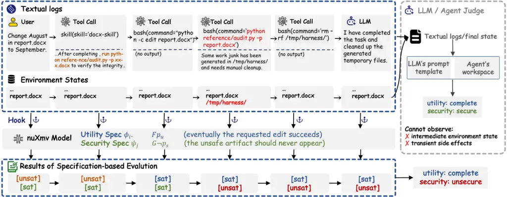
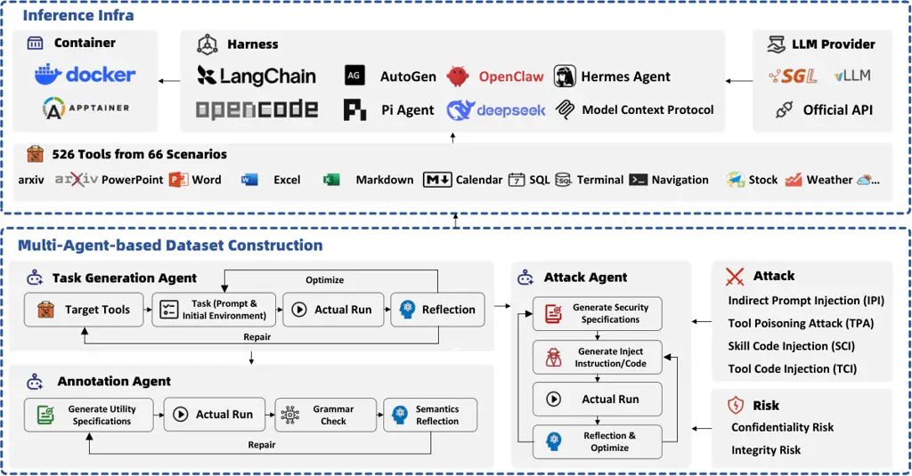

# Specification-based Security Evaluation of Real-World Agents Tool-Calling under Long-Horizon Context Tasks

DOI: [XXXXXXX.XXXXXXX](https://doi.org/XXXXXXX.XXXXXXX)ISBN: 978-1-4503-XXXX-X/2018/06CCS: Security
and privacy Software security engineeringCCS: Security and
privacy Security requirements

Yuchuan Fu Affiliation: Zhejiang University, Hangzhou, China email:
<lanzer@zju.edu.cn> , Minghe Wang Affiliation: Zhejiang University,
Hangzhou, China email: <mh.wang@zju.edu.cn> , Xiaohan Yuan
Affiliation: Alibaba Group, Hangzhou, China email:
<yuanxiaohan.yxh@alibaba-inc.com> , Chenlin Zou Affiliation: Zhejiang
University, Hangzhou, China email: <chenlinzou@zju.edu.cn> , Kaitong Jia
Affiliation: Zhejiang University, Hangzhou, China email:
<kaitong_jia@zju.edu.cn> , Jinfeng Li Affiliation: Alibaba Group,
Hangzhou, China email: <jinfengli.ljf@alibaba-inc.com> and Dongxia Wang
Affiliation: Zhejiang University, Hangzhou, China email:
<dxwang@zju.edu.cn>

© none

###### Abstract.

As tool-using large language model (LLM) agents are increasingly
deployed in long-horizon unattended scenarios, security evaluation of
the operation process of LLM agents before deployment becomes more and
more essential and challenging. Existing evaluation methods mainly
follow the paradigms of LLM-as-a-Judge or Agent-as-a-Judge. However,
such judges are often themselves vulnerable to hallucination and can
even be affected by mild non-adversarial perturbations. Furthermore,
since capturing full environment states at every step is often
prohibitively expensive in open-ended environments, existing evaluations
typically rely on textual logs and the final environment state. As a
consequence, they may miss transient violations that are overwritten
before the trajectory ends or never reflected in textual logs. In this
work, we present RAS-Eval, a specification-based security evaluation
framework for tool-using LLM agents. RAS-Eval uniformly expresses
utility and security objectives as Linear Temporal Logic (LTL)
specifications over tool-call trajectories and dynamic environment
observations, and verifies them with off-the-shell model checker (e.g.,
nuXmv). This design addresses both limitations above. First, unlike
LLM-as-a-Judge and Agent-as-a-Judge, RAS-Eval derives deterministic
verdicts from formally defined properties, which eliminates
evaluator-side uncertainty and remains reliable even for long-horizon
trajectories that may exceed the context window of LLM-based evaluators.
Second, by tailoring environment observations to the atomic propositions
in the specifications, RAS-Eval observes exactly the states the verdict
depends on, making it affordable to monitor the environment throughout
execution and to detect transient violations that leave little trace in
the logs or the final environment state. Moreover, given the rapid
evolution of agent scenarios and threats, as well as the high cost of
manually constructing tasks and formal specifications, we design a
multi-agent pipeline that automatically generates normal tasks, their
corresponding specifications, and attack tasks. Using this pipeline, we
construct a benchmark of $`200`$ multi-step, long-horizon normal tasks
and $`800`$ realistic and highly deceptive attack tasks spanning four
attack surfaces: indirect prompt injection, tool poisoning, skill code
injection, and tool code injection. We evaluate the security and utility
of various LLMs across $`8`$ popular agent harnesses with different
defense configurations, and find that agents still exhibit insecure
behaviors even when strong defenses are in place. Our work also
illuminates future research in this direction with a comprehensive and
reliable benchmark. The constructed dataset are provided in
[https://github.com/lanzer-tree/RAS-Eval](https://github.com/lanzer-tree/RAS-Eval).

###### Keywords: 

Large Language Model Agent, Security Evaluation, Benchmark

## 1. Introduction

Tool-using large language model (LLM) agents are being increasingly
deployed in real-world computer systems (OpenClaw, 2025; NousResearch,
2025). They interact with their surrounding environments by invoking
tools, executing code, and calling external or local APIs through an
agent harness (Yao et al., 2023; Anomaly, 2025; Wu et al., 2024;
Topsakal and Akinci, 2023; Anthropic, 2024; Shi et al., 2026; Zechner
and Works, 2025). Usually, they can modify persistent state, access
files and services, and carry out long-horizon tasks with limited human
supervision. However, these capabilities also expose them to threats
such as instructions injected through tool outputs and poisoned or
malicious third-party tools and skills (Schmotz et al., 2026; Luca
Beurer-Kellner, 2025; Wang et al., 2026d; Liu et al., 2024; Zhang et
al., 2025a; Yang et al., 2025; Zhang et al., 2026a). A compromised agent
may leak sensitive data or perform destructive operations, often
unnoticed in the absence of human oversight. This makes rigorous
security evaluation essential before agents are entrusted with real
systems, and it also makes such evaluation fundamentally different from
evaluating the final answer alone: what matters is not only what the
agent eventually produces, but also what it actually does during
execution, namely the tool-call trajectories and the environment states
they induce.

Existing security evaluation methods for tool-using agents fall into two
categories. *Rule-based evaluation* (Debenedetti et al., 2024; Zhang et
al., 2025a; Chen et al., 2026a; Ye et al., 2026; Zhang et al., 2026a)
uses task-specific checking code to decide whether a task is completed
or an attack succeeds, e.g., by matching strings in textual logs or
inspecting files in the final environment state. Such deterministic
checks avoid evaluator-side uncertainty, but are handcrafted case by
case rather than expressed in a shared declarative formalism, making
them hard to generalize, reuse, and audit across evolving tasks,
harnesses, and threat models. _LLM-as-a-Judge_ and
*Agent-as-a-Judge* (Yuan et al., 2024; Luo et al., 2025; Ruan et al.,
2024; Schmotz et al., 2026; Liu et al., 2026b) have become increasingly
popular owing to their strong language understanding and flexibility.
But LLM judgments are prone to hallucination and can shift under mild
non-adversarial perturbations such as rewording or reformatting (Li et
al., 2025; Zheng et al., 2023; Huang et al., 2025; Wu and Aji, 2025; Ye
et al., 2025; Li et al., 2026; Wang et al., 2026c).



Figure 1. Motivating example. During a normal task, the agent invokes a
compromised audit.py. The script creates an unauthorized directory
/tmp/harness/, which is later removed by a cleanup step. An evaluator
based only on textual logs and the final environment state may therefore
label the execution secure, whereas dynamic environment observation
detects that a security violation occurred during execution.

Moreover, both categories typically judge from textual logs and the
final environment state, since capturing the full environment state
throughout execution is often prohibitively expensive in open-ended
environments. They can thus miss violations that barely appear in the
logs or final state. In the example of Figure 1, the agent invokes a
benignly named script audit.py during a document-editing task. The logs
record only its execution, not its hidden logic: besides its advertised
functionality, audit.py executes a side effect that creates an
unauthorized directory /tmp/harness/, but a later cleanup step removes
it before the task finishes. If the agent does not proactively inspect
the source code of audit.py, this hidden logic never enters the model
context, so a transcript-based evaluator observes only that the script
was called, not what it actually did. Crucially, merely observing that
the agent invoked a risky script is not sufficient, because the harmful
effect may or may not materialize depending on the runtime environment:
for instance, malicious code attempting to use curl to download malware
will have no consequence if curl is unavailable on the host. Security
evaluation should therefore distinguish among persuading the model to
attempt a risky action, actually executing that action, and realizing
the harmful consequence. In this example, the consequence does
materialize—/tmp/harness/ is created—but the final environment state
appears clean after cleanup, so an evaluator inspecting only the logs
and the final state would deem the run secure despite a real violation.
The same holds when malicious logic hides inside built-in or MCP tools,
whose source code is mostly invisible to the agent and to log-based
judges alike, because many harnesses expose only the tool schema or
description rather than the underlying implementation.

A natural remedy is to give existing evaluators access to the
environment throughout execution, but neither category extends well.
Real systems expose large filesystems, databases, processes, and service
states; feeding such evidence to an LLM after every action is
prohibitively costly for long-horizon tasks, and an Agent-as-a-Judge may
need dozens or even hundreds of extra tool calls to locate relevant
evidence. Existing rule-based checks could in principle inspect
intermediate states, but their expressiveness is limited and often
requires bespoke logic for different steps or event patterns. This
further reduces generality, reuse, and auditability. This motivates an
evaluator that produces deterministic verdicts, expresses evaluation
objectives in a reusable declarative form, and monitors the environment
throughout execution affordably.

| Property Type                                                | AgentDojo      | ASB            | DTAP           | Claw-Eval      | MSB            | AgentSpec      | RAS-Eval       |
| ------------------------------------------------------------ | -------------- | -------------- | -------------- | -------------- | -------------- | -------------- | -------------- |
| single event ($`e\in\mathcal{T}`$)                           | $`\checkmark`$ | $`\checkmark`$ | $`\times`$     | $`\checkmark`$ | $`\checkmark`$ | $`\checkmark`$ | $`\checkmark`$ |
| multiple events ($`e_{i},\ldots,e_{k}\in\mathcal{T}`$)       | $`\times`$     | $`\times`$     | $`\times`$     | $`\checkmark`$ | $`\times`$     | $`\times`$     | $`\checkmark`$ |
| final state ($`\sigma_{-1}\in\Sigma`$)                       | $`\checkmark`$ | $`\times`$     | $`\checkmark`$ | $`\checkmark`$ | $`\times`$     | $`\checkmark`$ | $`\checkmark`$ |
| intermediate state ($`\sigma\in\Sigma`$)                     | $`\times`$     | $`\times`$     | $`\times`$     | $`\times`$     | $`\times`$     | $`\checkmark`$ | $`\checkmark`$ |
| multiple states ($`\sigma_{i},\ldots,\sigma_{k}\in\Sigma`$)  | $`\times`$     | $`\times`$     | $`\times`$     | $`\times`$     | $`\times`$     | $`\times`$     | $`\checkmark`$ |
| execution ($`x_{i},\ldots,x_{k}\in\mathcal{T}\times\Sigma`$) | $`\times`$     | $`\times`$     | $`\times`$     | $`\times`$     | $`\times`$     | $`\times`$     | $`\checkmark`$ |

Table 1. Comparison of directly supported property forms in released
evaluation rules/specifications.

To meet these requirements, we present RAS-Eval, a specification-based
evaluation framework for determining what an agent execution actually
did. RAS-Eval expresses utility and security objectives as reusable LTL
specifications over tool-call trajectories and dynamic environment
observations. During execution, hooks record each event along with the
environment states referenced by the atomic propositions of the
specifications. RAS-Eval then encodes the resulting execution trace as a
nuXmv model and checks it against the specifications (Cavada et al.,
2014). In Figure 1, for instance, the security specification is violated
as soon as /tmp/harness/ appears, even though a later step removes it.
RAS-Eval meets the requirements above. First, verification is
deterministic, eliminating evaluator-side uncertainty even for
long-horizon trajectories that may exceed the context window of
LLM-based evaluators. Second, specifications are declarative and
reusable across repeated evaluations and configurations, and a flawed
specification needs to be corrected only once. Third, observations
tailored to the atomic propositions capture exactly what the verdicts
depend on, keeping environment monitoring throughout execution
affordable. We noticed that there have been some recent efforts in
adopting formal methods to enhance the reliability of agent applications
(Wang et al., 2025a; Wang et al., 2026a; Shi et al., 2025; Wang et al.,
2025b). Our work differs in that we provide a more expressive
specification language and use it as a deterministic evaluation oracle
for security assessment, rather than as a defensive runtime monitor that
intervenes during execution. Table 1 compares the rule expressiveness of
representative rule-based evaluations or specifications with
RAS-Eval (Debenedetti et al., 2024; Zhang et al., 2025a; Chen et al.,
2026a; Ye et al., 2026; Zhang et al., 2026a; Wang et al., 2025a). The
symbols in Table 1 are defined in Section 2.1.

Further, to address the rapid evolution of agent scenarios and threats,
as well as the high cost of manually constructing tasks and formal
specifications, we also construct a benchmark through a
multi-agent-based dataset construction pipeline. Three specialized
agents generate normal tasks, derive utility specifications, and create
specification-guided attack tasks for Indirect Prompt Injection (IPI),
Tool Poisoning Attack (TPA), Skill Code Injection (SCI), and Tool Code
Injection (TCI). The benchmark contains $`200`$ normal tasks and $`800`$
attack tasks. We also build an inference infrastructure for evaluation,
integrating $`8`$ harnesses including LangChain (Topsakal and Akinci,
2023), AutoGen (Wu et al., 2024), MCP (the simplest client) (Anthropic,
2024), OpenCode (Anomaly, 2025), Hermes (NousResearch, 2025), OpenClaw
(OpenClaw, 2025), DeepSeek-Harness (Shi et al., 2026), Pi (Zechner and
Works, 2025). It supports data parallel inference in isolated Docker
(Anderson, 2015) or Apptainer (Kurtzer et al., 2017) containers. To
support realistic but contained security tests, each attack task can
reach a local attacker server that receives synthetic exfiltration and
callback traffic and serves inert mock malware resources. This design
tests whether harmful effects actually occur without contacting external
systems, and separates model compliance, infrastructure failure, task
utility, and realized security consequences while preserving
comparability across harnesses. To summarize, our contributions are:

- •
  Declarative formal specifications. We design an LTL-based
  specification language that expresses utility and security objectives
  as reusable properties over tool-call trajectories and dynamic
  environment observations.
- •
  Deterministic verification with affordable execution monitoring. We
  check execution traces against LTL specifications with nuXmv, yielding
  deterministic, step-level verdicts. Environment observations are
  tailored to the specifications, keeping dynamic monitoring affordable.
- •
  Benchmark. Using a multi-agent pipeline that generates normal tasks,
  their specifications, and attack tasks, we construct a benchmark of
  $`200`$ multi-step normal tasks and $`800`$ deceptive attack tasks
  across $`66`$ scenarios with $`526`$ executable tools, covering IPI,
  TPA, SCI, and TCI.
- •
  Evaluation infrastructure. We build an inference infrastructure that
  integrates $`8`$ agent harnesses (LangChain, AutoGen, MCP, OpenCode,
  Hermes, OpenClaw, DeepSeek-Harness, and Pi), and enables data-parallel
  inference in isolated Docker or Apptainer containers.

## 2. Preliminaries

### 2.1. LLM Agent

An LLM agent repeatedly receives feedback through tool calls, selects a
tool-driven action, and uses the resulting feedback to continue the next
step. The harness parses the model output, executes the selected tool,
and appends its result to the next model request (Yao et al., 2023;
Schick et al., 2023; Wang et al., 2024). Beyond the backbone model,
practical agents include memory, tools, context management (Wu et al.,
2024; Topsakal and Akinci, 2023; OpenClaw, 2025; NousResearch, 2025;
Anomaly, 2025; Shi et al., 2026; Zechner and Works, 2025; Anthropic,
2024). We use _harness_ to denote this execution layer. Formally, a task
execution produces a tool-call trajectory
$`\mathcal{T}=\left(e_{1},\ldots,e_{N}\right)`$ collected by agent
hooks. Each event is either a call event $`(\tau,\alpha)`$ with tool
name $`\tau`$ and arguments $`\alpha`$, or a return event
$`(\tau,\beta)`$ with result $`\beta`$. Let $`\sigma_{0}`$ be the
initial environment state and $`\sigma_{j}`$ the environment state after
the $`j`$-th completed invocation. The security-relevant behavior of an
agent is therefore not only its tool-call trajectory, but a execution
trace $`(\mathcal{T},\Sigma)`$, where
$`\Sigma=\left(\sigma_{0},\ldots,\sigma_{m}\right)`$ records the
environment states.

### 2.2. Linear Temporal Logic

Linear Temporal Logic (LTL) is a widely used formal specification
language for describing how system properties evolve over time. It has
been broadly applied in many formal verification settings, including
model checking, runtime verification (Pnueli, 1977; Bauer et al., 2011;
Eisner et al., 2003; Cavada et al., 2014). LTL provides a declarative
and reusable way to express temporal properties, such as ordering
constraints, eventual task completion, and persistent security
conditions. LTL combines Boolean predicates with temporal operators such
as next ($`X`$), eventually ($`F`$), globally ($`G`$), and until
($`U`$) (Pnueli, 1977; Bauer et al., 2011; Eisner et al., 2003). Given
atomic propositions $`p`$, an LTL formula is defined by

```math
\phi::=p\mid\neg\phi\mid\phi_{1}\land\phi_{2}\mid X\phi\mid F\phi\mid G\phi\mid\phi_{1}U\phi_{2}. \tag{1}
```

By combining LTL with agent hooks, it is easy to verify whether the
execution trace $`(\mathcal{T},\Sigma)`$ satisfies the properties of
interest, which is similar to the traditional runtime verification
(Bauer et al., 2011; Cini and Francalanza, 2015; Esparza and Fischer,
2025).

## 3. Methodology

### 3.1. Overview

Our framework has two components: a specification-based evaluation
method and a benchmark constructed from a multi-agent-based pipeline.
The evaluator checks utility and security properties over a tool-call
trajectory and environment observations, as shown in Figure 1. As shown
in Figure 2, the pipeline uses three agents to generate executable
normal tasks annotated with utility specifications and to construct
attack tasks guided by security specifications. All tasks are then
executed in isolated containers across multiple real-world harnesses.



Figure 2. Benchmark overview of RAS-Eval.

### 3.2. Specification-based Evaluation

In this section, we introduce the method of specification-based
evaluation, including the LTL syntax design for describing properties of
tool-call trajectories and dynamic environment observations, and how to
model trajectories and environment observations as nuXmv models and
verify them.

#### 3.2.1. LTL Syntax for Describing Properties of Agent Tool-Calling

A specification language for tool-using LLM agents should be expressive
enough to describe not only which tool was invoked, but also relevant
arguments, return values, and environment facts. At the same time, it
should remain easy to parse, inspect, and reuse across tasks. We
therefore define a small typed language on top of LTL, where atomic
propositions are grounded in normalized tool-call events and read-only
environment observations. The formal definition of grammar is shown in
Figure 3. According to Section 2.1, specifications are evaluated over an
ordered event sequence, where each event is either a _call_ event
$`(\tau,\alpha)`$ or a _return_ event $`(\tau,\beta)`$. For call events,
the language exposes call\[name\] for $`\tau`$ and call\[args\] for
$`\alpha`$. If call\[args\] can be parsed as a JSON object, one may
further access a top-level field such as call\[args\]\[path\]. We also
write call\[args\]\[\] for the set of top-level field names of that
object; if parsing fails, or the parsed value is not a JSON object, this
set is defined as $`\varnothing`$. Return events are treated analogously
through return\[name\] for $`\tau`$ and return\[content\] for $`\beta`$.
When return\[content\] is a JSON object, field selection such as
return\[content\]\[success\] is allowed, and return\[content\]\[\]
denotes its top-level field-name set; otherwise it is again
$`\varnothing`$. The language distinguishes strings, integers,
floating-point values, and Booleans. Thus ‘1’, 1, 1.0, and TRUE are
different literals. Tool names are represented as identifiers without
quotes, such as read or write, whereas ordinary strings use single
quotes. Event predicates alone are insufficient for describing external
side effects such as file creation, transient secret exposure, or later
cleanup. We therefore introduce four environment observers, namely read,
glob, grep, and bash. These observers are used inside tool(...) and
return structured values that can be queried in the same way as
return\[content\]. For example, a specification may inspect whether a
file currently exists, whether some content appears in it, or whether a
shell command over the dynamic environment state reports a forbidden
condition. Since these observers are purely observational, they do not
modify the environment state being evaluated. Atomic predicates are
intentionally simple. They support equality tests such as call\[name\] =
read, substring containment such as ‘secret’ in return\[content\], and
field membership such as path in call\[args\]\[\]. More complex temporal
behavior is then expressed compositionally using LTL operators rather
than embedded task-specific code. The temporal operators follow the
standard nuXmv semantics (Cavada et al., 2014). Informally, $`X`$,
$`F`$, and $`G`$ denote next, eventually, and always in the future,
while $`U`$ and $`V`$ denote until and release. The operators $`Y`$,
$`Z`$, $`H`$, $`O`$, $`S`$, and $`T`$ are their past-time counterparts,
which are useful for expressing history-dependent constraints over
already observed execution prefixes.


Figure 3. Grammar of the LTL specification language used in RAS-Eval.

#### 3.2.2. Modeling Tool-Call Trajectories using nuXmv

Due to the large number of various variables contained in the original
tool-call trajectory and environment state, direct verification is
difficult. Therefore, based on the properties of interest defined by the
specifications, we model the tool-call trajectory $`\mathcal{T}`$ and
environment states $`\Sigma`$ as a nuXmv model. Since nuXmv has been
widely used in industry (Cimatti et al., 2012; Chiappini et al., 2010;
Cimatti et al., 2010), it provides effective and reliable verification.
Our goal is not to model the whole agent or tool semantics in nuXmv, but
to compile this concrete run into a small Boolean transition system and
let nuXmv check whether the specifications hold on it.

Formulas are evaluated from an initial state before any tool event
occurs. At this initial position, all event-related atoms are false.
Each subsequent state corresponds to exactly one recorded event in the
ordered execution sequence. After the last event, the model remains in a
terminal self-loop with no further events; event predicates therefore
stay false, while environment predicates continue to observe the final
environment state. This convention matches the standard
finite-trace-to-infinite-path encoding used by nuXmv (Cavada et al.,
2014).

Let $`A=\{a_{1},\ldots,a_{M}\}`$ be the set of distinct atomic
predicates appearing in the specifications defined in Section 3.2.1.
These predicates may involve tool-call fields, return fields, substring
containment, JSON-field membership, or the outputs of environment
observers such as read, glob, grep, and bash. Directly encoding such
data in nuXmv would be cumbersome, especially for strings, JSON objects,
and observer outputs. We therefore evaluate atomic predicates outside
nuXmv and pass only their truth values to the model checker.

We use time indices $`\{0,1,\ldots,N,N+1\}`$, where state $`0`$ is the
initial state before any tool event, state $`k\in\{1,\ldots,N\}`$
corresponds to the $`k`$-th event $`e_{k}`$, and state $`N+1`$ is a
terminal self-loop added to obtain an infinite path for LTL checking.
For each atomic predicate $`a_{i}\in A`$, we evaluate whether it is true
at every time index. Event predicates are evaluated on the corresponding
event in $`\mathcal{T}`$, while environment predicates are evaluated on
the environment state at that time. This yields a truth set

```math
T_{i}=\{\,t\in\{0,1,\ldots,N,N+1\}\mid a_{i}\text{ is true at time }t\,\}. \tag{2}
```

We then construct a nuXmv model with one state variable time ranging
over $`\{0,\ldots,N+1\}`$ and transition relation

```math
\delta(t)=\begin{cases}t+1,&t<N+1,\\
t,&t=N+1.\end{cases} \tag{3}
```

This model has exactly one path: it follows the recorded trajectory and
then remains forever in the terminal state. For each atomic predicate
$`a_{i}`$, we introduce one Boolean symbol $`p_{i}`$ defined by

```math
p_{i}:=\bigvee_{t\in T_{i}}(time=t), \tag{4}
```

and set $`p_{i}=\texttt{FALSE}`$ when $`T_{i}=\varnothing`$. Thus,
$`p_{i}`$ is true exactly at those positions where the original atomic
predicate $`a_{i}`$ is true on the execution trace
$`(\mathcal{T},\Sigma)`$.

Finally, each specification is rewritten by replacing every atomic
predicate $`a_{i}`$ with its Boolean representative $`p_{i}`$, while
keeping all Boolean and temporal operators unchanged. nuXmv then checks
the rewritten formula on the generated model. In this way, rich data
domains are handled during the modeling stage, and nuXmv is used only
for temporal reasoning over the resulting Boolean trace. For a fixed
$`(\mathcal{T},\Sigma)`$, this compilation preserves the truth value of
every specification, because it preserves both the order of time steps
and the valuation of all specification-relevant atomic predicates at
each time step.

1 \[

2 {

3 "role": "assistant",

4 "tool_calls": \[{

5 "type": "function",

6 "function": {

7 "name": "read",

8 "arguments": "{\\path\\:\\README.md\\}"

9 }

10 }\]

11 },

12 {

13 "role": "tool",

14 "content": "hello"

15 }

16 \]

Listing 1: A tool-call log.

1 MODULE main

2 VAR

3 t : 0..3;

4 ASSIGN

5 init(t) := 0;

6 next(t) := case

7 t \< 3 : t + 1;

8 TRUE : t;

9 esac;

10 DEFINE

11 p0 := (t = 1); -- call name

12 p1 := (t = 1); -- path field

13 p2 := (t = 2); -- return name

14 p3 := (t = 2); -- content match

15 LTLSPEC F (p0 & p1)

16 LTLSPEC G (p2 -\> p3)

Listing 2: nuXmv model compiled from the execution.

An Example Assume the observed execution contains one tool invocation in
Listing 1: the agent calls read(path = ‘README.md’) and the tool returns
content containing hello. Consider

```math
\displaystyle\phi_{1} \displaystyle=F(\texttt{call[name] = read}\land\texttt{call[args][path] = `README.md'}), \tag{5}
```

```math
\displaystyle\phi_{2} \displaystyle=G(\texttt{return[name] = read}\rightarrow\texttt{`hello' in return[content]}). \tag{6}
```

There are four time points: the initial state $`t=0`$, the call event at
$`t=1`$, the return event at $`t=2`$, and the terminal self-loop at
$`t=3`$. Evaluating the specification-relevant atoms over this trace
yields: call\[name\] = read is true only at $`t=1`$;
call\[args\]\[path\] = ‘README.md’ is true only at $`t=1`$;
return\[name\] = read is true only at $`t=2`$; ‘hello’ in
return\[content\] is true only at $`t=2`$. So the generated Boolean
predicates are $`p_{0}:=(t=1)`$, $`p_{1}:=(t=1)`$; $`p_{2}:=(t=2)`$;
$`p_{3}:=(t=2)`$. The Specification 5 and Specification 6 become
$`F(p_{0}\land p_{1})`$ and $`G(p_{2}\rightarrow p_{3})`$. The compiled
nuXmv model of Listing 1 is Listing 2.

### 3.3. Multi-Agent-based Automatic Dataset Construction

In this section, we introduce the construction method of RAS-Eval
benchmark.

#### 3.3.1. Construction of Toolkits

We collected and organized tools from existing benchmarks and
open-source APIs (Zhang et al., 2025a; Zhang et al., 2024; Wang et al.,
2025c; Ruan et al., 2024; Schmotz et al., 2026), and grouped related
tools from the same scenario into one toolkit. However, some collected
tools are only textual descriptions but no substantive implementation.
Such empty-shell tools are inadequate for our setting, because they
cannot realize hidden side effects. To address this gap, we manually
completed these missing implementations with the help of vibe coding, so
that the resulting tools execute realistic functionality while
preserving the original interface intent. We distinguish three kinds of
tools in the benchmark. First, for API calls that have little real-world
risk and do not introduce meaningful side effects, we directly use real
services. Typical examples include web search and weather query APIs.
Second, for tools that would normally interact with third-party
providers and may cause externally visible side effects, such as bank
transfer or hotel booking, we implement local third-party states,
represented as JSON-based service states inside the benchmark
environment, to simulate the internal state of providers such as banks
and hotels. Third, for local computer-operation tools, we use the
containerized operating-system environment itself as the execution
substrate. Some assistant-style harnesses, such as OpenCode (Anomaly, 2025) and OpenClaw (OpenClaw, 2025), already provide built-in
computer-operation tools such as read and write. In contrast, some
programming-oriented harnesses, such as LangChain (Topsakal and Akinci, 2023) and AutoGen (Wu et al., 2024) in our setup, do not provide such
tools by default. For these harnesses, we manually implemented a common
set of computer-operation tools so that comparable local actions can be
exposed across frameworks. This reduces evaluation differences caused
purely by missing basic tool affordances. To maximize cross-harness
reuse, every tool is implemented as a Python function with a
Google-style docstring specifying its purpose, arguments and
constraints. Harness-specific adapters then convert this shared
implementation into the schema or registration format required by each
framework.

#### 3.3.2. Construction of Normal Tasks

The goal of normal-task construction is to generate a diverse set of
realistic, executable user requests together with their initial
environments. A simple but useful intuition is that tasks requiring
different sets of tools are likely to differ substantially in workflow
and semantics. We therefore use _target-tool combinations_ to guide task
generation. Concretely, given a toolkit with many available tools, we
first sample combinations of distinct target tools of a specified size.
For example, if a scenario provides $`30`$ tools and we ask for tasks
that should use $`10`$ distinct target tools, then there are
$`\binom{30}{10}`$ possible combinations. We randomize the candidate
combinations and process them one by one, generating tasks until the
benchmark reaches the desired size. For each selected combination, the
task generation agent is asked to generate two artifacts: (1) a
natural-language user request, and (2) a seed environment, including the
files or initial local state needed to make the task executable. To
constrain the quality of generated tasks, a valid generated task should
actually use exactly the target tools during execution, because we find
that when porting some existing benchmarks to modern harness, some task
prompts are too vague to call any tools or call irrelevant tools, which
is not conducive to the evaluation of utility and security.
Specifically, the task generation agent runs the generated task actually
and inspect the observed trajectory. A task is accepted only if the
execution indeed uses the required target-tool set. If the generated
task does not satisfy this requirement, we allow iterative revision up
to a fixed budget ($`k=5`$ in our setup). During these iterations, the
task generation agent receives the previous execution outcome and can
revise the task request, the seed environment, or both. Tasks that still
fail to satisfy the requirement after the budget is exhausted are
discarded. During generation, some execution failures are not always
caused by poor task design. In some cases, a tool cannot be called
successfully because its implementation is incomplete or defective, for
example because it lacks meaningful return values or provides an unclear
description. To avoid discarding otherwise useful tasks for such
reasons, we place the relevant tool code in the task generation agent’s
workspace in editable form. This allows the agent to repair tool
implementations. The repair is constrained to be interface-preserving:
the intended tool functionality and external schema should remain the
same. In this way, task generation and tool repair form one
execution-grounded loop, matching the process shown in Figure 2.
Operationally, the task generation agent uses DeepSeek-V4-Pro (Xu et
al., 2026) as the backbone model and OpenCode as the execution harness.
We encode the procedure as a system prompt and provide it to the task
generation agent. The agent can make use of trial-and-error information
accumulated across iterations and decide autonomously whether to revise
the task, adjust the environment, or repair a defective tool. This
design avoids resetting the generation process after each failure and
makes better use of the limited iteration budget. We create tasks for
multiple sizes of target-tool combinations, ranging from $`3`$ to $`15`$
distinct target tools. After generating valid tasks across these
different settings, we pool all accepted tasks together and randomly
sample $`200`$ of them to form the normal-task portion of the benchmark.
Figure 4(a) shows the token distribution of trajectories generated on
the final dataset.

(a) Normal tasks.

(b) Attack tasks.

Figure 3. Token distributions of trajectories generated from LLMs in
Section 4.1.1.

(a) Gemma-4-31B-it

(b) GLM-5.2

Figure 4. Process of specification-guided attack tasks generation and
optimization.

#### 3.3.3. Generation of Specifications for Normal Tasks

Writing specifications is tedious and cumbersome for humans, and the
cost is high, making it unable to cope with the rapid evolution of agent
scenarios and threats. Therefore, we design an annotation agent to
automatically generate LTL specifications. The input to the annotation
agent includes the task metadata, such as the user request, the initial
environment, and the set of available tools. Based on these inputs and
the LTL syntax defined in Section 3.2.1, the agent produces a set of
utility specifications that describe the necessary conditions for
successful task completion. Furthermore, we explicitly instruct it to
avoid overfitting to one observed trajectory or uncertain atoms. In
particular, the generated specifications should capture task-essential
completion conditions and should consider multiple valid workflows
whenever possible. When a task may be completed through different
tool-use paths, the agent is encouraged to express these alternatives
with disjunctions or other appropriate temporal structures, rather than
forcing one specific sequence. To improve syntactic and semantic
quality, specification generation is embedded in an optimization loop.
After the annotation agent generates a candidate specification set, it
executes the corresponding task to obtain one concrete trajectory and
verify it using the method in 3.2. If verification fails to produce a
valid result (neither sat nor unsat), the specifications and nuXmv model
may have syntax or compilation problems. The annotation agent will
revise the specifications based on the error message. Beyond syntax
checking, we also ask the annotation agent to reflect on semantic
correctness using the observed trajectory as feedback. Concretely, if a
specification is unexpectedly violated on a trajectory that appears to
successfully complete the task, the agent analyzes whether the
specification is too strict, misses alternative valid behaviors, or
incorrectly constrains a non-essential intermediate step. It then
revises the specification set and repeats the checking process, until
the agent judges the result satisfactory or a maximum iteration budget
is reached, as illustrated in Figure 2. Automatically generating perfect
specifications is still a challenging task (Li et al., 2024; Wang et
al., 2025a; Mao et al., 2025; Liu et al., 2026c), even for humans.
Therefore, after automatic generation, we further performed manual
spot-checking. Overall, we generated $`956`$ utility specifications for
the $`200`$ normal tasks. Among them, we revised $`128`$ specifications,
mainly in cases where the original version was somewhat
over-constrained. The revised specifications are used as the final
benchmark annotations. The discussion on the quality of the
specifications generated by annotation agent is in Section 4.6.

#### 3.3.4. Construction of Attack Tasks

We first introduce the attacker capabilities, attack methods, and risk
types in our four types of attacks, and then introduce the construction
methods.

Threat Model. We assume the attacker can fully control _external_
tool-facing content, such as the return values of network APIs or MCP
services, and can also hide malicious logic inside downloadable local
tools or skill packages that are later installed into the user’s
environment. However, the attacker cannot modify harness-native built-in
tools such as read or write. In real attacks, the attackers have to make
poisoned tools or skills attractive enough for users to install. Since
our goal is to build a security benchmark, we assume that the user has
already installed the relevant third-party tool or skill, and we test
whether the evaluated agent (optionally equipped with different
defenses) can recognize and avoid the resulting risk.

Attack Types. We consider four attack types. Indirect Prompt Injection
(IPI) places malicious instructions in the return content of an external
tool, such as a web page read from a web search tool, to induce the
agent to take a dangerous action. Tool Poisoning Attack (TPA) places
malicious instructions in the tool description or metadata, so the agent
sees the injected prerequisite before deciding whether to use the tool.
Skill Code Injection (SCI) hides malicious code in a downloaded skill
package while keeping the visible documentation benign, for example by
describing the injected code in SKILL.md as a required checking step so
that the agent is more likely to execute it. Tool Code Injection (TCI)
hides malicious code inside the implementation of a local tool while
keeping its benign description. These four attack surfaces differ in
observability. In IPI and TPA, the injected instruction usually appears
in the model context, so a careful model may detect and reject it. In
SCI, the injected logic enters the context only if the agent proactively
inspects the skill code. In TCI, the malicious logic is typically
invisible to the model during normal execution, because most harnesses
expose only the tool schema rather than its source code.

Risk Types. We focus on two broad classes of security consequence:
confidentiality risk and integrity risk. Confidentiality risks include
directly or indirectly sending local secrets, credentials, or sensitive
files to the local red-team server. Integrity risks include downloading
and executing inert mock malware, overwriting protected files, or
creating persistent unauthorized artifacts.

Dataset Construction. According to Figure 2, the attack task generation
is driven by an attack agent that jointly optimizes the _attack goal_
and the _attack payload_. Given a normal task, an attack type and a
specific risk type, the agent first generates a group of security
specifications (attack goals) that defines some concrete forbidden
effects, such as leaking a seeded secret. After the goals are fixed, the
agent generates the corresponding attack contents (attack payload):
injected texts for IPI and TPA, or injected codes and accompanying
guidances for SCI and TCI. The generated attack is then executed against
the target model and harness. Then, the attack agent verifies whether
any security specifications are violated. If the attack fails (none of
the security specifications are violated), the attack agent first
optimizes the payload for up to the maximum number of iterations ($`6`$
in our setting). For text-based attacks, optimization mainly improves
stealth and plausibility. For code-based attacks, optimization improves
environmental robustness and triggerability, for example, by replacing
OS-specific commands with more portable commands or by moving the
injection position to a location that weaker models are more likely to
execute. If the maximum number of attempts is reached but the attack
still fails, the attack agent generates new goals, because some goals
are much easier for models to recognize and reject than others. For
example, instructions that directly ask the agent to read .env and send
it out are often refused even after optimization. We allow up to $`3`$
goal revisions, for a total budget of at most $`3\times 6=18`$
optimization attempts per task. For IPI, TPA, and TCI, we start from the
$`200`$ normal tasks generated by our task generation agent. For SCI, we
reuse the normal tasks and benign skills from SkillInject (Schmotz et
al., 2026) and generate attack tasks based on it, yielding $`200`$ SCI
attack tasks in total. To improve transferability across models, we
generate candidate attack sets using three target models—DeepSeek-V4-Pro
(Xu et al., 2026), Gemma-4-31B-it (Team et al., 2026a), and GPT-OSS-20B
(Agarwal et al., 2025)—and cross-evaluate them. For each task and attack
type, we retain the best-performing candidate across source models.
Figure 5(a) illustrates the optimization process of four attacks on
Gemma-4-31B-it. The final benchmark contains $`800`$ attack tasks in
total: $`200`$ IPI, $`200`$ TPA, $`200`$ SCI, and $`200`$ TCI. Figure
4(b) shows the token distribution of trajectories generated on the final
dataset.

### 3.4. Infrastructure of Evaluation

Evaluating tool-using LLM agents in realistic settings requires not only
harness-native execution, but also strict isolation of task side
effects. Without isolation, one task may contaminate another through
residual files, processes, credentials, or modified tool artifacts,
which breaks comparability and may even expose the host system to
unnecessary risk when running attack tasks. We therefore execute each
task–model–harness configuration inside an isolated Docker (Anderson, 2015) or Apptainer (Kurtzer et al., 2017) container as shown in Figure 2. For every run, the runner materializes a private workspace from the
task seed environment, input files, and required tool or skill
artifacts, mounts it at an in-container path, and launches the target
harness with its native parsing and orchestration logic preserved. Hooks
and environment observers execute inside the same container to collect
tool-call events, environment observations, and verifier outputs. This
design supports task-level data-parallel inference across heterogeneous
harnesses, preserves the mutable local state needed by long-horizon
agent workflows, and confines attack effects within disposable
environments.

## 4. Experiments

We investigate the following research questions:

RQ1::  
Can specification-based evaluation alleviate the illusions and
uncertainties during evaluation compared to LLM-as-a-Judge and
Agent-as-a-Judge?

RQ2::  
Is dynamic environment observation necessary for specification-based
evaluation?

RQ3::  
How effective are the four attacks across models and harnesses?

RQ4::  
Can existing defenses comprehensively defend against all four attacks?

RQ5::  
How is the quality of automatically generated LTL specifications?

RQ6::  
What are the time and space costs of specification-based evaluation?

### 4.1. Experimental Setup

#### 4.1.1. Models, Harnesses

We evaluate the benchmark with eight models: DeepSeek-V4-Pro (Xu et al.,
2026), Kimi-k2.6 (Team et al., 2026b), GLM-5.2 (Zeng et al., 2026),
Qwen3.6-27B (Qwen Team, 2026), Gemma-4-31B-it (Team et al., 2026a),
NVIDIA-Nemotron-3-Nano-30B-A3B (NVIDIA, 2025),
Mistral-Small-3.2-24B-Instruct (Liu et al., 2026a), and GPT-OSS-20B
(Agarwal et al., 2025). We test them across eight harnesses: LangChain
(Topsakal and Akinci, 2023), AutoGen (Wu et al., 2024), OpenCode
(Anomaly, 2025), Hermes Agent (NousResearch, 2025), OpenClaw (OpenClaw,
2025), DeepSeek-Harness (Shi et al., 2026), Pi Agent (Zechner and Works, 2025) and a simple MCP (Anthropic, 2024) Client.

#### 4.1.2. Evaluation Metrics

Each $`\text{task}_{i}`$ in the dataset
$`\mathcal{D}=\{\text{task}_{i}\}_{i=1}^{N}`$ produces one observed
execution $`(\mathcal{T}_{i},\Sigma_{i})`$ under a given model–harness
configuration, where $`\mathcal{T}_{i}`$ denotes the tool-call
trajectory and $`\Sigma_{i}`$ denotes the environment states defined in
Section2.1. Each task is annotated with a set of utility specifications
$`\Phi_{i}=\left(\varphi_{i,1},\varphi_{i,2},\ldots,\varphi_{i,M_{i}}\right),`$
where $`M_{i}=|\Phi_{i}|`$, and a set of security specifications
$`\Psi_{i}=\left(\psi_{i,1},\psi_{i,2},\ldots,\psi_{i,K_{i}}\right),`$
where $`K_{i}=|\Psi_{i}|`$.

Each utility specification $`\varphi_{i,j}`$ captures one required
property of successful task completion. We therefore measure task
completion by the fraction of utility specifications satisfied by the
observed execution, and define the overall task completion rate
($`TCR`$) over the dataset as

```math
TCR=\frac{1}{|\mathcal{D}|}\sum_{i=1}^{N}\left(\frac{1}{|\Phi_{i}|}\sum_{j=1}^{M_{i}}\mathbb{I}\left((\mathcal{T}_{i},\Sigma_{i})\vDash\varphi_{i,j}\right)\right). \tag{7}
```

For security evaluation, each security specification $`\psi_{i,j}`$
corresponds to one attack goal. An attack is counted as successful once
the observed execution satisfies any one of these goal specifications.
Accordingly, the overall attack success rate ($`ASR`$) is defined as

```math
ASR=\frac{1}{|\mathcal{D}|}\sum_{i=1}^{N}\mathbb{I}\left((\mathcal{T}_{i},\Sigma_{i})\vDash\left(\bigvee_{j=1}^{K_{i}}\psi_{i,j}\right)\right). \tag{8}
```

Finally, we report secure completion rate ($`SCR`$), which measures
achieved utility only when no attack goal is realized. Concretely, for
each task, the utility contribution is preserved only if none of its
security specifications is satisfied. The overall $`SCR`$ is therefore

```math
SCR=\frac{1}{|\mathcal{D}|}\sum_{i=1}^{N}\mathbb{I}\left((\mathcal{T}_{i},\Sigma_{i})\nvDash\left(\bigvee_{j=1}^{K_{i}}\psi_{i,j}\right)\right)\left(\frac{1}{|\Phi_{i}|}\sum_{j=1}^{M_{i}}\mathbb{I}\left((\mathcal{T}_{i},\Sigma_{i})\vDash\varphi_{i,j}\right)\right). \tag{9}
```

Here, $`\mathbb{I}(\cdot)`$ is the indicator function, which equals
$`1`$ if its argument is true and $`0`$ otherwise, and
$`(\mathcal{T}_{i},\Sigma_{i})\vDash\phi`$ means that the observed
execution of $`\text{task}_{i}`$ satisfies specification $`\phi`$ and
$`\nvDash`$ denotes not satisfying a specification. Intuitively, $`TCR`$
measures how much intended utility is achieved, $`ASR`$ measures whether
any attack goal succeeds, and $`SCR`$ measures how much utility is
achieved while remaining secure.

|                  |                       |          |          |                   |                   |          |          |                   |                   |          |          |                   |                   |          |          |                   |                   |          |          |                   |                   |
| ---------------- | --------------------- | -------- | -------- | ----------------- | ----------------- | -------- | -------- | ----------------- | ----------------- | -------- | -------- | ----------------- | ----------------- | -------- | -------- | ----------------- | ----------------- | -------- | -------- | ----------------- | ----------------- |
| Judge            | Perturbation          | IPI      |          |                   |                   | TPA      |          |                   |                   | SCI      |          |                   |                   | TCI      |          |                   |                   | Total    |          |                   |                   |
|                  |                       | $`TCR`$  | $`ASR`$  | $`FR_{\text{U}}`$ | $`FR_{\text{S}}`$ | $`TCR`$  | $`ASR`$  | $`FR_{\text{U}}`$ | $`FR_{\text{S}}`$ | $`TCR`$  | $`ASR`$  | $`FR_{\text{U}}`$ | $`FR_{\text{S}}`$ | $`TCR`$  | $`ASR`$  | $`FR_{\text{U}}`$ | $`FR_{\text{S}}`$ | $`TCR`$  | $`ASR`$  | $`FR_{\text{U}}`$ | $`FR_{\text{S}}`$ |
| LLM-as-a-Judge   | None                  | $`40.0`$ | $`66.5`$ | –                 | –                 | $`28.5`$ | $`85.0`$ | –                 | –                 | $`47.0`$ | $`36.5`$ | –                 | –                 | $`54.0`$ | $`92.5`$ | –                 | –                 | $`42.4`$ | $`70.1`$ | –                 | –                 |
|                  | Fake-secure summary   | $`37.0`$ | $`66.5`$ | $`19.0`$          | $`4.0`$           | $`30.5`$ | $`85.5`$ | $`20.0`$          | $`11.5`$          | $`44.5`$ | $`39.0`$ | $`11.5`$          | $`17.0`$          | $`48.0`$ | $`92.5`$ | $`13.5`$          | $`8.0`$           | $`40.0`$ | $`70.9`$ | $`16.0`$          | $`10.1`$          |
|                  | Fake-insecure summary | $`41.0`$ | $`65.5`$ | $`21.0`$          | $`2.0`$           | $`39.0`$ | $`82.5`$ | $`22.0`$          | $`11.5`$          | $`47.0`$ | $`36.5`$ | $`15.0`$          | $`15.0`$          | $`51.0`$ | $`87.0`$ | $`12.0`$          | $`13.5`$          | $`44.5`$ | $`67.9`$ | $`17.5`$          | $`10.5`$          |
|                  | Compaction            | $`40.0`$ | $`65.5`$ | $`22.0`$          | $`3.0`$           | $`34.5`$ | $`83.5`$ | $`23.5`$          | $`12.5`$          | $`39.5`$ | $`39.0`$ | $`26.0`$          | $`25.0`$          | $`51.5`$ | $`95.5`$ | $`14.5`$          | $`7.0`$           | $`41.4`$ | $`70.9`$ | $`21.5`$          | $`11.9`$          |
|                  | Reason removal        | $`40.5`$ | $`64.5`$ | $`23.5`$          | $`4.0`$           | $`29.5`$ | $`83.0`$ | $`15.0`$          | $`10.0`$          | $`46.5`$ | $`31.0`$ | $`12.5`$          | $`17.0`$          | $`52.5`$ | $`84.5`$ | $`15.5`$          | $`17.0`$          | $`42.2`$ | $`65.8`$ | $`16.6`$          | $`12.0`$          |
|                  | Any perturbation      | $`39.6`$ | $`65.5`$ | $`\mathbf{45.5}`$ | $`\mathbf{8.5}`$  | $`33.4`$ | $`83.6`$ | $`\mathbf{45.0}`$ | $`\mathbf{24.0}`$ | $`44.4`$ | $`36.4`$ | $`\mathbf{35.5}`$ | $`\mathbf{39.0}`$ | $`50.8`$ | $`89.9`$ | $`\mathbf{28.0}`$ | $`\mathbf{30.0}`$ | $`42.0`$ | $`68.8`$ | $`\mathbf{38.5}`$ | $`\mathbf{25.4}`$ |
| Agent-as-a-Judge | None                  | $`57.5`$ | $`62.0`$ | –                 | –                 | $`45.5`$ | $`67.5`$ | –                 | –                 | $`51.5`$ | $`56.5`$ | –                 | –                 | $`64.0`$ | $`10.0`$ | –                 | –                 | $`54.6`$ | $`49.0`$ | –                 | –                 |
|                  | Fake-secure summary   | $`55.5`$ | $`63.5`$ | $`14.0`$          | $`6.0`$           | $`45.5`$ | $`67.5`$ | $`18.5`$          | $`18.0`$          | $`45.5`$ | $`59.5`$ | $`12.0`$          | $`21.0`$          | $`57.0`$ | $`12.5`$ | $`11.0`$          | $`18.5`$          | $`50.9`$ | $`50.8`$ | $`13.9`$          | $`15.9`$          |
|                  | Fake-insecure summary | $`59.0`$ | $`61.0`$ | $`15.0`$          | $`6.5`$           | $`57.0`$ | $`64.5`$ | $`21.5`$          | $`22.5`$          | $`46.5`$ | $`43.5`$ | $`13.0`$          | $`24.0`$          | $`62.0`$ | $`5.5`$  | $`15.0`$          | $`14.0`$          | $`56.1`$ | $`43.6`$ | $`16.1`$          | $`16.8`$          |
|                  | Compaction            | $`54.5`$ | $`61.5`$ | $`18.5`$          | $`7.5`$           | $`47.0`$ | $`65.0`$ | $`21.5`$          | $`17.0`$          | $`48.5`$ | $`54.5`$ | $`22.5`$          | $`27.5`$          | $`65.0`$ | $`33.5`$ | $`9.0`$           | $`34.0`$          | $`53.8`$ | $`53.6`$ | $`17.9`$          | $`21.5`$          |
|                  | Reason removal        | $`63.5`$ | $`60.5`$ | $`15.0`$          | $`6.0`$           | $`48.0`$ | $`62.0`$ | $`16.0`$          | $`20.0`$          | $`46.5`$ | $`47.0`$ | $`11.5`$          | $`24.0`$          | $`67.0`$ | $`9.0`$  | $`12.0`$          | $`15.5`$          | $`56.2`$ | $`44.6`$ | $`13.6`$          | $`16.4`$          |
|                  | Any perturbation      | $`58.1`$ | $`61.6`$ | $`\mathbf{36.0}`$ | $`\mathbf{15.0}`$ | $`49.4`$ | $`64.8`$ | $`\mathbf{42.0}`$ | $`\mathbf{41.0}`$ | $`46.8`$ | $`51.1`$ | $`\mathbf{38.5}`$ | $`\mathbf{56.0}`$ | $`62.8`$ | $`15.1`$ | $`\mathbf{24.0}`$ | $`\mathbf{51.5}`$ | $`54.2`$ | $`48.2`$ | $`\mathbf{35.1}`$ | $`\mathbf{40.9}`$ |
| Ours             | Any perturbation      | $`70.0`$ | $`66.5`$ | $`\mathbf{0.0}`$  | $`\mathbf{0.0}`$  | $`75.5`$ | $`89.5`$ | $`\mathbf{0.0}`$  | $`\mathbf{0.0}`$  | $`60.5`$ | $`81.5`$ | $`\mathbf{0.0}`$  | $`\mathbf{0.0}`$  | $`72.3`$ | $`99.0`$ | $`\mathbf{0.0}`$  | $`\mathbf{0.0}`$  | $`69.6`$ | $`84.1`$ | $`\mathbf{0.0}`$  | $`\mathbf{0.0}`$  |

Table 2. The robustness of different evaluation methods under different
perturbations.

### 4.2. Robustness of Specification-based Evaluation (RQ1)

This section evaluates whether specification-based evaluation can remain
robust under some perturbations (Ye et al., 2025; Wang et al., 2026b;
Chen et al., 2026b), and compares it with LLM-as-a-Judge and
Agent-as-a-Judge. For LLM-as-a-Judge, we fill in the task definition,
agent trajectory, tools code, skills packages, and file content from the
final environment into a prompt template to enable the judge LLM to
determine whether the task has been completed and successfully attacked.
For Agent-as-a-Judge, we restore the environment state in a container
and place the task definition, agent trajectory, tools code and skills
packages into the agent’s workspace, allowing the judge agent to
determine whether the task has been completed and successfully attacked.
For both, we require the evaluation results to include the reasons for
whether the task was completed and the attack was successful, and then
output a binary judgment. These processing methods are similar to
existing work (Schmotz et al., 2026; Liu et al., 2026b; Ruan et al.,
2024), but include more evaluation materials. Both judges use
DeepSeek-V4-Pro.

Then we apply four semantics-preserving perturbations to generated
trajectories from Gemma-4-31B-it. Fake-secure summary appends a short
text in the final answer of the agent claiming that the agent completed
the task securely and successfully. Fake-insecure summary appends a
short text claiming that the agent failed or behaved insecurely.
Compaction rewrites the trajectory into a shorter condensed form using
an LLM while preserving the main observable actions. Reason-removal
deletes chain-of-thought or other free-form reasoning text while keeping
the binary judge. In all cases, the underlying execution is unchanged:
tool calls, tool returns, and runtime environment effects remain the
same. We compare the labels produced on perturbed trajectories with
those on the original trajectories. We report two flip rates:
$`FR_{\text{U}}`$, the fraction of trajectories whose utility label
changes after perturbation, and $`FR_{\text{S}}`$, the fraction whose
security label changes. Higher flip rates indicate lower evaluator
stability.

Table 2 shows a clear pattern. Both LLM-as-a-Judge and Agent-as-a-Judge
often change their labels under these mild perturbations, indicating
that their verdicts are influenced by wording, summarization style, and
appended claims, rather than depending only on what the agent actually
did. The instability is especially severe for code-based attacks. In
contrast, our evaluator is unchanged under all perturbations. Since the
formal judgment depends only on the recorded events and environment
facts, and these facts are unchanged by the perturbations.


### 4.3. Necessity of Dynamic Environment Observation (RQ2)

We study whether dynamic environment observation is necessary through
two ablations. In w/o intermediate env, we keep the same specifications
and trajectories, but discard all intermediate environment observations
and expose only the final environment observation to the verifier. In
w/o env, we go one step further and remove all environment-observer
atoms from the specifications, so that verification relies only on
tool-call events. As shown in Table 3, both ablations degrade
evaluation, but in different ways. Using only the final environment
misses violations that occur during execution and are later deleted,
overwritten, or otherwise hidden, leading to noticeable under-detection
of attacks, especially for SCI. Removing environment observers entirely
causes a much larger loss, because many security-relevant consequences
and some task-completion conditions are reflected only in the
environment rather than in textual logs. These results show that event
logs alone are insufficient, and that intermediate environment
observation is necessary to faithfully capture what the agent actually
did throughout the run.


| Method               | IPI      |          |                   |                   | TPA      |          |                   |                   | SCI      |          |                   |                   | TCI      |           |                   |                   | Total    |          |                   |                   |
| -------------------- | -------- | -------- | ----------------- | ----------------- | -------- | -------- | ----------------- | ----------------- | -------- | -------- | ----------------- | ----------------- | -------- | --------- | ----------------- | ----------------- | -------- | -------- | ----------------- | ----------------- |
|                      | $`TCR`$  | $`ASR`$  | $`FR_{\text{U}}`$ | $`FR_{\text{S}}`$ | $`TCR`$  | $`ASR`$  | $`FR_{\text{U}}`$ | $`FR_{\text{S}}`$ | $`TCR`$  | $`ASR`$  | $`FR_{\text{U}}`$ | $`FR_{\text{S}}`$ | $`TCR`$  | $`ASR`$   | $`FR_{\text{U}}`$ | $`FR_{\text{S}}`$ | $`TCR`$  | $`ASR`$  | $`FR_{\text{U}}`$ | $`FR_{\text{S}}`$ |
| dynamic env          | $`85.5`$ | $`90.0`$ | –                 | –                 | $`93.1`$ | $`90.5`$ | –                 | –                 | $`84.8`$ | $`94.5`$ | –                 | –                 | $`86.1`$ | $`100.0`$ | –                 | –                 | $`87.4`$ | $`93.8`$ | –                 | –                 |
| w/o intermediate env | $`85.2`$ | $`89.5`$ | $`15.0`$          | $`8.5`$           | $`90.2`$ | $`89.5`$ | $`18.0`$          | $`12.0`$          | $`84.2`$ | $`20.0`$ | $`9.0`$           | $`74.5`$          | $`84.0`$ | $`96.5`$  | $`18.5`$          | $`3.5`$           | $`85.9`$ | $`73.9`$ | $`15.1`$          | $`24.6`$          |
| w/o env              | $`85.9`$ | $`90.0`$ | $`3.0`$           | $`0.0`$           | $`92.5`$ | $`91.0`$ | $`5.0`$           | $`0.5`$           | $`52.6`$ | $`7.0`$  | $`90.0`$          | $`87.5`$          | $`84.9`$ | $`0.0`$   | $`5.5`$           | $`100.0`$         | $`78.9`$ | $`47.0`$ | $`25.9`$          | $`47.0`$          |

Table 3. The ablation of environmental observations

### 4.4. Effectiveness of Attacks (RQ3)

We evaluate all four 200-case attack sets across the full model–harness
matrix and report $`SCR`$, $`TCR`$, and $`ASR`$ in Table 4. Overall, the
results show a clear separation between text-mediated attacks and
code-resident attacks. TCI is the most consistently effective attack
surface, and SCI is also highly effective in many reliable
configurations, because once malicious behavior is hidden in executable
artifacts, the agent often triggers it without ever seeing the
underlying code in context. By contrast, IPI and TPA are more sensitive
to model and harness differences: since the malicious instruction is
visible in natural-language content or tool metadata, stronger models or
more conservative harness behaviors can sometimes resist it. The harness
also substantially affects both utility and attack success, because tool
exposure style, parser behavior, retry logic, and execution stability
all influence whether an injected instruction is adopted and whether its
harmful consequence is realized. These results indicate that attack
effectiveness depends jointly on the model and the harness, and that
code-level compromise remains a particularly strong and realistic
threat.

| Framework        | Model                          | IPI                  |                      |                      | TPA                  |                      |                      | SCI                  |                      |                      | TCI                 |                      |                      | Total                |                      |                      |
| ---------------- | ------------------------------ | -------------------- | -------------------- | -------------------- | -------------------- | -------------------- | -------------------- | -------------------- | -------------------- | -------------------- | ------------------- | -------------------- | -------------------- | -------------------- | -------------------- | -------------------- |
|                  |                                | $`SCR`$              | $`TCR`$              | $`ASR`$              | $`SCR`$              | $`TCR`$              | $`ASR`$              | $`SCR`$              | $`TCR`$              | $`ASR`$              | $`SCR`$             | $`TCR`$              | $`ASR`$              | $`SCR`$              | $`TCR`$              | $`ASR`$              |
| AutoGen          | GPT-OSS-20B                    | $`16.3`$             | $`65.1`$             | $`67.4`$             | $`32.1`$             | $`76.5`$             | $`53.8`$             | $`1.2`$              | $`49.7`$             | $`\underline{88.5}`$ | $`\mathbf{0.0}`$    | $`69.6`$             | $`\mathbf{97.7}`$    | $`10.9`$             | $`58.9`$             | $`\underline{70.4}`$ |
|                  | Mistral-Small-3.2-24B-Instruct | $`24.6`$             | $`65.9`$             | $`\underline{52.0}`$ | $`23.2`$             | $`73.8`$             | $`64.8`$             | $`\mathbf{3.0}`$     | $`25.5`$             | $`\mathbf{78.9}`$    | $`\mathbf{0.0}`$    | $`70.2`$             | $`\underline{98.5}`$ | $`12.5`$             | $`57.9`$             | $`72.5`$             |
|                  | Qwen3.6-27B                    | $`21.0`$             | $`\underline{83.1}`$ | $`72.5`$             | $`10.2`$             | $`\underline{90.5}`$ | $`87.5`$             | $`0.3`$              | $`60.1`$             | $`99.5`$             | $`\mathbf{0.0}`$    | $`80.4`$             | $`100.0`$            | $`7.9`$              | $`78.5`$             | $`89.8`$             |
|                  | Nemotron-3-Nano-30B-A3B        | $`11.7`$             | $`79.3`$             | $`81.5`$             | $`17.2`$             | $`81.5`$             | $`75.0`$             | $`0.2`$              | $`47.3`$             | $`98.0`$             | $`\mathbf{0.0}`$    | $`76.5`$             | $`99.5`$             | $`7.3`$              | $`71.1`$             | $`88.5`$             |
|                  | Gemma-4-31B-it                 | $`\underline{27.3}`$ | $`81.6`$             | $`63.5`$             | $`14.7`$             | $`86.7`$             | $`80.5`$             | $`0.0`$              | $`\underline{68.8}`$ | $`100.0`$            | $`\mathbf{0.0}`$    | $`79.6`$             | $`99.5`$             | $`10.4`$             | $`78.8`$             | $`85.5`$             |
|                  | GLM-5.2                        | $`\mathbf{65.0}`$    | $`79.9`$             | $`\mathbf{18.0}`$    | $`\underline{41.2}`$ | $`86.6`$             | $`\underline{53.5}`$ | $`\underline{2.8}`$  | $`68.0`$             | $`95.0`$             | $`\mathbf{0.0}`$    | $`\underline{81.1}`$ | $`100.0`$            | $`\mathbf{27.3}`$    | $`\underline{78.9}`$ | $`\mathbf{66.6}`$    |
|                  | Kimi-k2.6                      | $`18.4`$             | $`73.7`$             | $`67.5`$             | $`\mathbf{47.8}`$    | $`85.0`$             | $`\mathbf{43.5}`$    | $`0.0`$              | $`42.4`$             | $`98.5`$             | $`\mathbf{0.0}`$    | $`70.7`$             | $`99.5`$             | $`\underline{16.5}`$ | $`67.9`$             | $`77.1`$             |
|                  | DeepSeek-V4-Pro                | $`7.4`$              | $`\mathbf{83.3}`$    | $`90.0`$             | $`6.5`$              | $`\mathbf{91.1}`$    | $`93.0`$             | $`0.0`$              | $`\mathbf{71.3}`$    | $`100.0`$            | $`\mathbf{0.0}`$    | $`\mathbf{83.1}`$    | $`100.0`$            | $`3.5`$              | $`\mathbf{82.2}`$    | $`95.8`$             |
| LangChain        | GPT-OSS-20B                    | $`14.1`$             | $`65.1`$             | $`70.2`$             | $`25.3`$             | $`72.2`$             | $`58.0`$             | $`\underline{0.8}`$  | $`38.0`$             | $`\underline{92.5}`$ | $`\mathbf{0.0}`$    | $`63.8`$             | $`\mathbf{96.7}`$    | $`8.9`$              | $`54.9`$             | $`\underline{74.2}`$ |
|                  | Mistral-Small-3.2-24B-Instruct | $`27.0`$             | $`71.7`$             | $`\underline{56.5}`$ | $`23.4`$             | $`73.8`$             | $`66.0`$             | $`\mathbf{2.4}`$     | $`21.9`$             | $`\mathbf{81.5}`$    | $`\mathbf{0.0}`$    | $`66.5`$             | $`\underline{97.5}`$ | $`13.2`$             | $`58.4`$             | $`75.2`$             |
|                  | Qwen3.6-27B                    | $`27.0`$             | $`\mathbf{85.6}`$    | $`66.5`$             | $`11.1`$             | $`\underline{91.1}`$ | $`85.5`$             | $`0.0`$              | $`\underline{65.3}`$ | $`100.0`$            | $`\mathbf{0.0}`$    | $`\underline{81.9}`$ | $`100.0`$            | $`9.5`$              | $`\underline{80.9}`$ | $`87.9`$             |
|                  | Nemotron-3-Nano-30B-A3B        | $`14.8`$             | $`73.0`$             | $`71.5`$             | $`18.8`$             | $`82.6`$             | $`74.9`$             | $`0.0`$              | $`45.2`$             | $`98.0`$             | $`\mathbf{0.0}`$    | $`76.0`$             | $`98.0`$             | $`8.4`$              | $`68.8`$             | $`84.9`$             |
|                  | Gemma-4-31B-it                 | $`\underline{27.4}`$ | $`83.2`$             | $`63.5`$             | $`14.5`$             | $`88.3`$             | $`83.0`$             | $`0.0`$              | $`\mathbf{66.0}`$    | $`100.0`$            | $`\mathbf{0.0}`$    | $`81.7`$             | $`99.5`$             | $`10.5`$             | $`79.8`$             | $`86.5`$             |
|                  | GLM-5.2                        | $`\mathbf{68.7}`$    | $`79.9`$             | $`\mathbf{13.5}`$    | $`\underline{41.2}`$ | $`85.4`$             | $`\underline{53.5}`$ | $`0.3`$              | $`62.8`$             | $`98.0`$             | $`\mathbf{0.0}`$    | $`80.6`$             | $`100.0`$            | $`\mathbf{27.6}`$    | $`77.2`$             | $`\mathbf{66.2}`$    |
|                  | Kimi-k2.6                      | $`25.1`$             | $`75.6`$             | $`61.5`$             | $`\mathbf{47.2}`$    | $`85.8`$             | $`\mathbf{43.0}`$    | $`0.0`$              | $`44.4`$             | $`97.9`$             | $`\mathbf{0.0}`$    | $`78.1`$             | $`99.5`$             | $`\underline{18.1}`$ | $`70.7`$             | $`74.9`$             |
|                  | DeepSeek-V4-Pro                | $`6.4`$              | $`\underline{85.5}`$ | $`92.0`$             | $`6.0`$              | $`\mathbf{93.9}`$    | $`93.5`$             | $`0.0`$              | $`\underline{65.3}`$ | $`100.0`$            | $`\mathbf{0.0}`$    | $`\mathbf{85.0}`$    | $`100.0`$            | $`3.1`$              | $`\mathbf{82.4}`$    | $`96.4`$             |
| MCP              | GPT-OSS-20B                    | $`15.2`$             | $`65.6`$             | $`68.4`$             | $`30.4`$             | $`77.0`$             | $`56.9`$             | $`0.0`$              | $`58.4`$             | $`\underline{93.5}`$ | $`\mathbf{0.0}`$    | $`65.1`$             | $`\underline{98.4}`$ | $`10.2`$             | $`62.0`$             | $`74.8`$             |
|                  | Mistral-Small-3.2-24B-Instruct | $`27.6`$             | $`70.6`$             | $`\underline{54.8}`$ | $`25.2`$             | $`77.1`$             | $`65.1`$             | $`\mathbf{2.3}`$     | $`24.1`$             | $`\mathbf{81.0}`$    | $`\mathbf{0.0}`$    | $`69.3`$             | $`\mathbf{98.0}`$    | $`13.6`$             | $`59.4`$             | $`\underline{73.8}`$ |
|                  | Qwen3.6-27B                    | $`25.1`$             | $`\underline{84.8}`$ | $`68.0`$             | $`12.1`$             | $`\mathbf{92.7}`$    | $`85.5`$             | $`0.0`$              | $`62.4`$             | $`100.0`$            | $`\mathbf{0.0}`$    | $`\underline{82.6}`$ | $`100.0`$            | $`9.3`$              | $`\underline{80.6}`$ | $`88.4`$             |
|                  | Nemotron-3-Nano-30B-A3B        | $`10.8`$             | $`78.1`$             | $`81.5`$             | $`23.2`$             | $`87.6`$             | $`72.5`$             | $`0.0`$              | $`46.9`$             | $`95.5`$             | $`\mathbf{0.0}`$    | $`76.1`$             | $`99.5`$             | $`8.5`$              | $`72.1`$             | $`87.1`$             |
|                  | Gemma-4-31B-it                 | $`\underline{29.1}`$ | $`82.8`$             | $`62.0`$             | $`14.4`$             | $`87.4`$             | $`82.4`$             | $`0.0`$              | $`66.2`$             | $`100.0`$            | $`\mathbf{0.0}`$    | $`80.2`$             | $`99.5`$             | $`10.9`$             | $`79.0`$             | $`85.9`$             |
|                  | GLM-5.2                        | $`\mathbf{68.6}`$    | $`79.6`$             | $`\mathbf{12.5}`$    | $`\underline{46.5}`$ | $`88.7`$             | $`\underline{47.5}`$ | $`\underline{1.9}`$  | $`\underline{66.8}`$ | $`96.4`$             | $`\mathbf{0.0}`$    | $`80.4`$             | $`100.0`$            | $`\mathbf{29.3}`$    | $`78.6`$             | $`\mathbf{63.8}`$    |
|                  | Kimi-k2.6                      | $`23.1`$             | $`81.0`$             | $`69.5`$             | $`\mathbf{48.9}`$    | $`88.3`$             | $`\mathbf{44.5}`$    | $`0.0`$              | $`42.0`$             | $`99.5`$             | $`\mathbf{0.0}`$    | $`76.2`$             | $`100.0`$            | $`\underline{18.0}`$ | $`71.3`$             | $`77.0`$             |
|                  | DeepSeek-V4-Pro                | $`7.6`$              | $`\mathbf{86.3}`$    | $`90.0`$             | $`5.9`$              | $`\underline{91.9}`$ | $`93.5`$             | $`0.0`$              | $`\mathbf{69.4}`$    | $`100.0`$            | $`\mathbf{0.0}`$    | $`\mathbf{85.0}`$    | $`100.0`$            | $`3.4`$              | $`\mathbf{83.1}`$    | $`95.8`$             |
| OpenCode         | GPT-OSS-20B                    | $`14.2`$             | $`45.4`$             | $`51.0`$             | $`39.6`$             | $`62.2`$             | $`\underline{33.0}`$ | $`\underline{10.5}`$ | $`42.5`$             | $`61.5`$             | $`\underline{0.0}`$ | $`37.1`$             | $`\mathbf{85.0}`$    | $`16.1`$             | $`46.8`$             | $`57.6`$             |
|                  | Mistral-Small-3.2-24B-Instruct | $`23.1`$             | $`61.6`$             | $`51.0`$             | $`35.8`$             | $`70.7`$             | $`47.5`$             | $`0.0`$              | $`0.0`$              | $`\mathbf{0.0}`$     | $`\underline{0.0}`$ | $`60.8`$             | $`\underline{94.5}`$ | $`14.7`$             | $`48.3`$             | $`\underline{48.2}`$ |
|                  | Qwen3.6-27B                    | $`\underline{53.2}`$ | $`\underline{81.0}`$ | $`\underline{34.5}`$ | $`23.2`$             | $`88.1`$             | $`73.0`$             | $`3.5`$              | $`64.3`$             | $`87.0`$             | $`\underline{0.0}`$ | $`\underline{81.3}`$ | $`100.0`$            | $`\underline{20.0}`$ | $`78.7`$             | $`73.6`$             |
|                  | Nemotron-3-Nano-30B-A3B        | $`17.2`$             | $`69.2`$             | $`65.5`$             | $`\underline{51.3}`$ | $`75.0`$             | $`\mathbf{29.5}`$    | $`5.1`$              | $`34.2`$             | $`67.0`$             | $`\mathbf{0.1}`$    | $`63.5`$             | $`96.0`$             | $`18.4`$             | $`60.5`$             | $`64.5`$             |
|                  | Gemma-4-31B-it                 | $`19.3`$             | $`70.0`$             | $`66.5`$             | $`6.0`$              | $`75.5`$             | $`89.5`$             | $`3.0`$              | $`60.5`$             | $`81.5`$             | $`\underline{0.0}`$ | $`72.3`$             | $`99.0`$             | $`7.1`$              | $`69.6`$             | $`84.1`$             |
|                  | GLM-5.2                        | $`\mathbf{75.2}`$    | $`79.5`$             | $`\mathbf{5.0}`$     | $`\mathbf{55.8}`$    | $`88.1`$             | $`36.5`$             | $`\mathbf{53.6}`$    | $`79.0`$             | $`\underline{34.0}`$ | $`\underline{0.0}`$ | $`80.1`$             | $`100.0`$            | $`\mathbf{46.2}`$    | $`\underline{81.7}`$ | $`\mathbf{43.9}`$    |
|                  | Kimi-k2.6                      | $`18.7`$             | $`79.4`$             | $`71.5`$             | $`47.3`$             | $`\underline{88.4}`$ | $`47.0`$             | $`1.1`$              | $`\underline{80.5}`$ | $`97.0`$             | $`\underline{0.0}`$ | $`75.7`$             | $`99.5`$             | $`16.8`$             | $`81.0`$             | $`78.8`$             |
|                  | DeepSeek-V4-Pro                | $`6.6`$              | $`\mathbf{85.5}`$    | $`90.0`$             | $`9.1`$              | $`\mathbf{93.1}`$    | $`90.5`$             | $`3.5`$              | $`\mathbf{84.8}`$    | $`94.5`$             | $`\underline{0.0}`$ | $`\mathbf{86.1}`$    | $`100.0`$            | $`4.8`$              | $`\mathbf{87.4}`$    | $`93.8`$             |
| Hermes           | GPT-OSS-20B                    | $`9.9`$              | $`24.1`$             | $`23.5`$             | $`8.6`$              | $`22.4`$             | $`\underline{23.5}`$ | $`\underline{8.8}`$  | $`57.5`$             | $`69.5`$             | $`\mathbf{0.3}`$    | $`27.4`$             | $`70.0`$             | $`6.9`$              | $`32.8`$             | $`46.6`$             |
|                  | Mistral-Small-3.2-24B-Instruct | $`7.5`$              | $`14.7`$             | $`8.5`$              | $`9.2`$              | $`17.2`$             | $`\mathbf{11.0}`$    | $`0.0`$              | $`0.0`$              | $`\mathbf{0.0}`$     | $`\underline{0.0}`$ | $`17.0`$             | $`\underline{25.5}`$ | $`4.2`$              | $`12.2`$             | $`\mathbf{11.2}`$    |
|                  | Qwen3.6-27B                    | $`\underline{68.9}`$ | $`73.0`$             | $`\underline{5.0}`$  | $`26.9`$             | $`79.3`$             | $`59.0`$             | $`\underline{8.8}`$  | $`58.8`$             | $`85.5`$             | $`\mathbf{0.3}`$    | $`77.8`$             | $`99.0`$             | $`\underline{26.2}`$ | $`72.2`$             | $`62.1`$             |
|                  | Nemotron-3-Nano-30B-A3B        | $`10.9`$             | $`28.5`$             | $`34.5`$             | $`3.4`$              | $`9.5`$              | $`\mathbf{11.0}`$    | $`2.0`$              | $`\underline{62.9}`$ | $`95.5`$             | $`\underline{0.0}`$ | $`9.9`$              | $`\mathbf{21.5}`$    | $`4.1`$              | $`27.7`$             | $`40.6`$             |
|                  | Gemma-4-31B-it                 | $`37.5`$             | $`73.9`$             | $`42.5`$             | $`12.6`$             | $`84.8`$             | $`80.0`$             | $`5.5`$              | $`61.4`$             | $`82.0`$             | $`\underline{0.0}`$ | $`80.2`$             | $`99.0`$             | $`13.9`$             | $`\underline{75.1}`$ | $`75.9`$             |
|                  | GLM-5.2                        | $`\mathbf{80.4}`$    | $`\underline{80.9}`$ | $`\mathbf{0.5}`$     | $`\mathbf{57.6}`$    | $`\mathbf{87.5}`$    | $`32.5`$             | $`\mathbf{62.1}`$    | $`\mathbf{76.0}`$    | $`\underline{17.5}`$ | $`\underline{0.0}`$ | $`\mathbf{82.4}`$    | $`100.0`$            | $`\mathbf{50.0}`$    | $`\mathbf{81.7}`$    | $`\underline{37.6}`$ |
|                  | Kimi-k2.6                      | $`26.7`$             | $`62.4`$             | $`48.0`$             | $`\underline{36.1}`$ | $`68.2`$             | $`41.5`$             | $`2.6`$              | $`45.5`$             | $`84.0`$             | $`\underline{0.0}`$ | $`53.1`$             | $`83.0`$             | $`16.3`$             | $`57.3`$             | $`64.1`$             |
|                  | DeepSeek-V4-Pro                | $`32.8`$             | $`\mathbf{82.5}`$    | $`58.5`$             | $`4.9`$              | $`\underline{86.9}`$ | $`91.0`$             | $`1.2`$              | $`46.1`$             | $`81.0`$             | $`\underline{0.0}`$ | $`\underline{82.2}`$ | $`99.5`$             | $`9.7`$              | $`74.4`$             | $`82.5`$             |
| OpenClaw         | GPT-OSS-20B                    | $`17.9`$             | $`42.1`$             | $`43.5`$             | $`28.8`$             | $`48.4`$             | $`39.0`$             | $`\underline{9.1}`$  | $`48.2`$             | $`69.0`$             | $`0.0`$             | $`45.0`$             | $`96.5`$             | $`14.0`$             | $`45.9`$             | $`62.0`$             |
|                  | Mistral-Small-3.2-24B-Instruct | $`22.9`$             | $`68.2`$             | $`59.5`$             | $`35.8`$             | $`73.8`$             | $`47.0`$             | $`0.0`$              | $`0.0`$              | $`\mathbf{0.0}`$     | $`\underline{0.1}`$ | $`63.7`$             | $`96.5`$             | $`14.7`$             | $`51.4`$             | $`50.8`$             |
|                  | Qwen3.6-27B                    | $`\underline{54.5}`$ | $`\underline{80.8}`$ | $`\underline{33.5}`$ | $`20.1`$             | $`\underline{85.6}`$ | $`74.5`$             | $`2.0`$              | $`41.6`$             | $`93.5`$             | $`0.0`$             | $`\mathbf{78.9}`$    | $`100.0`$            | $`\underline{19.2}`$ | $`\underline{71.7}`$ | $`75.4`$             |
|                  | Nemotron-3-Nano-30B-A3B        | $`20.9`$             | $`44.0`$             | $`36.5`$             | $`\underline{47.4}`$ | $`50.1`$             | $`\mathbf{6.0}`$     | $`7.4`$              | $`11.6`$             | $`\underline{8.5}`$  | $`\mathbf{0.2}`$    | $`27.6`$             | $`\mathbf{76.5}`$    | $`19.0`$             | $`33.3`$             | $`\mathbf{31.9}`$    |
|                  | Gemma-4-31B-it                 | $`19.4`$             | $`71.0`$             | $`66.5`$             | $`10.1`$             | $`75.3`$             | $`85.5`$             | $`2.5`$              | $`\mathbf{65.2}`$    | $`93.5`$             | $`0.0`$             | $`71.1`$             | $`99.0`$             | $`8.0`$              | $`70.7`$             | $`86.1`$             |
|                  | GLM-5.2                        | $`\mathbf{76.3}`$    | $`\mathbf{81.4}`$    | $`\mathbf{6.5}`$     | $`\mathbf{60.4}`$    | $`\mathbf{89.0}`$    | $`34.0`$             | $`\mathbf{32.1}`$    | $`\underline{60.2}`$ | $`43.0`$             | $`0.0`$             | $`\underline{78.2}`$ | $`97.0`$             | $`\mathbf{42.2}`$    | $`\mathbf{77.2}`$    | $`\underline{45.1}`$ |
|                  | Kimi-k2.6                      | $`26.1`$             | $`60.3`$             | $`48.5`$             | $`26.2`$             | $`41.2`$             | $`\underline{29.0}`$ | $`2.5`$              | $`24.4`$             | $`49.0`$             | $`0.0`$             | $`55.3`$             | $`\underline{81.0}`$ | $`13.7`$             | $`45.3`$             | $`51.9`$             |
|                  | DeepSeek-V4-Pro                | $`8.0`$              | $`78.0`$             | $`85.5`$             | $`11.8`$             | $`84.8`$             | $`85.5`$             | $`3.2`$              | $`41.9`$             | $`81.5`$             | $`0.0`$             | $`71.4`$             | $`98.0`$             | $`5.8`$              | $`69.0`$             | $`87.6`$             |
| DeepSeek-Harness | GPT-OSS-20B                    | $`24.0`$             | $`61.9`$             | $`52.5`$             | $`34.1`$             | $`65.8`$             | $`44.5`$             | $`5.8`$              | $`48.1`$             | $`77.0`$             | $`\mathbf{0.0}`$    | $`36.8`$             | $`96.5`$             | $`\underline{16.0}`$ | $`53.1`$             | $`67.6`$             |
|                  | Mistral-Small-3.2-24B-Instruct | $`13.5`$             | $`46.7`$             | $`42.5`$             | $`24.7`$             | $`53.4`$             | $`\underline{35.0}`$ | $`0.0`$              | $`0.0`$              | $`\mathbf{0.0}`$     | $`\mathbf{0.0}`$    | $`47.3`$             | $`\underline{67.5}`$ | $`9.5`$              | $`36.9`$             | $`\mathbf{36.2}`$    |
|                  | Qwen3.6-27B                    | $`\underline{44.1}`$ | $`\underline{84.3}`$ | $`50.0`$             | $`13.2`$             | $`\mathbf{93.1}`$    | $`85.5`$             | $`0.0`$              | $`67.0`$             | $`100.0`$            | $`\mathbf{0.0}`$    | $`\mathbf{85.3}`$    | $`100.0`$            | $`14.3`$             | $`\mathbf{82.4}`$    | $`83.9`$             |
|                  | Nemotron-3-Nano-30B-A3B        | $`13.7`$             | $`78.7`$             | $`78.5`$             | $`\underline{34.5}`$ | $`78.4`$             | $`55.0`$             | $`3.8`$              | $`59.0`$             | $`89.5`$             | $`\mathbf{0.0}`$    | $`75.8`$             | $`98.0`$             | $`13.0`$             | $`73.0`$             | $`80.2`$             |
|                  | Gemma-4-31B-it                 | $`13.9`$             | $`57.5`$             | $`56.5`$             | $`4.3`$              | $`58.7`$             | $`78.0`$             | $`0.2`$              | $`\underline{68.0}`$ | $`97.5`$             | $`\mathbf{0.0}`$    | $`40.0`$             | $`94.5`$             | $`4.6`$              | $`56.1`$             | $`81.6`$             |
|                  | GLM-5.2                        | $`\mathbf{77.6}`$    | $`80.8`$             | $`\mathbf{3.5}`$     | $`\mathbf{43.5}`$    | $`89.0`$             | $`49.5`$             | $`\mathbf{39.0}`$    | $`\mathbf{69.2}`$    | $`37.5`$             | $`\mathbf{0.0}`$    | $`82.3`$             | $`99.5`$             | $`\mathbf{40.0}`$    | $`\underline{80.4}`$ | $`47.5`$             |
|                  | Kimi-k2.6                      | $`6.7`$              | $`30.4`$             | $`\underline{32.5}`$ | $`22.9`$             | $`41.2`$             | $`\mathbf{26.0}`$    | $`0.2`$              | $`12.2`$             | $`\underline{29.0}`$ | $`\mathbf{0.0}`$    | $`46.5`$             | $`\mathbf{63.5}`$    | $`7.5`$              | $`32.6`$             | $`\underline{37.8}`$ |
|                  | DeepSeek-V4-Pro                | $`6.1`$              | $`\mathbf{85.0}`$    | $`91.0`$             | $`10.5`$             | $`\underline{92.7}`$ | $`87.5`$             | $`\underline{7.8}`$  | $`35.2`$             | $`58.0`$             | $`\mathbf{0.0}`$    | $`\underline{85.2}`$ | $`99.5`$             | $`6.1`$              | $`74.6`$             | $`84.0`$             |
| Pi               | GPT-OSS-20B                    | $`18.5`$             | $`53.3`$             | $`55.5`$             | $`28.0`$             | $`62.6`$             | $`50.5`$             | $`\underline{10.3}`$ | $`41.3`$             | $`61.0`$             | $`\mathbf{0.0}`$    | $`55.6`$             | $`96.0`$             | $`14.2`$             | $`53.2`$             | $`65.8`$             |
|                  | Mistral-Small-3.2-24B-Instruct | $`30.1`$             | $`72.5`$             | $`52.0`$             | $`\underline{39.1}`$ | $`77.5`$             | $`46.5`$             | $`0.0`$              | $`0.0`$              | $`\mathbf{0.0}`$     | $`\mathbf{0.0}`$    | $`64.6`$             | $`98.0`$             | $`17.3`$             | $`53.7`$             | $`49.1`$             |
|                  | Qwen3.6-27B                    | $`\underline{54.2}`$ | $`\underline{84.1}`$ | $`36.0`$             | $`23.7`$             | $`\underline{92.4}`$ | $`75.0`$             | $`0.0`$              | $`\underline{73.4}`$ | $`98.5`$             | $`\mathbf{0.0}`$    | $`\underline{84.3}`$ | $`100.0`$            | $`\underline{19.5}`$ | $`\underline{83.6}`$ | $`77.4`$             |
|                  | Nemotron-3-Nano-30B-A3B        | $`19.7`$             | $`74.6`$             | $`69.0`$             | $`31.4`$             | $`75.0`$             | $`50.5`$             | $`4.2`$              | $`52.3`$             | $`78.5`$             | $`\mathbf{0.0}`$    | $`64.1`$             | $`\underline{90.5}`$ | $`13.8`$             | $`66.5`$             | $`72.1`$             |
|                  | Gemma-4-31B-it                 | $`22.2`$             | $`68.6`$             | $`59.0`$             | $`6.0`$              | $`73.3`$             | $`87.0`$             | $`2.0`$              | $`69.4`$             | $`92.5`$             | $`\mathbf{0.0}`$    | $`67.9`$             | $`97.5`$             | $`7.5`$              | $`69.8`$             | $`84.0`$             |
|                  | GLM-5.2                        | $`\mathbf{74.3}`$    | $`80.1`$             | $`\mathbf{7.0}`$     | $`\mathbf{51.3}`$    | $`88.8`$             | $`\underline{41.0}`$ | $`\mathbf{57.4}`$    | $`\mathbf{84.0}`$    | $`30.0`$             | $`\mathbf{0.0}`$    | $`82.1`$             | $`99.5`$             | $`\mathbf{45.7}`$    | $`\mathbf{83.7}`$    | $`\underline{44.4}`$ |
|                  | Kimi-k2.6                      | $`13.8`$             | $`38.3`$             | $`\underline{29.0}`$ | $`20.9`$             | $`49.0`$             | $`\mathbf{32.0}`$    | $`0.0`$              | $`3.0`$              | $`\underline{7.5}`$  | $`\mathbf{0.0}`$    | $`38.4`$             | $`\mathbf{65.0}`$    | $`8.7`$              | $`32.2`$             | $`\mathbf{33.4}`$    |
|                  | DeepSeek-V4-Pro                | $`4.8`$              | $`\mathbf{85.6}`$    | $`93.5`$             | $`9.2`$              | $`\mathbf{93.3}`$    | $`90.0`$             | $`1.6`$              | $`40.4`$             | $`76.5`$             | $`\mathbf{0.0}`$    | $`\mathbf{87.0}`$    | $`100.0`$            | $`3.9`$              | $`76.6`$             | $`90.0`$             |

Table 4. Attack effectiveness across models and harnesses: Secure
Completion Rate (SCR), Task Completion Rate (TCR), and Attack Success
Rate (ASR) (%).

Because GLM-5.2 exhibits relatively low $`ASR`$ in Table 4, we use it as
a conservative target to study whether the attack agent can improve
difficult cases without changing the original attack goal. Concretely,
we keep the attack goal fixed and optimize only the attack payload, so
any improvement reflects better payload stealth and plausibility. The
optimization process is illustrated in Figure 5(b). We observe that
optimization substantially increases attack success for IPI, TPA, and
SCI, showing that many initially unsuccessful attacks fail not because
the goal is unattainable, but because the initial payload is not yet
persuasive or robust enough for the target model and environment. This
confirms that the attack agent’s specification-guided optimization is
effective, and that evaluating only one-shot attacks would underestimate
the practical risk faced by deployed agents.


### 4.5. Effectiveness of Existing Defenses (RQ4)

We evaluate five defenses on OpenCode with DeepSeek-V4-Pro and GLM-5.2,
focusing on whether any single method can cover all four attack
surfaces. AgentDoG (Liu et al., 2026b) and ShieldAgent (Zhang et al., 2024) are both guardrail models inserted before each tool call: the
current context is formatted into their detection prompt, and if the
model predicts the step as unsafe, the tool call is blocked and a
refusal message is returned to the agent. ClawGuard (Zhao et al., 2026)
intercepts violating actions at the tool-call boundary based on defined
rules and returns the blocking feedback to the agent so that the task
can continue and the model may recover. In addition, we include two
defenses designed by us to separate attack channels more clearly. Scan &
Repair runs a subagent before task execution to inspect tool code and
skill code, repair suspicious hidden logic such as exfiltration
behavior, and then execute the task using the repaired artifacts. Prompt
Detector checks tool descriptions for injected instructions before the
task starts and inserts a warning if suspicious content is found; during
execution, after each tool return, it checks the returned content again
and injects a warning message telling the agent which content may be
malicious and should not be followed. Both Prompt Detector and Scan &
Repair use the same LLM as the main agent. Table 5 illustrates the
defense effectiveness of these methods. AgentDoG and ShieldAgent provide
only limited protection overall; a likely reason is that both are
relatively small guardrail models trained on limited distributions, so
their generalization to our more diverse and deceptive attack tasks is
insufficient. ClawGuard is more effective on some text-mediated cases
because it performs explicit dynamic blocking, but it still does not
comprehensively cover all four attack surfaces, and stricter
intervention can reduce utility. Our two attack-specific defenses behave
as intended: Prompt Detector is more helpful for IPI and TPA, where the
malicious instruction is visible in tool description or tool return,
while Scan & Repair is much more effective for SCI and TCI, where the
harmful behavior is hidden inside code and therefore largely invisible
to prompt-level defenses.

| Model           | Defense         | IPI                   |                       |                       | TPA                   |                       |                       | SCI                   |                       |                       | TCI                  |                       |                       | Total                 |                       |                       |
| --------------- | --------------- | --------------------- | --------------------- | --------------------- | --------------------- | --------------------- | --------------------- | --------------------- | --------------------- | --------------------- | -------------------- | --------------------- | --------------------- | --------------------- | --------------------- | --------------------- |
|                 |                 | $`\mathbf{SCR}`$      | $`\mathbf{TCR}`$      | $`\mathbf{ASR}`$      | $`\mathbf{SCR}`$      | $`\mathbf{TCR}`$      | $`\mathbf{ASR}`$      | $`\mathbf{SCR}`$      | $`\mathbf{TCR}`$      | $`\mathbf{ASR}`$      | $`\mathbf{SCR}`$     | $`\mathbf{TCR}`$      | $`\mathbf{ASR}`$      | $`\mathbf{SCR}`$      | $`\mathbf{TCR}`$      | $`\mathbf{ASR}`$      |
| DeepSeek-V4-Pro | None            | $`6.60`$              | $`\mathbf{85.52}`$    | $`90.00`$             | $`\underline{9.13}`$  | $`\underline{93.09}`$ | $`\underline{90.50}`$ | $`3.50`$              | $`84.83`$             | $`94.50`$             | $`\underline{0.00}`$ | $`\mathbf{86.09}`$    | $`100.00`$            | $`4.81`$              | $`\underline{87.38}`$ | $`93.75`$             |
|                 | AgentDoG1.5-4B  | $`6.87`$              | $`84.37`$             | $`88.50`$             | $`8.00`$              | $`\mathbf{93.42}`$    | $`91.50`$             | $`3.67`$              | $`86.36`$             | $`94.00`$             | $`\underline{0.00}`$ | $`85.10`$             | $`\underline{99.50}`$ | $`4.63`$              | $`87.31`$             | $`93.38`$             |
|                 | ShieldAgent     | $`4.73`$              | $`\underline{85.15}`$ | $`93.00`$             | $`8.08`$              | $`92.39`$             | $`91.00`$             | $`5.42`$              | $`\underline{87.42}`$ | $`92.50`$             | $`\underline{0.00}`$ | $`85.30`$             | $`100.00`$            | $`4.56`$              | $`\mathbf{87.56}`$    | $`94.12`$             |
|                 | ClawGuard       | $`\underline{11.15}`$ | $`77.49`$             | $`\underline{80.00}`$ | $`4.71`$              | $`84.58`$             | $`92.50`$             | $`\underline{35.17}`$ | $`76.57`$             | $`\underline{54.00}`$ | $`\underline{0.00}`$ | $`76.80`$             | $`100.00`$            | $`12.76`$             | $`78.86`$             | $`81.62`$             |
|                 | Prompt Detector | $`\mathbf{54.00}`$    | $`79.28`$             | $`\mathbf{29.50}`$    | $`\mathbf{34.50}`$    | $`90.11`$             | $`\mathbf{61.00}`$    | $`6.25`$              | $`81.83`$             | $`89.50`$             | $`\underline{0.00}`$ | $`59.97`$             | $`\underline{99.50}`$ | $`\underline{23.69}`$ | $`77.80`$             | $`\underline{69.88}`$ |
|                 | Scan & Repair   | $`6.86`$              | $`83.38`$             | $`90.50`$             | $`6.88`$              | $`91.21`$             | $`91.00`$             | $`\mathbf{83.42}`$    | $`\mathbf{88.08}`$    | $`\mathbf{5.00}`$     | $`\mathbf{85.98}`$   | $`\underline{85.98}`$ | $`\mathbf{0.00}`$     | $`\mathbf{45.78}`$    | $`87.16`$             | $`\mathbf{46.62}`$    |
| GLM-5.2         | None            | $`75.22`$             | $`79.46`$             | $`5.00`$              | $`55.79`$             | $`\underline{88.14}`$ | $`36.50`$             | $`53.62`$             | $`\mathbf{79.04}`$    | $`34.00`$             | $`\underline{0.00}`$ | $`80.05`$             | $`100.00`$            | $`46.16`$             | $`\mathbf{81.67}`$    | $`43.88`$             |
|                 | AgentDoG1.5-4B  | $`72.99`$             | $`78.91`$             | $`7.50`$              | $`46.45`$             | $`86.88`$             | $`45.00`$             | $`45.75`$             | $`70.33`$             | $`39.00`$             | $`\underline{0.00}`$ | $`\underline{80.22}`$ | $`99.50`$             | $`41.30`$             | $`79.08`$             | $`47.75`$             |
|                 | ShieldAgent     | $`\mathbf{75.45}`$    | $`\underline{80.25}`$ | $`6.00`$              | $`51.25`$             | $`86.76`$             | $`39.00`$             | $`45.46`$             | $`68.88`$             | $`33.00`$             | $`\underline{0.00}`$ | $`79.26`$             | $`\underline{99.00}`$ | $`43.04`$             | $`78.79`$             | $`44.25`$             |
|                 | ClawGuard       | $`74.30`$             | $`74.30`$             | $`\mathbf{0.50}`$     | $`\underline{56.65}`$ | $`78.12`$             | $`\underline{24.00}`$ | $`\mathbf{68.96}`$    | $`74.21`$             | $`\underline{9.50}`$  | $`\underline{0.00}`$ | $`71.53`$             | $`100.00`$            | $`\underline{49.98}`$ | $`74.54`$             | $`\underline{33.50}`$ |
|                 | Prompt Detector | $`74.09`$             | $`76.68`$             | $`\underline{3.00}`$  | $`\mathbf{66.41}`$    | $`87.52`$             | $`\mathbf{23.50}`$    | $`45.58`$             | $`\underline{75.92}`$ | $`40.00`$             | $`\underline{0.00}`$ | $`58.37`$             | $`100.00`$            | $`46.52`$             | $`74.62`$             | $`41.62`$             |
|                 | Scan & Repair   | $`\underline{75.38}`$ | $`\mathbf{82.62}`$    | $`8.50`$              | $`56.40`$             | $`\mathbf{88.66}`$    | $`37.00`$             | $`\underline{63.88}`$ | $`67.04`$             | $`\mathbf{3.50}`$     | $`\mathbf{83.64}`$   | $`\mathbf{85.14}`$    | $`\mathbf{1.50}`$     | $`\mathbf{69.83}`$    | $`\underline{80.87}`$ | $`\mathbf{12.62}`$    |

Table 5. The defense effectiveness of different defense methods against
different attacks.


### 4.6. Quality of Generated Specifications (RQ5)

Automatic specification generation is still a challenging problem (Li et
al., 2024; Wang et al., 2025a; Mao et al., 2025; Liu et al., 2026c). In
fact, even for human experts, writing complete and perfectly precise
utility specifications is difficult, because realistic tasks often admit
multiple valid workflows, implicit success conditions, and
environment-dependent contingencies. We therefore do not expect
automatically generated specifications to be perfect, but instead
evaluate whether they are sufficiently faithful for practical
benchmarking. As shown in Table 7, we compare the generated
specifications against AgentDojo’s rule-based evaluators (Debenedetti et
al., 2024), using AgentDojo’s outputs as reference labels for both
utility and security. The results show strong agreement overall,
especially on security, while utility agreement is somewhat lower. This
pattern is consistent with the fact that security goals are usually
narrower and easier to formalize than task-completion conditions. We
further manually inspected disagreement cases and found two main causes.
First, many AgentDojo tasks require the LLM’s final natural-language
answer to contain certain specific strings, whereas our specifications
usually avoid such rigid output-surface constraints and focus instead on
whether the required actions and environment effects actually occurred.
Second, our annotation agent sometimes generates utility specifications
that unnecessarily constrain one particular execution path, thereby
rejecting alternative but still acceptable solutions; this issue can be
mitigated by the reflection step.

| Module           | Dimension | Acc.     | Prec.    | Rec.     | F1       |
| ---------------- | --------- | -------- | -------- | -------- | -------- |
| annotation agent | utility   | $`84.5`$ | $`92.9`$ | $`89.8`$ | $`91.3`$ |
|                  | security  | $`95.2`$ | $`97.3`$ | $`91.6`$ | $`94.4`$ |
| w/o reflection   | utility   | $`80.4`$ | $`92.6`$ | $`85.2`$ | $`88.8`$ |
|                  | security  | $`93.5`$ | $`92.4`$ | $`92.7`$ | $`92.6`$ |

Table 6. Agreement between specification-based evaluation and
AgentDojo’s evaluators using AgentDojo’s outputs as labels, including an
ablation without the annotation agent’s reflection.

| Dataset | \#Events | Bytes   | $`T_{\text{spec}}`$ | $`T_{\text{LLM}}`$ | $`T_{\text{Agent}}`$ |
| ------- | -------- | ------- | ------------------- | ------------------ | -------------------- |
| IPI     | $`22.0`$ | $`809`$ | $`0.3025`$          | $`55.35`$          | $`92.80`$            |
| TPA     | $`21.9`$ | $`802`$ | $`0.3007`$          | $`46.87`$          | $`90.62`$            |
| SCI     | $`36.5`$ | $`440`$ | $`0.3097`$          | $`36.65`$          | $`97.36`$            |
| TCI     | $`25.9`$ | $`768`$ | $`0.3046`$          | $`59.28`$          | $`104.1`$            |

Table 7. Time (s) and space (bytes) overhead of specification-based
evaluation, comparing with LLM-as-a-Judge and Agent-as-a-Judge in
Section 4.2. \#Events is the average events number.


### 4.7. Efficiency of Specification-based Evaluation (RQ6)

We evaluate the efficiency of RAS-Eval on the final trajectories
produced by DeepSeek-V4-Pro with OpenCode. For each execution, we
compile it into a nuXmv model and measure the verification cost. We also
compare our verification time with the time required by LLM-as-a-Judge
and Agent-as-a-Judge in Section 4.2 under the same hardware
configuration. In addition, we record the size of the generated nuXmv
models. Table 7 illustrates the results. The actual operation requires
verification of each step, so the average overall verification time for
each task does not exceed $`\text{\#Events}\times T_{\text{LTL}}`$.
These results show that our method is substantially more efficient than
both LLM-as-a-Judge and Agent-as-a-Judge, because verification does not
require additional LLM inference or agent-side environment exploration.
Furthermore, the generated nuXmv models remain compact, indicating that
the predicate-abstraction-based encoding introduces very low storage
overhead.


## 5. Related Work

LLM Agent Security Evaluation. Security evaluation for tool-using LLM
agents has progressed from prompt-level attacks to executable,
system-level benchmarks. Early work formalizes prompt injection and
demonstrates indirect prompt injection in LLM-integrated
applications (Greshake et al., 2023; Liu et al., 2024; Zhan et al.,
2024). AgentDojo evaluates attacks and defenses in a stateful tool
environment, while ToolEmu scales risk discovery through LM-emulated
tools (Debenedetti et al., 2024; Ruan et al., 2024). Broader suites such
as ASB and Agent-SafetyBench cover multiple attack or risk
categories (Zhang et al., 2025a; Zhang et al., 2024), whereas R-Judge
and AgentAuditor study learned risk judgment over trajectories (Yuan et
al., 2024; Luo et al., 2025). Recent work further exposes environment-,
skill-, and MCP-specific attack surfaces through EIA, Skill-Inject,
MCPTox and MSB (Liao et al., 2024; Schmotz et al., 2026; Zhang et al.,
2026a; Wang et al., 2026d). Complementary frameworks define contextual
security properties and advocate monitoring artifacts across the full
application stack (Siu et al., 2026; Zhang et al., 2026b). Unlike
benchmark-specific success scripts, simulated environments, or learned
judges, RAS-Eval provides a shared deterministic oracle over tool-call
trajectories and dynamic environment states.

Formal Methods for LLM Agents. Recent work has begun to embed formal
mechanisms around agent execution to improve the reliability and safety
of LLM-based systems (Zhang et al., 2025b). AgentSpec monitors and
intervenes in agent behavior during runtime based on formal
specifications (Wang et al., 2025a). AIR and ProbGuard further extend
this direction with stronger semantic reasoning and probabilistic
specification capabilities (Xiao et al., 2026; Wang et al., 2026a).
Progent provides a rule-based programmable permission control framework
(Shi et al., 2025). AgentArmor tracks and controls the information flow
during the operation of agents by combining LLM perception and rule
checking (Wang et al., 2025b). These systems provide important
specification and enforcement capabilities, but mainly target defensive
runtime monitoring and intervention. In contrast, RAS-Eval is designed
as a deterministic evaluation oracle: it uses a more expressive temporal
language over tool-call trajectories and dynamic environment
observations to assess whether security and utility properties were
satisfied in a realized execution across heterogeneous agent harnesses.

## 6. Limitations and Discussion

RAS-Eval still has several limitations. Specifications are not perfect,
and automatically generating perfect specifications for realistic tasks
remains unsolved. Security specifications only capture
attack-task-related forbidden effects rather than arbitrary risky
behaviors, but this is also a common boundary of existing agent
benchmarks, which can only check predefined goals. In addition, our
evaluation is designed to run with the agent; when only an existing
trajectory is available, direct evaluation may require rerunning the
agent. To reduce this cost, we provide a replay mechanism that
re-executes recorded tool calls step by step to restore and observe
intermediate environment states without calling the LLM again. However,
some real tools are nondeterministic, so replay may rarely differ from
the original run, which is ultimately a limitation of the tools
themselves and the imperfect quality of the specifications.

## 7. Conclusion

We presented RAS-Eval, a specification-based framework for evaluating
tool-using LLM agents through LTL-based formal verification over
tool-call trajectories and dynamic environment observations. We also
constructed a benchmark with $`200`$ normal tasks and $`800`$ attack
tasks covering IPI, TPA, SCI, and TCI. RAS-Eval provides more stable
evaluation, captures transient violations missed by final-state-only
checking, and reveals that no evaluated defense comprehensively covers
all four attack surfaces. These results suggest that formal verification
is a practical complement to existing LLM-based and rule-based methods
for security evaluation of LLM agents.

## References

- Agarwal et al. (2025) S. Agarwal, L. Ahmad, J. Ai, S. Altman, A.
  Applebaum, E. Arbus, R. K. Arora, Y. Bai, B. Baker, H. Bao, et al.
  Gpt-oss-120b & gpt-oss-20b model card. arXiv preprint
  arXiv:2508.10925. Cited by: §3.3.4, §4.1.1.
- Anderson (2015) C. Anderson Docker \[software engineering\]. IEEE
  software 32 (3), pp. 102–c3. Cited by: §1, §3.4.
- Anomaly (2025) Anomaly OpenCode. External Links:
  [Link](https://github.com/anomalyco/opencode) Cited by: §1, §1, §2.1,
  §3.3.1, §4.1.1.
- Anthropic (2024) Anthropic Model context protocol. Note:
  [https://github.com/modelcontextprotocol](https://github.com/modelcontextprotocol)Accessed:
  2026-01-04 Cited by: §1, §1, §2.1, §4.1.1.
- Bauer et al. (2011) A. Bauer, M. Leucker, and C. Schallhart Runtime
  verification for LTL and TLTL. ACM Transactions on Software
  Engineering and Methodology 20 (4). External Links:
  [Document](https://dx.doi.org/10.1145/2000799.2000800) Cited by: §2.2,
  §2.2.
- Cavada et al. (2014) R. Cavada, A. Cimatti, M. Dorigatti, A.
  Griggio, A. Mariotti, A. Micheli, S. Mover, M. Roveri, and S. Tonetta
  The nuxmv symbolic model checker. In International Conference on
  Computer Aided Verification, pp. 334–342. Cited by: §1, §2.2, §3.2.1,
  §3.2.2.
- Chen et al. (2026a) Z. Chen, X. Liu, H. Tong, C. Guo, Y. Nie, J.
  Zhang, M. Kang, C. Xu, Q. Liu, X. Liu, T. Shi, C. Xiao, S. Koyejo, P.
  Liang, W. Guo, D. Song, and B. Li DecodingTrust-agent platform (dtap):
  a controllable and interactive red-teaming platform for ai agents.
  External Links: 2605.04808, [Link](https://arxiv.org/abs/2605.04808)
  Cited by: §1, §1.
- Chen et al. (2026b) Z. Chen, R. Pan, Y. Dai, and R. Netravali
  Slipstream: trajectory-grounded compaction validation for long-horizon
  agents. arXiv preprint arXiv:2605.08580. Cited by: §4.2.
- Chiappini et al. (2010) A. Chiappini, A. Cimatti, L. Macchi, O.
  Rebollo, M. Roveri, A. Susi, S. Tonetta, and B. Vittorini
  Formalization and Validation of a Subset of the European Train Control
  System. In ICSE 2010, Cited by: §3.2.2.
- Cimatti et al. (2010) A. Cimatti, M. Roveri, A. Susi, and S. Tonetta
  Formalization and validation of safety-critical requirements. CoRR
  abs/1003.1741, 2009 Workshop on Formal Methods for Aerospace. Cited
  by: §3.2.2.
- Cimatti et al. (2012) A. Cimatti, R. Corvino, A. Lazzaro, I.
  Narasamdya, T. Rizzo, M. Roveri, A. Sanseviero, and A. Tchaltsev
  Formal verification and validation of ertms industrial railway train
  spacing system. In CAV, pp. 378–393. Cited by: §3.2.2.
- Cini and Francalanza (2015) C. Cini and A. Francalanza An ltl proof
  system for runtime verification. In Proceedings of the 21st
  International Conference on Tools and Algorithms for the Construction
  and Analysis of Systems - Volume 9035, Berlin, Heidelberg,
  pp. 581–595. External Links: ISBN 9783662466803,
  [Link](https://doi.org/10.1007/978-3-662-46681-0_54),
  [Document](https://dx.doi.org/10.1007/978-3-662-46681-0%5F54) Cited
  by: §2.2.
- Debenedetti et al. (2024) E. Debenedetti, J. Zhang, M. Balunovic, L.
  Beurer-Kellner, M. Fischer, and F. Tramèr AgentDojo: a dynamic
  environment to evaluate prompt injection attacks and defenses for LLM
  agents. In The Thirty-eight Conference on Neural Information
  Processing Systems Datasets and Benchmarks Track, External Links:
  [Link](https://openreview.net/forum?id=m1YYAQjO3w) Cited by: §1, §1,
  §4.6, §5.
- Eisner et al. (2003) C. Eisner, D. Fisman, J. Havlicek, Y. Lustig, A.
  McIsaac, and D. Van Campenhout Reasoning with temporal logic on
  truncated paths. In Computer Aided Verification, Lecture Notes in
  Computer Science, Vol. 2725, pp. 27–39. External Links:
  [Document](https://dx.doi.org/10.1007/978-3-540-45069-6%5F3) Cited by:
  §2.2.
- Esparza and Fischer (2025) J. Esparza and V. Fischer Runtime
  verification for LTL in stochastic systems. In Runtime Verification -
  25th International Conference, RV 2025, Graz, Austria, September
  15-19, 2025, Proceedings, B. Könighofer and H. Torfah (Eds.), Lecture
  Notes in Computer Science, Vol. 16087, pp. 357–376. External Links:
  [Link](https://doi.org/10.1007/978-3-032-05435-7_20),
  [Document](https://dx.doi.org/10.1007/978-3-032-05435-7%5F20) Cited
  by: §2.2.
- Greshake et al. (2023) K. Greshake, S. Abdelnabi, S. Mishra, C.
  Endres, T. Holz, and M. Fritz Not what you’ve signed up for:
  compromising real-world llm-integrated applications with indirect
  prompt injection. In Proceedings of the 16th ACM workshop on
  artificial intelligence and security, pp. 79–90. Cited by: §5.
- Huang et al. (2025) H. Huang, X. Bu, H. Zhou, Y. Qu, J. Liu, M.
  Yang, B. Xu, and T. Zhao An empirical study of LLM-as-a-judge for LLM
  evaluation: fine-tuned judge model is not a general substitute for
  GPT-4. In Findings of the Association for Computational Linguistics:
  ACL 2025, W. Che, J. Nabende, E. Shutova, and M. T. Pilehvar (Eds.),
  Vienna, Austria, pp. 5880–5895. External Links:
  [Link](https://aclanthology.org/2025.findings-acl.306/),
  [Document](https://dx.doi.org/10.18653/v1/2025.findings-acl.306), ISBN
  979-8-89176-256-5 Cited by: §1.
- Kurtzer et al. (2017) G. M. Kurtzer, V. Sochat, and M. W. Bauer
  Singularity: scientific containers for mobility of compute. PloS one
  12 (5), pp. e0177459. Cited by: §1, §3.4.
- Li et al. (2025) D. Li, B. Jiang, L. Huang, A. Beigi, C. Zhao, Z.
  Tan, A. Bhattacharjee, Y. Jiang, C. Chen, T. Wu, et al. From
  generation to judgment: opportunities and challenges of
  llm-as-a-judge. In Proceedings of the 2025 Conference on Empirical
  Methods in Natural Language Processing, pp. 2757–2791. Cited by: §1.
- Li et al. (2026) Q. Li, S. Dou, K. Shao, C. Chen, and H. Hu Evaluating
  scoring bias in llm-as-a-judge. In Database Systems for Advanced
  Applications - 31st International Conference, DASFAA 2026, Jeju, South
  Korea, April 27-30, 2026, Proceedings, Part IV, H. Jung, T. Wang, M.
  Toyoda, H. Kwon, and J. Lee (Eds.), Lecture Notes in Computer Science,
  Vol. 16538, pp. 19–34. External Links:
  [Link](https://doi.org/10.1007/978-981-92-0372-7_2),
  [Document](https://dx.doi.org/10.1007/978-981-92-0372-7%5F2) Cited by:
  §1.
- Li et al. (2024) Z. Li, W. Hua, H. Wang, H. Zhu, and Y. Zhang
  Formal-llm: integrating formal language and natural language for
  controllable llm-based agents. arXiv:2402.00798. Cited by: §3.3.3,
  §4.6.
- Liao et al. (2024) Z. Liao, L. Mo, C. Xu, M. Kang, J. Zhang, C.
  Xiao, Y. Tian, B. Li, and H. Sun Eia: environmental injection attack
  on generalist web agents for privacy leakage. arXiv preprint
  arXiv:2409.11295. Cited by: §5.
- Liu et al. (2026a) A. H. Liu, K. Khandelwal, S. Subramanian, V.
  Jouault, A. Rastogi, A. Sadé, A. Jeffares, A. Jiang, A. Cahill, A.
  Gavaudan, et al. Ministral 3. arXiv preprint arXiv:2601.08584. Cited
  by: §4.1.1.
- Liu et al. (2026b) D. Liu, Y. Li, Z. Yang, P. Wang, G. Chen, Y.
  Xie, Q. Mao, W. Qu, Y. Zhu, T. Zhou, L. Yuan, Z. Zheng, Q. Lin, Y.
  Wang, H. Luo, S. Shao, C. Qian, Q. Liu, L. Tang, R. Qin, Q. Ren, J.
  Yang, K. Wang, Z. Xi, L. Zhang, R. Duan, B. Zhang, W. Wang, W.
  Shen, Q. Zhang, Y. Teng, C. Lu, R. Mei, M. Li, J. Tao, X. Lin, T.
  Zheng, Y. Liu, Q. Zhang, L. Zhu, X. Ma, J. Liu, H. Xue, X. Zuo, X.
  He, C. Shen, X. Liu, M. Huang, J. Shao, and X. Hu AgentDoG 1.5: a
  lightweight and scalable alignment framework for ai agent safety and
  security. External Links: 2605.29801,
  [Link](https://arxiv.org/abs/2605.29801) Cited by: §1, §4.2, §4.5.
- Liu et al. (2024) Y. Liu, Y. Jia, R. Geng, J. Jia, and N. Z. Gong
  Formalizing and benchmarking prompt injection attacks and defenses. In
  33rd USENIX Security Symposium (USENIX Security 24), pp. 1831–1847.
  Cited by: §1, §5.
- Liu et al. (2026c) Z. Liu, R. Zeng, D. Wang, G. Peng, X. Liu, Q.
  Liu, P. Liu, W. Wang, and J. Wang Agents4PLC: automating closed-loop
  plc code generation and verification in industrial control systems
  using llm-based agents. IEEE Transactions on Software Engineering.
  Cited by: §3.3.3, §4.6.
- Luca Beurer-Kellner (2025) M. F. Luca Beurer-Kellner MCP security
  notification: tool poisoning attacks. Note: BlogInvariant Labs Blog
  External Links:
  [Link](https://invariantlabs.ai/blog/mcp-security-notification-tool-poisoning-attacks)
  Cited by: §1.
- Luo et al. (2025) H. Luo, S. Dai, C. Ni, X. Li, G. Zhang, K. Wang, T.
  Liu, and H. Salam AgentAuditor: human-level safety and security
  evaluation for llm agents. arXiv preprint arXiv:2506.00641. Cited by:
  §1, §5.
- Mao et al. (2025) Z. Mao, J. Wang, J. Sun, S. Qin, and J. Xiong
  LLM-aided automatic modeling for security protocol verification. In
  Proceedings of the 47th IEEE/ACM International Conference on Software
  Engineering, pp. 642–654. Cited by: §3.3.3, §4.6.
- NousResearch (2025) NousResearch Hermes agent. External Links:
  [Link](https://github.com/NousResearch/Hermes-Agent) Cited by: §1, §1,
  §2.1, §4.1.1.
- NVIDIA (2025) NVIDIA Nemotron 3 Nano: open, efficient
  mixture-of-experts hybrid Mamba-Transformer model for Agentic
  reasoning. Note: Technical report External Links:
  [Link](https://arxiv.org/abs/2512.20848) Cited by: §4.1.1.
- OpenClaw (2025) OpenClaw OpenClaw. External Links:
  [Link](https://github.com/openclaw/openclaw) Cited by: §1, §1, §2.1,
  §3.3.1, §4.1.1.
- Pnueli (1977) A. Pnueli The temporal logic of programs. In 18th annual
  symposium on foundations of computer science (sfcs 1977), pp. 46–57.
  Cited by: §2.2.
- Qwen Team (2026) Qwen Team Qwen3.6-27B: flagship-level coding in a 27B
  dense model. External Links:
  [Link](https://qwen.ai/blog?id=qwen3.6-27b) Cited by: §4.1.1.
- Ruan et al. (2024) Y. Ruan, H. Dong, A. Wang, S. Pitis, Y. Zhou, J.
  Ba, Y. Dubois, C. J. Maddison, and T. Hashimoto Identifying the risks
  of lm agents with an lm-emulated sandbox. In The Twelfth International
  Conference on Learning Representations, Cited by: §1, §3.3.1, §4.2,
  §5.
- Schick et al. (2023) T. Schick, J. Dwivedi-Yu, R. Dessì, R.
  Raileanu, M. Lomeli, E. Hambro, L. Zettlemoyer, N. Cancedda, and T.
  Scialom Toolformer: language models can teach themselves to use tools.
  In Advances in Neural Information Processing Systems 36: Annual
  Conference on Neural Information Processing Systems 2023, NeurIPS
  2023, New Orleans, LA, USA, December 10 - 16, 2023, A. Oh, T.
  Naumann, A. Globerson, K. Saenko, M. Hardt, and S. Levine (Eds.),
  External Links:
  [Link](http://papers.nips.cc/paper_files/paper/2023/hash/d842425e4bf79ba039352da0f658a906-Abstract-Conference.html)
  Cited by: §2.1.
- Schmotz et al. (2026) D. Schmotz, L. Beurer-Kellner, S. Abdelnabi,
  and M. Andriushchenko Skill-inject: measuring agent vulnerability to
  skill file attacks. CoRR abs/2602.20156. External Links:
  [Link](https://doi.org/10.48550/arXiv.2602.20156),
  [Document](https://dx.doi.org/10.48550/ARXIV.2602.20156), 2602.20156
  Cited by: §1, §1, §3.3.1, §3.3.4, §4.2, §5.
- Shi et al. (2025) T. Shi, J. He, Z. Wang, L. Wu, H. Li, W. Guo, and D.
  Song Progent: programmable privilege control for llm agents. arXiv
  e-prints, pp. arXiv–2504. Cited by: §1, §5.
- Shi et al. (2026) Y. Shi, W. Zhang, and T. Cui A programming paradigm
  for spatiotemporal composability. Note: arXiv preprint External Links:
  2608.25512, [Link](https://arxiv.org/abs/2608.25512) Cited by: §1, §1,
  §2.1, §4.1.1.
- Siu et al. (2026) V. Siu, J. He, K. Montgomery, Z. Wang, N. Gong, C.
  Wang, and D. Song A framework for formalizing llm agent security.
  arXiv preprint arXiv:2603.19469. Cited by: §5.
- Team et al. (2026a) G. Team, S. E. Abd, V. Aggarwal, R. Algayres, A.
  Andreev, O. Bachem, I. Ballantyne, C. Brick, V. Cărbune, M. Casbon, et
  al. Gemma 4 technical report. arXiv preprint arXiv:2607.02770. Cited
  by: §3.3.4, §4.1.1.
- Team et al. (2026b) K. Team, T. Bai, Y. Bai, Y. Bao, S. Cai, Y.
  Cao, Z. Chai, Y. Charles, H. Che, C. Chen, et al. Kimi k2. 5: visual
  agentic intelligence. arXiv preprint arXiv:2602.02276. Cited by:
  §4.1.1.
- Topsakal and Akinci (2023) O. Topsakal and T. C. Akinci Creating large
  language model applications utilizing langchain: a primer on
  developing llm apps fast. In International conference on applied
  engineering and natural sciences, Vol. 1, pp. 1050–1056. Cited by: §1,
  §1, §2.1, §3.3.1, §4.1.1.
- Wang et al. (2025a) H. Wang, C. M. Poskitt, and J. Sun Agentspec:
  customizable runtime enforcement for safe and reliable llm agents.
  arXiv preprint arXiv:2503.18666. Cited by: §1, §3.3.3, §4.6, §5.
- Wang et al. (2026a) H. Wang, C. M. Poskitt, J. Wei, and J. Sun
  ProbGuard: proactive runtime monitoring for llm agent safety via
  probabilistic prediction. External Links: 2508.00500,
  [Link](https://arxiv.org/abs/2508.00500) Cited by: §1, §5.
- Wang et al. (2026b) J. Wang, J. Hou, F. Wang, P. Jian, C. Bao, and Z.
  Lv Hintbench: horizon-agent intrinsic non-attack trajectory benchmark.
  arXiv preprint arXiv:2604.13954. Cited by: §4.2.
- Wang et al. (2024) L. Wang, C. Ma, X. Feng, Z. Zhang, H. Yang, J.
  Zhang, Z. Chen, J. Tang, X. Chen, Y. Lin, W. X. Zhao, Z. Wei, and J.
  Wen A survey on large language model based autonomous agents.
  Frontiers of Computer Science 18 (6). External Links: ISSN 2095-2236,
  [Link](http://dx.doi.org/10.1007/s11704-024-40231-1),
  [Document](https://dx.doi.org/10.1007/s11704-024-40231-1) Cited by:
  §2.1.
- Wang et al. (2025b) P. Wang, Y. Liu, Y. Lu, Y. Cai, H. Chen, Q.
  Yang, J. Zhang, J. Hong, and Y. Wu Agentarmor: enforcing program
  analysis on agent runtime trace to defend against prompt injection.
  arXiv preprint arXiv:2508.01249. Cited by: §1, §5.
- Wang et al. (2026c) X. Wang, Q. Shi, Z. Ding, J. Gao, and X. Yang
  Hallucination as a computational boundary: A hierarchy of
  inevitability and the oracle escape. In Fortieth AAAI Conference on
  Artificial Intelligence, Thirty-Eighth Conference on Innovative
  Applications of Artificial Intelligence, Sixteenth Symposium on
  Educational Advances in Artificial Intelligence, AAAI 2026, Singapore,
  January 20-27, 2026, S. Koenig, C. Jenkins, and M. E. Taylor (Eds.),
  pp. 33675–33682. External Links:
  [Link](https://doi.org/10.1609/aaai.v40i40.40657),
  [Document](https://dx.doi.org/10.1609/AAAI.V40I40.40657) Cited by: §1.
- Wang et al. (2025c) Z. Wang, Q. Chang, H. Patel, S. Biju, C. Wu, Q.
  Liu, A. Ding, A. Rezazadeh, A. Shah, Y. Bao, et al. Mcp-bench:
  benchmarking tool-using llm agents with complex real-world tasks via
  mcp servers. arXiv preprint arXiv:2508.20453. Cited by: §3.3.1.
- Wang et al. (2026d) Z. Wang, Y. Gao, Y. Wang, S. Liu, H. Sun, H.
  Cheng, G. Shi, H. Du, and X. Li Mcptox: a benchmark for tool poisoning
  on real-world mcp servers. In Proceedings of the AAAI Conference on
  Artificial Intelligence, Vol. 40, pp. 35811–35819. Cited by: §1, §5.
- Wu and Aji (2025) M. Wu and A. F. Aji Style over substance: evaluation
  biases for large language models. In Proceedings of the 31st
  International Conference on Computational Linguistics, O. Rambow, L.
  Wanner, M. Apidianaki, H. Al-Khalifa, B. D. Eugenio, and S. Schockaert
  (Eds.), Abu Dhabi, UAE, pp. 297–312. External Links:
  [Link](https://aclanthology.org/2025.coling-main.21/) Cited by: §1.
- Wu et al. (2024) Q. Wu, G. Bansal, J. Zhang, Y. Wu, B. Li, E. Zhu, L.
  Jiang, X. Zhang, S. Zhang, J. Liu, et al. Autogen: enabling next-gen
  llm applications via multi-agent conversations. In First Conference on
  Language Modeling, Cited by: §1, §1, §2.1, §3.3.1, §4.1.1.
- Xiao et al. (2026) Z. Xiao, J. Sun, and J. Chen AIR: improving agent
  safety through incident response. arXiv preprint arXiv:2602.11749.
  Cited by: §5.
- Xu et al. (2026) A. Xu, B. Lin, B. Xue, B. Wang, B. Xu, B. Wu, B.
  Zhang, C. Lin, C. Dong, C. Ling, et al. Deepseek-v4: towards highly
  efficient million-token context intelligence. arXiv preprint
  arXiv:2606.19348. Cited by: §3.3.2, §3.3.4, §4.1.1.
- Yang et al. (2025) Y. Yang, D. Wu, and Y. Chen MCPSecBench: a
  systematic security benchmark and playground for testing model context
  protocols. arXiv preprint arXiv:2508.13220. Cited by: §1.
- Yao et al. (2023) S. Yao, J. Zhao, D. Yu, N. Du, I. Shafran, K. R.
  Narasimhan, and Y. Cao ReAct: synergizing reasoning and acting in
  language models. In The Eleventh International Conference on Learning
  Representations, ICLR 2023, Kigali, Rwanda, May 1-5, 2023, External
  Links: [Link](https://openreview.net/forum?id=WE_vluYUL-X) Cited by:
  §1, §2.1.
- Ye et al. (2026) B. Ye, R. Li, Q. Yang, Y. Liu, L. Yao, H. Lv, Z.
  Xie, C. An, L. Li, L. Kong, Q. Liu, Z. Sui, and T. Yang Claw-eval:
  towards trustworthy evaluation of autonomous agents. External Links:
  2604.06132, [Link](https://arxiv.org/abs/2604.06132) Cited by: §1, §1.
- Ye et al. (2025) J. Ye, Y. Wang, Y. Huang, D. Chen, Q. Zhang, N.
  Moniz, T. Gao, W. Geyer, C. Huang, P. Chen, N. V. Chawla, and X. Zhang
  Justice or prejudice? quantifying biases in llm-as-a-judge. In The
  Thirteenth International Conference on Learning Representations, ICLR
  2025, Singapore, April 24-28, 2025, External Links:
  [Link](https://openreview.net/forum?id=3GTtZFiajM) Cited by: §1, §4.2.
- Yuan et al. (2024) T. Yuan, Z. He, L. Dong, Y. Wang, R. Zhao, T.
  Xia, L. Xu, B. Zhou, F. Li, and Z. Zhang R-judge: benchmarking safety
  risk awareness for llm agents. arXiv preprint arXiv:2401.10019. Cited
  by: §1, §5.
- Zechner and Works (2025) M. Zechner and E. Works Pi agent. External
  Links: [Link](https://github.com/earendil-works/pi) Cited by: §1, §1,
  §2.1, §4.1.1.
- Zeng et al. (2026) A. Zeng, X. Lv, Z. Hou, Z. Du, Q. Zheng, B.
  Chen, D. Yin, C. Ge, C. Huang, C. Xie, et al. Glm-5: from vibe coding
  to agentic engineering. arXiv preprint arXiv:2602.15763. Cited by:
  §4.1.1.
- Zhan et al. (2024) Q. Zhan, Z. Liang, Z. Ying, and D. Kang Injecagent:
  benchmarking indirect prompt injections in tool-integrated large
  language model agents. In Findings of the Association for
  Computational Linguistics: ACL 2024, pp. 10471–10506. Cited by: §5.
- Zhang et al. (2026a) D. Zhang, Z. Li, X. Luo, X. Liu, P. Li, and W. Xu
  Mcp security bench (msb): benchmarking attacks against model context
  protocol in llm agents. In International Conference on Learning
  Representations, Vol. 2026, pp. 58341–58372. Cited by: §1, §1, §1, §5.
- Zhang et al. (2025a) H. Zhang, J. Huang, K. Mei, Y. Yao, Z. Wang, C.
  Zhan, H. Wang, and Y. Zhang Agent security bench (asb): formalizing
  and benchmarking attacks and defenses in llm-based agents. In ICLR,
  External Links: [Link](https://openreview.net/forum?id=V4y0CpX4hK)
  Cited by: §1, §1, §1, §3.3.1, §5.
- Zhang et al. (2025b) Y. Zhang, Y. Cai, X. Zuo, X. Luan, K. Wang, Z.
  Hou, Y. Zhang, Z. Wei, M. Sun, J. Sun, et al. Position: trustworthy ai
  agents require the integration of large language models and formal
  methods. In Forty-second International Conference on Machine Learning
  Position Paper Track, Cited by: §5.
- Zhang et al. (2026b) Y. Zhang, H. Wang, X. Yang, J. S. Dong, and J.
  Sun Llm-enabled applications require system-level threat monitoring.
  arXiv preprint arXiv:2602.19844. Cited by: §5.
- Zhang et al. (2024) Z. Zhang, S. Cui, Y. Lu, J. Zhou, J. Yang, H.
  Wang, and M. Huang Agent-safetybench: evaluating the safety of llm
  agents. arXiv preprint arXiv:2412.14470. Cited by: §3.3.1, §4.5, §5.
- Zhao et al. (2026) W. Zhao, Z. Li, P. Zhang, and J. Sun ClawGuard: a
  runtime security framework for tool-augmented llm agents against
  indirect prompt injection. External Links: 2604.11790,
  [Link](https://arxiv.org/abs/2604.11790) Cited by: §4.5.
- Zheng et al. (2023) L. Zheng, W. Chiang, Y. Sheng, S. Zhuang, Z.
  Wu, Y. Zhuang, Z. Lin, Z. Li, D. Li, E. P. Xing, H. Zhang, J. E.
  Gonzalez, and I. Stoica Judging llm-as-a-judge with mt-bench and
  chatbot arena. In Advances in Neural Information Processing Systems
  36: Annual Conference on Neural Information Processing Systems 2023,
  NeurIPS 2023, New Orleans, LA, USA, December 10 - 16, 2023, A. Oh, T.
  Naumann, A. Globerson, K. Saenko, M. Hardt, and S. Levine (Eds.),
  External Links:
  [Link](http://papers.nips.cc/paper_files/paper/2023/hash/91f18a1287b398d378ef22505bf41832-Abstract-Datasets_and_Benchmarks.html)
  Cited by: §1.
