# Re-Imagine: Symbolic Benchmark Synthesis for Reasoning Evaluation

Xinnuo Xu Affiliation: Microsoft Research Cambridge, UK Correspondence
to: <xinnuoxu@microsoft.com>    Rachel Lawrence Affiliation: Microsoft
Research Cambridge, UK Correspondence to:
<rachel.lawrence@microsoft.com>    Kshitij Dubey Affiliation: Microsoft
Research India, India    Atharva Pandey Affiliation: Microsoft Research
India, India    Risa Ueno Affiliation: Microsoft Research Cambridge, UK
   Fabian Falck Affiliation: Microsoft Research Cambridge, UK    Aditya
V. Nori Affiliation: Microsoft Research Cambridge, UK    Rahul Sharma
Affiliation: Microsoft Research India, India    Amit Sharma
Affiliation: Microsoft Research India, India    Javier Gonzalez
Affiliation: Microsoft Research Cambridge, UK

###### Abstract

Recent Large Language Models (LLMs) have reported high accuracy on
reasoning benchmarks. However, it is still unclear whether the observed
results arise from true “reasoning” or from statistical recall of the
training set. Inspired by the ladder of causation (Pearl, 2009) and its
three levels (associations, interventions and counterfactuals), this
paper introduces Re-Imagine: a framework to characterize a hierarchy of
reasoning ability in LLMs, alongside a scalable pipeline to generate
problem variations across all the levels of the hierarchy. By altering
problems in an intermediate symbolic representation, Re-Imagine
generates arbitrarily many problems that are not solvable using
memorization alone. The framework is general and can work across
reasoning domains, including math, code, and logic. We demonstrate the
type of insights that Re-Imagine can generate on four widely-used
benchmarks, which we use to evaluate reasoning on several families of
LLMs. We observe reductions in performance when the models are queried
with problem variations. These assessments indicate a degree of reliance
on statistical recall for past performance, and open the door to further
research targeting skills across the reasoning hierarchy.

###### Keywords: 

Machine Learning, ICML

^(†)^(†)affiliationnotice: Equal contribution

|            |                                                                                                                    |                                                                                             |                                                                                |                                                                                          |
| ---------- | ------------------------------------------------------------------------------------------------------------------ | ------------------------------------------------------------------------------------------- | ------------------------------------------------------------------------------ | ---------------------------------------------------------------------------------------- |
| Level      | Description                                                                                                        | Examples                                                                                    | Evaluation metric(s)                                                           | References                                                                               |
| 1. Observe | Original problem.                                                                                                  | Problems in GSM8K, CLadder, CRUXEval Loop                                                   | Task performance (original).                                                   | Cobbe et al. (2021) Jin et al. (2023a) Kamath et al. (2024) Gu et al. (2024)             |
| 2. Mutate  | Mutated problem by replacing or adding components.                                                                 | Replacing numeric value, changing variable name, modifying operator, irrelevant information | Task performance (original and mutated).                                       | Mirzadeh et al. (2024) Srivastava et al. (2024) Wu et al. (2023) Lewis & Mitchell (2024) |
| 3. Imagine | Original problem augmented with an ‘imagine’ statement, modifying the original statements or assertions before it. | Extra logic involving revisions or counterfactual statements.                               | Task performance (original and augmented) PN and PS (only in counterfactuals). | González & Nori (2024) Hüyük et al. (2024)                                               |

Table 1: Hierarchy of problem variations introduced in the Re-Imagine
framework to evaluate LLMs. Level-1 (observe) captures the accuracy of
LLMs to solve problems in existing benchmarks. These benchmarks may have
been observed by the LLMs in current or similar form. Level-2 (mutate)
captures the ability to solve problem variations. Level-3 (imagine)
captures the ability to correctly incorporate new logic into existing
problems, even when this logic contradicts the original components. In
certain cases, the new logic can be understood as a counterfactual
statement (Pearl, 2009).

## 1 Introduction

Recent advancements in Artificial Intelligence (AI) have sparked
increasing interest in the development of reasoning systems. Central to
this goal are Large Language Models (LLMs) – models like OpenAI’s o1
(Jaech et al., 2024), o3 (OpenAI, 2024), or DeepSeek-R1 (Team, 2025)
show complex problem-solving abilities, and demonstrate unprecedented
results on reasoning benchmarks, e.g. FrontierMath (Glazer et al., 2024)
and ARC-AGI (Chollet et al., 2024). With growing reliance on LLMs across
wide-ranging applications, it is increasingly important to clarify the
strengths and limitations of these apparent reasoning abilities.

Reasoning is a cognitive process. It involves using facts or premises to
make inferences about conclusions or judgments (Holyoak & Morrison,
2005). In the realm of LLMs and AI, reasoning is understood to be the
ability of a model to demonstrate logically correct systematic processes
that surpass mere statistical pattern recognition in the training set
(González & Nori, 2024).

Traditionally, the evaluation of reasoning in LLMs has been focused on
their performance across fixed benchmarks in domains such as math (Cobbe
et al., 2021), programming (Wu et al., 2024; Gu et al., 2024),
real-world logic (Jin et al., 2023a) and others (Wang et al., 2019;
Hendrycks et al., 2020; Srivastava et al., 2022). However, debate
persists on whether the observed results occur from genuine reasoning or
from mere statistical recall of training data (Mitchell & Krakauer, 2023) – particularly for training data which, in the case of published
benchmarks, may have information leakage from the test set (Zhou et al.,
2023). Defining principled ways to make this distinction is crucial for
advancing AI and controlling potential hazards and risks (Weidinger
et al., 2021).

Recently, several surveys have explored how to evaluate reasoning beyond
memorization in LLMs (Xu et al., 2025; Huang & Chang, 2023). In general,
two main approaches have emerged. One aims to develop novel reasoning
tasks such as mystery blocksworld (Webb et al., 2024), ARC-AGI (Chollet
et al., 2025), and others (Zhu et al., 2023). An alternative is to
create novel variations of existing benchmarks, e.g. for math (Mirzadeh
et al., 2024; Srivastava et al., 2024), analogies (Lewis & Mitchell,
2024), and diverse tasks across code, math, and logic (Wu et al., 2023;
Zhang et al., 2024). A common strategy for creating such variations
involves leveraging symbolic representations of problems such as
functional templates (Mirzadeh et al., 2024; Srivastava et al., 2024),
reasoning or causal graphs (González & Nori, 2024; Hüyük et al., 2024;
Yang et al., 2024), planning tasks (Valmeekam et al., 2022) or code (Li
et al., 2024).

Despite the introduction of various benchmark variations aimed at
assessing LLMs’ reasoning abilities, these variations have been
developed in an ad hoc manner, lacking a systematic hierarchy. Moreover,
most existing approaches rely on significant manual effort and are
designed for specific tasks, making them difficult to scale across
multiple benchmarks and tasks. For instance, in Mirzadeh et al. (2024);
Srivastava et al. (2024), functional templates for simple math problems
in the GSM8K benchmark (Cobbe et al., 2021) are manually created,
restricting the analysis to only 100 new templates.

Inspired by Judea Pearl and his ladder of causation (Pearl, 2009), our
work expands on the traditional way to evaluate reasoning. Pearl asserts
that: “Only machines that can correctly perform correlations,
interventions and counterfactuals will have reasoning abilities
comparable to humans.” Following this principle, we present a new
framework, Re-Imagine, to characterize a hierarchy of reasoning
abilities in LLMs, alongside an automated pipeline to guarantee scalable
evaluations in each level of the hierarchy.

Re-Imagine generalizes, expands and scales up evaluation of LLM
reasoning by means of an pipeline with three core components:

1.  (i)
    A language-to-code model that converts each benchmark question into
    a symbolic (code) representation.
2.  (ii)
    A set of mutations of the symbolic representation that creates an
    ‘executable’ variation of the problem.
3.  (iii)
    A code-to-language component that translates the generated symbolic
    problems back into natural language.

The intermediate executable symbolic representation ensures that correct
outcomes can be calculated automatically from the mutations. This
approach generates a diverse set of “unseen” variations of existing,
well-established benchmarks, providing novel challenges for LLMs.

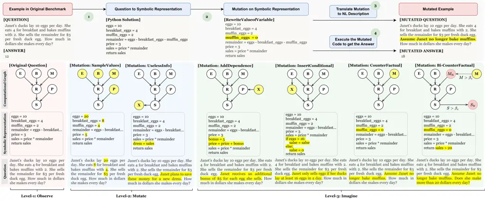

Figure 1: Top: The benchmark transformation pipeline (Section 3)
outlined with an example from GSM8K (Cobbe et al., 2021). This pipeline
leverages the symbolic representation of the question (a Python snippet
form) to automatically transform a math QA problem (leftmost) into a
similar format with additional reasoning steps (rightmost). Bottom: To
clearly define the mutations, we transform the symbolic representation
into a computational graph (leftmost). Nodes represent variables from
the symbolic representation, and edges illustrate the dependencies
between them. The remaining six graphs depict the different types of
mutations (see Section 3.2). E, B, M, R, P, and S represent variable
eggs, breakfast_eggs, muffin_eggs, reminder, price, and sales,
respectively. The yellow highlights indicate the modifications made
relative to the original versions. Red nodes represent binary values,
while all other nodes are numerical.

Re-Imagine enables us to _reinvent_ the standard approach to evaluating
reasoning in LLMs. As our experiments show, benchmarks across domains
such as math, code, and logic can be systematically transformed using
the same principles, generating challenging new scenarios that are
unlikely to appear in the LLMs’ pre-training data. Our findings indicate
that all tested LLMs exhibit some degree of reliance on statistical
recall, while problems at higher levels in the reasoning hierarchy
remain a yet-unsolved challenge.

##### Contributions.

This paper presents three major contributions, corresponding to each of
the following sections:

1.  In Section 2, we propose a hierarchical framework to characterize
    existing and new approaches for evaluating reasoning in LLMs. The
    proposed hierarchy has three levels of increasingly difficulty that
    capture different levels of reasoning via variations of the problems
    of existing, well-established benchmarks.
2.  In Section 3, we propose an end-to-end, scalable pipeline that
    allows the generation of an arbitrary number of new problems in each
    level of the hierarchy. This is crucial to scale up current
    approaches that require the manual generation of new scenarios.
3.  In Sections 4-5, we use Re-Imagine to re-analyze the reasoning
    abilities of all models in the GPT (Brown et al., 2020), Llama
    (Touvron et al., 2023), and Phi families (Kambhampati et al., 2024).
    We focus on four reasoning benchmarks: GSM8K for math (Cobbe et al.,
    2021), CLadder for causality (Jin et al., 2023a), and CRUXEval  (Gu
    et al., 2024) and Loop  (Kamath et al., 2024) for code. We show
    consistent decline in LLM performance as reasoning complexity
    increases across all evaluated benchmarks.

##### Novelty.

This paper introduces two major innovations:

1.  The unified 3-level reasoning hierarchy presented in this paper
    incorporates both previously studied mutations and the newly
    introduced ones. According to this hierarchy, we highlight that
    prior research has mainly focused on Level-2 mutations, which assess
    a model’s ability to generalize beyond existing benchmarks while
    maintaining the original reasoning path of the questions. In
    contrast, we emphasize that the Level-3 mutations introduced in our
    work are significantly more challenging.
2.  Alongside the reasoning hierarchy, we introduce – to the best of our
    knowledge – the first scalable mutation generation pipeline that
    applies across multiple benchmarks and tasks. This framework enables
    the creation of an arbitrary number of mutations at each level of
    the hierarchy for existing benchmark problems.

A detailed comparison with previous studies can be found in Table 4 in
Appendix B.

## 2 Re-Imagine: The Ladder of Reasoning

Inspired by the ladder of causation (Pearl, 2009), we systematically
define a three-layer hierarchy (‘observe’, ‘mutate’, ‘imagine’) that
characterizes different levels of reasoning abilities in LLMs, in the
same way that the ladder of causation captures three different cognition
skills. This allows us to characterize and compare the goals of
different evaluation experiments with precision, both new and existing.
A summary of the three levels is presented in Table 1.¹¹ 1 We provide a
more detailed explanation of the fundamental connection between our
hierarchy and causality in Appendix C.

- •
  Level-1 (“Observe”) captures the accuracy (or other metric of
  interest) of LLMs on existing benchmarks. It is called observe because
  it is expected that an LLM which has already seen training-set
  problems similar to the ones in the benchmark should be able to
  produce high accuracy.
- •
  Level-2 (“Mutate”) captures the ability of LLMs to solve problems that
  have been mutated by, for example, adding irrelevant information,
  renaming values, or changing values. It tests the ability of models to
  generalize beyond the existing benchmarks in cases where the core
  logical requirements of the questions are preserved. Several works
  have proposed approaches that sit in this level (Mirzadeh et al.,
  2024; Srivastava et al., 2024; Wu et al., 2023; Lewis & Mitchell,
  2024), which are based on manually created functional variations of
  the original problems. The results in such variations highlight
  memorization and over-fitting issues. For a true reasoning model, the
  task performance should be invariant w.r.t. the class of changes in
  this level.
- •
  Level-3 (“Imagine”) is the topmost and most sophisticated level. It
  captures the models’ ability to correctly incorporate new information
  and logic into existing problems. Given a problem defined by a set of
  logical predicates or facts, this variation augments the original
  problem with an additional predicate that changes some previously
  stated one. Correctly incorporating new logic requires an accurate
  (explicit or implicit) representation of the steps required to solve
  the problem, as well the ability to contradict and revise prior
  knowledge. Counterfactual assessments (González & Nori, 2024) sit on
  this level of the hierarchy. Task performance metrics and
  counterfactual related metrics like the probability of necessity (PN)
  and sufficiency (PS) can be used in this level as in (González & Nori,
  2024).

Next, we detail how to use the problems from benchmarks in Level-1 to
create novel problems in Level-2 and Level-3.

|           |                          |                           |                  |                                                                                         |
| --------- | ------------------------ | ------------------------- | ---------------- | --------------------------------------------------------------------------------------- |
| Benchmark | Type                     | Input                     | Output           | Required Steps                                                                          |
| GSM8K     | Mathematics QA           | NL math question          | Numerical answer | \raisebox{-.9pt} {1}⃝ \raisebox{-.9pt} {2}⃝ \raisebox{-.9pt} {3}⃝ \raisebox{-.9pt} {4}⃝ |
| CLadder   | Causal QA                | NL causal query           | Y/N answer       | \raisebox{-.9pt} {1}⃝ \raisebox{-.9pt} {2}⃝ \raisebox{-.9pt} {3}⃝ \raisebox{-.9pt} {4}⃝ |
| CRUXEval  | Code understanding       | Python function and input | Execution output | \raisebox{-.9pt} {2}⃝ \raisebox{-.9pt} {4}⃝                                             |
| Loop      | Loop invariant inference | C Code and an assertion   | Y/N answer       | \raisebox{-.9pt} {2}⃝ \raisebox{-.9pt} {4}⃝                                             |

Table 2: A summary of the steps used in GSM8K (Cobbe et al., 2021),
CLadder (Jin et al., 2023a), CRUXEval (Gu et al., 2024), and Loop
(Kamath et al., 2024). Since the inputs for both CRUXEval and Loop are
code snippets, steps \raisebox{-.9pt} {1}⃝ and \raisebox{-.9pt} {3}⃝ are
not required.

## 3 Benchmark Synthesis Pipeline

We present a unified benchmark synthesis pipeline that automatically
generates variations of existing benchmarks, preserving the core logic
of the task while demanding stronger reasoning abilities to solve.

We illustrate the pipeline with a real example from the GSM8K benchmark,
presented in the top row of Figure 1. Starting with a sample from the
existing dataset, we first convert the question into executable symbolic
form, e.g. code, knowledge graph (\raisebox{-.9pt} {1}⃝ in Figure 1). In
line with Toshniwal et al. (2024), we represent the math question as a
Python code snippet. Next, we apply a specific type of mutation to the
symbolic representation (\raisebox{-.9pt} {2}⃝). In this example, we
overwrite the value of the variable muffin_eggs in the code. To maintain
the core logic of the task – a natural language-based math
question-answering (QA) problem – we translate the change in the
symbolic representation back into natural language (NL) and incorporate
it into the original question (\raisebox{-.9pt} {3}⃝). Due to the
executable nature of the Python code, the ground-truth answer for the
mutated question can be obtained by running the modified code snippet
(\raisebox{-.9pt} {4}⃝).

Note that although Figure 1 illustrates all the elements in the
pipeline, not all of them will be necessary for every benchmark of
interest. A summary of the required steps for the benchmarks discussed
in this paper is provided in Table 2. Similarly, not all mutations are
applicable to every problem, and additional mutations beyond those
listed in Figure 1 can also be considered.

### 3.1 NL-to-Symbolic (\raisebox{-.9pt}{1}⃝) & Symbolic-to-NL (\raisebox{-.9pt}{3}⃝)

Steps \raisebox{-.9pt}{1}⃝ and \raisebox{-.9pt}{3}⃝, corresponding to
transformations from NL to Symbolic and Symbolic to NL respectively, are
non-trivial. Benchmarks that have original problems already in code form
(e.g. Loop and CRUXEval) do not require these steps. When they are
required, they need some level of adaptation to the nature of the
benchmark. Details for these two steps are provided in Section 4.

### 3.2 Symbolic Mutations (\raisebox{-.9pt} {2}⃝)

We showcase six code mutations spanning the Level-2 and Level-3
reasoning levels to create benchmark variations. To thoroughly define
the mutations in \raisebox{-.9pt} {2}⃝, we first convert the symbolic
representation into a computational graph (leftmost column in the bottom
row of Figure 1). Nodes represent variables in the symbolic
representation and edges capture their dependencies. The mutation
applied to the computational graph is then reflected in the symbolic
representation and translated into NL. The remaining six columns in
Figure 1 illustrate mutation variations.

Level-2 mutations

1.  •
    SampleValues assigns new values to all root nodes. When translating
    the mutation back to NL, only the values in the question are
    replaced with the new ones, while the rest of the narration remains
    unchanged. This mutation specifically aims to differentiate the
    model’s reasoning ability from memorization caused by data
    contamination.
2.  •
    UselessInfo adds a new node dependent on a randomly selected node
    from the original graph, with the change described in NL between the
    context and the question. This introduces additional context, but
    does not alter original statements or impact the correct answer.
    This assesses the model’s ability to disregard irrelevant
    information.

Level-3 mutations

1.  •
    AddDependence also introduces a new node into the graph. However,
    unlike UselessInfo, a randomly selected node from the original graph
    is modified to depend on the new node for its calculation. This is
    likely to influence the correct answer to the question. A natural
    way to encode this mutation in NL is to append a statement to the
    end of the original question, amending the original statement
    context, making this a Level-3 mutation.
2.  •
    InsertConditional adds a new node that connects two non-adjacent
    nodes in the graph, with edges linking the first node to the new
    node and the new node to the second node. In symbolic terms, this
    mutation is represented as an if-else condition. Two variables are
    randomly chosen, and one variable’s value is set to 0 depending on
    the value of the other. Describing this in NL as a change to the
    previous method of calculating the variable, it also becomes a
    Level-3 mutation.
3.  •
    CounterFactual randomly selects a node in the graph and overwrites
    its value. Unlike SampleValues, this mutation does not directly
    replace the number in the question. Instead, it presents the change
    as an assumption statement appended to the original question. Thus,
    it modifies an existing statement in the context and adds an extra
    reasoning step to the original question, making it a Level-3
    mutation.
4.  •
    Bi-CounterFactual builds on CounterFactual to evaluate the model’s
    ability to connect the presence or absence of a cause with its
    effect, an essential reasoning skill from the perspective of
    causation (Neuberg, 2003; Halpern & Pearl, 2005). Previous work
    (González & Nori, 2024; Hüyük et al., 2024) quantitatively evaluates
    this through necessity and sufficiency inconsistency rates (N-IR and
    S-IR), but relies on manually crafted questions and their
    counterfactuals. In contrast, our scalable pipeline unlocks
    large-scale analysis. In Bi-CounterFactual, the computational graph
    is treated as a Structural Causal Model (SCM), where the overwritten
    node acts as the cause and the final answer (leaf node) serves as
    the effect. Specifically, Bi-CounterFactual requires binary cause
    and effect nodes, with the overwritten value ensuring a change in
    the cause statement’s presence or absence.

In the next two sections, we apply our automatic benchmark synthesis
pipeline to the math reasoning benchmarks GSM8K and CLadder (Section 4)
and the code understanding benchmarks CRUXEval and Loop (Section 5).

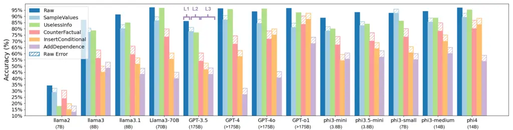

Figure 2: GSM8K results summary: model accuracy on numerical answer
predictions across test set variations in different reasoning levels
(see Section 3.2 and Figure 1). Due to potential noise from the
automatic mutation process, we performed a human evaluation on the
mutated test set. We added the percentage of invalid examples in each
mutation category to the top of each accuracy bar as hashed blocks,
assuming that if these QA pairs were correct, the models would answer
them correctly. This provides an upper bound on the model’s performance.
We also present a box plot (see Figure 10 in Appendix E) to illustrate
the statistical accuracy across 10 sets of samples.

## 4 Math Benchmarks: GSM8K and CLadder

This section first details the benchmark transformation process for
GSM8K and evaluates its quality (Section 4.1). We then analyze model
accuracy on numerical math questions using the first five mutations
outlined in Section 3.2, excluding Bi-CounterFactual (Section 4.2).
Since Bi-CounterFactual involves binary questions and is primarily
assessed with causation metrics, it is discussed separately in
Section 4.3. Section 4.4 demonstrates that the findings from GSM8K
extend to CLadder, another math reasoning benchmark focused on
probabilities and causality.

### 4.1 Transformation Pipeline

##### Question to Symbolic Representation \raisebox{-.9pt}{1}⃝

Toshniwal et al. (2024) introduced OpenMathInstruct, whose validation
set contains 970 GSM8K QA examples paired with Python solutions
generated by Mixtral-8x7B (Jiang et al., 2024). We construct our test
set by filtering out examples where the Python solution execution does
not match the ground-truth answers. To ensure high-quality mutations, we
further filter the data to keep only those where all constant variables
in the code (root nodes in the computational graph) align with the
numbers in the question and vice versa.²² 2 We account for commonsense
numerical facts, such as one year having 12 months, and one hour
containing 60 minutes.

##### Symbolic Representation to Mutation \raisebox{-.9pt}{2}⃝

We incorporate all six types of mutation described in Section 3.2. Since
most GSM8K questions are framed within a story context, we ensure that
newly sampled values for existing variables align with the original
value’s type (float/integer) and sign to preserve the story’s coherence.
Within this constraint, integers are sampled from a discrete uniform
distribution, while floats are drawn from a uniform distribution
centered around the original value. We also ensure that the final answer
maintains the same type and sign as the original ground-truth answer.

##### Mutated Symbolic to NL \raisebox{-.9pt}{3}⃝

In the SampleValues mutation, only the values in the questions are
replaced with newly sampled ones, while the rest of the narrative stays
the same, so no new NL descriptions are required. For the other mutation
types, we provide the original math question, its Python solution, and
the code modifications to a LLM (GPT-4o), leveraging its text generation
capabilities to describe the code changes in natural language. To
guarantee the symbolic-to-NL translation is correct, we prompt GPT-4o a
second time to back-translate the mutated math problem into Python by
modifying the original question’s Python solution. The generated code
must produce an execution result that matches the ground truth answer of
the mutated question. (Detailed prompts are shown in Figure 17 and
Figure 16 in Appendix E.)

To verify the accuracy of the mutated QA pairs, we manually reviewed 50
randomly selected examples from each mutation type. Valid examples are
the ones that contain a clearly defined question and a correct
ground-truth answer. The percentage of invalid QA pairs in SampleValues,
UselessInfo, CounterFactual, AddDependence, and InsertConditional were
3.33%, 0.00%, 6.67%, 5.00%, and 5.00%, respectively.

### 4.2 Reasoning on Numerical Math QA

In line with previous studies, during testing, all models are provided
with 8 in-context examples with Chain-of-Thought (CoT) to help them
understand the task (prompt shown in Figure 18 in Appendix E).³³ 3 We
follow [this blog
post](https://andrewmayne.com/2024/10/18/can-you-dramatically-improve-results-on-the-latest-large-language-model-reasoning-benchmark-with-a-simple-prompt/)
to strengthen our prompt. We evaluate models from three popular
families—Phi, Llama, and GPT (see Table 3 in Appendix A for details).

The answer accuracies are presented in Figure 2, with the percentage of
invalid mutated examples in each mutation category displayed as a hashed
block above each bar. By assuming that models would correctly answer
these questions if the QA pairs were valid, this estimation serves as an
upper bound on the model performance.

Key findings are: (1) With 8-shot in-context examples, most of the
models achieve high accuracy ($`\sim 95`$%) on the Level-1 raw test set.
(2) Among Level-2 mutations, UselessInfo is less challenging—especially
for larger models—indicating their ability to ignore irrelevant details.
However, nearly all models experience around 10% accuracy drop on
SampleValues, despite unchanged reasoning paths and only altered values.
(3) Level-3 mutations pose a greater challenge, with models showing
significantly lower upper-bound performance than on Level-1 and 2 test
sets.

We also conduct ablation experiments to examine performance on test set
containing multiple mutations (Appendix E.3). We found that composing
mutations increases performance gap between the mutated and the original
sets.

### 4.3 Reasoning Evaluation with Binary Counterfactuals

Bi-CounterFactual as described in Section 3.2 creates two auxiliary
nodes in the computation graph with binary versions of a condition and
an outcome. The reason for considering this problem transformation is
that it allow us to compute metrics that are relevant to evaluate
reasoning beyond accuracy. As shown in González & Nori (2024); Hüyük
et al. (2024), this scenario enables the computation of the
probabilities of necessity (PN) and sufficiency (PS) from the
counterfactual literature (Pearl et al., 2000). Intuitively, these
measures capture the probability of activating/deactivating a binary
outcome in the presence/absence of a binary input. Although this
restricts our analysis to the simplified (binarized) version of the
GSM8k introduced by the Binary Counterfactual mutations, we compute
these metrics due to their intrinsic value.

The ground truth PN and PS varies across problems and nodes. To give a
benchmark-level measure of how well different models approximate them,
we use the necessity and sufficiency inconsistency rates (N-IR, S-IR)
introduced in Hüyük et al. (2024), which account for the errors in the
approximation of these measures in a normalized way (an optimal
reasoning LLMs is one with N-IR $`=0`$ and S-IR $`=0`$). Because
obtaining N-IR and S-IR is computationally expensive, we used 50
questions from the validation set of the benchmark, where the condition
node was randomly sampled across the available leaf nodes. To obtain
these results, we follow the same setup as in Hüyük et al. (2024).

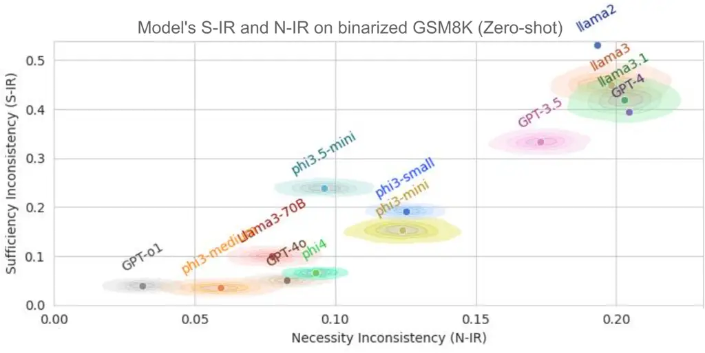

Figure 3: Sufficiency/necessity inconsistency rates (S-IR/N-IR) on GSM8K
factual/counterfactual test set. Models located near the bottom-left
corner are thought to predict the causal relationship between the cause
and effect, i.e. sufficient and necessary, in a way that is consistent
with the true causal relationship, as defined by the ground truth.

Figure 3shows the average S-IR and N-IR for all models across 50 random
examples. Consistent with the numerical accuracy evaluation, GPT-o1
remains the best-performing model, while Llama 8B models, GPT-3.5, and
GPT-4 are at the other end of the spectrum. However, GPT-4o and Llama
70B outperform phi3-small and phi3-mini in the causal reasoning
evaluation.

### 4.4 Similar Findings on CLadder

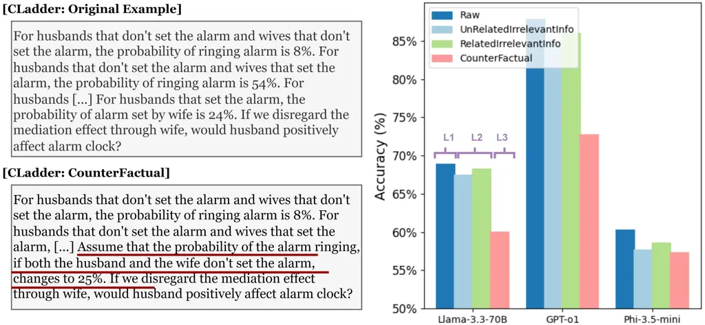

Figure 4: Left: An example from CLadder test set and its CounterFactual
mutation. Right: CLadder accuracy of the best-performing model in each
family on causal question answering across test set variations at
different reasoning levels. The full results can be found in Figure 21
in Appendix F. UnRelatedIrrelevantInfo and RelatedIrrelevantInfo are
categorized as UselessInfo per Figure 1.

To confirm that our findings in GSM8K generalize to other math reasoning
benchmarks, we use the transformation pipeline (Section 3) to
automatically generate three test set variations for CLadder, a causal
reasoning benchmark. We examine three mutations UnRelatedIrrelevantInfo,
RelatedIrrelevantInfo, and CounterFactual, with the first two classified
under UselessInfo (see Figure 1 and Section 3.2). Details on the
benchmark, implementation, LLM prompts, and mutation specifics are
provided in Appendix F. The accuracy of the best-performing model in
each family is shown in Figure 4. Similar to our observations in GSM8K,
Level-3 mutations present a greater challenge than Level-2, causing
models to exhibit an approximately $`20`$% drop in accuracy relative to
the original test set. Models exhibit lower accuracy on test set
variations composed of two types of mutations (Figure 21 in Appendix F).

## 5 Code Benchmarks: CRUXEval and Loop

We investigate two code understanding tasks: input/output prediction
(CRUXEval) and automatic inference of loop invariants (Loop).

The CRUXEval benchmark (Gu et al., 2024) consists of 800 short
LLM-generated Python functions alongside an input-output pair for each
function (see Figure 5 for an example). The model’s task is to predict
the output of the function when evaluated on a given input parameter.
Functions are filtered to include only those with low computation and
memory requirements, with no side-effects or randomization, and excluded
arithmetic calculation.

The Loop benchmark (Kamath et al., 2024) contains loop invariant
inference tasks, each of which consists of a program with a loop and an
assertion (see Figure 6 for an example). The goal is to infer a
predicate that satisfies the following three conditions: it holds before
the loop starts executing, holds for each iteration of the loop, and
implies the assertion when the loop exits.⁴⁴ 4 Although inferring such
loop invariants is undecidable, in practice, checking whether a given
candidate invariant satisfies the three conditions can be done well by
automated software verification tools like Frama-C (Correnson et al., ).
The model succeeds on the task if Frama-C (Correnson et al., ) verifies
via SMT solvers (de Moura & Bjørner, 2008) that the LLM output is a loop
invariant, and fails otherwise (details in Appendix H).

Since both tasks are already programs, steps \raisebox{-.9pt}{1}⃝ and
\raisebox{-.9pt}{3}⃝ of the pipeline are not required.

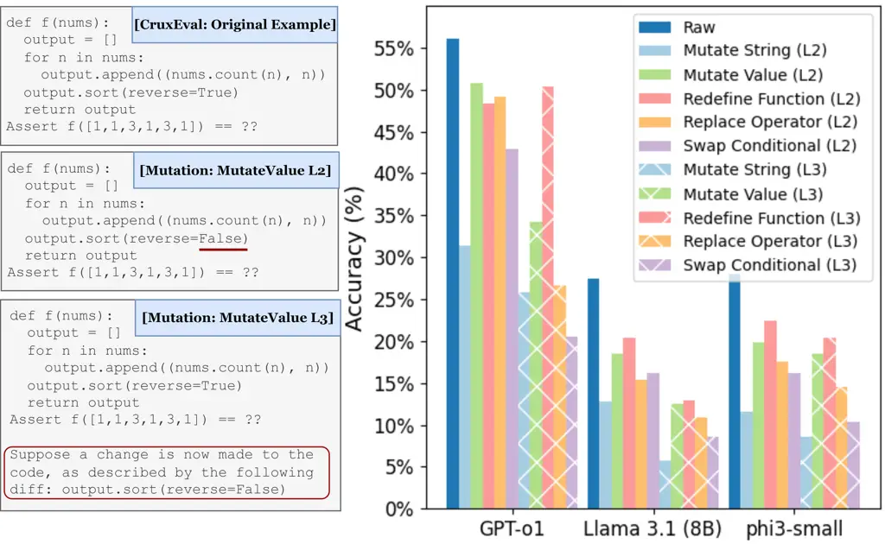

Figure 5: Left: An example from CRUXEval dataset and the Level-2 and
Level-3 versions of its MutateValue mutation. Right: CRUXEval accuracy
of the best-performing model in each family. Full results can be found
in Figure 23 of Appendix G.

### 5.1 Symbolic Mutations to CRUXEval \raisebox{-.9pt}{2}⃝

Each CRUXEval mutation can be applied either directly to the function
code (Level-2), or presented as a code diff in an “imagine” statement
following the original code (Level-3). The Level-2 versions, in
particular, are designed to have minimal effect on code length,
execution time, and overall question difficulty. Table 6 in Appendix G
shows the different types of mutations implemented for CRUXEval,
summarized below.

1.  •
    Replace Operator replaces an operator of type ast.BinOp,
    ast.UnaryOp, ast.BoolOp, or ast.AugAssign with its inverse or
    negation, where applicable.
2.  •
    Mutate String replaces a string instance with a uniformly random
    character sequence of the same length.
3.  •
    Mutate Value changes the value of an instance of type bool, int, or
    float. Booleans are replaced with their negations; integers / floats
    are perturbed by a uniformly random nonzero integer / float
    (respectively) in $`[-10,10]`$.
4.  •
    Swap Conditional selects a random conditional node for modification.
    If both an if and else branch are present, the code body for each
    branch is swapped. If only an if branch is present, the condition of
    the branch is negated.
5.  •
    Redefine Function defines a wrapper for a random non-attribute
    function, and replaces a call to the original function with a call
    to the wrapper.

A subsequent validation pass permits only code which terminates and
returns a value within 5 seconds without errors. Code transformations
for CRUXEval are deterministic, since for any validated program, the
output of the code on the provided inputs is taken to be ground truth.
See Appendix G for additional implementation detail.

### 5.2 Symbolic Mutations to Loop \raisebox{-.9pt}{2}⃝

Unlike earlier benchmarks, applying substantial mutations to Loop tasks
is more challenging. After changing the values of the program variables,
loop invariants can cease to exist. Hence, we limit ourselves to Level-2
mutations that add irrelevant information in the form of additional
variables and operations, leaving the values of variables from the
original program unaffected. Table 7 of Appendix H describes these
mutations, summarized below.

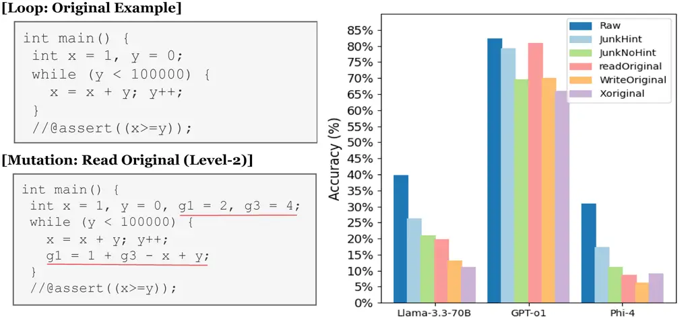

Figure 6: Left: An example from Loop dataset and its Read Original
mutation. Right: Loop concise results – accuracy of the best-performing
model in each family. Full results can be found in Figure 25 of
Appendix H.

1.  •
    Junk Hint adds five new variables `junk_0`, `junk_1`, etc., to the
    program (Si et al., 2018). Before the loop, they are initialized
    with randomly generated constants. Within the loop body, each new
    variable is updated with arithmetic expressions over randomly
    generated constants and the new variables.
2.  •
    Junk No-Hint assigns names to the new variables that resemble those
    in the original program. This aims to prevent LLMs from identifying
    variables with junk in their name as unnecessary.
3.  •
    Read Original reads the original variables of the code into the
    newly introduced ones. Original variables and operators are randomly
    sampled and added to new variables.
4.  •
    Write Original introduces superficial additional writes to the
    original variables, i.e. they leave the values taken by these
    variables at runtime unaffected. For a new variable $`y`$, existing
    variables are incremented by an identically zero polynomial
    $`f(y)`$. To further obscure the underlying identity, polynomial
    coefficients are decomposed and rearranged.
5.  •
    X-Original applies both Read and Write Original.

Although the mutated programs are syntactically larger, all mutations
described above have the property that the loop invariant of the
original program is also a valid loop invariant for the mutated program.

### 5.3 Model Performance

Zero-shot accuracy on CRUXEval tasks are summarized in Figure 5. ⁵⁵ 5
Each mutation type applies only to a subset of the questions in
CRUXEval, so we also evaluate performance on each mutation with respect
to the corresponding (factual) subset of problems (see Figure 24 in
Appendix G). Overall, accuracy scores decrease for both Level-2 and
Level-3 mutations compared with factual problems, with Level-3 posing
the greatest challenge. The drop in performance on Level-2 mutations is
a particularly strong indication of memorization effects from benchmark
leakage, as these mutations intentionally introduce minimal change to
the execution complexity and corresponding code understanding skills.
Notably, the original CRUXEval benchmark is publicly available and
LLM-generated, both of which provide potential leakage pathways.

Evaluations on Loop tasks are summarized in Figure 6 (for evaluation
with all models, see Figure 25 in Appendix H). Smaller models show
performance degradation on introducing junk named variables. The
performance decline from “Junk Hint” to “Junk No-Hint” shows that LLMs
use variable names as semantic cues. The “X-Original” mutations confuse
all models and significantly degrades their success rates compared to
the original tasks.

## 6 Ablation Study and Discussion

We further evaluate the models’ reasoning abilities through two ablation
experiments: (1) to determine whether the performance drop on mutated
questions stems from the mutations themselves or from the additional
reasoning complexity introduced by some mutations; and (2) to assess the
impact of in-context learning examples on the models’ reasoning
performance.

### 6.1 The Influence of Reasoning Complexity

We use GSM8K as a testbed for our analysis. Following Ye et al. (2025),
we quantify the complexity of a numerical reasoning question by the
number of reasoning steps, defined as the number of operations in its
code solution. By this measure, all mutated questions introduce one
additional reasoning step compared to their original counterparts,
except for those in the SampleValues category. Notably, while
UselessInfo questions also include an extra reasoning step, this step
does not affect the final answer, so we still categorize UselessInfo as
a Level-2 mutation. Using this definition, we compute the average
accuracy of each model across examples with different numbers of
reasoning steps. Given the large number of models tested, we aggregate
their results and report the overall average accuracy in Figure 7.
Detailed per-model results are in Figure 15 in Appendix E.5.

From Figure 7, we draw two key observations: (1) even when controlling
for the number of reasoning steps, models consistently perform worse on
mutated questions than on the original test set; and (2) Level-3
mutations pose a substantially greater challenge than Level-2. Notably,
the accuracy on Level-3 mutations with just three reasoning steps is
significantly lower than on original test examples requiring seven
reasoning steps. These findings suggest that the primary cause of
performance degradation on mutated questions is the mutations
themselves, rather than the added reasoning complexity.

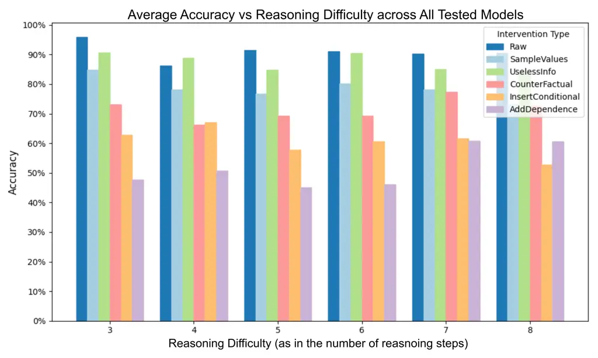

Figure 7: We analyze model performance across varying numbers of
reasoning steps in the GSM8K benchmark. The x-axis represents the number
of reasoning steps, defined as the number of operations in the code
solution. The plot aggregates the performance of all tested models.
Detailed results for each model are provided in Figure 15 in
Appendix E.5.

### 6.2 The impact of in-context examples

Following previous studies, the 8-shot in-context examples used in the
GSM8K experiments in Section 4 are randomly sampled from the original
training set. Here, we further investigate whether including mutated
examples in the in-context examples can improve model performance on the
generated test set variations. As shown in Figure 8, we find that most
models achieve significantly higher accuracy on the test variations when
given both original and mutated examples, compared to using only
original GSM8K examples or only mutated examples as in-context examples.
A detailed explanation of the experiment, including additional results
and full prompt examples, is in Appendix E.2.

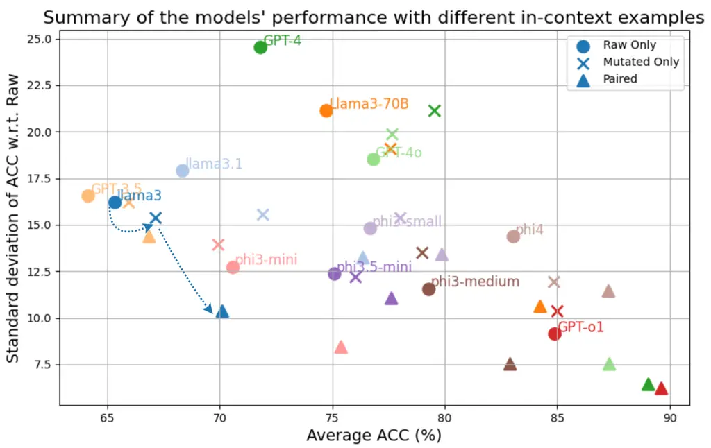

Figure 8: Models’ performance when prompted with different types of
in-context examples. We summarize model performance across two
dimensions: the average accuracy across all mutated test sets and the
original test set (x-axis), and the standard deviation in accuracy on
the five mutated test sets w.r.t. the raw test set (y-axis). The
bottom-right corner reflects the ideal balance of high performance on
both raw and mutated sets. In this plot, dots indicate models prompted
only with original examples, crosses represent models prompted only with
mutated examples, and triangles denote models prompted with both
original and corresponding mutated examples. Model structures are
differentiated by color, with the same model represented by the same
color.

## 7 Conclusion

This work presents a novel framework, Re-Imagine, designed to assess the
reasoning capabilities of LLMs through the systematic generation of
challenging problem variations. Our findings reveal a consistent decline
in model performance as reasoning complexity increases across all
evaluated benchmarks. On our mutated GSM8K benchmark, we find that the
overall performance of all LLMs degrades with increasing ladder levels.
The o1 model shows greater robustness on this benchmark and achieves the
best performance among all tested models on bi-counterfactuals. However,
even the most powerful models struggle with structured problem
variations, particularly when these variations are combined. Similar
results were observed on CLadder.

Additionally, we successfully applied Re-Imagine to mutate code
benchmarks Loop and CruxEval. Despite the mutations being designed to
have minimal effect on code length, execution time, and overall question
difficulty, a substantial decline in performance is again observed
across models and problem variations. This lends additional evidence
that these models struggle with higher levels of the reasoning
hierarchy, suggesting that gaps in their capabilities may be hidden by
effects such as memorization and benchmark leakage.

In addition to the models discussed in previous sections, we report
results for other popular models in Appendix D. The conclusions are
found to generalize well to these models.

Re-Imagine provides a systematic framework to assess and expose these
weaknesses, highlighting the need for more rigorous evaluation
strategies. Expanding Re-Imagine to broader domains could further
enhance our understanding of reasoning capabilities and limitations of
LLMs. Our hope is for Re-Imagine to provide a foundational framework for
a more nuanced evaluation of LLMs and encourage the development of more
robust reasoning models.

## Impact Statement

The RE-IMAGINE framework represents a significant advancement in
evaluating the reasoning capabilities of Large Language Models. By
systematically generating problem variations that cannot be solved
through memorization alone, RE-IMAGINE provides a robust method to
disentangle genuine reasoning from statistical recall. The findings
reveal notable drops in LLM performance when faced with problem
variations. By setting a new standard for evaluating hierarchical
reasoning, this research paves the way for more transparent and
interpretable AI systems, ultimately contributing to the broader goal of
building models with true generalizable reasoning capabilities. This
will impact the development of future AI systems. It will also influence
benchmark design, ensuring that evaluations better reflect genuine
cognitive capabilities rather than memorization. Additionally, this
research can guide policymakers, researchers, and practitioners in
designing more reliable and trustworthy AI applications across domains
such as education, healthcare, and scientific discovery, where robust
reasoning is critical.

## References

- Ait El Hara et al. (2022) Ait El Hara, H. R., Bury, G., and
  de Oliveira, S. Alt-Ergo-Fuzz: A fuzzer for the Alt-Ergo SMT solver.
  In Keller, C. and Bourke, T. (eds.), _Journées Francophones des
  Langages Applicatifs_, pp. 235–244, Saint-Médard-d’Excideuil, France,
  June 2022. URL
  [https://inria.hal.science/hal-03626861](https://inria.hal.science/hal-03626861).
- Barrett et al. (2011) Barrett, C. W., Conway, C. L., Deters, M.,
  Hadarean, L., Jovanovic, D., King, T., Reynolds, A., and Tinelli, C.
  CVC4. In Gopalakrishnan, G. and Qadeer, S. (eds.), _Computer Aided
  Verification - 23rd International Conference, CAV 2011, Snowbird, UT,
  USA, July 14-20, 2011. Proceedings_, volume 6806 of _Lecture Notes in
  Computer Science_, pp. 171–177. Springer, 2011. doi:
  10.1007/978-3-642-22110-1\\14. URL
  [https://doi.org/10.1007/978-3-642-22110-1_14](https://doi.org/10.1007/978-3-642-22110-1_14).
- Brown et al. (2020) Brown, T. B., Mann, B., Ryder, N., Subbiah, M.,
  Kaplan, J., Dhariwal, P., Neelakantan, A., Shyam, P., Sastry, G.,
  Askell, A., et al. Language models are few-shot learners. _arXiv
  preprint arXiv:2005.14165_, 2020.
- Chollet et al. (2024) Chollet, F., Knoop, M., Kamradt, G., and
  Landers, B. Arc prize 2024: Technical report. _arXiv preprint
  arXiv:2412.04604_, 2024.
- Chollet et al. (2025) Chollet, F., Knoop, M., Kamradt, G., and
  Landers, B. Arc prize 2024: Technical report, 2025. URL
  [https://arxiv.org/abs/2412.04604](https://arxiv.org/abs/2412.04604).
- Cobbe et al. (2021) Cobbe, K., Kosaraju, V., Hilton, J., and
  Schulman, J. Training verifiers to solve math word problems. _arXiv
  preprint arXiv:2110.14168_, 2021.
- (7) Correnson, L., Cuoq, P., Kirchner, F., Maroneze, A., Prevosto, V.,
  Puccetti, A., Signoles, J., and Yakobowski, B. _Frama-C User Manual_.
  URL
  [http://frama-c.com/download/frama-c-user-manual.pdf](http://frama-c.com/download/frama-c-user-manual.pdf).
- de Moura & Bjørner (2008) de Moura, L. and Bjørner, N. Z3: An
  efficient smt solver. In Ramakrishnan, C. R. and Rehof, J. (eds.),
  _Tools and Algorithms for the Construction and Analysis of Systems_,
  pp. 337–340, Berlin, Heidelberg, 2008. Springer Berlin Heidelberg.
  ISBN 978-3-540-78800-3.
- Gao et al. (2023) Gao, L., Madaan, A., Zhou, S., Alon, U., Liu, P.,
  Yang, Y., Callan, J., and Neubig, G. Pal: Program-aided language
  models. In _International Conference on Machine Learning_, pp.
  10764–10799. PMLR, 2023.
- Glazer et al. (2024) Glazer, E., Erdil, E., Besiroglu, T., Chicharro,
  D., Chen, E., Gunning, A., Olsson, C. F., Denain, J.-S., Ho, A.,
  de Oliveira Santos, E., Järviniemi, O., Barnett, M., Sandler, R.,
  Vrzala, M., Sevilla, J., Ren, Q., Pratt, E., Levine, L., Barkley, G.,
  Stewart, N., Grechuk, B., Grechuk, T., Enugandla, S. V., and
  Wildon, M. Frontiermath: A benchmark for evaluating advanced
  mathematical reasoning in AI, 2024. URL
  [https://arxiv.org/abs/2411.04872](https://arxiv.org/abs/2411.04872).
- González & Nori (2024) González, J. and Nori, A. V. Does reasoning
  emerge? examining the probabilities of causation in large language
  models. In _Advances in Neural Information Processing Systems
  (NeurIPS)_, 2024.
- Gu et al. (2024) Gu, A., Rozière, B., Leather, H., Solar-Lezama, A.,
  Synnaeve, G., and Wang, S. I. Cruxeval: A benchmark for code
  reasoning, understanding and execution. _arXiv preprint
  arXiv:2401.03065_, 2024.
- Halpern & Pearl (2005) Halpern, J. Y. and Pearl, J. Causes and
  explanations: A structural-model approach. Part I: Causes. _The
  British journal for the Philosophy of Science_, 2005.
- Hendrycks et al. (2020) Hendrycks, D., Basart, S., Mazeika, M., Zou,
  A., Song, D., and Steinhardt, J. Measuring massive multitask language
  understanding. _arXiv preprint arXiv:2009.03300_, 2020.
- Holyoak & Morrison (2005) Holyoak, K. J. and Morrison, R. G. (eds.).
  _The Cambridge Handbook of Thinking and Reasoning_. Cambridge
  University Press, Cambridge, England, 2005. ISBN 9780521824170.
- Huang & Chang (2023) Huang, J. and Chang, K. C.-C. Towards reasoning
  in large language models: A survey. In Rogers, A., Boyd-Graber, J.,
  and Okazaki, N. (eds.), _Findings of the Association for Computational
  Linguistics: ACL 2023_, pp. 1049–1065, Toronto, Canada, jul 2023.
  Association for Computational Linguistics.
- Hüyük et al. (2024) Hüyük, A., Xu, X., Maasch, J., Nori, A. V., and
  González, J. Reasoning elicitation in language models via
  counterfactual feedback, 2024. URL
  [https://arxiv.org/abs/2410.03767](https://arxiv.org/abs/2410.03767).
- Jaech et al. (2024) Jaech, A., Kalai, A., Lerer, A., et al. Openai o1
  system card. _arXiv preprint arXiv:2412.16720_, 2024.
- Jiang et al. (2024) Jiang, A. Q., Sablayrolles, A., Roux, A., Mensch,
  A., Savary, B., Bamford, C., Chaplot, D. S., Casas, D. d. l., Hanna,
  E. B., Bressand, F., et al. Mixtral of experts. _arXiv preprint
  arXiv:2401.04088_, 2024.
- Jin et al. (2023a) Jin, Z., Chen, Y., Leeb, F., Gresele, L., Kamal,
  O., Lyu, Z., Blin, K., Gonzalez, F., Kleiman-Weiner, M., Sachan, M.,
  and Schölkopf, B. CLadder: Assessing causal reasoning in language
  models. In _NeurIPS_, 2023a. URL
  [https://openreview.net/forum?id=e2wtjx0Yqu](https://openreview.net/forum?id=e2wtjx0Yqu).
- Jin et al. (2023b) Jin, Z., Chen, Y., Leeb, F., Gresele, L., Kamal,
  O., Lyu, Z., Blin, K., Gonzalez Adauto, F., Kleiman-Weiner, M.,
  Sachan, M., et al. Cladder: Assessing causal reasoning in language
  models. _Advances in Neural Information Processing Systems_,
  36:31038–31065, 2023b.
- Kamath et al. (2024) Kamath, A., Mohammed, N., Senthilnathan, A.,
  Chakraborty, S., Deligiannis, P., Lahiri, S. K., Lal, A., Rastogi, A.,
  Roy, S., and Sharma, R. Leveraging llms for program verification. In
  _FMCAD_, 2024. URL
  [http://hdl.handle.net/20.500.12708/200783](http://hdl.handle.net/20.500.12708/200783).
- Kambhampati et al. (2024) Kambhampati, R. S., Iwafuchi, T., and
  Dasaka, S. Phi-3: A family of small open models. _Microsoft AI
  Research_, 2024. Pre-release information.
- Lewis & Mitchell (2024) Lewis, M. and Mitchell, M. Evaluating the
  robustness of analogical reasoning in large language models. _arXiv
  preprint arXiv:2411.14215_, 2024.
- Li et al. (2024) Li, Z., Zhou, Z., Yao, Y., Li, Y.-F., Cao, C., Yang,
  F., Zhang, X., and Ma, X. Neuro-symbolic data generation for math
  reasoning, 2024. URL
  [https://arxiv.org/abs/2412.04857](https://arxiv.org/abs/2412.04857).
- Mirzadeh et al. (2024) Mirzadeh, I., Alizadeh, K., Shahrokhi, H.,
  Tuzel, O., Bengio, S., and Farajtabar, M. Gsm-symbolic: Understanding
  the limitations of mathematical reasoning in large language models.
  _arXiv preprint arXiv:2410.05229_, 2024.
- Mitchell & Krakauer (2023) Mitchell, M. and Krakauer, D. C. The debate
  over understanding in ai’s large language models. _Proceedings of the
  National Academy of Sciences_, 120(13):1–15, 2023. doi:
  10.1073/pnas.2215907120.
- Neuberg (2003) Neuberg, L. G. Causality: models, reasoning, and
  inference, by judea pearl, cambridge university press, 2000.
  _Econometric Theory_, 19(4):675–685, 2003.
- OpenAI (2024) OpenAI. Early access for safety testing, December 2024.
  [https://openai.com/index/early-access-for-safety-testing/](https://openai.com/index/early-access-for-safety-testing/).
- Pearl (2009) Pearl, J. _Causality: Models, Reasoning, and Inference_.
  Cambridge University Press, Cambridge, England, 2nd edition, 2009.
  ISBN 9780521895606.
- Pearl et al. (2000) Pearl, J. et al. Models, reasoning and inference.
  _Cambridge, UK: CambridgeUniversityPress_, 19(2):3, 2000.
- Shi et al. (2023) Shi, F., Chen, X., Misra, K., Scales, N., Dohan, D.,
  Chi, E. H., Schärli, N., and Zhou, D. Large language models can be
  easily distracted by irrelevant context. In _International Conference
  on Machine Learning_, pp. 31210–31227. PMLR, 2023.
- Si et al. (2018) Si, X., Dai, H., Raghothaman, M., Naik, M., and
  Song, L. Learning loop invariants for program verification. In
  _NeurIPS 2018_, 2018.
- Srivastava et al. (2022) Srivastava, A., Wei, J., Jun, H., et al.
  Beyond the imitation game: Quantifying and extrapolating the
  capabilities of language models. _arXiv preprint
  arXiv:2206.04615_, 2022.
- Srivastava et al. (2024) Srivastava, S., PV, A., Menon, S., Sukumar,
  A., Philipose, A., Prince, S., Thomas, S., et al. Functional
  benchmarks for robust evaluation of reasoning performance, and the
  reasoning gap. _arXiv preprint arXiv:2402.19450_, 2024.
- Team (2025) Team, D. A. Deepseek-r1: A comprehensive reasoning model.
  _DeepSeek AI Research_, 2025. URL
  [https://github.com/deepseek-ai/DeepSeek-R1](https://github.com/deepseek-ai/DeepSeek-R1).
  Available on GitHub.
- Toshniwal et al. (2024) Toshniwal, S., Moshkov, I., Narenthiran, S.,
  Gitman, D., Jia, F., and Gitman, I. Openmathinstruct-1: A 1.8 million
  math instruction tuning dataset. _arXiv preprint arXiv:
  Arxiv-2402.10176_, 2024.
- Touvron et al. (2023) Touvron, H., Lavril, T., Izacard, G., Martinet,
  X., Lachaux, M.-A., Lacroix, T., Roziere, B., Goyal, N., Hambro, E.,
  Azhar, F., Rodriguez, A., Joulin, A., Grave, E., and Lample, G. Llama:
  Open and efficient foundation language models. _arXiv preprint
  arXiv:2302.13971_, 2023.
- Valmeekam et al. (2022) Valmeekam, K., Olmo, A., Sreedharan, S., and
  Kambhampati, S. Large language models still can’t plan (a benchmark
  for llms on planning and reasoning about change). In _NeurIPS 2022
  Foundation Models for Decision Making Workshop_, 2022.
- Wang et al. (2019) Wang, A., Pruksachatkun, Y., Nangia, N., Singh, A.,
  Michael, J., Hill, F., Levy, O., and Bowman, S. R. Superglue: A
  stickier benchmark for general-purpose language understanding systems.
  _arXiv preprint arXiv:1905.00537_, 2019.
- Webb et al. (2024) Webb, T., Mondal, S. S., and Momennejad, I.
  Improving planning with large language models: A modular agentic
  architecture. _arXiv preprint arXiv:2310.00194_, 2024.
- Weidinger et al. (2021) Weidinger, L., Mellor, J., Rauh, M., et al.
  Ethical and social risks of harm from language models. _arXiv preprint
  arXiv:2112.04359_, 2021.
- Wu et al. (2024) Wu, H., Barrett, C. W., and Narodytska, N. Lemur:
  Integrating large language models in automated program verification.
  In _ICLR_, 2024.
- Wu et al. (2023) Wu, Z., Qiu, L., Ross, A., Akyürek, E., Chen, B.,
  Wang, B., Kim, N., Andreas, J., and Kim, Y. Reasoning or reciting?
  exploring the capabilities and limitations of language models through
  counterfactual tasks. _arXiv preprint arXiv:2307.02477_, 2023.
- Xu et al. (2025) Xu, F., Hao, Q., Zong, Z., Wang, J., Zhang, Y., Wang,
  J., Lan, X., Gong, J., Ouyang, T., Meng, F., et al. Towards large
  reasoning models: A survey on scaling llm reasoning capabilities.
  _arXiv preprint arXiv:2501.09686_, 2025.
- Yang et al. (2024) Yang, L., Shirvaikar, V., Clivio, O., and Falck, F.
  A critical review of causal reasoning benchmarks for large language
  models. In _AAAI 2024 Workshop on”Are Large Language Models Simply
  Causal Parrots?”_, 2024.
- Ye et al. (2025) Ye, T., Xu, Z., Li, Y., and Allen-Zhu, Z. Physics of
  Language Models: Part 2.1, Grade-School Math and the Hidden Reasoning
  Process. In _Proceedings of the 13th International Conference on
  Learning Representations_, ICLR ’25, April 2025. Full version
  available at
  [https://ssrn.com/abstract=5250629](https://ssrn.com/abstract=5250629).
- Zhang et al. (2024) Zhang, Z., Chen, J., and Yang, D. Darg: Dynamic
  evaluation of large language models via adaptive reasoning
  graph, 2024.
- Zhou et al. (2023) Zhou, K., Zhu, Y., Chen, Z., Chen, W., Zhao, W. X.,
  Chen, X., Lin, Y., Wen, J.-R., and Han, J. Don’t make your llm an
  evaluation benchmark cheater. _arXiv preprint arXiv:2311.01964_, 2023.
- Zhu et al. (2023) Zhu, K., Chen, J., Wang, J., Gong, N. Z., Yang, D.,
  and Xie, X. Dyval: Dynamic evaluation of large language models for
  reasoning tasks. In _The Twelfth International Conference on Learning
  Representations_, 2023.

## Appendix A Appendix: Language Model Details

|                 |                                        |              |                         |
| --------------- | -------------------------------------- | ------------ | ----------------------- |
| Models          | Details                                | \#Parameters | Pre-train Size (tokens) |
| Phi-3 mini      | microsoft/Phi-3-mini-128k-instruct     | 3.8B         | 4.9T                    |
| Phi-3.5 mini    | microsoft/Phi-3.5-mini-instruct        | 3.8B         | 3.4T                    |
| Phi-3 small     | microsoft/Phi-3-small-128k-instruct    | 7B           | 4.8T                    |
| Phi-3 medium    | microsoft/Phi-3-medium-128k-instruct   | 14B          | 4.8T                    |
| Phi-4           | microsoft/phi-4                        | 14B          | 9.8T                    |
| Llama 2         | meta-llama/Llama-2-7b-chat-hf          | 7B           | 2T                      |
| Llama 3         | meta-llama/Meta-Llama-3-8B-Instruct    | 8B           | 15T                     |
| Llama 3.1       | meta-llama/Meta-Llama-3.1-8B-Instruct  | 8B           | 15T                     |
| Llama 3.3 (70B) | meta-llama/Meta-Llama-3.3-70B-Instruct | 8B           | 15T                     |
| Llama 3 (70B)   | meta-llama/Meta-Llama-3-70B-Instruct   | 70B          | 15T                     |
| GPT-3.5         | gpt-35-turbo_1106                      | 175B         | –                       |
| GPT-4           | gpt-4-32k_0613                         | –            | –                       |
| GPT-4o          | gpt-4o_2024-08-06                      | –            | –                       |
| GPT-o1          | o1-preview_2024-09-12                  | –            | –                       |

Table 3: Details of LLMs used in this work.

## Appendix B Appendix: Comparison to Related Work

|                         |                            |                               |                                  |
| ----------------------- | -------------------------- | ----------------------------- | -------------------------------- |
| Previous Studies        | Mutations                  | Manual Effort                 | Scalability                      |
| GSM-IC                  | UselessInfo (L2)           | Hand-written patterns/rules   | Scaling within questions         |
| (Shi et al., 2023)      |                            | for each question             |                                  |
| iGSM                    | Out of scope               | Human-defined concepts,       | Scaling within questions         |
| (Ye et al., 2025)       | constructed from scratch   | dependency graphs,            |                                  |
|                         |                            | NL expression patterns        |                                  |
|                         |                            | for QA pairs.                 |                                  |
| GSM-Symbolic            | UselessInfo (L2)           | Hand-written patterns/rules   | Scaling within questions         |
| (Mirzadeh et al., 2024) | SampleValues (L2)          | for each question             |                                  |
|                         | ChangingVariableNames (L2) |                               |                                  |
| GSM-Hard                | SampleValues (L2)          | Writing prompts to get        | Scaling within benchmarks,       |
| (Gao et al., 2023)      |                            | symbolic representation.      | since the code generation        |
|                         |                            | Writing program to sample     | replies on the ground truth CoT. |
|                         |                            | values for parameters.        |                                  |
| CounterFactual          | Bi-Counterfactual (L3)     | Hand-written patterns/rules   | Scaling within questions         |
| (Hüyük et al., 2024)    |                            | for each question             |                                  |
| Re-Imagine (Ours)       | Covering L2 and L3         | Customizing reusable adapters | Scaling across benchmarks        |

Table 4: Compared to existing work. Scaling within questions means that
for each original question with human-written patterns, an arbitrary
number of mutated questions can be generated. Scaling within benchmarks
means that the mutation generation tool could help to generate an
arbitrary number of mutated questions for all questions in the entire
benchmark.

## Appendix C Appendix: Fundamental Link to Causality

The three levels of Pearl’s ladder of causation – intervention,
correlation and counterfactuals – provide a foundational hierarchical
characterization for the reasoning levels of an AI system. Our work is
inspired by this ladder, and taking the three levels as a reference, we
describe a hierarchical set of experiments that also capture different
levels of reasoning in LLMs. The key connection between both frameworks
is the problem’s computation graph, which can be understood as a causal
model in Pearl’s framework. Each problem in a benchmark can be
interpreted as a single realization of the graph with specific node
values. Experiments associated with different perturbations in such a
graph can often be related to operations in Pearl’s ladder of causation.
For instance, computing the effect of a change to one leaf node maps to
the standard definition of a counterfactual from causal inference. Note,
however, that not all mutations in the three levels have a causal
counterpart (for example, adding an irrelevant piece of information or
changing an operation). In this sense, our framework covers a broader
scope of reasoning tasks in each level.

## Appendix D Appendix: Extra Models Performance on GSM8K, CruxEval and Loop

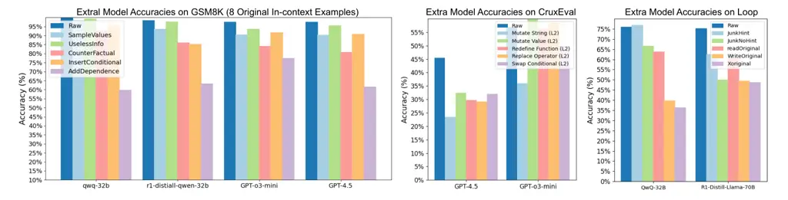

Figure 9: In addition to the models discussed in the main body of the
paper, we also report results for several popular models on GSM8K,
CruxEval, and Loop. The conclusions drawn in the main paper are found to
generalize well to these additional models.

## Appendix E Appendix: GSM8K Details

### E.1 Statistical Accuracy on GSM8K and its variations

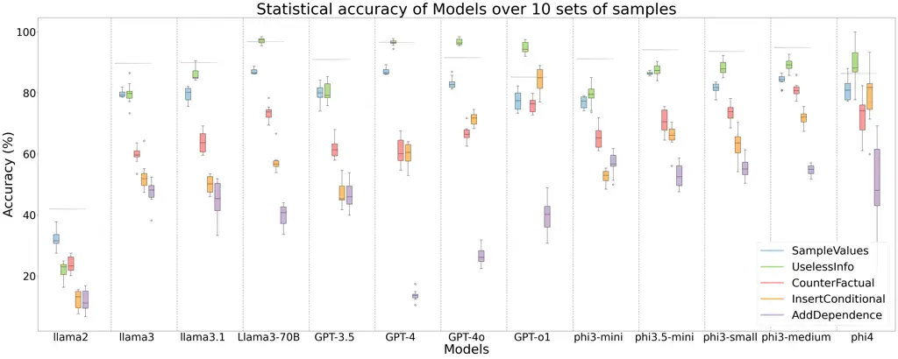

Figure 10: The statistical accuracy of models on GSM8K numerical answer
predictions is evaluated across different mutated test sets at varying
reasoning levels (see Section 3.2 and Figure 1). To generate this plot,
we randomly select 150 examples from the pool of examples eligible for
all mutations, excluding Bi-CounterFactual. We then create 10 test
variations for each mutation by sampling with 10 different seeds. All
models are independently tested on these 10 variations, and the
resulting accuracies are used to generate the bar plot. During testing,
each model is prompted with 8 raw examples along with their
Chain-of-Thought (CoT) process. Our observations are as follows: (1) All
models show significant accuracy variability when tested on mutated test
sets, particularly on variations with Level-3 mutations; (2) For all
models, the average performance on the mutated sets is notably lower
than on the original GSM8K test set (as indicated by the dashed line).
Moreover, for most test set variations with Level-3 mutations, even the
accuracy on the most beneficial sample set falls below the accuracy of
the original GSM8K test. This suggests that a single sentence mutation
altering the computational logic of the original math question may
severely impact the models’ performance.

### E.2 The Influence of In-context Examples

In this section, we examine the impact of in-context examples on the
model’s reasoning ability.

First, we aim to investigate whether providing the model with only
mutated examples can improve its reasoning performance on the generated
test set variations. During testing, all models are provided with seven
mutated examples with amended CoT process, each from a different type of
mutation (including two additional mutations beyond those discussed in
Section 3.2 and Figure 1). Figure 19 shows one detailed prompt.
Figure 11 presents the results, indicating that the models exhibit
behavior highly similar to when original GSM8K examples are used as
in-context examples (see Figure 2).

Next, we investigate whether providing the model with both the original
example and its mutated variations can enhance its reasoning performance
on the generated test set variations. During testing, all models receive
seven in-context examples. Each example consists of an original GSM8K
question and its answer, followed by a mutated version of the question
along with the corresponding CoT solution and answer. These examples
cover different types of mutations, including two additional mutations
beyond those discussed in Section 3.2 and Figure 1. To maintain
consistency with the in-context example format, we also include the
original question and its answer for the final mutated question that the
model is expected to answer. Figure 20 illustrates a detailed example of
the prompt, while Figure 12 presents the results. The findings indicate
that most models perform significantly better on the generated test set
variations when provided with both original and mutated examples,
compared to using only original GSM8K examples (Figure 2) or only
mutated examples (Figure 19) as in-context examples.

To visualize the comparison, we summarize model performance across two
dimensions: the average accuracy across all six test sets, as in the
left bar plot (x-axis), and the standard deviation in accuracy on the
five mutated test sets w.r.t. the raw test set (y-axis). The
bottom-right corner reflects the ideal balance of high performance on
both raw and mutated sets. In this way, we consolidate model performance
across these three different in-context example scenarios in Figure 8
and illustrate how to interpret the plot using the Llama3 model as an
example.

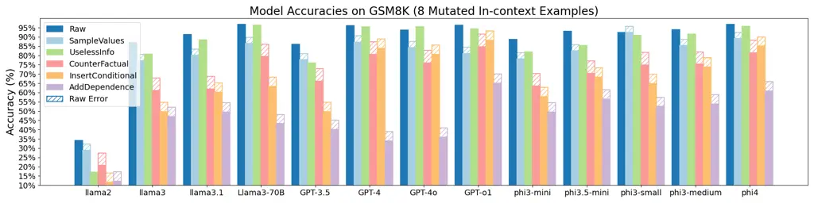

Figure 11: GSM8K: Detailed accuracy for all models in the Phi, Llama,
and GPT families. All models are prompted with 7 mutated in-context
examples. Check Figure 19 for the detailed prompt. Due to potential
noise from the automatic mutation process, we performed a human
evaluation on the mutated test set. We added the percentage of invalid
examples in each mutation category to the top of each accuracy bar,
assuming that if these QA pairs were correct, the models would answer
them correctly. This provides an upper bound on the model’s performance.

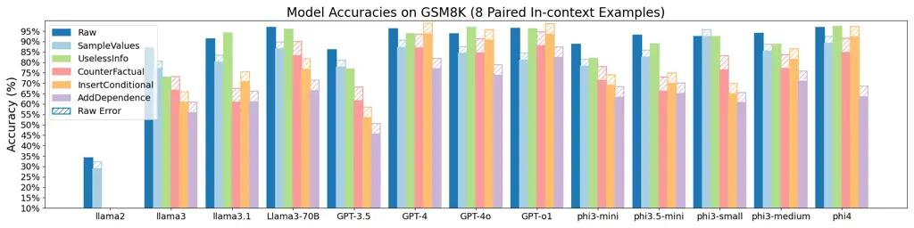

Figure 12: GSM8K: Detailed accuracy for all models in the Phi, Llama,
and GPT families. All models are prompted with 7 paired raw and the
corresponding mutated in-context examples. Check Figure 20 for the
detailed prompt. The missing Llama-2 experiments are due to its failure
to follow instructions and produce correctly formatted answers.

### E.3 Composition of Mutations

The defined Ladder of reasoning hierarchy (Section 2) and the automatic
variation generation pipeline (Section 3), open the possibility of
combining multiple mutations to create challenging test set variations.
In this section, we combine the SampleValues mutation from Level-2 with
the remaining four mutations (excluding Bi-CounterFactual) to create
four test set variations, each containing two types of mutations. The
models’ accuracy can be find in Figure 13.

To visualize the comparison, similar to Figure 8 in Section 6.2, we
summarize model performance along two dimensions: the average accuracy
across all test sets and the standard deviation in accuracy on the
mutated test sets relative to the raw test set. We combine model
performance on test set variations with a single mutation and those with
two mutations in Figure 14. As observed, all models exhibit lower
average accuracy on test variations containing two mutations compared to
those with a single mutation. The increased standard deviation of
accuracy w.r.t. the original test set suggests that composing mutations
expands the performance gap between the mutated sets and the original
set.

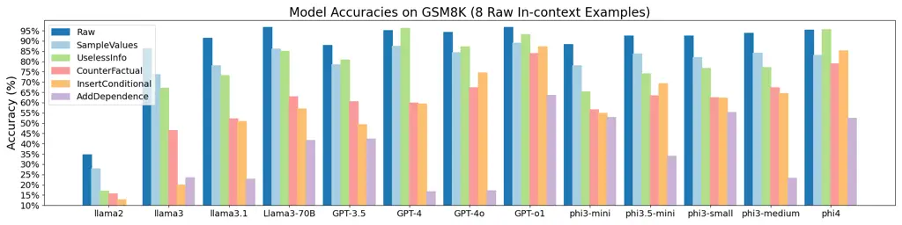

Figure 13: GSM8K: Detailed accuracy for all models in the Phi, Llama,
and GPT families. All models are prompted with 8 original in-context
examples. However, with the exception of SampleValues, all other
mutations are combined with SampleValues to create even more challenging
test set variations.

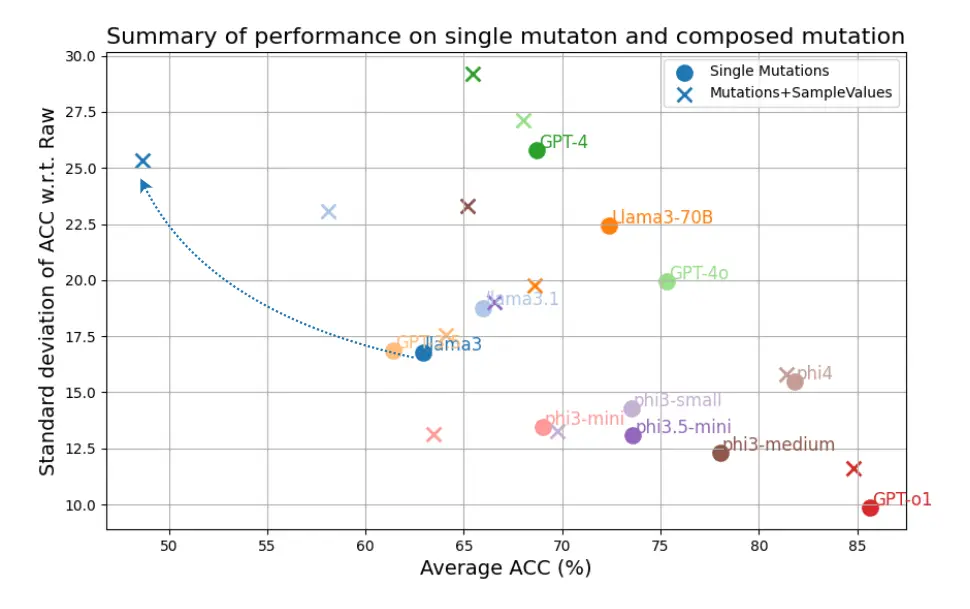

Figure 14: GSM8K: Visualization comparing model performance on test set
variations with one or two mutations. We summarize model performance
across two dimensions: the average accuracy across all six test sets, as
in the left bar plot (x-axis), and the standard deviation in accuracy on
the five mutated test sets w.r.t. the raw test set (y-axis). The
bottom-right corner reflects the ideal balance of high performance on
both raw and mutated sets. In this plot, dots represent models’ accuracy
on test sets with a single mutation, while crosses indicate their
accuracy on sets containing two mutations. Model structures are
differentiated by color, with the same structure represented by the same
color.

### E.4 Decomposing Model Performance by Number of Reasoning Steps

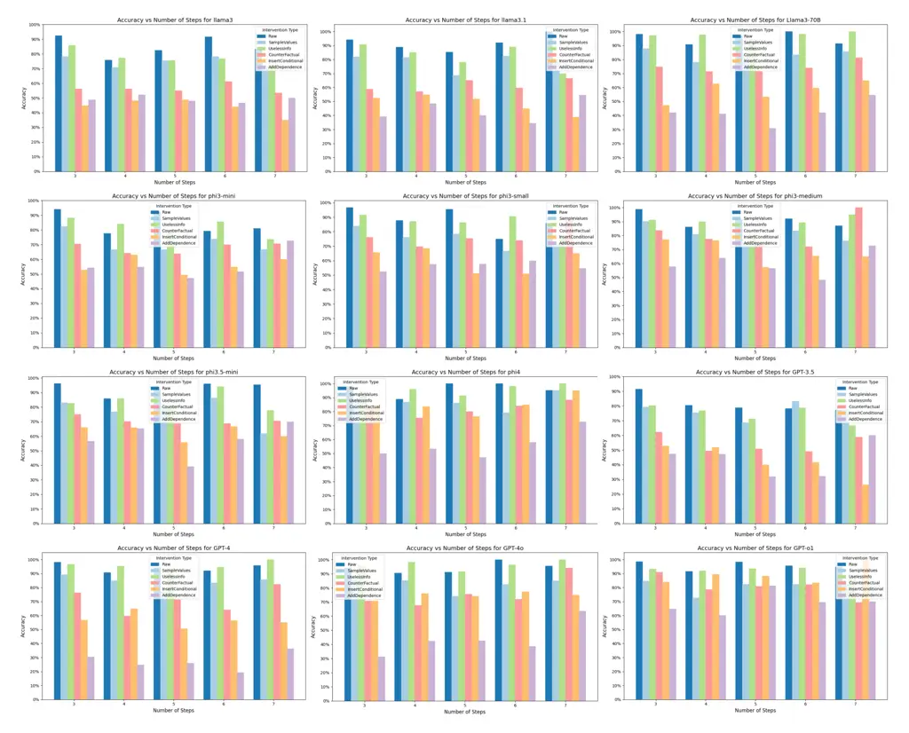

Figure 15: GSM8K: We analyze model performance across varying numbers of
reasoning steps. We define the difficulty of a numerical reasoning
question by the number of calculation steps (operations) in its code
solution. For each model, we compute the average accuracy across
examples grouped by their number of calculation steps. In the plots, the
x-axis indicates the number of reasoning steps, and the y-axis shows the
accuracy. The results reveal that, across all models, even when
controlling for the number of reasoning steps, performance is
consistently lower on mutated examples than on the original test set.
Furthermore, Level-3 mutations pose a significantly greater challenge
than Level-2. Notably, models perform worse on Level-3 mutations with
just three calculation steps than they do on original test examples
requiring seven steps, indicating a substantial gap.

### E.5 Detailed Prompts

Figure 16: Prompts used in GSM8K quality control. We prompt the LLM to
back-translate the mutated math problem into Python by modifying the
original question’s Python solution. The generated code must produce an
execution result that matches the ground truth answer of the mutated
question.

Figure 17: Prompts used in GSM8K mutated symbolic representation to
natural language.

Figure 18: Prompts used in GSM8K testing. The prompt contains 8 raw
in-context examples.

Figure 19: Prompts used in GSM8K testing. The prompt contains 7
in-context examples demonstrating different types of mutations.

Figure 20: Prompts used in GSM8K testing. The prompt contains 7
in-context examples. Each example contains a raw question and answer,
with the corresponding mutated question and chain-of-thought fo the
mutated question, with the final answer. The 7 examples are
demonstrating different types of mutations.

## Appendix F Appendix: CLadder Details

### F.1 Benchmark Details

The CLadder dataset (Jin et al., 2023b) provides a systematic evaluation
of causal reasoning abilities in LLMs. It consists of 10,000 causal
graphs of binary variables (i.e., Bernoulli conditional distributions)
that encompass common treatment-effect estimation scenarios, such as
confounding, mediation, and collisions. Each causal graph is associated
with multiple queries, spanning the three levels of Pearl’s ladder of
causation: associational, interventional, and counterfactual. Each
dataset example includes (1) a causal graph, (2) a query, (3) a causal
engine that computes over the casual graph and the query to get a binary
answer, and (4) a template-based formulation that translates the causal
graph and the query into a natural language question for the LLM to
interface with. The benchmark evaluates models’ causal reasoning
abilities by requiring them to (1) extract causal concepts from natural
language and (2) apply causal inference (either implicitly or
explicitly) over the causal concepts, such as do-calculus, to calculate
the final answer.

### F.2 Pipeline Details

#### F.2.1 Question to Symbolic Representation \raisebox{-.9pt}{1}⃝

Filtering: We begin with a filtering pass of the 10,000 examples in
CLadder, removing all examples corresponding to query types ‘backdoor
adjustment’ and ‘collider bias’ (in total 1,747 examples). The former
was filtered due to the inherent complexity of the python it would
require, and the latter because it is only present for one type of
causal graph structure. This leaves 8,365 examples from CLadder after
filtering.

Parser: Next, we develop a parser to automatically translate these
examples into Python code with the help of the causal engine provided by
CLadder. The parser determines the query type from the meta data in the
CLadder examples, and extracts the relevant variables from the natural
language questions. For every query type, causal graph, and estimand,
the parser generates a snippet of executable Python code which computes
the estimand.

Validation: To check that the NL to Python code parser is successful,
after conversion of the examples, we execute the Python code and compare
the computed estimand value with its ground-truth in CLadder. 60
examples showed a discrepancy, leaving us with 8,305 examples (99.34%
coverage of parsed examples).

#### F.2.2 Symbolic Mutations \raisebox{-.9pt}{2}⃝ and Mutated Symbolic Rep to NL \raisebox{-.9pt}{3}⃝

To examine the robustness of LLMs in handling variations in question
phrasing and irrelevant information, we include two key mutations:

1.  •
    UselessInfo: We add extraneous information at two levels. (i)
    RelatedIrrelevantInfo: With Meta-Llama 70B Instruct, we generate two
    sentences for each question that are semantically related but
    causally irrelevant. (ii) UnrelatedIrrelevantInfo: We prepend the
    natural language description from a randomly selected CLadder
    example to the beginning of each question, ensuring that the added
    sentences remain semantically irrelevant to prevent ambiguity. Both
    RelatedIrrelevantInfo and UnrelatedIrrelevantInfo describe Level-2
    mutations.
2.  •
    CounterFactual: We modify the probability values in the original
    question by introducing a counterfactual assumption, such as:
    “Suppose the probability of \<Event\> is \<new-value\> instead.”. To
    generate the ground-truth answer for the counterfactual question, we
    update the corresponding probability of the conditional distribution
    in Python code and execute it. CounterFactual is a Level-3 mutation.

In subsubsection F.2.2, we provide an example for each type of mutation.
Additionally, we generate two more test set variations by combining the
CounterFactual mutation with each UselessInfo mutation. The full results
are shown in Figure 21.

[TABLE]

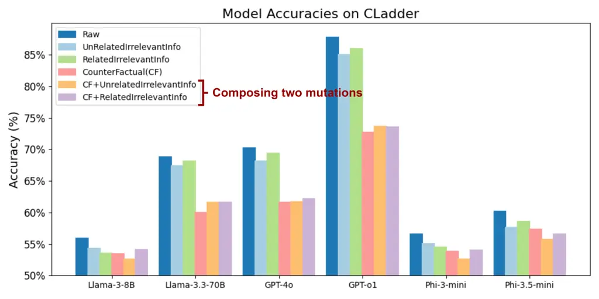

Figure 21: CLadder: Detailed accuracy for models in the Phi, Llama, and
GPT families.

### F.3 Prompts for mutated questions

Below are illustration of NL prompts for our mutations on CLadder. We
highlight parts of the original question in red, and the mutated natural
language in blue. The prompt consists of the System prompt (stated first
below), followed by a mutation-specific prompt (stated thereafter).

System Prompt We use the following system prompt throughout the
evaluation.

Related UselessInfo

Unrelated UselessInfo

CounterFactual

Unrelated UselessInfo x CounterFactual

Related UselessInfo x CounterFactual

### F.4 Prompts for generating IrrelevantInfo mutations

To generate the NL question for the IrrelevantInfo mutations, we use the
following auxiliary prompt. The template \<question\> refers to the part
highlighted in red in the prompts stated in Section F.3.

System Prompt to Generate Irrelevant Information

## Appendix G Appendix: CRUXEval Details

### G.1 Mutations

We summarize the mutation types implemented for CRUXEval in Table 6.
Note that each of the five code mutations can be implemented as both a
Type-2 and a Type-3 mutation, depending on how the resulting question is
posed; the corresponding two prompt templates are presented in
Section G.2.

[TABLE]

Table 6: Mutations in Re-Imagine for the CruxEval dataset.

### G.2 Prompts

Below we list the prompts used in testing CRUXEval. All models are
tested using zero-shot prompting, only.

Prompt for Level-2 mutations:

Prompt for Level-3 mutations:

### G.3 Coverage

Not all transformations are applicable to all problems; we report
coverage statistics below. Mutations are performed on 800 total factual
examples, with 88.9% of factual examples covered by at least one
mutation.

|               |             |                  |                 |                 |
| ------------- | ----------- | ---------------- | --------------- | --------------- |
| Mutate String | MutateValue | RedefineFunction | ReplaceOperator | SwapConditional |
| 30.3%         | 56.6%       | 54.1%            | 50.6%           | 42.5%           |

Figure 22: Mutation Coverage Statistics (as a percentage of total
CRUXEval data)

### G.4 Evaluation and Matched Factual Accuracy

We plot the accuracy on the factual and mutated CRUXEval benchmark for
ten language models in Figure 21.

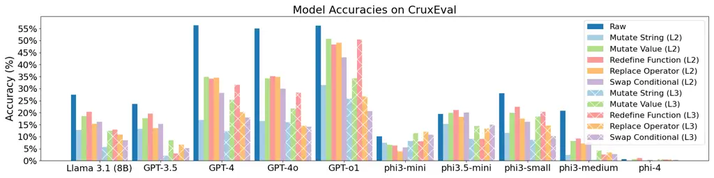

Figure 23: CRUXEval: Detailed accuracy for models in the Phi, Llama, and
GPT families.

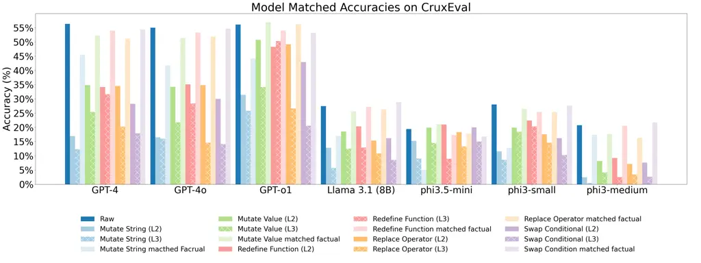

Figure 24: CRUXEval: Detailed accuracy and matched factual accuracy for
models in the Phi, Llama, and GPT families.

Because the coverage statistics for each mutation fall well below 100%,
each mutation is tested on only a subset of the total CRUXEval benchmark
problems. We therefore consider the possibility that there may be a
correlation between which mutations apply to a given problem and the
difficulty of that problem for the models we evaluate. In order to
account for this fact, we also compute matched factual accuracy scores
for each mutation. These scores report the factual accuracy rate of the
model when tested on only the same subset of problems to which the
mutation applies. For example, in Figure 24, the green bars represent
accuracy scores on the factual, Level-2, and Level-3 variants of the
56.6% of CRUXEval problems which admit a Mutate Value mutation. Note for
ease of reading that the palest bar of each color in Figure 24
represents the matched factual score for the corresponding mutation.

We observe that the overall trend of decreasing accuracy with Level-2
and Level-3 mutations is still evident with respect to matched accuracy
scores. Nonetheless, we note that matched factual accuracy is
consistently lower than raw accuracy on certain mutations; most
drastically for Mutate String. This indicates that problems which
contain mutable strings tend to be more difficult for LLMs than other
CRUXEval problems, underscoring the importance of viewing matched scores
for the fullest picture of model performance. The further decrease
between matched factual scores and the corresponding Level-2 and Level-3
mutation scores indicates that the difficulty-level correlation cannot
account for the remaining loss in accuracy post-mutation.

## Appendix H Appendix: Loop Details

In software verification, automatic inference of loop invariants is a
classic problem (Si et al., 2018). Since this problem is undecidable in
general, many heuristics have been proposed, including those based on
machine learning. Recently, LLMs have been demonstrated to perform well
on loop invariant inference of integer programs (Wu et al., 2024; Kamath
et al., 2024). In this paper, we mutate such tasks and evaluate the
efficacy of LLMs on the mutated tasks.

Each task has a program with a loop and an assertion. The goal is to
infer a predicate that satisfies the following three conditions: it
holds before the loop starts executing, holds for each iteration of the
loop, and implies the assertion when the loop exits. Finding such
predicates can be tricky even for small programs. Consider the task in
Figure 6; the predicate $`x\geq y`$ satisfies the first and the third
condition but fails to satisfy the second. As another example, consider
the simpler program

`x=0; while (x< 100) x++; assert x==100`

Given this program, the goal is for an LLM to produce the loop invariant
$`x\leq 100`$. It is easy to see that $`x\leq 100`$ satisfies all the
three conditions specified above. Note that there are infinitely many
predicates that are variations of $`x\leq 100`$, e.g.,
$`x\leq 99\vee x=100`$, that are valid loop invariants and the model
succeeds if it infers any of them. Although inferring such loop
invariants is undecidable, in practice, checking whether a given
candidate invariant satisfies the three conditions can be done well by
automated software verification tools like Frama-C (Correnson et al., ).

To evaluate a model on an original or a mutated task, the LLM output is
checked by Frama-C that internally uses SMT solvers such as Z3(de Moura
& Bjørner, 2008), alt-ergo(Ait El Hara et al., 2022) and CVC4(Barrett
et al., 2011). The model succeeds on the task if Frama-C succeeds to
verify the LLM output as a loop invariant, and fails otherwise. Hence, a
model can fail on a task for two reasons: either Frama-C declares the
candidate as invalid, or the candidate invariant is valid but Frama-C
could not prove its validity within the provided time bound. We evaluate
on 250 tasks from Kamath et al. (2024) which have the property that
Frama-C succeeds in verifying that the invariant for the original
program is also the invariant for all the mutated programs.

Unlike GSM8K, applying Level-3 mutations to these tasks is difficult.
Once we change the values of the program variables, loop invariants can
cease to exist. For example, if we mutate the example above then we can
get the mutated program

`x=101; while (x< 100) x++; assert x==100`

with a new initialization. There is no loop invariant which discharges
the assertion as the assertion will get violated when the program is
run. Hence, we limit ourselves to a category of Level-2 mutations that
add useless information to the tasks in the form of additional variables
and operations that leave the values of the variables in the original
program unaffected.

Table 7 shows how various mutations operate on the program in Figure 6.
Figure 25 shows the results of all the models we consider on 250 loop
invariant inference tasks from Kamath et al. (2024). We use the
following prompt from (Kamath et al., 2024), reproduced here for
completeness.

|                |                                                                                                                                                                                                                                                                                                                                                                                                       |                                                                                                                                                                                                                                                                                                                        |                                                                        |
| -------------- | ----------------------------------------------------------------------------------------------------------------------------------------------------------------------------------------------------------------------------------------------------------------------------------------------------------------------------------------------------------------------------------------------------- | ---------------------------------------------------------------------------------------------------------------------------------------------------------------------------------------------------------------------------------------------------------------------------------------------------------------------- | ---------------------------------------------------------------------- |
| Mutation       | Description                                                                                                                                                                                                                                                                                                                                                                                           | Code                                                                                                                                                                                                                                                                                                                   | Intervention Categories                                                |
| Vanilla        | Base Snippet with a loop and assertion.                                                                                                                                                                                                                                                                                                                                                               | int x = 1, y = 0; while (y \< 100000) {x+=y; y++;} //@ assert(x \>= y);                                                                                                                                                                                                                                                | None                                                                   |
| Junk Hint      | Adding 2 junk variables that are disjoint from original variables and are named as `junk_0` and `junk_1`.                                                                                                                                                                                                                                                                                             | int x = 1, y = 0; int junk_0 = 1, junk_1 = 3; while (y \< 100000) {x+=y; y++; junk_0 = 178; junk_1 = junk_0 - 687; }//@ assert(x \>= y);                                                                                                                                                                               | Add irrelevant Info                                                    |
| Junk No-Hint   | Adding 2 new variables that are disjoint from original variables and are named unremarkably (g0 and g1). Create new statements using randomly sampling of new variables and constants.                                                                                                                                                                                                                | int x = 1, y = 0; int g0 = 1, g1 = 3; while (y \< 100000) { x+=y; y++; g0 = 178; g1 = g0 - 687; }//@ assert(x \>= y);                                                                                                                                                                                                  | Add irrelevant Info and rename nodes                                   |
| Read Original  | Read the original variables of the code into the newly introduced ones. Randomly sample original variables and operators and add them to new variables. The arithmetic expressions in updates to new variables can use the original program variables along with the new variables and random constants. This mutation introduces more reads of the original program variables but no writes to them. | int x = 1, y = 0; int g0 = 1, g1 = 3; while (y \< 100000) { x+=y; y++; g0 = 178 + x - y; g1 = g0 - 687 + y - x; }//@ assert(x \>= y);                                                                                                                                                                                  | Add irrelevant Info and rename nodes, dummy relationship between nodes |
| Write Original | Increment the original variables by algebraic identities of new variables that equate to 0. Randomly sample new variables for the identity. Split constants to increase complexity.                                                                                                                                                                                                                   | int x = 1, y = 0; int g0 = 1, g1 = 3; while (y \< 100000) { x = x + y + (((g0 + g1)\*(g0 + g1)) -1\*g0\*g1 -2\*g0\*g1) - ((g0\*g0 + g1\*g1) - 1\*g0\*g1); y = y + 1 + ((g1\*g1 + g0\*g0) -1\*g1\*g0) - (((g1 + g0)\*(g1 + g0)) -1\*g1\*g0 -2\*g1\*g0); g0 = 178; g1 = g0 - 687; }//@ assert(x \>= y);                  | Add irrelevant Info and rename nodes, dummy relationship between nodes |
| X Original     | Increment the original variables by algebraic identities of new variables that equate to 0 and read original variables into the new variables                                                                                                                                                                                                                                                         | int x = 1, y = 0; int g0 = 1, g1 = 3; while (y \< 100000) { x = x + y + (((g0 + g1)\*(g0 + g1)) -1\*g0\*g1 -2\*g0\*g1) - ((g0\*g0 + g1\*g1) - 1\*g0\*g1); y = y + 1 + ((g1\*g1 + g0\*g0) -1\*g1\*g0) - (((g1 + g0)\*(g1 + g0)) -1\*g1\*g0 -2\*g1\*g0); g0 = 178 + x - y;; g1 = g0 - 687 + y - x; }//@ assert(x \>= y); | Add irrelevant Info and rename nodes, dummy relationship between nodes |

Table 7: Mutations for the Loop dataset on an example. For all the
programs, $`(x=1\wedge y=0)\vee x\geq y\geq 1`$ is a valid loop
invariant.

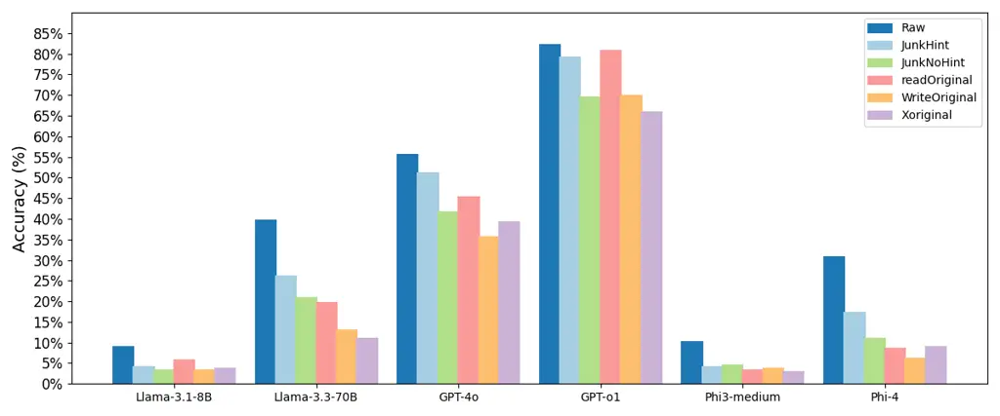

Figure 25: Evaluation of various models on the Loop dataset and its
mutated versions.

langley00

Table 5: Mutations in Re-Imagine for the CLadder dataset. In the
Bayesian network, gray nodes indicate a variable whose probability mass
function (conditional on variables from incoming edges) has been
intervened on or added as part of the mutation. The probability
distributions for the irrelevant graph in IrrelevantInfo are not stated.
Note that the probability of the positive event specifies the full
conditional distribution since all distributions are Bernoulli (e.g.
$`P(A=1|H=0,W=0)=0.08\implies P(A=0|H=0,W=0)=0.92`$).
