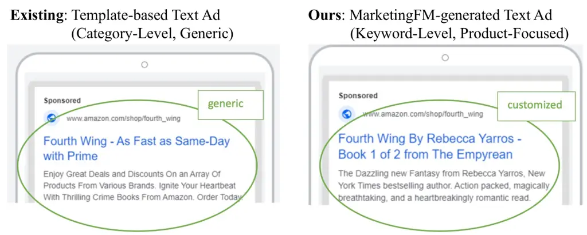
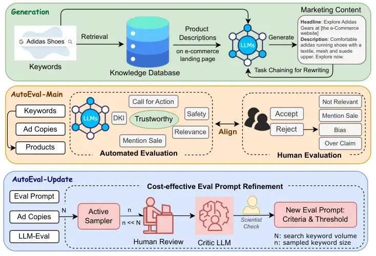
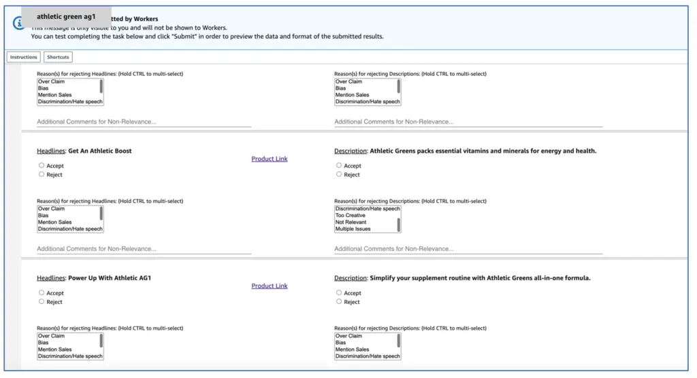
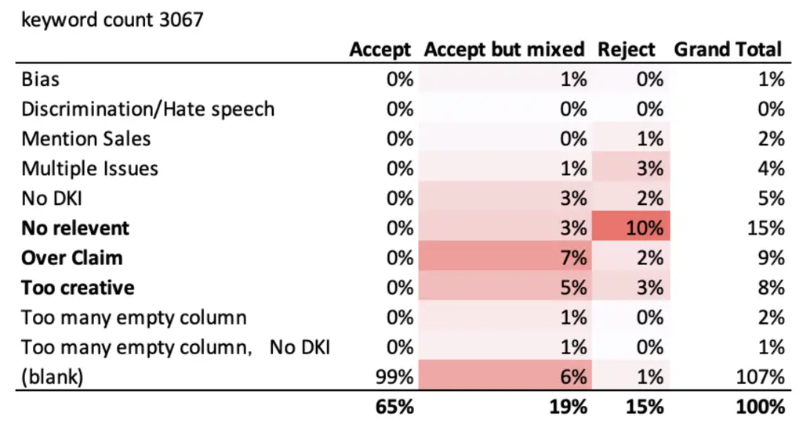
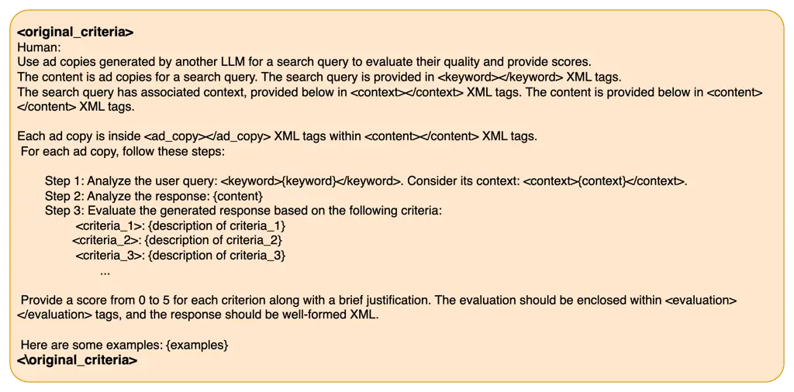
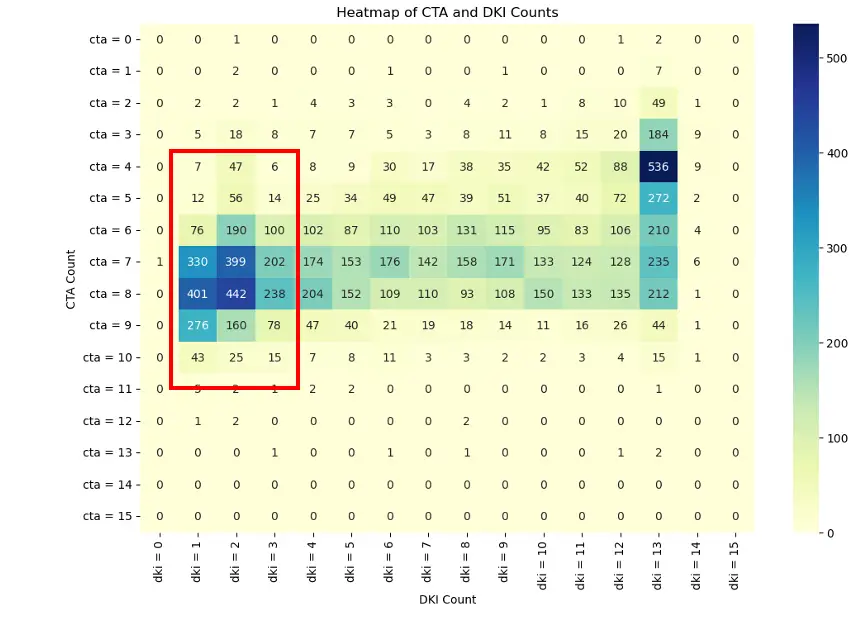

# LLMs for Customized Marketing Content Generation and Evaluation at Scale

Haoran Liu Note: Work done during Haoran’s internship at Amazon.
Affiliation: Texas A&M University email: <liuhr99@tamu.edu> , Amir
Tahmasbi Affiliation: Amazon Inc. email:
[atahmasb@amazon.com](mailto:%0Aatahmasb@amazon.com%0A) , Ehtesham Sam
Haque Affiliation: Amazon Inc. email:
[ehtesham@amazon.com](mailto:%0Aehtesham@amazon.com%0A) and Purak Jain
Affiliation: Amazon Inc. email:
[purakjn@amazon.com](mailto:%0Apurakjn@amazon.com%0A)

Received  5 June 2009

###### Abstract.

Offsite marketing is essential in e-commerce, enabling businesses to
reach customers through external platforms and drive traffic to retail
websites. However, most current offsite marketing content is overly
generic, template-based, and poorly aligned with landing pages, limiting
its effectiveness. To address these limitations, we propose MarketingFM,
a retrieval-augmented marketing content generation system that
integrates multiple data sources to produce keyword-specific ad copy
with minimal human intervention. We validate MarketingFM through offline
human and automated evaluations and large-scale online A/B tests. In a
recent experiment, keyword-focused ad copy outperformed template-based
ads, achieving up to 9% higher click-through rates (CTR), 12% more
impressions, and a 0.38% lower cost-per-click (CPC), demonstrating
improved ad ranking and cost efficiency. Despite these gains, manual
review of generated ads remains costly and time-consuming. To mitigate
this, we introduce AutoEval-Main, an automated evaluation system that
combines rule-based metrics and LLM-as-a-Judge approaches, ensuring
alignment with marketing principles. In experiments conducted with
large-scale high-quality human annotation data, AutoEval-Main achieves
an agreement rate of 89.57% with human reviewers. Building on this, we
further propose AutoEval-Update, a cost-efficient LLM-human
collaborative framework designed to dynamically refine the evaluation
prompt and adapt to shifting criteria with minimal human effort. By
selectively sampling representative ads for human review and leveraging
a critic LLM to generate alignment reports, AutoEval-Update enhances
evaluation consistency while significantly reducing manual effort. Our
experiments show that the critic LLM proposes meaningful refinements,
enhancing alignment between LLM-based and human evaluations. However,
human oversight remains crucial for setting thresholds and validating
refinements before full-scale deployment.

###### Keywords: 

Large Language Models (LLMs), Marketing Content Generation,
Retrieval-Augmented Generation (RAG), Ad Copy Evaluation,
LLM-as-a-Judge, LLM Alignment, AI for Marketing

## 1. Introduction



Figure 1. A comparison of two paid search ads for an e-commerce website
targeting the same keyword. The left ad is generic and template-based,
while the right is our keyword-specific, product-focused approach to
enhance ad relevance and user engagement considering product context.

Customers often search for products through web services like Google,
Bing, and social media services such as Facebook, Instagram, and
Pinterest, where they encounter e-commerce advertisements alongside
organic search results. To effectively engage users and present the
products of an e-commerce website, these offsite marketing content must
be carefully crafted to clearly communicate product offerings and
present them in an appealing way.

Currently, most large-scale e-commerce websites rely on manually
curated, template-based ad copies, images, and videos that fail to adapt
to their diverse product offerings. In search marketing, marketers often
craft broad category-level templates like "Come Find Your Favorite
\<Keyword\> on \[e-commerce website\]!" for entire keyword categories
without emphasizing product-specific features. While this approach
provides a structured framework, it suffers from several key
limitations. First, generic templates fail to capture product-specific
nuances that could differentiate offerings in a competitive marketplace.
Second, they struggle to adapt messaging to varying customer intents
across different channels, such as search and social marketing channels.
Third, the resource-intensive nature of manual content creation hinders
scalability, making it difficult to customize or personalize content at
scale. As a result, traditional methods often misalign ad content with
user expectations, leading to limited audience engagement and suboptimal
returns on advertising investment.



Figure 2. An illustration of the proposed MarketingFM framework for
marketing content generation and evaluation. The top section represents
the ad copy generation pipeline, where retrieval-augmented generation
and task chaining ensure relevant and concise ad content. The middle
section depicts AutoEval-Main, an automated evaluation system that
assesses ad quality based on key criteria, aligning LLM-generated
content with human evaluations. The bottom section illustrates
AutoEval-Update, a cost-effective LLM-human collaborative evaluation
refinement process that iteratively updates evaluation criteria.

Recent advances in Large Language Models (LLMs) (Brown et al., 2020;
Chowdhery et al., 2023; Touvron et al., 2023; Yang et al., 2024; Dong
et al., 2024a) offer promising opportunities for automating marketing
content generation at scale (Chung et al., 2023; Wu et al., 2025;
Acharya et al., 2023; Bismay et al., 2024). However, directly applying
these models introduces risks such as factual inaccuracies (Celikyilmaz
et al., 2020; Chen et al., 2025; Liang et al., 2024a), unsubstantiated
claims (Qiu et al., 2023; Farquhar et al., 2024), and potential policy
violations (Karamolegkou et al., 2023; Neel and Chang, 2023; Dong
et al., 2024b), all of which can degrade customer experience and
engagement. For example, for the keyword “Stanley Cup”, a baseline model
mistakenly generated hockey-related ad copy instead of content for
trending water bottles, underscoring the importance of aligning
generated content with both customer intent and product catalog
accuracy.

To address these challenges and enhance ad copy customization without
intensive human labor, we introduce MarketingFM, a framework that
automates and optimizes the generation of marketing content at scale.
MarketingFM empowers e-commerce marketing teams to generate custom ad
content for millions of products while ensuring relevance to diverse
customer interests. By using Retrieval-Augmented Generation (RAG) (Lewis
et al., 2021; Gao et al., 2023; Kortukov et al., 2024) with existing
onsite search infrastructure within the e-commerce service, MarketingFM
grounds ad generation in real-time product data corresponding to
customer queries, thereby enhancing ad relevance. Figure 1 illustrates
how MarketingFM produces more relevant and targeted ad content compared
to generic ad copy in the paid search use case. To assess the
effectiveness of MarketingFM’s ad generation, we conducted large-scale
human evaluations across multiple criteria, demonstrating a high
acceptance rate for the generated ads. Additionally, online A/B testing
showed a significant increase in user engagement, confirming the
framework’s ability to produce high-quality, relevant ad content at
scale.

To further reduce the need for costly human review, we developed
AutoEval-Main, an automated evaluation system that integrates rule-based
checks and LLM-as-a-Judge scoring to ensure ad quality. Rule-based
methods enforce policy compliance by detecting disallowed terms,
formatting issues, and stylistic inconsistencies, ensuring adherence to
channel-specific requirements. Meanwhile, the LLM-as-a-Judge component
evaluates query relevance and factual accuracy by cross-referencing
product metadata, preventing hallucinations, overclaims, and policy
violations. By leveraging human evaluation data as a benchmark, we
demonstrate that this hybrid approach closely aligns with human
judgments, maintaining high-quality standards while improving efficiency
in content validation.

While AutoEval-Main enhances efficiency and consistency, it requires
dynamic refinement to keep pace with evolving customer behavior, keyword
distributions, and evaluation standards. To address this criteria drift
issue, we propose AutoEval-Update, an automated self-refinement
framework that iteratively improves the evaluation prompts and criteria.
This cost-effective solution leverages active sampling and a critic LLM
to identify misalignment factors and dynamically refine evaluation
standards. The process begins by actively sampling a small but
representative subset of ad copies for evaluation by AutoEval-Main and
human annotators. The critic LLM, a more advanced model than the LLM of
ad generation, then generates an alignment report by identifying
discrepancies between human evaluations and AutoEval-Main outputs,
derived from new evaluation criteria. These refinements are iteratively
incorporated into AutoEval, ensuring that AutoEval remains adaptive and
aligned with emerging needs. This process continues until convergence,
with only the final round of updates undergoing domain expert review
before deployment to ensure robustness and accuracy in large-scale ad
evaluation. Experiments confirm that AutoEval-Update enables refinement
in evaluation quality with little human labor, ensuring sustained
alignment with human assessments and adaptability to evolving ad
evaluation standards.

In summary, our contributions are:

- •
  We propose MarketingFM that ensures LLM-generated ad copies align with
  marketing principles. We curate ad quality criteria based on marketer
  insights and benchmark this task using large-scale human annotations.
- •
  We develop AutoEval-Main, an automated evaluation system that
  integrates rule-based checks and LLM-as-a-Judge to assess ad quality,
  reducing need for costly human review.
- •
  We introduce AutoEval-Update, a self-refining evaluation framework
  that actively samples data and automatically updates evaluation
  criteria to adapt to shifting data and evolving standards, ensuring
  continuous improvement of the automated evaluation system.
- •
  We validate the effectiveness of our systems through both offline
  evaluation and online A/B tests, demonstrating improvements in
  marketing content quality and alignment with marketer objectives.

Notably, our MarketingFM framework can be extended to other marketing
use cases, such as social media and outbound marketing email,
demonstrating the potential of foundation models for marketing content
generation.

## 2. Related Work

#### LLMs for Ads Generation.

Relevant ad copy is crucial for driving engagement and optimizing the
performance of sponsored links. Limited prior works have explored the
role of LLMs in ad generation, with a survey paper (Reisenbichler
et al., 2023) highlighting their potential in search engine advertising
and emphasizing the importance of structured guidance to ensure quality
and relevance. Likewise, another study (Zhou et al., 2024a) improves CTR
by integrating LLMs with feature engineering and modified genetic
algorithms for copywriting, demonstrating the need to align ad content
with user intent, landing pages, and performance metrics. In contrast,
our work consider practical deployment of LLMs for offsite search
marketing in e-commerce, integrating marketing expertise into ad
generation. We design domain-specialized prompts and RAG mechanism to
drive engagement, integrate task chaining (Huang et al., 2023; Wei
et al., 2022) to meet character limits, and establish a dataset with
high-quality, large-scale human annotations to evaluate LLM-generated ad
quality.

#### LLM-as-a-Judge.

The evaluation of language models, particularly in content generation,
necessitates robust and reliable assessment methods. Recent studies have
underscored the effectiveness of using foundation models with shared
datasets to ensure consistent evaluations and minimize bias (Zheng
et al., 2023; Gu et al., 2024). Metrics such as fluency, coherence,
relevance, and n-gram diversity have been widely adopted to evaluate
model outputs (Wang et al., 2023b). Additionally, researchers have
investigated using strong LLMs as evaluators to reduce the costs
associated with human assessment. These LLM-based evaluations have
proven effective in detecting biases, such as position and verbosity
bias, achieving over 80% agreement with human judgments on benchmark
datasets, thus demonstrating the scalability and cost-efficiency of LLMs
as evaluative tools (Yasunaga et al., 2023). Unlike prior work on
general-domain question answering (Liu et al., 2023; Li et al., 2024),
reasoning (Setlur et al., 2024; Saha et al., 2025; Wang et al., 2023a;
Zhou et al., 2024b), and alignment (Ashktorab et al., 2024; Liang
et al., 2024b; Zhang et al., 2024), we adapt LLM-as-a-Judge for
marketing content quality evaluation aligning with marketer principles.
Our system evaluates the relevance of the ad copy and the
generalizability of the ad, ensuring relevance with search keywords and
products from the landing page. To enable scalability, we design it for
both effectiveness and efficiency in large-scale advertising
applications.

However, in real-world applications, evaluation criteria evolve as
models generate new outputs and external conditions shift. Shankar
et al. (2024) highlights this criteria drift problem—users need criteria
to grade outputs, yet grading outputs help define those criteria. Their
work proposes a UI-based human-LLM collaboration system, but it still
depends on manual updates, making the process labor-intensive and
difficult to scale. In contrast, we introduce an automated framework
designed to meet industry-scale evaluation needs by minimizing human
effort. Using active sampling and a powerful critic LLM, our system
ensures continuous adaptation to shifting customer interests, evolving
product catalogs, and changing advertising requirements. Our approach
enables scalable and high-quality ad evaluation in dynamic commercial
environments.

## 3. LLM for Ads Content Generation

#### Problem Setting.

Given an input customer intent query $`x`$ (the search keyword), we
retrieve relevant product documents $`z`$, which provide titles and
detailed product features as context. This context, along with $`x`$, is
used to generate marketing content $`y`$. For example, in the Paid
Search use case, the output $`y`$ is the ad titles and descriptions, as
shown in Figure 1. Formally, our generation process can be represented
as:

```math
p_{\text{MarketingFM}}(y|x)=p_{\theta}(y|x,z)p_{\phi}(z|x)
```

Specifically, the generation process has two components: (1) a retriever
$`p_{\phi}`$ that retrieves the top $`k`$ product documents $`z`$,
conditioned on $`x`$; (2) a generator $`p_{\theta}`$ that produces $`y`$
based on $`x`$ and the retrieved context $`z`$. An illustration of the
marketingFM framework is shown in Figure 2.

### 3.1. Search Keyword Context Retrieval

To resolve ambiguity and improve ad relevance, we retrieve products from
a knowledge base (KB) of all products from an e-commerce website and use
the product metadata as context for generation. For this RAG component,
we propose two retrieval strategies: (1) semantic embedding-based
retrieval and (2) search page products context retrieval.

#### Semantic Embedding-based Retrieval.

Suppose that, given the input $`x`$, $`z^{+}`$ is a target product to
retrieve ¹¹ 1 For simplicity, we consider one $`z^{+}`$ for each input;
the retrieval target can be a set of triplets $`\{z^{+}\}`$. Then, the
objective is formulated with a sentence encoder model $`p_{\phi}`$ as:

```math
z^{+}=\text{argmax}_{z\in\text{KB}}f(p_{\phi}(x),p_{\phi}(z))
```

where $`f`$ is a non-parametric scoring function that calculates the
similarity between the input query representation $`p_{\phi}(x)`$ and
document embedding $`p_{\phi}(z)`$, for example, the dot product.
Specifically, we use all-MiniLM-L6-v2 ²² 2
[https://huggingface.co/sentence-transformers/all-MiniLM-L6-v2](https://huggingface.co/sentence-transformers/all-MiniLM-L6-v2)
model (Face, 2020). To efficiently retrieve the top-$`k`$ documents from
millions of high-dimensional vectors, we use the FAISS library (Douze
et al., 2024) for document indexing and similarity calculation.

#### RAG using Search Page Products Context.

In this approach, we use a different KB that directly maps search
keywords to products from the e-commerce website’s search result pages,
assuming their relevance for ad copy generation. Specifically, we
prioritize products from earlier search result pages and select the
top-$`k`$ products to extract metadata, i.e., product title and
descriptions. This metadata forms the context for each search keyword.
Since the products displayed on search pages may change over time, we
regularly refresh the KB to ensure accuracy.

### 3.2. Marketing Content Generation and Task Chaining

For content generation $`p_{\theta}(y|x,z)`$, we use Anthropic Claude
Haiku (Anthropic, 2024) through Amazon Bedrock ³³ 3
[https://aws.amazon.com/bedrock/](https://aws.amazon.com/bedrock/) to
balance the cost of API and the quality of the generation. Specifically,
for a given search keyword $`x`$ for advertising, we construct a prompt
$`P`$ by retrieving the context $`z`$ and then use $`P`$ as input to
$`p_{\theta}`$. In practice, based on suggestions from marketing
managers, we design two prompts: a general-purpose prompt and a
call-to-action prompt (intended to encourage customer engagement,
definitions in Appendix B.1), and we use both in combination
(implementation details in Section 6.1).

#### Task Chaining.

However, ensuring rule-following remains a challenge for LLMs (Mu
et al., 2023; Sun et al., 2024), and one key requirement for paid search
ads is to keep headlines under 30 characters. This is difficult due to
the length of many keywords (over 50% exceeding 15 characters). Despite
trying various prompts, our initial attempts failed as most generated
headlines exceeded the limit. To resolve this, we adopt a task chaining
approach through summarization: First, we generate twice as many
headlines and descriptions as needed and then use a subsequent LLM call
to summarize them so they meet the length requirement. This approach
effectively produces headlines within the limit using just two LLM
calls, whereas the previous method could require up to 10 attempts to
satisfy length constraints. We provide the prompt template in
Appendix A.3.

## 4. Benchmarking LLM-Generated Ads at Scale: Quality Standards and Human Evaluation

We collaborate with marketers to define detailed ad quality requirements
and create guidelines for human annotators, ensuring alignment with
marketing objectives and customer engagement goals. The requirements for
engagement-driven messaging and keyword relevance are detailed in
Appendix A.4, while Table 11 shows rejection reasons and
theirdefinitions. Additionally, we develop a human annotation workflow
tool using AWS GroundTruth to support human evaluation. The annotators
review all headlines and descriptions for each keyword, accepting or
rejecting content based on guidelines provided by business stakeholders
and the marketing team. The process provides an accept or reject status
for each ad copy, along with the specific reason for rejection. As shown
in Table 1(a), over 97% of generated ad copies are accepted, indicating
high-quality LLM generation. A breakdown of the rejected reasons are in
Table 1(b), with “not relevant” being the most common reason for
rejection. Note that the rejection reason bias does not indicate harmful
stereotyping but rather cases where an ad copy unintentionally limits
the target audience based on gender, age, or other demographics. For
example, if a user searches for “birthday gifts” but the ad copy states
“birthday gifts for kids”, it narrows the intended audience. While this
does not pose a fairness risk, it may affect inclusivity and ad
performance. Notably, no safety or toxicity issues are identified in the
generated content, confirming the trustworthiness of our system.

#### Analysis on Human Evaluation Quality.

To assess reviewer reliability, we randomly sample and manually validate
the annotations. Due to the data imbalance (only 2% of the cases are
rejections), we calculated weighted metrics to reflect the proportion of
accepted and rejected cases. As shown in Table 1, the overall weighted
error rate is 3.71%, confirming the trustworthiness of human
evaluations.

With these human annotations, we establish a comprehensive benchmark
dataset for ad copy generation, encompassing keywords, product metadata,
generated ad copies, and human labels. The dataset enables us to (1)
validate our offline evaluation metrics against human judgment while (2)
providing valuable training data for future model fine-tuning.

|               |           |
| ------------- | --------- |
| Eval. Results | Ratio (%) |
| accept        | 97.21     |
| reject        | 2.79      |
| total         | 100       |

(a) Overall human evaluation results.

|               |           |
| ------------- | --------- |
| Rej. Reason   | Ratio (%) |
| not relevant  | 48.64     |
| too specific  | 22.49     |
| over claim    | 13.92     |
| mention sales | 7.11      |
| bias          | 5.96      |
| too creative  | 1.75      |
| others        | 0.14      |
| total         | 100       |

(b) Breakdown of rejections.

Table 1. Human evaluation results for 150,000 generated ad copies of
10,000 keywords.

|                   |             |             |
| ----------------- | ----------- | ----------- |
| Human Opinion     | Correct (%) | Mistake (%) |
| Accept            | 97          | 3           |
| Reject            | 71          | 29          |
| Weighted Accuracy | 96.29       | 3.71        |

Table 2. Sampled and weighted manual validation results for human
annotations.

|                |                                                                                                                                                 |                   |               |
| -------------- | ----------------------------------------------------------------------------------------------------------------------------------------------- | ----------------- | ------------- |
| Criterion      | Description                                                                                                                                     | Evaluation Method | Scoring       |
| Relevance      | Ad copy should balance between vague and specific, align with keyword/search intent, avoid bias, and not focus narrowly on one or two products. | LLM-as-a-Judge    | 0–5 Score     |
| Generalization | Evaluates how well the ad copy generalizes while remaining relevant, avoiding excessive specificity or bias.                                    | LLM-as-a-Judge    | 0–5 Score     |
| Safety         | Content must be appropriate, avoiding harmful/offensive language and adhering to advertising standards.                                         | Rule-based        | Accept/Reject |
| Mention Sale   | Ad copy should avoid misleading price impressions. No "sale," "discounts," or "clearance" are allowed.                                          | Rule-based        | Accept/Reject |
| Diversity      | For a keyword, ad copies should vary in tone, features, or aspects to ensure diversity compared to other ads for the same keyword.              | Rule-based        | Accept/Reject |

Table 3. AutoEval-Main Criteria: Our proposed evaluation system criteria
for assessing the quality of generated ad copies. The framework combines
LLM-based evaluation and rule-based checks, with scoring formats varying
between numerical ratings and binary accept/reject decisions.

## 5. Automated Evaluation for Generated Ads

To reduce the cost associated with human annotation and screening, we
explore automated evaluation methods using LLMs.

### 5.1. AutoEval-Main: Evaluation via LLM-as-a-Judge and Rule-Based Checks

Our proposed automated evaluation framework, AutoEval-Main (Figure
2.middle), integrates Rule-Based Checks with an LLM-as-a-Judge system
(Zheng et al., 2023) to ensure the generation of high-quality ad copies.
The Rule-Based Checks implement efficient, stoplist-based methods that
address inherent limitations in LLM outputs to ensure compliance with
business requirements by accepting/rejecting ad copies based on criteria
defined in Table 3. The LLM-as-a-Judge system introduces a more nuanced
evaluation layer by assessing ad copies on two key metrics: Relevance
and Generalization (refer to Table 3), each rated on a 0-5 scale. The
system leverages prompt engineering (refer to Appendix A.4 for detail)
and domain expert-crafted few-shot examples, complemented by
query-specific context from the KB. These components guide the LLM in
evaluating ad copies against predetermined criteria, with the examples
serving as evaluation benchmarks.

The workflow begins when a user submits a search query, e.g., “wireless
headphones for gym”, prompting the system to generate multiple ad
variations, typically 12 headlines and 3 descriptions. These ad copies
first undergo rule-based checks to filter out those that fail to meet
fundamental requirements. The remaining copies, along with the original
query and relevant product context from the KB, are then evaluated by
the LLM. The system assigns Relevance and Generalization scores to each
ad copy, accepting those that meet or exceed the threshold while
rejecting the rest.

1:

2: LLM-generated ad copies $`C`$

3: Initial evaluation prompt $`P`$

4: Evaluation criteria and KB context

5: Performance threshold $`\tau`$

6: Maximum iteration rounds $`N`$

7:

8: Refined evaluation prompt $`P^{\prime}`$ aligned with human judgment.

9: Initialization: Select a diverse subset $`C_{s}\subseteq C`$ for
evaluation.

10: Step 1 - Active Sampling: Ensure $`C_{s}`$ represents varied query
types, product categories, and prior evaluation outcomes.

11: Step 2 - Automated Evaluation: Use prompt $`P`$ to score $`C_{s}`$,
generating LLM evaluation scores $`S_{s}`$.

12: Step 3 - Human Evaluation:

- •
  Obtain human feedback $`H`$ on $`C_{s}`$.
- •
  Identify discrepancies between $`S_{s}`$ and $`H`$.

13: Step 4 - Discrepancy Analysis:

- •
  Compare $`S_{s}`$ and $`H`$ to detect misalignments.
- •
  Diagnose root causes (e.g., ambiguous criteria, LLM biases).

14: Step 5 - Prompt Refinement:

- •
  Update $`P`$ based on insights from Step 4, generating refined prompt
  $`P^{\prime}`$.
- •
  Adjust evaluation guidelines to enhance clarity and penalize
  inconsistencies.

15: Iteration: Apply $`P^{\prime}`$ in subsequent evaluations and repeat
Steps 1–5 iteratively. Iteration terminates when evaluation performance
meets a predefined threshold $`\tau`$ or exhibits no significant
improvement over $`N`$ consecutive rounds.

16: Output: Refined evaluation prompt $`P^{\prime}`$.

Algorithm 1 AutoEval-Update Framework for Self-Refining Ad Copy
Evaluation

### 5.2. AutoEval-Update: Iterative Self-Refinement with LLM-Human Collaboration

Ad copy evaluation is inherently dynamic, shaped by data distribution
shifts, evolving marketing priorities, and policy changes. These factors
necessitate regular updates to evaluation prompts to maintain relevance
and accuracy. For instance, growing public concern over product safety
may necessitate more rigorous accuracy metrics, while increasing
scrutiny on political or socially sensitive advertising could require
more precise or inclusive language guidelines to ensure compliance with
evolving regulations.

The proposed AutoEval-Update framework (Figure 2.lower) addresses these
challenges through an iterative refinement process that continuously
improves evaluation prompts. AutoEval-Update begins with active
sampling, selecting a diverse and representative subset of LLM-generated
ad copies and their evaluation results. These samples undergo human
review to validate alignment with LLM assessments, establishing a
reliable ground truth. Discrepancies between human and LLM evaluations
are analyzed in an alignment report, identifying issues such as keyword
misinterpretation or inconsistent criteria application. Insights from
this analysis guide prompt adjustments, refining evaluation criteria and
thresholds for the next iteration. The process continues until
evaluation performance meets a predefined threshold $`\tau`$ or shows no
significant improvement over $`N`$ consecutive rounds. At scale, this
process ensures that evaluation remains adaptive and aligned with
evolving data with little human involve. For instance, from a daily
digest of 20 million keywords, the active sampler selects 1,000 keywords
with their generated ads for human review, which, along with the critic
LLM’s feedback, iteratively refines the evaluation prompt before
applying it to new assessments. The detailed procedure is outlined in
Algorithm 1, and Figure 5 illustrates the end-to-end production
pipeline.

#### Active Sampling Strategies.

Selecting a representative and meaningful subset for human review is
crucial for maintaining evaluation quality. To achieve this, the
framework employs three sampling approaches: (1) Random Sampling: A
baseline method that selects samples uniformly at random. While simple
and unbiased, it may fail to capture critical edge cases; (2)
Uncertainty-Based Sampling: Leverages LLM-generated confidence scores to
prioritize samples with lower confidence, ensuring that cases with
ambiguous or uncertain evaluations receive targeted human review. (3)
Diversity-Based Sampling: Ensures a broad and balanced representation by
selecting samples across different categories, CTR segments, or click
distributions, capturing variations in data distribution and model
performance.

## 6. Experiments and Lessons Learned

We select 10,000 high-performing keywords for paid search ad copy
generation, with a CTR range of 5% to 60%. Using our framework with
Anthropic Claude as the base model, we generate ad copies for these
keywords. We present the results from both offline evaluations and
online tests, along with key insights and findings.

### 6.1. Offline Evaluation of Generated Marketing Content

Given the public-facing nature of our offsite outputs, even a few
low-quality ads could damage the brand’s reputation and adversely affect
the e-commerce site’s business. Therefore, ensuring the quality and
safety of every output is paramount. To mitigate these risks and
maintain high standards, we conducted rigorous offline
evaluations—combining human assessment with LLM-as-a-Judge—before
launching online A/B tests.

|                         |            |
| ----------------------- | ---------- |
| Relevance Score         | Percentage |
| High Relevant (5)       | 54.34%     |
| Relevant (4)            | 20.49%     |
| Moderately Relevant (3) | 19.09%     |
| Slightly Relevant (2)   | 5.52%      |
| Not Relevant (1)        | 0.56%      |

Table 4. Distribution of LLM-evaluated relevance scores

#### Implemention Details.

During MarketingFM’s generation process, we generate then filter and
re-generate ad copies based on three key marketer requirements:
relevance to landing page product context, call-to-action (CTA), and
dynamic keyword insertion (DKI) (definitions in Appendix B.1). For
relevance, we provide LLM-generated headlines to the critic LLM,
requesting it to score the relevance to the search keyword on a scale
from 0 to 5, where 0 indicates no relevance and 5 indicates high
relevance. For this experiment, any ad copy with a score less than 4 was
automatically rejected and replaced with a new headline. For CTA, we
construct a list and check the presence of action-oriented verbs such as
“Buy Now” or “Shop at \[the e-commerce website\]”. Headlines lacking CTA
verbs are removed and regenerated. For DKI, we do not enforce strict
rules due to keyword length variability and character limits imposed by
the search engine advertising service. Instead, we analyze the output to
assess keyword incorporation distribution, enabling automatic filtering
and refinement of ad copies based on key marketing criteria.

#### Automated Evaluation Results.

Table 4 shows the relevance scores for raw (unfiltered) ad copies, with
74.83% scoring 4 or higher (regeneration threshold). CTA and DKI
analysis is in Appendix E. Notably, we observe that LLM-based relevance
scoring lacks precision at mid-scale (2–4), making it difficult to
establish a concrete irrelevance threshold. This misalignment with
marketer-defined rejection criteria reveals the limitations of
manually-defined evaluation criteria and threshold optimization. These
insights led us to further develop AutoEval-Update, enabling dynamic
refinement of evaluation criteria and thresholds.

|                                    |            |     |
| ---------------------------------- | ---------- | --- |
| Category                           | Percentage |     |
| Overall Agreement                  | 89.57%     |     |
| Overall Disagreement               | 10.43%     |     |
| Breakdown of Disagreements         |            |     |
|    Human Accepted but LLM Rejected | 8.90%      |     |
|    Human Rejected but LLM Accepted | 1.53%      |     |

Table 5. Alignment analysis between LLM-based and human evaluations.

### 6.2. Online Test for Generated Marketing Content

The hypothesis driving this initiative posits that keyword-specific ad
copy boosts engagement among shoppers on our partner search engine
advertising service. To validate this, we conducted a randomized A/B
test across 10,000 keywords with a wide range of CTRs. More details on
the experimentation infrastructure that enables scalable experiment
splits and execution can be found in Jain and Appala (2024). In the
experiment, the Control group used generic or category-level ad copy,
while the Treatment group utilized keyword-specific copy. We begin with
a 3,000-keyword online test using the semantic-based retrieval method.
The results, shown in Table 6, measure engagement using
click-through-rate (CTR), defined as clicks over impressions. The
treatment group shows an increase in CTR, particularly on mobile
devices, which represent 80% of our traffic.

|         |            |         |
| ------- | ---------- | ------- |
| Device  | Lift (bps) | p-value |
| Mobile  | +121       | 0.055   |
| Desktop | +38        | 0.269   |

Table 6. First-round online A/B test results (CTR) comparing generic ad
copy (control) to keyword-specific ad copy (treatment) for 3,000
keywords on a major search engine ads service. The retriever used in RAG
is semantic-based.

|                  |        |         |         |         |
| ---------------- | ------ | ------- | ------- | ------- |
| Metric           | Mobile |         | Desktop |         |
|                  | Lift   | p-value | Lift    | p-value |
| Clicks Lift      | +8%    | 3.89e-6 | +9%     | 2.56e-3 |
| Impressions Lift | +8%    | 3.17e-6 | +12%    | 1.01e-5 |
| CTR Lift (bps)   | (+4)   | 2.34e-1 | (+24)   | 1.10e-1 |
| CPC Reduction    | -0.35% | 3.07e-3 | -0.22%  | 2.01e-1 |

Table 7. Second-round online A/B test results (CTR, clicks, CPC)
comparing keyword-specific ad copy (treatment) to template-based ad copy
(control) for 10,000 keywords on a major search engine advertising
service. The retrieval method is products context KB-based RAG.

From the test, we identified a relevancy issue of 10%, where the ad copy
did not match the products on the e-commerce website’s search landing
pages. To address this, we curate a KB mapping keywords to search page
products, which reduce the relevancy issue to 1%. Furthermore, our
partner search engine advertising service recommended using a specific
output style that incorporates CTAs and DKIs (definitions in
Appendix B.1). The post-experiment analysis also confirmed that
successful keyword segments contain CTA and DKI. As a result, we
implemented these guidelines through task chaining. Building on this, we
expand to a 10,000-keyword online test (Table 7), where keyword-specific
Ad Copy (Treatment) achieves an 8% increase in impressions on mobile and
a 12% increase on desktop, indicating improved visibility and ad rank
performance on the tested major search engine advertising service. While
CTR remains stable due to broader reach, overall click volume increases,
and the lower CPC indicates improved cost efficiency. We observe that
aligning LLM output with the advertising service provider’s preferred
style and tone is key to increasing impression share and search ranking.

### 6.3. Evaluation of AutoEval-Main

The effectiveness of an evaluation framework for LLM-generated ad copies
depends on balancing concerned rate (incorrectly approving unacceptable
content, LLM accept but human reject rate) and wasted rate (rejecting
acceptable content, LLM reject but human accept rate). To evaluate the
AutoEval framework, we tested its performance on 150,000 ad copies
across 10,000 keywords, using a human-labeled dataset as the benchmark.
Each query included 12 headlines and 3 descriptions generated by the
LLM. Human reviewers assessed the same ad copies, assigning Accept or
Reject labels based on predefined criteria outlined in Table 3.

With offline evaluation with AutoEval-Main, we find LLM and human
evaluations agree with each other in 89.57% of cases, indicating
substantial alignment (Figure 5). Notably, we notice from outputs that
LLM tends to be more conservative than human evaluators, often rejecting
ad copies that humans accept. This suggests that calibrating LLM’s
evaluation criteria could enhance alignment with human perspectives and
reduce unnecessary rejections of acceptable content.

An ablation study on three LLM-as-a-Judge modes, applying 0–5 thresholds
for relevance and generalization to determine ad copy acceptance. The
baseline mode scores relevance using only the query and ad copy. The
context-aware mode enhances relevance scoring with RAG-retrieved product
metadata. The generalization-aware mode incorporates both relevance and
generalization, penalizing overly specific or vague outputs. As shown in
Table 8, the baseline mode exhibited the highest false negative rate
(FNR, wasted rate) at 35.42% and a false positive rate (FPR, concerned
rate) of 1.53%, indicating poor alignment with human evaluations. Adding
context through the RAG-based mode significantly reduced FNR to 18.61%
while maintaining a similar FPR of 1.55%. Incorporating generalization
scores further reduced FPR to 0.97% with stricter thresholds (4,3),
though it increased FNR to 35.27%, reflecting more rejected acceptable
ad copies. These results demonstrate that incorporating context and
generalization scores improves alignment with human evaluations. This
approach addresses safety concerns at scale while allowing threshold
adjustments to balance both FPR and FNR based on evolving business
priorities. Notably, using AutoEval-Main in place of human evaluation
reduces costs by 200× and processing time by 42×, enabling scalable and
efficient ad quality assessment.

|                           |             |          |           |
| ------------------------- | ----------- | -------- | --------- |
| Method                    | FPR         | FNR      | Total     |
| (Thresholds)              | (Concerned) | (Wasted) | Disagree. |
| Keyword Only              | 1.53%       | 35.42%   | 36.95%    |
| Context Only              | 1.55%       | 18.61%   | 20.16%    |
| Context (2) + General (3) | 1.53%       | 8.90%    | 10.43%    |
| Context (3) + General (3) | 1.41%       | 15.25%   | 16.66%    |
| Context (4) + General (2) | 1.03%       | 34.43%   | 35.46%    |
| Context (4) + General (3) | 0.97%       | 35.27%   | 36.24%    |

Table 8. Ablation study of false positive rate (FPR, concerned rate),
false negative rate (FNR, wasted rate), and total misalignment rate
between human and LLM evaluation across different methods and threshold
settings. “Context (X) + General (Y)” denotes threshold settings, where
X is the context relevance threshold and Y is the generalization
threshold.

### 6.4. Evaluation of AutoEval-Update

Sampling strategies are crucial for ensuring that subsets selected for
human review are both representative and meaningful. In this study, we
evaluated AutoEval-Update using 1,000 keyword samples per strategy,
comparing performance against a baseline represented by the original
evaluation prompt. The baseline approach involves using the
LLM-as-a-Judge without any refinement of the evaluation prompt, relying
solely on initial scoring for ad copies.

The experimental design incorporated three sampling approaches, (1)
random sampling; (2) uncertainty-based sampling; and (3) diversity based
sampling. The results, shown in Table 9, show that the baseline method
performs the worst overall, with the highest FPR and FNR rates. All
AutoEval-Update strategies improved upon the baseline to varying
degrees. The optimal sampling strategy selection depends on specific
objectives: uncertainty-based sampling proves most effective for
reducing errors in complex cases, while diversity-based sampling offers
superior coverage across various categorical and performance metrics.

To evaluate the performance of refined prompts and threshold settings,
re-evaluations of prompt alignment are conducted using either of the two
contamination-free datasets, meaning these datasets are not part of the
data used for report generation or prompt adjustment. (1) a validation
set: used to test and iteratively refine adjustments. (2) a verified
golden dataset: a reliable benchmark with no human error for assessing
alignment and accuracy. Before finalizing prompts, revalidation of the
refined prompts is conducted, followed by a scientist check to confirm
that the criteria and thresholds are robust. These steps form a
systematic foundation for adapting AutoEval-Update to evolving data
distributions and evaluation requirements.

The experimental results, obtained from simulations using previous human
annotation data, are summarized in Table 9 and Table 10. These findings
highlight three key insights: (1) Role of Critic LLMs: While critic LLMs
effectively propose new evaluation criteria, human oversight remains
crucial for defining and fine-tuning threshold settings (Table 9). (2)
Threshold Optimization: The most reliable approach to setting thresholds
involves prompt evaluations on a validation set, ensuring proper
calibration before applying them at scale to enhance consistency and
reliability. (3) Balancing Human-in-the-Loop and Automation: Although
human involvement is essential for maintaining evaluation quality,
integrating automation with selective human review significantly reduces
labor requirements (Table 10). These findings demonstrate the importance
of combining automated systems with minimal but strategic human
oversight to achieve scalable, efficient, and high-quality evaluations.
A case study is provided in Appendix D.

|                     |        |        |        |           |
| ------------------- | ------ | ------ | ------ | --------- |
| Method              | FP     | FN     | Acc    | F\_(beta) |
| Baseline (Original) | 20.69% | 10.92% | 68.39% | 72.09%    |
| Random              | 14.37% | 15.52% | 70.67% | 73.07%    |
| Uncertainty         | 17.82% | 10.34% | 72.69% | 73.43%    |
| Diversity           | 13.22% | 22.41% | 66.89% | 70.16%    |

Table 9. Results comparing original prompts and AutoEval-proposed
prompts using various active sampling strategies.

|                    |        |        |        |           |
| ------------------ | ------ | ------ | ------ | --------- |
| Method             | FP     | FN     | Acc    | F\_(beta) |
| AutoEval-Proposed  | 26.44% | 21.84% | 51.72% | 61.43%    |
| ES - Max Recall    | 14.37% | 15.52% | 70.67% | 73.07%    |
| ES - Balanced      | 19.54% | 8.62%  | 66.67% | 70.16%    |
| ES - Max Precision | 22.99% | 5.75%  | 71.26% | 71.97%    |

Table 10. Ablation study comparing AutoEval-proposed thresholds with
expert-suggested thresholds, using random sampling. ES stands for
Expert-Suggested.

### 6.5. Key Observations and Domain Insights

#### Retriever Choice.

We initially employ a semantic-based retriever for RAG but find
limitations in its effectiveness within the retail domain. In our
3,000-keyword experiment, human reviewers report a 10% rejection rate
for irrelevance and a 15% overall rejection rate (detailed in
Appendix B.4). A notable failure case is the "Stanley Cup problem,"
where the retriever confuses hockey games with trending water cups,
leading to misleading ad copy. To improve relevance, we adopt the search
page products context retrieval strategy, which retrieves actual
products from the e-commerce website’s search results. This approach
significantly reduces the overall rejection rate to 2.79% in human
review, demonstrating improved contextual accuracy. We apply this
retrieval method to both offline evaluations and the 10,000-keyword
online experiment, ensuring more precise ad copy generation.

#### Domain-Specific Design.

General LLMs lack the nuanced understanding of ad network preferences
and the specific criteria essential for optimizing ad performance. Our
findings highlight the necessity of a domain-specific approach to ensure
efficiency and effectiveness in this context. Insights from official
recommendations provided by the advertising service reinforced the need
for alignment with ad-specific requirements, prompting us to incorporate
marketer-driven criteria into our evaluation framework. By integrating
marketer insights (detailed in Appendix B.1), we ensure that our system
is tailored to the unique demands of digital advertising, ultimately
improving ad quality and performance in real-world applications.

#### Automated Evaluation.

Our experience with LLM-as-a-Judge highlights the importance of starting
with high-quality, large-scale human annotations to establish a reliable
benchmark for automated evaluation. This foundation enables robust
simulation and validation, ensuring that the system aligns closely with
human judgment. One notable finding is that no safety or toxicity issues
are detected in the generated content, reinforcing the system’s
trustworthiness. Instead, the key challenge is defining evaluation
criteria that effectively filter out low-quality ad copies while
minimizing unnecessary rejections, emphasizing the need for precise,
well-calibrated standards to optimize ad quality and relevance.

#### Self-Refinement of Evaluation Prompt for Criteria Drifts.

As data distributions and evaluation criteria evolve, it is imperative
to develop adaptive systems that can dynamically adjust to these shifts.
Our human-LLM collaborative framework enables continuous refinement by
incorporating newly emerging assertions and criteria, ensuring that
evaluations remain aligned with evolving marketing principles. Moreover,
the efficiency and reliability of this approach hinge on an optimized
balance between human oversight and automation. While human-in-the-loop
validation remains essential for maintaining accuracy, our findings
demonstrate that automation and selective sampling can significantly
reduce manual effort. With this cost-efficient LLM-human collaboration,
we establish a scalable and adaptive evaluation system that sustains
high-quality assessments with minimal human intervention.

## 7. Conclusion And Future Work

In this work, we introduce a scalable framework for retrieval-augmented
ad copy generation and evaluation on an e-commerce website, addressing
the challenges posed by dynamic product catalogs, diverse customer
intents, and policy compliance in large-scale marketing. By grounding
content generation in real-time product data, employing channel-specific
constraints, and combining rule-based checks with LLM evaluations, the
proposed approach achieves enhanced precision, reduced error rates, and
substantial cost savings in manual annotation processes. The
experimental results validate the system’s effectiveness, demonstrating
significant improvements in engagement metrics such as clicks and sales.
For future work, we aim to integrate our system into an LLM agent to
facilitate expert interactions for system refinement, explore model
distillation to enhance efficiency and continue training to further
improve performance.

## References

- Acharya et al. \[2023\] Arkadeep Acharya, Brijraj Singh, and Naoyuki
  Onoe. Llm based generation of item-description for recommendation
  system. In _Proceedings of the 17th ACM Conference on Recommender
  Systems_, RecSys ’23, page 1204–1207, New York, NY, USA, 2023.
  Association for Computing Machinery. ISBN 9798400702419. doi:
  10.1145/3604915.3610647. URL
  [https://doi.org/10.1145/3604915.3610647](https://doi.org/10.1145/3604915.3610647).
- Anthropic \[2024\] AI Anthropic. The claude 3 model family: Opus,
  sonnet, haiku. _Claude-3 Model Card_, 1, 2024.
- Ashktorab et al. \[2024\] Zahra Ashktorab, Michael Desmond, Qian Pan,
  James M Johnson, Martin Santillan Cooper, Elizabeth M Daly, Rahul
  Nair, Tejaswini Pedapati, Swapnaja Achintalwar, and Werner Geyer.
  Aligning human and llm judgments: Insights from evalassist on
  task-specific evaluations and ai-assisted assessment strategy
  preferences. _arXiv preprint arXiv:2410.00873_, 2024.
- Bismay et al. \[2024\] Millennium Bismay, Xiangjue Dong, and James
  Caverlee. Reasoningrec: Bridging personalized recommendations and
  human-interpretable explanations through llm reasoning. _arXiv
  preprint arXiv:2410.23180_, 2024.
- Brown et al. \[2020\] Tom Brown, Benjamin Mann, Nick Ryder, Melanie
  Subbiah, Jared D Kaplan, Prafulla Dhariwal, Arvind Neelakantan, Pranav
  Shyam, Girish Sastry, Amanda Askell, et al. Language models are
  few-shot learners. _Advances in neural information processing
  systems_, 33:1877–1901, 2020.
- Celikyilmaz et al. \[2020\] Asli Celikyilmaz, Elizabeth Clark, and
  Jianfeng Gao. Evaluation of text generation: A survey. _arXiv preprint
  arXiv: 2006.14799_, 2020.
- Chen et al. \[2025\] Yingjian Chen, Haoran Liu, Yinhong Liu, Jinxiang
  Xie, Rui Yang, Han Yuan, Yanran Fu, Peng Yuan Zhou, Qingyu Chen, James
  Caverlee, et al. Graphcheck: Breaking long-term text barriers with
  extracted knowledge graph-powered fact-checking. _arXiv preprint
  arXiv:2502.16514_, 2025.
- Chowdhery et al. \[2023\] Aakanksha Chowdhery, Sharan Narang, Jacob
  Devlin, Maarten Bosma, Gaurav Mishra, Adam Roberts, Paul Barham,
  Hyung Won Chung, Charles Sutton, Sebastian Gehrmann, et al. Palm:
  Scaling language modeling with pathways. _Journal of Machine Learning
  Research_, 24(240):1–113, 2023.
- Chung et al. \[2023\] John Joon Young Chung, Ece Kamar, and Saleema
  Amershi. Increasing diversity while maintaining accuracy: Text data
  generation with large language models and human interventions. _Annual
  Meeting of the Association for Computational Linguistics_, 2023. doi:
  10.18653/v1/2023.acl-long.34.
- Dong et al. \[2024a\] Xiangjue Dong, Maria Teleki, and James Caverlee.
  A survey on llm inference-time self-improvement. _arXiv preprint
  arXiv:2412.14352_, 2024a.
- Dong et al. \[2024b\] Xiangjue Dong, Yibo Wang, Philip S Yu, and James
  Caverlee. Disclosure and mitigation of gender bias in llms. _arXiv
  preprint arXiv:2402.11190_, 2024b.
- Douze et al. \[2024\] Matthijs Douze, Alexandr Guzhva, Chengqi Deng,
  Jeff Johnson, Gergely Szilvasy, Pierre-Emmanuel Mazaré, Maria Lomeli,
  Lucas Hosseini, and Hervé Jégou. The faiss library. 2024.
- Face \[2020\] Hugging Face. all-minilm-l6-v2, 2020. URL
  [https://huggingface.co/sentence-transformers/all-MiniLM-L6-v2](https://huggingface.co/sentence-transformers/all-MiniLM-L6-v2).
- Farquhar et al. \[2024\] Sebastian Farquhar, Jannik Kossen, Lorenz
  Kuhn, and Yarin Gal. Detecting hallucinations in large language models
  using semantic entropy. _Nature_, 630(8017):625–630, 2024.
- Gao et al. \[2023\] Yunfan Gao, Yun Xiong, Xinyu Gao, Kangxiang Jia,
  Jinliu Pan, Yuxi Bi, Yi Dai, Jiawei Sun, and Haofen Wang.
  Retrieval-augmented generation for large language models: A survey.
  _arXiv preprint arXiv:2312.10997_, 2023.
- Gu et al. \[2024\] Jiawei Gu, Xuhui Jiang, Zhichao Shi, Hexiang Tan,
  Xuehao Zhai, Chengjin Xu, Wei Li, Yinghan Shen, Shengjie Ma, Honghao
  Liu, et al. A survey on llm-as-a-judge. _arXiv preprint
  arXiv:2411.15594_, 2024.
- Huang et al. \[2023\] Qing Huang, Jiahui Zhu, Zhilong Li, Zhenchang
  Xing, Changjing Wang, and Xiwei Xu. Pcr-chain: Partial code reuse
  assisted by hierarchical chaining of prompts on frozen copilot. In
  _2023 IEEE/ACM 45th International Conference on Software Engineering:
  Companion Proceedings (ICSE-Companion)_, pages 1–5. IEEE, 2023.
- Jain and Appala \[2024\] Purak Jain and Sandeep Appala. Serp
  interference network and its applications in search advertising. 2024.
- Karamolegkou et al. \[2023\] Antonia Karamolegkou, Jiaang Li, Li Zhou,
  and Anders Søgaard. Copyright violations and large language models.
  _arXiv preprint arXiv:2310.13771_, 2023.
- Kortukov et al. \[2024\] Evgenii Kortukov, Alexander Rubinstein, Elisa
  Nguyen, and Seong Joon Oh. Studying large language model behaviors
  under realistic knowledge conflicts. _arXiv preprint
  arXiv:2404.16032_, 2024.
- Lewis et al. \[2021\] Patrick Lewis, Ethan Perez, Aleksandra Piktus,
  Fabio Petroni, Vladimir Karpukhin, Naman Goyal, Heinrich Küttler, Mike
  Lewis, Wen tau Yih, Tim Rocktäschel, Sebastian Riedel, and Douwe
  Kiela. Retrieval-augmented generation for knowledge-intensive nlp
  tasks. 2021.
- Li et al. \[2024\] Ruosen Li, Barry Wang, Ruochen Li, and Xinya Du.
  Iqa-eval: Automatic evaluation of human-model interactive question
  answering. _arXiv preprint arXiv:2408.13545_, 2024.
- Liang et al. \[2024a\] Xun Liang, Hanyu Wang, Yezhaohui Wang, Shichao
  Song, Jiawei Yang, Simin Niu, Jie Hu, Dan Liu, Shunyu Yao, Feiyu
  Xiong, and Zhiyu Li. Controllable text generation for large language
  models: A survey. _arXiv preprint arXiv: 2408.12599_, 2024a.
- Liang et al. \[2024b\] Yiming Liang, Ge Zhang, Xingwei Qu, Tianyu
  Zheng, Jiawei Guo, Xinrun Du, Zhenzhu Yang, Jiaheng Liu, Chenghua Lin,
  Lei Ma, et al. I-sheep: Self-alignment of llm from scratch through an
  iterative self-enhancement paradigm. _arXiv preprint
  arXiv:2408.08072_, 2024b.
- Liu et al. \[2023\] Yang Liu, Dan Iter, Yichong Xu, Shuohang Wang,
  Ruochen Xu, and Chenguang Zhu. G-eval: Nlg evaluation using gpt-4 with
  better human alignment. _arXiv preprint arXiv:2303.16634_, 2023.
- Mu et al. \[2023\] Norman Mu, Sarah Chen, Zifan Wang, Sizhe Chen,
  David Karamardian, Lulwa Aljeraisy, Dan Hendrycks, and David Wagner.
  Can llms follow simple rules? _arXiv preprint arXiv:2311.04235_, 2023.
- Neel and Chang \[2023\] Seth Neel and Peter Chang. Privacy issues in
  large language models: A survey. _arXiv preprint
  arXiv:2312.06717_, 2023.
- Qiu et al. \[2023\] Yifu Qiu, Yftah Ziser, Anna Korhonen, Edoardo M
  Ponti, and Shay B Cohen. Detecting and mitigating hallucinations in
  multilingual summarisation. _arXiv preprint arXiv:2305.13632_, 2023.
- Reisenbichler et al. \[2023\] Martin Reisenbichler, Thomas Reutterer,
  and David A Schweidel. Applying large language models to sponsored
  search advertising. _URL: https://www. msi.
  org/working-paper/applying-large-language-models-to-sponsored-search-advertising_, 2023.
- Saha et al. \[2025\] Swarnadeep Saha, Xian Li, Marjan Ghazvininejad,
  Jason Weston, and Tianlu Wang. Learning to plan & reason for
  evaluation with thinking-llm-as-a-judge. _arXiv preprint
  arXiv:2501.18099_, 2025.
- Setlur et al. \[2024\] Amrith Setlur, Chirag Nagpal, Adam Fisch,
  Xinyang Geng, Jacob Eisenstein, Rishabh Agarwal, Alekh Agarwal,
  Jonathan Berant, and Aviral Kumar. Rewarding progress: Scaling
  automated process verifiers for llm reasoning. _arXiv preprint
  arXiv:2410.08146_, 2024.
- Shankar et al. \[2024\] Shreya Shankar, JD Zamfirescu-Pereira, Bjorn
  Hartmann, Aditya Parameswaran, and Ian Arawjo. Who validates the
  validators? aligning llm-assisted evaluation of llm outputs with human
  preferences. In _Proceedings of the 37th Annual ACM Symposium on User
  Interface Software and Technology_, pages 1–14, 2024.
- Sun et al. \[2024\] Wangtao Sun, Chenxiang Zhang, Xueyou Zhang, Ziyang
  Huang, Haotian Xu, Pei Chen, Shizhu He, Jun Zhao, and Kang Liu. Beyond
  instruction following: Evaluating rule following of large language
  models. _arXiv preprint arXiv:2407.08440_, 2024.
- Touvron et al. \[2023\] Hugo Touvron, Louis Martin, Kevin Stone, Peter
  Albert, Amjad Almahairi, Yasmine Babaei, Nikolay Bashlykov, Soumya
  Batra, Prajjwal Bhargava, Shruti Bhosale, et al. Llama 2: Open
  foundation and fine-tuned chat models. _arXiv preprint
  arXiv:2307.09288_, 2023.
- Wang et al. \[2023a\] Boshi Wang, Xiang Yue, and Huan Sun. Can chatgpt
  defend its belief in truth? evaluating llm reasoning via debate.
  _arXiv preprint arXiv:2305.13160_, 2023a.
- Wang et al. \[2023b\] Boxin Wang, Weixin Chen, Hengzhi Pei, Chulin
  Xie, Mintong Kang, Chenhui Zhang, Chejian Xu, Zidi Xiong, Ritik Dutta,
  Rylan Schaeffer, Sang T. Truong, Simran Arora, Mantas Mazeika, Dan
  Hendrycks, Zinan Lin, Yu Cheng, Sanmi Koyejo, Dawn Song, and Bo Li.
  Decodingtrust: A comprehensive assessment of trustworthiness in gpt
  models. In _NeurIPS 2023_, June 2023b.
- Wei et al. \[2022\] Jason Wei, Xuezhi Wang, Dale Schuurmans, Maarten
  Bosma, Fei Xia, Ed Chi, Quoc V Le, Denny Zhou, et al. Chain-of-thought
  prompting elicits reasoning in large language models. _Advances in
  neural information processing systems_, 35:24824–24837, 2022.
- Wu et al. \[2025\] Junchao Wu, Shu Yang, Runzhe Zhan, Yulin Yuan,
  Lidia Sam Chao, and Derek F. Wong. A survey on llm-generated text
  detection: Necessity, methods, and future directions. _Computational
  Linguistics_, 2025. doi: 10.1162/coli_a_00549.
- Yang et al. \[2024\] Rui Yang, Haoran Liu, Edison Marrese-Taylor,
  Qingcheng Zeng, Yu He Ke, Wanxin Li, Lechao Cheng, Qingyu Chen, James
  Caverlee, Yutaka Matsuo, et al. Kg-rank: Enhancing large language
  models for medical qa with knowledge graphs and ranking techniques.
  _arXiv preprint arXiv:2403.05881_, 2024.
- Yasunaga et al. \[2023\] Michihiro Yasunaga, Armen Aghajanyan, Weijia
  Shi, Rich James, Jure Leskovec, Percy Liang, Mike Lewis, Luke
  Zettlemoyer, and Wen tau Yih. Retrieval-augmented multimodal language
  modeling, 2023.
- Zhang et al. \[2024\] Xiaoying Zhang, Baolin Peng, Ye Tian, Jingyan
  Zhou, Lifeng Jin, Linfeng Song, Haitao Mi, and Helen Meng.
  Self-alignment for factuality: Mitigating hallucinations in llms via
  self-evaluation. _arXiv preprint arXiv:2402.09267_, 2024.
- Zheng et al. \[2023\] Lianmin Zheng, Wei-Lin Chiang, Ying Sheng,
  Siyuan Zhuang, Zhanghao Wu, Yonghao Zhuang, Zi Lin, Zhuohan Li,
  Dacheng Li, Eric Xing, et al. Judging llm-as-a-judge with mt-bench and
  chatbot arena. _Advances in Neural Information Processing Systems_,
  36:46595–46623, 2023.
- Zhou et al. \[2024a\] Jianghui Zhou, Ya Gao, Jie Liu, Xuemin Zhao,
  Zhaohua Yang, Yue Wu, and Lirong Shi. Gcof: Self-iterative text
  generation for copywriting using large language model. _arXiv preprint
  arXiv:2402.13667_, 2024a.
- Zhou et al. \[2024b\] Pei Zhou, Jay Pujara, Xiang Ren, Xinyun Chen,
  Heng-Tze Cheng, Quoc V Le, Ed H Chi, Denny Zhou, Swaroop Mishra, and
  Huaixiu Steven Zheng. Self-discover: Large language models
  self-compose reasoning structures. _arXiv preprint arXiv:2402.03620_,
  2024b.

## Appendix A Prompt Examples

### A.1. General Generation

The marketing content generation prompt example used for our partner
major search engine advertising service use case is as follows:

Human: Context: {context} Let’s think step by step. Follow the below
instructions when generating answers:
{detailed_ads_content_requirements_and_instructions} Here are some
examples. Each example has a question or the keyword and corresponding
headlines and descriptions. {examples} Question: {question} Assistant:

### A.2. Call-to-Action Generation.

Human: Lets think step by step. Follow the below instructions when
generating answers: {detailed ads content requirements and instructions
for call to action, e.g., Add "at \[e-commerce website\]" at the end of
headlines when question length is short; Each headline must start with
call-to-action verbs. Choose approporiate verb based on the question.}
Here are some examples. Each example has a question or the keyword and
corresponding headlines. {examples} Question: {question} Assistant:

### A.3. Task Chaining Rewrite

The task chaining rewrite prompt for the Paid Search search engine
advertising service use case is as follows:

Human: Use headlines and descriptions in \<rewrite\>\</rewrite\> XML
tags below to create shorter versions. Previous Output: \<rewrite\>
{previous_output} \</rewrite\> Let’s think step by step. The headlines
and the descriptions are previously generated by an LLM but the LLM did
not follow all our requirements in generating headlines and
descriptions. Your task is to fix the issues based on the following
instructions and rewrite new headlines and descriptions. Instructions:
{detailed ads content requirements and instructions} Question:
{question} Assistant:

### A.4. AutoEval-Main

The automated evaluation prompt for the \[our partner search engine
advertising service\] use case is presented as follows:

Human: Use ad copies generated by another LLM for a search query to
evaluate their quality and provide scores. The content is ad copies for
a search query. The search query is provided in \<keyword\>\</keyword\>
XML tags. The search query has associated context, provided below in
\<context\>\</context\> XML tags. The content is provided below in
\<content\>\</content\> XML tags. Each ad copy is inside
\<ad_copy\>\</ad_copy\> XML tags inside \<content\>\</content\> XML
tags. For each ad copy, you need to follow these steps: Step 1: Analyze
the user query: \<keyword\>{keyword}\</keyword\>. Consider its context:
\<context\>{context}\</context\>. Step 2: Analyze the response:
{content} Step 3: Evaluate the generated response based on the following
criteria and provide a score from 0 to 5 along with a brief
justification for the criterion: {designed criteria} It should avoid
being: {designed rejection reasons} Here are some examples. {examples}
Assistant: """



Figure 3. AWS GroundTruth UI for human annotation of MarketingFM
generated marketing content.

## Appendix B Human Evaluation

### B.1. Marketer Insight for Ads Quality

To ensure high-quality ad copy, we collaborate with marketers and
identify three key aspects: relevance, call to action (CTA), and dynamic
keyword insertion (DKI). These factors play a crucial role in optimizing
engagement and alignment with marketing goals.

#### Relevance

To assess relevance, we provided LLM-generated headlines to , which
scored their alignment with the search keyword on a scale from 0 to 5,
where 0 indicates no relevance and 5 represents high relevance.
Headlines scoring below 4 were rejected and replaced to maintain ad
quality.

#### Call to Action (CTA).

Effective ad copy encourages user engagement through action-oriented
language. We checked for the presence of CTA verbs such as “Buy Now” or
“Shop at \[the e-Commerce website\]”. Headlines lacking strong CTA
phrases were removed and regenerated to improve conversion potential.

#### Dynamic Keyword Insertion (DKI).

DKI enhances ad relevance by incorporating the search keyword directly
into the ad text. While we did not enforce strict rules regarding DKI
usage or headline length—given variations in keyword length—we analyzed
the generated output to understand their distribution and impact.

These insights guide our approach to refining ad content, ensuring that
LLM-generated ads meet marketing standards and drive engagement
effectively.

### B.2. AWS GroundTruth UI Developed for Validation

As shown in Figure 3, we developed a custom validation interface using
AWS GroundTruth to streamline the human evaluation process. This UI
enables annotators to efficiently review and assess LLM-generated ad
copies based on predefined quality guidelines.

The interface presents each ad copy alongside its associated keyword and
product information, allowing annotators to make informed decisions.
Annotators can mark an ad copy as accepted or rejected and, in the case
of rejection, select from predefined rejection reasons (e.g., not
relevant, lacking CTA, misleading claim).

To ensure consistency, annotators receive training based on detailed
guidelines, and their decisions are periodically audited. The validation
tool also logs annotation metadata, enabling further analysis of
inter-annotator agreement and evaluation trends.

### B.3. Human Evaluation Rejection Criteria

To ensure high-quality ad copy, human evaluators follow a structured
rejection framework based on predefined criteria. Table 11 outlines the
primary reasons for rejection, each aimed at maintaining relevance,
clarity, and compliance with marketing standards.

|               |                                                                                                                                                        |
| ------------- | ------------------------------------------------------------------------------------------------------------------------------------------------------ |
| Reason        | Definition                                                                                                                                             |
| Not Relevant  | The ad copy is unrelated or only loosely connected to the keyword, promoting a different product or feature.                                           |
| Too Specific  | The ad copy is too narrowly focused on a particular feature or product, limiting its relevance to the broader keyword intent.                          |
| Over Claim    | The ad copy exaggerates the product’s features or benefits beyond what is reasonable or substantiated.                                                 |
| Mention Sales | Ad copies must avoid indication/references to sales, discounts, or promotional terms, focusing instead on product features and benefits.               |
| Bias          | The ad copy contains assumptions or stereotypes based on gender, age, or other demographics, potentially excluding certain audiences.                  |
| Too Creative  | The ad copy is overly abstract or imaginative, straying from clear and direct messaging, potentially confusing or misaligning with the keyword intent. |
| Others        | The ad copy is vague, unclear, or incomplete, failing to align with any predefined rejection categories.                                               |
| Hate Speech   | The ad copy contains offensive or harmful language targeting specific groups.                                                                          |

Table 11. Reasons for rejection with definitions.

### B.4. Human Evaluation Results for First-Round 3,000-Keyword Test

Figure 4 presents the human review results for the 3,000-keyword initial
test using the semantic-based retriever. The overall rejection rate is
15%, with "Not Relevant" (10%) being the most frequent issue, followed
by "Over Claim" (7%) and "Too Creative" (5%). These findings indicate
that the semantic-based retrieval approach often fails to retrieve
contextually relevant ads, leading to a high rate of irrelevant or
misleading ad copies.



Figure 4. Human evaluation results for the first-round 3,000-keyword
test using semantic embedding-based RAG generation.

## Appendix C AutoEval-Update Framework

Figure 5 illustrates the AutoEval-Update framework, which iteratively
refines evaluation prompts to maintain alignment with evolving data and
criteria. The framework integrates active sampling, human review, and
LLM-based evaluation refinement to systematically and reliably improve
assessment accuracy while minimizing necessary human and expert labor.

Figure 5. An illustration of the AutoEval-Update pipeline for
self-refinement of evaluation prompt.

## Appendix D Case Study: Evaluation Prompt Refinement with AutoEval-Update

In this section, we present a case study on evaluation prompt refinement
using diversity sampling with AutoEval-Update, simulated with our
large-scale human-annotated data. Figure 6 shows the original evaluation
criteria for ad copies, which included DKI, CTA, relevance, and mention
sale, along with their associated limitations. Figure 7 presents the
refined criteria, incorporating additional dimensions, proposed
acceptance thresholds, and a structured parser to extract scores from
the LLM-as-a-Judge output. This shows that AutoEval-Update can provide
useful and insightful evaluation criteria.



Figure 6. Initial evaluation prompt before refinement by
AutoEval-Update.

Figure 7. Refined evaluation prompt generated through AutoEval-Update.



Figure 8. A heatmap between CTA and DKI counts. The number of keywords
in the sample of 10,000 keywords with the number of DKI and CTA
headlines. The numbers in the boxes represent the number of keywords.
The x-axis is the number of headlines that meet the DKI requirement, and
the y-axis represents the number of headlines that meet the CTA
requirements.

## Appendix E More on DKI and CTA Metrics

While we cannot enforce DKI due to length limitations, we looked at the
number of DKI and CTA headlines and how many keywords exist for each
combination, as shown in Figure 8. On the left side of the heat map with
less than 3 DKI headlines (red box), the average length of keywords is
24 characters, which means it is harder to increase the number of DKI
when the keyword is too long.
