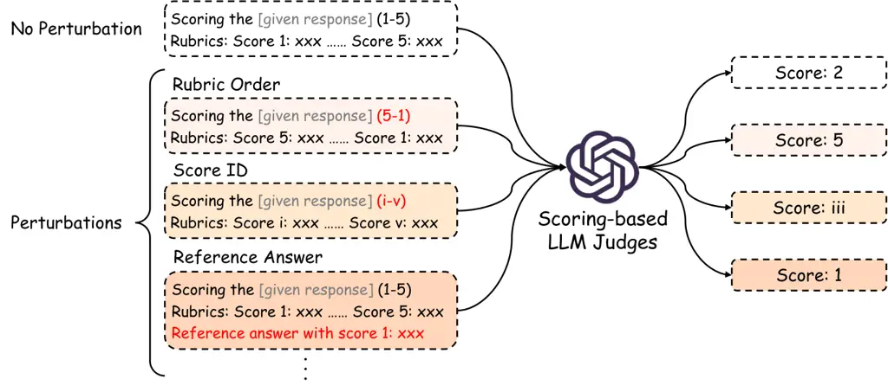
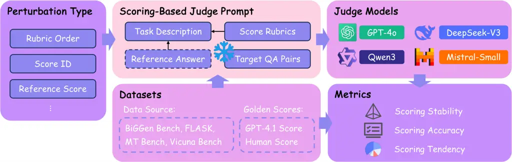
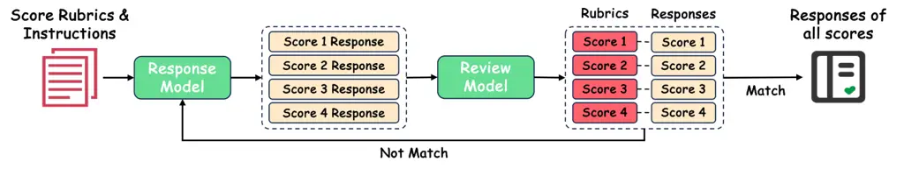
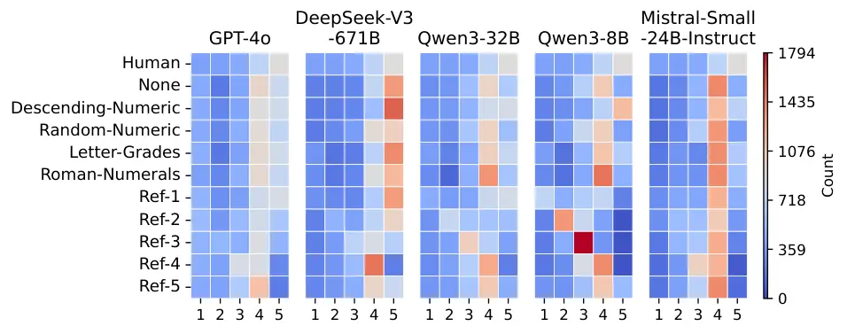
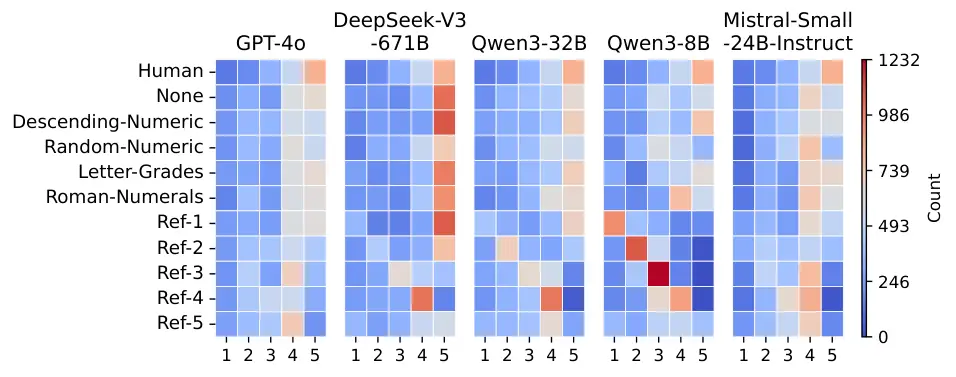

# Evaluating Scoring Bias in LLM-as-a-Judge

Qingquan
Li^(⋆†)[](https://orcid.org/0009-0005-7605-1247)
   Shaoyu
Dou^(⋆)[](https://orcid.org/0000-0002-8899-4788)
   Kailai Shao    Chao Chen    Haixiang Hu ✉ Affiliation: Ant Group,
Hangzhou, China E-mail [qingquanl97@outlook.com,
doushaoyu.dsy@antgroup.com, kailai.skl@antgroup.com,
chixi.cc@antgroup.com,
zengxian@antgroup.com](mailto:qingquanl97@outlook.com,%20doushaoyu.dsy@antgroup.com,%20kailai.skl@antgroup.com,%0Achixi.cc@antgroup.com,%20zengxian@antgroup.com)

###### Abstract

The “LLM-as-a-Judge” paradigm, using Large Language Models (LLMs) as
automated evaluators, is pivotal to LLM development, offering scalable
feedback for complex tasks. However, the reliability of these judges is
compromised by various biases. Existing research has heavily
concentrated on biases in comparative evaluations. In contrast,
scoring-based evaluations—which assign an absolute score and are often
more practical in industrial applications—remain under-investigated. To
address this gap, we undertake the first dedicated examination of
scoring bias in LLM judges. We shift the focus from biases tied to the
evaluation targets to those originating from the scoring prompt itself.
We formally define scoring bias and identify three novel, previously
unstudied types: rubric order bias, score ID bias, and reference answer
score bias. We propose a comprehensive framework to quantify these
biases, featuring a suite of multi-faceted metrics and an automatic data
synthesis pipeline to create a tailored evaluation corpus¹. Our
experiments empirically demonstrate that even the most advanced LLMs
suffer from these substantial scoring biases. Our analysis yields
actionable insights for designing more robust scoring prompts and
mitigating these newly identified biases.

###### Keywords: 

LLM-as-a-Judge Bias.

^(†)^(†)footnotetext: ^(⋆)Equal contribution. ^(†)Work done while at Ant
Group^(†)^(†)footnotetext: ¹Our dataset is publicly available at
[https://github.com/KMdsy/scoring_bias/](https://github.com/KMdsy/scoring_bias/)

## 1 Introduction

The “LLM-as-a-Judge” \[9, 15\] paradigm, where Large Language Models
(LLMs) serve as automated evaluators, is pivotal to LLM development.
These judges provide fine-grained assessments for complex tasks like
factuality evaluation \[32\] and instruction-following \[50\], and act
as scalable proxies for human feedback in preference learning \[2, 14\].
The increasing prominence of this paradigm makes its robustness a
critical concern. Ideally, LLM judges should provide objective
judgments, uninfluenced by irrelevant factors. However, recent
work \[29\] confirms that LLM judges exhibit various biases, undermining
their consistency. Existing research has identified several such biases,
including position bias \[40\], self-preference bias \[42\], length
bias \[43\], and so on.



Figure 1: Even slight perturbations to LLM judges lead to inconsistent
scores for the same response.

While existing studies have investigated these biases, pressing issues
remain. Research has heavily concentrated on comparative LLM judges,
which determine the superior of two responses. However, scoring-based
evaluation, providing an absolute quality score for a single response,
is often more practical and widely adopted. It is more intuitive and
better suited for standardized, quantitative analysis, especially when a
direct comparison object is unavailable \[39\]. Consequently, an
in-depth investigation into the biases of scoring-based judges is
crucial. Research in this area remains unsystematic; while some issues
like self-enhancement bias, refinement-aware bias \[47\], and judge
model choice bias \[40\] have been identified, the exploration is far
from comprehensive and leaves many potential biases unaddressed.

This research gap is not merely theoretical. Our work is motivated by a
practical observation: when using a score-based LLM judge to evaluate a
financial advisory assistant, we found that adding a single in-context
example for a specific score level (e.g., an exemplar for a 4-point
response) caused the absolute scores of other, unrelated samples to
shift. This instability highlights a critical, unaddressed sensitivity
to prompt examples and served as the primary catalyst for our
investigation into other potential biases affecting score-based judges.

In this work, we consider the scoring bias as the measurable scoring
shifts exhibited by an LLM-as-a-Judge when subjected to perturbations to
its scoring prompt (as illustrated in Figure 1). Diverging from prior
work, which has focused heavily on biases tied to the evaluation
targets, our research investigates biases originating from other
components of the scoring prompt. Specifically, we identify and define
three novel and previously unstudied types of scoring bias: rubric order
bias, score ID bias, and reference answer score bias.

To identify and quantify these three biases, we propose a comprehensive
evaluation framework. This framework is designed to be extensible,
enabling the identification of various scoring biases beyond those
explored in this paper. We conduct experiments on four existing
LLM-as-a-Judge benchmarks and utilize a suite of metrics, categorized as
stability metrics, accuracy metrics, and scoring tendency, to thoroughly
quantify the impact of these biases. Our key contributions can be
summarized as follows:

- •
  We identify three novel types of scoring bias: rubric order bias,
  score ID bias, and reference answer score bias. To facilitate their
  evaluation, we introduce an automatic data synthesis pipeline that
  expands existing benchmarks into a tailored corpus, establishing a
  foundational resource for future research.
- •
  We propose the first evaluation framework for investigating and
  quantifying scoring bias, introducing metrics across three key
  dimensions: stability, accuracy, and scoring tendency.
- •
  We empirically demonstrate that even the most advanced LLMs suffer
  from the substantial scoring biases we identify. Furthermore, our
  analysis yields valuable recommendations for designing more robust
  scoring prompts and mitigating these biases.

## 2 Related Work

### 2.1 LLM-as-a-Judge

Previous work \[9\] defines LLM-as-a-Judge as the task in which an LLM
generates an evaluation result in any form given input data and context.
Common forms of LLM judgment include score generation \[8\], pairwise
comparison \[31\], ranking \[17\], multiple-choice selection \[16\], and
critique generation \[10\]. Improvement strategies for LLM-as-a-Judge
include meticulous design of evaluation prompts \[22\], improvement of
LLM’s abilities such as fine-tuning \[41\], multi-LLM collaboration
pipelines such as feedback mechanisms \[45\], and output optimization
strategies such as multi-output ensembling \[34\]. The performance of
LLM-as-a-Judge is usually measured using metrics that represent its
alignment with human annotators or advanced LLM judgments such as
agreement \[37\], Cohen’s Kappa, and Spearman’s correlation \[3\].
LLM-as-a-Judge is widely applied to evaluation \[19\], alignment \[2\],
retrieval \[36\], reasoning \[6\], and other specific domains \[1, 33\].
LLM-as-a-Judge faces challenges of bias and vulnerability, which
significantly compromise the fairness and reliability of LLM
judges \[15\].

### 2.2 Bias in LLM-as-a-Judge

Existing work \[47\] defines the prompt for LLM judges as three
components: system instruction, question, and response. Based on this,
they define bias in LLM-as-a-Judge as the tendency for judgments to
differ when the system instruction or responses are modified in a
bias-related manner. Common types of bias in LLM-as-a-Judge include
position bias, length bias, self-enhancement bias, etc. These biases are
often incorporated into the evaluation scope of existing LLM-as-a-Judge
benchmarks \[43, 51\]. Currently, the types of bias remain a focal point
of investigation, and numerous benchmarks have been proposed to evaluate
bias in LLM-as-a-Judge. OffsetBias \[29\] identifies six types of bias
in LLM-as-a-Judge including length bias, concreteness bias, empty
reference bias, and so on. CALM \[47\] quantifies and analyzes 12 types
of bias in LLM judges. However, the biases defined in current work are
predominantly focused on comparative evaluation tasks, and there is a
lack of systematic research and definitions specifically addressing
biases in scoring-based evaluation tasks. Similar to research on
adversarial attacks, the evaluation metrics for bias in LLM-as-a-Judge
are often based on the consistency between bias-related modified
judgments and the original judgments, or on alignment with golden
answers.

Some studies focus on mitigating bias in LLM-as-a-Judge and aim to
develop more robust LLM judges. \[23\] introduces Pairwise-Preference
Search (PAIRS) to mitigate biases in LLM evaluators. \[40\] proposes
three methods to calibrate positional bias, including multiple evidence
calibration, balanced position calibration, and human-in-the-loop
calibration. Our evaluation results on scoring bias will serve as a
reference for future research on mitigating scoring biases in judge
models and enhancing the robustness of scoring-based evaluations.

## 3 Evaluation Method



Figure 2: Our evaluation framework to measure the scoring bias in
LLM-as-a-Judge.

Figure 2 shows our evaluation framework, inspired by \[47\]. On a
selected dataset, we inject predefined perturbation types into the
scoring prompts for the LLM judges. Then we obtain the scores from a
selected judge model. We evaluate the scoring bias by calculating the
consistency between scores before and after injecting perturbations, and
the correlations between the judge model’s scores and the golden scores
(obtained from advanced LLMs and human annotators). Furthermore, our
metrics include score distribution, which is used to measure the impact
of different types of bias on the scoring tendencies of LLM judges.

### 3.1 Problem Formulation


Figure 3: Scoring prompt template adapted from \[13\], with red text
indicating components that were perturbed in our experiments.

We assess the scoring bias in LLM-as-a-Judge by perturbing the scoring
prompt and measuring the resulting impact on judgments.
Following \[13\], the input prompt $`P`$ for the scoring-based LLM judge
consists of four components: a task description $`T`$, an evaluation
target instance $`I`$, which can be either an instruction-response or a
question-answer pair, reference answer(s) with corresponding score(s)
$`A`$, and score rubrics $`R`$ as shown in Figure 3. The input prompt
$`P`$ is formulated as follows:

```math
P=(T,I^{*},[A],R), \tag{1}
```

where $`*`$ denotes the component will not be perturbed, and $`[\cdot]`$
means that the enclosed component is optional within the input prompt.
This formulation is central to our study. To specifically explore biases
induced by non-target components (i.e., $`T`$, $`R`$, and $`[A]`$), we
hold the evaluation target instance $`I`$ constant, as denoted by
$`I^{*}`$. We also treat the reference answer $`[A]`$ as an optional
element to explore its impact on scoring robustness, as it is not a
mandatory part of the scoring process.

By perturbing the reference answer $`A\rightarrow A^{\prime}`$ or the
score rubrics $`R\rightarrow R^{\prime}`$, we get a perturbed input
prompt $`P^{\prime}`$. At the same time, the task description $`T`$ will
also be modified to $`T^{\prime}`$ in conjunction with the perturbed
components to ensure the prompt remains coherent. The score from the
perturbed prompt will be:

```math
s^{\prime}=\textbf{LLM}(P^{\prime}). \tag{2}
```

For each target instance $`I`$, we have a golden score $`s`$ from
advanced LLMs or human annotators. If $`s`$ and $`s^{\prime}`$ differ,
it demonstrates that the LLM judge exhibits scoring bias on the given
sample.

### 3.2 Perturbation Types

We propose three methods to perturb key parts of the judge prompt to
introduce scoring biases:

- •
  Score Rubric Order: The ordering of the description for each score
  within the rubric. We explore Ascending-Numeric (score 1 to score 5),
  Descending-Numeric (score 5 to score 1), and Random-Numeric orders
  (random score rubrics listed in prompt).
- •
  Score ID: Typically, scores are represented using Arabic numerals
  $`\{1,2,3,4,5\}`$ as IDs. In this work, we explore the use of
  Letter-Grades $`\{\text{E},\text{D},\text{C},\text{B},\text{A}\}`$ and
  Roman-Numerals
  $`\{\text{i},\text{ii},\text{iii},\text{iv},\text{v}\}`$ as scoring
  IDs.
- •
  Reference Answer Score: Based on the finding from \[11, 13\] that
  reference answers improve scoring accuracy for LLM judges, our work
  addresses an unexplored question: whether attaching a specific score
  $`k`$ to these references, denoted as Ref-$`k`$, could degrade scoring
  robustness.

### 3.3 Datasets

Following previous work \[4, 13\], we select four LLM-as-a-Judge
datasets for scoring bias evaluation:

- •
  BiGGen Bench \[12\]: This is a principled generation benchmark with
  instance-specific evaluation criteria. We use the non-multilingual
  portion of its test set, which contains 2,780 responses for 695
  instances, all evaluated by human annotators.
- •
  FLASK \[48\]: This is a fine-grained evaluation benchmark with 200
  test prompts, 12 score rubrics, and 2,001 responses. It also includes
  scores labeled by human annotators.
- •
  MT Bench \[51\]: This is a multi-turn chat benchmark with 80 test
  prompts. \[11\] write 80 hand-crafted score rubrics and generate 320
  responses from WizardLM-13B \[44\], Vicuna-13B \[5\],
  Llama-2-Chat-13B \[38\], and GPT-3.5-Turbo-0613 \[25\].
- •
  Vicuna Bench \[5\]: This is a single-turn chat benchmark with 80 test
  prompts.\[11\] also write 80 hand-crafted score rubrics and generate
  320 responses from WizardLM-13B, Vicuna-13B, Llama-2-Chat-13B, and
  GPT-3.5-Turbo-0613.

| Dataset      | Data Size | Human Judgment | Reference Answer |
| ------------ | --------- | -------------- | ---------------- |
| BiGGen Bench | 2,780     | ✓              | ✓                |
| FLASK        | 2,001     | ✓              | ✓                |
| MT Bench     | 320       | ✗              | ✗                |
| Vicuna Bench | 320       | ✗              | ✗                |

Table 1: Statistics of our evaluation datasets.

| Model (Source of score)    | BiGGen Bench |        | FLASK    |        |
| -------------------------- | ------------ | ------ | -------- | ------ |
|                            | $`\rho`$     | $`r`$  | $`\rho`$ | $`r`$  |
| GPT-4.1 (our pipeline)     | 0.6048       | 0.6360 | 0.6401   | 0.6823 |
| GPT-4o (our pipeline)      | 0.6047       | 0.6340 | 0.6340   | 0.6557 |
| GPT-4 (original benchmark) | 0.5741       | 0.6045 | 0.6207   | 0.6862 |

Table 2: Comparison of the alignment between our LLM judgment pipeline
and human golden scores, where $`\rho`$ and $`r`$ represent Spearman’s
and Pearson’s correlation coefficients, respectively.

The detailed statistics of our selected datasets are shown in Table 1.
Due to the cost of manual annotation, the scores from advanced LLMs are
usually used as golden scores \[12, 48\]. The instances in the above
four datasets are pre-annotated with scores from GPT-4 \[26\], which is
out of date at the current time. Therefore, we use more recent models
such as GPT-4.1 \[28\] and GPT-4o \[27\] to obtain golden scores.
Inspired by \[11, 13\], we repeat the scoring process three times using
a judge prompt that includes a reference answer assigned a score of 5,
and then take a majority vote to obtain the final score from the LLM
evaluators. Table 2 shows that the GPT-4.1 scores exhibit the highest
correlation with human scores. Throughout the remainder of our
experiments, the scores generated by GPT-4.1 are treated as the golden
LLM scores.

Each instance in BiGGen Bench and FLASK is accompanied by a reference
answer with a score of 5. To measure the impact of the reference answer
score on the judgment robustness, it is necessary to additionally
generate reference answers with scores ranging from 1 to 4. We propose a
generation-review pipeline to synthesize reference answers for each
sample in BiGGen Bench and FLASK, as shown in Figure 4. Given an
instruction and score rubrics, the response model generates the response
according to the description from score 1 to 4. Then a review model
checks whether the response matches the corresponding score description.
If they match, we accept the generated responses; otherwise, we rerun
the pipeline until a match is achieved. In this pipeline, we use GPT-4.1
and GPT-4o, alternating their roles as the response and review models.

### 3.4 Metrics

For a dataset of $`n`$ samples, the human-annotated golden label set is
denoted as $`S=\{s_{1},\cdots,s_{n}\}`$. We consider the
ascending-numeric rubric without a reference answer as the baseline
condition. The LLM outputs under this condition is denoted as
$`S^{(0)}=\{s_{1}^{(0)},\cdots,s_{n}^{(0)}\}`$. Let $`\mathcal{P}`$ be
the set of all perturbed prompt templates and the unperturbed baseline,
and $`\mathcal{P}^{\prime}`$ be the set of all perturbed prompt
templates excluding the baseline. For any prompt template $`p`$ in
$`\mathcal{P}`$ or $`\mathcal{P}^{\prime}`$, the resulting LLM score set
is $`S^{(p)}=\{s_{1}^{(p)},\cdots,s_{n}^{(p)}\}`$.

Stability metrics quantify the consistency between the scores generated
by a perturbed prompt $`p,p\in\mathcal{P}^{\prime}`$ (i.e. $`S^{(p)}`$)
and the baseline scores $`S^{(0)}`$. We adopt flip rate (FP) and mean
absolute deviation (MAD) as metrics. FP and MAD are defined as follows,

```math
\displaystyle\text{FP}^{(p)}=\frac{1}{n}\sum_{i=1}^{n}\mathbb{I}(s_{i}^{(p)}\neq s_{i}^{(0)}),\quad\text{MAD}^{(p)}=\frac{1}{n}\sum_{i=1}^{n}|s_{i}^{(p)}-s_{i}^{(0)}|,\quad p\in\mathcal{P}^{\prime}. \tag{3}
```

Accuracy metrics quantify the agreement between the scores generated by
a perturbed prompt $`p,p\in\mathcal{P}`$ (i.e. $`S^{(p)}`$) and the
golden scores $`S`$. Specifically, we report both Spearman’s correlation
coefficient $`\rho`$ \[35\] and Pearson’s correlation coefficient
$`r`$ \[30\].

Scoring tendency quantifies the model’s tendency to favor specific score
categories for a given prompt template $`p`$ ($`p\in\mathcal{P}`$). For
rating scale $`\{r_{1},\cdots,r_{5}\}`$ (e.g., $`\{1,\cdots,5\}`$), the
tendency is defined by the following scoring distribution,

```math
N^{(p)}=(N_{r_{1}}^{(p)},\cdots,N_{r_{5}}^{(p)}),\quad N_{r_{k}}^{(p)}=\sum_{i=1}^{n}{\mathbb{I}(s_{i}^{(p)}=r_{k})},\quad k\in\{1,\cdots,5\}. \tag{4}
```



Figure 4: The proposed generation-review pipeline for synthesizing
reference answers.

## 4 Experiments

### 4.1 Setup

Judge Models. Previous work \[7, 18, 21\] has reached a consensus that
judge models should be stronger models to ensure evaluation
reliability \[47\]. After preliminary experiments, we found that scoring
bias is a common phenomenon in judge models based on various LLMs.
Furthermore, we aim to explore the impact of factors such as model type
and size on scoring bias. Therefore, we select diverse judge models that
include closed-source, open-source, large-size, and small-size models.
They are GPT-4o, DeepSeek-V3-671B \[20\], Qwen3-32B, Qwen3-8B \[46\],
and Mistral-Small-24B-Instruct-2501 \[24\]. These judge models we
selected differ from the models used to generate responses in the
evaluation datasets, thus mitigating potential self-enhancement
bias \[47, 51\].

Judge Prompt. The prompt we use for scoring-based judgment, adapted
from \[13\], is shown in Figure 3. The unperturbed prompt is the one
with ascending score rubrics, Arabic numeral score IDs, and no reference
answer.

Hyper-parameters. To ensure a deterministic scoring process, which is
crucial for a fair evaluation of bias, we set the temperature of the LLM
judge to 0 during all scoring tasks.

### 4.2 Main Results

| Model                      | Perturbation       | BiGGen Bench |        | FLASK |        | MT Bench |        | Vicuna Bench |        |
| -------------------------- | ------------------ | ------------ | ------ | ----- | ------ | -------- | ------ | ------------ | ------ |
|                            |                    | FR           | MAD    | FR    | MAD    | FR       | MAD    | FR           | MAD    |
| GPT-4o                     | Descending-Numeric | 23.63        | 0.2885 | 23.44 | 0.2769 | 23.13    | 0.2594 | 20.00        | 0.2094 |
|                            | Random-Numeric     | 22.55        | 0.2651 | 24.94 | 0.3023 | 28.44    | 0.3375 | 19.38        | 0.1938 |
|                            | Letter-Grades      | 18.17        | 0.2122 | 18.24 | 0.2259 | 19.69    | 0.2188 | 19.38        | 0.2031 |
|                            | Roman-Numerals     | 16.51        | 0.1892 | 15.94 | 0.2014 | 23.13    | 0.2688 | 15.63        | 0.1625 |
|                            | Ref-5              | 45.54        | 0.5604 | 45.58 | 0.7166 | \-       | \-     | \-           | \-     |
| DeepSeek-V3-671B           | Descending-Numeric | 24.21        | 0.2867 | 21.89 | 0.2734 | 25.00    | 0.2969 | 27.50        | 0.2906 |
|                            | Random-Numeric     | 30.86        | 0.3565 | 32.83 | 0.4123 | 32.19    | 0.3875 | 39.06        | 0.4250 |
|                            | Letter-Grades      | 19.86        | 0.2349 | 18.14 | 0.2374 | 17.81    | 0.1969 | 26.25        | 0.2844 |
|                            | Roman-Numerals     | 19.53        | 0.2338 | 17.89 | 0.2169 | 20.00    | 0.2344 | 25.00        | 0.2625 |
|                            | Ref-5              | 38.99        | 0.4863 | 45.13 | 0.6742 | \-       | \-     | \-           | \-     |
| Qwen3-32B                  | Descending-Numeric | 28.56        | 0.3281 | 25.54 | 0.2989 | 29.38    | 0.3656 | 34.06        | 0.3688 |
|                            | Random-Numeric     | 26.12        | 0.2957 | 29.64 | 0.3448 | 33.44    | 0.3938 | 27.81        | 0.2906 |
|                            | Letter-Grades      | 25.11        | 0.2770 | 24.34 | 0.2909 | 28.44    | 0.3313 | 29.06        | 0.3000 |
|                            | Roman-Numerals     | 28.92        | 0.3259 | 28.39 | 0.3273 | 51.88    | 0.6875 | 30.94        | 0.3156 |
|                            | Ref-5              | 37.59        | 0.7674 | 44.58 | 0.6512 | \-       | \-     | \-           | \-     |
| Qwen3-8B                   | Descending-Numeric | 46.22        | 0.5296 | 32.23 | 0.3778 | 40.31    | 0.4594 | 44.06        | 0.4750 |
|                            | Random-Numeric     | 34.93        | 0.3989 | 36.83 | 0.4363 | 35.31    | 0.4125 | 34.38        | 0.3750 |
|                            | Letter-Grades      | 30.54        | 0.3493 | 28.39 | 0.3228 | 36.88    | 0.4063 | 28.44        | 0.2938 |
|                            | Roman-Numerals     | 32.99        | 0.3827 | 34.38 | 0.4058 | 40.31    | 0.4344 | 30.94        | 0.3156 |
|                            | Ref-5              | 36.48        | 0.4367 | 40.53 | 0.5712 | \-       | \-     | \-           | \-     |
| Mistral-Small-24B-Instruct | Descending-Numeric | 31.04        | 0.3421 | 27.39 | 0.2904 | 32.81    | 0.3406 | 25.63        | 0.2719 |
|                            | Random-Numeric     | 28.02        | 0.3083 | 33.03 | 0.3603 | 29.38    | 0.3066 | 22.81        | 0.2406 |
|                            | Letter-Grades      | 25.36        | 0.2734 | 25.54 | 0.2809 | 26.88    | 0.2969 | 23.75        | 0.2438 |
|                            | Roman-Numerals     | 21.83        | 0.2349 | 23.24 | 0.2549 | 21.56    | 0.2281 | 16.56        | 0.1688 |
|                            | Ref-5              | 35.40        | 0.4065 | 48.58 | 0.6247 | \-       | \-     | \-           | \-     |

Table 3: Stability metrics FP (%) and MAD, comparing baseline scores
with scores under various prompt perturbations. A higher metric
indicates a greater difference from the baseline score. The perturbation
method Ref-5 was only applied to BiGGen Bench and FLASK, as the other
two datasets do not provide reference answers.

| Model                      | Perturbation       | Human Score  |        |          |        | GPT-4.1 Score |        |              |        |
| -------------------------- | ------------------ | ------------ | ------ | -------- | ------ | ------------- | ------ | ------------ | ------ |
|                            |                    | BiGGen Bench |        | FLASK    |        | MT Bench      |        | Vicuna Bench |        |
|                            |                    | $`\rho`$     | $`r`$  | $`\rho`$ | $`r`$  | $`\rho`$      | $`r`$  | $`\rho`$     | $`r`$  |
| GPT-4o                     | \-                 | 0.5669       | 0.6147 | 0.5529   | 0.5915 | 0.7578        | 0.7724 | 0.6862       | 0.7696 |
|                            | Descending-Numeric | 0.5836       | 0.6227 | 0.5754   | 0.6080 | 0.7479        | 0.7597 | 0.6734       | 0.7635 |
|                            | Random-Numeric     | 0.5947       | 0.6296 | 0.5592   | 0.5894 | 0.7673        | 0.7838 | 0.6701       | 0.7504 |
|                            | Letter-Grades      | 0.5627       | 0.6057 | 0.5558   | 0.5977 | 0.7317        | 0.7454 | 0.6539       | 0.7712 |
|                            | Roman-Numerals     | 0.5753       | 0.6172 | 0.5535   | 0.5912 | 0.7725        | 0.7786 | 0.7073       | 0.7821 |
| DeepSeek-V3-671B           | \-                 | 0.5340       | 0.5823 | 0.5193   | 0.5746 | 0.6323        | 0.6593 | 0.4411       | 0.6119 |
|                            | Descending-Numeric | 0.5383       | 0.5890 | 0.5212   | 0.5642 | 0.6184        | 0.6436 | 0.5106       | 0.6656 |
|                            | Random-Numeric     | 0.5161       | 0.5685 | 0.5029   | 0.5560 | 0.6178        | 0.6460 | 0.5178       | 0.6187 |
|                            | Letter-Grades      | 0.5410       | 0.5835 | 0.5350   | 0.5840 | 0.6489        | 0.6715 | 0.4938       | 0.6322 |
|                            | Roman-Numerals     | 0.5184       | 0.5731 | 0.5090   | 0.5624 | 0.6358        | 0.6642 | 0.4504       | 0.5897 |
| Qwen3-32B                  | \-                 | 0.5418       | 0.5848 | 0.5323   | 0.5695 | 0.6959        | 0.7053 | 0.6419       | 0.7188 |
|                            | Descending-Numeric | 0.5572       | 0.5989 | 0.5345   | 0.5657 | 0.6843        | 0.6989 | 0.6205       | 0.7020 |
|                            | Random-Numeric     | 0.5528       | 0.5938 | 0.5115   | 0.5456 | 0.6554        | 0.6688 | 0.6416       | 0.7252 |
|                            | Letter-Grades      | 0.5352       | 0.5852 | 0.5393   | 0.5724 | 0.6795        | 0.6930 | 0.6208       | 0.7079 |
|                            | Roman-Numerals     | 0.5139       | 0.5629 | 0.5257   | 0.5781 | 0.7158        | 0.7238 | 0.6072       | 0.7126 |
| Qwen3-8B                   | \-                 | 0.5087       | 0.5419 | 0.5035   | 0.5309 | 0.6238        | 0.6342 | 0.6639       | 0.7284 |
|                            | Descending-Numeric | 0.5223       | 0.5592 | 0.4885   | 0.5339 | 0.6005        | 0.6135 | 0.5500       | 0.6647 |
|                            | Random-Numeric     | 0.4831       | 0.5107 | 0.4778   | 0.5004 | 0.5949        | 0.5983 | 0.5135       | 0.6053 |
|                            | Letter-Grades      | 0.4842       | 0.5195 | 0.4873   | 0.5244 | 0.5985        | 0.6126 | 0.5812       | 0.6867 |
|                            | Roman-Numerals     | 0.4808       | 0.5165 | 0.4606   | 0.5087 | 0.6016        | 0.5975 | 0.6111       | 0.7178 |
| Mistral-Small-24B-Instruct | \-                 | 0.5067       | 0.5543 | 0.4948   | 0.5392 | 0.5943        | 0.5762 | 0.6116       | 0.6917 |
|                            | Descending-Numeric | 0.5383       | 0.5767 | 0.4921   | 0.5325 | 0.6104        | 0.6102 | 0.6137       | 0.7082 |
|                            | Random-Numeric     | 0.5047       | 0.5450 | 0.4758   | 0.5065 | 0.5603        | 0.5602 | 0.5461       | 0.6418 |
|                            | Letter-Grades      | 0.5098       | 0.5610 | 0.4894   | 0.5392 | 0.5375        | 0.5485 | 0.5558       | 0.6608 |
|                            | Roman-Numerals     | 0.5107       | 0.5612 | 0.4932   | 0.5455 | 0.5863        | 0.5907 | 0.5903       | 0.6905 |

Table 4: Accuracy metrics Spearman’s ($`\rho`$) and Pearson’s ($`r`$)
correlation coefficient, showing the correlation between judge scores
under perturbations and golden scores. Each judge model’s first row
serves as the unperturbed baseline. Results are colored green (better
than baseline) or red (worse).

The existence of scoring bias is proved in all judge models. Table 3
shows the difference between baseline model scores and perturbed model
scores, Table 4 and Figure 6 show the correlation between judge model
scores and golden scores under all perturbation methods. For all judge
models we evaluated, including advanced models such as GPT-4o, we
observed fluctuations in the scoring results under different types of
perturbations. This indicates that scoring bias significantly impacts
the robustness of LLM-as-a-Judge. Furthermore, different judge models
exhibit varying sensitivity to scoring bias:

(1) More powerful judge models tend to be more robust to scoring bias.
Consistent with existing consensus \[7, 18, 21\], our experimental
results indicate that judge models with advanced capability and larger
size tend to exhibit higher reliability in scoring. As shown in Table 3,
GPT-4o has FRs less than 25% and MADs less than 0.3 under perturbation
in most cases, except for the case involving a full-marked reference
answer. Althogh Qwen3-8B, has higher FRs and MADs than GPT-4o and the
larger version Qwen3-32B, especially reaches 46.22% FR and 0.5296 MAD on
BiGGen Bench under descending-numeric perturbation, which means that
nearly half of the scores are corrupted. Therefore, more capable judge
models should be prioritized in scoring evaluations.

(2) Contrary to the conventional view that bias is always harmful, we
find that scoring bias in LLM-as-a-Judge can also have surprisingly
positive effects on the evaluation results. For example, as Table 4
shows, in most cases, the correlation between GPT-4o scores and golden
scores increases when Roman numerals are used as scoring IDs. However,
when DeepSeek-V3-671B, Qwen3-32B and Qwen3-8B are employed as judge
models, the use of Roman numerals generally exerts a negative effect on
their scoring accuracy. An interesting phenomenon is that the impact of
reference answer score bias on the judge models we evaluated appears to
be consistent, which will be further analyzed in subsequent sections.
Our experimental results can serve as a valuable reference for the
selection of judge models and the design of scoring prompt templates.

(3) Judge models have their own scoring tendencies. Figure 5 presents
the scoring tendencies of different judge models under various scoring
biases in the form of heatmaps. It is obvious that each judge model
exhibits its own specific scoring preferences. Under unbiased
conditions, DeepSeek-V3-671B assigns a score of 5 to more than half of
the instruction-response pairs. Compared to the human scoring
distribution, Mistral-Small-24B-Instruct has a stronger tendency to
assign a score of 4 to the samples. Other judge models show smoother
scoring distribution shifts, but certain scores are still preferred. For
example, GPT-4o demonstrates a preference for a score of 4. An
examination of Figure 5 reveals that score rubric order bias and score
ID bias have a certain impact on the scoring tendencies of the judge
models; however, they do not fundamentally alter the overall score
distribution. An exception is Qwen3-8B, whose score distribution is more
significantly influenced by biases, possibly due to its small size. It
is particularly evident that the reference answer score bias exerts a
substantial impact on the score distribution, which will be analyzed in
detail in the following sections. Our experimental results show that
judge models inherently exhibit biases in their scoring tendencies.
Therefore, debiasing the judge models is crucial to ensuring the
fairness and reliability of the evaluation.



(a) BiGGen Bench



(b) FLASK

Figure 5: Score tendency of LLM judges on BiGGen Bench and FLASK,
plotting score distributions (x-axis) against perturbation methods
(y-axis). The “Human” (top) and “None” (second) rows serve as baselines,
showing human scores and the model’s unperturbed scores, respectively.

### 4.3 Methods for Scoring Bias Mitigation

#### (1) Leveraging Model Scale as a Debiasing Strategy.

Our findings show a strong correlation between model scale and bias
resilience. As shown in Table 3, state-of-the-art models like GPT-4o
consistently demonstrate high stability, with FRs often remaining below
25%. In stark contrast, smaller models are highly vulnerable. Qwen3-8B,
for example, suffers a 46.22% FR on BiGGen Bench under a simple rubric
reordering. The larger Qwen3-32B is far more stable (28.56% FR) under
the same perturbation, confirming the link to model scale. This trend
extends to accuracy, as shown in Table 4. Perturbations often improve
GPT-4o’s correlations with human scores, whereas the same perturbations
frequently degrade the accuracy of smaller models like Qwen3-8B and
Mistral-Small. Therefore, for high-stakes evaluations, selecting a
powerful model like GPT-4o is a primary strategy for ensuring robust and
reliable results, justifying potential trade-offs in cost or latency.

#### (2) Debiasing via Intentional Deviation from Convention.

In most cases of scoring-based evaluation tasks, Arabic numerals are
commonly used as scoring IDs, and the score rubric order typically
follows a sequential order (1 to 5). These conventional choices align
with human cognitive preferences in prompt design. However, our
experimental results (Table 4) indicate that such prompts do not
necessarily produce the most accurate scoring. For example, the GPT-4o
judge improves when using Roman numerals. Besides, using letter grades
as scoring IDs improves the scoring accuracy of DeepSeek-V3-671B.
Regarding the score rubric order bias, adopting a descending order
improves the scoring accuracy of DeepSeek-V3 and
Mistral-Small-24B-Instruct in most instances. Intuitively, employing a
random scoring rubric order tends to negatively impact the scoring
accuracy of all judge models. Based on our analysis, we propose a core
design principle for scoring prompts: intentional yet meaningful
deviation from convention. Effective strategies include structured,
unconventional formats, such as presenting rubrics in descending order
or using non-numeric identifiers like letter grades (A, B, C). However,
the key is to maintain clarity. Therefore, chaotic perturbations—such as
a fully randomized rubric order—should be avoided as they harm logical
coherence. Moreover, inspired by previous work \[23, 29\], perturbations
applied to scoring prompt also show potential as debiasing strategies.

#### (3) Using full-mark reference answers can stabilize scoring preferences and achieve optimal accuracy.

The impact of reference answer score bias on scoring accuracy and
tendency is shown in Figure 6 and Figure 5. Our results indicate this
bias’s influence on robustness is more pronounced and regular than that
of score rubric order or ID bias.

As shown in Figure 6, introducing reference answers generally improves
scoring accuracy for models like GPT-4o, DeepSeek-V3-671B, and
Mistral-Small-24B-Instruct. Notably, across both BiGGen Bench and FLASK,
introducing a full-marked (score 5) reference answer consistently yields
top-tier scoring accuracy, significantly outperforming other scores and
the baseline.

Figure 5 reveals a significant impact on scoring tendency, especially
for DeepSeek-V3-671B, Qwen3-32B, and Qwen3-8B. When the reference score
is between 1 and 4, these models tend to assign similar scores,
indicating a strong pull from the reference. Interestingly, when a score
5 reference answer is introduced, the judge’s scoring behavior becomes
more rational.

In particular, when reference answers with a score of 5 are introduced,
the models achieve the highest scoring accuracy without
disproportionately influencing their scoring preferences. Therefore,
when incorporating reference answers into a scoring-based judge prompt,
a full-mark reference answer is the best choice. Conceptually, this
aligns with metrics like BLEU and ROUGE, which also rely on golden
answers.

(a) BiGGen Bench

(b) FLASK

Figure 6: Accuracy metric Spearman’s correlation between human scores
and judge model scores on BiGGen Bench and FLASK dataset, under
perturbations applied to the reference answer scores.

## 5 Limitations and Future Work

While our work offers notable conclusions and insights, several
limitations remain to be addressed in future work.

Firstly, our evaluation framework has room for further expansion. More
types of scoring biases remain to be identified. Building more
comprehensive benchmarks to evaluate scoring bias in LLM-as-a-Judge is
also warranted, as a limited data distribution may lead to an unfair
evaluation.

Secondly, mitigating scoring bias needs further exploration. Although
there are no dedicated methods for addressing scoring bias, intuitive
and straightforward approaches, such as scoring multiple times followed
by majority voting or averaging the scores, require empirical validation
for their effectiveness in mitigating scoring bias. Moreover, the
elaborate design of scoring prompt templates, the construction of
debiased scoring-based judgment datasets \[29\], and adversarial
training are potential approaches to enhancing the scoring robustness of
judge models.

Additionally, although our work demonstrates the existence of scoring
bias in LLM-as-a-Judge, the underlying causes of scoring bias remain to
be validated. Approaches such as training data analysis and information
flow observation \[49\] may help identify the reasons for scoring bias,
whether it originates from within the model or from external factors.

## 6 Conclusion

This work investigates scoring bias in LLM-as-a-Judge, where scoring
judgments shift due to minor perturbations in judge prompts. To evaluate
this, we designed a framework that perturbs score rubric order, score
IDs, and reference answers, quantifying the bias using scoring
stability, scoring accuracy and scoring tendency. Experiments on
synthesized datasets expanded from four benchmarks confirm that scoring
bias significantly undermines the robustness and reliability of existing
LLM judges, with varying sensitivity across different models. To
mitigate this, we recommend unconventional prompt designs—such as
descending rubric order or using letter or Roman numeral IDs—and
providing a full-mark reference answer when applicable, both of which
effectively improve performance. In summary, our work provides evidence
and actionable recommendations for evaluating and enhancing the
reliability of LLM judges.

#### Disclosure of Interests.

The authors have no competing interests to declare that are relevant to
the content of this article.

## References

- \[1\] G. Babaei and P. Giudici (2024) GPT classifications, with
  application to credit lending. Machine Learning with Applications 16,
  pp. 100534. Cited by: §2.1.
- \[2\] Y. Bai, S. Kadavath, S. Kundu, A. Askell, J. Kernion, A. Jones,
  et al. (2022) Constitutional AI: harmlessness from AI feedback. arXiv
  preprint arXiv:2212.08073. Cited by: §1, §2.1.
- \[3\] Y. Bai, J. Ying, Y. Cao, X. Lv, Y. He, X. Wang, J. Yu, K. Zeng,
  et al. (2023) Benchmarking foundation models with
  language-model-as-an-examiner. Advances in NeurIPS 36,
  pp. 78142–78167. Cited by: §2.1.
- \[4\] C. Chiang, H. Lee, and M. Lukasik (2025) TRACT: regression-aware
  fine-tuning meets chain-of-thought reasoning for LLM-as-a-Judge. arXiv
  preprint arXiv:2503.04381. Cited by: §3.3.
- \[5\] W. Chiang, Z. Li, Z. Lin, Y. Sheng, Z. Wu, H. Zhang, L. Zheng,
  et al. (2023) Vicuna: an open-source chatbot impressing GPT-4 with
  90%\* chatGPT quality. Note:
  [https://lmsys.org/blog/2023-03-30-vicuna/](https://lmsys.org/blog/2023-03-30-vicuna/)
  Cited by: 3rd item, 4th item.
- \[6\] C. Gao, H. Jiang, D. Cai, S. Shi, and W. Lam (2024) StrategyLLM:
  large language models as strategy generators, executors, optimizers,
  and evaluators for problem solving. Advances in NeurIPS 37,
  pp. 96797–96846. Cited by: §2.1.
- \[7\] C. Gao, Q. Zhang, D. Chen, Y. Huang, S. Wu, Z. Fu, Y. Wan, X.
  Zhang, and L. Sun (2024) The best of both worlds: toward an honest and
  helpful large language model. arXiv preprint arXiv:2406.00380. Cited
  by: §4.1, §4.2.
- \[8\] M. Gao, J. Ruan, R. Sun, X. Yin, S. Yang, and X. Wan (2023)
  Human-like summarization evaluation with chatGPT. arXiv preprint
  arXiv:2304.02554. Cited by: §2.1.
- \[9\] J. Gu, X. Jiang, Z. Shi, H. Tan, X. Zhai, C. Xu, W. Li, et
  al. (2024) A survey on LLM-as-a-Judge. arXiv preprint
  arXiv:2411.15594. Cited by: §1, §2.1.
- \[10\] P. Ke, B. Wen, A. Feng, X. Liu, X. Lei, J. Cheng, S. Wang, A.
  Zeng, et al. (2024) CritiqueLLM: towards an informative critique
  generation model for evaluation of large language model generation. In
  Proc. of ACL, Vol. 1, pp. 13034–13054. Cited by: §2.1.
- \[11\] S. Kim, J. Shin, Y. Cho, J. Jang, S. Longpre, H. Lee, S.
  Yun, S. Kim, J. Thorne, and M. Seo (2024) Prometheus: inducing
  fine-grained evaluation capability in language models. In ICLR, Cited
  by: 3rd item, 3rd item, 4th item, §3.3.
- \[12\] S. Kim, J. Suk, J. Y. Cho, S. Longpre, C. Kim, D. Yoon, G. Son,
  et al. (2024) The BiGGen bench: a principled benchmark for
  fine-grained evaluation of language models with language models. arXiv
  preprint arXiv:2406.05761. Cited by: 1st item, §3.3.
- \[13\] S. Kim, J. Suk, S. Longpre, B. Y. Lin, J. Shin, S. Welleck, G.
  Neubig, M. Lee, K. Lee, and M. Seo (2024) Prometheus 2: an open source
  language model specialized in evaluating other language models. In
  Proc. of EMNLP, pp. 4334–4353. Cited by: Figure 3, Figure 3, 3rd item,
  §3.1, §3.3, §3.3, §4.1.
- \[14\] H. Lee, S. Phatale, H. Mansoor, T. Mesnard, J. Ferret, K. Lu,
  et al. (2024) RLAIF vs. RLHF: scaling reinforcement learning from
  human feedback with AI feedback. In Proc. of ICML, pp. 26874–26901.
  Cited by: §1.
- \[15\] D. Li, B. Jiang, L. Huang, A. Beigi, C. Zhao, Z. Tan, et
  al. (2024) From generation to judgment: opportunities and challenges
  of LLM-as-a-Judge. arXiv preprint arXiv:2411.16594. Cited by: §1,
  §2.1.
- \[16\] D. Li, S. Yang, Z. Tan, J. Baik, S. Yun, J. Lee, A. Chacko, B.
  Hou, et al. (2024) DALK: dynamic co-augmentation of LLMs and KG to
  answer Alzheimer’s disease questions with scientific literature. In
  Findings of EMNLP, pp. 2187–2205. Cited by: §2.1.
- \[17\] R. Li, T. Patel, and X. Du (2023) PRD: peer rank and discussion
  improve large language model based evaluations. arXiv preprint
  arXiv:2307.02762. Cited by: §2.1.
- \[18\] Y. Li, Y. Huang, H. Wang, X. Zhang, J. Zou, and L. Sun (2024)
  Quantifying AI psychology: a psychometrics benchmark for large
  language models. arXiv preprint arXiv:2406.17675. Cited by: §4.1,
  §4.2.
- \[19\] Y. Lin and Y. Chen (2023) LLM-Eval: unified multi-dimensional
  automatic evaluation for open-domain conversations with large language
  models. In Proc. of the 5th Workshop on NLP4ConvAI), pp. 47–58. Cited
  by: §2.1.
- \[20\] A. Liu, B. Feng, B. Xue, B. Wang, B. Wu, C. Lu, C. Zhao, et
  al. (2024) DeepSeek-V3 technical report. arXiv preprint
  arXiv:2412.19437. Cited by: §4.1.
- \[21\] X. Liu, X. Lei, S. Wang, Y. Huang, A. Feng, B. Wen, J. Cheng,
  et al. (2024) AlignBench: benchmarking chinese alignment of large
  language models. In Proc. of ACL, Vol. 1, pp. 11621–11640. Cited by:
  §4.1, §4.2.
- \[22\] Y. Liu, D. Iter, Y. Xu, S. Wang, R. Xu, and C. Zhu (2023)
  G-Eval: NLG evaluation using GPT-4 with better human alignment. In
  Proc. of EMNLP, pp. 2511–2522. Cited by: §2.1.
- \[23\] Y. Liu, H. Zhou, Z. Guo, E. Shareghi, I. Vulić, A. Korhonen,
  and N. Collier (2024) Aligning with human judgement: the role of
  pairwise preference in large language model evaluators. In COLM, Cited
  by: §2.2, §4.3.
- \[24\] MistralAI (2025) Mistral 3 small. Note:
  [https://mistral.ai/news/mistral-small-3](https://mistral.ai/news/mistral-small-3)
  Cited by: §4.1.
- \[25\] OpenAI (2023) GPT-3.5-turbo. Note:
  [https://platform.openai.com/docs/models/gpt-3.5-turbo](https://platform.openai.com/docs/models/gpt-3.5-turbo)
  Cited by: 3rd item.
- \[26\] OpenAI (2023) GPT-4. Note:
  [https://platform.openai.com/docs/models/gpt-4](https://platform.openai.com/docs/models/gpt-4)
  Cited by: §3.3.
- \[27\] OpenAI (2024) GPT-4o. Note:
  [https://platform.openai.com/docs/models/gpt-4o](https://platform.openai.com/docs/models/gpt-4o)
  Cited by: §3.3.
- \[28\] OpenAI (2025) GPT-4.1. Note:
  [https://platform.openai.com/docs/models/gpt-4.1](https://platform.openai.com/docs/models/gpt-4.1)
  Cited by: §3.3.
- \[29\] J. Park, S. Jwa, R. Meiying, D. Kim, and S. Choi (2024)
  OffsetBias: leveraging debiased data for tuning evaluators. In
  Findings of EMNLP, pp. 1043–1067. Cited by: §1, §2.2, §4.3, §5.
- \[30\] K. Pearson (1895) VII. Note on regression and inheritance in
  the case of two parents. proceedings of the royal society of London 58
  (347-352), pp. 240–242. Cited by: §3.4.
- \[31\] Z. Qin, R. Jagerman, K. Hui, H. Zhuang, J. Wu, L. Yan, J.
  Shen, T. Liu, et al. (2024) Large language models are effective text
  rankers with pairwise ranking prompting. In Findings of the NAACL,
  pp. 1504–1518. Cited by: §2.1.
- \[32\] S. S. Rahman, M. A. Islam, M. M. Alam, M. Zeba, M. A.
  Rahman, S. S. Chowa, M. A. K. Raiaan, and S. Azam (2025) Hallucination
  to truth: a review of fact-checking and factuality evaluation in large
  language models. arXiv preprint arXiv:2508.03860. Cited by: §1.
- \[33\] C. Ryu, S. Lee, S. Pang, C. Choi, H. Choi, M. Min, and J.
  Sohn (2023) Retrieval-based evaluation for LLMs: a case study in
  korean legal qa. In Proc. of NLLP Workshop, pp. 132–137. Cited by:
  §2.1.
- \[34\] A. Sottana, B. Liang, K. Zou, and Z. Yuan (2023) Evaluation
  metrics in the era of GPT-4: reliably evaluating large language models
  on sequence to sequence tasks. In Proc. of EMNLP, pp. 8776–8788. Cited
  by: §2.1.
- \[35\] C. Spearman (1904) The proof and measurement of association
  between two things. The American Journal of Psychology 15 (1),
  pp. 72–101. Cited by: §3.4.
- \[36\] W. Sun, L. Yan, X. Ma, S. Wang, P. Ren, Z. Chen, D. Yin, and Z.
  Ren (2023) Is chatGPT good at search? investigating large language
  models as re-ranking agents. In Proc. of EMNLP, pp. 14918–14937. Cited
  by: §2.1.
- \[37\] A. S. Thakur, K. Choudhary, V. S. Ramayapally, S. Vaidyanathan,
  and D. Hupkes (2024) Judging the judges: evaluating alignment and
  vulnerabilities in LLMs-as-judges. arXiv preprint arXiv:2406.12624.
  Cited by: §2.1.
- \[38\] H. Touvron, L. Martin, K. Stone, P. Albert, A. Almahairi, Y.
  Babaei, et al. (2023) LLaMa 2: open foundation and fine-tuned chat
  models. arXiv preprint arXiv:2307.09288. Cited by: 3rd item.
- \[39\] T. Tripathi, M. Wadhwa, G. Durrett, and S. Niekum (2025)
  Pairwise or pointwise? evaluating feedback protocols for bias in
  LLM-based evaluation. arXiv preprint arXiv:2504.14716. Cited by: §1.
- \[40\] P. Wang, L. Li, L. Chen, Z. Cai, D. Zhu, B. Lin, Y. Cao, L.
  Kong, et al. (2024) Large language models are not fair evaluators. In
  Proc. of ACL, Vol. 1, pp. 9440–9450. Cited by: §1, §1, §2.2.
- \[41\] Y. Wang, Z. Yu, W. Yao, Z. Zeng, L. Yang, C. Wang, H. Chen, et
  al. (2024) PandaLM: an automatic evaluation benchmark for LLM
  instruction tuning optimization. In ICLR, Cited by: §2.1.
- \[42\] K. Wataoka, T. Takahashi, and R. Ri (2024) Self-preference bias
  in LLM-as-a-Judge. In Neurips Safe Generative AI Workshop 2024, Cited
  by: §1.
- \[43\] H. Wei, S. He, T. Xia, F. Liu, A. Wong, J. Lin, and M.
  Han (2024) Systematic evaluation of LLM-as-a-Judge in LLM alignment
  tasks: explainable metrics and diverse prompt templates. arXiv
  preprint arXiv:2408.13006. Cited by: §1, §2.2.
- \[44\] C. Xu, Q. Sun, K. Zheng, X. Geng, P. Zhao, J. Feng, C. Tao, Q.
  Lin, and D. Jiang (2024) WizardLM: empowering large pre-trained
  language models to follow complex instructions. In ICLR, Cited by: 3rd
  item.
- \[45\] W. Xu, D. Wang, L. Pan, Z. Song, M. Freitag, W. Wang, and L.
  Li (2023) InstructScore: towards explainable text generation
  evaluation with automatic feedback. In Proc. of EMNLP, pp. 5967–5994.
  Cited by: §2.1.
- \[46\] A. Yang, A. Li, B. Yang, B. Zhang, B. Hui, B. Zheng, B. Yu, C.
  Gao, et al. (2025) Qwen3 technical report. arXiv preprint
  arXiv:2505.09388. Cited by: §4.1.
- \[47\] J. Ye, Y. Wang, Y. Huang, D. Chen, Q. Zhang, N. Moniz, T. Gao,
  et al. (2024) Justice or prejudice? quantifying biases in
  LLM-as-a-Judge. In Neurips Safe Generative AI Workshop 2024, Cited by:
  §1, §2.2, §3, §4.1.
- \[48\] S. Ye, D. Kim, S. Kim, H. Hwang, S. Kim, Y. Jo, J. Thorne, J.
  Kim, and M. Seo (2024) FLASK: fine-grained language model evaluation
  based on alignment skill sets. In ICLR 2024 Workshop on Large Language
  Model (LLM) Agents, Cited by: 2nd item, §3.3.
- \[49\] X. Yuan, C. Shen, S. Yan, X. F. Zhang, L. Xie, W. Wang, R.
  Guan, Y. Wang, and J. Ye (2025) Instance-adaptive zero-shot
  chain-of-thought prompting. In NeurIPS, Cited by: §5.
- \[50\] Z. Zeng, J. Yu, T. Gao, Y. Meng, T. Goyal, and D. Chen (2024)
  EVALUATING large language models at evaluating instruction following.
  In ICLR, Cited by: §1.
- \[51\] L. Zheng, W. Chiang, Y. Sheng, S. Zhuang, Z. Wu, Y. Zhuang, Z.
  Lin, et al. (2023) Judging LLM-as-a-Judge with MT-bench and chatbot
  arena. Advances in NeurIPS 36, pp. 46595–46623. Cited by: §2.2, 3rd
  item, §4.1.
