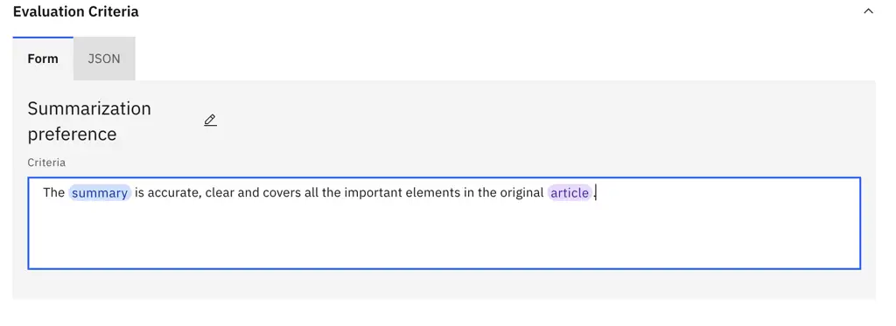
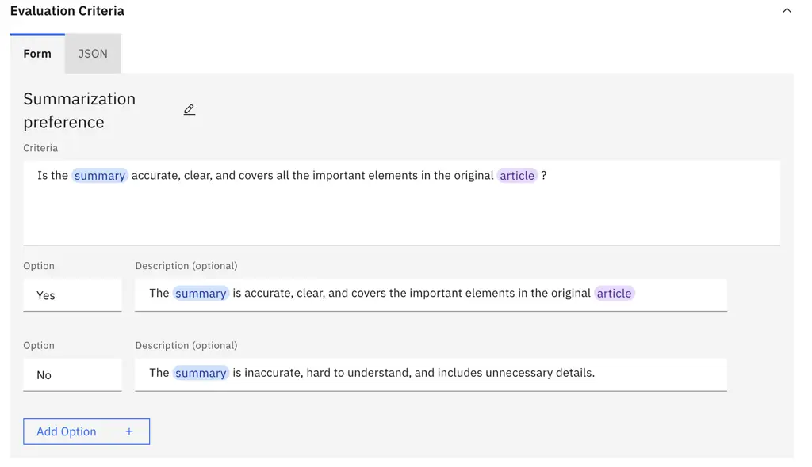
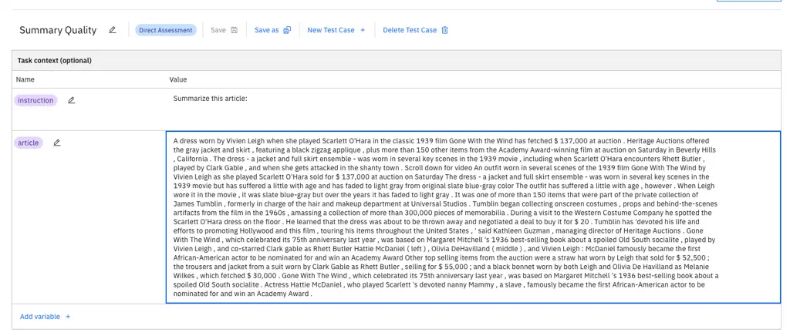
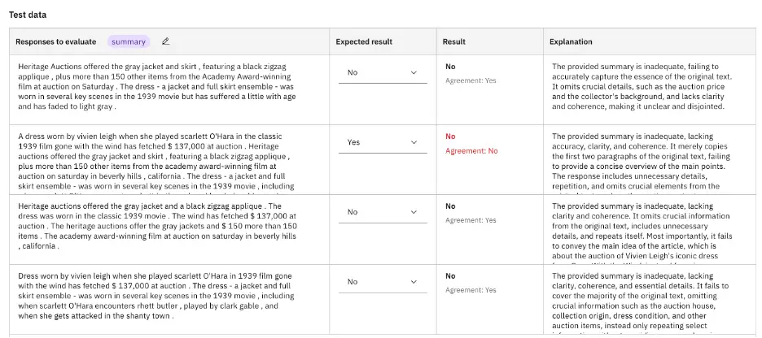
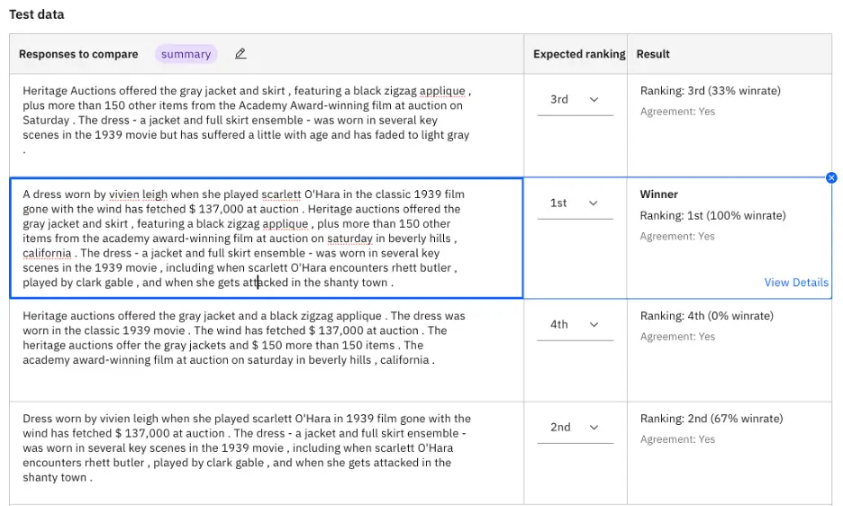
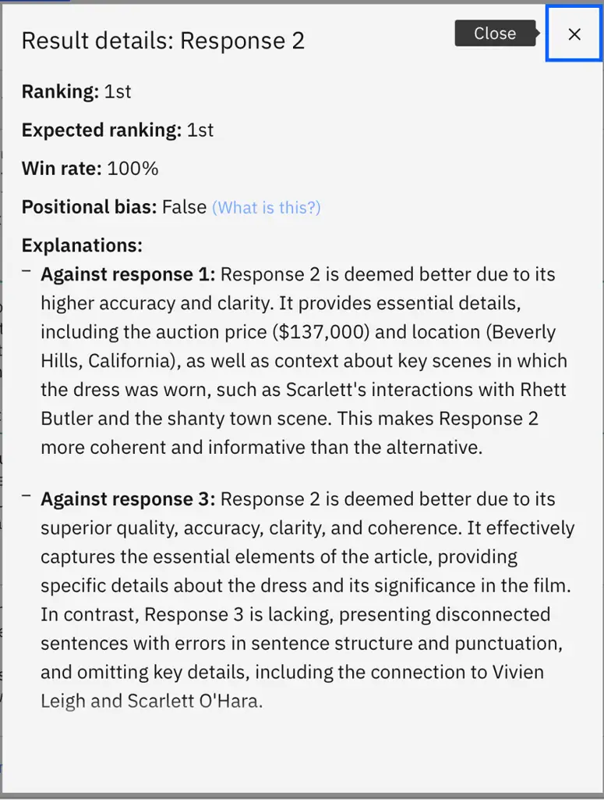
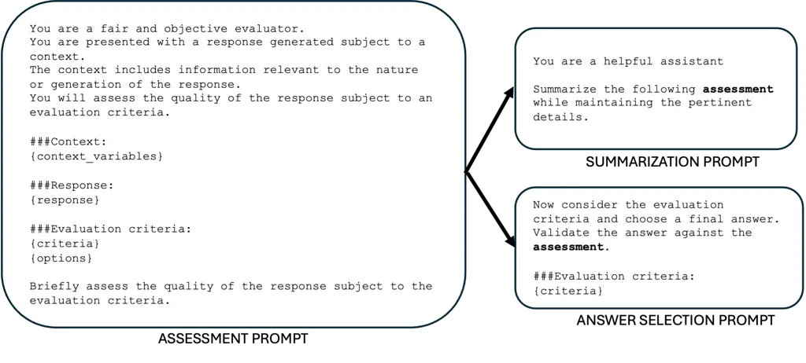

# EvalAssist: A Human-Centered Tool for LLM-as-a-Judge

Conference: 2nd HEAL Workshop at CHI Conference on Human Factors in
Computing Systems; April 26, 2025; Yokohama, Japan

Zahra Ashktorab email: <zahra.ashktorab@ibm.com> Affiliation: IBM
Research, Yorktown Heights, NY, USA , Werner Geyer email:
<werner.geyer@ibm.com> Affiliation: IBM Research, Cambridge, MA, USA ,
Michael Desmond email: <michael.desmond@ibm.com> Affiliation: IBM
Research, Yorktown Heights, NY, USA , Elizabeth M. Daly email:
<elizabeth.daly@ibm.com> Affiliation: IBM Research, Dublin, Ireland ,
Martín Santillán Cooper email: <martin.cooper@ibm.com> Affiliation: IBM
Research, Yorktown Heights, NY, USA , Qian Pan email: <qian.pan@ibm.com>
Affiliation: IBM Research, Cambridge, MA, USA , Erik Miehling email:
<erik.miehling@ibm.com> Affiliation: IBM Research, Dublin, Ireland ,
Tejaswini Pedapati email: <tejaswini.pedapati@ibm.com> Affiliation: IBM
Research, Yorktown Heights, New York, USA and Hyo Jin Do email:
<hjdo@ibm.com> Affiliation: IBM Research, Cambridge, MA, USA

###### Abstract.

With the broad availability of large language models and their ability
to generate vast outputs using varied prompts and configurations,
determining the best output for a given task requires an intensive
evaluation process—one where machine learning practitioners must decide
how to assess the outputs and then carefully carry out the evaluation.
This process is both time-consuming and costly. As practitioners work
with an increasing number of models, they must now evaluate outputs to
determine which model and prompt performs best for a given task. LLMs
are increasingly used as evaluators to filter training data, evaluate
model performance, assess harms and risks, or assist human evaluators
with detailed assessments. We present _EvalAssist_, a framework that
simplifies the LLM-as-a-judge workflow. The system provides an online
criteria development environment, where users can interactively build,
test, and share custom evaluation criteria in a structured and portable
format. We support a set of LLM-based evaluation pipelines that leverage
off-the-shelf LLMs and use a prompt-chaining approach we developed and
contributed to the UNITXT open-source library. Additionally, our system
also includes specially trained evaluators to detect harms and risks in
LLM outputs. We have deployed the system internally in our organization
with several hundreds of users.

## Keywords

large language models, llm-as-a-judge, evaluation tools, direct
assessment, pairwise comparison

## Introduction

Human evaluation of Large Language Models (LLMs) is common practice and
still considered gold standard. However, given cost and time
constraints, LLMs are increasingly being used to judge the output of
other LLMs, often referred to as LLM-as-a-judge. This approach is
attractive as it can accommodate use case specific needs through custom
criteria, is easy-to-understand by non-technical users, does not require
reference data, and can significantly reduce human evaluation effort.
Empirical studies have reported high agreement between LLM and human
ratings. For example (Zheng et al., 2023) report more than 80% agreement
and (Kim et al., 2023) report that fine tuned evaluator models have high
correlation with human judgments. More recently, evaluator ensembles
have been shown to be effective (Verga et al., 2024).

While LLM-as-a-judge has become popular, several challenges remain to
make the approach effective, trustworthy and aligned with user needs.
Doddapaneni et al. (Doddapaneni et al., 2024) report on evaluator LLMs
that failed to identify synthetic quality drops in half the cases,
suggesting that evaluators did not understand the task. Bavaresco et al.
(Bavaresco et al., 2024) urge caution after empirical analysis of
several language tasks and conclude that LLMs are not yet ready to
systematically replace human judges. Finally, issues with bias (Liu
et al., 2023; Li et al., 2023) and prompt sensitivity (Wang et al., 2023) have been identified that prevent the straightforward,
out-of-the-box use of LLMs as judges. In other words, one cannot simply
deploy an LLM to evaluate content reliably; instead, additional
validations and safeguards are required for practical application.

In this demo, we introduce EvalAssist, a comprehensive LLM-as-a-judge
framework that provides a criteria development and test environment, in
which users can iteratively test and refine evaluation criteria until
they are confident that they work well and align with their
expectations. The criteria can then be applied to a larger dataset by
exporting a Jupyter notebook from EvalAssist which is based on the
UNITXT open-source evaluation library (Bandel et al., 2024). Our
algorithms available in UNITXT are inspired by Chain-of-Thought
prompting and and we compute positional bias as a metric for
uncertainty, which can help engender trust in the evaluation process. We
also plan to open source the EvalAssist UI framework built on top of
UNITXT.

## Design Goals

In designing EvalAssist, we aim to address the challenges that
engineers, data scientists, and researchers face when evaluating outputs
and aligning criteria with their requirements. We identify five design
goals to guide the development of EvalAssist, addressing key gaps in
existing tools. We build on user findings from prior work with ML
practitioners, which highlights the challenges faced during model
evaluation (Pan et al., 2024; Desmond et al., 2024). Our approach is
designed to support engineers, ML practitioners, and researchers by
incorporating key features such as the ability to choose between
pairwise comparison and direct assessment, (positional) bias indicators,
and scalable, cost-efficient workflows. Below, we outline these goals
and how EvalAssist stands apart in the evaluation tool landscape:

DG1. Isolate Generation from Evaluation. Isolating generation and prompt
engineering from evaluation is a significant need for engineers, data
scientists, and practitioners working in complex multi-agent
environments or retrieval-augmented generation (RAG) contexts (Gao
et al., 2023), where sophisticated workflows often exist outside the
evaluation tool and result in large datasets across various models,
prompts, and configurations (Pan et al., 2024; Desmond et al., 2024).
Other tools couple the prompt engineering process with the evaluation
process (Shankar et al., 2024; Arawjo et al., 2024; Kim et al., 2024) as
they focus on prompting and variations that result in output as a result
of varied prompts. The targeted users for EvalAssist are developers,
including engineers, ML practitioners, and researchers, who often have
access to a wider variety of models and need to design complex LLM
workflows to select the best model for a specific task.

DG2. Reduce Cost of Evaluation. Applying AI-assisted evaluation to large
datasets typically used by research engineers, data scientists (Zheng
et al., 2024) is costly and time consuming. Prior work has shown that
users would like to run an evaluation on a subset of the data first (Pan
et al., 2024). EvalAssist addresses the challenge of costly and
time-consuming model calls by allowing users to evaluate a subset of the
data, refine their criteria, and then, once satisfied, apply these
criteria to the entire dataset through an Software Development Kit
(SDK)— a crucial feature for users handling very large datasets.

DG3. Support Multiple AI Evaluators. Users can select their preferred
model from a set of LLMs as the evaluator, addressing issues like
self-enhancement bias (Xu et al., 2024), where models favor their own
responses. EvalAssist is model-agnostic, enabling users to choose any
model for evaluation, unlike other front-end tools that limit users to a
single AI evaluator.

DG4. Include Bias Indicators. ML researchers using LLM-as-a-judge are
aware of potential biases exhibited by AI evaluation and have expressed
the desire to have transparent indicators on bias in LLM-as-a-judge
tooling (Pan et al., 2024). Positional bias occurs when a model
consistently favors one option based solely on its position, rather than
its content (Li et al., 2024). In evaluation tasks, such as pairwise
comparisons, this bias arises if the model disproportionately selects
the output to be evaluated in a particular position (e.g., always
favoring the first output) regardless of the actual content. In direct
assessments, where a response is evaluated based on specific criteria
and options, the order of these options can be shuffled. EvalAssist is
the only LLM-as-a-judge application that provides a positional bias
indicator in the user experience. Including bias indicators helps users
recognize positional uncertainty in LLM judgments.

DG5. Enable Flexible Evaluation Methods EvalAssist is the first tool to
allow users to define their criteria for the two most common
LLM-as-a-judge approaches: direct assessment (score-based,
single-grading) and pairwise comparison (relation-based) (Zheng et al.,
2024; Shi et al., 2024). With this tool, users can select the strategy
that best suits their dataset or explore both approaches to determine
which is more effective for their needs.

## EvalAssist: System Design

EvalAssist abstracts the LLM-as-a-Judge evaluation process into
parameterize-able evaluators (the criterion being the parameter),
allowing the user to focus on criteria definition. EvalAssist is
independent of the LLM used to generate the output to be evaluated, i.e.
this approach acknowledges that developers often use complex external
workflows to adjust configurations (e.g., model temperature) and
experiment with different models and prompts to generate responses
(Desmond et al., 2024). EvalAssist consists of a web-based user
experience (see Figure 1) and an API based on the UNITXT open-source
evaluation library (Bandel et al., 2024). The user interface provides a
convenient way of iteratively testing and refining LLM-as-a-judge
criteria, and supports both direct (rubric-based) and pairwise
assessment paradigms (relation-based), the two most prevalent forms of
LLM-as-a-judge evaluation available (Kim et al., 2023; Zheng et al.,
2024). EvalAssist can leverage both off-the-shelf instruction-tuned
models to be used as evaluators or specialized judge models such as, for
example, Granite Guardian (Padhi et al., 2024), a judge model to assess
harms and risks (see 1 B). Since EvalAssist uses UNITXT as it’s main
judging API, new models can be easily incorporated by adding them
through UNITXT. Once users are satisfied with their criteria, they can
run bulk evaluations with larger data sets by downloading a Jupyter
Notebook that contains their criteria definition and the necessary code
to run large evaluations with UNITXT. We also allow users to save their
test cases and provide a catalog of predefined criteria (see Figure 1
A). A test case in the Example Catalog includes a criteria definition
and the data being evaluated.

Figure 1. EvalAssist landing page with test case catalog on the left and
different evaluation strategies to choose from in the center.Screenshot
of EvalAssist landing page showing a test case catalog on the left and
evaluation strategies in the center.

### Task Context

To run LLM-as-a-judge evaluations in EvalAssist, users need to create a
new test case by choosing between direct assessments and pairwise
comparisons (Figure 1C). Once a new test case has been created, users
can optionally define task-relevant input data through variables in the
task context (Figure 4), such as, for example, the prompt, the article
to summarize, or the source data for content-grounded Q&A. Variables
make it easier to reference these elements when defining criteria in the
evaluation forms (Figures 2 and 3).

Figure 2. Evaluation Criteria Form for Pairwise Comparison. Variables
created in the task context can be referenced in the criteria
definition.

Figure 3. Evaluation Criteria Form for Direct Assessment. Variables
created in the task context can be referenced in the criteria definition
and in the options.

Figure 4. Task Context for a Summarization Task. The Task Context is
consistent for both direct assessment and pairwise comparison
strategies. Users have the option to break down the context into
variables, such as the instruction and article, to simplify and unify
references when developing evaluation criteria.

### Direct Assessment

With this strategy, users evaluate outputs based on a single criterion
rubric they define. The evaluation criteria form (Figure 3) allows
defining criteria with a title, criteria description, and an arbitrary
number of free-form options. These are the options the LLM Evaluator
will have to choose from during assessment. As such, the system supports
both binary and multi-level scale assessments. In the Evaluator section
(not shown), users must select one of the pre-configured LLM evaluators.
In the Test Data Section (see Figure 5), users enter the outputs they
want to evaluate.

Additionally, users can optionally enter the result they would expect to
see for each output. This feature is useful, if users evaluate a large
number of items and want to see at a glance which evaluations failed.
After running the evaluation, the system shows the actual results next
to the expected results, including agreement, positional bias if
present, and an explanation.

Figure 5. Results for direct assessment. Users can select their expected
judgments for the output, which are auto-populated based on the criteria
they define (i.e., the scale items created when setting the criteria).
The results display the AI Evaluator’s judgments, indicating whether
there is agreement between the user and the AI, along with explanations
for each result.

(a) Ranking results generated from pairwise comparison assessment. Users
can input their expected ranking to and assess their level of agreement
with the AI evaluator.

(b) Explanations for each pairwise comparison in pairwise assessment.

Figure 6. Results, explanations, and expected ranking generated through
pairwise comparison.

Figure 7. The assessment prompt, summarization prompt and answer
selection prompt for one of the AI evaluators in the direct assessment
context. The assessment prompt is used first, generating an evaluation
of the response based on context and evaluation criteria. This
assessment is then passed to a summarization prompt, which condenses the
findings, and an answer selection prompt, which validates the response
against the evaluation criteria.

### Pairwise Comparison

In this strategy, EvalAssist compares two or more outputs pairwise
against one another selecting the one that better fits the criteria. The
best output is determined by computing the win rate across all pairwise
output comparisons. Similar to direct assessment, users can provide
task-relevant input data through variables, define a criteria, and
select an evaluator LLM. However, options don’t need to be added to
pairwise comparisons (Figure 2). After evaluation, we display the
results next to the expected results (see Figure 6(a)), including the
winner, ranking, and agreement with expected ranking. Explanations in
pairwise comparison can be seen in Figure 6(b) and are generated as a
result of comparing pairs of responses to be evaluated. In total,
$`\binom{N}{2}`$ comparisons are performed in a pairwise manner, where N
is the total number of outputs being evaluated. Each pairwise comparison
generates an explanation. The outputs are then ranked based on a win
rate metric, similar to (Dubois et al., 2024). The explanations
presented in Figure 6(b) correspond to the comparisons of each summary
against the highlighted row in Figure 6(a). As a result, users are able
to click on each result to see detailed explanations including
positional bias, win-rate, and explanations for the comparisons with the
other outputs.

### Positional Bias

To test for positional bias, an evaluation is conducted twice with the
options to choose from or the outputs to be compared presented in
different orders. If the outcomes differ between the two evaluations,
positional bias is present, as it indicates that the position influenced
the evaluation. Conversely, if the outcomes are the same, it suggests
that the model’s assessment was not influenced by the position. In
EvalAssist, we include a positional bias indicator for both direct and
pairwise assessments. This indicator is displayed for each row in the
results and is flagged in red text to highlight inconsistent judgments
by the AI evaluators.

### Evaluation

When users select the "Evaluate" button, their input is sent to the
chosen evaluator. Each evaluator is designed to perform either direct
assessment or pairwise comparison. The main external difference between
these two lies in how the input criteria is structured. Internally,
evaluators operate as a dialog with the associated LLM using a set of
custom prompts specific to that AI Evaluator. The process consists of an
assessment prompt, a summarization prompt, and an answer selection
prompt for all AI evaluators as shown in Figure 7. However, specialized
judges such as Granite Guardian use only a single prompt, as they have
already been trained to provide high-quality evaluations and
explanations (Padhi et al., 2024).

First, the LLM is prompted to review the evaluation task, considering
the task context, criteria, and subject of evaluation. The LLM generates
an open-ended assessment that explains its decision-making process. This
step is inspired by Chain-of-Thought (CoT) prompting (Wei et al., 2022),
encouraging the LLM to base its final judgement on its initial
reasoning. This generated assessment is then added to the dialog
history. Next, the LLM is asked to make a final judgement taking the
assessment into account. Finally, the summarization prompt results in a
summarization of the initial assessment which serves as the explanation
presented to the user. Positional bias is checked by shuffling the order
of the options presented to the LLM and verifying the consistency of its
final decision. EvalAssist’s evaluation algorithms have been
open-sourced as part of UNITXT, a flexible library for customizable
textual data preparation and evaluation designed for generative language
models (Bandel et al., 2024). These capabilities are available for use
at (Unitxt Contributors, 2023). Additionally, we are working on
open-sourcing the front end, allowing users to access its features while
running AI-assisted evaluations.

## User Evaluation

EvalAssist has been deployed internally, with over 700 users so far and
we have conducted multiple controlled user studies with internal users.
Our research (Ashktorab et al., 2024) indicates that users prefer direct
assessment when they seek greater control, while pairwise assessment is
favored for more subjective tasks. We also observed significant
variability in how users defined subjective criteria, highlighting the
challenge of aligning AI-assisted evaluations with diverse stakeholder
needs. Some users over-specified their criteria, tailoring them too
closely to a single example, while others provided overly vague
definitions, relying on the AI evaluator to interpret key concepts.
These differences emphasize the importance of clear stakeholder
deliberation when defining evaluation criteria.

While trust levels remained consistent between direct assessment and
pairwise comparison, explanation visibility played a key role. Users
found direct assessment explanations more useful, suggesting a need to
improve how explanations are presented in pairwise evaluations. Bias
indicators were also highly valued, pointing to opportunities to expand
bias detection beyond positional bias. Finally, users expressed a strong
preference for flexible evaluation strategies, using direct assessment
for structured tasks and pairwise ranking for more subjective judgments.

## Conclusion

EvalAssist streamlines LLM-as-a-Judge workflows by enabling users to
define, test, and refine evaluation criteria with transparency and
flexibility. By supporting direct assessment and pairwise comparison,
integrating multiple AI evaluators, and incorporating bias indicators,
EvalAssist enhances trust and usability in AI-assisted evaluations. User
studies revealed a preference for direct assessment in structured tasks
and pairwise comparison for subjective ones.

## References

- Arawjo et al. (2024) Ian Arawjo, Chelse Swoopes, Priyan Vaithilingam,
  Martin Wattenberg, and Elena L Glassman. 2024. ChainForge: A Visual
  Toolkit for Prompt Engineering and LLM Hypothesis Testing. 18 pages.
- Ashktorab et al. (2024) Zahra Ashktorab, Qian Pan, Michael Desmond,
  James M. Johnson, Martin Santillan Cooper, Elizabeth M. Daly, Rahul
  Nair, Tejaswini Pedapati, Swapnaja Achintalwar, and Werner
  Geyer. 2024. Aligning Human and LLM Judgments: Insights from
  EvalAssist on Task-Specific Evaluations and AI-assisted Assessment
  Strategy Preferences.
  [https://arxiv.org/abs/2410.00873](https://arxiv.org/abs/2410.00873).
  Under review.
- Bandel et al. (2024) Elron Bandel, Yotam Perlitz, Elad Venezian, Roni
  Friedman-Melamed, Ofir Arviv, Matan Orbach, Shachar Don-Yehyia, Dafna
  Sheinwald, Ariel Gera, Leshem Choshen, et al. 2024. Unitxt: Flexible,
  shareable and reusable data preparation and evaluation for generative
  ai.
- Bavaresco et al. (2024) Anna Bavaresco, Raffaella Bernardi, Leonardo
  Bertolazzi, Desmond Elliott, Raquel Fernández, Albert Gatt, Esam
  Ghaleb, Mario Giulianelli, Michael Hanna, Alexander Koller,
  et al. 2024. Llms instead of human judges? a large scale empirical
  study across 20 nlp evaluation tasks.
- Desmond et al. (2024) Michael Desmond, Zahra Ashktorab, Qian Pan,
  Casey Dugan, and James M. Johnson. 2024. EvaluLLM: LLM assisted
  evaluation of generative outputs. In _Companion Proceedings of the
  29th International Conference on Intelligent User Interfaces_
  (Greenville, SC, USA) _(IUI ’24 Companion)_. Association for Computing
  Machinery, New York, NY, USA, 30–32.
  [doi:10.1145/3640544.3645216](https://doi.org/10.1145/3640544.3645216)
- Doddapaneni et al. (2024) Sumanth Doddapaneni, Mohammed Safi Ur Rahman
  Khan, Sshubam Verma, and Mitesh M Khapra. 2024. Finding Blind Spots in
  Evaluator LLMs with Interpretable Checklists.
- Dubois et al. (2024) Yann Dubois, Chen Xuechen Li, Rohan Taori, Tianyi
  Zhang, Ishaan Gulrajani, Jimmy Ba, Carlos Guestrin, Percy S Liang, and
  Tatsunori B Hashimoto. 2024. Alpacafarm: A simulation framework for
  methods that learn from human feedback.
- Gao et al. (2023) Yunfan Gao, Yun Xiong, Xinyu Gao, Kangxiang Jia,
  Jinliu Pan, Yuxi Bi, Yi Dai, Jiawei Sun, and Haofen Wang. 2023.
  Retrieval-augmented generation for large language models: A survey.
- Kim et al. (2023) Seungone Kim, Jamin Shin, Yejin Cho, Joel Jang,
  Shayne Longpre, Hwaran Lee, Sangdoo Yun, Seongjin Shin, Sungdong Kim,
  James Thorne, et al. 2023. Prometheus: Inducing fine-grained
  evaluation capability in language models.
- Kim et al. (2024) Tae Soo Kim, Yoonjoo Lee, Jamin Shin, Young-Ho Kim,
  and Juho Kim. 2024. EvalLM: Interactive Evaluation of Large Language
  Model Prompts on User-Defined Criteria. In _Proceedings of the 2024
  CHI Conference on Human Factors in Computing Systems_ (Honolulu, HI,
  USA) _(CHI ’24)_. Association for Computing Machinery, New York, NY,
  USA, Article 306, 21 pages.
  [doi:10.1145/3613904.3642216](https://doi.org/10.1145/3613904.3642216)
- Li et al. (2023) Xuechen Li, Tianyi Zhang, Yann Dubois, Rohan Taori,
  Ishaan Gulrajani, Carlos Guestrin, Percy Liang, and Tatsunori B
  Hashimoto. 2023. Alpacaeval: An automatic evaluator of
  instruction-following models.
- Li et al. (2024) Zongjie Li, Chaozheng Wang, Pingchuan Ma, Daoyuan Wu,
  Shuai Wang, Cuiyun Gao, and Yang Liu. 2024. Split and Merge: Aligning
  Position Biases in LLM-based Evaluators. 11084–11108 pages.
- Liu et al. (2023) Yang Liu, Dan Iter, Yichong Xu, Shuohang Wang,
  Ruochen Xu, and Chenguang Zhu. 2023. G-Eval: NLG Evaluation using
  GPT-4 with Better Human Alignment, May 2023.
- Padhi et al. (2024) Inkit Padhi, Manish Nagireddy, Giandomenico
  Cornacchia, Subhajit Chaudhury, Tejaswini Pedapati, Pierre Dognin,
  Keerthiram Murugesan, Erik Miehling, Martín Santillán Cooper, Kieran
  Fraser, Giulio Zizzo, Muhammad Zaid Hameed, Mark Purcell, Michael
  Desmond, Qian Pan, Zahra Ashktorab, Inge Vejsbjerg, Elizabeth M. Daly,
  Michael Hind, Werner Geyer, Ambrish Rawat, Kush R. Varshney, and
  Prasanna Sattigeri. 2024. Granite Guardian. arXiv:2412.07724 \[cs.CL\]
  [https://arxiv.org/abs/2412.07724](https://arxiv.org/abs/2412.07724)
- Pan et al. (2024) Qian Pan, Zahra Ashktorab, Michael Desmond,
  Martin Santillan Cooper, James Johnson, Rahul Nair, Elizabeth Daly,
  and Werner Geyer. 2024. Human-Centered Design Recommendations for
  LLM-as-a-Judge.
- Shankar et al. (2024) Shreya Shankar, JD Zamfirescu-Pereira, Björn
  Hartmann, Aditya G Parameswaran, and Ian Arawjo. 2024. Who Validates
  the Validators? Aligning LLM-Assisted Evaluation of LLM Outputs with
  Human Preferences.
- Shi et al. (2024) Lin Shi, Chiyu Ma, Wenhua Liang, Weicheng Ma, and
  Soroush Vosoughi. 2024. Judging the Judges: A Systematic Investigation
  of Position Bias in Pairwise Comparative Assessments by LLMs.
- Unitxt Contributors (2023) Unitxt Contributors. 2023. _LLM as a Judge
  Metrics Guide_. IBM Research.
  [https://www.unitxt.ai/en/latest/docs/llm_as_judge.html](https://www.unitxt.ai/en/latest/docs/llm_as_judge.html)
  Accessed: 2025-02-13.
- Verga et al. (2024) Pat Verga, Sebastian Hofstatter, Sophia Althammer,
  Yixuan Su, Aleksandra Piktus, Arkady Arkhangorodsky, Minjie Xu, Naomi
  White, and Patrick Lewis. 2024. Replacing Judges with Juries:
  Evaluating LLM Generations with a Panel of Diverse Models.
- Wang et al. (2023) Jiaan Wang, Yunlong Liang, Fandong Meng, Haoxiang
  Shi, Zhixu Li, Jinan Xu, Jianfeng Qu, and Jie Zhou. 2023. Is chatgpt a
  good nlg evaluator? a preliminary study.
- Wei et al. (2022) Jason Wei, Xuezhi Wang, Dale Schuurmans, Maarten
  Bosma, Fei Xia, Ed Chi, Quoc V Le, Denny Zhou, et al. 2022.
  Chain-of-thought prompting elicits reasoning in large language models.
  _Advances in neural information processing systems_ 35 (2022),
  24824–24837.
- Xu et al. (2024) Wenda Xu, Guanglei Zhu, Xuandong Zhao, Liangming Pan,
  Lei Li, and William Wang. 2024. Pride and prejudice: LLM amplifies
  self-bias in self-refinement. 15474–15492 pages.
- Zheng et al. (2023) Chujie Zheng, Hao Zhou, Fandong Meng, Jie Zhou,
  and Minlie Huang. 2023. Large language models are not robust multiple
  choice selectors.
- Zheng et al. (2024) Lianmin Zheng, Wei-Lin Chiang, Ying Sheng, Siyuan
  Zhuang, Zhanghao Wu, Yonghao Zhuang, Zi Lin, Zhuohan Li, Dacheng Li,
  Eric P. Xing, Hao Zhang, Joseph E. Gonzalez, and Ion Stoica. 2024.
  Judging LLM-as-a-judge with MT-bench and Chatbot Arena. 29 pages.
