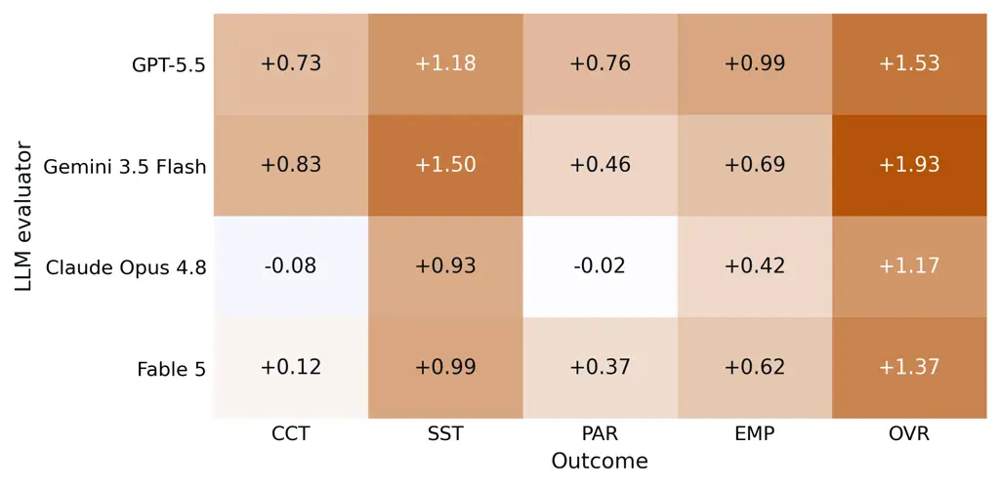
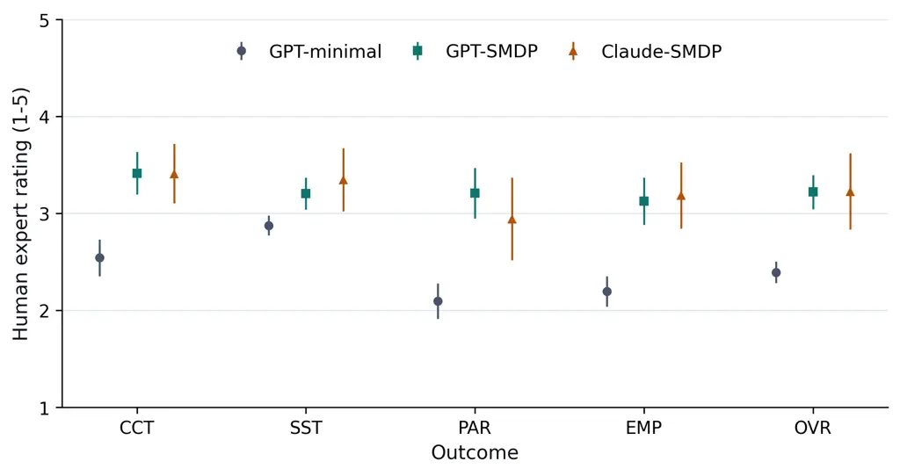

# Distinct Profiles of Run-to-Run Score Reliability and Expert-Panel Alignment Across Four LLM Evaluators of Simulated Japanese-Language AI-to-AI Counseling

Keita Kiuchi ^(†)^(†)thanks: Correspondence concerning this article
should be sent to Keita Kiuchi, Japan National Institute of Occupational
Safety and Health, Organization of Occupational Health and Safety,
Tama-ku Nagao 6-21-1, Kawasaki, Kanagawa 214-0023, Japan. Email:
kiuchi@h.jniosh.johas.go.jp Affiliation: Japan National Institute of
Occupational Safety and Health, Kawasaki, Kanagawa, Japan    Yoshikazu
Fujimoto Affiliation: Kaze To Taiyo, Tokyo, Japan    Hideyuki Gotō
Affiliation: Saga Occupational Health Association, Saga, Japan   
Tomonori Hosokawa Affiliation: Zikei Hospital/Zikei Institute of
Psychiatry, Okayama, Japan    Makoto Nishimura Affiliation: Suzuka
University of Medical Science, Suzuka, Mie, Japan    Yōsuke Satō
Affiliation: Ritsumeikan University, Ibaraki, Osaka, Japan    Izumi
Sezai Affiliation: National Defense Medical College, Tokorozawa,
Saitama, Japan    Tomohiro Inoue Affiliation: Aoyama Gakuin University,
Tokyo, Japan

August 27, 2026

###### Abstract

Introduction: Large language models (LLMs) increasingly evaluate
generated dialogue, but reliable scores across repeated runs do not
establish alignment with professional judgment.

Methods: This observational fixed-benchmark study compared four
configured LLM evaluator systems—GPT-5.5, Gemini 3.5 Flash, Claude Opus
4.8, and Fable 5—with aggregated ratings from 15 counseling experts on
18 complete simulated artificial intelligence (AI)-to-AI counseling
sessions conducted in Japanese. Sessions represented three counselor
conditions across six prespecified client-profile contexts. Each system
scored every transcript three times on four motivational
interviewing–informed dimensions and overall quality.

Findings: All four LLM systems assigned higher scores than did the
aggregated expert panel for softening sustain talk and overall quality,
although score differences varied across systems and constructs.
Single-run intraclass correlation coefficients ranged from .33 to .96;
high run-to-run score reliability did not ensure closer expert-panel
alignment. Claude Opus 4.8 showed the smallest mean absolute difference,
whereas Fable 5 showed an intermediate mean absolute difference. In a
secondary benchmark analysis, GPT-4-turbo sessions generated with the
Structured Multi-step Dialogue Prompt received higher expert-panel
ratings than sessions generated by the same model with a minimal
instruction on cultivating change talk, partnership, empathy, and
overall quality; the contrast for softening sustain talk remained
uncertain.

Discussion: The systems showed distinct system- and construct-specific
profiles of run-to-run score reliability and expert-panel alignment.

Limitations: The fixed benchmark contained one complete session per
counselor-condition-by-profile cell and did not estimate performance
across all possible stochastic regenerations.

Conclusions: Run-to-run score reliability, expert-panel alignment, and
condition discrimination are separate properties of automated counseling
evaluation. This benchmark provides a concrete basis for assessing LLM
evaluators against professional judgment at the construct level.

   

Preprint

|     |
| --- |
|     |

*Keywords* large language models $`\cdot`$ automated evaluation
$`\cdot`$ motivational interviewing $`\cdot`$ expert judgment $`\cdot`$
AI counseling simulation

## 1 Introduction

Large language models (LLMs), a form of artificial intelligence (AI),
are increasingly examined as tools for counseling simulation and skills
training and as evaluators of generated dialogue (Maurya, 2024; Qiu &
Lan, 2024; Stade et al., 2024). Mental health chatbot research indicates
that engagement, user attitudes, and outcome evidence should be
evaluated rather than inferred from conversational availability or
positive impressions alone (Limpanopparat et al., 2024), and perceptions
of LLM-generated advice vary with advice style and user characteristics
(Wester et al., 2024). The capacity to generate fluent, supportive
language does not establish counseling quality, and the capacity to
assign consistent scores does not establish valid evaluation. A dialogue
may appear empathic and orderly while overlooking ambivalence, moving
prematurely toward advice, or failing to preserve client autonomy. When
generative models both produce and judge counseling dialogue, stable
automated scores may therefore encourage unwarranted trust in the
evaluation process (Volpato et al., 2025).

Motivational interviewing (MI) provides a framework for separating
relational qualities—empathy, collaboration, and respect for
autonomy—from technical responsiveness to change talk and sustain talk
(Magill et al., 2018; Miller & Rose, 2009). The _Motivational
Interviewing Treatment Integrity Coding Manual_ 4.2.1 (MITI; Moyers et
al., 2014) operationalizes observable aspects of these processes.
Partnership and Empathy primarily represented relational qualities in
this study, whereas Cultivating Change Talk and Softening Sustain Talk
represented technically demanding responses to client language. An LLM
may reproduce the surface form of empathic communication without
responding contingently to the psychological meaning of the client’s
statements. MITI-derived measures have been applied to AI-generated
counseling dialogue (Cohen et al., 2024; Steenstra et al., 2024; Yang et
al., 2025), although the adapted global ratings used here omitted
behavior counts and should not be interpreted as full MITI fidelity
coding.

### 1.1 Automated Evaluation of Counseling Quality

Automated evaluation is not a single property. An evaluator may
reproduce its scores across repeated calls while remaining
systematically shifted from professional judgments, and it may match
average score levels while discriminating dialogue conditions
differently from experts. LLM-based scoring should therefore distinguish
run-to-run score reliability, expert-panel alignment, and discrimination
among counseling conditions. Agreement with human ratings varies across
models, datasets, and evaluated properties (Bavaresco et al., 2025). In
synthetic conversations with a mental health chatbot, the model with the
highest classification accuracy differed from that with the strongest
human-rating correlation (Reichenpfader et al., 2026). MI is a demanding
test because an evaluator may reward supportive wording, coherent
structure, or movement toward planning while missing implicit emotion,
competing values, sustain talk, or client-generated reasons for change.
Comparing several configured evaluator systems with an aggregated expert
panel on the same transcripts can reveal whether discrepancies are
uniform, system-specific, or construct-specific and whether high
run-to-run score reliability coexists with systematic differences from
expert-panel scores.

### 1.2 Counselor Conditions and Simulated Clients

The Structured Multi-step Dialogue Prompt (SMDP) provided benchmark
variation by guiding the interaction from the present concern through a
desired future, prior attempts, resources, and possible next steps and
by requiring two reflections before each counselor question. Such
procedural scaffolding may reduce interrogative turn-taking and create
opportunities for change talk, empathy, and partnership (Huang et al.,
2024; Lee et al., 2024). It does not, however, ensure responsiveness to
emotion, values, or ambivalence. Comparing the counselor conditions
therefore addressed a secondary substantive question about structured
procedural prompting and provided benchmark variation for examining
evaluator discrimination. The benchmark’s interpretability also depends
on whether simulated clients express enough uncertainty, resistance, and
sustain talk for demanding MI behaviors to be observed.

Japanese-language counseling dialogue remains understudied. Politeness,
ellipsis, sentence-final expressions, and listener responses may shape
perceptions of empathy and directiveness. Japanese attentive-listening
research has linked backchannel variation with perceived naturalness and
understanding (Yamaguchi et al., 2016), and Japanese MITI research has
emphasized rater training (Ohtsubo et al., 2016). Japanese-language
dialogue therefore provides an understudied context in which findings
based primarily on English interactions should be examined
independently. Because the present study did not compare languages or
cultures, it makes no claim about cross-cultural differences.

### 1.3 Present Study

The primary methodological objective was to determine how ratings from
four configured LLM evaluator systems—GPT-5.5, Gemini 3.5 Flash, Claude
Opus 4.8, and Fable 5—differed from the aggregated ratings of a panel of
counseling experts for the same 18 complete Japanese-language AI-to-AI
counseling sessions. We examined run-to-run score reliability,
expert-panel alignment, and discrimination among counselor conditions as
distinct evaluator properties. A secondary objective was to compare
counselor conditions within this benchmark. GPT-minimal and GPT-SMDP
held the GPT-4-turbo counselor model constant while varying the
procedural instruction; Claude-SMDP provided a cross-model SMDP
implementation. The evaluated object was the complete evolving
interaction rather than isolated counselor responses to standardized
client utterances.

The three preregistered hypotheses were: GPT-SMDP would receive higher
expert ratings than GPT-minimal (H1); Claude-SMDP would receive higher
expert ratings than GPT-SMDP (H2); and expert ratings would differ from
the four LLM evaluator systems (H3). The evaluator-type comparison
specified in H3 provides the manuscript’s primary methodological
contribution, whereas H1 and H2 address secondary benchmark questions.
The prespecified mixed models served as the primary analyses; additional
sensitivity analyses are described below. Simulated-client naturalness
and qualitative failure modes were exploratory.

## 2 Methods

### 2.1 Counseling Script Development

The benchmark comprised 18 complete Japanese-language AI-to-AI
counseling sessions: three counselor conditions crossed with six
prespecified profiles (women and men in their 20s, 40s, and 60s). Each
condition was represented by six separately initiated sessions, one per
profile. GPT-minimal used GPT-4-turbo with a minimal role instruction,
GPT-SMDP used GPT-4-turbo with SMDP, and Claude-SMDP used the February
2024 Claude-3-Opus API release with SMDP. All client simulations used
Claude-3-Opus and work-related concern prompts.

After the initial client message, each session proceeded through 10
sequential counselor–client exchanges. The counselor response and
subsequent client response were generated in separate model calls, with
accumulating dialogue histories supplied at the next exchange. Thus,
each transcript contained repeated, history-conditioned generations
within a dynamically evolving interaction. Individual turns were not
treated as independent replications, and client language differed across
counselor conditions in response to preceding counselor turns. The
evaluated object was complete-interaction quality across the six profile
contexts, not isolated responses to identical client inputs.

A custom program maintained the two dialogue histories through the
OpenAI Chat Completions and Anthropic Messages APIs; all transcripts
were generated on April 12, 2024. Full prompts, model identifiers,
sampling settings, history updates, output limits, and retry settings
appear in Online Resource 1, Section S1. The GPT-minimal versus GPT-SMDP
comparison isolates prompt structure within one counselor model;
comparisons involving Claude-SMDP also include model differences.

### 2.2 Expert Evaluation

Fifteen counseling experts rated the transcripts. The panel included
nonauthor experts and coauthors other than the first and last authors,
who did not rate the materials. Eleven experts (73%) had at least 10
years of counseling experience, and eight (53%) held Japanese clinical
psychologist or certified psychologist qualifications (Table 1).
Nonauthor evaluators were recruited through Japanese MI practitioner
networks based on professional background and self-reported familiarity
with MI and MITI; they received 500 Japanese yen per three-script
evaluation unit.

Each blinded unit contained all three counselor conditions for one
client profile. Questionnaire randomization determined display order.
Evaluators saw only the labels Moon, Star, and Sun and were not told
which counselor condition each label represented. The label-to-condition
mapping used for analysis was constant across profiles and evaluators.
On 1–5 scales permitting 0.5-point increments, they rated Cultivating
Change Talk (CCT), Softening Sustain Talk (SST), Partnership (PAR),
Empathy (EMP), and custom Overall evaluation (OVR). The first four
measures were adapted from MITI global scales; behavior counts were not
coded. Evaluators also rated client naturalness from 0 to 10 and
provided comments. The 54 completed units yielded 162 ratings per
outcome; each transcript received 8–10 ratings (median = 9).

Evaluator-to-profile assignment was sequential and workload based, with
an informal attempt to distribute age and sex profiles; it was not
randomized or formally counterbalanced. Every completed unit
nevertheless provided within-evaluator ratings of all three conditions
for the same profile. The study was designed as a general expert-panel
evaluation using MITI-informed global dimensions rather than as a formal
MITI fidelity assessment. In prior MITI reliability studies, formal
coder training involved 39–40 hours of structured instruction and
practice (Forsberg et al., 2007; Moyers et al., 2016). Even after such
training, interrater reliability for some dimensions was only fair;
Japanese preliminary evidence likewise suggests that global ratings and
behavior counts may have different training requirements (Forsberg et
al., 2007; Moyers et al., 2016; Ohtsubo et al., 2016). As AI-generated
counseling becomes increasingly sophisticated, differences among
counseling dialogues may become more difficult for evaluators to
distinguish, yet repeatedly assembling and training a dedicated MITI
coding team for each study would be difficult to sustain as a general
evaluation strategy. The study therefore did not conduct a formal
calibration exercise to align evaluators with a study-specific scoring
interpretation; instead, the transcript-level mean of ratings made
separately by multiple counseling professionals served as the
professional comparison standard rather than as an error-free gold
standard or formal MITI fidelity criterion (Online Resource 1, Section
S2).

\[Table 1 about here\]

### 2.3 LLM Evaluation Systems

OpenAI GPT-5.5, Google Gemini 3.5 Flash, and Anthropic Claude Opus 4.8
served as API-based evaluators (Anthropic, 2026b; Google DeepMind, 2026;
OpenAI, 2026). On June 24–25, 2026 (UTC), each system rated every
transcript three times on the five 1–5 scales using the provider’s
maximum reasoning or effort setting. These were repeated stochastic
outputs, not independent human-like raters. Each metric-specific call
supplied the same transcript, prompt body, and rubric and returned a
numeric score and reason. Provider-native message-role structures
differed, and temperature was not explicitly set. The three systems
produced 810 numeric ratings and, in separate post-scoring calls, 54
qualitative summaries and 54 suggested dialogue revisions.

Anthropic restored global access to Fable 5 on July 1, 2026, including
through Claude Platform and Claude Code, and its platform documentation
identifies claude-fable-5 as the Claude API model ID (Anthropic, 2026a,
2026c). At the time of evaluation, however, Fable 5 was not exposed
through the study account’s Anthropic Console API access. The
evaluations included in the analyses were therefore conducted through a
Claude Code subscription. Each rating used an isolated, single-turn
process with maximum reasoning effort; tools, repository instructions,
conversation persistence, and the coding-oriented system prompt were
disabled. Fable received the same counseling-supervisor instruction,
metric prompts, criteria, and transcripts used for the API systems.
Three runs for 18 transcripts and five outcomes yielded 270 numeric
ratings. Subsequent calls generated 18 qualitative summaries and 18
dialogue-specific improvement evaluations after deterministic
integration of the three score runs. Model identity was verified for
each accepted evaluation. Only the Claude Code evaluations were
included; an earlier GUI evaluation was excluded from the numeric and
qualitative analyses. Fable model identity cannot be separated from its
Claude Code pathway. Complete settings, prompts, formats, and
qualitative procedures appear in Online Resource 1, Section S3.

### 2.4 Statistical Analysis

A transcript-level sensitivity analysis specified after preliminary
mixed-model inspection assessed alignment with the aggregated expert
panel. For each transcript and outcome, the expert-panel mean was
compared with each configured LLM system’s three-run mean. Mean signed
LLM-minus-expert differences represented directional score shifts, and
mean absolute differences represented distance from the expert-panel
aggregate. Condition-stratified transcript bootstrap intervals
summarized variation across the 18 archived transcript summaries rather
than across all possible generated dialogues.

The OSF-specified primary model-based analysis assessed whether
evaluator-type differences varied across counselor conditions. For each
outcome, the mixed model included evaluator type, counselor condition,
their interaction, client age, and client sex, with crossed evaluator
and transcript random intercepts. Likelihood-ratio tests evaluated the
interaction, and Tukey–Kramer-adjusted simple effects compared evaluator
types within condition. Type III Wald tests were reported as
supplementary summaries. Run-to-run score reliability was summarized
separately by ICC(2,1), ICC(2,_k_) (Koo & Li, 2016), and variance
components; LLM ICCs describe repeated stochastic outputs from the same
configured system, not agreement among independent raters.

For the secondary counselor-condition question, expert-rated outcomes
were analyzed with mixed models containing counselor condition, client
age, and client sex, with evaluator and transcript random intercepts.
Likelihood-ratio tests evaluated counselor condition, and
Tukey–Kramer-adjusted contrasts compared conditions. Age and sex were
descriptive covariates because each profile cell contained one
transcript. After preliminary mixed-model inspection, we specified
additional sensitivity analyses using within-evaluator-by-profile paired
differences, Holm adjustment within outcomes, Benjamini–Hochberg
adjustment across 15 contrasts, robust standard errors, an
evaluation-unit model, and ordinal mixed models. Full specifications and
diagnostics appear in Online Resource 1, Sections S5–S6.

Study size was determined by the archived 18-session benchmark and
completed expert evaluations rather than by a prospective sample-size
calculation. The 162 expert observations per outcome were repeated
ratings of those sessions. No valid planned rating was excluded; all
planned LLM ratings were complete, whereas the expert matrix was
intentionally incomplete because evaluators completed different
workloads. The inferential target was the configured systems’ and expert
panel’s ratings of this benchmark, including counselor-condition
differences across six profile contexts—not repeated-generation
variability within identical cells or average performance across all
possible regenerations. Analyses used R 4.4.1 with lme4 1.1-37,
lmerTest, emmeans 1.11.0, and psych. Preregistration and amendments are
available at https://doi.org/10.17605/OSF.IO/VU286.

### 2.5 Ethical Considerations

The study used synthetic dialogues and professional evaluations of those
materials. No patients or counseling clients were recruited, and no
clinical, identifiable, or private behavioral data were collected. The
expert evaluators acted as professional collaborators or subject-matter
contributors who judged synthetic materials, not as the target
population from whom psychological or health outcomes were measured.
Individual rating and comment records were anonymized for analysis and
reporting, and written informed consent was obtained from the expert
evaluators. On this basis, the authors judged that formal ethics review
was not required; however, no institutional determination of exemption
or non-human-participant status was obtained.

## 3 Findings

### 3.1 Dataset and Score Overview

The benchmark contained 18 complete sessions, with six sessions in each
counselor condition. Fifteen experts completed 54 evaluator-by-profile
units, yielding 162 expert ratings per outcome; each transcript received
8–10 expert ratings (median = 9). Each of the four configured LLM
evaluator systems completed three scoring runs for every transcript and
outcome, yielding 216 LLM ratings per outcome and 1,080 LLM ratings
overall. Table 2 summarizes scores by counselor condition and evaluator.
Across conditions, GPT-5.5 produced uniformly high scores (OVR _M_ =
4.48, _SD_ = 0.34), Gemini 3.5 Flash produced the highest OVR and SST
means (4.88 and 4.64, respectively), and Claude Opus 4.8 was
descriptively closest to the aggregated expert panel on CCT and PAR.
Fable 5 produced an OVR mean of 4.31 (_SD_ = 0.34) and an SST mean of
4.13 (_SD_ = 0.26).

\[Table 2 about here\]

### 3.2 LLM Evaluators Showed System- and Construct-Specific Score Differences From the Expert Panel

At the transcript level, all four LLM evaluator systems assigned higher
OVR and SST scores than the aggregated expert panel. Mean OVR and SST
differences were +1.53 and +1.18 for GPT-5.5, +1.93 and +1.50 for Gemini
3.5 Flash, +1.17 and +0.93 for Claude Opus 4.8, and +1.37 and +0.99 for
Fable 5; all eight bootstrap intervals excluded zero. Claude Opus 4.8
was near the panel on CCT (−0.08, 95% bootstrap interval \[−0.22,
0.05\]) and PAR (−0.02 \[−0.13, 0.12\]), whereas Fable 5 showed
differences of +0.12 for CCT, +0.37 for PAR, and +0.62 for EMP. Mean
absolute differences across outcomes were 0.60 for Claude Opus 4.8, 0.76
for Fable 5, 1.04 for GPT-5.5, and 1.21 for Gemini 3.5 Flash. These
benchmark-specific values do not identify a generally superior
underlying model (Figure 1; Online Resource 1, Section S6).

\[Figure 1 about here\]

### 3.3 OSF-Specified Models Provided Complementary Condition-Specific Comparisons

In the primary model-based analyses, evaluator differences varied by
counselor condition for OVR, χ²(8) = 83.34, _p_ \< .001; CCT, χ²(8) =
75.33, _p_ \< .001; SST, χ²(8) = 20.16, _p_ = .010; and PAR, χ²(8) =
80.74, _p_ \< .001. The interaction was not significant for EMP, χ²(8) =
12.92, _p_ = .115 (Table 3 and Online Resource 1, Section S6).

All four systems assigned higher OVR and SST scores than the aggregated
expert panel within every counselor condition, with all adjusted
contrasts significant. Differences for CCT, PAR, and EMP were system
specific. GPT-5.5 assigned higher CCT scores than the expert panel for
GPT-minimal, higher PAR scores for both SMDP conditions, and higher EMP
scores for all conditions. Gemini 3.5 Flash assigned higher CCT and PAR
scores than the expert panel for both SMDP conditions and higher EMP
scores for Claude-SMDP. Claude Opus 4.8 did not differ significantly on
CCT, PAR, or EMP within any condition. Fable 5 assigned higher EMP
scores than the expert panel only for GPT-SMDP among these three
outcomes. Covariate estimates are descriptive (Online Resource 1,
Section S6).

\[Table 3 about here\]

### 3.4 Run-to-Run Score Reliability Did Not Ensure Expert-Panel Alignment

Across the four LLM evaluator systems, single-run ICCs ranged from .33
to .96 across systems and outcomes (Online Resource 1, Section S5).
Outcome-specific ranges were .85–.96 for CCT, .33–.66 for SST, .90–.95
for PAR, .84–.93 for EMP, and .51–.82 for OVR. High run-to-run score
reliability nevertheless coexisted with systematic positive score
differences on SST and OVR, and the system with the smallest overall
mean absolute difference was not uniformly aligned across constructs.
Run-to-run score reliability, expert-panel alignment, and condition
discrimination therefore formed distinct empirical profiles in this
benchmark.

### 3.5 Secondary Counselor-Condition Findings Within the Complete-Session Benchmark

Within the fixed six-profile benchmark, the omnibus counselor-condition
term was significant for all five outcomes. In the direct within-model
contrast, GPT-minimal received lower expert-panel ratings than GPT-SMDP
on CCT (adjusted difference = −0.88), PAR (−1.11), EMP (−0.93), and OVR
(−0.83); the SST contrast was directionally consistent but narrowly
missed the Tukey-adjusted significance threshold (−0.33, _p_ = .051).
GPT-minimal also received lower ratings than Claude-SMDP on every
outcome, with adjusted differences ranging from −0.48 for SST to −1.01
for EMP. GPT-SMDP and Claude-SMDP did not differ significantly on any
outcome. This result was not an equivalence test and is not interpreted
as model-level equivalence. Age and sex estimates are descriptive
because each profile cell contained one session (Table 3; Online
Resource 1, Section S6).

The additional sensitivity analyses supported the substantive pattern.
GPT-SMDP received higher expert-panel ratings than GPT-minimal for OVR
(0.80, 95% CI \[0.44, 1.16\]), CCT (0.84 \[0.41, 1.28\]), PAR (1.04
\[0.60, 1.48\]), and EMP (0.93 \[0.51, 1.35\]); Holm-adjusted *p*s and
Benjamini–Hochberg *q*s were no greater than .003. The SST paired
difference was smaller and uncertain (0.24 \[−0.26, 0.73\]), and no
Claude-SMDP versus GPT-SMDP paired contrast was significant. Robust HC3
and ordinal score-level sensitivity analyses were directionally
consistent overall, although SST was less stable in the
paired-difference analysis (Figure 2; Online Resource 1, Section S6).

\[Figure 2 about here\]

### 3.6 Expert-Panel Variability and Benchmark Diagnostics

Expert single-rater reliability was low for CCT, PAR, EMP, and OVR
(ICC(2,1) = .20–.26) and very low for SST (.03). Average-measure
estimates were higher for CCT, PAR, EMP, and OVR (.79–.84) but remained
low for SST (.30). Because each transcript was rated by 8–10 experts and
the evaluator subset varied across client profiles, these
average-measure ICCs are descriptive summaries of the incomplete rating
matrix rather than direct reliability estimates for the observed
transcript means (Online Resource 1, Section S5). Client naturalness
averaged 4.65 (_SD_ = 2.05) on the 0–10 scale. Experts described
simulated clients as compliant, formal, repetitive, and context-poor,
with little resistance or ambivalence, restricting opportunities to
observe SST.

### 3.7 Qualitative Patterns

Expert comments emphasized directiveness, shallow emotional reflection,
limited change-talk deepening, and evaluative rather than collaborative
responses. LLM score reasons often rewarded respectful tone, coherent
structure, and rapid planning despite limited emotional depth; Claude
Opus 4.8 most consistently echoed expert concerns. Separate post-scoring
advisory calls also emphasized complex reflection but were analytically
distinct from contemporaneous score reasons (Online Resource 1, Section
S7).

## 4 Discussion

The four configured LLM evaluator systems exhibited distinct system- and
construct-specific profiles of run-to-run score reliability and
expert-panel alignment. All four systems assigned higher SST and OVR
scores, whereas their differences on CCT, PAR, and EMP varied by
evaluator. Run-to-run score reliability also varied and did not ensure
closer alignment with professional judgment. Together, these results
distinguish three properties often conflated in automated counseling
evaluation: reliability across repeated scoring runs, alignment with
aggregated expert-panel scores, and discrimination among dialogue
conditions.

As a secondary benchmark finding, the within-model GPT-4-turbo
comparison showed higher aggregated expert-panel ratings for GPT-SMDP
than for GPT-minimal on CCT, PAR, EMP, and OVR across the fixed
six-profile set; the SST contrast remained uncertain in the paired
analysis. GPT-SMDP and Claude-SMDP did not differ significantly. These
counselor-condition results characterize the evaluated complete sessions
and provide meaningful benchmark variation for examining evaluator
behavior.

### 4.1 Why Run-to-Run Score Reliability Can Coexist With Expert-Panel Misalignment

The system- and construct-specific differences show why repeated output
stability is insufficient evidence of evaluator validity. An LLM can
apply a stable scoring tendency while systematically valuing different
dialogue features from counseling professionals. In the score-call
reasons, respectful wording, orderly progression, and movement toward
planning could outweigh deficits that experts considered central,
including premature advice, shallow emotional reflection, and missed
opportunities to deepen client-generated change talk. This pattern was
especially visible for SST and OVR: all four systems assigned higher
scores than the expert panel, even though run-to-run score reliability
varied widely.

The differences were not reducible to a single leniency parameter.
Claude Opus 4.8 had the smallest overall mean absolute difference and
was near the expert-panel aggregate on CCT and PAR, but it remained
positively shifted on SST and OVR. Fable 5 was also near the expert
panel on CCT yet showed larger positive differences on other outcomes.
GPT-5.5 and Gemini 3.5 Flash showed still different profiles across
conditions and constructs. These comparisons concern the evaluator
systems as configured, including prompts, message-role handling,
reasoning settings, and execution pathways; they do not establish that
one underlying model family is generally the best judge of counseling
quality.

Automated counseling evaluators should consequently be benchmarked
separately for the constructs and uses they are intended to support.
Behavioral anchors and expert-rated examples should distinguish surface
politeness and procedural order from emotionally and motivationally
responsive counseling. High run-to-run score reliability cannot
substitute for outcome-specific comparison with professional judgments.
AI-generated feedback has also been evaluated as a tool for
psychotherapy training (Young et al., 2026). The later qualitative
modules may likewise support supervision by converting general concerns
into concrete revisions, but their usefulness is distinct from score
accuracy because those outputs were generated after scoring under
separate prompts.

The advisory outputs also showed model-specific emphases. Claude Opus
4.8 most frequently prioritized complex reflection, whereas Gemini 3.5
Flash more often emphasized affirmation and revision of existing
questions. GPT-5.5 more frequently proposed summaries and
autonomy-supportive rewording of advice or information. Fable 5 combined
the shared emphasis on complex reflection with comparatively frequent
summaries and suggestions involving affirmation and question revision.
Thus, the configured evaluator systems differed not only in their score
profiles but also in the types of supervisory revisions they tended to
prioritize.

### 4.2 Secondary Findings on Structured Procedural Prompting

The direct GPT-minimal versus GPT-SMDP contrast held the counselor model
constant while varying the procedural prompt. Across the six
prespecified profile contexts, GPT-SMDP produced complete sessions with
higher aggregated expert-panel ratings on CCT, PAR, EMP, and OVR. The
session-level procedure was not a one-turn response template: it shaped
a sequence of history-conditioned counselor and client calls as the
interaction developed. Requiring two reflective responses before each
question may have contributed to more favorably rated pacing and
collaboration, while the ordered exploration of goals, prior efforts,
and resources may have created opportunities for change talk.

The qualitative comments also clarify the boundary of this procedural
scaffolding. GPT-SMDP often produced reflections that remained close to
the client’s explicit content rather than developing implicit emotion,
values, ambivalence, or change talk. The prompt asked Listen-Back 1 to
add a “new nuance or interpretation” and Listen-Back 2 to add “another
layer of meaning or interpretation,” but it gave little guidance about
which latent meanings to pursue or how to construct complex reflections
around them. This underspecification may have led the model to satisfy
the two-reflection rule mainly through simple paraphrase. The resulting
monotony therefore appears to reflect limited reflective depth more than
the fixed order of the broader question sequence. More explicit
instructions to reflect implicit affect, personally important values,
competing motivations, and client-generated change talk may strengthen
psychological responsiveness while preserving the procedural benefits of
SMDP.

The study compared the complete SMDP condition with a
minimal-instruction condition; accordingly, this prompt-level account
remains a plausible explanation of the qualitative pattern rather than
an identified component effect. Comparisons involving Claude-SMDP also
include a model-family difference, and the nonsignificant GPT-SMDP
versus Claude-SMDP result is not evidence of equivalence.

### 4.3 Simulated-Client Naturalness and Construct Observability

The simulated clients showed little resistance or ambivalence and
received a mean naturalness rating below the midpoint of the 0–10 scale.
When sustain talk is scarce, an evaluator can assign a high SST score
without observing demanding counselor behavior, making it difficult to
distinguish effective softening from a lack of opportunities to evaluate
that skill. The especially low expert agreement for SST reinforces this
construct-specific concern. This limitation applies most directly to
SST; it does not erase the observed evaluator differences or
counselor-condition patterns on constructs for which relevant behavior
was more visible. Richer simulations with plausible hesitation,
disagreement, affective shifts, and contextual detail would provide a
more stringent test of both counselor responses and evaluator judgments.

## 5 Limitations

This study has five principal boundaries. First, it evaluated 18
archived complete sessions generated in April 2024, with one session in
each counselor-condition-by-profile cell. Each counselor condition was
represented by six separately initiated sessions across the prespecified
profile contexts, so the corresponding inferential target is the
performance of these evaluated sessions across the six profiles.
Within-cell generative stability, average performance across stochastic
regenerations, and the performance of current counselor models are
separate inferential targets.

Second, client utterances developed dynamically in response to counselor
behavior, making the complete interaction the evaluated object.
Standardized client utterances would address the complementary estimand
of counselor responses under identical inputs.

Third, the professional comparison standard comprised aggregated blinded
ratings from an expert panel using MITI-informed global dimensions
without behavior counts rather than ratings from a formally trained and
calibrated MITI coding team. Each transcript received 8–10 expert
ratings, but the incomplete matrix, low single-rater agreement,
sequential evaluator-to-profile assignment, and inclusion of some
coauthor evaluators mean that the aggregate should not be treated as an
error-free gold standard or formal MITI fidelity criterion.

Fourth, the benchmark was limited to Japanese-language AI-to-AI sessions
concerning work-related problems and used a single simulated-client
model. This narrow language, topic, and simulation context limits
transportability to other languages, concerns, client models, and
human–client interactions. The simulated clients’ limited naturalness,
resistance, and ambivalence most directly constrained opportunities to
observe SST.

Fifth, the automated evaluators were compared as configured systems
rather than under perfectly identical provider interfaces. Message-role
handling, sampling defaults, and execution pathways differed, and Fable
5 model identity could not be separated from its Claude Code pathway.
These design features should be preserved when interpreting or
attempting to reproduce the system-specific differences.

## 6 Conclusions

Four configured LLM evaluator systems showed distinct system- and
construct-specific profiles of run-to-run score reliability and
expert-panel alignment for the same complete Japanese-language AI-to-AI
counseling sessions. All four systems assigned higher scores for SST and
OVR, and high run-to-run score reliability did not ensure closer
alignment with the expert panel. Within this benchmark, sessions
generated under structured procedural prompting received higher
expert-panel ratings on four of five outcomes. Together, these findings
distinguish run-to-run score reliability, expert-panel alignment, and
condition discrimination as separate properties of automated counseling
evaluation. This benchmark provides a concrete basis for assessing LLM
evaluators against professional judgment at the construct level.

## Statements and Declarations

### Acknowledgments

We thank Dr. Kaoru Shibayama, Mr. Kensuke Saito, Mr. Koji Kunita,
Dr. Youhei Komatsu, Ms. Misumi Yamaguchi, Mr. Takahiro Maki, and Youichi
Ohtsubo, MD, for serving as expert evaluators of the counseling scripts.
Permission to identify these nonauthor evaluators in the Acknowledgments
was obtained.

### Funding

This work was supported by PsyAI Consulting, a general incorporated
association. The sponsor as an organization had no role beyond providing
financial support; study design, data collection, analysis,
interpretation, manuscript preparation, and the decision to submit the
article were carried out by the authors in the roles disclosed below.
Keita Kiuchi’s individual scientific contributions are reported in the
Author Contributions statement.

### Competing Interests

Keita Kiuchi is the representative director of PsyAI Consulting, a
general incorporated association, which provided financial support for
this work. This relationship is disclosed as a potential competing
interest. The remaining authors have no relevant financial or
non-financial interests to disclose.

### Author Contributions

Keita Kiuchi: Conceptualization, Methodology, Software, Formal Analysis,
Data Curation, Writing – Original Draft, Visualization, Project
Administration, Funding Acquisition.

Yoshikazu Fujimoto, Hideyuki Gotō, Tomonori Hosokawa, Makoto Nishimura,
Yōsuke Satō, and Izumi Sezai: Conceptualization, Validation,
Investigation, Writing – Review & Editing.

Tomohiro Inoue: Conceptualization, Validation, Writing – Review &
Editing.

Yoshikazu Fujimoto, Hideyuki Gotō, Tomonori Hosokawa, Makoto Nishimura,
Yōsuke Satō, and Izumi Sezai contributed equally and are listed
alphabetically by surname. Keita Kiuchi is listed as first author and
Tomohiro Inoue as last author. All authors read and approved the
manuscript.

### Declaration of Generative AI and AI-Assisted Technologies in Manuscript Preparation

During the preparation of this work, the authors used OpenAI Codex for
manuscript language editing, consistency checks, and formatting review.
No generative AI or AI-assisted tools were used to create or alter
figures. The authors reviewed and edited the output as needed and take
full responsibility for the content of the manuscript.

## Electronic Supplementary Material

Online Resource 1. Supplementary methods, prompts, example transcripts,
diagnostic analyses, sensitivity analyses, and qualitative summaries for
the four-system benchmark. The resource contains the following sections:

- •
  S1. Counselor and Client Generation: the minimal role instruction,
  SMDP, client-simulation prompt, sequential generation procedure, and
  model and sampling settings.
- •
  S2. Expert Evaluation Protocol: evaluator eligibility, rating-scale
  overview, assignment structure, workload, and client-naturalness
  ratings.
- •
  S3. LLM Evaluation Protocol and Metric Prompts: evaluator model and
  settings summaries, scoring rubrics, complete metric prompts, output
  formats, qualitative-summary prompts, and improvement-detail prompts.
- •
  S4. Counseling Script Examples: selected transcripts generated by
  GPT-4-turbo and Claude-3-Opus.
- •
  S5. Reliability and Diagnostic Sensitivity Analyses: reliability
  summaries and diagnostic post hoc outputs for the four-system analysis
  using maximum reasoning/effort settings.
- •
  S6. Mixed-Model Specifications, Contrasts, Interaction Tests, and
  Sensitivity Analyses: model equations, fixed-effect tests,
  Tukey-adjusted contrasts, simple effects, paired-difference
  sensitivity models, additional sensitivity analyses, ordinal models,
  diagnostics, transcript-level LLM–expert-panel score differences, and
  a comparison with lower reasoning/effort settings.
- •
  S7. Qualitative Evaluation Summary: expert comments, LLM score
  reasons, qualitative summaries, revision targets, and
  client-simulation findings.
- •
  S8. Data, Code, Registration, and Materials Availability: repository,
  registration, and data-sharing information.

## TABLE 1 Study Design and Expert Evaluator Characteristics

| Feature                                              | Value     |
| ---------------------------------------------------- | --------- |
| Stimulus set                                         |           |
| Fixed synthetic transcripts                          | 18        |
| Counselor conditions                                 | 3         |
| Simulated-client profiles                            | 6         |
| Transcripts per counselor condition                  | 6         |
| Sequential counselor–client exchanges per transcript | 10        |
| Expert-rated outcomes per transcript                 | 5         |
| Expert observations per outcome                      | 162       |
| Formal LLM evaluator systems                         | 4         |
| API-based evaluator systems                          | 3         |
| Non-API evaluator systems                            | 1         |
| LLM repeated scoring runs per transcript and outcome | 3         |
| Counseling experience                                |           |
| \< 5 years                                           | 2 (13.3)  |
| 5 to \< 10 years                                     | 2 (13.3)  |
| ≥ 10 years                                           | 11 (73.3) |
| Professional qualification                           |           |
| Clinical psychologist / certified psychologist       | 8 (53.3)  |
| Medical doctor                                       | 2 (13.3)  |
| Nurse / public health nurse                          | 2 (13.3)  |
| Occupational therapist                               | 2 (13.3)  |
| Psychiatric social worker                            | 2 (13.3)  |
| Career counselor                                     | 3 (20.0)  |
| Social worker                                        | 1 (6.7)   |
| Pharmacist                                           | 1 (6.7)   |

_Note._ _N_ = 15 unique expert evaluators. Counseling experience and
professional qualification values are _n_ (%). Professional
qualification categories are not mutually exclusive; therefore
percentages may sum to more than 100%. The stimulus set contained one
transcript for each counselor-condition × client-profile cell.

## TABLE 2 Counseling-Session Scores by Evaluator System and Counselor Condition

| Variable                | Expert (_N_ = 54) | GPT-5.5 (_N_ = 18) | Gemini 3.5 Flash (_N_ = 18) | Claude Opus 4.8 (_N_ = 18) | Fable 5 (_N_ = 18) |
| ----------------------- | ----------------- | ------------------ | --------------------------- | -------------------------- | ------------------ |
| _Score for Claude-SMDP_ |                   |                    |                             |                            |                    |
| CCT                     | 3.42 $`\pm`$ 0.88 | 4.11 $`\pm`$ 0.21  | 4.56 $`\pm`$ 0.42           | 3.44 $`\pm`$ 0.57          | 3.78 $`\pm`$ 0.39  |
| SST                     | 3.35 $`\pm`$ 0.86 | 4.39 $`\pm`$ 0.21  | 4.81 $`\pm`$ 0.25           | 4.08 $`\pm`$ 0.39          | 4.19 $`\pm`$ 0.35  |
| PAR                     | 2.96 $`\pm`$ 0.97 | 3.92 $`\pm`$ 0.19  | 3.72 $`\pm`$ 1.06           | 3.00 $`\pm`$ 0.38          | 3.58 $`\pm`$ 0.26  |
| EMP                     | 3.20 $`\pm`$ 0.97 | 4.00 $`\pm`$ 0.00  | 3.97 $`\pm`$ 0.70           | 3.50 $`\pm`$ 0.34          | 3.83 $`\pm`$ 0.30  |
| OVR                     | 3.25 $`\pm`$ 0.83 | 4.69 $`\pm`$ 0.25  | 5.00 $`\pm`$ 0.00           | 4.36 $`\pm`$ 0.23          | 4.53 $`\pm`$ 0.12  |
| _Score for GPT-minimal_ |                   |                    |                             |                            |                    |
| CCT                     | 2.54 $`\pm`$ 0.97 | 3.44 $`\pm`$ 0.24  | 2.56 $`\pm`$ 0.57           | 2.33 $`\pm`$ 0.24          | 2.33 $`\pm`$ 0.24  |
| SST                     | 2.87 $`\pm`$ 0.87 | 4.53 $`\pm`$ 0.32  | 4.44 $`\pm`$ 0.29           | 4.00 $`\pm`$ 0.00          | 4.03 $`\pm`$ 0.12  |
| PAR                     | 2.09 $`\pm`$ 0.91 | 2.61 $`\pm`$ 0.40  | 1.50 $`\pm`$ 0.38           | 2.00 $`\pm`$ 0.24          | 1.94 $`\pm`$ 0.38  |
| EMP                     | 2.19 $`\pm`$ 0.77 | 3.47 $`\pm`$ 0.36  | 2.75 $`\pm`$ 0.69           | 2.72 $`\pm`$ 0.35          | 2.64 $`\pm`$ 0.45  |
| OVR                     | 2.39 $`\pm`$ 0.64 | 4.61 $`\pm`$ 0.21  | 4.72 $`\pm`$ 0.26           | 4.03 $`\pm`$ 0.27          | 4.44 $`\pm`$ 0.16  |
| _Score for GPT-SMDP_    |                   |                    |                             |                            |                    |
| CCT                     | 3.42 $`\pm`$ 0.76 | 4.00 $`\pm`$ 0.00  | 4.75 $`\pm`$ 0.26           | 3.33 $`\pm`$ 0.24          | 3.61 $`\pm`$ 0.21  |
| SST                     | 3.20 $`\pm`$ 0.85 | 4.06 $`\pm`$ 0.24  | 4.67 $`\pm`$ 0.38           | 4.14 $`\pm`$ 0.33          | 4.17 $`\pm`$ 0.24  |
| PAR                     | 3.20 $`\pm`$ 0.81 | 4.00 $`\pm`$ 0.00  | 4.42 $`\pm`$ 0.26           | 3.19 $`\pm`$ 0.25          | 3.83 $`\pm`$ 0.30  |
| EMP                     | 3.12 $`\pm`$ 0.94 | 4.00 $`\pm`$ 0.00  | 3.86 $`\pm`$ 0.23           | 3.56 $`\pm`$ 0.24          | 3.89 $`\pm`$ 0.21  |
| OVR                     | 3.22 $`\pm`$ 0.66 | 4.14 $`\pm`$ 0.23  | 4.92 $`\pm`$ 0.19           | 3.97 $`\pm`$ 0.40          | 3.97 $`\pm`$ 0.36  |

_Note._ Values are mean $`\pm`$ _SD_. The Expert column contains 54
script-level ratings per counselor condition. Each automated-evaluator
column contains 18 ratings per counselor condition, reflecting six
scripts per counselor condition × three score iterations. CCT =
Cultivating Change Talk; SST = Softening Sustain Talk; PAR =
Partnership; EMP = Empathy; OVR = Overall evaluation; SMDP = Structured
Multi-step Dialogue Prompt; GPT-minimal = GPT-4-turbo with a minimal
role instruction; GPT-SMDP = GPT-4-turbo with SMDP; Claude-SMDP =
Claude-3-Opus with SMDP. Simulated-client profiles were balanced across
age group and sex.

## TABLE 3 LLM–Expert-Panel Score Differences and Secondary Counselor-Condition Contrasts

| Analysis                                           | Outcome or model   | Key estimate                                                                                                                 | Interpretation                                                                                                                                                                                      |
| -------------------------------------------------- | ------------------ | ---------------------------------------------------------------------------------------------------------------------------- | --------------------------------------------------------------------------------------------------------------------------------------------------------------------------------------------------- |
| Evaluator type × counselor condition interaction   | CCT, SST, PAR, OVR | Likelihood-ratio tests were significant for CCT, SST, PAR, and OVR; the interaction for EMP was not significant (_p_ = .115) | Evaluator differences varied by counselor condition for four of the five outcomes.                                                                                                                  |
| Transcript-level LLM-minus-expert-panel difference | GPT-5.5            | Mean signed difference = +1.04; mean absolute difference = 1.04                                                              | Ratings were higher on average than the aggregated expert-panel means.                                                                                                                              |
| Transcript-level LLM-minus-expert-panel difference | Gemini 3.5 Flash   | Mean signed difference = +1.08; mean absolute difference = 1.21                                                              | Ratings were higher on average than the aggregated expert-panel means, especially for OVR and SST.                                                                                                  |
| Transcript-level LLM-minus-expert-panel difference | Claude Opus 4.8    | Mean signed difference = +0.49; mean absolute difference = 0.60                                                              | The overall mean absolute difference was the smallest among the four systems, with particularly small differences for CCT and PAR, although SST and OVR scores remained positively shifted.         |
| Transcript-level LLM-minus-expert-panel difference | Fable 5            | Mean signed difference = +0.69; mean absolute difference = 0.76                                                              | Ratings were positively shifted overall, especially for SST and OVR; the mean absolute difference was smaller than those for GPT-5.5 and Gemini 3.5 Flash but larger than that for Claude Opus 4.8. |
| Expert counselor contrast: GPT-minimal − GPT-SMDP  | CCT                | −0.88, Tukey-adjusted _p_ \< .001                                                                                            | GPT-SMDP was rated higher than GPT-minimal.                                                                                                                                                         |
| Expert counselor contrast: GPT-minimal − GPT-SMDP  | SST                | −0.33, Tukey-adjusted _p_ = .051                                                                                             | The direction favored GPT-SMDP, but the adjusted contrast narrowly missed the conventional threshold.                                                                                               |
| Expert counselor contrast: GPT-minimal − GPT-SMDP  | PAR                | −1.11, Tukey-adjusted _p_ \< .001                                                                                            | GPT-SMDP was rated higher than GPT-minimal.                                                                                                                                                         |
| Expert counselor contrast: GPT-minimal − GPT-SMDP  | EMP                | −0.93, Tukey-adjusted _p_ \< .001                                                                                            | GPT-SMDP was rated higher than GPT-minimal.                                                                                                                                                         |
| Expert counselor contrast: GPT-minimal − GPT-SMDP  | OVR                | −0.83, Tukey-adjusted _p_ \< .001                                                                                            | GPT-SMDP was rated higher than GPT-minimal.                                                                                                                                                         |
| Expert counselor contrast: GPT-SMDP − Claude-SMDP  | All outcomes       | No adjusted contrast significant                                                                                             | No statistically significant difference was detected; this was not an equivalence test.                                                                                                             |

_Note._ LLM score-difference values are transcript-level
LLM-minus-aggregated-expert-panel differences averaged across the five
outcomes in the four-system analysis using maximum reasoning/effort
settings. Positive values indicate higher LLM ratings. Aggregated
expert-panel ratings are a professional comparison standard, not an
error-free gold standard. Expert counselor contrasts are Tukey-adjusted
pairwise contrasts from the expert-only mixed model; negative values for
GPT-minimal − GPT-SMDP indicate higher ratings for GPT-SMDP. Full
fixed-effect estimates, variance components, likelihood-ratio tests,
simple-effect contrasts, sensitivity analyses, and outcome-specific
differences are reported in Online Resource 1, Section S6. CCT =
Cultivating Change Talk; SST = Softening Sustain Talk; PAR =
Partnership; EMP = Empathy; OVR = Overall evaluation; SMDP = Structured
Multi-step Dialogue Prompt.



Figure 1: LLM Minus Aggregated Expert-Panel Score Differences by
Evaluator System and Outcome.

_Note._ Values show mean LLM-minus-aggregated-expert-panel rating
differences across transcripts for each outcome in the four-system
analysis using maximum reasoning/effort settings. Positive values
indicate that the configured LLM evaluator assigned higher ratings than
the expert-panel aggregate. The aggregate is used as a professional
comparison standard rather than as an error-free gold standard. CCT =
Cultivating Change Talk; SST = Softening Sustain Talk; PAR =
Partnership; EMP = Empathy; OVR = Overall evaluation.



Figure 2: Aggregated Expert-Panel Ratings by Counselor Condition Within
the Six-Profile Benchmark.

_Note._ Points show mean script-level expert ratings by outcome and
counselor condition. Error bars show 95% confidence intervals. The
figure describes the fixed six-profile complete-session benchmark. CCT =
Cultivating Change Talk; SST = Softening Sustain Talk; PAR =
Partnership; EMP = Empathy; OVR = Overall evaluation; SMDP = Structured
Multi-step Dialogue Prompt; GPT-minimal = GPT-4-turbo with a minimal
role instruction; GPT-SMDP = GPT-4-turbo with SMDP; Claude-SMDP =
Claude-3-Opus with SMDP.

## Data Availability Statement

The public-sharing dataset and analysis code are archived at Zenodo
(version 2026.08.26): https://doi.org/10.5281/zenodo.22106028. The OSF
registration and amendments are available at
https://doi.org/10.17605/OSF.IO/VU286. The companion OSF project is
available at https://osf.io/p8c39/. Raw identifiable evaluator records
are not publicly shared.

## References

reAnthropic. (2026a). _Introducing Claude Fable 5 and Claude Mythos 5_.
Claude Platform Docs.
[https://platform.claude.com/docs/en/models/fable-5/introducing-claude-fable-5-and-claude-mythos-5](https://platform.claude.com/docs/en/models/fable-5/introducing-claude-fable-5-and-claude-mythos-5)

preAnthropic. (2026b). _Introducing Claude Opus 4.8_.
[https://www.anthropic.com/news/claude-opus-4-8](https://www.anthropic.com/news/claude-opus-4-8)

preAnthropic. (2026c, June 30). _Redeploying Claude Fable 5_.
[https://www.anthropic.com/news/redeploying-fable-5](https://www.anthropic.com/news/redeploying-fable-5)

preBavaresco, A., Bernardi, R., Bertolazzi, L., Elliott, D., Fernández,
R., Gatt, A., Ghaleb, E., Giulianelli, M., Hanna, M., Koller, A.,
Martins, A. F. T., Mondorf, P., Neplenbroek, V., Pezzelle, S., Plank,
B., Schlangen, D., Suglia, A., Surikuchi, A. K., Takmaz, E., & Testoni,
A. (2025). LLMs instead of human judges? A large scale empirical study
across 20 NLP evaluation tasks. In W. Che, J. Nabende, E. Shutova, & M.
T. Pilehvar (Eds.), _Proceedings of the 63rd Annual Meeting of the
Association for Computational Linguistics (Volume 2: Short Papers)_
(pp. 238–255). Association for Computational Linguistics.
[https://doi.org/10.18653/v1/2025.acl-short.20](https://doi.org/10.18653/v1/2025.acl-short.20)

preBunge, E. L., & Desage, C. (2025). A framework for evaluating mental
health artificial intelligence-based conversational agents. _Journal of
Technology in Behavioral Science_, _10_, 731–739.
[https://doi.org/10.1007/s41347-025-00519-w](https://doi.org/10.1007/s41347-025-00519-w)

preCohen, B., Zisquit, M., Yosef, S., Friedman, D., & Bar, K. (2024).
Motivational Interviewing Transcripts Annotated with Global Scores. In
N. Calzolari, M.-Y. Kan, V. Hoste, A. Lenci, S. Sakti, & N. Xue (Eds.),
_Proceedings of the 2024 Joint International Conference on Computational
Linguistics, Language Resources and Evaluation (LREC-COLING 2024)_
(pp. 11642–11657). ELRA and ICCL.

preForsberg, L., Källmén, H., Hermansson, U., Berman, A. H., & Helgason,
Á. R. (2007). Coding counsellor behaviour in motivational interviewing
sessions: Inter-rater reliability for the Swedish Motivational
Interviewing Treatment Integrity Code (MITI). _Cognitive Behaviour
Therapy_, _36_(3), 162–169.
[https://doi.org/10.1080/16506070701339887](https://doi.org/10.1080/16506070701339887)

preGoogle DeepMind. (2026). _Gemini 3.5 Flash model card_.
[https://deepmind.google/models/model-cards/gemini-3-5-flash/](https://deepmind.google/models/model-cards/gemini-3-5-flash/)

preHuang, S., Fu, F., Yang, K., Zhang, K., & Yang, F. (2024).
Empowerment of Large Language Models in Psychological Counseling through
Prompt Engineering. _2024 IEEE 4th International Conference on Software
Engineering and Artificial Intelligence (SEAI)_, 220–225.
[https://doi.org/10.1109/SEAI62072.2024.10674052](https://doi.org/10.1109/SEAI62072.2024.10674052)

preKoo, T. K., & Li, M. Y. (2016). A Guideline of Selecting and
Reporting Intraclass Correlation Coefficients for Reliability Research.
_Journal of Chiropractic Medicine_, _15_(2), 155–163.
[https://doi.org/10.1016/j.jcm.2016.02.012](https://doi.org/10.1016/j.jcm.2016.02.012)

preLee, A., Moon, S., Jhon, M., Kim, J.-W., Kim, D.-K., Kim, J. E.,
Park, K., & Jeon, E. (2024). Comparative Study on the Performance of
LLM-based Psychological Counseling Chatbots via Prompt Engineering
Techniques. _2024 IEEE International Conference on Bioinformatics and
Biomedicine (BIBM)_, 7080–7082.
[https://doi.org/10.1109/BIBM62325.2024.10822158](https://doi.org/10.1109/BIBM62325.2024.10822158)

preLimpanopparat, S., Gibson, E., & Harris, A. (2024). User engagement,
attitudes, and the effectiveness of chatbots as a mental health
intervention: A systematic review. _Computers in Human Behavior:
Artificial Humans_, _2_, 100081.
[https://doi.org/10.1016/j.chbah.2024.100081](https://doi.org/10.1016/j.chbah.2024.100081)

preMagill, M., Apodaca, T. R., Borsari, B., Gaume, J., Hoadley, A.,
Gordon, R. E. F., Tonigan, J. S., & Moyers, T. (2018). A meta-analysis
of motivational interviewing process: Technical, relational, and
conditional process models of change. _Journal of Consulting and
Clinical Psychology_, _86_(2), 140–157.
[https://doi.org/10.1037/ccp0000250](https://doi.org/10.1037/ccp0000250)

preMaurya, R. K. (2024). Using AI Based Chatbot ChatGPT for Practicing
Counseling Skills Through Role-Play. _Journal of Creativity in Mental
Health_, _19_(4), 513–528.
[https://doi.org/10.1080/15401383.2023.2297857](https://doi.org/10.1080/15401383.2023.2297857)

preMiller, W. R., & Rose, G. S. (2009). Toward a theory of motivational
interviewing. _American Psychologist_, _64_(6), 527–537.
[https://doi.org/10.1037/a0016830](https://doi.org/10.1037/a0016830)

preMoyers, T. B., Manuel, J. K., & Ernst, D. (2014). _Motivational
Interviewing Treatment Integrity Coding Manual 4.2.1_ \[Unpublished
manual\].
[https://motivationalinterviewing.org/sites/default/files/miti4_2.pdf](https://motivationalinterviewing.org/sites/default/files/miti4_2.pdf)

preMoyers, T. B., Rowell, L. N., Manuel, J. K., Ernst, D., & Houck, J.
M. (2016). The Motivational Interviewing Treatment Integrity Code (MITI
4): Rationale, preliminary reliability and validity. _Journal of
Substance Abuse Treatment_, _65_, 36–42.
[https://doi.org/10.1016/j.jsat.2016.01.001](https://doi.org/10.1016/j.jsat.2016.01.001)

preOhtsubo, Y., Harai, H., Inagaki, K., & Sezai, I. (2016). The
preliminary study for training of Motivational Interviewing Treatment
Integrity Code 3.0 Japanese Version \[Article in Japanese\]. _Japanese
Journal of Behavior Therapy_, _42_(1), 99–106.
[https://doi.org/10.24468/jjbt.42.1_99](https://doi.org/10.24468/jjbt.42.1_99)

preOpenAI. (2026). _GPT-5.5 system card_.
[https://openai.com/index/gpt-5-5-system-card/](https://openai.com/index/gpt-5-5-system-card/)

prePareek, S., & Jain, G. (2025). Perceived authorship and
conversational evaluations: A study on AI-generated vs. human therapist
dialogue. _Journal of Technology in Behavioral Science_, _10_, 821–835.
[https://doi.org/10.1007/s41347-025-00544-9](https://doi.org/10.1007/s41347-025-00544-9)

preQiu, H., & Lan, Z. (2024). _Interactive Agents: Simulating
Counselor-Client Psychological Counseling via Role-Playing LLM-to-LLM
Interactions_ (arXiv:2408.15787). arXiv.
[https://doi.org/10.48550/arXiv.2408.15787](https://doi.org/10.48550/arXiv.2408.15787)

preReichenpfader, D., Gabarron, E., Lüthi, S. M., Bürki, J. R.,
Kroißenbrunner, A., & Denecke, K. (2026). Detecting suicidal ideation
signals in synthetic conversations with an LLM-based mental health
chatbot: Experimental study. _Journal of Technology in Behavioral
Science_.
[https://doi.org/10.1007/s41347-026-00647-x](https://doi.org/10.1007/s41347-026-00647-x)

preStade, E. C., Stirman, S. W., Ungar, L. H., Boland, C. L., Schwartz,
H. A., Yaden, D. B., Sedoc, J., DeRubeis, R. J., Willer, R., &
Eichstaedt, J. C. (2024). Large language models could change the future
of behavioral healthcare: A proposal for responsible development and
evaluation. _npj Mental Health Research_, _3_(1), 1–12.
[https://doi.org/10.1038/s44184-024-00056-z](https://doi.org/10.1038/s44184-024-00056-z)

preSteenstra, I., Nouraei, F., Arjmand, M., & Bickmore, T. W. (2024).
Virtual Agents for Alcohol Use Counseling: Exploring LLM-Powered
Motivational Interviewing. _Proceedings of the ACM International
Conference on Intelligent Virtual Agents_, 1–10.
[https://doi.org/10.1145/3652988.3673932](https://doi.org/10.1145/3652988.3673932)

preVolpato, R., DeBruine, L., & Stumpf, S. (2025). Trusting emotional
support from generative artificial intelligence: A conceptual review.
_Computers in Human Behavior: Artificial Humans_, _5_, 100195.
[https://doi.org/10.1016/j.chbah.2025.100195](https://doi.org/10.1016/j.chbah.2025.100195)

preWester, J., de Jong, S., Pohl, H., & van Berkel, N. (2024). Exploring
people’s perceptions of LLM-generated advice. _Computers in Human
Behavior: Artificial Humans_, _2_, 100072.
[https://doi.org/10.1016/j.chbah.2024.100072](https://doi.org/10.1016/j.chbah.2024.100072)

preYamaguchi, T., Inoue, K., Yoshino, K., Takanashi, K., Ward, N. G., &
Kawahara, T. (2016). Generating a variety of backchannel forms based on
linguistic and prosodic features for attentive listening agents
\[Article in Japanese\]. _Transactions of the Japanese Society for
Artificial Intelligence_, _31_(4), C-G31_1–10.
[https://doi.org/10.1527/tjsai.C-G31](https://doi.org/10.1527/tjsai.C-G31)

preYang, Y., Achananuparp, P., Huang, H., Jiang, J., Leng, K. P., Lim,
N. G., Ern, C. T. S., & Lim, E. (2025). _CAMI: A Counselor Agent
Supporting Motivational Interviewing through State Inference and Topic
Exploration_ (arXiv:2502.02807). arXiv.
[https://doi.org/10.48550/arXiv.2502.02807](https://doi.org/10.48550/arXiv.2502.02807)

preYoung, J., Schruff, M., Mudryk, E., & Bentley, J. P. (2026).
Artificial intelligence-generated feedback as a training tool for
enhancing psychotherapy skill. _Journal of Technology in Behavioral
Science_.
[https://doi.org/10.1007/s41347-026-00603-9](https://doi.org/10.1007/s41347-026-00603-9)

p

## Supplementary Material

Associated manuscript: _Distinct Profiles of Run-to-Run Score
Reliability and Expert-Panel Alignment Across Four LLM Evaluators of
Simulated Japanese-Language AI-to-AI Counseling_

Caption. Supplementary counselor- and client-generation methods, expert
and LLM evaluation protocols, example transcripts, reliability and
diagnostic analyses, mixed-model and sensitivity results, qualitative
summaries, and availability information for the four-system benchmark.

Abbreviations. AI = artificial intelligence; API = application
programming interface; CCT = Cultivating Change Talk; CSV =
comma-separated values; EMP = Empathy; GUI = graphical user interface;
ICC = intraclass correlation coefficient; LLM = large language model; MI
= motivational interviewing; MITI = _Motivational Interviewing Treatment
Integrity_; OVR = Overall evaluation; PAR = Partnership; SMDP =
Structured Multi-step Dialogue Prompt; SST = Softening Sustain Talk.

Term usage. Narrative text uses American spelling, including counseling
and counselor. S1 reproduces the original English prompts verbatim, so
the original prompt spelling is retained there. Counselor-condition
labels are used consistently as follows: GPT-minimal = GPT-4-turbo with
a minimal role instruction; GPT-SMDP = GPT-4-turbo with SMDP;
Claude-SMDP = Claude-3-Opus with SMDP.

## Contents

- •
  S1. Counselor and Client Generation: minimal counselor instruction,
  SMDP, client-simulation prompt, sequential generation procedure, and
  generation settings.
- •
  S2. Expert Evaluation Protocol: evaluator eligibility, rating-scale
  overview, assignment, workload, and client-naturalness ratings.
- •
  S3. LLM Evaluation Protocol and Metric Prompts: evaluator model and
  settings summaries, scoring prompts, output format, and
  qualitative-call prompts.
- •
  S4. Counseling Script Examples: selected GPT-4-turbo and Claude-3-Opus
  transcript examples.
- •
  S5. Reliability and Diagnostic Sensitivity Analyses: reliability
  summaries and diagnostic post hoc outputs.
- •
  S6. Mixed-Model Specifications, Contrasts, Interaction Tests, and
  Sensitivity Analyses: model equations, contrasts, paired-difference
  sensitivity models, robustness checks, diagnostics, and
  transcript-level LLM–expert-panel score differences.
- •
  S7. Qualitative Evaluation Summary: expert comments, LLM score
  reasons, revision targets, and client-simulation findings.
- •
  S8. Data, Code, Registration, and Materials Availability: repository,
  registration, and data-sharing information.

## S1 Counselor and Client Generation

### S1.1 Counselor AI Prompt

1.  a.
    Minimal role instruction prompt

You are a supportive and encouraging counsellor

1.  b.
    Structured Multi-step Dialogue Prompt (SMDP)

You are a supportive and well aware counsellor of strengths. Listen to
your users through the following methods and respond in Japanese.

\<methods\>

Listen-Back 1: After the user makes a statement, paraphrase it into a
single sentence while adding a new nuance or interpretation.

Wait for the user’s reply to your Listen-Back 1 (e.g., they might say
only “yes”).

Listen-Back 2: After receiving the user’s response, further paraphrase
their reply, condensing it into one sentence and adding another layer of
meaning or interpretation.

Once you’ve done Listen-Back 1 and Listen-Back 2 and received a response
from the user, you may then pose a question from the list provided.

Questions are in the order specified by order_of_questions. All
questions must be asked without skipping any, even if you think you
already have the answer.

After the user answers your question, return to Listen-Back 1.

You can ask your next question only after: receiving a response to your
Listen-Back 1, providing your Listen-Back 2, and getting another
response from the user.

Avoid giving advice as much as possible, and if you must do so, please
include a disclaimer that it is your opinion and the user is free to
follow it or not.

Never ask consecutive questions. Also, you must not do Listen-Back and
ask a question at the same time.

Always follow the pattern of Listen-Back 1, user response, Listen-Back
2, and then another user response before moving on to your next
question.

\</methods\>

\<order_of_questions\>

1: Open by asking the user a question about a particularly troubling
aspect of the situation.

2: Then, inquire about how the user would envision the ideal outcome.

3: Proceed by asking about what steps, if any, the user has already
taken to address the issue.

4: Follow up by exploring other actions the user is currently
undertaking related to the situation.

5: Delve into potential resources that could aid in achieving the user’s
goals.

6: Discuss the immediate actions the user can take to move closer to
their aspirations.

7: Lastly, encourage the user to complete the very first step in that
direction with some positive feedback, and ask if you can close the
conversation.

\</order_of_questions\>

### S1.2 Client AI Prompt

You play the role of a client seeking counseling for a work-related
problem.

Please speak to the counsellor in one brief sentence in Japanese. You
are a {client_type}.

Include only what you say in your response, and do not include
explanations such as sighs deeply, nods deeply, nodding deeply or thinks
for a moment.

### S1.3 Sequential Generation Procedure and Settings

The benchmark comprised 18 complete sessions: three counselor conditions
crossed with six prespecified client profiles defined by sex (female or
male) and age category (20s, 40s, or 60s). Each counselor condition was
represented by six separately initiated and generated sessions, one for
each profile. Each counselor-condition-by-profile cell contained one
complete session.

The initial client message was “

仕事の悩みを相談したいです” (“I would like to discuss a work-related
concern”). The program then executed 10 sequential counselor–client
exchanges. Counselor-side and client-side histories were stored
separately. At each exchange, the program performed the following
operations:

1.  1.  It supplied the accumulated counselor-side history to the counselor
        model and generated one counselor response.
2.  2.  It appended that response as an assistant message in the
        counselor-side history and as a user message in the client-side
        history.
3.  3.  It supplied the accumulated client-side history to the client model
        and generated one client response.
4.  4.  It appended that response as an assistant message in the client-side
        history and as a user message in the counselor-side history.

The next exchange therefore incorporated the dialogue generated in all
preceding exchanges. Each transcript was a sequence of repeated,
history-conditioned model calls rather than a single model response
generated from one prompt. The counselor and client turns were
components of the complete session and were not treated as independent
statistical replications. All sessions were generated on April 12, 2024.

The generation code instantiated ChatOpenAI or ChatAnthropic with the
parameters shown below. Values explicitly passed in the code are labeled
“code-specified”; the remaining numerical values are the wrapper or
provider defaults that applied at generation. ChatOpenAI sent GPT
counselor requests to the OpenAI Chat Completions endpoint, and
ChatAnthropic sent Claude requests through the Anthropic Messages
interface. No seed was specified in any condition.

| Role and condition       | Model and interface                                              | Temperature                | Top-_p_                  | Seed          | Maximum output tokens   | Maximum retries     |
| ------------------------ | ---------------------------------------------------------------- | -------------------------- | ------------------------ | ------------- | ----------------------- | ------------------- |
| GPT-minimal counselor    | gpt-4-turbo; OpenAI Chat Completions through ChatOpenAI          | 0.7 (2024 wrapper default) | 1.0 (provider default)   | Not specified | Not specified           | 2 (wrapper default) |
| GPT-SMDP counselor       | gpt-4-turbo; OpenAI Chat Completions through ChatOpenAI          | 0.7 (2024 wrapper default) | 1.0 (provider default)   | Not specified | Not specified           | 2 (wrapper default) |
| Claude-SMDP counselor    | claude-3-opus-20240229; Anthropic Messages through ChatAnthropic | 1.0 (provider default)     | 0.999 (provider default) | Not specified | 1,024 (wrapper default) | 2 (wrapper default) |
| Client in all conditions | claude-3-opus-20240229; Anthropic Messages through ChatAnthropic | 0.0 (code-specified)       | 0.999 (provider default) | Not specified | 1,000 (code-specified)  | 2 (wrapper default) |

_Note._ The counselor implementations did not explicitly override
sampling parameters, output limits, or retry settings. The client
implementation explicitly set temperature = 0 and max_tokens = 1000. The
OpenAI counselor pathway used Chat Completions, not the Assistants API.
The default Anthropic top-_p_ at the April 2024 generation date was
0.999; the provider changed this default to 0.99 in 2025. The archived
generation code and transcripts are the provenance records for the
benchmark.

## S2 Expert Evaluation Protocol

Fifteen counseling experts evaluated the synthetic counseling scripts as
professional subject-matter evaluators. The panel included nonauthor
experts and coauthors other than the first and last authors; the first
and last authors did not serve as evaluators. Nonauthor evaluators were
recruited from Japanese motivational interviewing (MI) practitioner
networks, and all evaluators were required to be familiar with MI and to
have knowledge of MITI. Nonauthor evaluators received a small honorarium
of 500 Japanese yen per evaluation unit, with each unit comprising three
scripts from the same client profile. Individual rating and comment
records were anonymized for analysis and reporting.

The expert evaluators are described here as professional collaborators
or subject-matter contributors who reviewed fixed synthetic materials,
not as counseling clients, patients, or research participants from whom
clinical or behavioral outcomes were collected. The authors therefore
treated their contributions as expert evaluation work rather than as
participation in human subjects research. No formal institutional
determination of exemption or non-human-participant status was obtained.

Each evaluation unit presented the three counselor conditions under
blinded codes, with model names hidden. The questionnaire’s built-in
randomization function randomized the display order of the three blinded
cases within each client-profile unit. Evaluators saw only the labels
Moon, Star, and Sun and were not told what the labels represented. The
analysis mapping was fixed across all client profiles and evaluators:
Moon corresponded to Claude-SMDP, Star to GPT-minimal, and Sun to
GPT-SMDP. Evaluator-to-profile assignment was made sequentially as
evaluators indicated their preferred workload, with an informal attempt
to distribute client age and sex profiles across evaluators; it was not
randomized or formally counterbalanced. This assignment determined which
profiles an evaluator rated, not which counselor conditions the
evaluator encountered, because every completed unit contained all three
conditions for the same profile. The scripts were pregenerated. No
formal calibration exercise was conducted before rating. Aggregated
ratings across the 8–10 available experts per transcript (median = 9)
served as a professional comparison standard for the LLM analyses, not
as an error-free gold standard or formal MITI fidelity criterion.
Because the client AI responded dynamically to each counselor AI, client
utterances differed across the three scripts within a unit.

Evaluators rated five complete-session counselor-quality indicators on a
1–5 scale with 0.5-point increments: Cultivating Change Talk, Softening
Sustain Talk, Partnership, Empathy, and Overall evaluation. The first
four were adapted global rating scales derived from MITI 4.2.1. Formal
MITI behavior counts were not coded because the study evaluated global
quality across complete sessions rather than using counts of prompted
response forms as the primary construct. Evaluators also rated the
naturalness of the AI-generated client responses on a 0–10 scale and
provided qualitative comments.

### S2.1 Expert Rating-Scale Overview

| Reporting label         | Scale range               | Source and adaptation                                                                                       |
| ----------------------- | ------------------------- | ----------------------------------------------------------------------------------------------------------- |
| Cultivating Change Talk | 1–5, 0.5-point increments | Adapted from the MITI 4.2.1 global rating for cultivating change talk.                                      |
| Softening Sustain Talk  | 1–5, 0.5-point increments | Adapted from the MITI 4.2.1 global rating for softening sustain talk.                                       |
| Partnership             | 1–5, 0.5-point increments | Adapted from the MITI 4.2.1 global rating for partnership.                                                  |
| Empathy                 | 1–5, 0.5-point increments | Adapted from the MITI 4.2.1 global rating for empathy.                                                      |
| Overall evaluation      | 1–5, 0.5-point increments | Custom global item summarizing overall counselor quality in the script.                                     |
| Client naturalness      | 0–10                      | Custom item rating the naturalness of the AI-generated client responses across the three scripts in a unit. |

### S2.2 Expert Evaluator Workload

| Anonymous evaluator ID | Client-profile units completed | Transcript ratings |
| ---------------------- | ------------------------------ | ------------------ |
| human_01               | 6                              | 18                 |
| human_02               | 6                              | 18                 |
| human_03               | 4                              | 12                 |
| human_04               | 1                              | 3                  |
| human_05               | 3                              | 9                  |
| human_06               | 3                              | 9                  |
| human_07               | 3                              | 9                  |
| human_08               | 1                              | 3                  |
| human_09               | 3                              | 9                  |
| human_10               | 6                              | 18                 |
| human_11               | 6                              | 18                 |
| human_12               | 1                              | 3                  |
| human_13               | 6                              | 18                 |
| human_14               | 3                              | 9                  |
| human_15               | 2                              | 6                  |

### S2.3 Expert Ratings per Transcript

| Case ID | Counselor condition | Client profile    | Expert evaluators |
| ------- | ------------------- | ----------------- | ----------------- |
| 1       | GPT-SMDP            | female in her 20s | 9                 |
| 2       | GPT-SMDP            | female in her 40s | 10                |
| 3       | GPT-SMDP            | female in her 60s | 8                 |
| 4       | GPT-SMDP            | male in his 20s   | 9                 |
| 5       | GPT-SMDP            | male in his 40s   | 8                 |
| 6       | GPT-SMDP            | male in his 60s   | 10                |
| 7       | GPT-minimal         | female in her 20s | 9                 |
| 8       | GPT-minimal         | female in her 40s | 10                |
| 9       | GPT-minimal         | female in her 60s | 8                 |
| 10      | GPT-minimal         | male in his 20s   | 9                 |
| 11      | GPT-minimal         | male in his 40s   | 8                 |
| 12      | GPT-minimal         | male in his 60s   | 10                |
| 13      | Claude-SMDP         | female in her 20s | 9                 |
| 14      | Claude-SMDP         | female in her 40s | 10                |
| 15      | Claude-SMDP         | female in her 60s | 8                 |
| 16      | Claude-SMDP         | male in his 20s   | 9                 |
| 17      | Claude-SMDP         | male in his 40s   | 8                 |
| 18      | Claude-SMDP         | male in his 60s   | 10                |

_Note._ Case IDs are analysis identifiers and do not represent display
order in the rating form. The form randomized the within-profile display
order of the three blinded labels. SMDP = Structured Multi-step Dialogue
Prompt; GPT-minimal = GPT-4-turbo with a minimal role instruction;
GPT-SMDP = GPT-4-turbo with SMDP; Claude-SMDP = Claude-3-Opus with SMDP.

### S2.4 Client-AI Naturalness Ratings

| Client profile    | _n_ | Mean | _SD_ | Minimum | Maximum |
| ----------------- | --- | ---- | ---- | ------- | ------- |
| female in her 20s | 9   | 4.44 | 2.01 | 2       | 7       |
| female in her 40s | 10  | 3.90 | 1.97 | 1       | 7       |
| female in her 60s | 8   | 4.62 | 2.33 | 2       | 9       |
| male in his 20s   | 9   | 5.44 | 1.88 | 3       | 8       |
| male in his 40s   | 8   | 4.88 | 1.81 | 3       | 7       |
| male in his 60s   | 10  | 4.70 | 2.45 | 1       | 8       |
| Overall           | 54  | 4.65 | 2.05 | 1       | 9       |

## S3 LLM Evaluation Protocol and Metric Prompts

This section documents the four-system evaluation using maximum
reasoning/effort settings. It distinguishes three kinds of output:
numeric scores, score-call reasons, and later advisory feedback.
Throughout this Online Resource, LLM-evaluator labels refer to
configured evaluator systems, including the model, execution pathway,
instruction structure, reasoning-effort setting, sampling defaults when
exposed, and evaluation prompts. GPT-5.5, Gemini 3.5 Flash, and Claude
Opus 4.8 were evaluated through provider APIs on June 24–25, 2026 (UTC).
Anthropic restored global Fable 5 access on July 1, 2026, including
through Claude Platform and Claude Code, and its platform documentation
identifies claude-fable-5 as the Claude API model ID. At the time of
evaluation, however, Fable 5 was not exposed through the study account’s
Anthropic Console API access. The evaluation included in the analyses
was therefore conducted through a Claude Code subscription from July 15
to 17, 2026 (UTC). The five metric-scoring prompts were rubric-specific
templates filled with each counseling transcript. Each scoring call
requested a numeric score from 1 to 5, permitted half-point increments,
and requested a free-text reason in the same response.

The manuscript interprets expert-panel alignment using the numeric
scores and, descriptively, the free-text reasons returned in those same
scoring calls. The separately generated qualitative-summary and
improvement-detail responses were produced after the metric scores
existed, under different prompts, and are therefore treated as advisory
feedback outputs that are separate from contemporaneous rationales for
individual numeric scores.

The API pipeline first constructed metric-scoring tasks across evaluator
model, transcript, metric prompt, and score iteration. It then wrote
row-level outputs with model metadata, counselor and client identifiers,
prompt name, iteration, parsed score, parsed reason, raw response,
latency, token counts when available, and error fields. After all
expected metric rows existed for a transcript-evaluator pair, the
pipeline generated an iteration-0 qualitative-summary row from the five
metric score/reason sets, the transcript, the study rubrics, and the
compact MI evaluation lens. A final improvement-detail call used that
qualitative summary plus the metric score summary to select one
client-counselor exchange and propose a concrete revision.

Each Fable 5 call used a single-turn, noninteractive, nonpersistent
Claude Code session with maximum reasoning effort. Tool use, slash
commands, Model Context Protocol servers, repository-level instructions,
skills, hooks, conversation persistence, and access to the study
workspace were disabled. The standard Claude Code coding-oriented system
prompt was replaced with the study-specific instruction, “You are the
expert supervisor of counseling.” Fable 5 otherwise received the same
metric prompts, rating criteria, output contract, and Japanese
counseling transcripts used for the API-based evaluators. Numeric
ratings were generated independently for every
transcript–outcome–iteration combination. Completed evaluations were
accepted only after the expected output structure and target-model use
had been confirmed. Unsuccessful attempts, usage-limit events, and
superseded retries were retained in the restricted audit trail but did
not enter the analytic dataset.

After all 270 numeric evaluations had been completed, the three ratings
were averaged and their accompanying reasons were combined
deterministically within each of the 90 transcript–outcome combinations.
These integrated records were supplied to Fable 5 for the
transcript-level qualitative summaries. Dialogue-specific improvement
evaluations were generated in a subsequent independent stage. The
inferential analyses used the 270 run-level ratings rather than the 90
deterministic means. Only the Claude Code evaluations were included; the
earlier Fable 5 GUI evaluation was preserved in the public provenance
archive but excluded from the numeric and qualitative analyses. The
derived analysis outputs include the cleaned long-format score table,
qualitative-summary table, improvement-detail table, normalized
revision-move table, expert-comparison tables, reliability summaries,
diagnostic power outputs, exploratory equivalence outputs, and
mixed-model results.

### S3.1 LLM Evaluator Systems and Repeated Scoring Counts

| Configured evaluator system | Provider  | Execution pathway | Recorded model identifier | Metric score rows | Qualitative summary rows | Improvement-detail rows |
| --------------------------- | --------- | ----------------- | ------------------------- | ----------------- | ------------------------ | ----------------------- |
| GPT-5.5                     | OpenAI    | Responses API     | gpt-5.5                   | 270               | 18                       | 18                      |
| Gemini 3.5 Flash            | Google    | Gemini API        | gemini-3.5-flash          | 270               | 18                       | 18                      |
| Claude Opus 4.8             | Anthropic | Messages API      | claude-opus-4-8           | 270               | 18                       | 18                      |
| Fable 5                     | Anthropic | Claude Code       | claude-fable-5            | 270               | 18                       | 18                      |

_Note._ Metric score rows count one numeric scoring record for each
transcript–metric–iteration combination: 18 transcripts × 5 metric
prompts × 3 score iterations = 270 rows per evaluator system.
Qualitative summary rows count one MI-oriented qualitative-summary row
per transcript and evaluator system. Improvement-detail rows count one
suggested-revision row per transcript and evaluator system. All four
evaluators used their maximum available reasoning/effort profiles.
GPT-5.5, Gemini 3.5 Flash, and Claude Opus 4.8 were run through provider
APIs; Fable 5 was run through Claude Code. Model identity and execution
pathway cannot be separated for Fable 5.

### S3.2 LLM Evaluator Settings

| Setting                            | OpenAI gpt-5.5                                            | Google gemini-3.5-flash                                             | Anthropic claude-opus-4-8                                          | Anthropic claude-fable-5 through Claude Code                                                                      |
| ---------------------------------- | --------------------------------------------------------- | ------------------------------------------------------------------- | ------------------------------------------------------------------ | ----------------------------------------------------------------------------------------------------------------- |
| System handling                    | No separate system field; prompt supplied as user input   | system_instruction = "You are the expert supervisor of counseling." | system = "You are the expert supervisor of counseling."            | Study-specific system instruction replaced the standard coding-oriented system prompt                             |
| Temperature                        | Not explicitly set; provider default used                 | Not explicitly set; provider default used                           | Not explicitly set; provider default used                          | Not exposed by Claude Code                                                                                        |
| Metric scoring maximum output      | 8,192 tokens                                              | 8,192 tokens                                                        | 8,192 tokens                                                       | Not exposed by Claude Code; shared prompt output contract used                                                    |
| Qualitative summary maximum output | 12,000 tokens                                             | 12,000 tokens                                                       | 64,000 tokens                                                      | Not exposed by Claude Code; shared prompt output constraints used                                                 |
| Improvement-detail maximum output  | 12,000 tokens                                             | 12,000 tokens                                                       | 64,000 tokens                                                      | Not exposed by Claude Code; shared prompt output constraints used                                                 |
| Reasoning/thinking setting         | reasoning.effort = "xhigh"; tools disabled; store = false | thinking_level = "high"                                             | thinking = {"type": "adaptive"}; output_config = {"effort": "max"} | Maximum reasoning effort                                                                                          |
| Execution isolation                | Not applicable                                            | Not applicable                                                      | Not applicable                                                     | Isolated, single-turn, noninteractive, nonpersistent process for each evaluation; tools and integrations disabled |
| Timeout                            | 120 seconds                                               | 120 seconds                                                         | 120 seconds                                                        | 900 seconds                                                                                                       |

The maximum-reasoning/effort API metric evaluation was completed on June
24–25, 2026 (UTC), and contained 810 API metric rows: 18 transcript
cases × 5 metric prompts × 3 score iterations × 3 API-based evaluator
models. The qualitative-summary and improvement-detail calls were run
once per transcript and evaluator model after aggregating the three
score iterations. The Fable 5 evaluation conducted through Claude Code
from July 15 to 17, 2026 (UTC), added 270 metric rows and 18 rows for
each qualitative-output type. The resulting analysis dataset contained
1,080 metric rows, 72 qualitative-summary rows, and 72
improvement-detail rows, for a total of 1,224 automated-evaluation rows.
All included rows had status ok; metric scores were complete, within
range, and unique by evaluator model, transcript, outcome, and iteration
key.

Provider-specific maximum-reasoning settings were as follows. OpenAI
GPT-5.5 used the Responses API with reasoning.effort = "xhigh", no
tools, store = false, and no separate system message. Google Gemini 3.5
Flash used the Gemini API with thinking_level = "high",
response_mime_type = text/plain, and the system instruction shown below.
Anthropic Claude Opus 4.8 used the Messages API with thinking = {"type":
"adaptive"}, output_config = {"effort": "max"}, and the same system
instruction. Metric-call maximum output length was 8,192 tokens;
qualitative-summary and improvement-detail calls used 12,000-token
limits, with a 64,000-token Anthropic override for both qualitative call
types. Temperature was not explicitly set for any API provider. Fable 5
used maximum reasoning effort through Claude Code; Claude Code did not
expose Messages API max_tokens or temperature settings. The prompt
output constraints and parsing contract matched those used by the API
runner. A comparison using lower reasoning/effort settings is reported
in S6.13.

### S3.3 System Instruction and Evaluation Lens

The pipeline used the following system instruction for provider
interfaces that accepted a separate system field:

```ltx_verbatim
You are the expert supervisor of counseling.
```

This instruction was supplied through the system field for Anthropic API
calls and through system_instruction for Google calls. The OpenAI
Responses call used the same metric or qualitative prompt body as user
input without a separate system message. For the Fable 5 evaluation
included in the analyses, this study-specific instruction replaced the
standard Claude Code coding-oriented system prompt. Thus, task prompts
and rubrics were held constant across providers, whereas message-role
structures and execution pathways differed. Cross-provider differences
should be interpreted as differences among evaluator systems as
configured, rather than as isolated model-family effects under perfectly
identical instruction handling, execution pathways, and sampling
conditions.

The qualitative calls also included a compact MI evaluation lens. This
lens instructed evaluators to review the dialogue for MI consistency
using partnership, acceptance, compassion, empowerment, open questions,
affirmations, reflections, summaries (OARS), change talk, sustain talk,
advice/information handling, focusing, and planning. It explicitly
treated the review as qualitative MI-consistency feedback and not as
formal MITI fidelity coding.

### S3.4 Metric Prompt Set Overview

The prompt bodies below are reproduced as used in the evaluations
included in the analyses, with {conversation_text} marking the
transcript insertion point. Minor wording differences from manuscript
terminology are retained to preserve the exact scoring materials.

| Metric                                                           | Scoring focus                                                                                                                 |
| ---------------------------------------------------------------- | ----------------------------------------------------------------------------------------------------------------------------- |
| Cultivating Change Talk (CCT)                                    | Whether the counselor attends to, reinforces, and deepens the client’s language in favor of change.                           |
| Softening Sustain Talk (SST)                                     | Whether the counselor avoids strengthening client language in favor of the status quo and helps reduce its depth or momentum. |
| Partnership (PAR)                                                | Whether the counselor shares power, collaborates, and allows the client’s contributions to shape the session.                 |
| Empathy (EMP)                                                    | Whether the counselor accurately understands the client’s explicit and implicit perspective.                                  |
| Overall evaluation (OVR; prompt label: Comprehensive Evaluation) | Overall counseling attitude: acceptance, empathy, openness, genuineness, and belief in the client’s strengths.                |

All five metric prompts used the same output contract:

```ltx_verbatim
<response>
Score:
Reason:
</response>
```

The five metric prompt bodies were as follows, with the counseling
transcript inserted into the prompt template.

#### S3.4.1 Overall evaluation (OVR; prompt label: Comprehensive Evaluation)

```ltx_verbatim
Please provide comprehensive evaluation of the counselor’s attitudes on a scale from 1 to 5.
Refer to the "standards" section below for the evaluation criteria.
You may use half-point increments for scores between two levels. For example, if the performance falls between levels 1 and 2, you can give a score of 1.5.
After reviewing the conversation, provide your score after "Score:" and list the reasons for your rating after "Reason:".
<standards>
Score: reason
1: Clinician points out the client’s problems and blames them. Alternatively, the clinician restricts the client’s autonomy and tries to impose their own opinions. These attitudes are prominent.
2: Clinician shows a negative attitude towards the client. Alternatively, it can be inferred that the clinician is not open and is hiding negative feelings. There is no clear evidence that the clinician believes in the client’s strengths.
3: Clinician provides somewhat accepting and empathetic responses and shows an open and genuine attitude. There is some evidence that the clinician believes in the client’s strengths.
4: Clinician provides accepting and empathetic responses in most cases and shows an open and genuine attitude. It is generally clear that the clinician believes in the client’s strengths.
5: Clinician consistently provides accepting and empathetic responses and shows an open and genuine attitude. It is frankly evident that the clinician believes in the client’s strengths.
</standards>
{conversation_text}
<response>
Score:
Reason:
</response>
```

#### S3.4.2 Cultivating Change Talk (CCT)

```ltx_verbatim
Please evaluate the level of Cultivating Change Talk on a scale from 1 to 5.
Refer to the "standards" section below for the evaluation criteria.
You may use half-point increments for scores between two levels. For example, if the performance falls between levels 1 and 2, you can give a score of 1.5.
After reviewing the conversation, provide your score after "Score:" and list the reasons for your rating after "Reason:".
<standards>
Score: reason
1: Clinician shows no explicit attention to, or preference for, the client’s language in favor of changing.
2: Clinician sporadically attends to client language in favor of change - frequently misses opportunities to encourage change talk.
3: Clinician often attends to the client’s language in favor of change, but misses some opportunities to encourage change talk.
4: Clinician consistently attends to the client’s language about change and makes efforts to encourage it.
5: Clinician shows a marked and consistent effort to increase the depth, strength, or momentum of the client’s language in favor of change.
</standards>
{conversation_text}
<response>
Score:
Reason:
</response>
```

#### S3.4.3 Softening Sustain Talk (SST)

```ltx_verbatim
Please evaluate the level of Softening Sustain Talk on a scale from 1 to 5.
Refer to the "standards" section below for the evaluation criteria.
You may use half-point increments for scores between two levels. For example, if the performance falls between levels 1 and 2, you can give a score of 1.5.
After reviewing the conversation, provide your score after "Score:" and list the reasons for your rating after "Reason:".
<standards>
Score: reason
1: Clinician consistently responds to the client’s language in a manner that facilitates the frequency or depth of arguments in favor of the status quo.
2: Clinician usually chooses to explore, focus on, or respond to the client’s language in favor of the status quo.
3: Clinician gives preference to the client’s language in favor of the status quo, but may show some instances of shifting the focus away from sustain talk.
4: Clinician typically avoids an emphasis on client language favoring the status quo.
5: Clinician shows a marked and consistent effort to decrease the depth, strength, or momentum of the client’s language in favor of the status quo.
</standards>
{conversation_text}
<response>
Score:
Reason:
</response>
```

#### S3.4.4 Partnership (PAR)

```ltx_verbatim
Please evaluate the level of Partnership on a scale from 1 to 5.
Refer to the "standards" section below for the evaluation criteria.
You may use half-point increments for scores between two levels. For example, if the performance falls between levels 1 and 2, you can give a score of 1.5.
After reviewing the conversation, provide your score after "Score:" and list the reasons for your rating after "Reason:".
<standards>
Score: reason
1: Clinician actively assumes the expert role for the majority of the interaction with the client. Collaboration or partnership is absent.
2: Clinician superficially responds to opportunities to collaborate.
3: Clinician incorporates client’s contributions but does so in a lukewarm or erratic fashion.
4: Clinician fosters collaboration and power sharing so that client’s contributions impact the session in ways that they otherwise would not.
5: Clinician actively fosters and encourages power sharing in the interaction in such a way that client’s contributions substantially influence the nature of the session.
</standards>
{conversation_text}
<response>
Score:
Reason:
</response>
```

#### S3.4.5 Empathy (EMP)

```ltx_verbatim
Please evaluate the level of Empathy on a scale from 1 to 5.
Refer to the "standards" section below for the evaluation criteria.
You may use half-point increments for scores between two levels. For example, if the performance falls between levels 1 and 2, you can give a score of 1.5.
After reviewing the conversation, provide your score after "Score:" and list the reasons for your rating after "Reason:".
<standards>
Score: reason
1: Clinician gives little or no attention to the client’s perspective.
2: Clinician makes sporadic efforts to explore the client’s perspective. Clinician’s understanding may be inaccurate or may detract from the client’s true meaning.
3: Clinician is actively trying to understand the client’s perspective, with modest success.
4: Clinician makes active and repeated efforts to understand the client’s point of view. Shows evidence of accurate understanding of the client’s worldview, although mostly limited to explicit content.
5: Clinician shows evidence of deep understanding of client’s point of view, not just for what has been explicitly stated but what the client means but has not yet said.
</standards>
{conversation_text}
<response>
Score:
Reason:
</response>
```

### S3.5 Qualitative Summary and Detail Calls

After all API metric rows were available for a transcript and evaluator
model, a qualitative-summary call aggregated results from the five
metric-prompt scoring calls across all three score iterations. This call
included the metric scores, metric reasons, the full dialogue, the study
rubrics, and the compact MI evaluation lens. It did not assign any new
numeric score, and its reported strengths and improvement points should
not be read as contemporaneous rationale for any specific score row. The
required output was Japanese text with a strengths section containing
two to four points and a further-improvement section containing exactly
two prioritized points. For Fable 5, the three completed ratings were
averaged and their accompanying reasons were combined deterministically
within transcript and outcome. The 90 integrated records were then
grouped by transcript and supplied to one independent, single-turn
Claude Code qualitative-summary task per transcript. Each task produced
the same analytic strengths-and-improvement structure used for the other
evaluators.

Each improvement point had to label one preferred revision move from the
following set: complex reflection, summary, affirmation,
autonomy-supportive rewording of advice/information, or existing
question revision. The instructions emphasized that adding questions
should not be the default; existing question revision was allowed only
when the cited counselor response was already a question.

A second improvement-detail call then used the qualitative summary and
metric score summary to select exactly one adjacent client-counselor
exchange for concrete revision. For Fable 5, one independent,
single-turn Claude Code improvement-detail task was run for each
transcript after the corresponding qualitative summary had been
completed. The improvement-detail output showed the preceding client
utterance, the original counselor response, the selected improvement
rationale, and a revised counselor response. The revised response had to
be MI-consistent, grounded in the selected client utterance, at most two
short sentences, and written in Japanese. These outputs were analyzed as
supervisory behavior of the evaluator models, not as additional evidence
that the original numeric scores were valid.

## S4 Counseling Script Examples

The examples below are English translations of the Japanese transcripts
used in the study. Model-generated repetitions, stage directions, and
awkward endings were retained because they were part of the material
evaluated by the expert panel.

### (a) Interview Script with Male Client in His 20s

#### (a)-1 GPT-minimal Counselor

Client: I’d like to discuss my work concerns.

Counselor: Of course, please tell me anything. What are you worried
about?

Client: \*\*With a deep sigh\*\* Recently, work stress has been building
up, and my relationship with my supervisor isn’t going well…

Counselor: That sounds difficult. When stress accumulates, it really
exhausts both mind and body. When the relationship with your supervisor
isn’t going well, daily work life might feel even more challenging. What
specifically is the problem? Please tell me about it.

Client: I often receive unreasonable demands from my supervisor, and no
matter how hard I try, I rarely get recognition.

Counselor: That must be really stressful. It’s painful when you’re
working so hard but it’s not being recognized. In this situation, is it
possible for you to communicate what you’re feeling to your supervisor?
Also, how are you dealing with these demands?

Client: It’s difficult to speak directly to my supervisor. I don’t think
they would listen, and I’m worried it might make the relationship worse…
Right now, I think I have no choice but to just keep doing what I’m
told.

Counselor: That’s a very difficult situation. An environment where it’s
hard to express your opinions can be a significant mental burden.
However, your health and well-being are also very important. If
possible, do you have any opportunities to consult with trusted
colleagues or another supervisor at work? Also, it’s important to have
time to take care of yourself, such as stress relief methods in your
private life.

Client: I’ve consulted a bit with my colleagues, but everyone seems to
have similar concerns… In my private life, I go to the gym to exercise
and relieve stress, but I still feel like there’s something unsettled
deep inside.

Counselor: Since your colleagues are also experiencing similar concerns,
the overall workplace atmosphere might be one of the causes of stress.
It’s very good that you’re exercising to relieve stress. However, the
lingering uneasiness might be because the problem hasn’t been
fundamentally resolved.

To improve the workplace environment, a more organizational approach
might be necessary. It might be helpful to communicate the situation to
HR or, if your company has a consultation service, to reach out there.
Also, consulting with a professional counselor or psychotherapist might
be beneficial. Please take care of yourself and don’t push yourself too
hard.

Client: Yes, consulting with HR might be one option. I’ll also consider
counseling. I need to take care of my mental health, don’t I? Thank you
for listening today. I feel refreshed. I’ll observe the situation a bit
more and think about solutions in my own way. Thank you very much.

Counselor: Yes, taking care of your mental health is extremely
important. I think considering HR and counseling options is a very good
idea. I’m glad we could talk today. If there’s any progress, please let
me know anytime. If anxiety or questions arise while thinking about
solutions, please don’t hesitate to consult. Don’t overwork yourself and
take care of yourself. Thank you.

Client: Thank you. I’ll consider various options without keeping
everything to myself. I’ll consult again if something comes up.

Counselor: Please consult anytime. Not keeping things to yourself and
considering various options is a very good step. If anything comes up,
feel free to come talk. I’ll continue to support you, so please proceed
at your own pace. I look forward to hearing from you. Please take care
of yourself.

Client: \*\*Smiling\*\* Yes, that’s reassuring. I feel like I can move
forward step by step. Thank you very much.

Counselor: \*\*Smiling back\*\* Yes, moving forward step by step is
important. I’m very happy that you feel even a little more positive.
I’ll always support you, so please feel at ease. Let’s continue to
believe in yourself and move forward step by step. Please talk to me
anytime if something comes up. Take care of your health and have a
wonderful day. Thank you!

Client: \*\*Nodding deeply\*\* Your kindness as a counselor saves me. I
want to believe in myself and move forward step by step. Thank you very
much for today. I’ll come again.

Counselor: \*\*Watching warmly\*\* I’m very happy to receive those words.
Believing in yourself and moving forward step by step is very important.
You’re always welcome, so please come without hesitation if anything
happens. I hope today’s conversation helps you even a little. I
sincerely look forward to your next visit. Please take care of yourself.
Thank you for today!

Client: Your warm words as a counselor have given me courage. I’ll
continue to face forward and do my best. Thank you very much.

Counselor: I’m glad to be able to support you so that you can always
move forward with courage and hope. That determination is wonderful. You
have the strength to keep facing forward no matter what. If anything
comes up, I’ll always be here to consult, so please feel free to come.
Thank you very much for today. I’m cheering for you wholeheartedly!

Client: I’ll come again. Thank you for today.

#### (a)-2 GPT-SMDP Counselor

Client: I’d like to discuss my work concerns.

Counselor: Of course, thank you for sharing your work-related concerns.
What specific issues are you facing?

Client: \*\*With a deep sigh\*\* Recently, work stress has been building
up, and my relationship with my supervisor isn’t going well…

Counselor: I understand you’re experiencing accumulated stress and
feeling that your relationship with your supervisor isn’t going well.

Client: Yes, every day is depressing, and I can’t get motivated about
work.

Counselor: You’re experiencing daily depression and inability to feel
motivated about work. That must be difficult. What specifically troubles
you most about this situation?

Client: I’m reaching my limit of tolerating my supervisor’s unreasonable
demands and behavior, and I feel like I’m about to reach my breaking
point.

Counselor: You’re feeling that you’re approaching the limit of
tolerating your supervisor’s unreasonable demands and behavior.

Client: Yes, my irritation with my supervisor’s attitude is building up,
and I’m about to reach my stress limit. If this continues, I feel like I
might explode someday…

Counselor: Your irritation is building up, you’re approaching your
stress limit, and you’re anxious about potentially having a major
reaction. In this situation, what would be your ideal solution?

Client: I’d like to be able to communicate well with my supervisor and
build a relationship where we can respect each other.

Counselor: You desire mutual respect and improved communication with
your supervisor. Have you tried any specific measures toward this goal?

Client: I once arranged a one-on-one discussion with my supervisor, but
their attitude didn’t change, so I haven’t done anything specific since
then.

Counselor: You attempted a one-on-one discussion but didn’t see any
change in your supervisor’s attitude, making it difficult to take
further specific measures. Are you currently working on anything else
regarding this issue?

Client: No, I’m not doing anything in particular right now. I don’t know
what to do and feel at a loss.

Counselor: You’re unable to take action and feel at a loss about how to
handle this. What resources or support do you think would be helpful in
improving this situation?

Client: Well… I think it would be good to first consult with HR or my
supervisor’s supervisor to get objective advice. I’d also like to
participate in training where I can learn stress management techniques.

Counselor: You believe that consulting with HR or your supervisor’s
supervisor for objective advice, and participating in stress management
training would be desirable support. What do you think you can do
immediately to access this support?

Client: I’ll contact HR today and schedule a meeting. I’ll also check if
there are any stress management training programs within the company and
apply if available.

Counselor: You have a concrete action plan to contact HR today to
schedule a meeting and to check for and apply to internal stress
management training. How do you plan to proceed with the first step of
contacting HR? And would it be alright to conclude our conversation
after you complete that action?

Client: Yes, I plan to email HR this afternoon. I’ll communicate my
preferred meeting times and request schedule coordination. And once I’ve
contacted HR, I’d like to conclude today’s consultation. Thank you for
your valuable advice.

#### (a)-3 Claude-SMDP Counselor

Client: I’d like to discuss my work concerns.

Counselor: Yes, please tell me about your work concerns. What is
particularly troubling you?

Client: Recently, my relationship with my supervisor hasn’t been going
well. We can’t agree on work methods…

Counselor: I see, disagreements with your supervisor are causing you
stress. When the relationship with your supervisor isn’t smooth, it can
certainly affect your work motivation.

Client: Yes, that’s right. My supervisor’s instructions are often vague,
and I frequently don’t know what to do. Even when I think things through
and act on my own, I get criticized later.

Counselor: So you’re confused about how to proceed with work because
your supervisor’s instructions aren’t clear. Even when you make efforts
to work things out on your own, you end up diverging from your
supervisor’s expectations and don’t receive recognition. I imagine you
feel frustrated by this gap.

Client: That’s right. I feel like I’m trying my best, but I’m not being
evaluated at all. Rather, I only receive criticism, so I’m starting to
not know what’s right anymore. If this continues, I might lose my
motivation for work…

Counselor: I see, despite your efforts, you’re receiving mostly negative
feedback from your supervisor, which is causing your work motivation to
decline. When your hard work isn’t rewarded continuously, it can make
you lose enthusiasm for any task.

Ideally, what kind of relationship would you like to build with your
supervisor?

Client: I’d really like a relationship where we can communicate more
openly. Where we can honestly express our thoughts and have constructive
discussions. I’d like to build an equal relationship where I can clearly
understand my supervisor’s expectations while also being able to express
my opinions.

Counselor: I see, you wish to make communication with your supervisor
more open and bidirectional. You want to freely share thoughts, engage
in constructive discussions to deepen understanding about work goals and
methods. And you aim for an equal partnership where you can clearly
grasp your supervisor’s expectations while also being able to express
your own opinions.

Have you taken any actions to improve this situation?

Client: Well, I’ve tried to communicate my thoughts to my supervisor
several times… But the supervisor’s response wasn’t good, and I ended up
not being able to say what I wanted. I’m still unsure about how to
communicate better.

Counselor: So you’ve taken steps to improve communication with your
supervisor, but felt frustrated because the supervisor’s response wasn’t
favorable. You have things you want to say but can’t express them well,
leaving you with unresolved feelings. You’re unable to find an answer
about how to approach your supervisor for smoother communication.

What else are you trying to improve the relationship with your
supervisor?

Client: Well… I’m trying to carefully observe my supervisor’s behavior
and work style. I’m trying to understand what my supervisor prioritizes
and when they’re in good or bad moods. But I can’t grasp any
consistency. Since I can’t read my supervisor’s thoughts, I don’t know
how to interact.

Counselor: I see, you’re making efforts to understand your supervisor’s
thinking by carefully observing their behavioral patterns and work
stance. If you could grasp what your supervisor values and their mood
patterns, communication would become easier. But because there’s no
consistency in your supervisor’s attitudes and responses, you can’t
figure out the appropriate way to interact. The frustration of not being
able to read your supervisor’s true intentions is causing you confusion.

Are there any resources you could utilize to break through this
situation? For example, do you have any senior colleagues, coworkers, or
HR departments you could consult with inside or outside the company?

Client: Come to think of it, there’s a senior colleague in my department
who gets along well with the supervisor. That senior might know some
tips for building a relationship with the supervisor. I think I’ll try
consulting with them.

Also, it seems there’s a consultation service in HR, so I might be able
to get professional advice there. Since there should be support systems
within the company, it might be good to utilize them more actively.

Counselor: That’s right, your senior colleague in the same department
could be a valuable source of information. They might have tips for
smooth communication with your supervisor, so it’s definitely worth
consulting them. You might gain hints from your senior’s experience and
advice that you can apply.

Also, the HR consultation service could be a strong ally. You should be
able to get guidance from a professional perspective on improving your
relationship with your supervisor. Since support systems are in place
within the company, making better use of them is a wise choice. The
organization will support your career development.

What would be a good first step to improve your current situation? What
specific actions do you think you should take to move forward?

Client: I think I’ll start by consulting with my senior colleague. I’ll
talk to them about building a relationship with the supervisor and learn
what tips they have. While referring to the advice I receive, I plan to
communicate more with my supervisor.

Then, I’ll also contact the HR consultation service. If I can have
professionals help me organize my situation, I’m sure I’ll gain new
insights. By receiving support from an objective standpoint, I might be
able to see breakthrough solutions.

Anyway, nothing will change without taking action. I believe that if I
move forward step by step, the situation will definitely improve.

Counselor: Yes, consulting with your senior colleague would be a good
first step. If you learn tips for smooth communication with your
supervisor, you should be able to apply them. Your attitude of actively
engaging with your supervisor while borrowing your senior’s wisdom is
wonderful.

I think it’s a wise decision to also utilize HR’s support. If
professionals help you organize your situation from their perspective,
you might have new discoveries and insights. Objective advice from third
parties can be key to breaking through stuck situations.

I’m impressed by your positive attitude of taking the first step. You
seem to understand the importance of taking action to change the current
situation. If you progress step by step, the path will surely open up. I
sincerely hope for your growth and improvement of the situation.

Would it be alright to end our conversation here? Please consult again
anytime if you need. Please work on this at your own pace. I’m rooting
for you!

Client: Thank you. I’ve been very encouraged by your positive words as a
counselor. I feel like I can gradually improve the situation by
utilizing support from others rather than keeping everything to myself.

From now on, I plan to deepen communication with my supervisor at my own
pace while consulting with seniors and HR. It might take time, but I
want to work on it without giving up.

Thank you very much for your valuable advice today. Please let me
consult again if something comes up.

Counselor: I sincerely respect your determination and positive attitude.
I think your stance of steadily moving forward step by step at your own
pace while utilizing surrounding support is wonderful. Please build your
relationship with your supervisor without rushing but without giving up.

The road ahead might not be smooth, but with your strong will and
sincere efforts, the situation will surely improve. You might feel
discouraged at times, but that’s all part of the growth process. Believe
in the power within you and move forward step by step.

I’m always on your side. Please don’t hesitate to contact me if you want
to discuss something again. I sincerely wish for your success and
happiness. Keep doing your best!

Client: Thank you. Your warm words truly encourage me. I’ll accept that
setbacks might be necessary experiences for growth.

It’s reassuring to know that you, as a counselor, are on my side. I’ll
definitely consult you again when I’m troubled.

I’m really glad we could talk today. I feel like I can walk forward in
my own way. Thank you for your precious time today. I’ll keep doing my
best!

### (b) Interview Script with Male Client in His 60s

#### (b)-1 GPT-minimal Counselor

Client: I’d like to discuss my work concerns.

Counselor: Of course, please tell me. What are you worried about?

Client: Recently, workplace relationships haven’t been going well, and
I’m feeling stressed.

Counselor: Relationship problems can really be stressful. What
specifically is happening? Also, could you tell me how you’ve been
responding? That might help me give more specific advice.

Client: The new supervisor’s instructions are too strict, and it’s
difficult to keep up. But I can’t bring myself to say anything directly…

Counselor: Relationships with new supervisors can sometimes be difficult
to adjust to. When you feel the supervisor is strict, communication
becomes especially important. If it’s difficult to speak up directly, it
might be good to first organize specific examples of which instructions
are strict and how they’re affecting your work.

Based on that, if you can find small opportunities for feedback and
create chances to express your opinions and feelings, things might
gradually improve. Also, consulting with trusted colleagues is another
approach. Others might feel the same way, and if so, discussing together
might make it easier to find solutions.

Client: Yes, I think organizing specific examples and communicating them
to improve communication with my supervisor is a good idea. Consulting
with colleagues also seems like a good idea. Thank you.

Counselor: That’s a wonderful decision! By organizing specific examples,
it will be easier to clearly convey your thoughts. Also, through
consultation with colleagues, you might gain various perspectives and
opinions. This could enable a more balanced approach.

Please come consult again anytime if there’s any progress. Let’s think
of solutions together. Good luck!

Client: Thank you. I’ll try to work on this positively based on your
advice. Please let me consult again if something comes up.

Counselor: Please come consult anytime. Your positive attitude is
wonderful. If you have any troubles, I’ll support you anytime, so please
don’t hesitate to reach out. Good luck!

Client: Yes, that’s reassuring. I’ll continue to do my best. Thank you
very much.

Counselor: You’re welcome. I’ll do my best to help whenever I can, so
please feel free to consult if anything comes up. Please continue doing
your best! Take care of your health and yourself.

Client: Thank you. I’m really glad I could consult with you as a
counselor. I’ll continue to face forward and do my best.

Counselor: Thank you for sharing your feelings. A positive attitude is a
great strength in overcoming any difficulty. If you have any troubles,
please come here for consultation anytime. Please continue doing your
best!

Client: Yes, I’ll do that. Thank you very much for today.

Counselor: Thank you for consulting with me. I sincerely look forward to
your next consultation. You did great work today. Good night.

Client: \*\*Nodding deeply\*\* Thank you for today. I feel positive thanks
to you.

Counselor: I’m very happy to hear that. Being positive is the beginning
of everything. Please continue with confidence. If anything happens,
please consult anytime. Take care of your health and have wonderful
days.

Client: Yes, thank you. I’ll continue to work hard with confidence.

Counselor: Yes, please keep that spirit. Having confidence will give you
strength in many situations. Let’s continue moving forward step by step.
I’m cheering for you!

Client: Thank you. Your kind words as a counselor have given me courage.

#### (b)-2 GPT-SMDP Counselor

Client: I’d like to discuss my work concerns.

Counselor: I understand you have work-related concerns. What specific
issues are you facing?

Client: Yes, I’ve been worried about workplace relationships recently.

Counselor: You’ve been experiencing concerns about workplace
relationships recently. Could you tell me more about this?

Client: I’m a bit concerned about my junior colleague’s attitude. Their
language is rough, and I feel their work attitude isn’t good.

Counselor: You’re concerned about your junior colleague’s rough language
and work attitude. Do you feel this situation is affecting workplace
relationships?

Client: Yes, exactly. I feel like the workplace atmosphere is getting
worse. As a supervisor, I’m also troubled about how to provide guidance.

Counselor: The workplace atmosphere is deteriorating, and you’re
troubled about appropriate guidance methods as a supervisor. What
specifically troubles you most in this situation?

Client: I don’t know how to provide guidance without damaging my
relationship with my junior colleague. I think I need to properly
correct them, but if I say it wrong, it might backfire…

Counselor: You’re concerned about how to effectively guide without
damaging your relationship with your junior colleague, and you’re
worried that improper correction might backfire. What would be your
ideal solution or outcome?

Client: Well, I’d like to be able to provide guidance while building
trust with my junior colleague and improve their work attitude. Ideally,
the workplace atmosphere would improve and we could all work
cooperatively.

Counselor: Your ideal solution is to maintain trust while improving your
junior colleague’s work attitude and enhancing the workplace atmosphere.
Have you already tried anything toward this goal?

Client: I’m trying to communicate with my junior colleague. I chat about
non-work topics and have tea together during breaks to gradually close
the distance. But when it comes to actual guidance, I haven’t been able
to take that step yet.

Counselor: You’re working to close the distance with your junior
colleague through communication, but haven’t yet taken steps toward
specific guidance. Are you currently doing anything else related to this
situation?

Client: I’ve consulted with other senior colleagues, but haven’t
received particularly good advice… Everyone seems to struggle with
guiding junior staff. I thought about consulting my supervisor too, but
I’m hesitating a bit.

Counselor: You’ve consulted with other senior colleagues but haven’t
received effective advice, and you’re hesitating to consult your
supervisor. What resources or support might be available to address this
issue?

Client: Well… consulting with HR might be one option. There might be
opportunities to learn about subordinate guidance methods through
internal training. I could also consider reading books to learn
communication and guidance skills on my own.

Counselor: You’re considering consulting with HR, utilizing internal
training, and self-study through books. What specific actions do you
think you can start immediately by utilizing these resources?

Client: First, I’ll consult with HR to confirm what kind of support is
available internally. In parallel, I’d like to read books about
communication and guidance to deepen my knowledge. By doing so, I might
be able to gradually bring up topics about work attitude in
conversations with my junior colleague. When giving advice, I want to be
able to choose my words carefully while considering their feelings.

Counselor: You’re planning to consult HR to confirm available support
while reading books about guidance and communication to deepen your
knowledge, and gradually begin discussing work attitude with your junior
colleague. That’s a wonderful first step. I feel you’re taking a very
positive approach. Is there anything else you need support with
regarding this plan? Or would it be alright to conclude our conversation
here?

Client: No, I don’t need any additional support at this time. Being able
to consult with you as a counselor has helped me organize my thoughts.
I’ll work on this positively. Thank you for your time today.

#### (b)-3 Claude-SMDP Counselor

Client: I’d like to discuss my work concerns.

Counselor: Please tell me about your work concerns. Let’s find solutions
together. What aspects are troubling you?

Client: Recently, my relationship with my junior colleague hasn’t been
going well, and I’m feeling stressed.

Counselor: You’re feeling stressed because your relationship with your
junior colleague isn’t going well. Everyone has relationship concerns,
but relationships with close colleagues like juniors are particularly
important, so I understand your feelings well.

Client: I don’t know how to interact as a supervisor anymore…

Counselor: I see, you’re troubled about how to interact with your junior
colleague as a supervisor. To improve the relationship with your junior,
it might be important to review your communication approach. Creating an
environment where you can openly discuss each other’s thoughts and
opinions might lead to improved relationships.

Client: Setting up a discussion opportunity sounds like a good idea. But
I’m anxious about whether I can communicate well…

Counselor: Yes, by setting up discussions, you can share thoughts and
deepen mutual understanding. However, it’s natural to feel anxious about
whether you can communicate well. Communication isn’t easy.

But if you face them sincerely and show a listening attitude, it will
surely get through to them. Rather than aiming for perfection, please
value the mindset of progressing step by step. Trust relationships can’t
be built overnight. But by continuing efforts without giving up, things
will surely move in a positive direction.

When you overcome this situation, what kind of ideal relationship would
you like to have? Could you tell me about the trust relationship you
want to build with your junior colleague?

Client: I want to build a well-ventilated relationship where I trust my
junior and am trusted by them in return.

Counselor: I see, you want to aim for a well-ventilated relationship
where you trust each other. I feel you’re envisioning an ideal
relationship where you face and respect each other as individuals beyond
the supervisor-subordinate positions.

To build such a relationship, I think it’s important to maintain open
communication daily. Listen carefully to your junior’s words and express
your thoughts honestly. There might be conflicts at times, but if you
don’t forget the desire for mutual growth, trust will surely deepen.

By the way, what efforts have you made so far to approach this ideal?
Please tell me if you’ve practiced anything to improve your relationship
with your junior colleague.

Client: I’ve been trying to listen carefully to my junior’s stories and
properly praise their work achievements.

Counselor: You’ve been making efforts to build trust by listening to
your junior’s stories and properly praising their work achievements. The
attitude of sincerely listening to subordinates’ stories is very
important as a supervisor. By praising, you can enhance your junior’s
motivation and lead to better work.

These daily accumulations should become the foundation for building a
well-ventilated relationship. On the other hand, not just praise but
sometimes strict feedback might be necessary. Growth advice is conveyed
precisely because there’s a trust relationship.

Is there anything else you’re mindful of to improve your relationship
with your junior? For example, are you providing support beyond work,
such as being available for private concerns, or starting any new
initiatives?

Client: Recently, I’ve been trying to listen not just to work matters
but also to private concerns.

Counselor: I think it’s a wonderful initiative to listen to private
concerns as well. An attitude of being supportive not just about work
but also personal issues will enhance your trustworthiness as a
supervisor. Your junior might come to see you not just as a supervisor
but as a reliable senior or consultant.

However, balance is important to avoid getting too deeply involved in
private matters. Don’t forget that work is central, and maintain
appropriate boundaries.

Now, while continuing these efforts, it might be effective to utilize
various internal and external resources. For example, participating in
communication training for managers or consulting with trusted senior
supervisors—there are various means of getting support. What resources
come to mind that you could utilize?

Client: Well, it might be good to consult with HR.

Counselor: Consulting with HR is a good idea. HR personnel should be
well-versed in organizational communication and relationship challenges.
They’ll provide accurate advice from an objective standpoint.

Also, through consultation with HR, you might discover resources you
weren’t aware of, such as internal training systems. It could be a good
opportunity to improve your management skills.

It would also be effective to exchange information with other managers
facing similar concerns or seek advice from trusted senior supervisors.
It’s important not to carry the burden alone but to actively utilize
surrounding support.

Now, let’s think about specific future actions. What would be a good
first step toward building your ideal relationship? Even starting with
something feasible, like setting up a consultation with HR, would be
fine. Please share your thoughts.

Client: First, I’ll try to set up a consultation opportunity with HR. I
hope to receive various advice there.

Counselor: Making HR consultation your first step is an excellent
choice. Advice from a professional perspective will surely be a great
help in solving problems.

Your attitude of steadily taking action toward building trust while
incorporating external insights is wonderful. I hope you gain new
awareness and learning through consultation with HR.

Also, while referring to HR’s advice, please don’t forget to value your
own experience and intuition. You’re the one who best understands the
actual situation. Ultimately, your judgment and action will lead your
relationship with your junior in a positive direction.

I wholeheartedly support your attitude of trying to move forward step by
step. Please praise yourself for being able to take the first step.
We’ll conclude today’s consultation here, but please feel free to reach
out anytime if you need. Let’s aim for a better direction together!

Client: Thank you. With your advice in mind, I want to continue doing my
best.

Counselor: I think maintaining a positive attitude is most important.
You might face difficulties at times, but please don’t forget that you
have colleagues to encourage each other and to believe in your own
growth.

Through this consultation, I could feel your sincere commitment to
leadership. That commitment is surely being conveyed to those around
you. Please continue to demonstrate your unique leadership and build
trusting relationships with your juniors.

I sincerely hope your efforts bear fruit and your workplace becomes
vibrant. Please consult again if anything comes up. While looking back
on your journey so far and praising yourself, I hope you’ll take the
next step forward.

It was an honor to speak with you today. I’m supporting your future
success from the shadows!

Client: Thank you for your encouraging words. I’ll move forward step by
step.

## S5 Reliability and Diagnostic Sensitivity Analyses

### S5.1 Four-System Analysis Dataset

The analysis using maximum reasoning/effort settings includes four LLM
evaluator systems: GPT-5.5, Gemini 3.5 Flash, Claude Opus 4.8, and Fable 5. Descriptive score summaries, transcript-level score-difference
outputs, figures, qualitative-comparison outputs, mixed models, ICC
outputs, equivalence tests, observed-power diagnostics, and simr power
outputs were generated with all four evaluator systems. The earlier
Fable 5 GUI evaluation is excluded from these outputs. The post hoc
power and equivalence outputs are reported as descriptive diagnostics
only and are not used as substantive evidence for the manuscript
conclusions.

The current analysis dataset had the following dimensions:

| Component                                                       | Current count |
| --------------------------------------------------------------- | ------------- |
| Expert response rows                                            | 54            |
| Expert evaluators                                               | 15            |
| Expert metric rows                                              | 810           |
| Automated metric rows in current analysis outputs               | 1,080         |
| Full metric rows in current analysis outputs                    | 1,890         |
| LLM evaluator systems in inferential outputs                    | 4             |
| API-based evaluator systems                                     | 3             |
| Non-API evaluator systems                                       | 1             |
| Score iterations per automated evaluator system                 | 3             |
| Qualitative summary rows in current analysis outputs            | 72            |
| Qualitative improvement-detail rows in current analysis outputs | 72            |

The expert evaluation records are described in S2. The analytic dataset
contains script ratings, client-naturalness ratings, and qualitative
comments about the synthetic dialogues. Evaluator qualifications and
experience are reported only as aggregate panel descriptors; no patient
or counseling-client data, human counseling transcripts, or identifiable
evaluator-level results are included.

Exploratory equivalence tests used the two one-sided tests (TOST)
procedure with equivalence bounds set to ±0.5 observed *SD*s for each
analysis/outcome set and 90% confidence intervals. Because these bounds
were not prespecified as substantively justified minimal important
differences, the TOST outputs are not used to claim equivalence. Power
for the likelihood-ratio tests was estimated with the simr package,
using 1,000 simulations under the current model specifications. The
observed contrast power results below are reported only as descriptive
model-output diagnostics and are not used to support substantive
conclusions.

### S5.2 Simulation-Based Power (simr) for Likelihood-Ratio Tests

| Analysis                                                    | Outcome | Simulations | Successes | Power (95% CI)      | Warnings | Errors |
| ----------------------------------------------------------- | ------- | ----------- | --------- | ------------------- | -------- | ------ |
| Expert-only counselor-condition likelihood-ratio test       | CCT     | 1000        | 1000      | 1.00 \[1.00, 1.00\] | 2        | 0      |
| Counselor-condition by evaluator-type likelihood-ratio test | CCT     | 1000        | 1000      | 1.00 \[1.00, 1.00\] | 2        | 0      |
| Expert-only counselor-condition likelihood-ratio test       | SST     | 1000        | 859       | 0.86 \[0.84, 0.88\] | 0        | 0      |
| Counselor-condition by evaluator-type likelihood-ratio test | SST     | 1000        | 936       | 0.94 \[0.92, 0.95\] | 2        | 0      |
| Expert-only counselor-condition likelihood-ratio test       | PAR     | 1000        | 1000      | 1.00 \[1.00, 1.00\] | 0        | 0      |
| Counselor-condition by evaluator-type likelihood-ratio test | PAR     | 1000        | 1000      | 1.00 \[1.00, 1.00\] | 3        | 0      |
| Expert-only counselor-condition likelihood-ratio test       | EMP     | 1000        | 1000      | 1.00 \[1.00, 1.00\] | 2        | 0      |
| Counselor-condition by evaluator-type likelihood-ratio test | EMP     | 1000        | 740       | 0.74 \[0.71, 0.77\] | 6        | 0      |
| Expert-only counselor-condition likelihood-ratio test       | OVR     | 1000        | 1000      | 1.00 \[1.00, 1.00\] | 0        | 0      |
| Counselor-condition by evaluator-type likelihood-ratio test | OVR     | 1000        | 1000      | 1.00 \[1.00, 1.00\] | 12       | 0      |

### S5.3 Observed Contrast Power Diagnostics

| Analysis                                            | Outcome | Contrasts | Minimum power | Median power | Maximum power |
| --------------------------------------------------- | ------- | --------- | ------------- | ------------ | ------------- |
| Expert-only counselor-condition contrasts           | CCT     | 3         | 0.05          | 1.00         | 1.00          |
| Evaluator-type contrasts within counselor condition | CCT     | 30        | 0.05          | 0.41         | 1.00          |
| Counselor-condition contrasts within evaluator type | CCT     | 15        | 0.05          | 1.00         | 1.00          |
| Expert-only counselor-condition contrasts           | SST     | 3         | 0.18          | 0.65         | 0.92          |
| Evaluator-type contrasts within counselor condition | SST     | 30        | 0.05          | 0.51         | 1.00          |
| Counselor-condition contrasts within evaluator type | SST     | 15        | 0.05          | 0.16         | 1.00          |
| Expert-only counselor-condition contrasts           | PAR     | 3         | 0.38          | 1.00         | 1.00          |
| Evaluator-type contrasts within counselor condition | PAR     | 30        | 0.05          | 0.49         | 1.00          |
| Counselor-condition contrasts within evaluator type | PAR     | 15        | 0.07          | 1.00         | 1.00          |
| Expert-only counselor-condition contrasts           | EMP     | 3         | 0.08          | 1.00         | 1.00          |
| Evaluator-type contrasts within counselor condition | EMP     | 30        | 0.05          | 0.33         | 1.00          |
| Counselor-condition contrasts within evaluator type | EMP     | 15        | 0.05          | 0.97         | 1.00          |
| Expert-only counselor-condition contrasts           | OVR     | 3         | 0.06          | 1.00         | 1.00          |
| Evaluator-type contrasts within counselor condition | OVR     | 30        | 0.05          | 0.94         | 1.00          |
| Counselor-condition contrasts within evaluator type | OVR     | 15        | 0.06          | 0.54         | 1.00          |

### S5.4 Exploratory TOST Diagnostic Summaries

| Analysis                                            | Outcome | Contrasts | Equivalent contrasts | Minimum larger TOST _p_ | Maximum larger TOST _p_ |
| --------------------------------------------------- | ------- | --------- | -------------------- | ----------------------- | ----------------------- |
| Expert-only counselor-condition contrasts           | CCT     | 3         | 1                    | \<.001                  | .999                    |
| Evaluator-type contrasts within counselor condition | CCT     | 30        | 0                    | .064                    | .999                    |
| Counselor-condition contrasts within evaluator type | CCT     | 15        | 3                    | \<.001                  | 1.000                   |
| Expert-only counselor-condition contrasts           | SST     | 3         | 1                    | .021                    | .620                    |
| Evaluator-type contrasts within counselor condition | SST     | 30        | 0                    | .080                    | 1.000                   |
| Counselor-condition contrasts within evaluator type | SST     | 15        | 8                    | .003                    | .702                    |
| Expert-only counselor-condition contrasts           | PAR     | 3         | 1                    | .034                    | 1.000                   |
| Evaluator-type contrasts within counselor condition | PAR     | 30        | 2                    | .025                    | .996                    |
| Counselor-condition contrasts within evaluator type | PAR     | 15        | 2                    | .019                    | 1.000                   |
| Expert-only counselor-condition contrasts           | EMP     | 3         | 1                    | .003                    | .999                    |
| Evaluator-type contrasts within counselor condition | EMP     | 30        | 0                    | .089                    | .999                    |
| Counselor-condition contrasts within evaluator type | EMP     | 15        | 4                    | .004                    | 1.000                   |
| Expert-only counselor-condition contrasts           | OVR     | 3         | 1                    | .002                    | 1.000                   |
| Evaluator-type contrasts within counselor condition | OVR     | 30        | 2                    | .011                    | 1.000                   |
| Counselor-condition contrasts within evaluator type | OVR     | 15        | 6                    | \<.001                  | 1.000                   |

### S5.5 Run-to-Run Score Reliability for LLM Evaluators and Interrater Reliability for Experts (ICC)

Run-to-run score reliability for the LLM evaluator systems and
interrater reliability for the expert panel were estimated with the ICC
function in the psych package, using its linear mixed-effects model
option. This option was used because the expert-rating matrix is sparse:
expert evaluators did not each rate every target, whereas each automated
evaluator system had three complete score iterations per target. Fable 5
was included as the fourth evaluator system. For the expert panel,
average-measure ICCs are descriptive summaries under an incomplete
rating matrix; they do not directly estimate the reliability of the
observed transcript means, which were based on 8–10 evaluators per
transcript without a common complete panel of all 15 evaluators.

| Evaluator type   | Outcome | ICC type   | ICC (95% CI)         | Raters or iterations | Complete targets |
| ---------------- | ------- | ---------- | -------------------- | -------------------- | ---------------- |
| Expert           | CCT     | ICC(2,1)   | 0.20 \[0.10, 0.39\]  | 15                   | 0                |
| Expert           | CCT     | ICC(2,_k_) | 0.79 \[0.62, 0.91\]  | 15                   | 0                |
| GPT-5.5          | CCT     | ICC(2,1)   | 0.85 \[0.71, 0.94\]  | 3                    | 18               |
| GPT-5.5          | CCT     | ICC(2,_k_) | 0.94 \[0.88, 0.98\]  | 3                    | 18               |
| Gemini 3.5 Flash | CCT     | ICC(2,1)   | 0.94 \[0.87, 0.97\]  | 3                    | 18               |
| Gemini 3.5 Flash | CCT     | ICC(2,_k_) | 0.98 \[0.95, 0.99\]  | 3                    | 18               |
| Claude Opus 4.8  | CCT     | ICC(2,1)   | 0.86 \[0.73, 0.94\]  | 3                    | 18               |
| Claude Opus 4.8  | CCT     | ICC(2,_k_) | 0.95 \[0.89, 0.98\]  | 3                    | 18               |
| Fable 5          | CCT     | ICC(2,1)   | 0.96 \[0.91, 0.98\]  | 3                    | 18               |
| Fable 5          | CCT     | ICC(2,_k_) | 0.98 \[0.97, 0.99\]  | 3                    | 18               |
| Expert           | SST     | ICC(2,1)   | 0.03 \[−0.01, 0.12\] | 15                   | 0                |
| Expert           | SST     | ICC(2,_k_) | 0.30 \[−0.14, 0.67\] | 15                   | 0                |
| GPT-5.5          | SST     | ICC(2,1)   | 0.66 \[0.42, 0.84\]  | 3                    | 18               |
| GPT-5.5          | SST     | ICC(2,_k_) | 0.85 \[0.68, 0.94\]  | 3                    | 18               |
| Gemini 3.5 Flash | SST     | ICC(2,1)   | 0.38 \[0.09, 0.66\]  | 3                    | 18               |
| Gemini 3.5 Flash | SST     | ICC(2,_k_) | 0.64 \[0.23, 0.86\]  | 3                    | 18               |
| Claude Opus 4.8  | SST     | ICC(2,1)   | 0.33 \[0.05, 0.63\]  | 3                    | 18               |
| Claude Opus 4.8  | SST     | ICC(2,_k_) | 0.60 \[0.14, 0.84\]  | 3                    | 18               |
| Fable 5          | SST     | ICC(2,1)   | 0.46 \[0.18, 0.72\]  | 3                    | 18               |
| Fable 5          | SST     | ICC(2,_k_) | 0.72 \[0.39, 0.89\]  | 3                    | 18               |
| Expert           | PAR     | ICC(2,1)   | 0.26 \[0.14, 0.46\]  | 15                   | 0                |
| Expert           | PAR     | ICC(2,_k_) | 0.84 \[0.71, 0.93\]  | 15                   | 0                |
| GPT-5.5          | PAR     | ICC(2,1)   | 0.92 \[0.85, 0.97\]  | 3                    | 18               |
| GPT-5.5          | PAR     | ICC(2,_k_) | 0.97 \[0.94, 0.99\]  | 3                    | 18               |
| Gemini 3.5 Flash | PAR     | ICC(2,1)   | 0.95 \[0.89, 0.98\]  | 3                    | 18               |
| Gemini 3.5 Flash | PAR     | ICC(2,_k_) | 0.98 \[0.96, 0.99\]  | 3                    | 18               |
| Claude Opus 4.8  | PAR     | ICC(2,1)   | 0.90 \[0.80, 0.96\]  | 3                    | 18               |
| Claude Opus 4.8  | PAR     | ICC(2,_k_) | 0.97 \[0.92, 0.99\]  | 3                    | 18               |
| Fable 5          | PAR     | ICC(2,1)   | 0.93 \[0.86, 0.97\]  | 3                    | 18               |
| Fable 5          | PAR     | ICC(2,_k_) | 0.98 \[0.95, 0.99\]  | 3                    | 18               |
| Expert           | EMP     | ICC(2,1)   | 0.20 \[0.10, 0.39\]  | 15                   | 0                |
| Expert           | EMP     | ICC(2,_k_) | 0.79 \[0.62, 0.90\]  | 15                   | 0                |
| GPT-5.5          | EMP     | ICC(2,1)   | 0.92 \[0.83, 0.96\]  | 3                    | 18               |
| GPT-5.5          | EMP     | ICC(2,_k_) | 0.97 \[0.93, 0.99\]  | 3                    | 18               |
| Gemini 3.5 Flash | EMP     | ICC(2,1)   | 0.84 \[0.68, 0.93\]  | 3                    | 18               |
| Gemini 3.5 Flash | EMP     | ICC(2,_k_) | 0.94 \[0.87, 0.98\]  | 3                    | 18               |
| Claude Opus 4.8  | EMP     | ICC(2,1)   | 0.85 \[0.71, 0.94\]  | 3                    | 18               |
| Claude Opus 4.8  | EMP     | ICC(2,_k_) | 0.95 \[0.88, 0.98\]  | 3                    | 18               |
| Fable 5          | EMP     | ICC(2,1)   | 0.93 \[0.86, 0.97\]  | 3                    | 18               |
| Fable 5          | EMP     | ICC(2,_k_) | 0.98 \[0.95, 0.99\]  | 3                    | 18               |
| Expert           | OVR     | ICC(2,1)   | 0.25 \[0.14, 0.46\]  | 15                   | 0                |
| Expert           | OVR     | ICC(2,_k_) | 0.84 \[0.70, 0.93\]  | 15                   | 0                |
| GPT-5.5          | OVR     | ICC(2,1)   | 0.72 \[0.50, 0.87\]  | 3                    | 18               |
| GPT-5.5          | OVR     | ICC(2,_k_) | 0.89 \[0.75, 0.95\]  | 3                    | 18               |
| Gemini 3.5 Flash | OVR     | ICC(2,1)   | 0.51 \[0.24, 0.76\]  | 3                    | 18               |
| Gemini 3.5 Flash | OVR     | ICC(2,_k_) | 0.76 \[0.48, 0.90\]  | 3                    | 18               |
| Claude Opus 4.8  | OVR     | ICC(2,1)   | 0.82 \[0.65, 0.92\]  | 3                    | 18               |
| Claude Opus 4.8  | OVR     | ICC(2,_k_) | 0.93 \[0.85, 0.97\]  | 3                    | 18               |
| Fable 5          | OVR     | ICC(2,1)   | 0.81 \[0.64, 0.92\]  | 3                    | 18               |
| Fable 5          | OVR     | ICC(2,_k_) | 0.93 \[0.84, 0.97\]  | 3                    | 18               |

## S6 Mixed-Model Specifications, Contrasts, Interaction Tests, and Sensitivity Analyses

The tables below report the mixed-model specifications, Tukey-adjusted
contrasts, interaction-model outputs, and additional sensitivity
analyses from the four-system analysis using maximum reasoning/effort
settings. These inferential models include GPT-5.5, Gemini 3.5 Flash,
Claude Opus 4.8, and Fable 5. Contrast estimates are estimated marginal
mean differences for the first level minus the second level unless
otherwise noted; negative values therefore indicate that the first level
scored lower than the second level.

All counselor-condition analyses should be read as fixed-benchmark
analyses of 18 pregenerated complete sessions. Each counselor condition
was represented by six separately initiated and generated sessions
across the prespecified client-profile contexts. Following the initial
client message, each session comprised 10 sequential counselor–client
exchanges generated through separate, history-conditioned calls. The
estimand was the rated quality of the complete interaction produced
under each counselor condition, not the isolated quality of counselor
responses to identical client turns. The study did not estimate
repeated-generation variability within an identical
counselor-condition-by-profile cell or average performance across all
possible stochastic regenerations. The transcript and client-profile
terms address variation within this fixed benchmark and should not be
interpreted as random sampling from a broader population of generated
dialogues.

### S6.1 Mixed-Model Specifications

#### Expert Evaluation of Counselor Conditions

Each outcome was analyzed separately using the following linear
mixed-effects model:

```math
\displaystyle\mathrm{Score}_{ijk}= \displaystyle\beta_{0}+\beta_{1}\,\mathrm{Model}_{\text{GPT-SMDP},ijk}+\beta_{2}\,\mathrm{Model}_{\text{Claude-SMDP},ijk}
```

```math
\displaystyle+\beta_{3}\,\mathrm{AgeCat}_{40\text{s},ijk}+\beta_{4}\,\mathrm{AgeCat}_{60\text{s},ijk}+\beta_{5}\,\mathrm{Sex}_{\text{male},ijk}
```

```math
\displaystyle+u_{0j}+v_{0k}+\varepsilon_{ijk},
```

where $`u_{0j}`$ is the random intercept for evaluator $`j`$ and
$`v_{0k}`$ is the random intercept for transcript $`k`$. GPT-minimal,
clients in their 20s, and female clients were the reference categories.
The omnibus counselor-condition effect was tested by comparing this
model with a model that omitted counselor condition but retained the
client covariates and both random intercepts. Pairwise comparisons used
Tukey–Kramer adjustment.

#### Expert–LLM Evaluator Comparison

Each outcome was also analyzed using the following interaction model for
expert ratings, the three API-based LLM evaluator systems, and Fable 5:

```math
\displaystyle\mathrm{Score}_{ijk}= \displaystyle\beta_{0}+\boldsymbol{\beta}_{1\text{-}4}\,\mathrm{EvaluatorType}_{ijk}+\boldsymbol{\beta}_{5\text{-}6}\,\mathrm{Model}_{ijk}
```

```math
\displaystyle+\boldsymbol{\beta}_{7\text{-}14}(\mathrm{EvaluatorType}_{ijk}\times\mathrm{Model}_{ijk})
```

```math
\displaystyle+\boldsymbol{\beta}_{15\text{-}16}\,\mathrm{AgeCat}_{ijk}+\beta_{17}\,\mathrm{Sex}_{ijk}
```

```math
\displaystyle+u_{0j}+v_{0k}+\varepsilon_{ijk}.
```

The interaction was tested against the corresponding additive model with
the same covariates and random-effects structure. Tukey–Kramer-adjusted
simple effects compared evaluator types within counselor condition.
Counselor-condition contrasts within evaluator type were treated as
secondary simple effects. Type III Wald tests were reported as
supplementary summaries. Fable 5 was included as the fourth evaluator
system; because its model identity and execution pathway are confounded,
Fable-specific contrasts cannot be attributed to the model alone.

### S6.2 Expert-Only Counselor-Condition Contrasts

| Outcome | Contrast                      | Estimate | SE   | df     | _t_   | _p_    |
| ------- | ----------------------------- | -------- | ---- | ------ | ----- | ------ |
| CCT     | (GPT-minimal) − (GPT-SMDP)    | −0.88    | 0.12 | 148.92 | −7.04 | \<.001 |
| CCT     | (GPT-minimal) − (Claude-SMDP) | −0.88    | 0.12 | 148.92 | −7.04 | \<.001 |
| CCT     | (GPT-SMDP) − (Claude-SMDP)    | 0.00     | 0.12 | 148.92 | 0.00  | 1.000  |
| SST     | (GPT-minimal) − (GPT-SMDP)    | −0.33    | 0.14 | 149.99 | −2.36 | .051   |
| SST     | (GPT-minimal) − (Claude-SMDP) | −0.48    | 0.14 | 149.99 | −3.41 | .002   |
| SST     | (GPT-SMDP) − (Claude-SMDP)    | −0.15    | 0.14 | 149.99 | −1.05 | .548   |
| PAR     | (GPT-minimal) − (GPT-SMDP)    | −1.11    | 0.14 | 149.59 | −7.70 | \<.001 |
| PAR     | (GPT-minimal) − (Claude-SMDP) | −0.87    | 0.14 | 149.59 | −6.03 | \<.001 |
| PAR     | (GPT-SMDP) − (Claude-SMDP)    | 0.24     | 0.14 | 149.59 | 1.67  | .221   |
| EMP     | (GPT-minimal) − (GPT-SMDP)    | −0.93    | 0.15 | 148.79 | −6.08 | \<.001 |
| EMP     | (GPT-minimal) − (Claude-SMDP) | −1.01    | 0.15 | 148.79 | −6.63 | \<.001 |
| EMP     | (GPT-SMDP) − (Claude-SMDP)    | −0.08    | 0.15 | 148.79 | −0.55 | .848   |
| OVR     | (GPT-minimal) − (GPT-SMDP)    | −0.83    | 0.13 | 150.16 | −6.50 | \<.001 |
| OVR     | (GPT-minimal) − (Claude-SMDP) | −0.86    | 0.13 | 150.16 | −6.72 | \<.001 |
| OVR     | (GPT-SMDP) − (Claude-SMDP)    | −0.03    | 0.13 | 150.16 | −0.22 | .974   |

### S6.3 Sensitivity Additive Evaluator-Type Contrasts

These contrasts are sensitivity results from an additive evaluator-type
model without a transcript random intercept. They are not the primary
evaluator-type contrasts.

| Outcome | Contrast                           | Estimate | SE   | df    | _t_    | _p_    |
| ------- | ---------------------------------- | -------- | ---- | ----- | ------ | ------ |
| CCT     | Expert − GPT-5.5                   | −0.76    | 0.24 | 25.78 | −3.16  | .030   |
| CCT     | Expert − Gemini 3.5 Flash          | −0.86    | 0.24 | 25.78 | −3.58  | .011   |
| CCT     | Expert − Claude Opus 4.8           | 0.05     | 0.24 | 25.78 | 0.22   | .999   |
| CCT     | Expert − Fable 5                   | −0.15    | 0.24 | 25.78 | −0.63  | .969   |
| CCT     | GPT-5.5 − Gemini 3.5 Flash         | −0.10    | 0.31 | 24.81 | −0.33  | .997   |
| CCT     | GPT-5.5 − Claude Opus 4.8          | 0.81     | 0.31 | 24.81 | 2.65   | .092   |
| CCT     | GPT-5.5 − Fable 5                  | 0.61     | 0.31 | 24.81 | 1.98   | .303   |
| CCT     | Gemini 3.5 Flash − Claude Opus 4.8 | 0.92     | 0.31 | 24.81 | 2.98   | .046   |
| CCT     | Gemini 3.5 Flash − Fable 5         | 0.71     | 0.31 | 24.81 | 2.31   | .174   |
| CCT     | Claude Opus 4.8 − Fable 5          | −0.20    | 0.31 | 24.81 | −0.66  | .963   |
| SST     | Expert − GPT-5.5                   | −1.18    | 0.19 | 25.14 | −6.19  | \<.001 |
| SST     | Expert − Gemini 3.5 Flash          | −1.49    | 0.19 | 25.14 | −7.85  | \<.001 |
| SST     | Expert − Claude Opus 4.8           | −0.93    | 0.19 | 25.14 | −4.88  | \<.001 |
| SST     | Expert − Fable 5                   | −0.98    | 0.19 | 25.14 | −5.17  | \<.001 |
| SST     | GPT-5.5 − Gemini 3.5 Flash         | −0.31    | 0.24 | 23.84 | −1.30  | .691   |
| SST     | GPT-5.5 − Claude Opus 4.8          | 0.25     | 0.24 | 23.84 | 1.04   | .836   |
| SST     | GPT-5.5 − Fable 5                  | 0.19     | 0.24 | 23.84 | 0.81   | .926   |
| SST     | Gemini 3.5 Flash − Claude Opus 4.8 | 0.56     | 0.24 | 23.84 | 2.34   | .167   |
| SST     | Gemini 3.5 Flash − Fable 5         | 0.51     | 0.24 | 23.84 | 2.11   | .249   |
| SST     | Claude Opus 4.8 − Fable 5          | −0.06    | 0.24 | 23.84 | −0.23  | .999   |
| PAR     | Expert − GPT-5.5                   | −0.73    | 0.21 | 24.74 | −3.45  | .016   |
| PAR     | Expert − Gemini 3.5 Flash          | −0.43    | 0.21 | 24.74 | −2.05  | .273   |
| PAR     | Expert − Claude Opus 4.8           | 0.05     | 0.21 | 24.74 | 0.23   | .999   |
| PAR     | Expert − Fable 5                   | −0.34    | 0.21 | 24.74 | −1.61  | .504   |
| PAR     | GPT-5.5 − Gemini 3.5 Flash         | 0.30     | 0.27 | 23.36 | 1.11   | .802   |
| PAR     | GPT-5.5 − Claude Opus 4.8          | 0.78     | 0.27 | 23.36 | 2.90   | .055   |
| PAR     | GPT-5.5 − Fable 5                  | 0.39     | 0.27 | 23.36 | 1.45   | .602   |
| PAR     | Gemini 3.5 Flash − Claude Opus 4.8 | 0.48     | 0.27 | 23.36 | 1.80   | .399   |
| PAR     | Gemini 3.5 Flash − Fable 5         | 0.09     | 0.27 | 23.36 | 0.35   | .997   |
| PAR     | Claude Opus 4.8 − Fable 5          | −0.39    | 0.27 | 23.36 | −1.45  | .602   |
| EMP     | Expert − GPT-5.5                   | −0.92    | 0.20 | 21.99 | −4.59  | .001   |
| EMP     | Expert − Gemini 3.5 Flash          | −0.62    | 0.20 | 21.99 | −3.11  | .037   |
| EMP     | Expert − Claude Opus 4.8           | −0.36    | 0.20 | 21.99 | −1.77  | .413   |
| EMP     | Expert − Fable 5                   | −0.55    | 0.20 | 21.99 | −2.74  | .079   |
| EMP     | GPT-5.5 − Gemini 3.5 Flash         | 0.30     | 0.25 | 20.80 | 1.16   | .771   |
| EMP     | GPT-5.5 − Claude Opus 4.8          | 0.56     | 0.25 | 20.80 | 2.22   | .212   |
| EMP     | GPT-5.5 − Fable 5                  | 0.37     | 0.25 | 20.80 | 1.45   | .601   |
| EMP     | Gemini 3.5 Flash − Claude Opus 4.8 | 0.27     | 0.25 | 20.80 | 1.05   | .827   |
| EMP     | Gemini 3.5 Flash − Fable 5         | 0.07     | 0.25 | 20.80 | 0.29   | .998   |
| EMP     | Claude Opus 4.8 − Fable 5          | −0.19    | 0.25 | 20.80 | −0.76  | .938   |
| OVR     | Expert − GPT-5.5                   | −1.53    | 0.13 | 21.71 | −12.04 | \<.001 |
| OVR     | Expert − Gemini 3.5 Flash          | −1.93    | 0.13 | 21.71 | −15.18 | \<.001 |
| OVR     | Expert − Claude Opus 4.8           | −1.17    | 0.13 | 21.71 | −9.20  | \<.001 |
| OVR     | Expert − Fable 5                   | −1.36    | 0.13 | 21.71 | −10.73 | \<.001 |
| OVR     | GPT-5.5 − Gemini 3.5 Flash         | −0.40    | 0.16 | 19.96 | −2.50  | .129   |
| OVR     | GPT-5.5 − Claude Opus 4.8          | 0.36     | 0.16 | 19.96 | 2.27   | .195   |
| OVR     | GPT-5.5 − Fable 5                  | 0.17     | 0.16 | 19.96 | 1.05   | .830   |
| OVR     | Gemini 3.5 Flash − Claude Opus 4.8 | 0.76     | 0.16 | 19.96 | 4.78   | \<.001 |
| OVR     | Gemini 3.5 Flash − Fable 5         | 0.56     | 0.16 | 19.96 | 3.55   | .015   |
| OVR     | Claude Opus 4.8 − Fable 5          | −0.19    | 0.16 | 19.96 | −1.22  | .738   |

### S6.4 Interaction Model Type III Analysis of Variance

| Outcome | Term                                 | F     | df       | _p_    |
| ------- | ------------------------------------ | ----- | -------- | ------ |
| CCT     | Counselor condition × evaluator type | 10.56 | 8, 335.3 | \<.001 |
| SST     | Counselor condition × evaluator type | 2.59  | 8, 352.8 | .009   |
| PAR     | Counselor condition × evaluator type | 11.42 | 8, 335.0 | \<.001 |
| EMP     | Counselor condition × evaluator type | 1.65  | 8, 332.3 | .111   |
| OVR     | Counselor condition × evaluator type | 11.83 | 8, 333.5 | \<.001 |

### S6.5 Significant Simple-Effect Contrasts

The table below reports the significant primary
expert-versus-automated-evaluator simple-effect contrasts from the
four-system interaction model using maximum reasoning/effort settings.
Negative estimates indicate higher automated-evaluator ratings than
expert ratings within the same counselor condition. The full
machine-readable simple-effect table, including nonsignificant
expert-versus-automated-evaluator contrasts, automated-evaluator
contrasts, and counselor-condition contrasts within evaluator type, is
available as
results/analysis_runs/fable5_claude_code_formal_20260717/mixed_model_results/model_interaction_simple_effect_contrasts.csv
in the public analysis package.

| Outcome | Counselor condition | Comparison                | Estimate | SE   | df    | _t_    | _p_    |
| ------- | ------------------- | ------------------------- | -------- | ---- | ----- | ------ | ------ |
| CCT     | GPT-minimal         | Expert − GPT-5.5          | −0.95    | 0.26 | 36.17 | −3.59  | .008   |
| CCT     | GPT-SMDP            | Expert − Gemini 3.5 Flash | −1.37    | 0.26 | 36.17 | −5.21  | \<.001 |
| CCT     | Claude-SMDP         | Expert − Gemini 3.5 Flash | −1.18    | 0.26 | 36.17 | −4.50  | \<.001 |
| SST     | GPT-minimal         | Expert − GPT-5.5          | −1.65    | 0.22 | 46.68 | −7.43  | \<.001 |
| SST     | GPT-minimal         | Expert − Gemini 3.5 Flash | −1.57    | 0.22 | 46.68 | −7.05  | \<.001 |
| SST     | GPT-minimal         | Expert − Claude Opus 4.8  | −1.13    | 0.22 | 46.68 | −5.06  | \<.001 |
| SST     | GPT-minimal         | Expert − Fable 5          | −1.15    | 0.22 | 46.68 | −5.18  | \<.001 |
| SST     | GPT-SMDP            | Expert − GPT-5.5          | −0.85    | 0.22 | 46.68 | −3.81  | .004   |
| SST     | GPT-SMDP            | Expert − Gemini 3.5 Flash | −1.46    | 0.22 | 46.68 | −6.55  | \<.001 |
| SST     | GPT-SMDP            | Expert − Claude Opus 4.8  | −0.93    | 0.22 | 46.68 | −4.18  | .001   |
| SST     | GPT-SMDP            | Expert − Fable 5          | −0.96    | 0.22 | 46.68 | −4.31  | \<.001 |
| SST     | Claude-SMDP         | Expert − GPT-5.5          | −1.03    | 0.22 | 46.68 | −4.64  | \<.001 |
| SST     | Claude-SMDP         | Expert − Gemini 3.5 Flash | −1.45    | 0.22 | 46.68 | −6.51  | \<.001 |
| SST     | Claude-SMDP         | Expert − Claude Opus 4.8  | −0.73    | 0.22 | 46.68 | −3.27  | .017   |
| SST     | Claude-SMDP         | Expert − Fable 5          | −0.84    | 0.22 | 46.68 | −3.77  | .004   |
| PAR     | GPT-SMDP            | Expert − GPT-5.5          | −0.76    | 0.25 | 43.63 | −3.11  | .026   |
| PAR     | GPT-SMDP            | Expert − Gemini 3.5 Flash | −1.18    | 0.25 | 43.63 | −4.81  | \<.001 |
| PAR     | Claude-SMDP         | Expert − GPT-5.5          | −0.93    | 0.25 | 43.63 | −3.80  | .004   |
| PAR     | Claude-SMDP         | Expert − Gemini 3.5 Flash | −0.74    | 0.25 | 43.63 | −3.01  | .033   |
| EMP     | GPT-minimal         | Expert − GPT-5.5          | −1.21    | 0.24 | 41.76 | −5.10  | \<.001 |
| EMP     | GPT-SMDP            | Expert − GPT-5.5          | −0.81    | 0.24 | 41.76 | −3.41  | .012   |
| EMP     | GPT-SMDP            | Expert − Fable 5          | −0.70    | 0.24 | 41.76 | −2.94  | .040   |
| EMP     | Claude-SMDP         | Expert − GPT-5.5          | −0.74    | 0.24 | 41.76 | −3.10  | .027   |
| EMP     | Claude-SMDP         | Expert − Gemini 3.5 Flash | −0.71    | 0.24 | 41.76 | −2.99  | .036   |
| OVR     | GPT-minimal         | Expert − GPT-5.5          | −2.22    | 0.16 | 58.01 | −13.47 | \<.001 |
| OVR     | GPT-minimal         | Expert − Gemini 3.5 Flash | −2.33    | 0.16 | 58.01 | −14.15 | \<.001 |
| OVR     | GPT-minimal         | Expert − Claude Opus 4.8  | −1.64    | 0.16 | 58.01 | −9.94  | \<.001 |
| OVR     | GPT-minimal         | Expert − Fable 5          | −2.06    | 0.16 | 58.01 | −12.46 | \<.001 |
| OVR     | GPT-SMDP            | Expert − GPT-5.5          | −0.92    | 0.16 | 58.01 | −5.55  | \<.001 |
| OVR     | GPT-SMDP            | Expert − Gemini 3.5 Flash | −1.69    | 0.16 | 58.01 | −10.27 | \<.001 |
| OVR     | GPT-SMDP            | Expert − Claude Opus 4.8  | −0.75    | 0.16 | 58.01 | −4.54  | \<.001 |
| OVR     | GPT-SMDP            | Expert − Fable 5          | −0.75    | 0.16 | 58.01 | −4.54  | \<.001 |
| OVR     | Claude-SMDP         | Expert − GPT-5.5          | −1.45    | 0.16 | 58.01 | −8.79  | \<.001 |
| OVR     | Claude-SMDP         | Expert − Gemini 3.5 Flash | −1.75    | 0.16 | 58.01 | −10.64 | \<.001 |
| OVR     | Claude-SMDP         | Expert − Claude Opus 4.8  | −1.12    | 0.16 | 58.01 | −6.77  | \<.001 |
| OVR     | Claude-SMDP         | Expert − Fable 5          | −1.28    | 0.16 | 58.01 | −7.78  | \<.001 |

### S6.6 Sensitivity Analyses Specified After Preliminary Model Inspection

Additional sensitivity analyses addressed the fixed-stimulus design and
the repeated-measures structure of the expert ratings. These analyses
were specified after preliminary model inspection and are therefore
reported as robustness checks rather than as prespecified primary
analyses. Full machine-readable outputs are in
results/analysis_runs/fable5_claude_code_formal_20260717/v9_sensitivity/
in the public analysis package.

### S6.7 Within-Evaluation-Unit Paired-Difference Sensitivity Models

| Outcome | Contrast                  | Estimate | 95% CI          | Holm _p_ | BH _q_ |
| ------- | ------------------------- | -------- | --------------- | -------- | ------ |
| CCT     | Claude-SMDP − GPT-minimal | 0.85     | \[0.45, 1.25\]  | .002     | .001   |
| CCT     | GPT-SMDP − GPT-minimal    | 0.84     | \[0.41, 1.28\]  | .002     | .002   |
| CCT     | Claude-SMDP − GPT-SMDP    | −0.00    | \[−0.36, 0.35\] | .976     | .976   |
| SST     | Claude-SMDP − GPT-minimal | 0.39     | \[−0.02, 0.81\] | .179     | .100   |
| SST     | GPT-SMDP − GPT-minimal    | 0.24     | \[−0.26, 0.73\] | .644     | .439   |
| SST     | Claude-SMDP − GPT-SMDP    | 0.12     | \[−0.25, 0.50\] | .644     | .615   |
| PAR     | Claude-SMDP − GPT-minimal | 0.82     | \[0.50, 1.13\]  | \<.001   | \<.001 |
| PAR     | GPT-SMDP − GPT-minimal    | 1.04     | \[0.60, 1.48\]  | \<.001   | \<.001 |
| PAR     | Claude-SMDP − GPT-SMDP    | −0.26    | \[−0.63, 0.11\] | .151     | .226   |
| EMP     | Claude-SMDP − GPT-minimal | 0.98     | \[0.57, 1.38\]  | .001     | .001   |
| EMP     | GPT-SMDP − GPT-minimal    | 0.93     | \[0.51, 1.35\]  | .001     | .001   |
| EMP     | Claude-SMDP − GPT-SMDP    | 0.05     | \[−0.38, 0.48\] | .813     | .938   |
| OVR     | Claude-SMDP − GPT-minimal | 0.81     | \[0.49, 1.13\]  | \<.001   | \<.001 |
| OVR     | GPT-SMDP − GPT-minimal    | 0.80     | \[0.44, 1.16\]  | \<.001   | \<.001 |
| OVR     | Claude-SMDP − GPT-SMDP    | −0.01    | \[−0.39, 0.38\] | .974     | .976   |

_Note._ Estimates are within-evaluation-unit paired differences for the
first condition minus the second condition in each contrast; positive
estimates indicate that the first condition scored higher. Each model
used 54 evaluator-by-client-profile units from 15 evaluators and
included client profile as a fixed effect and evaluator as a random
intercept. CI = confidence interval; Holm _p_ = Holm-adjusted _p_ value
within outcome; BH _q_ = Benjamini–Hochberg-adjusted _q_ value across
the 15 paired contrasts. CCT = Cultivating Change Talk; SST = Softening
Sustain Talk; PAR = Partnership; EMP = Empathy; OVR = Overall
evaluation; SMDP = Structured Multi-step Dialogue Prompt.

In this fixed benchmark, the paired-difference analysis indicated higher
aggregated expert-panel ratings for GPT-SMDP than GPT-minimal on CCT,
PAR, EMP, and OVR. The SST contrast was positive but did not survive
multiplicity adjustment. Claude-SMDP also exceeded GPT-minimal on CCT,
PAR, EMP, and OVR, whereas no paired-difference contrast supported a
difference between the two SMDP counselor conditions. The latter result
was not an equivalence test.

### S6.8 Robust HC3 Paired-Difference Sensitivity Analysis

A fixed-profile linear model with HC3 robust standard errors produced
the same substantive pattern for the direct GPT-SMDP minus GPT-minimal
contrast. Evidence for the SST contrast remained sensitive to
multiplicity adjustment: its unadjusted _p_ value was .048, but its
Holm-adjusted _p_ value was .096 and its BH _q_ value was .072.

| Outcome | Contrast               | Estimate | 95% CI         | Holm _p_ | BH _q_  |
| ------- | ---------------------- | -------- | -------------- | -------- | ------- |
| CCT     | GPT-SMDP − GPT-minimal | 0.87     | \[0.61, 1.14\] | \< .001  | \< .001 |
| SST     | GPT-SMDP − GPT-minimal | 0.33     | \[0.00, 0.66\] | .096     | .072    |
| PAR     | GPT-SMDP − GPT-minimal | 1.11     | \[0.80, 1.42\] | \< .001  | \< .001 |
| EMP     | GPT-SMDP − GPT-minimal | 0.93     | \[0.62, 1.24\] | \< .001  | \< .001 |
| OVR     | GPT-SMDP − GPT-minimal | 0.83     | \[0.57, 1.09\] | \< .001  | \< .001 |

### S6.9 Supportive Evaluation-Unit Score-Level Model

As a supportive score-level analysis, a mixed model added an
evaluator-by-profile evaluation-unit random intercept to the expert
score-level model. The counselor-condition likelihood-ratio test was
significant for all outcomes. However, the CCT, EMP, and OVR models
produced singular fits, indicating that the additional evaluation-unit
variance component was not consistently estimable in this sparse
fixed-stimulus dataset.

| Outcome | LR statistic | df  | _p_     | Singular fit |
| ------- | ------------ | --- | ------- | ------------ |
| CCT     | 54.74        | 2   | \< .001 | Yes          |
| SST     | 11.81        | 2   | .003    | No           |
| PAR     | 55.81        | 2   | \< .001 | No           |
| EMP     | 46.34        | 2   | \< .001 | Yes          |
| OVR     | 50.30        | 2   | \< .001 | Yes          |

Pairwise contrasts from this supportive model reproduced the primary
score-level pattern: GPT-minimal scored lower than GPT-SMDP and
Claude-SMDP on all outcomes, whereas GPT-SMDP and Claude-SMDP did not
differ significantly. Because of the singular fits, this model is
interpreted as a supportive sensitivity analysis and is not used as the
main basis for inference.

### S6.10 Ordinal Mixed-Model Sensitivity Analyses

Ordinal mixed models treated the 1–5 half-point ratings as ordered
categories. Expert-only ordinal models detected counselor-condition
effects for all outcomes, and ordinal expert–LLM interaction models
detected evaluator-type by counselor-condition interactions for all
outcomes. Ordinal expert pairwise contrasts showed GPT-minimal scoring
lower than both SMDP conditions on all outcomes and no significant
difference between GPT-SMDP and Claude-SMDP.

| Outcome | Expert counselor-condition LR | df  | _p_    | Expert–automated-evaluator interaction LR | df  | _p_    |
| ------- | ----------------------------- | --- | ------ | ----------------------------------------- | --- | ------ |
| CCT     | 49.41                         | 2   | \<.001 | 109.46                                    | 8   | \<.001 |
| SST     | 12.58                         | 2   | .002   | 34.34                                     | 8   | \<.001 |
| PAR     | 54.88                         | 2   | \<.001 | 115.44                                    | 8   | \<.001 |
| EMP     | 48.76                         | 2   | \<.001 | 19.65                                     | 8   | .012   |
| OVR     | 50.30                         | 2   | \<.001 | 104.02                                    | 8   | \<.001 |

These ordinal results support the direction of the score-level findings,
but they do not eliminate the design and measurement limitations of SST.
The paired-difference analysis remains the most direct fixed-stimulus
sensitivity analysis for the expert counselor-condition comparisons.

### S6.11 Transcript-Level LLM–Expert-Panel Score Differences

For each transcript and outcome, the aggregated expert-panel score was
computed as the observed mean of the available expert ratings, and the
LLM evaluator score was computed as the repeated-run mean for that
configured evaluator system. The table reports overall
LLM-minus-expert-panel differences across the 18 transcripts. Bootstrap
intervals used 2,000 resamples stratified by counselor condition. The
aggregated expert-panel scores served as a professional comparison
standard, not an error-free gold standard; they reflect 8–10 available
ratings per transcript without a common complete panel or formal
calibration training. Fable 5 is included as the fourth evaluator
system. Its model identity and execution pathway cannot be separated.

| Evaluator model  | Outcome | Mean signed difference | 95% bootstrap interval | Mean absolute difference |
| ---------------- | ------- | ---------------------- | ---------------------- | ------------------------ |
| GPT-5.5          | CCT     | 0.73                   | \[0.63, 0.83\]         | 0.73                     |
| GPT-5.5          | SST     | 1.18                   | \[1.03, 1.31\]         | 1.18                     |
| GPT-5.5          | PAR     | 0.76                   | \[0.65, 0.87\]         | 0.76                     |
| GPT-5.5          | EMP     | 0.99                   | \[0.85, 1.12\]         | 0.99                     |
| GPT-5.5          | OVR     | 1.53                   | \[1.43, 1.64\]         | 1.53                     |
| Gemini 3.5 Flash | CCT     | 0.83                   | \[0.67, 1.00\]         | 0.97                     |
| Gemini 3.5 Flash | SST     | 1.50                   | \[1.39, 1.59\]         | 1.50                     |
| Gemini 3.5 Flash | PAR     | 0.46                   | \[0.25, 0.67\]         | 0.92                     |
| Gemini 3.5 Flash | EMP     | 0.69                   | \[0.50, 0.89\]         | 0.73                     |
| Gemini 3.5 Flash | OVR     | 1.93                   | \[1.83, 2.05\]         | 1.93                     |
| Claude Opus 4.8  | CCT     | −0.08                  | \[−0.22, 0.05\]        | 0.25                     |
| Claude Opus 4.8  | SST     | 0.93                   | \[0.78, 1.06\]         | 0.95                     |
| Claude Opus 4.8  | PAR     | −0.02                  | \[−0.13, 0.12\]        | 0.21                     |
| Claude Opus 4.8  | EMP     | 0.42                   | \[0.34, 0.52\]         | 0.42                     |
| Claude Opus 4.8  | OVR     | 1.17                   | \[1.03, 1.31\]         | 1.17                     |
| Fable 5          | CCT     | 0.12                   | \[0.02, 0.22\]         | 0.28                     |
| Fable 5          | SST     | 0.99                   | \[0.82, 1.12\]         | 1.01                     |
| Fable 5          | PAR     | 0.37                   | \[0.24, 0.50\]         | 0.49                     |
| Fable 5          | EMP     | 0.62                   | \[0.48, 0.76\]         | 0.64                     |
| Fable 5          | OVR     | 1.37                   | \[1.24, 1.51\]         | 1.37                     |

Transcript-level aggregation reproduced the main score-difference
pattern. All four LLM evaluator systems assigned higher OVR and SST
scores than the aggregated expert-panel means. Claude Opus 4.8 had the
smallest overall absolute difference, with a mean signed difference of
+0.49 and a mean absolute difference of 0.60 averaged across outcomes;
it was also nearest to the panel aggregate on CCT and PAR. Fable 5
showed a mean signed difference of +0.69 and a mean absolute difference
of 0.76 averaged across outcomes. Its CCT difference was small, but its
SST and OVR differences were substantial. GPT-5.5 and Gemini 3.5 Flash
showed positive mean differences across all outcomes and larger overall
absolute differences. This subsection addresses expert-panel alignment;
run-to-run score reliability is summarized separately by ICCs, and
discrimination of counselor-condition differences is addressed by the
interaction and simple-effect analyses above.

### S6.12 Model Diagnostics

The 15 primary paired-difference mixed models did not produce
singular-fit flags. In contrast, the supportive evaluation-unit
score-level models produced singular fits for CCT, EMP, and OVR. This
pattern suggests that the paired-difference approach more stably
represented the evaluator-by-profile repeated-measures structure in the
present fixed-stimulus dataset. The supportive score-level model
attempted to estimate an additional variance component that the data did
not consistently support.

### S6.13 Comparison Using Lower Reasoning/Effort Settings

This secondary comparison used the same three API-based evaluator models
with lower reasoning/effort settings. The main score-level pattern
persisted when maximum reasoning/effort settings were used: all three
configured API-based LLM evaluator systems assigned higher SST and OVR
scores than the aggregated expert-panel transcript means. Claude Opus
4.8 remained nearest to the panel aggregate on CCT and PAR under both
configurations. The Fable 5 evaluation described in S3 used maximum
reasoning effort and is therefore not part of this comparison.

| Evaluator model  | Run                      | Mean signed difference across outcomes | Mean absolute difference across outcomes | OVR signed difference | SST signed difference | CCT signed difference | PAR signed difference | EMP signed difference |
| ---------------- | ------------------------ | -------------------------------------- | ---------------------------------------- | --------------------- | --------------------- | --------------------- | --------------------- | --------------------- |
| GPT-5.5          | Low/default effort       | 1.03                                   | 1.03                                     | 1.51                  | 1.33                  | 0.68                  | 0.77                  | 0.87                  |
| GPT-5.5          | Maximum reasoning/effort | 1.04                                   | 1.04                                     | 1.53                  | 1.18                  | 0.73                  | 0.76                  | 0.99                  |
| Gemini 3.5 Flash | Low/default effort       | 0.94                                   | 1.11                                     | 1.70                  | 1.55                  | 0.43                  | 0.33                  | 0.70                  |
| Gemini 3.5 Flash | Maximum reasoning/effort | 1.08                                   | 1.21                                     | 1.93                  | 1.50                  | 0.83                  | 0.46                  | 0.69                  |
| Claude Opus 4.8  | Low/default effort       | 0.46                                   | 0.57                                     | 0.83                  | 1.16                  | −0.09                 | 0.09                  | 0.28                  |
| Claude Opus 4.8  | Maximum reasoning/effort | 0.49                                   | 0.60                                     | 1.17                  | 0.93                  | −0.08                 | −0.02                 | 0.42                  |

_Note._ Values are transcript-level API-based
LLM-minus-aggregated-expert-panel differences across the same 18 fixed
transcripts for the three API-based evaluator systems. Positive values
indicate higher LLM ratings. The mean absolute difference column
averages the five outcome-specific transcript-level mean absolute
differences. Outputs from the lower reasoning/effort configuration are
stored separately in results/analysis_runs/latest_low_effort_20260620/;
they are not combined with the analysis using maximum reasoning/effort
settings.

## S7 Qualitative Evaluation Summary

The qualitative-summary and improvement-detail outputs contain 72 rows
each: 18 transcript cases × 4 automated evaluator systems. For the three
API-based evaluator systems, qualitative summaries aggregated the three
metric score iterations for a given transcript and evaluator model but
were generated in separate calls after scoring. For Fable 5, the three
completed numeric runs were first integrated deterministically within
transcript and outcome; one qualitative-summary task and one subsequent
improvement-detail task were then completed per transcript. These
outputs therefore summarize advisory review behavior and do not provide
the direct rationale for numeric scores. Client-AI naturalness ratings
are summarized in S2.4; the present section summarizes
counselor-dialogue qualitative review outputs.

### S7.1 Revision-Move Counts

Revision moves were normalized before summarization. Summary counts
represent classifiable improvement points from the two requested
improvement points per transcript-evaluator row; detail counts represent
the single selected response targeted for concrete revision.

| Revision move                                       | Qualitative summary points (_n_ = 142) | Detail-selected target responses (_n_ = 72) |
| --------------------------------------------------- | -------------------------------------- | ------------------------------------------- |
| Complex reflection                                  | 67                                     | 52                                          |
| Summary                                             | 19                                     | 4                                           |
| Autonomy-supportive rewording of advice/information | 17                                     | 9                                           |
| Affirmation                                         | 31                                     | 4                                           |
| Existing question revision                          | 8                                      | 3                                           |

The dominant improvement need was complex reflection: evaluators most
often identified missed opportunities to reflect implicit emotion,
values, ambivalence, or change talk before moving to questions, advice,
or planning. In the maximum-reasoning/effort run, affirmation appeared
often in qualitative summaries, especially when evaluators noted
unacknowledged persistence, preparation, or self-efficacy.
Autonomy-supportive rewording remained concentrated in advice-heavy
responses, especially in GPT-minimal dialogues.

### S7.2 Revision Moves by Evaluator Model

The table below combines qualitative-summary and improvement-detail
moves. Complex reflection was the most frequent move for all four
automated evaluator systems. Across systems, Claude Opus 4.8 had the
highest complex-reflection count; Gemini 3.5 Flash had the highest
affirmation and question-revision counts; GPT-5.5 had the highest
summary and autonomy-supportive rewording counts; and Fable 5 had the
second-highest summary count.

| Evaluator model  | Complex reflection | Summary | Autonomy-supportive rewording | Affirmation | Existing question revision |
| ---------------- | ------------------ | ------- | ----------------------------- | ----------- | -------------------------- |
| GPT-5.5          | 29                 | 10      | 12                            | 3           | 0                          |
| Gemini 3.5 Flash | 29                 | 2       | 3                             | 13          | 7                          |
| Claude Opus 4.8  | 32                 | 3       | 6                             | 11          | 0                          |
| Fable 5          | 29                 | 8       | 5                             | 8           | 4                          |

### S7.3 Comparison With Expert Descriptive Comments

Expert descriptive comments were available in the analysis dataset. The
comparison below is interpretive rather than an additional statistical
test because the expert comments were free text and were not coded as
model-level qualitative outcomes. It distinguishes the score-and-reason
evaluations from the later improvement-support calls.

| Comparison target                                          | Model or pattern                               | Basis                                                                                                                                                                                                                                                                                                                                                                                                                            |
| ---------------------------------------------------------- | ---------------------------------------------- | -------------------------------------------------------------------------------------------------------------------------------------------------------------------------------------------------------------------------------------------------------------------------------------------------------------------------------------------------------------------------------------------------------------------------------- |
| Score-and-reason evaluation overall                        | Claude Opus 4.8                                | In the interpretive comparison, free-text reason fields from scoring calls most closely echoed expert concerns about premature problem-solving, question-heavy structure, insufficient exploration of implicit affect, values, and change talk, and weak collaboration. Numerically, Claude Opus 4.8 was also nearest to the aggregated expert panel on CCT and PAR, although it still assigned higher SST, EMP, and OVR scores. |
| Fable 5 score-level difference                             | Fable 5                                        | Fable 5 showed an average signed difference of +0.69 and an average absolute difference of 0.76 across outcomes. Its CCT difference was small, but its SST and OVR differences were substantial. Because model identity and the execution pathway are confounded, these differences cannot be attributed to the model alone.                                                                                                     |
| Score-and-reason detection of minimal-instruction weakness | Gemini 3.5 Flash                               | Gemini 3.5 Flash penalized GPT-minimal on CCT and PAR for advice-led structure and superficial collaboration, matching a subset of expert comments. Its high SST and OVR scores diverged from expert global judgments.                                                                                                                                                                                                           |
| Score-and-reason leniency pattern                          | GPT-5.5                                        | GPT-5.5 noted formulaic wording and limited emotional depth in some score reasons, but these concerns did not sufficiently lower its scores, especially for OVR, SST, and EMP.                                                                                                                                                                                                                                                   |
| Improvement support for reflective depth                   | All four automated evaluator systems           | Complex reflection was the most frequent advisory move for GPT-5.5 (29 moves), Gemini 3.5 Flash (29 moves), Claude Opus 4.8 (32 moves), and Fable 5 (29 moves), matching expert comments about superficial understanding, excessive questioning, and insufficient deepening of emotions, values, and motivation.                                                                                                                 |
| Improvement support for directiveness and client ownership | GPT-5.5                                        | GPT-5.5 produced the most autonomy-supportive rewording moves (12); Claude Opus 4.8 and Fable 5 followed with six and five. These moves overlapped with expert comments about premature advice, directiveness, and the need to preserve the client’s ownership of change.                                                                                                                                                        |
| Improvement support for affirmation and question structure | Gemini 3.5 Flash, Claude Opus 4.8, and Fable 5 | Gemini 3.5 Flash and Claude Opus 4.8 most often selected affirmation (13 and 11 moves), while Fable 5 selected eight. Gemini 3.5 Flash selected seven question-revision moves and Fable 5 selected four, indicating attention to missed recognition and leading-question structure in the advisory outputs.                                                                                                                      |

### S7.4 Detail-Selected Revision Moves by Counselor Condition

| Counselor condition | Complex reflection | Summary | Autonomy-supportive rewording | Affirmation | Existing question revision |
| ------------------- | ------------------ | ------- | ----------------------------- | ----------- | -------------------------- |
| GPT-minimal         | 18                 | 0       | 6                             | 0           | 0                          |
| GPT-SMDP            | 20                 | 1       | 0                             | 3           | 0                          |
| Claude-SMDP         | 14                 | 3       | 3                             | 1           | 3                          |

### S7.5 Representative Improvement-Detail Examples

The examples below summarize the Japanese improvement-detail rows in
English. They are not additional scoring results; they illustrate how
the final detail calls translated qualitative issues into concrete
revision directions.

| Case | Evaluator model  | Counselor condition | Selected revision move                              | Improvement target                                                                                                                                                             | Representative revision direction                                                                              |
| ---- | ---------------- | ------------------- | --------------------------------------------------- | ------------------------------------------------------------------------------------------------------------------------------------------------------------------------------ | -------------------------------------------------------------------------------------------------------------- |
| 1    | Claude Opus 4.8  | GPT-SMDP            | Complex reflection                                  | The client expressed a wish for genuine communication and mutual understanding, but the counselor restated the content and immediately moved to a question about prior action. | Reflect the desire to be understood and to work as partners before asking about concrete steps.                |
| 2    | Claude Opus 4.8  | GPT-SMDP            | Affirmation                                         | The client described trying again after a prior disappointing conversation with the supervisor and planning to communicate proactively with colleagues.                        | Affirm the persistence and preparation shown by re-approaching the supervisor despite the earlier difficulty.  |
| 2    | GPT-5.5          | GPT-SMDP            | Summary                                             | The client articulated motivation, preparation, and intended steps, but the counselor shifted quickly into scheduling questions.                                               | Offer a concise change-talk summary linking the client’s reasons, resources, and planned actions.              |
| 7    | Claude Opus 4.8  | GPT-minimal         | Autonomy-supportive rewording of advice/information | The counselor offered several strategies for ambiguous supervisor instructions before fully acknowledging the client’s hesitation about asking questions.                      | Acknowledge the difficulty and frame any confirmation strategy as a small optional step the client can choose. |
| 14   | Gemini 3.5 Flash | Claude-SMDP         | Existing question revision                          | The counselor asked what the client could do but immediately supplied options, reducing client ownership.                                                                      | Keep a single open question and remove the supplied options so the client can generate possibilities.          |

### S7.6 Expert Qualitative Findings

#### Counselor Simulations

Expert evaluators identified four recurring limitations across counselor
conditions: excessive directiveness or advice-giving, insufficient
reflection of emotion and unexpressed meaning, limited deepening of
change-oriented statements, and an evaluative stance that weakened
collaboration. Model-specific comments added nuance. Claude-SMDP often
elicited strengths but sometimes dominated the exchange through long
responses, ambiguous goal setting, and extended closings. GPT-minimal
offered rapid support but moved quickly to problem solving and
termination, relying on generic encouragement. GPT-SMDP showed
collaborative intent but followed a monotonous sequence and
insufficiently explored values or workplace context.

#### Client Simulations

Three themes characterized comments on client realism. First, dialogue
style was overly compliant and repetitive, with formal or
translation-like phrasing and formulaic endings. Second, emotional
expression was narrow: clients showed little resistance, ambivalence, or
negative affect and frequently accepted suggestions without
qualification. Third, character development lacked concrete age-,
workplace-, and family-related context. Experts recommended more natural
backchanneling and pauses, wider emotional variation, plausible
disagreement or hesitation, and richer situational detail. These
limitations are relevant to SST because minimal sustain talk reduces the
opportunity to observe how a counselor responds to resistance or
ambivalence.

## S8 Data, Code, Registration, and Materials Availability

The public-sharing dataset and analysis code are archived at Zenodo
(version 2026.08.26): https://doi.org/10.5281/zenodo.22106028.

The analysis code, generated transcripts, prompts, cleaned
LLM-evaluation outputs, expert-rating summaries, mixed-model outputs,
qualitative-summary outputs, reliability summaries, and diagnostic
sensitivity outputs are maintained in the companion analysis repository.
The public-sharing subset includes the Fable 5 outputs used in the
analyses and four-system outputs for mixed models, ICCs, equivalence
tests, power diagnostics, transcript-level score differences, and
qualitative analyses. The earlier Fable 5 GUI evaluation is preserved
only for provenance and is excluded from the analyses; outputs from the
lower reasoning/effort configuration are stored separately.

The OSF registration and amendments are available at
https://doi.org/10.17605/OSF.IO/VU286. The companion OSF project is
available at https://osf.io/p8c39/. Each amendment was registered before
the analysis newly specified in that amendment was conducted. The
amendment concerning Fable 5 was registered after its ratings had been
collected and checked for completeness but before the four-system
analyses incorporating those ratings were conducted. A later
post-analysis amendment clarified the complete-session benchmark and
scope of inference; it specified no new analysis and did not change the
dataset, hypotheses, outcomes, exclusions, statistical models,
contrasts, inference criteria, or results.

Evaluator identities are not linked to ratings in the manuscript or
Supplementary Material tables. The shared materials document analyses of
synthetic transcripts and configured evaluator-system outputs; they do
not include patient records, counseling-client data, or raw identifiable
expert-evaluator records.
