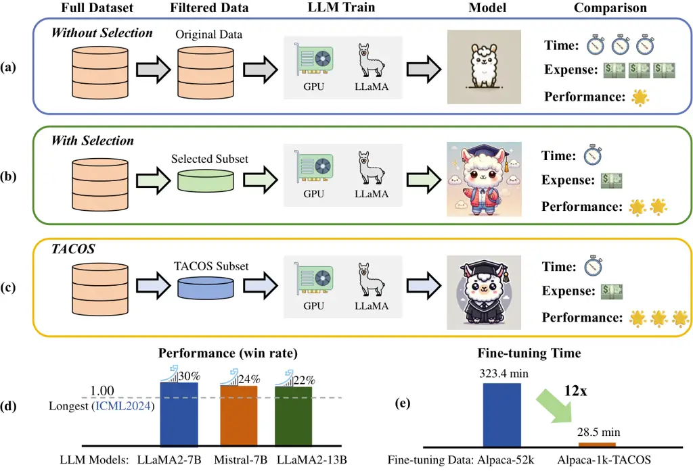
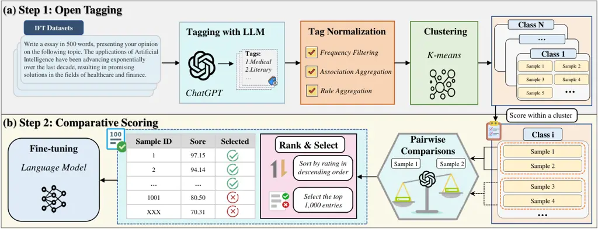
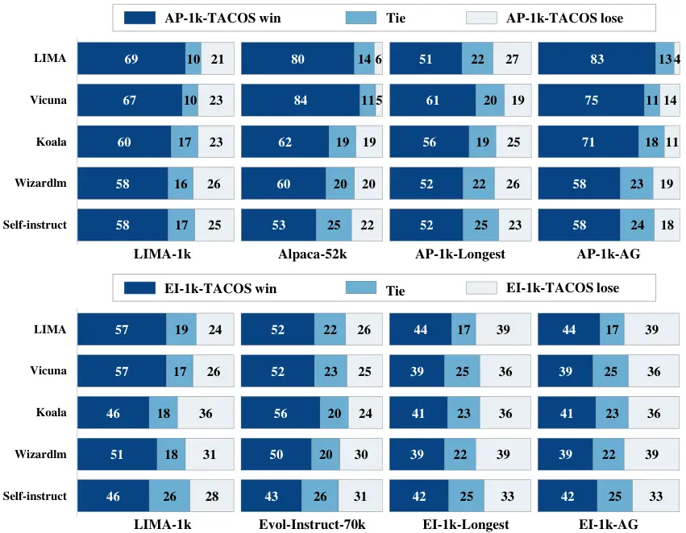
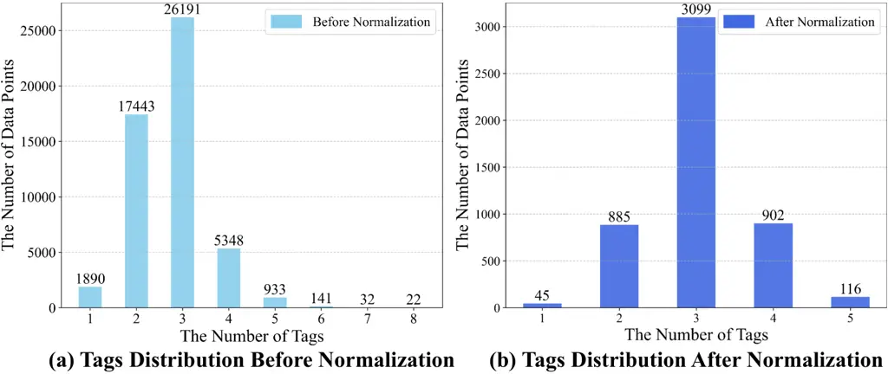
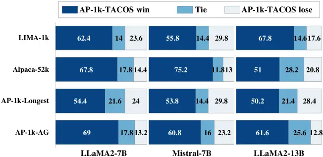

# TACOS: Open Tagging and Comparative Scoring for Instruction Fine-Tuning Data Selection

Xixiang He¹, Hao Yu², Qiyao Sun¹, Ao Cheng¹,  
Tailai Zhang¹, Cong Liu¹, and Shuxuan Guo^(2\*) ^(†)^(†)thanks: ^(\*)
denotes the corresponding author. Affiliation:  Affiliation: ¹National
University of Defense Technology, Changsha, China
Affiliation: ²Intelligent Game and Decision Lab, Beijing, China
Affiliation: {hexixiang, sunqiyao18, chengao18, zhangtailai,
liucong21}@nudt.edu.cn,  
haoyutum@163.com, sg10.work@outlook.com

###### Abstract

Instruction Fine-Tuning (IFT) is crucial for aligning large language
models (LLMs) with human preferences, and selecting a small yet
representative subset from massive data significantly facilitates IFT in
terms of both efficiency and effectiveness. Nevertheless, existing
approaches suffer from two limitations: the use of simple heuristics
restricts data diversity, while the singleton data quality evaluation
accounts for inconsistent criteria between independent samples. To
address the issues, we present TACOS, an innovative method that
integrates Open Tagging and Comparative Scoring for IFT data selection.
To capture data diversity, we leverage LLMs to assign open-domain tags
to human queries, followed by a normalization stage to denoise the open
tags and enable efficient clustering. Additionally, we suggest a
comparative scoring method that allows the relative quality evaluation
of samples within a cluster, avoiding inconsistent criteria seen in
singleton-based evaluations. Extensive experiments across diverse
datasets and LLM architectures demonstrate that TACOS outperforms
existing approaches by a large margin. Notably, it achieves superior
instruction-following performance on MT-Bench and ranks 1st among
LLaMA2-7B-Based models on AlpacaEval 2.0, illustrating its efficacy for
IFT data selection.

###### Index Terms: 

Instruction fine-tuning, large language models, data selection.

## I Introduction

However, direct IFT with unfiltered massive data accounts for flaws such
as inefficient use of computational resources, increased time cost,
contamination from noisy data, etc. Consequently, the emphasis has moved
towards selecting a small subset of high-quality data for IFT, which
enhances LLM performance more effectively \[1\].

Although the research field of IFT data selection has witnessed rapid
development in recent years, existing works \[2, 3, 4, 5, 6, 7, 8, 9,
10, 11, 12, 13, 14\] are constrained by two major challenges: preserving
data diversity after selection and evaluating data quality with
consistent criteria. To enhance data diversity, previous approaches
mainly rely on intuitive human prior, such as selecting instruction
pairs with the longest response \[6\] or leveraging linear quality
rules \[15\].

Fig. 1: Top: Comparison of different IFT data selection strategies,
including: (a) original data based IFT, which is time-consuming and
expensive, while leading to suboptimal performance; (b) selected data
based IFT, which saves training time and expense, while improving IFT
performance; (c) TACOS that introduces Open Tagging and Comparative
Scoring to further boost the performance of data selection for IFT.
Bottom: Quantitative results, including: (d) comparison between
TACOS and a SOTA baseline for IFT data selection in terms of LLM
performance, where our consistent higher win rate on variant LLMs
demonstrates our superiority. (e) comparison between TACOS based and
original data based IFT in terms of LLM fine-tuning time, where
TACOS achieves 12x acceleration.

Fig. 2: An overview of TACOS. Top: (a) Open Tagging. From left to right,
a LLM is leveraged to generate open-domain tags for IFT datasets,
followed by normalization and clustering to group similar samples,
ensuring data diversity and efficiency simultaneously. Bottom: (b)
Comparative Scoring. From right to left, a LLM is used to perform
comparative scoring within each cluster to obtain consistent criteria
and reliable scores for high-quality IFT data selection.

Nevertheless, those simple heuristics fail to capture the semantic level
diversity encoded in textual content, leading to suboptimal data
diversity preservation. On the other hand, to set criteria for data
evaluation, recent works \[3, 4, 5\] have proposed to leverage learned
prior knowledge as constrains through rating each instruction-response
pair by LLMs. However, due to the absence of reference when evaluating
each individual data sample, the criteria remain inconsistent, i.e.,
high-quality data is likely to be assigned with low scores, leading to
unreliable data ranking in IFT data selection.

To tackle these issues, we introduce a novel IFT data selection method,
termed TACOS (Open TAgging and COparative Scoring), which consists of
two primary modules: (1) Open Tagging, where IFT data is first annotated
with open-domain tags created by LLMs for preserving data diversity.
Normalization is further introduced to filter out redundant tags,
facilitating a more efficient clustering afterwards. (2) Comparative
Scoring, where prompts are first refined to align LLM evaluators with
human experts. LLMs are then adopted to perform comparative scoring,
i.e., taking another data sample as reference when evaluating one data
sample, which helps keep consistent evaluation criteria across all the
data and enhances the stability of the consecutive score-based data
selection. To ensure consistency and mitigate LLM bias, we swap and
rescore the evaluated and reference samples. Benefiting from both
designs, TACOS consistently surpasses baseline methods for the IFT of
LLMs. Furthermore, we only use publicly available data for training and
have released both the code and data for reproducibility ¹¹ 1
https://github.com/hexixiang/TACOS.

Our main contributions are summarized as follows:

- •
  We propose to introduce open tagging with normalization procedures,
  ensuring data diversity and clustering efficiency.
- •
  We design to refine data evaluation prompts and evaluate data quality
  in a comparative fashion, thereby enhancing the reliability and
  consistency of assessments for IFT data selection.
- •
  We conduct extensive experiments on a variety of LLMs, IFT datasets,
  and benchmarks, demonstrating the efficiency and effectiveness
  of TACOS for IFT data selection.

## II RELATED WORK

### II-A Instruction Fine-Tuning of LLMs

IFT has emerged as a critical step to bridge the gap between LLMs’
predictive objectives and user goals, improving response controllability
and computational efficiency \[16, 17\]. Notable models (e.g.,
InstructGPT \[18\]) employ a multi-step approach combining IFT and
reinforcement learning with human feedback (RLHF) \[19\], which enhances
model accuracy, utility, and safety. Moreover, specialized IFT
approaches, such as Alpaca \[20\], Vicuna \[21\] and ChatGLM4 \[22\],
have demonstrated effectiveness in domain-specific or multilingual
contexts, improving instruction adherence and reducing potential biases.
Consequently, IFT remains a powerful strategy for advancing LLM
capabilities across a wide range of tasks.

### II-B Data Selection for Instruction Fine-Tuning

LLMs have demonstrated notable capabilities across diverse tasks, but
the high time and computational costs associated with IFT constrain
their scalability and limit broader real-world adoption. Some
studies \[2, 23, 24\] suggest that artificially constructing IFT
datasets with diverse instructions and uniform response styles can yield
strong fine-tuning results. Yet, there is currently no unified paradigm
for how to automatically select and construct such datasets, prompting
research into more effective IFT data selection strategies. Early
metric-based approaches rely on simple indicators, such as instruction
length \[6\], Instruction-Following Distance (IFD) \[7\], or
perplexity \[8\] to gauge data quality. While these methods are
straightforward, they overlook nuanced contextual relationships among
data samples. In contrast, model-based solutions employ fully trained
LLMs to score and filter data, resulting in more detailed assessments
but incurring high resource costs. Extending this idea, some advanced
LLM-based methods \[3\] refine this idea by systematically using prompts
to evaluate instruction quality, although they risk overfitting to
model-specific biases. Although comparative strategies such as winning
rates and internal or external comparisons \[25\] help to gauge
efficacy, challenges remain to ensure data diversity, stable scoring,
and reliable performance across varied domains.

## III METHOD

As shown in Fig. 2, TACOS has two key modules: Open Tagging (III-A) and
Comparative Scoring (III-B) that enhance IFT data selection by ensuring
data diversity and score reliability, respectively.

### III-A Open Tagging

Open-Domain Tagging. To capture diverse intentions in IFT data, we
propose to eliminate the inherent limitation of pre-defined tags \[26\]
by leaving the tag space open to LLMs. To achieve that, we extend the
prompt designed in \[26\] and employ GPT-4o ²² 2
https://platform.openai.com/docs/models/gpt-4o to annotate
instruction-response pairs with fine-grained intentions in a specific
JSON format. Through this fashion, GPT-4o generates over 50k tags for
Alpaca-52k \[20\] (as shown in Fig. 5.(a)), demonstrating LLMs’
capability for breaking down the barriers introduced by human prior
knowledge. However, letting LLMs decide the tag space freely introduces
additional noise, such as non-compliant JSON formats, inconsistent word
expressions, and uneven tag granularity. More importantly, the rapidly
increasing number of tags has a significant impact on clustering’s
computational efficiency. To address these issues, we introduce
normalization procedures \[26\], including frequency filtering that
removes long-tail tags, association aggregation that mines tag
relationships, and rule aggregation \[27\] that manually integrates
tags. As a result, low-frequency tags are eliminated, and JSON formats
are standardized. As shown in Fig. 5, these steps significantly reduce
tag redundancy and noise, and meanwhile maintain data diversity.

Post-Tagging Clustering. Different from \[28\] that clusters data based
on a combination of instructions and input texts, we use tags for
clustering, as tags help identify different tasks and cover a more
diverse dataset. Thereby, we propose to utilize normalized tags
associated with instruction-response pairs for clustering. To reduce
redundancy, we generate semantic vectors for tags using the Phrase-BERT
model \[29\] and cluster them via unsupervised clustering \[30\]. When a
single instance has multiple tags mapped to different clusters, we unify
or reassign them if they frequently co-occur or are semantically
similar, thereby resolving conflicts. After clustering, representative
labels of the clusters replace the original tags, significantly reducing
redundancy. We then organize these labels into semantically coherent
groups, using the longest instruction in each group as a representation
for creating a streamlined IFT data subset. In doing so, massive raw
data are compressed into a representative subset with the diversity
preserved, which significantly facilitates the IFT procedure in terms of
both efficacy and efficiency.

Fig. 3: Template of Comparative Scoring Prompt. The LLM evaluates
pairwise data in a comparative fashion, scoring each on a range of \[1,
100\]. Feedback ensures accurate assessment.

### III-B Comparative Scoring

Prompt Refinement. Unlike existing works \[3, 5, 31, 25\] that primarily
adopt LLMs for data scoring without prompt customization, we argue that
careful prompt design, aligned with human evaluation standards, greatly
enhances the precision and stability of IFT data selection. Based on a
similar idea, Chen et al. \[4\] have designed prompts for LLMs to score
IFT data responses. Nevertheless, their narrow score range and lack of
human-machine alignment lead to inflated scores as well as gaps between
LLM and human assessments. To address this, we refine the prompt by
expanding the score range to \[1, 100\] and adding criteria in the
\[scoring requirements\] part (see the upper part of Fig. 3). Such a
design aligns scoring standards with human experts better and allows
LLMs to provide more stable scores to data samples, improving the
accuracy and stability of data evaluation.

Pairwise Scoring. Previous approaches \[3, 5, 4\] leverage LLMs to rate
each data sample individually and consecutively filter data based on a
defined threshold, resulting in unreliable data evaluation and
selection. To tackle the problem, we propose to cluster all the data
first and then leverage GPT-4 \[32\] to perform comparative scoring by
comparing data samples in a pairwise fashion. Data with the highest
scores is finally selected for IFT. As our method considers mutual
relationships by comparing pairs of data samples for scoring, it reduces
rating biases and score inflation caused by inconsistent scoring
criteria in previous methods, thereby improving the reliability and
effectiveness of data selection.

## IV MAIN RESULTS

### IV-A Experiment Settings

We fine-tune LLaMA2-7B \[23\], LLaMA2-13B \[23\], and Mistral-7B-v0.1
(abbreviated as Mistral-7B) \[33\] on IFT datasets Alpaca-52k \[20\] and
Evol-Instruct-70k \[34\] using LLaMA-Factory \[35\] in bfloat16 on
8\*A800 GPUs. For the selected 1k IFT data, we adopt the hyperparameters
from \[6, 2\], with a sequence length of 2,048, a batch size of 128, and
gradient accumulation. Models are trained for 3 epochs on the original
Alpaca and Evol-Instruct datasets, and 15 epochs on the selected 1k
datasets. Five datasets, including LIMA \[2\], Vicuna \[21\],
Koala \[36\], WizardLM \[34\], and Self-Instruct \[37\] , are used for
testing. Pairwise comparisons based on GPT-4 are used to judge win
rates, with ties being allowed. Additionally, models are tested on
MT-Bench \[38\] to assess instruction-following abilities across a range
of tasks.

Fig. 4: Preference evaluation Results (in ​%). Rows represent five test
sets, and columns stand for four baseline methods. The results present
the win, tie, and lose rates of TACOS versus baselines. Top: comparisons
on the Alpaca-52k dataset with LLaMA2-7B. Bottom: comparisons on the
Evol-Instruct-70k dataset with LLaMA2-7B. Results demonstrate that our
approach consistently yields higher preference scores compared to
existing methods.

Fig. 5: Distribution of Tags before and after Normalization. The
introduced normalization procedures compress the size of the original
tag set from around 50k to less than 6k.

### IV-B Head-to-Head Comparisons

To substantiate the robustness and precision of our data selection
strategy in diverse evaluation contexts, we use LLaMA2-7B as the base
LLM and apply our method to Alpaca-52k and Evol-Instruct-70k to select
1k data samples, obtaining subsets termed AP-1k-TACOS and EI-1k-TACOS,
respectively. Several baselines with the same base LLM are used for
comparisons, including full datasets (Alpaca-52k and Evol-Instruct-70k),
the 1k datasets selected by Zhao et al. \[6\] (namely AP-1k-Longest and
EI-1k-Longest), the 1k datasets with the highest scores according to
GPT-3.5-Turbo as done by Chen et al. \[3\] (named AP-1k-AG and
EI-1k-AG), and LIMA-1k which is manually curated by Zhou et al. \[2\]

Fig. 4 demonstrates that on the same dataset, the LLM fine-tuned by
either AP-1k-TACOS or EI-1k-TACOS consistently outperforms the same LLM
fine-tuned by baseline methods. Notably, our method achieves an average
win rate of 54.4% across all the five testing sets compared to the
current state-of-the-art method Longest \[6\], which only has a failure
rate of 24% (see Fig. 6 with LLaMA2-7B). Moreover,
EI-1k-TACOS significantly outperforms LIMA-1k and the full
Evol-Instruct-70k data, and shows consistent advantages over EI-1k-AG.
Additionally, our score analysis indicates that the data from
Evol-Instruct-70k generally receives higher scores, suggesting that
Evol-Instruct-70k contains more high-quality data compared to
Alpaca-52k.

Fig. 6: Cross-LLM performance (in ​%). Rows represent four baseline
models, and columns stand for three LLM architectures. The reported
results present competition between TACOS and baselines averaged on five
evaluation sets. Results illustrate that TACOS consistently outperforms
baselines on different LLMs, demonstrating TACOS’s excellent
instruction-following capability across LLM architectures.

### IV-C AlpacaEval 2.0 Evaluation

We report the results on the AlpacaEval 2.0 benchmark of our models and
baseline methods whose results are from the public leaderboard ³³ 3
https://tatsu-lab.github.io/alpaca_eval. As shown in Table I, TACOS 
consistently surpasses or stays on-par with SOTA methods. For instance,
on Llama-2-7B, Refined-Alpaca-1k-TACOS attains an 8.12% win rate and
surpasses several baselines that use far more data. When combined with
NEFTune \[39\] that further augments IFT data with uniform noise, our
win rate rises to 9.64%, outpacing Tulu-2-DPO-7B (8.20%) \[40\] that
utilizes 326k instruction-following samples and 64k preference pairs.
Moreover, on the Mistral-7B-v0.1 architecture, TACOS reaches up to
13.77% win rate with NEFTune, outperforming comparable methods that are
trained on 10k instructions. A similar trend is also observed on
Llama-2-13B, where our win rate increases to 11.35% once NEFTune is
enabled. Notably, expanding the generation limit from 2,048 to 4,096
tokens often leads to longer responses, yet does not necessarily produce
higher win rates, hinting at a nuanced interplay between sequence length
and model alignment. Overall, these findings underscore the
effectiveness of our introspection-refinement approach, even at small
data scales, and highlight the additional gains provided by NEFTune in
boosting alignment performance.

|                                          |             |               |          |             |
| ---------------------------------------- | ----------- | ------------- | -------- | ----------- |
| Models                                   | \# IFT Data | \# Pref. Data | Win Rate | Avg. Length |
| Notable baselines                        |             |               |          |             |
| GPT-4-Turbo\*                            | \-          | \-            | 50.0     | 2049        |
| Alpaca-7B\*                              | 52k         | 0             | 2.59     | 396         |
| Vicuna-7B\*                              | 70k         | 0             | 4.16     | 1044        |
| Base model: Llama-2-7B                   |             |               |          |             |
| Llama-2-Chat-7B\*                        | 27k         | 3M            | 4.96     | 1479        |
|    + Evol70k-NEFTune\*                   | 97k         | 3M            | 7.60     | 1612        |
| Tulu-2-DPO-7B\*                          | 326k        | 64k           | 8.20     | 1663        |
| AlpaGasus-1k                             | 1k          | 0             | 2.69     | 745         |
| LIMA-1k                                  | 1k          | 0             | 2.74     | 1360        |
| Alpaca-52k                               | 52k         | 0             | 2.74     | 586         |
| Alpaca-1k-longest                        | 1k          | 0             | 3.16     | 1810        |
|    + max gen. 2048 $`\rightarrow`$ 4096  | 1k          | 0             | 3.11     | 2290        |
| Alpaca-1k-TACOS^(□)                      | 1k          | 0             | 6.21     | 1563        |
|    + max gen. 2048 $`\rightarrow`$ 4096  | 1k          | 0             | 5.78     | 2045        |
| Evol-Instruct-70k                        | 70k         | 0             | 3.44     | 850         |
| Evol-Instruct-1k-longest                 | 1k          | 0             | 4.09     | 1866        |
|    + max gen. 2048 $`\rightarrow`$ 4096  | 1k          | 0             | 4.16     | 2486        |
| Evol-Instruct-1k-TACOS^(□)               | 1k          | 0             | 7.11     | 1363        |
|    + max gen. 2048 $`\rightarrow`$ 4096  | 1k          | 0             | 6.48     | 1759        |
| Evol-Instruct-AlpaGasus-1k               | 1k          | 0             | 4.32     | 1156        |
| Refined-Evol-Instruct-1k-longest         | 1k          | 0             | 5.12     | 1289        |
| Refined-Evol-Instruct-1k-TACOS^(□)       | 1k          | 0             | 7.96     | 1467        |
| Refined-Alpaca-1k-longest                | 1k          | 0             | 6.00     | 1732        |
| Refined-Alpaca-1k-TACOS^(□)              | 1k          | 0             | 8.12     | 1643        |
|    + max gen. 2048 $`\rightarrow`$ 4096  | 1k          | 0             | 8.26     | 2147        |
|    + NEFTune                             | 1k          | 0             | 9.64     | 1904        |
|    + NEFTune + 2048 $`\rightarrow`$ 4096 | 1k          | 0             | 9.19     | 2072        |
| Base model: Mistral-7B-v0.1              |             |               |          |             |
| Alpaca-52k                               | 52k         | 0             | 3.42     | 450         |
| AlpaGasus-1k                             | 1k          | 0             | 4.91     | 502         |
| LIMA-1k                                  | 1k          | 0             | 6.76     | 1197        |
| Alpaca-1k-longest                        | 1k          | 0             | 7.13     | 937         |
| Alpaca-1k-TACOS^(□)                      | 1k          | 0             | 10.55    | 1130        |
| Refined-Alpaca-1k-longest                | 1k          | 0             | 11.74    | 1170        |
| Refined-Alpaca-1k-TACOS^(□)              | 1k          | 0             | 13.29    | 1348        |
|    + max gen. 2048 $`\rightarrow`$ 4096  | 1k          | 0             | 13.45    | 1593        |
|    + NEFTune                             | 1k          | 0             | 13.77    | 1370        |
| Base model: Llama-2-13B                  |             |               |          |             |
| Alpaca-52k                               | 52k         | 0             | 3.90     | 556         |
| Alpaca-1k-longest                        | 1k          | 0             | 4.80     | 1104        |
| Alpaca-1k-TACOS^(□)                      | 1k          | 0             | 7.28     | 864         |
| AlpaGasus-1k                             | 1k          | 0             | 4.87     | 540         |
| LIMA-1k                                  | 1k          | 0             | 5.64     | 1097        |
| Refined-Alpaca-1k-longest                | 1k          | 0             | 8.44     | 1646        |
| Refined-Alpaca-1k-TACOS^(□)              | 1k          | 0             | 10.72    | 1298        |
|    + max gen. 2048 $`\rightarrow`$ 4096  | 1k          | 0             | 10.65    | 1539        |
|    + NEFTune                             | 1k          | 0             | 11.35    | 1194        |

TABLE I: Preference Evaluation Results on AlpacaEval 2.0. The evaluation
considers factors such as training data, win rates, and average output
lengths. For our models, unless otherwise specified, we use a generation
limit of 2048 tokens. \* denotes results from the leaderboard. ^(□)
indicates models developed by us, and bold numbers highlight the best
performance within the same dataset.

### IV-D Evaluation on Instruction-Following

To better demonstrate our TACOS’s superiority over others, we conduct
experiments on MT-Bench \[38\] to evaluate its instruction-following
capability. As shown in Tab. II, using LLaMA2-7B as the base model,
unrefined AP-1k-TACOS significantly outperforms all the other unrefined
baselines. Notably, unrefined AP-1k-TACOS achieves on-par performance
with Refined-AP-1k-Longest. Moreover, when incorporating the refinement
method from \[6\], which leverages GPT-4 \[32\] for instruction
refinement, our method attains a score of 5.77, surpassing others by a
considerable margin. When the base LLM is changed to LLaMA2-13B or
Mistral-7B, our approach still shows consistent improvements over
baseline methods, which further confirms our generalizability and
effectiveness across different LLM architectures.

|                             |           |            |            |
| --------------------------- | --------- | ---------- | ---------- |
| Datasets                    | Models    |            |            |
|                             | LLaMA2-7B | LLaMA2-13B | Mistral-7B |
| Alpaca-52k \[20\]           | 3.74      | 5.40       | 5.35       |
| LIMA-1k \[2\]               | 3.95      | 5.18       | 6.18       |
| AP-1k-AG \[3\]              | 3.63      | 4.70       | 6.06       |
| AP-1k-Longest \[6\]         | 3.96      | 5.32       | 5.80       |
| AP-1k-TACOS (Ours)          | 4.17      | 5.47       | 6.00       |
| Refined-AP-1k-Longest \[6\] | 4.18      | 6.09       | 6.00       |
| Refined-AP-1k-TACOS (Ours)  | 5.77      | 6.02       | 6.08       |

TABLE II: Single-Score Evaluation on MT-Bench \[38\] across different
base LLMs and IFT datasets. Scores are generated by GPT-4 with a range
of \[1, 10\]. The best performing methods are highlighted as bold, while
the second best ones are marked with underlines.

### IV-E Evaluation with Automatic Metrics

To eliminate the potential biases introduced by the judge LLMs, we
conduct additional experiments using automatic evaluation metrics
including ROUGE \[41\] and BLEU \[42\] scores. As shown in
Tab. III, TACOS consistently outperforms baseline models on both
metrics, confirming our significance for IFT data selection.

| Datasets            | ROUGE-1 | ROUGE-2 | ROUGE-L | BLEU  |
| ------------------- | ------- | ------- | ------- | ----- |
| AP-1k-TACOS (Ours)  | 0.284   | 0.104   | 0.243   | 0.088 |
| Alpaca-52k \[20\]   | 0.229   | 0.086   | 0.187   | 0.026 |
| AP-1k-AG \[3\]      | 0.186   | 0.076   | 0.166   | 0.050 |
| AP-1k-Longest \[6\] | 0.261   | 0.102   | 0.199   | 0.026 |

TABLE III: Performance Comparison on MT-Bench \[38\] with GPT-4 as
Reference Standard. The table presents ROUGE and BLEU scores calculated
by comparing generated responses with GPT-4’s answers. The
best-performing results are highlighted in bold.

## V ABLATION STUDIES

To provide a better understanding of TACOS’s design choices, we conduct
ablation experiments on the LLaMA2-7B model with the Alpaca-52k dataset.
As shown in Tab. IV, four settings are designed to reveal the influence
of Open Tagging (OT), Comparative Scoring (CS), instruction-based
embedding, and different score ranges, respectively. Results and
analysis are detailed below.

(1) Open Tagging (OT). We first assess the role of OT by constructing a
variant without OT (TACOS w/o OT in Tab. IV). When compared with this
variant, the full TACOS model achieves 1,310 wins, 170 ties, and 580
losses, resulting in a win rate of 1.354. This ablation study indicates
that OT plays a pivotal role in IFT data selection, ultimately leading
to better model performance.

(2) Comparative Scoring (CS). We then validate the importance of CS by
replacing the pairwise comparative mechanism with an individual scoring
strategy (TACOS w/o CS), which results in 1,345 wins and a win rate of
1.388. This further confirms that comparing samples through pairwise
scoring helps the judge model distinguish subtle quality differences and
select high-quality data for IFT.

(3) Instruction-based Embedding (IE). We further explore the scenario in
which data samples are embedded using only their original instructions
(i.e., TACOS w/o Tagging \[1, 100\]). Although directly using raw labels
yields some performance, it is noticeably lower than the fully
equipped TACOS, which achieves a 1.375 win rate. These results suggest
that decomposing instructions into tag features offers richer semantic
granularity, boosting the selection effectiveness.

(4) Original \[1, 10\] Score Range. Finally, we revert the scoring range
to \[1, 10\] while keeping all other modules intact. Under this
configuration, TACOS achieves 1,586 wins, 275 ties, and 199 losses,
yielding a win rate of 1.673. However, this setting underperforms
compared with the broader range, indicating that a more fine-grained
scoring scheme yields greater discrimination of sample quality and
ultimately better guides the selection of fine-tuning data.

|                    |             |       |       |        |          |
| ------------------ | ----------- | ----- | ----- | ------ | -------- |
| Original TACOS     |             |       |       |        |          |
| vs. Variant Models | Score Range | \#Win | \#Tie | \#Lose | Win Rate |
| TACOS w/o OT       | \[1, 100\]  | 1,310 | 170   | 580    | 1.354    |
| TACOS w/o CS       | \[1, 100\]  | 1,345 | 169   | 546    | 1.388    |
| TACOS w/ IE        | \[1, 100\]  | 1,175 | 482   | 403    | 1.375    |
| TACOS              | \[1, 10\]   | 1586  | 275   | 199    | 1.673    |

TABLE IV: Ablation Studies with LLaMA2-7B and Alpaca-50k. Results are
averaged on five test sets, comparing TACOS with variant models. Win
rate = (#Win $`-`$ \#Lose) / (Total) + 1.

## VI CONCLUSION

In this work, we presented TACOS, a novel approach that integrates Open
Tagging and Comparative Scoring to improve data diversity and scoring
reliability in IFT data selection, respectively. More specifically, the
Open Tagging mechanism maintains data diversity through autonomous
open-domain tags assigned by LLMs and reduces tag redundancy via
normalization that leads to more efficient clustering. The Comparative
Scoring paradigm first adopts fine-grained prompts for better alignment
with human evaluation standards and then evaluate data samples in a
pairwise comparative fashion, thereby keeping evaluation criteria
consistent across data and improving score reliability. Extensive
experiments on diverse datasets and LLM architectures have been
conducted to validate our proposed method. Results demonstrate
that TACOS significantly enhances the effectiveness of IFT data
selection, offering a promising solution for optimizing LLM performance
with IFT.

## References

- \[1\] Jason Wei, Maarten Bosma, Vincent Y. Zhao, Kelvin Guu, Adams Wei
  Yu, Brian Lester, Nan Du, Andrew M. Dai, and Quoc V. Le, “Finetuned
  language models are zero-shot learners,” in ICLR, 2022.
- \[2\] Chunting Zhou, Pengfei Liu, Puxin Xu, Srinivasan Iyer, Jiao Sun,
  Yuning Mao, Xuezhe Ma, Avia Efrat, Ping Yu, Lili Yu, Susan Zhang,
  Gargi Ghosh, Mike Lewis, Luke Zettlemoyer, and Omer Levy, “LIMA: less
  is more for alignment,” in NeurIPS, 2023.
- \[3\] Lichang Chen, Shiyang Li, Jun Yan, Hai Wang, Kalpa Gunaratna,
  Vikas Yadav, Zheng Tang, Vijay Srinivasan, Tianyi Zhou, Heng Huang,
  and Hongxia Jin, “Alpagasus: Training a better alpaca with fewer
  data,” in ICLR, 2024.
- \[4\] Yijie Chen, Yijin Liu, Fandong Meng, Yufeng Chen, Jinan Xu, and
  Jie Zhou, “Improving translation faithfulness of large language models
  via augmenting instructions,” arXiv:2308.12674, 2023.
- \[5\] Wei Liu, Weihao Zeng, Keqing He, Yong Jiang, and Junxian He,
  “What makes good data for alignment? a comprehensive study of
  automatic data selection in instruction tuning,”
  arXiv:2312.15685, 2023.
- \[6\] Hao Zhao, Maksym Andriushchenko, Francesco Croce, and Nicolas
  Flammarion, “Long is more for alignment: A simple but tough-to-beat
  baseline for instruction fine-tuning,” arXiv:2402.04833, 2024.
- \[7\] Ming Li andbYong Zhang, Zhitao Li, Jiuhai Chen, Lichang Chen,
  Ning Cheng, Jianzong Wang, Tianyi Zhou, and Jing Xiao, “From quantity
  to quality: Boosting LLM performance with self-guided data selection
  for instruction tuning,” in NAACL, 2024.
- \[8\] Hila Gonen, Srini Iyer, Terra Blevins, Noah A Smith, and Luke
  Zettlemoyer, “Demystifying prompts in language models via perplexity
  estimation,” arXiv:2212.04037, 2022.
- \[9\] Qianlong Du, Chengqing Zong, and Jiajun Zhang, “Mods:
  Model-oriented data selection for instruction tuning,”
  arXiv:2311.15653, 2023.
- \[10\] Subhabrata Mukherjee, Arindam Mitra, Ganesh Jawahar, Sahaj
  Agarwal, Hamid Palangi, and Ahmed Awadallah, “Orca: Progressive
  learning from complex explanation traces of gpt-4,”
  arXiv:2306.02707, 2023.
- \[11\] Yingxiu Zhao, Bowen Yu, Binyuan Hui, Haiyang Yu, Fei Huang,
  Yongbin Li, and Nevin L Zhang, “A preliminary study of the intrinsic
  relationship between complexity and alignment,”
  arXiv:2308.05696, 2023.
- \[12\] Shayne Longpre, Le Hou, Tu Vu, Albert Webson, Hyung Won Chung,
  Yi Tay, Denny Zhou, Quoc V Le, Barret Zoph, Jason Wei, et al., “The
  flan collection: Designing data and methods for effective instruction
  tuning,” in ICML, 2023.
- \[13\] Ashutosh Kumar, Satwik Bhattamishra, Manik Bhandari, and Partha
  Talukdar, “Submodular optimization-based diverse paraphrasing and its
  effectiveness in data augmentation,” in ACL, 2019.
- \[14\] Zhaocong Li, Xuebo Liu, Derek F Wong, Lidia S Chao, and Min
  Zhang, “Consisttl: Modeling consistency in transfer learning for
  low-resource neural machine translation,” arXiv:2212.04262, 2022.
- \[15\] Yihan Cao, Yanbin Kang, and Lichao Sun, “Instruction mining:
  High-quality instruction data selection for large language models,”
  arXiv:2307.06290, 2023.
- \[16\] Kaixin Li, Qisheng Hu, James Zhao, Hui Chen, Yuxi Xie, Tiedong
  Liu, Michael Shieh, and Junxian He, “Instructcoder: Instruction tuning
  large language models for code editing,” in ACL Student Research
  Workshop, 2024.
- \[17\] Jieh-Sheng Lee, “Instructpatentgpt: Training patent language
  models to follow instructions with human feedback,” CoRR, 2024.
- \[18\] Long Ouyang, Jeffrey Wu, Xu Jiang, Diogo Almeida, Carroll
  Wainwright, Pamela Mishkin, Chong Zhang, Sandhini Agarwal, Katarina
  Slama, Alex Ray, et al., “Training language models to follow
  instructions with human feedback,” NeurIPS, 2022.
- \[19\] Robert Kirk, Ishita Mediratta, Christoforos Nalmpantis, Jelena
  Luketina, Eric Hambro, Edward Grefenstette, and Roberta Raileanu,
  “Understanding the effects of rlhf on llm generalisation and
  diversity,” arXiv:2310.06452, 2023.
- \[20\] Rohan Taori, Ishaan Gulrajani, Tianyi Zhang, Yann Dubois,
  Xuechen Li, Carlos Guestrin, Percy Liang, and Tatsunori B. Hashimoto,
  “Stanford alpaca: An instruction-following llama model,” 2023.
- \[21\] Wei-Lin Chiang, Zhuohan Li, Zi Lin, Ying Sheng, Zhanghao Wu,
  Hao Zhang, Lianmin Zheng, Siyuan Zhuang, Yonghao Zhuang, Joseph E.
  Gonzalez, Ion Stoica, and Eric P. Xing, “Vicuna: An open-source
  chatbot impressing gpt-4 with 90%\* chatgpt quality,” 2023.
- \[22\] Team GLM, Aohan Zeng, Bin Xu, Bowen Wang, Chenhui Zhang,
  Da Yin, Dan Zhang, Diego Rojas, Guanyu Feng, Hanlin Zhao, et al.,
  “Chatglm: A family of large language models from glm-130b to glm-4 all
  tools,” arXiv:2406.12793, 2024.
- \[23\] Hugo Touvron, Louis Martin, Kevin Stone, Peter Albert, Amjad
  Almahairi, Yasmine Babaei, Nikolay Bashlykov, Soumya Batra, Prajjwal
  Bhargava, Shruti Bhosale, et al., “Llama 2: Open foundation and
  fine-tuned chat models,” arXiv:2307.09288, 2023.
- \[24\] Yizhong Wang, Swaroop Mishra, Pegah Alipoormolabashi, Yeganeh
  Kordi, Amirreza Mirzaei, Anjana Arunkumar, Arjun Ashok, Arut Selvan
  Dhanasekaran, Atharva Naik, David Stap, et al.,
  “Super-naturalinstructions: Generalization via declarative
  instructions on 1600+ nlp tasks,” arXiv:2204.07705, 2022.
- \[25\] Po-Nien Kung, Fan Yin, Di Wu, Kai-Wei Chang, and Nanyun Peng,
  “Active instruction tuning: Improving cross-task generalization by
  training on prompt sensitive tasks,” arXiv:2311.00288, 2023.
- \[26\] Keming Lu, Hongyi Yuan, Zheng Yuan, Runji Lin, Junyang Lin,
  Chuanqi Tan, Chang Zhou, and Jingren Zhou, “# instag: Instruction
  tagging for analyzing supervised fine-tuning of large language
  models,” in ICLR, 2023.
- \[27\] Jiawei Han, Jian Pei, and Yiwen Yin, “Mining frequent patterns
  without candidate generation,” ACM Sigmod Record, 2000.
- \[28\] Hao Chen, Yiming Zhang, Qi Zhang, Hantao Yang, Xiaomeng Hu,
  Xuetao Ma, Yifan Yanggong, and Junbo Zhao, “Maybe only 0.5% data is
  needed: A preliminary exploration of low training data instruction
  tuning,” arXiv:2305.09246, 2023.
- \[29\] Shufan Wang, Laure Thompson, and Mohit Iyyer, “Phrase-bert:
  Improved phrase embeddings from bert with an application to corpus
  exploration,” arXiv:2109.06304, 2021.
- \[30\] Debapriya Sengupta, Sayantan Singha Roy, Sarbani Ghosh, and
  Ranjan Dasgupta, “Modified k-means algorithm for big data clustering,”
  in 2017 International Conference on Computational Science and
  Computational Intelligence (CSCI), 2017.
- \[31\] Shengguang Wu, Keming Lu, Benfeng Xu, Junyang Lin, Qi Su, and
  Chang Zhou, “Self-evolved diverse data sampling for efficient
  instruction tuning,” arXiv:2311.08182, 2023.
- \[32\] Josh Achiam, Steven Adler, Sandhini Agarwal, Lama Ahmad, Ilge
  Akkaya, Florencia Leoni Aleman, Diogo Almeida, Janko Altenschmidt, Sam
  Altman, Shyamal Anadkat, et al., “Gpt-4 technical report,”
  arXiv:2303.08774, 2023.
- \[33\] Albert Q Jiang, Alexandre Sablayrolles, Arthur Mensch, Chris
  Bamford, Devendra Singh Chaplot, Diego de las Casas, Florian Bressand,
  Gianna Lengyel, Guillaume Lample, Lucile Saulnier, et al., “Mistral
  7b,” arXiv:2310.06825, 2023.
- \[34\] Can Xu, Qingfeng Sun, Kai Zheng, Xiubo Geng, Pu Zhao, Jiazhan
  Feng, Chongyang Tao, and Daxin Jiang, “Wizardlm: Empowering large
  language models to follow complex instructions,”
  arXiv:2304.12244, 2023.
- \[35\] Yaowei Zheng, Richong Zhang, Junhao Zhang, Yanhan Ye, and
  Zheyan Luo, “Llamafactory: Unified efficient fine-tuning of 100+
  language models,” arXiv:2403.13372, 2024.
- \[36\] Xinyang Geng, Arnav Gudibande, Hao Liu, Eric Wallace, Pieter
  Abbeel, Sergey Levine, and Dawn Song, “Koala: A dialogue model for
  academic research,” 2023.
- \[37\] Yizhong Wang, Yeganeh Kordi, Swaroop Mishra, Alisa Liu, Noah A
  Smith, Daniel Khashabi, and Hannaneh Hajishirzi, “Self-instruct:
  Aligning language models with self-generated instructions,”
  arXiv:2212.10560, 2022.
- \[38\] Lianmin Zheng, Wei-Lin Chiang, Ying Sheng, Siyuan Zhuang,
  Zhanghao Wu, Yonghao Zhuang, Zi Lin, Zhuohan Li, Dacheng Li, Eric
  Xing, et al., “Judging llm-as-a-judge with mt-bench and chatbot
  arena,” in NeurIPS, 2024.
- \[39\] Neel Jain, Ping-yeh Chiang, Yuxin Wen, John Kirchenbauer,
  Hong-Min Chu, Gowthami Somepalli, Brian R. Bartoldson, Bhavya
  Kailkhura, Avi Schwarzschild, Aniruddha Saha, Micah Goldblum, Jonas
  Geiping, and Tom Goldstein, “Neftune: Noisy embeddings improve
  instruction finetuning,” in ICLR, 2024.
- \[40\] Hamish Ivison, Yizhong Wang, Valentina Pyatkin, Nathan Lambert,
  Matthew Peters, Pradeep Dasigi, Joel Jang, David Wadden, Noah A Smith,
  Iz Beltagy, et al., “Camels in a changing climate: Enhancing lm
  adaptation with tulu 2,” arXiv:2311.10702, 2023.
- \[41\] Chin-Yew Lin, “ROUGE: A package for automatic evaluation of
  summaries,” in ACL, 2004.
- \[42\] Kishore Papineni, Salim Roukos, Todd Ward, and Wei-Jing Zhu,
  “Bleu: a method for automatic evaluation of machine translation,” in
  ACL, 2002.
