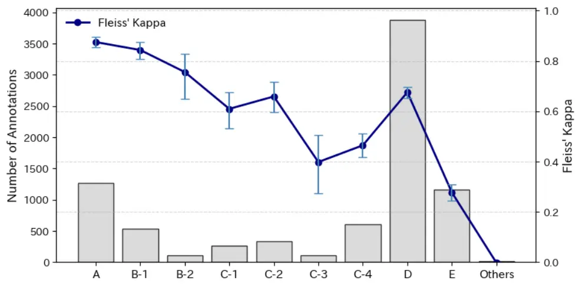
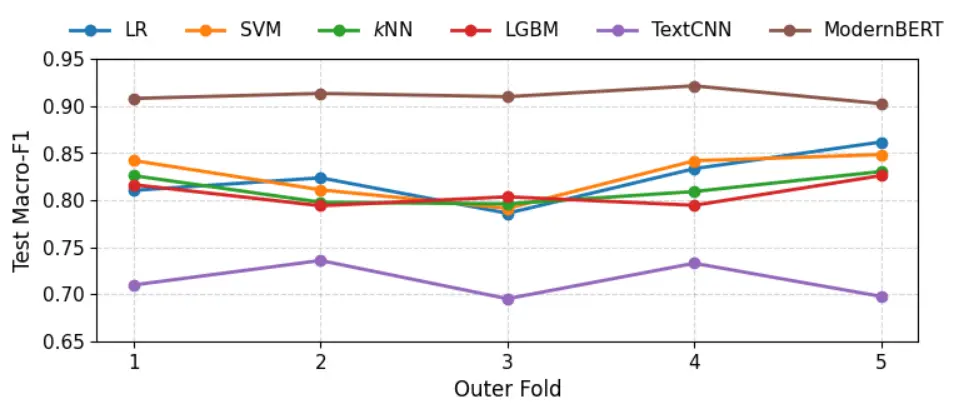

# Function-based Labels for Complementary Recommendation: Definition, Annotation, and LLM-as-a-Judge

Journal: Pattern Recognition Letters

Chihiro Yamasaki Affiliation: The University of Electro-Communications,
1-5-1 Chofugaoka, Chofu, 182-8585, Tokyo, Japan    Kai Sugahara
Affiliation: The University of Electro-Communications, 1-5-1 Chofugaoka,
Chofu, 182-8585, Tokyo, Japan    Yuma Nagi Affiliation: The University
of Electro-Communications, 1-5-1 Chofugaoka, Chofu, 182-8585, Tokyo,
Japan    Kazushi Okamoto Affiliation: The University of
Electro-Communications, 1-5-1 Chofugaoka, Chofu, 182-8585, Tokyo, Japan

###### Abstract

Complementary recommendations enhance the user experience by suggesting
items that are frequently purchased together while serving different
functions from the query item. Inferring or evaluating whether two items
have a complementary relationship requires complementary relationship
labels; however, defining these labels is challenging because of the
inherent ambiguity of such relationships. Complementary labels based on
user historical behavior logs attempt to capture these relationships,
but often produce inconsistent and unreliable results. Recent efforts
have introduced large language models (LLMs) to infer these
relationships. However, these approaches provide a binary classification
without a nuanced understanding of complementary relationships. In this
study, we address these challenges by introducing Function-Based Labels
(FBLs), a novel definition of complementary relationships independent of
user purchase logs and the opaque decision processes of LLMs. We
constructed a human-annotated FBLs dataset comprising 2,759 item pairs
and demonstrated that it covered possible item relationships and
minimized ambiguity. We then evaluated whether machine learning methods
using annotated FBLs could accurately infer labels for unseen item
pairs, and whether LLM-generated complementary labels align with human
perception. Among machine learning methods, ModernBERT achieved the
highest performance with a Macro-F1 of 0.911, demonstrating accuracy and
robustness even under limited supervision. For LLMs, GPT-4o-mini
achieved high consistency (0.989) and classification accuracy (0.849)
under the detailed FBL definition, while requiring only 1/842 the cost
and 1/75 the time of human annotation. Overall, our study presents FBLs
as a clear definition of complementary relationships, enabling more
accurate inferences and automated labeling of complementary
recommendations.

###### Keywords: 

Recommender Systems , Complementary Recommendation , Annotation , Large
Language Models

## 1 Introduction

Item-to-item recommender systems suggest alternative items to users
based on the relationships between the items. Complementary
recommendation is a type of item-to-item recommender system that focuses
on two aspects of item relationships: complementary and substitute
relationships; it recommends items that have a complementary
relationship with a given item \[1\]. For instance, the relationship
between smartphone A and another company’s smartphone B is considered a
substitute relationship because they serve the same purpose, whereas a
protective film for a smartphone is regarded as complementary because it
enhances its functionality. By suggesting items based on these
complementary relationships, the system assists users in item searches
and contributes to increased sales on e-commerce sites by promoting
co-purchasing behavior \[1, 2\].

Automatically identifying whether a given pair of items is complementary
is necessary to make complementary recommendations. However, defining
complementary relationships is challenging because of the complex and
diverse relationships among items \[3\]. For instance, a pair such as
“frying pan and saucepan” can be considered complementary because they
can be used together for cooking, but they are not always used
simultaneously; therefore, they may not always be complementary. This
ambiguity in determining whether a pair is complementary leads to varied
interpretations among individuals, making it labor-intensive and costly
to manually extract and define clear “complementary pairs” from numerous
item combinations. McAuley et al. proposed defining “frequently
co-purchased relationships” as complementarities and “frequently
co-viewed relationships” as substitutes to construct explicit
relationship labels, using co-occurrence counts in user purchases and
viewing histories to label item pairs \[4, 5\]. Several previous studies
have used these behavior-based labels constructed from such
history-based labeling methods as labels for model training and
evaluation. Nevertheless, it has been noted that actual histories
contain irregular user behaviors, resulting in numerous noisy labels
that do not match the true relationships \[6, 7, 8\].

Recent studies \[6, 7, 9\] have attempted to mitigate noisy labels using
Large Language Models (LLMs) by leveraging their vast knowledge and
excellent reasoning capabilities to capture complementary semantic
relationships. These methods typically rely on the output of LLMs
generated from prompts that ask binary questions, such as “Is it a
complementary relationship?” or “Is it a substitute relationship?”
without considering the detailed nuances of the item relationships.
Thus, similar to humans, LLMs may respond ambiguously when assessing
item relationships, potentially leading to incorrect reasoning or
explanation generation. Moreover, determining whether LLMs can
appropriately capture item relationships in the same way that humans
perceive them has not been sufficiently evaluated. Most existing studies
have focused primarily on accuracy metrics \[6, 7, 9\], and the
evaluation of LLM-as-a-Judge for complementary relationships has thus
far been limited to binary assessments by humans, such as whether the
classification is complementary and whether the explanation is
useful \[7\]. Owing to these limitations, uncertainties remain regarding
whether the LLMs outputs align with human perceptions.

Consequently, this study aims to develop Function-Based Labels (FBLs)
that explicitly capture item relationships based on their inherent
functional characteristics, independent of historical behavioral data or
the opaque decision-making processes of LLMs. Our primary goal is to
determine whether human-annotated FBLs can effectively describe
functional relationships and whether machine learning (ML) models,
including LLMs, can learn to infer these relationships in a manner that
aligns with human judgments. Specifically, we aim:

- 1.  To define FBLs that exclusively rely on the functional properties of
      items, avoiding confounding effects from historical user behavior or
      purchase logs.
- 2.  To construct a comprehensive FBL dataset by manually annotating item
      pairs, thereby establishing a robust ground truth for evaluating
      functional relationships.
- 3.  To investigate the capability of ML models to predict FBLs for unseen
      item pairs, and to examine how closely the inferences of LLMs align
      with human-annotated FBLs.

This study raises three research questions:

RQ1: Can the functional relationships clarify item relationships in
complementary recommendations?

RQ2: Can ML models trained on a small FBLs dataset accurately infer
relationships for new item pairs?

RQ3: Are the FBLs inferred by LLMs consistent with human-annotated FBLs?

To answer these questions, for RQ1, we analyzed the distribution and
clarity of the manually assigned FBLs. For RQ2, we used the constructed
FBLs dataset to train and evaluate the ML models and examine the
mechanical identifiability of FBLs. For RQ3, we designed prompts for
LLMs to estimate relationships in FBLs from item information, and
analyzed the consistency and agreement with manual annotations for both
the proposed FBLs categories and the three traditional categories,
thereby evaluating the usefulness of LLMs as annotators. This study is
an extension of a previous study \[10\].

## 2 Related Work

### 2.1 Complementary Recommendation

The definition of “complementary relationship” in complementary
recommendation varies. A survey paper \[3\] comprehensively summarizes
complementary recommendations and states that complementary items are
those that are different from the query item, but are sold together as
accompanying items. This definition serves as a broad criterion for
determining whether an item is complementary; however, it contains
several ambiguities, and no examples exist of more detailed definitions
of complementary relationships.

Similar to general recommender systems, complementary recommendations
involve two approaches: unsupervised and supervised learning \[1, 3\].
The main concept of unsupervised learning methods is to identify
complementary items based on the co-occurrence frequency of co-purchases
between items or between items and users, along with a threshold.
However, co-purchase data often contain both complementary and
substitute items, making it difficult to accurately detect complementary
items because of this noise. To address this issue, Zheng et al. \[11\]
divided a series of browsing and purchasing behaviors into comparison
and consideration stages, defining a complementary score that also
considers substitute items. In addition, methods that generate embedded
representations from item and user co-occurrences \[12\] have been
proposed.

By contrast, supervised learning methods can be interpreted as link
prediction tasks between items. In practice, the accurate labeling of
complementary pairs with complex relationships requires annotators with
deep domain knowledge and significant effort, and datasets recording
complementary relationships do not exist \[1\]. In an initial attempt to
label the relationships between items, McAuley et al. proposed a
behavior-based labeling method using data collected from Amazon.com.
This method categorizes four types of item graphs based on user
behavior: (1) users who viewed $`x`$ also viewed $`y`$, (2) users who
viewed $`x`$ eventually purchased $`y`$, (3) users who purchased $`x`$
also purchased $`y`$, and (4) $`x`$ and $`y`$ are frequently purchased
together. They defined (1) and (2) as substitute relationships and (3)
and (4) as complementary relationships \[4\]. These behavior-based
labels have been widely used in numerous previous studies for training
and evaluating models \[4, 5, 13, 14, 15, 16, 17\]. To address the cold
start problem, content-based methods that capture complementary
relationships based on item text and image information have been
studied. LDA-based approaches have also been explored for generating
item embeddings from reviews; however, their limitations in handling
short texts have led to the development of deep generative models using
variational autoencoders \[14\]. Furthermore, efforts have been made to
generate item embeddings with higher expressiveness using the available
item information (title, description, brand, and images) \[6, 16\].

### 2.2 Addressing Noisy Labels

Complementary pairs estimated based on user viewing and purchasing
behavior, as well as the constructed training labels, do not always
accurately reflect true complementary relationships and may contain
numerous noisy labels \[6, 7, 15, 17\]. The main causes of this issue
include noises from the co-purchase of popular items and irregular user
behavior. In the former case, the high frequency of co-purchases with
popular items bought by several users increases the risk of incorrectly
estimating non-complementary item pairs as complementary pairs \[17\].
In the latter case, irregular user behavior introduces significant bias
in estimating complementary pairs, which is particularly problematic for
e-commerce sites and item pairs with limited behavioral histories \[6\].
Such real-world label information inevitably contains considerable
noise, which can severely impair model performance \[18\].

Several studies have focused on reducing the noise in behavior-based
labels to create more refined labels. Hao et al. \[5\] proposed a
strategy to obtain more accurate complementary relationship labels by
considering the difference between a set of complementary relationship
pairs and a set of substitute relationship pairs from McAuley et al.’s
four types of item graphs \[4\]. In addition, methods have been proposed
to effectively extract item relationships from noisy browsing,
purchasing, and search behaviors and item information by introducing a
self-attention mechanism \[15\]. Another approach models the co-purchase
frequency of each item as a Gaussian distribution, separating
co-purchases based on complementary relationships from those due to
noise, to estimate more genuine complementary relationships \[17\].

Recent studies have used LLMs, which demonstrate high performance in
zero-shot estimation tasks, to infer complex complementary
relationships \[6, 7, 9\]. These studies have demonstrated the
usefulness of LLMs in extracting complementary relationships for item
pairs that behavior-based labels cannot capture, such as long-tail
items \[6, 9\], and in generating explanations of relationships using
their advanced language generation capabilities \[7\]. In these methods,
prompts are provided to LLMs to determine whether the target item pair
has a “complementary relationship” or a “substitute relationship,” and
the outputs are used for knowledge expansion \[6, 7\] and constructing
item graphs \[9\]. However, the extent to which the relationship
estimations of LLMs align with human judgment has not been sufficiently
verified. Previous studies have often focused more on improving the
accuracy of recommendation tasks than on the accuracy of the
relationship estimations of LLMs. Evaluations of how LLMs determine
relationships and their consistency with human perceptions are limited.
Moreover, several methods estimate relationships by asking LLMs binary
questions such as “Is it a complementary relationship?” or “Is it a
substitute relationship?” However, this approach makes it difficult to
consider the strength of the relationships or subtle semantic nuances.
Consequently, the inference results may be used for knowledge expansion
or item graph construction without being sufficiently accurate. Li et
al. \[7\] introduced the concept of “consistent complementary
relationships,” considering the asymmetry of item relationships, and
evaluated the classification accuracy of LLMs using manually labeled
correct data, but the evaluation was limited to 200 pairs.

## 3 Function-based Labels

### 3.1 Definition

This study focuses on the functional relationships between items to
clarify ambiguous complementary relationships, excluding influences
based on viewing or purchase relationships. Specifically, through
discussions with e-commerce site practitioners, we define nine types of
relationship labels based on item functions, known as FBLs, as follows:

1.  (A)
    Items $`x`$ and $`y`$ have the same function and usage.
2.  (B-1)
    Item $`x`$ can be replenished with item $`y`$.
3.  (B-2)
    Item $`y`$ can be replenished with item $`x`$.
4.  (C-1)
    Item $`x`$ and $`y`$ must be combined to be usable.
5.  (C-2)
    When combined with item $`y`$, item $`x`$ becomes more useful.
6.  (C-3)
    When combined with item $`x`$, item $`y`$ becomes more useful.
7.  (C-4)
    Combining $`x`$ and $`y`$ makes them more useful.
8.  (D)
    Items $`x`$ and $`y`$ have no relationship.
9.  (E)
    Items $`x`$ and $`y`$ seem to have a relationship, but it is
    difficult to verbalize.

Several pre-tests were performed to finalize the labels. In each
pre-test, we (1) extracted 100 sample pairs, (2) assigned relationship
labels, (3) evaluated their validity and coverage, and (4) iteratively
revised the label definitions as necessary. During this process, we
focused on functional aspects to ensure that the relationships were
defined systematically and comprehensively. The three traditional
categories of relationships (substitute, complementary, and unrelated)
are mapped to the new detailed labels as follows: the substitution
relationship corresponds to Label A, complementary relationship
corresponds to Labels B-\* and C-\*, and unrelated (neither substitution
nor complementary relationship) corresponds to Label D. In complementary
relationships, a sequential purchase order where one item becomes
necessary after purchasing another is assumed to exist. Therefore, we
define Label B-\* for “replenishment” to distinguish it from Label C-\*.
For instance, the correction tape body (Item x) and refill tape (Item y)
illustrate this. Additionally, Label C-\* captures cases in which one of
the paired items can (or cannot) be used independently for its intended
function. For instance, a broom (Item x) can be used alone for cleaning,
but combining it with a dustpan (Item y) makes cleaning more convenient,
corresponding to Label C-2. Another example is an insert cup (Item x)
and its holder (Item y), which cannot be used independently and only
become functional when combined; thus, it should be assigned Label C-1.
Finally, Label E was used for complementary relationships that could not
be clearly defined by the authors. As mentioned earlier, complementary
relationships have complex structures; therefore, the pairs assigned to
Label E should be used as the basis for future discussions and
definitions of the relationships.

These relationships were intended for use in the annotation process, as
described later. Labels with clearer relationship definitions were
placed earlier in the sequence from Label A to Label E to ensure the
efficiency and reliability of annotation. Annotators use a flowchart to
determine whether an item pair fits each definition in order. Based on
insights from the pre-tests, we subdivided complementary relationships
into finer categories (Labels B-\* and C-\*) to better reflect
functional distinctions and to facilitate annotation efficiency by
reducing annotator burden.

### 3.2 Human Annotation

#### 3.2.1 Annotation Setup

We prioritized annotator familiarity and item relationship complexity to
ensure accurate and effective label collection, selecting pairs from the
well-known everyday categories “Office Supplies/Stationery” and
“Household Goods/Kitchenware.” Random sampling from all item pairs would
result in most pairs being classified as “unrelated,” making it
difficult to obtain sufficient pairs with substitute and complementary
relationships. Conversely, sampling from item pairs with high
co-purchase counts could lead to a bias toward certain item categories
owing to differences in the number of purchased items, thereby losing
the diversity of the annotation target pairs. Therefore, in this
experiment, we used the D’Hondt method \[19\], based on co-purchase
counts between item categories, to ensure diversity and sample a certain
number of pairs with various relationships. In the D’Hondt allocation
method, the co-purchase count for each major category pair is divided by
natural numbers ($`1,2,3,\cdots`$), and the sampling numbers are
allocated in order from the largest quotient. We then sample the top
co-purchased item pairs according to the allocated sampling numbers for
each major category pair. Ultimately, we selected 2,000 pairs using the
D’Hondt method and added 800 pairs randomly selected from those already
empirically identified as complementary by field practitioners,
resulting in 2,800 pairs for annotation. We asked 18 annotators (7
undergraduate computer science students, 9 graduate computer science
students, and 2 faculty staffs) to assign unique labels based on the
item titles and web pages of the item pairs, with each annotator
handling 400 or 500 pairs and collecting 8,400 responses. The final
label was determined by majority vote among the three annotators, and
only labels selected by at least two annotators were adopted.

#### 3.2.2 Annotation Results

Human annotation required on average 16 JPY and 50 seconds per item
pair. Of the 2,800 pairs collected through annotation, 41 that did not
fit the FBLs definitions were excluded as invalid responses. This
resulted in a human-annotated FBL dataset,
$`\mathfrak{F}_{\text{Human}}`$, comprising 2,759 pairs. The label
distribution in $`\mathfrak{F}_{\text{Human}}`$ is shown in Figure 1.
Label A, which corresponds to substitute relationships, accounts for
14.9%. Labels B-\* and C-\*, which correspond to complementary
relationships, comprised 21.4%. Label D, which represents unrelated
relationships, was the most common at 48.0%. Label E, which indicates
relationships that could not be defined, was relatively low at 10.8%,
suggesting that the proposed function-based relationship definitions
covered most relationships. Notably, most pairs labeled as Label E were
qualitatively observed to exhibit indirect complementary through a third
item (e.g., an envelope and a pen refill through a pen). Such
relationships cannot be adequately represented by binary relations alone
and require consideration of ternary or higher-order relations. From the
viewpoint of binary relation modeling, assigning these cases to Label E
can therefore be regarded as an appropriate classification.

Regarding annotation reliability, the proportion of parity cases was low
at 4.8%. Fleiss’ Kappa \[20\] further yielded an overall value of 0.63
(moderate agreement), and Figure 2 shows the Kappa values with 95%
confidence intervals (95% CI) for each label. Agreement was relatively
high for Labels A and B-\*, whereas lower values were observed for some
fine-grained complementary categories (Labels C-3 and C-4) and for Label
E. These results suggest that the proposed FBLs provided sufficiently
clear and consistent definitions for human annotation, while certain
categories still posed greater challenges. For subsequent evaluation
experiments, we used $`\mathfrak{F}^{\prime}_{\text{Human}}`$, which
comprised 2,625 pairs, excluding the contested pairs from
$`\mathfrak{F}_{\text{Human}}`$. The FBLs dataset developed in this
study is publicly available on GitHub¹¹ 1
[https://github.com/okamoto-lab/fbl_dataset](https://github.com/okamoto-lab/fbl_dataset).
The dataset contains 2,800 item pairs with their corresponding
relationship labels, including web links to each item in the pairs, to
support further research on complementary recommender systems.

Figure 1: Label distribution in the human-annotated FBLs
$`\mathfrak{F}_{\text{Human}}`$



Figure 2: Fleiss’ Kappa with 95% CI in the human-annotated FBLs
$`\mathfrak{F}_{\text{Human}}`$

## 4 Evaluation Experiment in Machine Learning Models

### 4.1 Settings for Machine Learning Models

As an initial step, our study aims to predict whether two items are
complementary (compl.), substitute (subst.), or unrelated (unrel.). We
therefore evaluated the classification accuracy of ML models using
$`\mathfrak{F}^{\prime}_{\text{Human}}`$ in this three-class setting
based on item attribute features of item pairs. The nine-class labels,
where directionality was introduced only in annotations, were mapped to
the three classes as follows: Label A was mapped to substitute, Labels
B-\* and C-\* were mapped to complementary, and Labels D and E were
mapped to unrelated.

We employed four traditional models: Logistic Regression (LR), LightGBM
(LGBM), Support Vector Machine (SVM), $`k`$-Nearest Neighbors ($`k`$NN),
and two neural models: TextCNN \[21\] and ModernBERT-Ja-70m \[22\] ²² 2
[https://huggingface.co/sbintuitions/modernbert-ja-70m](https://huggingface.co/sbintuitions/modernbert-ja-70m).
For both neural models, we used the tokenizer of ModernBERT-Ja-70m. We
adopted double cross-validation \[23\] with 5-fold cross-validation on
the outer layer (outer test set) and stratified 5-fold cross-validation
on the inner layer (inner validation set). For the traditional models,
the inner validation set was used for parameter tuning with
Optuna \[24\] to prevent overfitting and assess generalizability. For
the neural models, the inner set was used to stabilize training and for
early stopping. As the evaluation metric and tuning objective, we
employed Macro-F1 across the three classes complementary, substitute,
and unrelated, in order to account for class imbalance. Macro-F1 was
defined as the mean of class-wise F1 scores:

```math
\text{Macro-F1}=\frac{1}{3}\sum_{i\in\{\text{compl.},\text{subst.},\text{unrel.}\}}\text{F1}_{i}
```

where
$`\text{F1}_{i}=2\cdot\text{Precision}_{i}\cdot\text{Recall}_{i}/(\text{Precision}_{i}+\text{Recall}_{i})`$.

As input to the traditional models, we construct a 424-dimensional
feature vector
$`\boldsymbol{x_{i}=[x^{sim}_{i},x^{mch}_{i},x^{cate}_{i}]}`$, combining
three types of features: (i) Similarity features: cosine similarities
between multilingual-e5-large³³ 3
[https://huggingface.co/intfloat/multilingual-e5-large](https://huggingface.co/intfloat/multilingual-e5-large)
embeddings of item information (title, description, specification,
category), (ii) Match flag features: binary indicators of exact matches
for major category, subcategory, manufacturer, and brand, and (iii)
Category match features: binary indicators showing whether item pairs
match in each element of the major and subcategory classifications. For
the neural models, the input was constructed as a single text sequence
by concatenating the attributes of each item (title, description,
category, maker, and brand) in this order, separated by commas. A
delimiter is then placed between the sequences of item $`x`$ and item
$`y`$ to distinguish the two items.

### 4.2 Comparison of Classification Accuracy by ML Models

Table 1 summarizes the classification accuracy of all models in the
double cross-validation. Among the traditional models, LR and SVM
achieved the highest Macro-F1 (around 0.82), while $`k`$NN and LGBM were
slightly lower (about 0.80). The relatively lower performance of LGBM
may be explained by its feature selection behavior, which made more
limited use of features compared to LR (43 selected features for LGBM
vs. 151 for LR out of 424). TextCNN performed clearly worse (around
0.71), whereas ModernBERT markedly outperformed all models, reaching
0.898 (inner validation set) and 0.911 (outer test set). As shown in
Figure 3, certain folds yielded higher the outer test accuracies, likely
reflecting fold-level variability with some folds containing easier to
classify pairs for each models. Such variability was evident in most
models, whereas ModernBERT achieved the highest accuracy with
comparatively small fluctuation across folds, highlighting its stability
and performance.

|            | Validation set        | Test set              |
| ---------- | --------------------- | --------------------- |
| LR         | 0.818 ($`\pm`$ 0.007) | 0.823 ($`\pm`$ 0.028) |
| SVM        | 0.818 ($`\pm`$ 0.019) | 0.826 ($`\pm`$ 0.025) |
| $`k`$NN    | 0.794 ($`\pm`$ 0.011) | 0.811 ($`\pm`$ 0.015) |
| LGBM       | 0.800 ($`\pm`$ 0.003) | 0.802 ($`\pm`$ 0.012) |
| ModernBERT | 0.898 ($`\pm`$ 0.014) | 0.911 ($`\pm`$ 0.006) |
| TextCNN    | 0.711 ($`\pm`$ 0.024) | 0.714 ($`\pm`$ 0.017) |

Table 1: Comparison of Macro-F1 by ML models (mean $`\pm`$ standard
deviation across 5-fold double cross-validation)



Figure 3: Macro-F1 on the test set across outer folds for each model

Overall, these results indicate that while traditional models such as LR
and SVM already achieve solid performance under limited supervision,
advanced neural approaches such as ModernBERT provide even higher
accuracy and robustness. Robustness to small datasets is a critical
challenge when working with manually labeled data, and our findings
offer useful insights for developing methods that exploit the FBL
dataset with its limited number of labels.

## 5 Evaluation Experiment for LLMs

### 5.1 Annotation Settings for LLMs

We evaluated the usefulness of the LLMs as annotators by comparing their
annotation results with $`\mathfrak{F}^{\prime}_{\text{Human}}`$. In
this experiment, we examine the results of two LLMs: gpt-4o-mini
(GPT) \[25\] and an 8-bit quantized model of Llama-3.1-70B \[26\], which
is a Japanese fine-tuned model⁴⁴ 4
https://huggingface.co/cyberagent/Llama-3.1-70B-Japanese-Instruct-2407.
For the LLM parameter settings, we set the temperature, which adjusts
the randomness of responses, to 0.6. This setting is based on the
analysis by Pangakis et al. \[27\], which confirmed that setting the
temperature to 0.6 or higher and using majority voting from multiple (at
least seven times) outputs improves the labeling accuracy of LLMs.
Additionally, for Llama, we set mirostat_tau, a parameter that adjusts
response consistency, to 1, which is lower than the default value of 5,
to suppress unnecessary verbose explanations in the labeling tasks. The
LLMs were instructed to output a unique label based on the titles,
descriptions, category names, manufacturer names, and brand names of the
input item pairs, according to the following two label systems:

1.  1.  Nine relationships focused on item functionality (9-cls)
2.  2.  Three relationships considered in previous studies \[6, 7, 9\]:
        complementary, substitute, and unrelated (3-cls)

In each label system, a unique label is determined by majority voting
from the output label list $`\hat{\boldsymbol{y}}`$ obtained from the
seven inference results. The experiments were conducted using Japanese
prompts, and the English version of the 9-cls sample prompt is provided
in A to ensure reproducibility.

|        | Llama    |          | GPT      |          |
| ------ | -------- | -------- | -------- | -------- |
|        | w/ 3-cls | w/ 9-cls | w/ 3-cls | w/ 9-cls |
| Compl. | 0.936    | 0.939    | 0.995    | 0.985    |
| Subst. | 0.841    | 0.876    | 0.959    | 0.976    |
| Unrel. | 0.969    | 0.979    | 0.993    | 0.994    |
| All    | 0.942    | 0.954    | 0.988    | 0.989    |

Table 2: Comparison of Consistency Score by LLMs (3-cls: three
traditional classes, 9-cls: nine FBL classes; majority voting from 7
outputs per item pair)

### 5.2 Evaluation Metrics

Two evaluation metrics were used to evaluate the annotation results of
the LLMs. In addition, the nine detailed relationship labels were
consolidated into three categories for evaluation: Label A as a
substitute, Labels B-\* and C-\* as complementary, and Labels D and E as
unrelated.

##### 1. Consistency Score

We adopted Consistency Score proposed by Pangakis et al. \[27\] to
measure the consistency of the LLM outputs:

```math
\text{Consistency Score}=\frac{1}{\mid\hat{\boldsymbol{y}}\mid}\sum_{\hat{y}\in\hat{\boldsymbol{y}}}\left(\hat{y}=\hat{\boldsymbol{y}}_{mode}\right).
```

Here, $`\hat{\boldsymbol{y}}_{\text{mode}}`$ is the most frequent label
in the output label list $`\hat{\boldsymbol{y}}`$, and the average
Consistency Score across all pairs serves as the final evaluation
metric. This metric assesses the agreement of multiple label outputs for
each pair, indicating that the closer the score is to 1, the more
clearly the LLM recognizes the item relationships and consistently
outputs the same label.

##### 2. Macro-F1

As a metric to measure the agreement between the LLM-generated and
human-annotated labels $`\mathfrak{F}^{\prime}_{\text{Human}}`$, we used
Macro-F1 for complementary, substitute, and unrelated labels, with human
labels as the ground truth.

### 5.3 Classification Accuracy of LLMs

Tables 2 and  3 summarize the LLM results for each label system. In
terms of Consistency Score, labeling with the 9-cls setting improved
overall consistency compared with the 3-cls setting, achieving a high
consistency of 0.989 with GPT w/ 9-cls. For Llama, although its
consistency was generally lower than that of GPT, the 9-cls setting
contributed to a 1.2% improvement in consistency. In the substitute
relationship, the 9-cls setting led to a notable consistency increase of
4.1% for Llama and 1.7% for GPT. These results suggest that defining
detailed relationships based on item functionality allows LLMs to
understand item relationships more clearly, thus providing positive
evidence for RQ1.

Similarly, in Macro-F1, the 9-cls setting achieved higher scores than
the 3-cls setting did. GPT w/ 9-cls achieved the best result with 0.849,
followed by Llama w/ 9-cls at 0.822, achieving classification accuracy
exceeding LR (0.823) without requiring labeled data. Within the 9-cls
setting, improvements in scores for complementary and substitute
relationships were notable, with GPT achieving 0.797 for complementary
and 0.816 for substitute relationships, exhibiting significant
improvements over the 3-cls setting, with scores of 0.691 and 0.581,
respectively. These results indicate that a detailed label system based
on item functionality enables LLMs to grasp the relationships between
items more accurately, suggesting that LLMs can function effectively as
annotators mimicking human perception. Moreover, GPT-4o-mini required
only 0.019 JPY and 0.67 seconds per pair, corresponding to 1/842 the
cost and 1/75 the time of human annotation. It maintained Macro-F1 of
0.849, demonstrating that such accuracy can be achieved at dramatically
lower cost and latency.

|        | Llama    |          | GPT      |          | ML (baseline) |        |
| ------ | -------- | -------- | -------- | -------- | ------------- | ------ |
|        | w/ 3-cls | w/ 9-cls | w/ 3-cls | w/ 9-cls | LR            | Modern |
|        |          |          |          |          |               | BERT   |
| Compl. | 0.688    | 0.782    | 0.691    | 0.797    | 0.705         | 0.866  |
| Subst. | 0.519    | 0.758    | 0.581    | 0.816    | 0.837         | 0.905  |
| Unrel. | 0.901    | 0.924    | 0.914    | 0.933    | 0.926         | 0.961  |
| All    | 0.703    | 0.822    | 0.729    | 0.849    | 0.823         | 0.911  |

Table 3: Comparison of Macro-F1 by LLMs (3-cls: three traditional
classes, 9-cls: nine FBL classes; majority voting from 7 outputs per
item pair)

### 5.4 Comparison between Human and LLMs FBLs

Figures 4 and 5 show the confusion matrices comparing human-annotated
FBLs with those generated by Llama and GPT in the 9-cls setting. In
Llama, outputs for complementary relationships are concentrated on Label
B-1 (“Item $`x`$ can be replenished with item $`y`$”) indicating a
relatively good classification of complementary relationships, but it
struggles with distinguishing more complex relationships and their
directions, such as replenishment and combination. In contrast, GPT
shows a reduced tendency for localization in complementary
relationships, suggesting that it can capture more complex item
relationships than Llama. Both LLMs also tend to classify item pairs
that humans labeled as “A. Items $`x`$ and $`y`$ have the same function
and usage.” and “C-4. Combining $`x`$ and $`y`$ makes them more useful.”
as “D. Items x and y have no relationship.” Examples of the former
include pairs, such as envelopes of different sizes or pens with
different ink properties, including mechanical pencils and oil-based
pens, which are difficult for humans to judge as substitutes. Examples
of the latter include pairs such as sponges and bleach or disposable
chopsticks and soup cups, which can be used together in the same scene
(kitchen or dining), but do not necessarily have to be used, indicating
a weak relationship. Fleiss’ Kappa in human annotator agreement was also
low (approximately 0.4) for Labels C-3 and C-4, suggesting that the
relationship definitions for these labels were less robust and likely
contributed to the difficulty of correct labeling by LLMs. The analysis
of these item pair trends suggests that LLMs tend to diverge from human
judgment for item pairs with ambiguous relationships or differences,
functioning as stricter annotators than humans by classifying such pairs
as unrelated.

Figure 4: Correspondence between Llama-generated and human-annotated
labels (counts, not percentages; color scale capped at 100 for
visualization)

Figure 5: Correspondence between GPT-generated and human-annotated
labels (counts, not percentages; color scale capped at 100 for
visualization)

## 6 Conclusion

In this study, we propose FBLs that focus on the functional
relationships between items as a new definition of complementary
relationships independent of user behavior history. We constructed a
human-annotated dataset based on the FBLs relationship definitions and
evaluated the classification accuracy of these relationships using ML
models and LLMs. The label distribution results of the human-annotated
FBL dataset clarified the existing relationships in complementary
recommendations from a functional perspective. Additionally, labeling by
LLMs based on FBLs improved the response consistency, suggesting that
FBLs function as a clear definition of complementary relationships
(RQ1). In the evaluation experiment of ML models using FBLs, LR and SVM
achieved an average Macro-F1 of approximately 0.82 in both validation
and test sets, demonstrating high classification accuracy (RQ2). In the
evaluation experiment of relationship estimation by LLMs, FBLs assigned
by LLMs achieved a high Macro-F1 of up to 0.849 compared with
human-annotated FBLs, suggesting that LLMs can function effectively as
annotators mimicking human perception when using FBLs (RQ3).

While these findings demonstrate the promise of FBLs, several
limitations remain to be addressed in future work:

- 1.  The current dataset is limited in size and category coverage;
      larger-scale annotation with additional annotators and diverse item
      domains will be necessary to confirm reproducibility and
      generalizability.
- 2.  Some fine-grained definitions, such as Labels C-3 and C-4, showed
      relatively low inter-annotator agreement (Kappa $`\thickapprox`$ 0.4),
      and Label E (10.8%) captured cases that could not be clearly defined,
      indicating the need for refining and subdividing functional
      relationship definitions.
- 3.  The present study was conducted in Japanese; extending the dataset and
      experiments to other languages will allow us to consider cultural and
      linguistic influences.
- 4.  Expanding the dataset to include long-tail items will enable
      examination of domain shifts that naturally occur in real-world
      e-commerce.

Although this study confirmed the usefulness of LLMs as annotators,
applying LLMs to a vast number of item pairs incurs high costs in terms
of time and money. Therefore, to reduce these costs, the development of
automatic pair classification using ML models is required. In
particular, active learning methods that utilize teacher labels obtained
from LLMs \[28, 29\] are considered promising approaches and directions
for future research. Building on this perspective, it is also important
to recognize that LLMs may not always possess sufficient knowledge to
provide highly reliable labels. Therefore, exploring active learning
paradigms that explicitly account for uncertain labeling
knowledge \[30\] could further enable more robust and trustworthy
utilization of LLM-generated FBLs.

## Funding

This work was supported by ASKUL Corporation and JSPS KAKENHI Grant
Numbers JP23K21724 and JP24K21410.

## References

- \[1\] L. Li, Z. Du, Complementary recommendation in e-commerce:
  Definition, approaches, and future directions (2024).
  [arXiv:2403.16135](http://arxiv.org/abs/2403.16135).
- \[2\] N. Entezari, E. E. Papalexakis, H. Wang, S. Rao, S. K. Prasad,
  Tensor-based complementary product recommendation, in: 2021 IEEE Int.
  Conf. Big Data, 2021, pp. 409–415.
  [doi:10.1109/BigData52589.2021.9671938](https://doi.org/10.1109/BigData52589.2021.9671938).
- \[3\] H. Yu, L. Litchfield, T. Kernreiter, S. Jolly, K. Hempstalk,
  Complementary recommendations: A brief survey, in: 2019 Int. Conf.
  High Perform. Big Data Intell. Syst., 2019, pp. 73–78.
  [doi:10.1109/HPBDIS.2019.8735479](https://doi.org/10.1109/HPBDIS.2019.8735479).
- \[4\] J. McAuley, R. Pandey, J. Leskovec, Inferring networks of
  substitutable and complementary products, in: Proc. 21th ACM SIGKDD
  Int. Conf. Knowl. Discov. Data Min., 2015, pp. 785–794.
  [doi:10.1145/2783258.2783381](https://doi.org/10.1145/2783258.2783381).
- \[5\] J. Hao, T. Zhao, J. Li, X. L. Dong, C. Faloutsos, Y. Sun,
  W. Wang, P-companion: A principled framework for diversified
  complementary product recommendation, in: Proc. 29th ACM Int. Conf.
  Inf. Knowl. Manag., 2020, pp. 2517–2524.
  [doi:10.1145/3340531.3412732](https://doi.org/10.1145/3340531.3412732).
- \[6\] R. Papso, Complementary product recommendation for long-tail
  products, in: Proc. 17th ACM Conf. Recomm. Syst., 2023, pp. 1305–1311.
  [doi:10.1145/3604915.3608864](https://doi.org/10.1145/3604915.3608864).
- \[7\] Z. Li, Y. Liang, M. Wang, S. Yoon, J. Shi, X. Shen, X. He,
  C. Zhang, W. Wu, H. Wang, J. Li, J. Chan, Y. Zhang, ECCR: Explainable
  and coherent complement recommendation based on large language models,
  in: KDD 2024 Workshop Gener. AI Recomm. Syst. Pers., 2024.
- \[8\] K. Sugahara, C. Yamasaki, K. Okamoto, Complementary product
  recommendation for long-tail products, in: Proc. 18th ACM Conf.
  Recomm. Syst., 2024, pp. 1091–1095.
  [doi:10.1145/3640457.3691705](https://doi.org/10.1145/3640457.3691705).
- \[9\] Q. Zhao, H. Qian, Z. Liu, G. Zhang, L. Gu, Breaking the barrier:
  Utilizing large language models for industrial recommendation systems
  through an inferential knowledge graph, in: Proc. 33rd ACM Int. Conf.
  Inf. Knowl. Manag., 2024, pp. 5086–5093.
  [doi:10.1145/3627673.3680022](https://doi.org/10.1145/3627673.3680022).
- \[10\] K. Sugahara, C. Yamasaki, Y. Nagi, K. Okamoto, A study of
  complementary recommendation focused on functional aspects, Tech.
  rep., IEICE (2024).
- \[11\] J. Zheng, X. Wu, J. Niu, A. Bolivar, Substitutes or
  complements: Another step forward in recommendations, in: Proc. 10th
  ACM Conf. Electron. Commer., 2009, pp. 139–146.
  [doi:10.1145/1566374.1566394](https://doi.org/10.1145/1566374.1566394).
- \[12\] M. Wan, D. Wang, J. Liu, P. Bennett, J. McAuley, Representing
  and recommending shopping baskets with complementarity, compatibility
  and loyalty, in: Proc. 27th ACM Int. Conf. Inf. Knowl. Manag., 2018,
  pp. 1133–1142.
  [doi:10.1145/3269206.3271786](https://doi.org/10.1145/3269206.3271786).
- \[13\] Z. Wang, Z. Jiang, Z. Ren, J. Tang, D. Yin, A path-constrained
  framework for discriminating substitutable and complementary products
  in e-commerce, in: Proc. Eleventh ACM Int. Conf. Web Search Data Min.,
  2018, pp. 619–627.
  [doi:10.1145/3159652.3159710](https://doi.org/10.1145/3159652.3159710).
- \[14\] V. Rakesh, S. Wang, K. Shu, H. Liu, Linked variational
  autoencoders for inferring substitutable and supplementary items, in:
  Proc. Twelfth ACM Int. Conf. Web Search Data Min., 2019, pp. 438–446.
- \[15\] D. Xu, C. Ruan, J. Cho, E. Korpeoglu, S. Kumar, K. Achan,
  Knowledge-aware complementary product representation learning, in:
  Proc. 13th Int. Conf. Web Search Data Min., 2020, pp. 681–689.
  [doi:10.1145/3336191.3371854](https://doi.org/10.1145/3336191.3371854).
- \[16\] M. Angelovska, S. Sheikholeslami, B. Dunn, A. H. Payberah,
  Siamese neural networks for detecting complementary products, in:
  Proc. 16th Conf. Eur. Chapter Assoc. Comput. Linguist.: Stud. Res.
  Workshop, 2021, pp. 65–70.
  [doi:10.18653/v1/2021.eacl-srw.10](https://doi.org/10.18653/v1/2021.eacl-srw.10).
- \[17\] L. Ma, J. Xu, J. H. Cho, E. Korpeoglu, S. Kumar, K. Achan,
  NEAT: A label noise-resistant complementary item recommender system
  with trustworthy evaluation, in: 2021 IEEE Int. Conf. Big Data, 2021,
  pp. 469–479.
  [doi:10.1109/BigData52589.2021.9671870](https://doi.org/10.1109/BigData52589.2021.9671870).
- \[18\] Y. Zhang, Y. Lu, H. Wang, Label-noise learning via
  uncertainty-aware neighborhood sample selection, Pattern Recognit.
  Lett. 186 (2024) 191–197.
  [doi:10.1016/j.patrec.2024.09.012](https://doi.org/10.1016/j.patrec.2024.09.012).
- \[19\] N. Bormann, M. Golder, Democratic electoral systems around the
  world, 1946–2011, Elect. Stud. 32 (2) (2013) 360–369.
  [doi:10.1016/j.electstud.2013.01.005](https://doi.org/10.1016/j.electstud.2013.01.005).
- \[20\] J. L. Fleiss, Measuring nominal scale agreement among many
  raters, Psychol. Bull. 76 (5) (1971) 378–382.
  [doi:10.1037/h0031619](https://doi.org/10.1037/h0031619).
- \[21\] Y. Kim, Convolutional neural networks for sentence
  classification, in: Proc. 2014 Conf. Empir. Method. Nat. Lang.
  Process., 2014, pp. 1746–1751.
  [doi:10.3115/v1/D14-1181](https://doi.org/10.3115/v1/D14-1181).
- \[22\] I. Sugiura, K. Nakayama, Y. Oda, llm-jp-modernbert: A
  modernbert model trained on a large-scale japanese corpus with long
  context length (2025).
  [arXiv:2504.15544](http://arxiv.org/abs/2504.15544).
- \[23\] P. Filzmoser, B. Liebmann, K. Varmuza, Repeated double cross
  validation 23 (2009) 160–171.
- \[24\] T. Akiba, S. Sano, T. Yanase, T. Ohta, M. Koyama, Optuna: A
  next-generation hyperparameter optimization framework, in: Proc. 25th
  ACM SIGKDD Int. Conf. Knowl. Discov. Data Min., 2019, pp. 2623–2631.
  [doi:10.1145/3292500.3330701](https://doi.org/10.1145/3292500.3330701).
- \[25\] OpenAI, et al., GPT-4o system card (2024).
  [arXiv:2410.21276](http://arxiv.org/abs/2410.21276).
- \[26\] A. Grattafiori, A. Dubey, A. Jauhri, A. Pandey, A. Kadian,
  A. Al-Dahle, A. Letman, A. Mathur, A. Schelten, A. Vaughan, A. Yang,
  A. Fan, et al., The Llama 3 herd of models (2024).
  [arXiv:2407.21783](http://arxiv.org/abs/2407.21783).
- \[27\] N. Pangakis, S. Wolken, N. Fasching, Automated annotation with
  generative AI requires validation (2023).
  [arXiv:2306.00176](http://arxiv.org/abs/2306.00176).
- \[28\] R. Xiao, Y. Dong, J. Zhao, R. Wu, M. Lin, G. Chen, H. Wang,
  FreeAL: Towards human-free active learning in the era of large
  language models, in: Proc. 2023 Conf. Empir. Method. Nat. Lang.
  Process., 2023, pp. 14520–14535.
  [doi:10.18653/v1/2023.emnlp-main.896](https://doi.org/10.18653/v1/2023.emnlp-main.896).
- \[29\] N. Kholodna, S. Julka, M. Khodadadi, M. N. Gumus, M. Granitzer,
  LLMs in the loop: Leveraging large language model annotations for
  active learning in low-resource languages, in: Mach. Learn. Knowl
  Discov. Databases Appl. Data Sci. Track: Eur. Conf., ECML PKDD 2024,
  Vilnius, Lithuania, September 9–13, 2024, Proc., Part X, 2024, pp.
  397–412.
  [doi:10.1007/978-3-031-70381-2\\25](https://doi.org/10.1007/978-3-031-70381-2_25).
- \[30\] M. Fang, X. Zhu, Active learning with uncertain labeling
  knowledge, Pattern Recognit. Lett. 43 (2014) 98–108.
  [doi:10.1016/j.patrec.2013.10.011](https://doi.org/10.1016/j.patrec.2013.10.011).

## Appendix A LLM Prompts for 9-class (English Version)

The prompt used for the 9-class annotation is shown below.

Input: You are a highly capable assistant that assigns a unique label to
the relationship between \#ItemA and \#ItemB by strictly following the
\#Procedure. In your output, do not include anything other than the
label information in the format "{’label’: \<corresponding option
number\>}".

\# Procedure

(1) Based on the detailed information of \#Item A and \#Item B,
understand how each item is used.

(2) Go through the options in the \#Flowchart (1) to (9) in order, and
decide which option best matches the relationship between \#ItemA and
\#ItemB.

(3) Output the corresponding option number strictly in the JSON format
defined in \#Output Format. Do not add any explanation or extra text.

\# Flowchart

(1) Items A and B have the same function and usage.

(2) Item A can be replenished with item B.

(3) Item B can be replenished with item A.

(4) Item A and By must be combined to be usable.

(5) When combined with item B, item A becomes more useful.

(6) When combined with item A, item B becomes more useful.

(7) Combining A and B makes them more useful.

(8) Items A and B have no relationship.

(9) Items A and B seem to have a relationship, but it is difficult to
verbalize.

(10) Others.

\# Item A

{Input Item A Descriptions}

\# Item B

{Input Item B Descriptions}

\# Output Format

{’label’: \<corresponding option number\>}

Output:
