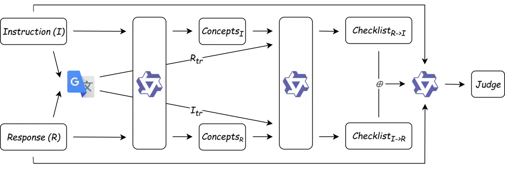

# Checklist Engineering Empowers Multilingual LLM Judges

Mohammad Ghiasvand Mohammadkhani Affiliation: Amirkabir University of
Technology Email: [mohammad.ghiasvand@aut.ac.ir](mailto:)    Hamid Beigy
Affiliation: Sharif University of Technology
Email: [beigy@sharif.edu](mailto:)

###### Abstract

Automated text evaluation has long been a central issue in Natural
Language Processing (NLP). Recently, the field has shifted toward using
Large Language Models (LLMs) as evaluators—a trend known as the
LLM-as-a-Judge paradigm. While promising and easily adaptable across
tasks, this approach has seen limited exploration in multilingual
contexts. Existing multilingual studies often rely on proprietary models
or require extensive training data for fine-tuning, raising concerns
about cost, time, and efficiency. In this paper, we propose Checklist
Engineering based LLM-as-a-Judge (CE-Judge), a training-free framework
that uses checklist intuition for multilingual evaluation with an
open-source model. Experiments across multiple languages and three
benchmark datasets, under both pointwise and pairwise settings, show
that our method generally surpasses the baselines and performs on par
with the GPT-4o model.¹¹ 1 The code implementation is accessible at
[https://github.com/mghiasvand1/CE-Judge](https://github.com/mghiasvand1/CE-Judge).

## 1 Introduction

Evaluation is a fundamental task in Natural Language Processing (NLP)
for measuring a model’s performance on specific tasks. Automating this
process offers significant benefits and has been a focus since the early
stages of NLP research. Moreover, beyond creating evaluators proficient
in English, it is crucial to develop their evaluation capabilities in
parallel for other languages. Traditional evaluation metrics (Papineni
et al., 2002) have some drawbacks, such as the necessity of reference
answers and a lack of interpretability, which has led to a paradigm
shift toward developing Large Language Model (LLM) evaluators, referred
to as LLM-as-a-Judge (Gu et al., 2025; Li et al., 2024). These models
are also capable of evaluating long-form LLM generations in either a
pointwise or pairwise format—meaning grading a single response or
selecting the better response out of two, respectively. Some advantages
of this approach include high adaptability (Bavaresco et al., ) and
interpretability, in contrast to traditional metrics, as well as low
inference time and the fact that the evaluated LLM does not need to be
active during evaluation (i.e., it does not need to generate additional
responses), both in contrast to more complex LLM-based evaluation
frameworks such as Kim et al. (2025).

Despite significant efforts to make LLMs multilingual (Qin et al.,
2024), extending LLM-as-a-Judge to multilingual configurations has
received relatively little attention. Although current multilingual LLM
judges (Pombal et al., 2025; Doddapaneni et al., 2025) perform well,
their main limitation is their reliance on proprietary models or the
need for a large amount of real or synthetic data to fine-tune a capable
evaluator, raising concerns regarding cost, time, and efficiency.

Meanwhile, checklists as interpretable evaluation tools (Doddapaneni
et al., 2024; Cook et al., ) are gaining traction for their transparency
and structure, although their application to multilingual evaluation
remains relatively underexplored, and most of them also lack robust
support for pairwise evaluation. For instance, (Wei et al., 2025)
suggests to handle the pairwise setting by selecting the higher-graded
response based on independent pointwise scores, which fails to capture
the nuanced comparative superiority between responses. In this work, we
present CE-Judge, an LLM-as-a-Judge framework that builds and uses
engineered checklists for evaluation. It supports multilingual
evaluation and both pointwise and pairwise modes. Our pipeline follows a
three-stage process: the first two stages aim to generate broad and
dynamic checklist items, and the third applies them for judgment.
Notably, by using a lightweight, open-source LLM without any
fine-tuning, our method demonstrates strong performance across different
evaluation scenarios.

Figure 1: CE-Judge framework illustration.

## 2 Related Works

### 2.1 LLM-as-a-Judge

We begin with Zheng et al. (2023), which uses the generative
capabilities of LLMs to act as evaluators. These can be grouped into two
types: prompt-based and fine-tuned evaluators. For instance, for the
former, Li et al. (2025) adopts a "decompose and aggregate" strategy,
identifying weighted evaluation aspects and combining their scores to
assess candidate responses. For the latter, which has recently gained
momentum, Kim et al. (2024) is a representative work that trains
evaluators using large-scale synthetic data in both pointwise and
pairwise setups, incorporating a weight-merging technique. In
multilingual settings, consistency remains limited, as noted by Fu and
Liu (2025). Among the few multilingual methods, Doddapaneni et al.
(2025) translates between languages to anchor outputs in English for
consistent scoring, while Pombal et al. (2025) follows Kim et al. (2024)
to generate multilingual evaluation data and fine-tune models
accordingly. Chang et al. (2025) investigates several aspects of
multilingual LLM-based evaluators, including reference-free prompting,
the effect of language resource availability, and the impact of
fine-tuning. Thellmann et al. (2024) creates various multilingual
evaluation benchmarks while exploring the impact of translation and
evaluating LLMs.

### 2.2 Checklist-based Evaluators

Several works have explored checklist-based evaluation. RocketEval (Wei
et al., 2025) generates binary checklist items, then reweights them to
produce final scores. TICK (Cook et al., ) uses instructions to generate
checklists, which LLMs use for self-improvement. CheckEval (Lee et al., 2024) defines high-level criteria, then decomposes, diversifies, and
filters them to form evaluation checklists. FBI (Doddapaneni et al., 2024) employs checklists for meta-evaluation to assess evaluator LLMs.
Unlike these works, our framework introduces a novel architecture and,
notably: (1) extends to multilingual settings; (2) supports pairwise
evaluation beyond pointwise framing; and (3) uniquely incorporates
broadness, descriptiveness, dynamism, and answer-mentioning in a unified
manner.

## 3 CE-Judge pipeline

|                                        |                    |          |          |          |          |          |          |          |          |          |          |          |
| -------------------------------------- | ------------------ | -------- | -------- | -------- | -------- | -------- | -------- | -------- | -------- | -------- | -------- | -------- |
| Model                                  | MMEval (Reasoning) |          |          |          |          |          |          |          |          |          |          | Avg.     |
|                                        | en                 | de       | fr       | es       | ru       | zh       | bn       | ja       | th       | te       | sw       |          |
| Proprietary Models                     |                    |          |          |          |          |          |          |          |          |          |          |          |
| GPT-4o                                 | 0.79               | 0.79     | 0.78     | 0.79     | 0.76     | 0.78     | 0.84     | 0.80     | 0.79     | 0.87     | 0.80     | 0.79     |
| \[.4pt/2pt\]   Medium (7B parameters)  |                    |          |          |          |          |          |          |          |          |          |          |          |
| Qwen2.5-7B-Instruct                    | $`0.67`$           | $`0.65`$ | $`0.63`$ | $`0.65`$ | $`0.66`$ | $`0.71`$ | $`0.60`$ | $`0.62`$ | $`0.66`$ | $`0.67`$ | $`0.61`$ | $`0.64`$ |
| Hercule 7B                             | $`0.50`$           | $`0.56`$ | $`0.55`$ | $`0.55`$ | $`0.53`$ | $`0.57`$ | $`0.57`$ | $`0.54`$ | $`0.52`$ | $`0.54`$ | $`0.51`$ | $`0.54`$ |
| M-Prometheus 7B                        | $`0.60`$           | $`0.62`$ | $`0.63`$ | $`0.60`$ | $`0.62`$ | $`0.69`$ | $`0.61`$ | $`0.57`$ | $`0.60`$ | $`0.65`$ | $`0.72`$ | $`0.62`$ |
| \[.4pt/2pt\]   Large (14B+ parameters) |                    |          |          |          |          |          |          |          |          |          |          |          |
| Prometheus 2 8x7B                      | $`0.54`$           | $`0.65`$ | $`0.58`$ | $`0.58`$ | $`0.58`$ | $`0.64`$ | $`0.57`$ | $`0.56`$ | $`0.60`$ | $`0.60`$ | $`0.63`$ | $`0.59`$ |
| M-Prometheus 14B                       | $`0.64`$           | $`0.70`$ | $`0.70`$ | $`0.69`$ | $`0.69`$ | $`0.72`$ | $`0.70`$ | $`0.70`$ | $`0.68`$ | $`0.72`$ | $`0.76`$ | $`0.70`$ |
| \[.4pt/2pt\]   Ours (7B parameters)    |                    |          |          |          |          |          |          |          |          |          |          |          |
| CE-Judge                               | 0.77               | 0.81     | 0.77     | 0.72     | 0.78     | 0.77     | 0.75     | 0.84     | 0.78     | 0.76     | 0.78     | 0.77     |

We present our training-free, efficient evaluation framework (Figure 1),
which consists of three steps. The pipeline first constructs an
engineered checklist through level-by-level multilingual understanding
and integration of input-output linkages to enable dynamism, followed by
utilizing this checklist to enhance the decisions of the evaluator LLM.
All LLM generations are asked to be in English to leverage its strong
performance in the language (Mondshine et al., 2025).

### 3.1 Concepts generation

Considering an instruction as input—replaced by the source text in the
translation evaluation task—and a corresponding response, we pass each
separately to the LLM along with the prompt in A.1 for concept
generation. This generation aims to produce an abstract-level text that
represents the skeleton of the corresponding text.

### 3.2 Checklist generation

Next, we translate both the instruction and response texts into English.
Using the translated response, the concepts generated from the
instruction (from the previous step), and the prompt in A.2, we generate
a checklist following the “response to instruction” direction. Likewise,
we use the translated instruction and the response’s concepts to
generate a checklist for the “instruction to response” direction. This
dual approach aims to blind each side once, broadening checklist
coverage and enhancing awareness of both sides’ content, rather than
relying on a standard checklist with limited, predefined criteria. In
this step, we also avoid prejudgment and ask the model to generate more
descriptive items, going beyond simple binary questions.

### 3.3 Judgment

The final step is judgment. First, the two checklists from the previous
steps are concatenated into a unified checklist. It’s important to note
that the entire process described so far is for pointwise evaluation.
For pairwise evaluation, the process remains the same, except that the
previous two steps are applied to two candidate responses instead of
one. As a result, after concatenation, we obtain two checklists, one for
each candidate. In this step, we provide the untranslated versions of
the instruction and response(s)—to avoid translation bias—along with the
checklist(s) and the prompt template in A.3. The LLM is then asked to
answer a subset of key checklist items and generate evaluation feedback.
Unlike prior works where checklist items are marked with ticks, crosses,
or weighted scores, here the model exercises discretion in its
judgments, and the final evaluation is left to the model’s decision.

## 4 Experiments

|                                        |               |          |          |          |          |          |          |          |
| -------------------------------------- | ------------- | -------- | -------- | -------- | -------- | -------- | -------- | -------- |
| Model                                  | MMEval (Chat) |          |          |          |          |          |          | Avg.     |
|                                        | en            | de       | fr       | es       | ca       | ru       | zh       |          |
| Proprietary Models                     |               |          |          |          |          |          |          |          |
| GPT-4o                                 | 0.72          | $`0.70`$ | 0.73     | $`0.64`$ | $`0.75`$ | 0.78     | $`0.80`$ | 0.73     |
| \[.4pt/2pt\]   Medium (7B parameters)  |               |          |          |          |          |          |          |          |
| Qwen2.5-7B-Instruct                    | 0.69          | 0.75     | $`0.71`$ | 0.78     | $`0.72`$ | $`0.66`$ | 0.85     | $`0.72`$ |
| Hercule 7B                             | $`0.62`$      | $`0.71`$ | $`0.61`$ | $`0.55`$ | $`0.62`$ | $`0.64`$ | $`0.65`$ | $`0.62`$ |
| M-Prometheus 7B                        | $`0.68`$      | $`0.65`$ | $`0.66`$ | $`0.59`$ | $`0.62`$ | $`0.56`$ | $`0.58`$ | $`0.62`$ |
| \[.4pt/2pt\]   Large (14B+ parameters) |               |          |          |          |          |          |          |          |
| Prometheus 2 8x7B                      | $`0.64`$      | $`0.68`$ | 0.72     | $`0.65`$ | 0.77     | $`0.64`$ | $`0.80`$ | $`0.70`$ |
| M-Prometheus 14B                       | $`0.61`$      | 0.72     | $`0.64`$ | $`0.64`$ | $`0.57`$ | $`0.71`$ | $`0.73`$ | $`0.66`$ |
| \[.4pt/2pt\]   Ours (7B parameters)    |               |          |          |          |          |          |          |          |
| CE-Judge                               | 0.69          | $`0.60`$ | 0.73     | 0.77     | 0.82     | 0.77     | 0.87     | 0.75     |

### 4.1 Experimental setup

In this work, we used the Qwen2.5-7B-Instruct model (Yang et al., 2024)
as the backbone LLM, accessed freely via the Novita API²² 2
[https://novita.ai/](https://novita.ai/). The hyperparameters
“temperature”, “top_p”, and “seed” were set to 0, 1, and 42,
respectively, to ensure reproducibility. For translation, we employed
the free Google Translate API available through the deep-translator
Python package³³ 3
[https://deep-translator.readthedocs.io/en/latest/README.html](https://deep-translator.readthedocs.io/en/latest/README.html).

### 4.2 Datasets

Since our method is training-free, all datasets are used solely for
testing. We evaluated our framework in both pointwise and pairwise
settings. For pointwise evaluation, we used the student-annotated subset
of the LitEval (Zhang et al., 2024), which contains source–target
literary translations for four language pairs with human ratings from 1
to 7. For pairwise evaluation, we employed the reasoning and chat
subsets of the MM-Eval dataset (Son et al., 2024), covering 11 and 7
languages, respectively. Each input consists of a reasoning question or
chat history, with the task being to choose the better of two candidate
responses. The reason for utilizing the LitEval and MM-Eval datasets is
that the former is one of the only multilingual pointwise evaluation
datasets, and the latter is more robust than the well-known
M-RewardBench multilingual benchmark (Gureja et al., 2025).

### 4.3 Evaluation Metrics

To evaluate our CE-Judge framework in pointwise mode, we measured
performance using Kendall’s Tau correlation coefficient (Kendall, 1938),
which assesses agreement between our model’s rankings and human
judgments. For the pairwise setting, we used accuracy—defined as the
number of correct predictions over the total number of samples.

|                                        |                     |                     |                     |                     |          |
| -------------------------------------- | ------------------- | ------------------- | ------------------- | ------------------- | -------- |
| Model                                  | LitEval             |                     |                     |                     | Avg.     |
|                                        | de$`\rightarrow`$en | en$`\rightarrow`$de | en$`\rightarrow`$zh | de$`\rightarrow`$zh |          |
| Proprietary Models                     |                     |                     |                     |                     |          |
| GPT-4o                                 | $`0.26`$            | $`0.48`$            | $`0.41`$            | $`0.40`$            | $`0.38`$ |
| \[.4pt/2pt\]   Medium (7B parameters)  |                     |                     |                     |                     |          |
| Qwen2.5-7B-Instruct                    | $`0.12`$            | $`0.32`$            | $`0.17`$            | $`0.07`$            | $`0.17`$ |
| Hercule 7B                             | $`0.26`$            | $`0.33`$            | $`0.38`$            | $`0.42`$            | $`0.34`$ |
| M-Prometheus 7B                        | $`0.20`$            | 0.53                | $`0.46`$            | 0.54                | 0.43     |
| \[.4pt/2pt\]   Large (14B+ parameters) |                     |                     |                     |                     |          |
| Prometheus 2 8x7B                      | $`0.24`$            | $`0.36`$            | $`0.25`$            | $`0.40`$            | $`0.31`$ |
| M-Prometheus 14B                       | 0.29                | 0.57                | 0.48                | 0.56                | 0.47     |
| \[.4pt/2pt\]   Ours (7B parameters)    |                     |                     |                     |                     |          |
| CE-Judge                               | 0.28                | $`0.46`$            | 0.49                | $`0.30`$            | $`0.38`$ |

### 4.4 Baselines

We compare our framework with three types of models. The first includes
proprietary models like GPT-4o. The second is Qwen2.5-7B-Instruct, a
strong multilingual open-source LLM that is instruction-tuned from a
pretrained model without further fine-tuning. The third category
consists of models explicitly trained as evaluators, such as Prometheus
2 (Kim et al., 2024), Hercule (Doddapaneni et al., 2025), and
M-Prometheus (Pombal et al., 2025), as discussed in Subsection 2.1.

## 5 Results

We evaluate CE-Judge on three multilingual evaluation
datasets—reasoning, chat, and literary translation—against proprietary
and open-source baselines, including the fine-tuned M-Prometheus. In all
three tables, languages are shown by their codes, and, more importantly,
the results for the other models are taken from Pombal et al. (2025).

- •
  In the reasoning evaluation task (Table 3), CE-Judge achieves an
  average accuracy of 0.77, outperforming all open-source baselines in
  all languages, including large fine-tuned evaluators such as
  M-Prometheus 14B. Despite being training-free and based on a
  7B-parameter model, it performs competitively with GPT-4o (which has
  an average accuracy of 0.79) and maintains strong performance across
  both high- and low-resource languages.
- •
  In the chat evaluation (Table 4), CE-Judge achieves an average
  accuracy of 0.75, surpassing GPT-4o (with the average of 0.73) and
  significantly outperforming the M-Prometheus models across nearly all
  languages. This result highlights the robustness of our
  checklist-driven approach in conversational scenarios that require
  nuanced, context-aware judgment.
- •
  In the literary translation evaluation (Table 4.3), which requires
  nuanced linguistic and stylistic understanding, CE-Judge achieves an
  average Kendall’s Tau correlation of 0.38, significantly outperforming
  its backbone model, Qwen2.5-7B, and delivering performance comparable
  to GPT-4o. Although it slightly lags behind M-Prometheus 7B (average
  of 0.43)—which benefits from fine-tuning on supervised machine
  translation evaluation data—our training-free approach remains highly
  competitive.

## 6 Conclusion

In this work, we introduce CE-Judge, a novel and straightforward
checklist-based framework for multilingual LLM-as-a-Judge that is
training-free and built on an open-source model. By leveraging dynamic,
broad, and flexible checklist items, CE-Judge supports both pointwise
and pairwise evaluations across diverse languages. Experiments on
multiple multilingual benchmarks show that CE-Judge not only generally
outperforms open-source fine-tuned baselines but also performs on par
with GPT-4o. These results highlight the promise of structured, dynamic
evaluation techniques for improving the reliability and interpretability
of LLM judgment, particularly in multilingual contexts, for more
consistent performance.

## Ethics Statement

This study aims to advance multilingual evaluation using a training-free
approach built on an open-source LLM, prioritizing accessibility and
transparency. We leveraged publicly available datasets and APIs, with no
collection of personal or sensitive data. All experiments are free from
human involvement and pose no privacy or safety risks.

## Limitations

Despite its strong results and training-free design, our framework has
several limitations to address in future work. First, crafting effective
prompts for each of the three steps per task can be time-consuming, so
developing an automatic, adaptable prompt generation module would be
beneficial. Second, our method relies solely on LLM generation, which
may suffer from misalignment between training objectives and robust text
generation. Incorporating internal LLM representations, as shown by
Sheng et al. (2024), could capture more accurate implicit knowledge.
Finally, our framework’s flexibility suggests potential extensions as a
plug-and-play method or adaptations to other evaluation strategies, such
as interview-based evaluation (Kim et al., 2025).

## References

- (1) Anna Bavaresco, Raffaella Bernardi, Leonardo Bertolazzi, Desmond
  Elliott, Raquel Fernández, Albert Gatt, Esam Ghaleb, Mario
  Giulianelli, Michael Hanna, Alexander Koller, and 1 others. [Llms
  instead of human judges? a large scale empirical study across 20 nlp
  evaluation tasks](https://arxiv.org/pdf/2406.18403). _arXiv preprint
  arXiv:2406.18403_.
- Chang et al. (2025) Jiayi Chang, Mingqi Gao, Xinyu Hu, and Xiaojun
  Wan. 2025. [Exploring the multilingual nlg evaluation abilities of
  llm-based evaluators](https://arxiv.org/abs/2503.04360). _Preprint_,
  arXiv:2503.04360.
- (3) Jonathan Cook, Tim Rocktäschel, Jakob Nicolaus Foerster, Dennis
  Aumiller, and Alex Wang. [Ticking all the boxes: Generated checklists
  improve llm evaluation and
  generation](https://openreview.net/pdf?id=Q3y6QhOUnI). In _Language
  Gamification-NeurIPS 2024 Workshop_.
- Doddapaneni et al. (2024) Sumanth Doddapaneni, Mohammed Khan, Sshubam
  Verma, and Mitesh M Khapra. 2024. [Finding blind spots in evaluator
  llms with interpretable
  checklists](https://arxiv.org/pdf/2406.13439?). In _Proceedings of the
  2024 Conference on Empirical Methods in Natural Language Processing_,
  pages 16279–16309.
- Doddapaneni et al. (2025) Sumanth Doddapaneni, Mohammed Safi Ur Rahman
  Khan, Dilip Venkatesh, Raj Dabre, Anoop Kunchukuttan, and Mitesh M
  Khapra. 2025. [Cross-lingual auto evaluation for assessing
  multilingual LLMs](https://aclanthology.org/2025.acl-long.1419/). In
  _Proceedings of the 63rd Annual Meeting of the Association for
  Computational Linguistics (Volume 1: Long Papers)_, pages 29297–29329,
  Vienna, Austria. Association for Computational Linguistics.
- Fu and Liu (2025) Xiyan Fu and Wei Liu. 2025. [How reliable is
  multilingual llm-as-a-judge?](https://arxiv.org/pdf/2505.12201) _arXiv
  preprint arXiv:2505.12201_.
- Gu et al. (2025) Jiawei Gu, Xuhui Jiang, Zhichao Shi, Hexiang Tan,
  Xuehao Zhai, Chengjin Xu, Wei Li, Yinghan Shen, Shengjie Ma, Honghao
  Liu, Saizhuo Wang, Kun Zhang, Yuanzhuo Wang, Wen Gao, Lionel Ni, and
  Jian Guo. 2025. [A survey on
  llm-as-a-judge](https://arxiv.org/abs/2411.15594). _Preprint_,
  arXiv:2411.15594.
- Gureja et al. (2025) Srishti Gureja, Lester James Validad Miranda,
  Shayekh Bin Islam, Rishabh Maheshwary, Drishti Sharma, Gusti Triandi
  Winata, Nathan Lambert, Sebastian Ruder, Sara Hooker, and Marzieh
  Fadaee. 2025. [M-RewardBench: Evaluating reward models in multilingual
  settings](https://aclanthology.org/2025.acl-long.3/). In _Proceedings
  of the 63rd Annual Meeting of the Association for Computational
  Linguistics (Volume 1: Long Papers)_, pages 43–58, Vienna, Austria.
  Association for Computational Linguistics.
- Kendall (1938) Maurice G Kendall. 1938. [A new measure of rank
  correlation](https://academic.oup.com/biomet/article-abstract/30/1-2/81/176907?redirectedFrom=PDF).
  _Biometrika_, 30(1-2):81–93.
- Kim et al. (2025) Eunsu Kim, Juyoung Suk, Seungone Kim, Niklas
  Muennighoff, Dongkwan Kim, and Alice Oh. 2025. [LLM-as-an-interviewer:
  Beyond static testing through dynamic LLM
  evaluation](https://aclanthology.org/2025.findings-acl.1357/). In
  _Findings of the Association for Computational Linguistics: ACL 2025_,
  pages 26456–26493, Vienna, Austria. Association for Computational
  Linguistics.
- Kim et al. (2024) Seungone Kim, Juyoung Suk, Shayne Longpre,
  Bill Yuchen Lin, Jamin Shin, Sean Welleck, Graham Neubig, Moontae Lee,
  Kyungjae Lee, and Minjoon Seo. 2024. [Prometheus 2: An open source
  language model specialized in evaluating other language
  models](https://doi.org/10.18653/v1/2024.emnlp-main.248). In
  _Proceedings of the 2024 Conference on Empirical Methods in Natural
  Language Processing_, pages 4334–4353, Miami, Florida, USA.
  Association for Computational Linguistics.
- Lee et al. (2024) Yukyung Lee, Joonghoon Kim, Jaehee Kim, Hyowon Cho,
  and Pilsung Kang. 2024. [Checkeval: Robust evaluation framework using
  large language model via
  checklist](https://arxiv.org/pdf/2403.18771v1). _arXiv preprint
  arXiv:2403.18771_.
- Li et al. (2024) Dawei Li, Bohan Jiang, Liangjie Huang, Alimohammad
  Beigi, Chengshuai Zhao, Zhen Tan, Amrita Bhattacharjee, Yuxuan Jiang,
  Canyu Chen, Tianhao Wu, and 1 others. 2024. [From generation to
  judgment: Opportunities and challenges of
  llm-as-a-judge](https://arxiv.org/pdf/2411.16594). _arXiv preprint
  arXiv:2411.16594_.
- Li et al. (2025) Minzhi Li, Zhengyuan Liu, Shumin Deng, Shafiq Joty,
  Nancy Chen, and Min-Yen Kan. 2025. [Dna-eval: Enhancing large language
  model evaluation through decomposition and
  aggregation](https://aclanthology.org/anthology-files/pdf/coling/2025.coling-main.156.pdf).
  In _Proceedings of the 31st International Conference on Computational
  Linguistics_, pages 2277–2290.
- Mondshine et al. (2025) Itai Mondshine, Tzuf Paz-Argaman, and Reut
  Tsarfaty. 2025. [Beyond English: The impact of prompt translation
  strategies across languages and tasks in multilingual
  LLMs](https://doi.org/10.18653/v1/2025.findings-naacl.73). In
  _Findings of the Association for Computational Linguistics: NAACL
  2025_, pages 1331–1354, Albuquerque, New Mexico. Association for
  Computational Linguistics.
- Papineni et al. (2002) Kishore Papineni, Salim Roukos, Todd Ward, and
  Wei-Jing Zhu. 2002. [Bleu: a method for automatic evaluation of
  machine translation](https://aclanthology.org/P02-1040.Pdf). In
  _Proceedings of the 40th annual meeting of the Association for
  Computational Linguistics_, pages 311–318.
- Pombal et al. (2025) José Pombal, Dongkeun Yoon, Patrick Fernandes,
  Ian Wu, Seungone Kim, Ricardo Rei, Graham Neubig, and André F. T.
  Martins. 2025. [M-prometheus: A suite of open multilingual llm
  judges](https://arxiv.org/abs/2504.04953). _Preprint_,
  arXiv:2504.04953.
- Qin et al. (2024) Libo Qin, Qiguang Chen, Yuhang Zhou, Zhi Chen,
  Yinghui Li, Lizi Liao, Min Li, Wanxiang Che, and Philip S Yu. 2024.
  [Multilingual large language model: A survey of resources, taxonomy
  and frontiers](https://arxiv.org/pdf/2404.04925). _arXiv preprint
  arXiv:2404.04925_.
- Sheng et al. (2024) Shuqian Sheng, Yi Xu, Tianhang Zhang, Zanwei Shen,
  Luoyi Fu, Jiaxin Ding, Lei Zhou, Xiaoying Gan, Xinbing Wang, and
  Chenghu Zhou. 2024. [Repeval: Effective text evaluation with llm
  representation](https://aclanthology.org/anthology-files/pdf/emnlp/2024.emnlp-main.398.pdf).
  In _Proceedings of the 2024 Conference on Empirical Methods in Natural
  Language Processing_, pages 7019–7033.
- Son et al. (2024) Guijin Son, Dongkeun Yoon, Juyoung Suk, Javier
  Aula-Blasco, Mano Aslan, Vu Trong Kim, Shayekh Bin Islam, Jaume
  Prats-Cristià, Lucía Tormo-Bañuelos, and Seungone Kim. 2024. [Mm-eval:
  A multilingual meta-evaluation benchmark for llm-as-a-judge and reward
  models](https://arxiv.org/pdf/2410.17578?). _arXiv preprint
  arXiv:2410.17578_.
- Thellmann et al. (2024) Klaudia Thellmann, Bernhard Stadler, Michael
  Fromm, Jasper Schulze Buschhoff, Alex Jude, Fabio Barth, Johannes
  Leveling, Nicolas Flores-Herr, Joachim Köhler, René Jäkel, and Mehdi
  Ali. 2024. [Towards multilingual llm evaluation for european
  languages](https://arxiv.org/abs/2410.08928). _Preprint_,
  arXiv:2410.08928.
- Wei et al. (2025) Tianjun Wei, Wei Wen, Ruizhi Qiao, Xing Sun, and
  Jianghong Ma. 2025. [Rocketeval: Efficient automated LLM evaluation
  via grading checklist](https://openreview.net/forum?id=zJjzNj6QUe). In
  _The Thirteenth International Conference on Learning Representations_.
- Yang et al. (2024) An Yang, Baosong Yang, Beichen Zhang, Binyuan Hui,
  Bo Zheng, Bowen Yu, Chengyuan Li, Dayiheng Liu, Fei Huang, Haoran Wei,
  and 1 others. 2024. [Qwen2.5 technical
  report](https://arxiv.org/pdf/2412.15115). _arXiv preprint
  arXiv:2412.15115_.
- Zhang et al. (2024) Ran Zhang, Wei Zhao, and Steffen Eger. 2024. [How
  good are llms for literary translation, really? literary translation
  evaluation with humans and llms](https://arxiv.org/pdf/2410.18697).
  _arXiv preprint arXiv:2410.18697_.
- Zheng et al. (2023) Lianmin Zheng, Wei-Lin Chiang, Ying Sheng, Siyuan
  Zhuang, Zhanghao Wu, Yonghao Zhuang, Zi Lin, Zhuohan Li, Dacheng Li,
  Eric Xing, and 1 others. 2023. [Judging llm-as-a-judge with mt-bench
  and chatbot
  arena](https://proceedings.neurips.cc/paper_files/paper/2023/file/91f18a1287b398d378ef22505bf41832-Paper-Datasets_and_Benchmarks.pdf).
  _Advances in Neural Information Processing Systems_, 36:46595–46623.

## Appendix A Prompt templates

### A.1 Concepts Generation Prompts

The prompts for this step, across all three datasets, are shown in 2,
and the “\[INPUT\]” placeholder must be replaced with the text from
which we want to extract concepts, such as an instruction, response,
etc.

### A.2 Checklist Generation Prompts

Figures 3, 4, and 5 show checklist generation prompts for Liteval,
MM-Eval (Reasoning), and MM-Eval (Chat), respectively. Each figure
consists of two prompts indicating the checklist creation direction.
Note that the “\[CONCEPTS\]” placeholder must be replaced with the
concepts generated in the previous step.

### A.3 Judgment Prompts

We only use system prompts from this section, which are shown in 6: one
for the Liteval dataset and another for the MM-Eval datasets. Figure 7
presents the prompt template for the Liteval dataset, while 8 shows the
prompts for the two MM-Eval datasets. In these prompts, the placeholders
clearly indicate what should replace them. Importantly, to demonstrate
the flexibility of our framework, we also use a scoring guide for the
pointwise assessment to help our judge LLM perform a more accurate
evaluation.

Figure 2: Concept generation prompts for LitEval and MM-Eval (Reasoning
& Chat) datasets.

Figure 3: Checklist generation prompts for LitEval dataset.

Figure 4: Checklist generation prompts for MM-Eval (Reasoning) dataset.

Figure 5: Checklist generation prompts for MM-Eval (Chat) dataset.

Figure 6: Judgment system prompts for LitEval and MM-Eval (Reasoning &
Chat) datasets.

Figure 7: Judgment prompt for LitEval dataset.

Figure 8: Judgment prompt for MM-Eval (Reasoning & Chat) datasets.

Table 3: Kendall correlation on LitEval broken down by language pair.

Table 2: Accuracy on MMEval (Chat) broken down by language.

Table 1: Accuracy on MMEval (Reasoning) broken down by language.
