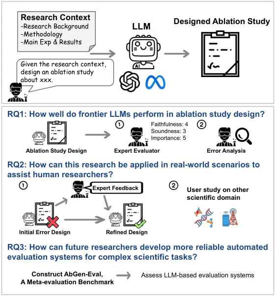
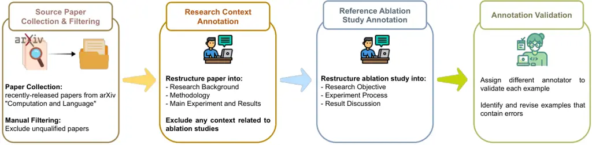
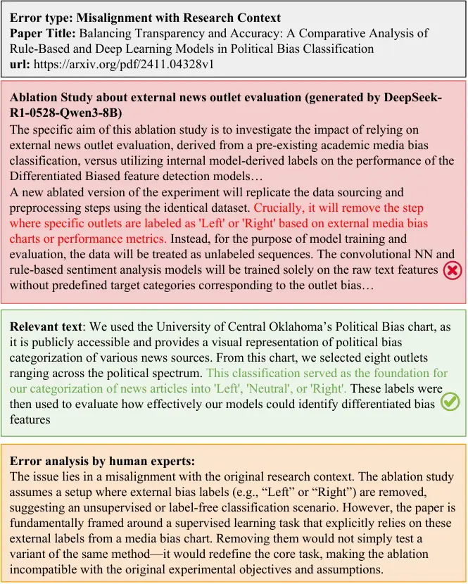
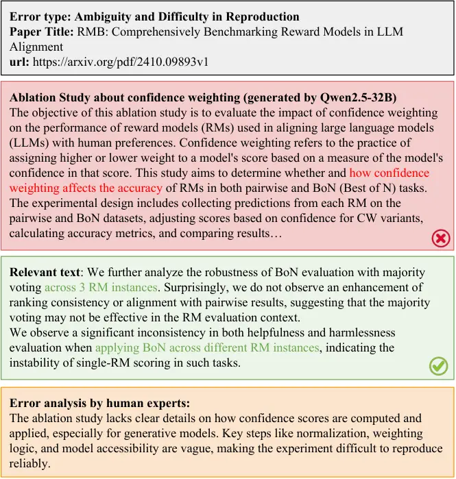
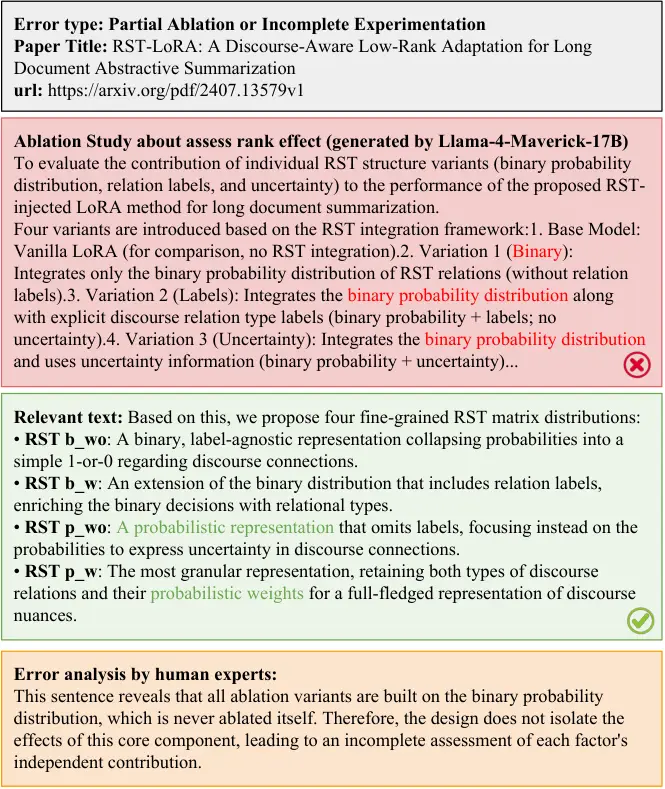
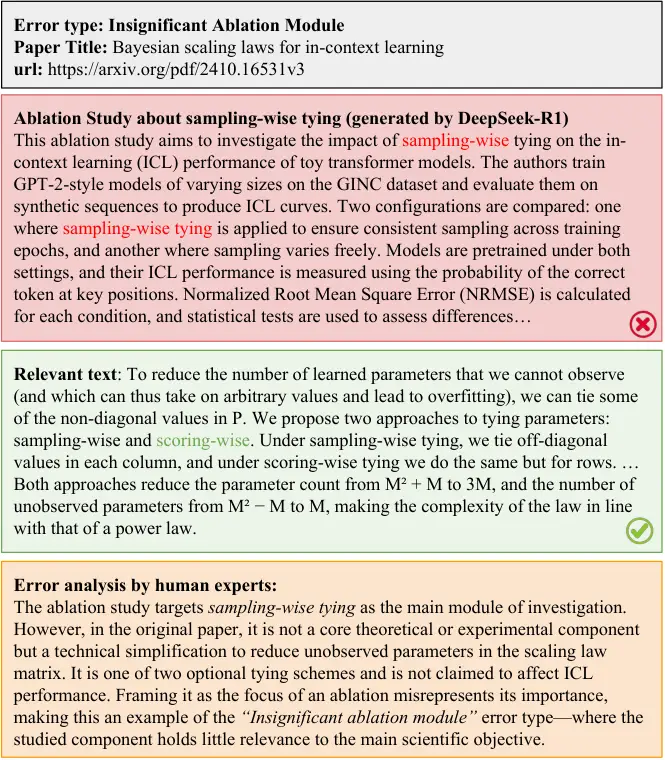
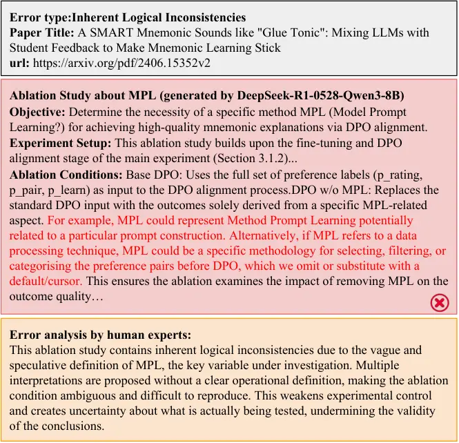

# AbGen: Evaluating Large Language Models in Ablation Study Design and Evaluation for Scientific Research

Yilun
Zhao $`\hskip 1.00006pt{}^{{\color[rgb]{0.0625,0.1641,0.3359}\bm{Y}}}`$
^(†)^(†)thanks: ˜˜Equal Contributions. Correspondence: Yilun Zhao
(yilun.zhao@yale.edu)    Weiyuan
Chen^(\*)$`\hskip 1.00006pt{}^{{\color[rgb]{0.0625,0.1641,0.3359}\bm{Y}}}`$
   Zhijian
Xu$`\hskip 1.00006pt{}^{{\color[rgb]{0.0625,0.1641,0.3359}\bm{Y}}}`$   
Manasi
Patwardhan$`\hskip 1.00006pt{}^{{\color[rgb]{0.0039,0.4922,0.7813}\bm{T}}}`$
Affiliation: Yixin
Liu$`\hskip 1.00006pt{}^{{\color[rgb]{0.0625,0.1641,0.3359}\bm{Y}}}`$
  Chengye
Wang$`\hskip 1.00006pt{}^{{\color[rgb]{0.0625,0.1641,0.3359}\bm{Y}}}`$
  Lovekesh
Vig$`\hskip 1.00006pt{}^{{\color[rgb]{0.0039,0.4922,0.7813}\bm{T}}}`$
  Arman
Cohan$`\hskip 1.00006pt{}^{{\color[rgb]{0.0625,0.1641,0.3359}\bm{Y}}}`$
Affiliation: $`\hskip 1.00006pt{}^{{\color[rgb]{0.0625,0.1641,0.3359}\bm{Y}}}`$ Yale
NLP Lab   
$`\hskip 1.00006pt{}^{{\color[rgb]{0.0039,0.4922,0.7813}\bm{T}}}`$ TCS
Research

###### Abstract

We introduce AbGen, the first benchmark designed to evaluate the
capabilities of LLMs in designing ablation studies for scientific
research. AbGen consists of 1,500 expert-annotated examples derived from
807 NLP papers. In this benchmark, LLMs are tasked with generating
detailed ablation study designs for a specified module or process based
on the given research context. Our evaluation of leading LLMs, such as
DeepSeek-R1-0528 and o4-mini, highlights a significant performance gap
between these models and human experts in terms of the importance,
faithfulness, and soundness of the ablation study designs. Moreover, we
demonstrate that current automated evaluation methods are not reliable
for our task, as they show a significant discrepancy when compared to
human assessment. To better investigate this, we develop AbGen-Eval, a
meta-evaluation benchmark designed to assess the reliability of commonly
used automated evaluation systems in measuring LLM performance on our
task. We investigate various LLM-as-Judge systems on AbGen-Eval,
providing insights for future research on developing more effective and
reliable LLM-based evaluation systems for complex scientific tasks.

|     |      |                                                                  |
| --- | ---- | ---------------------------------------------------------------- |
|     | Data | [yale-nlp/AbGen](https://huggingface.co/datasets/yale-nlp/AbGen) |
|     | Code | [yale-nlp/AbGen](https://github.com/yale-nlp/AbGen)              |



Figure 1: Overview of the research: the ablation study design task and
three research questions investigated.



Figure 2: An overview of AbGen construction pipeline.

## 1 Introduction

In empirical scientific fields, designing experiments and selecting the
appropriate experimental settings often present considerable challenges
and requires significant domain expertise. Oftentimes, scientists learn
about the flaws in their experimental design and missing ablations after
going through a peer review process, which involves domain experts
carefully evaluating a scientific work. The complexity of tasks in
experimental science underscores the need for innovative approaches to
support researchers in optimizing their workflows. Meanwhile, LLMs have
demonstrated remarkable capabilities across a range of tasks integral to
scientific processes, such as reviewing manuscripts D’Arcy et al.
(2024); Du et al. (2024), scientific writing Altmäe et al. (2023); Xu
et al. (2024), scientific code generation Liu et al. (2023); Yang et al.
(2024b). This raises a compelling question: _Can LLMs be effectively
leveraged to assist scientists in the process of experimental design?_

While addressing this question is inherently complex due to the diverse
nature of scientific disciplines and difficulty of evaluation, our
objective is to introduce the first comprehensive benchmark as well as
an evaluation methodology to facilitate measuring progress on this task.
We particularly introduce AbGen, the first benchmark for evaluating LLMs
in the context of designing ablation studies for scientific research.
The dataset consists of 1,500 examples derived from 807 scientific
papers in natural language processing (NLP). Each example is carefully
annotated and validated by NLP experts and includes a comprehensive
research context along with a reference ablation study, both
restructured from the original research paper. The research context is
divided into three sections: research background, methodology, and the
main experiment setup and results. As illustrated in Figure 1, the LLMs
are tasked with generating a detailed ablation study design for a
specified module or process based on the provided research context.

As outlined in Figure 1, we investigate three research questions in this
study. Our main contributions are summarized below:

- •
  We propose AbGen, the first benchmark designed to evaluate the
  capabilities of LLMs in ablation study designs for scientific research
  (§2). We design a comprehensive human and automated evaluation systems
  for AbGen (§3).
- •
  We conduct a systematic evaluation of leading LLMs, analyzing their
  strengths and limitations on our new task, and providing insights for
  future advancements (§4.2).
- •
  Our user studies reveals the potential of LLMs in ablation study
  design by interaction with human researchers, and highlights the
  adaptability of this approach to other scientific domains (§4.3).
- •
  We develop the meta-evaluation benchmark, AbGen-Eval, and investigate
  various LLM-based evaluation methods to provide insights for creating
  more reliable automated evaluation systems for complex scientific
  tasks (§5).

## 2 AbGen Benchmark

To systematically study the capabilities and limitations of current LLMs
and measuring progress in assisting scientists with the design of their
experimental workflows, we introduce a new benchmark named AbGen. The
LLMs are tasked with generating detailed ablation study designs for a
specified module or process based on the given research context. We
focus on scientific research within the NLP domain, as the involved
expert annotators primarily have expertise in NLP (_i.e.,_ each has at
least one publication in a top-tier NLP or AI venue as a leading
author). Detailed biographies of the annotators participating in the
AbGen annotation and LLM performance evaluation process are provided in
Table 7 in Appendix A.1. We believe that future research could extend
our benchmark construction pipeline to extend to other scientific
domains.

In the following subsections, we first provide a formal definition of
the AbGen task and then detail each step within the benchmark
construction process. We present an overview of the AbGen construction
pipeline in Figure 2.

### 2.1 AbGen Task Formulation

We formally define the task of AbGen in the context of LLMs.
Specifically, given:

- •
  The research context $`C`$, which is an expert-annotated context of a
  specific scientific study. This context is restructured from the
  original paper by expert annotators, including sections of research
  background, methodology, and main experiment setup and results (§2.3).
- •
  The name of a specific essential module or process, denoted as $`M`$,
  which is described in the _methodology_ section within research
  context $`C`$.

The LLM is tasked with generating the design for an ablation study,
$`A`$, aimed at evaluating the contribution and impact of $`M`$ within
the overall research framework:

```math
\bm{\hat{A}}=\arg\max_{A}P_{\mathbf{LLM}}(\bm{A}~|~\bm{C},\bm{M}) \tag{1}
```

The ablation study design should include a clear statement of the
research objective, along with a detailed description of the
experimental process.

### 2.2 Source Paper Collection and Filtering

#### Source Paper Collection.

We collect scientific papers from arXiv under the ‘‘Computation and
Language’’ category, targeting those first released between March 1,
2024 and August 30, 2024. For each paper, we adopt the tool¹¹ 1
[https://github.com/allenai/s2orc-doc2json](https://github.com/allenai/s2orc-doc2json)
developed by Lo et al. (2020) to extract its content. Specifically, this
tool parses LaTeX source files of papers into JSON format, extracting
features including the paper title, abstract, main sections, and
appendix. We convert tables within the papers into HTML format. Both
recent works Sui et al. (2024); Fang et al. (2024) and our preliminary
studies reveal that the evaluated LLMs can comprehend such table format
effectively. Next, we describe our approach and criteria for inclusion
of the papers for annotation, as well as the details of the annotation
process.

#### Research Paper Manual Filtering.

For each collected NLP paper, the expert annotator first determines if
they are familiar with the paper’s topic. If not, we randomly assign the
paper to another annotator. Papers whose topics are unfamiliar to both
annotators are excluded. The annotators are then instructed to determine
whether the paper qualifies for inclusion in our benchmark.
Specifically, we exclude: (1) Papers that are not focused on
experimental work (_e.g.,_ surveys, position papers, dissertations), as
they do not involve ablation study design; (2) Papers with fewer than
two ablation studies, as these may not provide sufficient breadth of
experimental evidence. Additionally, annotators may exclude papers they
deem to be of low quality based on their expert judgment. After applying
these filtering criteria, 807 papers remain for further annotation.

### 2.3 Research Context Annotation

After determining that a research paper qualifies for benchmark
inclusion, annotators are instructed to restructure the original paper
into research context that maintains the original meaning but exclude
any content related to ablation studies. The research context contains
the following three sections: (1) Research Background, which is
restructured from the introduction and related work sections, describing
the paper’s motivation, research problem, and relevant prior work. (2)
Methodology, which is restructured from the methodology sections, This
section describes the proposed method or model, including key components
and innovations. (3) Main Experiment Setup and Results, which is
restructured from the experiment sections. This section details the
primary experimental setup, including datasets, baselines, and
evaluation metrics used in main experiments, as well as the main
experimental results.

### 2.4 Reference Ablation Study Annotation

Annotators are then tasked with restructuring each ablation study in the
research paper into a reference ablation study. It consists of the
following three sections: (1) Research Objective, a one- or two-sentence
description of the research problem and the goal of the ablation study.
If this statement is not explicitly provided in the original ablation
study, annotators are required to infer and summarize it. (2) Experiment
Process, a detailed account of the experimental setup, including the
experimental groups, datasets, procedures, and the evaluation tools and
metrics used. Annotators are requried to ensure that the process is
clearly understandable and replicable based on the provided description.
(3) Result Discussion, an analysis of the outcomes, where annotators
summarize the key findings and their implications. It’s worth noting
that we do not require LLMs to generate this part, as our main focus is
on evaluating their ability to design ablation studies rather than
execute and analyze experiments. However, we believe these features
could be valuable for future research.

### 2.5 Annotation Validation

For each annotated example, we assign an annotator to validate the
annotated research context and reference ablation study based on the
original research paper. They are required to identify and revise
examples that contain errors. Out of the 1,500 annotated examples, 273
were identified as erroneous and were subsequently revised. We conducted
a final human evaluation of data quality on 100 examples. As shown in
Table 6 (Appendix A.1), for each validation metric, over 95% of the
samples received a satisfaction rating of at least 4 out of 5. This
result indicates the high quality of AbGen.

| Property                            | Value (avg./max) |
| ----------------------------------- | ---------------- |
| Research Context Word Length        | 1,847.8 / 6,253  |
| Research Background                 | 319.6 / 1,178    |
| Methodology                         | 904.4 / 4,685    |
| Exp Setup & Results                 | 623.7 / 2,174    |
| Ref. Ablation Study Word Length     | 145.5 / 518      |
| Research Objective                  | 6.1 / 15         |
| Experiment Process                  | 72.5 / 264       |
| Result Discussion                   | 67.1 / 336       |
| \# NLP Research                     | 807              |
| \# Ref. Ablation Study per Research | 1.9 / 3          |
| AbGen Size                          | 1,500            |
| Testmini Set                        | 500              |
| Test Set                            | 1,000            |

Table 1: Data statistics of the AbGen benchmark.

### 2.6 Data Statistics

Table 1 illustrates the data statistics of the AbGen benchmark. We
randomly split the dataset into two subsets: _testmini_ and _test_. The
_testmini_ subset contains 500 examples and is intended for both method
validation and human analysis and evaluation. The _test_ subset
comprises the remaining 1,000 examples and is designed for standard
evaluation.

## 3 AbGen Evaluation

The automated evaluation of LLM generation for tasks relevant to
scientific workflows remains an unsolved problem in the community.
Recent benchmark work, such as SciMON Wang et al. (2024a) for novel
scientific direction generation and MARG D’Arcy et al. (2024) for peer
review generation, primarily rely on human evaluation to assess
LLM-based system performance. In our study, we also employ human
evaluation by expert annotators as the _primary_ assessment method.
Additionally, in Section 5, we investigate different variants of
LLM-based evaluation methods, aiming to provide insights for future work
to develop automated evaluation systems for a large-scale evaluation.

### 3.1 Evaluation Criteria

This section discusses the human and automated evaluation protocols
developed for AbGen evaluation. We assess the following three dimensions
for the generated ablation study design.

- •
  Importance: The generated ablation study design will provide valuable
  insights into understanding the role of the specified module or
  process within the overall methodology.
- •
  Faithfulness: The generated ablation study design aligns perfectly
  with the given research context. There are no contradictions between
  the generated content and the main experimental setup within the
  provided research context.
- •
  Soundness: The generated ablation study design is logically
  self-consistent without ambiguious description. The human researchers
  would be able to clearly understand and replicate the ablation study
  based on the generated context.

To determine these three dimensions, we gathered feedback from three
external senior NLP researchers, all of whom serve as area chairs for
the ACL Rolling Review. Through iterative discussions, we identified
these dimensions as critical for evaluating the quality and utility of
generated ablation study designs. This feedback process also helped us
in refining the assessment guidelines used for human evaluation (§3.2).
We do not evaluate the _fluency_ of the generated ablation study, as
both recent works D’Arcy et al. (2024); Zeng et al. (2024) and our
preliminary findings find that leading LLMs consistently produce fluent
text free of grammatical errors.

### 3.2 Human Evaluation Protocol

For human evaluation, we use Likert-scale scores ranging from 1 to 5 for
each criterion (_i.e.,_ importance, faithfulness, and soundness). Given
the research context and an LLM-generated ablation study, human
evaluators are asked to score the generated content for each criteria.
Initially, the reference ablation study is not provided to the
evaluator. This approach encourages evaluators to carefully review the
generated content in light of the research context, reducing the
likelihood of bias from comparing it to the reference. This is
particularly important, as LLMs may generate ablation studies that,
while reasonable, differ from the reference. After submitting their
initial scores, evaluators are then given the reference ablation study
and asked to adjust their scores if they identify any aspects they may
have initially overlooked.

To assess inter-annotator agreement of our human evaluation, we sample
40 fixed LLM-generated outputs that are separately evaluated by all four
expert annotators. They achieve inter-annotator agreement scores
(_i.e.,_ Cohen’s Kappa) of 0.735, 0.782, and 0.710 for the criteria of
importance, faithfulness, and soundness, respectively.

### 3.3 Automated Evaluation

While human evaluation is generally reliable, it is time-consuming and
does not scale well. To address this, we also employ an LLM-as-a-judge
system for automated evaluation. Specifically, we use GPT-4.1-mini as
the base evaluator. For each model-generated response, the evaluator is
provided with the research context and a reference ablation study.
Evaluation is performed across four criteria (_i.e.,_ importance,
faithfulness, soundness, and overall quality), with the model prompted
separately for each criterion to assign a score from 1 to 5. Prior to
issuing a final score, the evaluator must generate a rationale
explaining its judgment. The full evaluation prompts used for each
criterion are provided in Appendix B. To gain a deeper understanding of
the reliability of LLM-as-Judge systems, we develop the meta-evaluation
benchmark, AbGen-Eval, which is detailed in Section 5.

## 4 LLMs for Ablation Study Design

### 4.1 Experiment Setup

#### Evaluated Systems.

We examine the performance of 18 frontier LLMs across two distinct
categories on our benchmark: (1) Proprietary LLMs, including
o4-mini OpenAI (2025a), GPT-4o OpenAI (2024), GPT-4.1 OpenAI (2025b),
Gemini-2.5-Flash Gemini (2024); and Open-source LLMs, including
Llama-3.1-70B, Llama-3.3-70B, Llama-4-Scout-17B and
Llama-4-Maverick-17B AI@Meta (2024); Meta AI (2025), Mistral-Large Jiang
et al. (2024), Deepseek-V3, DeepSeek-R1-0528-Qwen3-8B, and
Deepseek-R1 DeepSeek-AI (2024); DeepSeek-AI (2025), Phi-4 Microsoft
et al. (2025), Gemma-3-27b-it Team et al. (2025) , Qwen2.5-32B,
Qwen3-8B, Qwen3-32B and Qwen3-235B-A22B, Yang et al. (2024a); Team
(2025). Table 8 in Appendix presents the details of these evaluated LLMs
in AbGen.

#### Measuring Performance of Real Paper and Expert.

To provide an informative estimate of real paper and expert-level
performance on AbGen, we randomly sample 20 examples from 10 papers in
the _testmini_ set. We enlist two expert annotators (_i.e.,_ Annotators
1 and 4, as described in Table 7 in Appendix A.1) to individually solve
these examples. To ensure fairness, we mix these 20$`\times`$2
expert-annotated data and corresponding 20 reference ablation study
within the standard human evaluation process. The expert evaluators are
not informed of the sources of these ablation study examples when
evaluation. We report the evaluation results on Table 2.


Figure 3: Prompt for ablation study generation.

|                           |                      |        |        |         |                        |        |        |      |
| ------------------------- | -------------------- | ------ | ------ | ------- | ---------------------- | ------ | ------ | ---- |
| System                    | LLM-based Eval (1-5) |        |        |         | Human Evaluation (1-5) |        |        |      |
|                           | Import.              | Faith. | Sound. | Overall | Import.                | Faith. | Sound. | Avg. |
| Reference (orig)          | –                    | –      | –      | –       | 4.70                   | 4.90   | 4.70   | 4.77 |
| Human Expert              | 4.82                 | 4.84   | 4.33   | –       | 4.65                   | 4.93   | 4.83   | 4.80 |
| DeepSeek-R1-0528          | 4.80                 | 4.85   | 4.39   | 4.95    | 4.23                   | 4.00   | 4.11   | 4.11 |
| o4-mini                   | 4.80                 | 4.81   | 4.33   | 4.96    | 4.23                   | 3.78   | 4.00   | 4.00 |
| GPT-4.1                   | 4.82                 | 4.84   | 4.28   | 4.96    | 4.12                   | 3.87   | 4.02   | 4.00 |
| DeepSeek-V3               | 4.78                 | 4.80   | 4.19   | 4.92    | 3.98                   | 3.79   | 3.96   | 3.91 |
| Qwen3-235B-A22B           | 4.83                 | 4.76   | 4.31   | 4.95    | 4.26                   | 3.43   | 4.00   | 3.90 |
| Gemini-2.5-Flash          | 4.63                 | 4.52   | 4.01   | 4.65    | 3.89                   | 3.94   | 3.76   | 3.86 |
| Gemma-3-27b-it            | 4.70                 | 4.75   | 4.21   | 4.85    | 3.78                   | 3.81   | 3.96   | 3.85 |
| GPT-4o                    | 4.81                 | 4.75   | 4.15   | 4.65    | 3.88                   | 3.67   | 3.91   | 3.82 |
| Qwen3-32B                 | 4.82                 | 4.74   | 4.22   | 4.94    | 3.90                   | 3.47   | 3.98   | 3.78 |
| Qwen3-8B                  | 4.77                 | 4.69   | 4.16   | 4.90    | 3.86                   | 3.46   | 3.89   | 3.74 |
| Mistral-Small-3.1-24B     | 4.74                 | 4.63   | 4.12   | 4.84    | 3.74                   | 3.35   | 3.84   | 3.64 |
| Phi-4                     | 4.74                 | 4.65   | 4.12   | 4.81    | 3.70                   | 3.34   | 3.78   | 3.61 |
| Llama-4-Maverick-17B      | 4.66                 | 4.64   | 4.04   | 4.71    | 3.46                   | 3.66   | 3.68   | 3.60 |
| DeepSeek-R1-0528-Qwen3-8B | 4.69                 | 4.68   | 4.12   | 4.81    | 3.71                   | 3.18   | 3.65   | 3.51 |
| Qwen2.5-32B               | 4.73                 | 4.64   | 4.08   | 4.80    | 3.53                   | 3.17   | 3.72   | 3.47 |
| Llama-4-Scout-17B         | 4.71                 | 4.51   | 4.04   | 4.70    | 3.49                   | 3.22   | 3.50   | 3.40 |
| Llama-3.1-70B             | 4.68                 | 4.46   | 4.05   | 4.70    | 3.58                   | 2.91   | 3.55   | 3.35 |
| Llama-3.3-70B             | 4.68                 | 4.45   | 4.03   | 4.66    | 3.27                   | 3.08   | 3.49   | 3.28 |

Table 2: Human and automated evaluation results of LLMs on AbGen. For
automated evaluation, we use GPT-4.1-mini as the base evaluator and
report scores on the _test_ subset. For human evaluation, we randomly
sample 100 examples from the _testmini_ subset. Each model output is
assessed by an expert evaluator. The average human score is used as the
primary metric for ranking model performance in this table.

#### Implementation Details.

For all the experiments, we set temperature as 1.0 and maximum output
length as 1024 (as the maximum length of reference ablation study is 518
words as presented in Table 1). Figure 3 illustrates the default prompt
used across all generation experiments. The model is tasked with
generating the design for an ablation study, based on the provided
annotated research context and the specified module or process name.
Specifically, the LLMs are required to first generate a one-sentence
description of the research objectives, followed by a detailed
description of the experimental setup for the ablation study.

### 4.2 Results and Analysis


Table 2 illustrates the performance of the evaluated LLMs on AbGen. The
human evaluation results demonstrate that AbGen poses significant
challenges to current LLMs. Even the best-performing LLM,
DeepSeek-R1-0528, performs much worse than human experts. This gap
highlights the critical need for further advancements in LLMs,
especially in applying them to complex scientific tasks. Moreover, we
observe a disparity between automated evaluation systems and human
assessments. For instance, despite receiving similar scores in LLM-based
evaluations compared to o4-mini, DeepSeek-R1-0528 consistently
outperforms it in every criterion according to human evaluation. These
results suggest that current automated evaluation systems may not be
fully reliable for our task. To gain a deeper understanding of the
reliability of current automated evaluation systems, we develop the
meta-evaluation benchmark, AbGen-Eval, which is detailed in Section 5.

| Error Type                                     | Explanation                                                                                                                                                                   |
| ---------------------------------------------- | ----------------------------------------------------------------------------------------------------------------------------------------------------------------------------- |
| Misalignment with research context             | This error arises when the generated experiment process contradicts with the baseline in the research context or introduces factual errors.                                   |
| Ambiguity and Difficulty in Reproduction       | This error arises when the generated experiment process contains ambiguous steps or lacks the necessary datasets or tools, for human researchers to replicate ablation study. |
| Partial Ablation or Incomplete Experimentation | This error arises when the generated experiment process partially addresses the ablation module, such as only ablating a sub-module, or missing experimental groups.          |
| Insignificant Ablation Module                  | This error arises when the generated research objective is focused on an insignificant ablation module in research context.                                                   |
| Inherent Logical Inconsistencies               | This error arises when the generated experiment process contains inherent logical inconsistencies, such as gaps in implementation steps.                                      |

Table 3: A summary of GPT-4o’s failure cases. We provide examples for
each error type in Appendix D.

#### Error Analysis.

We further conduct a comprehensive error analysis to better understand
the capabilities and limitations of the top-performing LLMs on our task.
This error analysis is based on 100 failure cases of models from the
_testmini_ set, where the average human evaluation scores are below 3.
We identify five common error types, and provide detailed explanations
for each type in Table 3. These error cases demonstrate that generating
constructive ablation study designs based on research context is still
challenging for LLMs.

### 4.3 User Studies on Real-world Scenarios


|                                            |            |            |            |
| ------------------------------------------ | ---------- | ---------- | ---------- |
| User Study                                 | Import.    | Faith.     | Sound.     |
| _User Study 1: LLM-Researcher Interaction_ |            |            |            |
| GPT-4o                                     |            |            |            |
| Initial Failure Case                       | 3.9        | 2.1        | 2.0        |
| Revision with Feedback                     | 4.8 (+0.9) | 4.2 (+2.1) | 4.6 (+2.6) |
| Llama-3.1-70B                              |            |            |            |
| Initial Failure Case                       | 3.7        | 1.8        | 1.7        |
| Revision with Feedback                     | 4.5 (+0.8) | 3.9 (+2.1) | 4.1 (+2.4) |
| _User Study 2: Domain Generalization_      |            |            |            |
| GPT-4o                                     |            |            |            |
| NLP Domain (as Main Exp)                   | 3.9        | 3.4        | 3.3        |
| Biomedical Domain                          | 3.7        | 3.4        | 3.1        |
| Computer Network Domain                    | 3.8        | 3.3        | 3.4        |
| Llama-3.1-70B                              |            |            |            |
| NLP Domain (as Main Exp)                   | 3.3        | 2.8        | 2.8        |
| Biomedical Domain                          | 3.0        | 2.8        | 2.9        |
| Computer Network Domain                    | 3.1        | 2.9        | 3.0        |

Table 4: Human evaluation result from two user studies. The findings
demonstrate (1) the potential of LLMs in designing ablation studies
through interaction with human researchers, and (2) the adaptability of
our research across different scientific domains.

To investigate this research question, we design and conduct following
two user studies:

#### LLM-Researcher Interaction

While LLMs currently lag behind human experts in designing ablation
studies, they still hold value as tools to assist researchers. To
explore this potential, we examine scenarios where researchers interact
with LLMs, providing feedback to guide the refinement of their outputs.
Specifically, we first sample 20 failure cases from _testmini_ set—each
with an average human score below 3—from both GPT-4o and Llama-3.1-70B.
Two expert annotators are then tasked with reviewing these LLM-generated
ablation study designs, identifying errors, and providing constructive
feedback for improvement within a 50-word limit. We then feed the
research context, initial ablation study design, and researcher feedback
back into the same LLMs, instructing them to regenerate the ablation
study design. Another expert evaluator is then assigned to assess the
revised version, following the same human evaluation protocol in
Section 3.2. As shown in Table 4, incorporating researcher feedback can
significantly enhance LLM performance in refining their outputs.

#### Domain Generalization of Our Research.

Our research primarily focuses on NLP domains. To explore the
adaptability of our work across other scientific fields, we conducted
user studies in the areas of biomedical sciences and computer networks.
Specifically, we engage two experts—one in computer networking and one
in biomedical research—to provide five research papers from their
respective fields that were first published after May 1, 2024, and with
which they are familiar. Following the same procedure as AbGen
annotation, they annotate the research context and reference ablation
studies from five corresponding papers, resulting in a total of 27
examples over ten papers. We then provide them with LLM-generated
ablation study designs and ask them to strictly follow our human
assessment guidelines to evaluate the LLM outputs. As shown in Table 4,
the human evaluation scores for GPT-4o and Llama-3.1-70B are consistent
with the results observed in the NLP domain experiments. We believe that
future work could extend our research framework to other scientific
domains.

## 5 Investigating Automated Evaluation for Ablation Study Design


As discussed in Section 4.2, we observe a significant discrepancy
between automated and human evaluation results when assessing LLM
performance on AbGen. To investigate this issue further, we conduct a
systematic meta-evaluation of commonly used automated evaluation
systems.

### 5.1 AbGen-Eval Benchmark

We construct the meta-evaluation benchmark, AbGen-Eval, based on the
human assessments results collected in Section 4. AbGen-Eval comprises
$`18`$ LLM outputs $`\times`$ $`100`$ human assessments $`=1,800`$
examples. Each example includes an LLM-generated ablation study design
and three human scores assessing the study’s importance, faithfulness,
and soundness, respectively (detailed in §3.2). In line with previous
meta-evaluation studies Fabbri et al. (2021); Chen et al. (2021); Liu
et al. (2024), in AbGen-Eval, the human evaluation results on the
system-generated ablation study is considered the gold standard.

The performance of automated evaluation systems is measured by the
system-level and instance-level correlation between scores of human
evaluation and automated evaluation systems. Specifically, given $`n`$
input scientific papers and $`m`$ ablation study generation systems, the
human evaluation and an automatic metric result in two $`n`$-row,
$`m`$-column score matrices $`H`$, $`M`$ respectively. The system-level
correlation is calculated on the aggregated system scores:

```math
r_{\mathrm{sys}}(H,M)=\mathcal{C}(\bar{H},\bar{M}), \tag{2}
```

where $`\bar{H}`$ and $`\bar{M}`$ contain $`m`$ entries which are the
average system scores across $`n`$ data samples (e.g.,
$`\bar{H}_{0}=\sum_{i}H_{i,0}/n`$), and $`\mathcal{C}`$ is a function
calculating a correlation coefficient (e.g., the Pearson’s correlation
coefficient). In contrast, the instance-level correlation is an average
of sample-wise correlations:

```math
r_{\mathrm{sum}}(H,M)=\frac{\sum_{i}\mathcal{C}(H_{i},M_{i})}{n}, \tag{3}
```

where $`H_{i}`$, $`M_{i}`$ are the evaluation results on the $`i`$-th
data sample.

| Evaluator LLM       | Import. | Faith. | Sound. | Overall |
| ------------------- | ------- | ------ | ------ | ------- |
| Gemini-2.5-Flash    | 0.391   | 0.482  | 0.378  | 0.307   |
| Qwen3-32B           | 0.305   | 0.405  | 0.299  | 0.248   |
| GPT-4.1             | 0.238   | 0.445  | 0.298  | 0.246   |
| DeepSeek-R1-0528    | 0.352   | 0.234  | 0.070  | 0.245   |
| Qwen3-8B            | 0.318   | 0.308  | 0.298  | 0.237   |
| QwQ-32B             | 0.232   | 0.338  | 0.284  | 0.225   |
| GPT-4.1-mini        | 0.164   | 0.329  | 0.193  | 0.194   |
| GPT-4o              | 0.151   | 0.249  | 0.139  | 0.179   |
| Llama-3.3-70B       | 0.102   | 0.268  | 0.239  | 0.170   |
| Qwen2.5-32B         | 0.109   | 0.234  | 0.173  | 0.144   |
| DS-R1-0528-Qwen3-8B | 0.232   | 0.265  | 0.253  | 0.124   |
| Llama-4-Maverick    | 0.158   | 0.038  | 0.136  | 0.122   |
| Llama-3.1-70B       | 0.071   | 0.100  | -0.020 | 0.100   |
| Llama-4-Scout       | 0.167   | 0.026  | 0.105  | 0.083   |

Table 5: Instance-level Pearson correlations between pointwise
evaluations from various LLM-based evaluators and human judgments across
four criteria: _importance_, _faithfulness_, _soundness_, and _overall_.
The _overall_ score is not directly rated by humans, but computed as the
average of the other three aspect scores. Evaluation prompts used in the
LLM-based pairwise evaluations for each aspect are provided in
Appendix B. The system-level correlations are presented in Table 9 in
Appendix.

### 5.2 Experiments

For the LLM-based evaluation systems, we developed multiple variants to
investigate how different factors influence their effectiveness. These
factors include: the choice of base LLMs, ranging from open-source to
proprietary models; and whether evaluation is based on specific criteria
or overall scores. As illustrated in Table 5 and Table 9 in Appendix,
the current automated evaluation systems show relatively low
correlations, indicating that they are not reliable for assessing
generated ablation study designs. We believe future research could build
on AbGen-Eval dataset to develop more advanced and robust LLM-based
evaluation methods for scientific tasks.

## 6 Related Work

LLMs have been employed for different scientific tasks for enhancing
researchers’ scientific workflows, such as conducting literature
reviews Wang et al. (2024b); Agarwal et al. (2024), question answering
over scientific papers Dasigi et al. (2021); Saikh et al. (2022); Lee
et al. (2023); Li et al. (2024a); Wang et al. (2025); Zhao et al.
(2025a), research hypothesis generation Wang et al. (2024a); Zhou et al.
(2024b); Si et al. (2025), scientific paper writing Xu et al. (2024); Lu
et al. (2024), and peer-review and meta-review generation D’Arcy et al.
(2024); Tan et al. (2024); Wu et al. (2022); Zhou et al. (2024a); Xu
et al. (2025), However, the potential of LLMs to effectively assist
scientists in the experimental design process remains largely open
research questions Li et al. (2024b); Lou et al. (2025); Chen et al.
(2025a). Additionally, the challenge of developing effective and
reliable automated evaluation systems for complex scientific tasks is
underexplored Zhao et al. (2025b). Our work bridges these gaps by
introducing standard benchmarks for evaluating both ablation study
design and evaluation.

## 7 Conclusion

This paper introduces AbGen, the first benchmark designed to evaluate
LLMs in generating ablation studies for scientific research. Through a
comprehensive assessment, we highlight both the strengths and
limitations of leading LLMs on AbGen, providing valuable insights for
future advancements. Our findings offer practical guidance on how to
apply this research in real-world scenarios, ultimately aiding human
researchers. Additionally, we identify a discrepancy between automated
evaluations and human assessments in our task. To investigate this, we
also develop a meta-evaluation benchmark, providing insights into
developing more reliable automated evaluation for complex scientific
tasks.

## Acknowledgments

This project is supported by Tata Sons Private Limited, Tata Consultancy
Services Limited, and Titan. We are grateful to Nvidia Academic Grant
Program for providing computing resources.

## Limitations and Future Work

This study does not explore advanced prompting techniques Yao et al.
(2023); Wang et al. (2024a) or LLM-Agent-based methods D’Arcy et al.
(2024); Majumder et al. (2024). Our focus is on assessing the
fundamental capabilities of leading LLMs in ablation study design. The
goal is to provide insights into their strengths and limitations, laying
the groundwork for future advancements. We encourage researchers to
build upon our benchmark and findings to develop more advanced
approaches for this task. Second, as shown in our results on AbGen-Eval,
the reported automated evaluation scores are not yet perfect. To support
further research, we will make all model outputs from Section 4 publicly
available. This will enable other researchers to conduct different
automated evaluations and ensure consistent rankings by re-running their
assessments on our model outputs. Additionally, our human evaluation
protocol is designed to minimize the need for repeated human evaluations
by future researchers. By strictly adhering to our assessment
guidelines, researchers can reliably assess and compare their methods
with existing approaches in an independent and consistent manner.
Lastly, we only explore the LLMs’ abilities on designing ablation
studies. In real-world scenarios, how can LLM execute the designed
ablation studies would be an interesting topic and we encourage future
work to explore Chen et al. (2025b).

## References

- Agarwal et al. (2024) Shubham Agarwal, Issam H. Laradji, Laurent
  Charlin, and Christopher Pal. 2024. [Litllm: A toolkit for scientific
  literature review](http://arxiv.org/abs/2402.01788).
- AI@Meta (2024) AI@Meta. 2024. [The llama 3 herd of
  models](http://arxiv.org/abs/2407.21783).
- Altmäe et al. (2023) Signe Altmäe, Alberto Sola-Leyva, and Andres
  Salumets. 2023. [Artificial intelligence in scientific writing: a
  friend or a
  foe?](https://doi.org/https://doi.org/10.1016/j.rbmo.2023.04.009)
  _Reproductive BioMedicine Online_, 47(1):3–9.
- Chen et al. (2025a) Hui Chen, Miao Xiong, Yujie Lu, Wei Han, Ailin
  Deng, Yufei He, Jiaying Wu, Yibo Li, Yue Liu, and Bryan Hooi. 2025a.
  [Mlr-bench: Evaluating ai agents on open-ended machine learning
  research](http://arxiv.org/abs/2505.19955).
- Chen et al. (2025b) Qiguang Chen, Mingda Yang, Libo Qin, Jinhao Liu,
  Zheng Yan, Jiannan Guan, Dengyun Peng, Yiyan Ji, Hanjing Li, Mengkang
  Hu, Yimeng Zhang, Yihao Liang, Yuhang Zhou, Jiaqi Wang, Zhi Chen, and
  Wanxiang Che. 2025b. [Ai4research: A survey of artificial intelligence
  for scientific research](http://arxiv.org/abs/2507.01903).
- Chen et al. (2021) Yiran Chen, Pengfei Liu, and Xipeng Qiu. 2021. [Are
  factuality checkers reliable? adversarial meta-evaluation of
  factuality in
  summarization](https://doi.org/10.18653/v1/2021.findings-emnlp.179).
  In _Findings of the Association for Computational Linguistics: EMNLP
  2021_, pages 2082–2095, Punta Cana, Dominican Republic. Association
  for Computational Linguistics.
- D’Arcy et al. (2024) Mike D’Arcy, Tom Hope, Larry Birnbaum, and Doug
  Downey. 2024. Marg: Multi-agent review generation for scientific
  papers. _arXiv preprint arXiv:2401.04259_.
- Dasigi et al. (2021) Pradeep Dasigi, Kyle Lo, Iz Beltagy, Arman Cohan,
  Noah A. Smith, and Matt Gardner. 2021. [A dataset of
  information-seeking questions and answers anchored in research
  papers](https://doi.org/10.18653/v1/2021.naacl-main.365). In
  _Proceedings of the 2021 Conference of the North American Chapter of
  the Association for Computational Linguistics: Human Language
  Technologies_, pages 4599–4610, Online. Association for Computational
  Linguistics.
- DeepSeek-AI (2024) DeepSeek-AI. 2024. [Deepseek-v3 technical
  report](http://arxiv.org/abs/2412.19437).
- DeepSeek-AI (2025) DeepSeek-AI. 2025. [Deepseek-r1: Incentivizing
  reasoning capability in llms via reinforcement
  learning](http://arxiv.org/abs/2501.12948).
- Du et al. (2024) Jiangshu Du, Yibo Wang, Wenting Zhao, Zhongfen Deng,
  Shuaiqi Liu, Renze Lou, Henry Peng Zou, Pranav Narayanan Venkit, Nan
  Zhang, Mukund Srinath, et al. 2024. Llms assist nlp researchers:
  Critique paper (meta-) reviewing. _arXiv preprint arXiv:2406.16253_.
- Fabbri et al. (2021) Alexander R. Fabbri, Wojciech Kryściński, Bryan
  McCann, Caiming Xiong, Richard Socher, and Dragomir Radev. 2021.
  [SummEval: Re-evaluating summarization
  evaluation](https://doi.org/10.1162/tacl_a_00373). _Transactions of
  the Association for Computational Linguistics_, 9:391–409.
- Fang et al. (2024) Xi Fang, Weijie Xu, Fiona Anting Tan, Ziqing Hu,
  Jiani Zhang, Yanjun Qi, Srinivasan H. Sengamedu, and Christos
  Faloutsos. 2024. [Large language models (LLMs) on tabular data:
  Prediction, generation, and understanding - a
  survey](https://openreview.net/forum?id=IZnrCGF9WI). _Transactions on
  Machine Learning Research_.
- Gemini (2024) Gemini. 2024. [Gemini 1.5: Unlocking multimodal
  understanding across millions of tokens of
  context](http://arxiv.org/abs/2403.05530).
- Jiang et al. (2024) Albert Q. Jiang, Alexandre Sablayrolles, Antoine
  Roux, Arthur Mensch, Blanche Savary, Chris Bamford, Devendra Singh
  Chaplot, Diego de las Casas, Emma Bou Hanna, Florian Bressand, Gianna
  Lengyel, Guillaume Bour, Guillaume Lample, Lélio Renard Lavaud, Lucile
  Saulnier, Marie-Anne Lachaux, Pierre Stock, Sandeep Subramanian,
  Sophia Yang, Szymon Antoniak, Teven Le Scao, Théophile Gervet, Thibaut
  Lavril, Thomas Wang, Timothée Lacroix, and William El Sayed. 2024.
  [Mixtral of experts](http://arxiv.org/abs/2401.04088).
- Lee et al. (2023) Yoonjoo Lee, Kyungjae Lee, Sunghyun Park, Dasol
  Hwang, Jaehyeon Kim, Hong-In Lee, and Moontae Lee. 2023. [QASA:
  Advanced question answering on scientific
  articles](https://proceedings.mlr.press/v202/lee23n.html). In
  _Proceedings of the 40th International Conference on Machine
  Learning_, volume 202 of _Proceedings of Machine Learning Research_,
  pages 19036–19052. PMLR.
- Li et al. (2024a) Chuhan Li, Ziyao Shangguan, Yilun Zhao, Deyuan Li,
  Yixin Liu, and Arman Cohan. 2024a. [M3SciQA: A multi-modal
  multi-document scientific QA benchmark for evaluating foundation
  models](https://doi.org/10.18653/v1/2024.findings-emnlp.904). In
  _Findings of the Association for Computational Linguistics: EMNLP
  2024_, pages 15419–15446, Miami, Florida, USA. Association for
  Computational Linguistics.
- Li et al. (2024b) Ruochen Li, Teerth Patel, Qingyun Wang, and Xinya
  Du. 2024b. [Mlr-copilot: Autonomous machine learning research based on
  large language models agents](http://arxiv.org/abs/2408.14033).
- Liu et al. (2024) Yixin Liu, Alexander Fabbri, Jiawen Chen, Yilun
  Zhao, Simeng Han, Shafiq Joty, Pengfei Liu, Dragomir Radev,
  Chien-Sheng Wu, and Arman Cohan. 2024. [Benchmarking generation and
  evaluation capabilities of large language models for instruction
  controllable
  summarization](https://doi.org/10.18653/v1/2024.findings-naacl.280).
  In _Findings of the Association for Computational Linguistics: NAACL
  2024_, pages 4481–4501, Mexico City, Mexico. Association for
  Computational Linguistics.
- Liu et al. (2023) Yuliang Liu, Xiangru Tang, Zefan Cai, Junjie Lu,
  Yichi Zhang, Yanjun Shao, Zexuan Deng, Helan Hu, Zengxian Yang, Kaikai
  An, et al. 2023. Ml-bench: Large language models leverage open-source
  libraries for machine learning tasks. _arXiv preprint
  arXiv:2311.09835_.
- Lo et al. (2020) Kyle Lo, Lucy Lu Wang, Mark Neumann, Rodney Kinney,
  and Daniel Weld. 2020. [S2ORC: The semantic scholar open research
  corpus](https://doi.org/10.18653/v1/2020.acl-main.447). In
  _Proceedings of the 58th Annual Meeting of the Association for
  Computational Linguistics_, pages 4969–4983, Online. Association for
  Computational Linguistics.
- Lou et al. (2025) Renze Lou, Hanzi Xu, Sijia Wang, Jiangshu Du, Ryo
  Kamoi, Xiaoxin Lu, Jian Xie, Yuxuan Sun, Yusen Zhang, Jihyun Janice
  Ahn, Hongchao Fang, Zhuoyang Zou, Wenchao Ma, Xi Li, Kai Zhang,
  Congying Xia, Lifu Huang, and Wenpeng Yin. 2025. [AAAR-1.0: Assessing
  AI’s potential to assist
  research](https://openreview.net/forum?id=RHAWcjIyl2). In
  _Forty-second International Conference on Machine Learning_.
- Lu et al. (2024) Chris Lu, Cong Lu, Robert Tjarko Lange, Jakob
  Foerster, Jeff Clune, and David Ha. 2024. [The ai scientist: Towards
  fully automated open-ended scientific
  discovery](http://arxiv.org/abs/2408.06292).
- Majumder et al. (2024) Bodhisattwa Prasad Majumder, Harshit Surana,
  Dhruv Agarwal, Sanchaita Hazra, Ashish Sabharwal, and Peter
  Clark. 2024. [Data-driven discovery with large generative
  models](http://arxiv.org/abs/2402.13610).
- Meta AI (2025) Meta AI. 2025. [Llama 4: Natively multimodal
  mixture-of-experts language
  model](https://www.llama.com/models/llama-4).
- Microsoft et al. (2025) Microsoft, :, Abdelrahman Abouelenin, Atabak
  Ashfaq, Adam Atkinson, Hany Awadalla, Nguyen Bach, Jianmin Bao, Alon
  Benhaim, Martin Cai, Vishrav Chaudhary, Congcong Chen, Dong Chen,
  Dongdong Chen, Junkun Chen, Weizhu Chen, Yen-Chun Chen, Yi ling Chen,
  Qi Dai, Xiyang Dai, Ruchao Fan, Mei Gao, Min Gao, Amit Garg, Abhishek
  Goswami, Junheng Hao, Amr Hendy, Yuxuan Hu, Xin Jin, Mahmoud Khademi,
  Dongwoo Kim, Young Jin Kim, Gina Lee, Jinyu Li, Yunsheng Li, Chen
  Liang, Xihui Lin, Zeqi Lin, Mengchen Liu, Yang Liu, Gilsinia Lopez,
  Chong Luo, Piyush Madan, Vadim Mazalov, Arindam Mitra, Ali Mousavi,
  Anh Nguyen, Jing Pan, Daniel Perez-Becker, Jacob Platin, Thomas
  Portet, Kai Qiu, Bo Ren, Liliang Ren, Sambuddha Roy, Ning Shang,
  Yelong Shen, Saksham Singhal, Subhojit Som, Xia Song, Tetyana Sych,
  Praneetha Vaddamanu, Shuohang Wang, Yiming Wang, Zhenghao Wang, Haibin
  Wu, Haoran Xu, Weijian Xu, Yifan Yang, Ziyi Yang, Donghan Yu, Ishmam
  Zabir, Jianwen Zhang, Li Lyna Zhang, Yunan Zhang, and Xiren
  Zhou. 2025. [Phi-4-mini technical report: Compact yet powerful
  multimodal language models via
  mixture-of-loras](http://arxiv.org/abs/2503.01743).
- OpenAI (2024) OpenAI. 2024. [Hello
  gpt-4o](https://openai.com/index/hello-gpt-4o/).
- OpenAI (2025a) OpenAI. 2025a. [Addendum to openai o3 and o4-mini
  system card: Openai o3
  operator](https://openai.com/index/o3-o4-mini-system-card-addendum-operator-o3/).
- OpenAI (2025b) OpenAI. 2025b. [Introducing gpt-4.1 in the
  api](https://openai.com/index/gpt-4-1/).
- Saikh et al. (2022) Tanik Saikh, Tirthankar Ghosal, Amish Mittal, Asif
  Ekbal, and Pushpak Bhattacharyya. 2022. [Scienceqa: a novel resource
  for question answering on scholarly
  articles](https://api.semanticscholar.org/CorpusID:250729995).
  _International Journal on Digital Libraries_, 23:289 – 301.
- Si et al. (2025) Chenglei Si, Diyi Yang, and Tatsunori
  Hashimoto. 2025. [Can LLMs generate novel research ideas? a
  large-scale human study with 100+ NLP
  researchers](https://openreview.net/forum?id=M23dTGWCZy). In _The
  Thirteenth International Conference on Learning Representations_.
- Sui et al. (2024) Yuan Sui, Mengyu Zhou, Mingjie Zhou, Shi Han, and
  Dongmei Zhang. 2024. [Table meets llm: Can large language models
  understand structured table data? a benchmark and empirical
  study](http://arxiv.org/abs/2305.13062).
- Tan et al. (2024) Cheng Tan, Dongxin Lyu, Siyuan Li, Zhangyang Gao,
  Jingxuan Wei, Siqi Ma, Zicheng Liu, and Stan Z. Li. 2024. [Peer review
  as a multi-turn and long-context dialogue with role-based
  interactions](http://arxiv.org/abs/2406.05688).
- Team et al. (2025) Gemma Team, Aishwarya Kamath, Johan Ferret, Shreya
  Pathak, Nino Vieillard, Ramona Merhej, Sarah Perrin, Tatiana
  Matejovicova, Alexandre Ramé, Morgane Rivière, Louis Rouillard, Thomas
  Mesnard, Geoffrey Cideron, Jean bastien Grill, Sabela Ramos, Edouard
  Yvinec, Michelle Casbon, Etienne Pot, Ivo Penchev, Gaël Liu, Francesco
  Visin, Kathleen Kenealy, Lucas Beyer, Xiaohai Zhai, Anton Tsitsulin,
  Robert Busa-Fekete, Alex Feng, Noveen Sachdeva, Benjamin Coleman,
  Yi Gao, Basil Mustafa, Iain Barr, Emilio Parisotto, David Tian, Matan
  Eyal, Colin Cherry, Jan-Thorsten Peter, Danila Sinopalnikov, Surya
  Bhupatiraju, Rishabh Agarwal, Mehran Kazemi, Dan Malkin, Ravin Kumar,
  David Vilar, Idan Brusilovsky, Jiaming Luo, Andreas Steiner, Abe
  Friesen, Abhanshu Sharma, Abheesht Sharma, Adi Mayrav Gilady, Adrian
  Goedeckemeyer, Alaa Saade, Alex Feng, Alexander Kolesnikov, Alexei
  Bendebury, Alvin Abdagic, Amit Vadi, András György, André Susano
  Pinto, Anil Das, Ankur Bapna, Antoine Miech, Antoine Yang, Antonia
  Paterson, Ashish Shenoy, Ayan Chakrabarti, Bilal Piot, Bo Wu, Bobak
  Shahriari, Bryce Petrini, Charlie Chen, Charline Le Lan,
  Christopher A. Choquette-Choo, CJ Carey, Cormac Brick, Daniel Deutsch,
  Danielle Eisenbud, Dee Cattle, Derek Cheng, Dimitris Paparas,
  Divyashree Shivakumar Sreepathihalli, Doug Reid, Dustin Tran, Dustin
  Zelle, Eric Noland, Erwin Huizenga, Eugene Kharitonov, Frederick Liu,
  Gagik Amirkhanyan, Glenn Cameron, Hadi Hashemi, Hanna
  Klimczak-Plucińska, Harman Singh, Harsh Mehta, Harshal Tushar Lehri,
  Hussein Hazimeh, Ian Ballantyne, Idan Szpektor, Ivan Nardini, Jean
  Pouget-Abadie, Jetha Chan, Joe Stanton, John Wieting, Jonathan Lai,
  Jordi Orbay, Joseph Fernandez, Josh Newlan, Ju yeong Ji, Jyotinder
  Singh, Kat Black, Kathy Yu, Kevin Hui, Kiran Vodrahalli, Klaus Greff,
  Linhai Qiu, Marcella Valentine, Marina Coelho, Marvin Ritter, Matt
  Hoffman, Matthew Watson, Mayank Chaturvedi, Michael Moynihan, Min Ma,
  Nabila Babar, Natasha Noy, Nathan Byrd, Nick Roy, Nikola Momchev,
  Nilay Chauhan, Noveen Sachdeva, Oskar Bunyan, Pankil Botarda, Paul
  Caron, Paul Kishan Rubenstein, Phil Culliton, Philipp Schmid,
  Pier Giuseppe Sessa, Pingmei Xu, Piotr Stanczyk, Pouya Tafti, Rakesh
  Shivanna, Renjie Wu, Renke Pan, Reza Rokni, Rob Willoughby, Rohith
  Vallu, Ryan Mullins, Sammy Jerome, Sara Smoot, Sertan Girgin, Shariq
  Iqbal, Shashir Reddy, Shruti Sheth, Siim Põder, Sijal Bhatnagar,
  Sindhu Raghuram Panyam, Sivan Eiger, Susan Zhang, Tianqi Liu, Trevor
  Yacovone, Tyler Liechty, Uday Kalra, Utku Evci, Vedant Misra, Vincent
  Roseberry, Vlad Feinberg, Vlad Kolesnikov, Woohyun Han, Woosuk Kwon,
  Xi Chen, Yinlam Chow, Yuvein Zhu, Zichuan Wei, Zoltan Egyed, Victor
  Cotruta, Minh Giang, Phoebe Kirk, Anand Rao, Kat Black, Nabila Babar,
  Jessica Lo, Erica Moreira, Luiz Gustavo Martins, Omar Sanseviero,
  Lucas Gonzalez, Zach Gleicher, Tris Warkentin, Vahab Mirrokni, Evan
  Senter, Eli Collins, Joelle Barral, Zoubin Ghahramani, Raia Hadsell,
  Yossi Matias, D. Sculley, Slav Petrov, Noah Fiedel, Noam Shazeer,
  Oriol Vinyals, Jeff Dean, Demis Hassabis, Koray Kavukcuoglu, Clement
  Farabet, Elena Buchatskaya, Jean-Baptiste Alayrac, Rohan Anil, Dmitry,
  Lepikhin, Sebastian Borgeaud, Olivier Bachem, Armand Joulin, Alek
  Andreev, Cassidy Hardin, Robert Dadashi, and Léonard Hussenot. 2025.
  [Gemma 3 technical report](http://arxiv.org/abs/2503.19786).
- Team (2025) Qwen Team. 2025. [Qwen3 technical
  report](http://arxiv.org/abs/2505.09388).
- Wang et al. (2025) Chengye Wang, Yifei Shen, Zexi Kuang, Arman Cohan,
  and Yilun Zhao. 2025. [Sciver: Evaluating foundation models for
  multimodal scientific claim
  verification](http://arxiv.org/abs/2506.15569).
- Wang et al. (2024a) Qingyun Wang, Doug Downey, Heng Ji, and Tom Hope.
  2024a. [Scimon: Scientific inspiration machines optimized for
  novelty](http://arxiv.org/abs/2305.14259).
- Wang et al. (2024b) Xintao Wang, Jiangjie Chen, Nianqi Li, Lida Chen,
  Xinfeng Yuan, Wei Shi, Xuyang Ge, Rui Xu, and Yanghua Xiao. 2024b.
  Surveyagent: A conversational system for personalized and efficient
  research survey. _arXiv preprint arXiv:2404.06364_.
- Wu et al. (2022) Po-Cheng Wu, An-Zi Yen, Hen-Hsen Huang, and Hsin-Hsi
  Chen. 2022. [Incorporating peer reviews and rebuttal counter-arguments
  for meta-review
  generation](https://api.semanticscholar.org/CorpusID:252904822).
  _Proceedings of the 31st ACM International Conference on Information &
  Knowledge Management_.
- Xu et al. (2024) Fangyuan Xu, Kyle Lo, Luca Soldaini, Bailey Kuehl,
  Eunsol Choi, and David Wadden. 2024. Kiwi: A dataset of
  knowledge-intensive writing instructions for answering research
  questions. _arXiv preprint arXiv:2403.03866_.
- Xu et al. (2025) Zhijian Xu, Yilun Zhao, Manasi Patwardhan, Lovekesh
  Vig, and Arman Cohan. 2025. [Can llms identify critical limitations
  within scientific research? a systematic evaluation on ai research
  papers](http://arxiv.org/abs/2507.02694).
- Yang et al. (2024a) An Yang, Baosong Yang, Binyuan Hui, Bo Zheng,
  Bowen Yu, Chang Zhou, Chengpeng Li, Chengyuan Li, Dayiheng Liu, Fei
  Huang, Guanting Dong, Haoran Wei, Huan Lin, Jialong Tang, Jialin Wang,
  Jian Yang, Jianhong Tu, Jianwei Zhang, Jianxin Ma, Jianxin Yang, Jin
  Xu, Jingren Zhou, Jinze Bai, Jinzheng He, Junyang Lin, Kai Dang,
  Keming Lu, Keqin Chen, Kexin Yang, Mei Li, Mingfeng Xue, Na Ni, Pei
  Zhang, Peng Wang, Ru Peng, Rui Men, Ruize Gao, Runji Lin, Shijie Wang,
  Shuai Bai, Sinan Tan, Tianhang Zhu, Tianhao Li, Tianyu Liu, Wenbin Ge,
  Xiaodong Deng, Xiaohuan Zhou, Xingzhang Ren, Xinyu Zhang, Xipin Wei,
  Xuancheng Ren, Xuejing Liu, Yang Fan, Yang Yao, Yichang Zhang, Yu Wan,
  Yunfei Chu, Yuqiong Liu, Zeyu Cui, Zhenru Zhang, Zhifang Guo, and
  Zhihao Fan. 2024a. [Qwen2 technical
  report](http://arxiv.org/abs/2407.10671).
- Yang et al. (2024b) John Yang, Carlos E Jimenez, Alexander Wettig,
  Kilian Lieret, Shunyu Yao, Karthik Narasimhan, and Ofir Press. 2024b.
  Swe-agent: Agent-computer interfaces enable automated software
  engineering. _arXiv preprint arXiv:2405.15793_.
- Yao et al. (2023) Shunyu Yao, Dian Yu, Jeffrey Zhao, Izhak Shafran,
  Thomas L. Griffiths, Yuan Cao, and Karthik R Narasimhan. 2023. [Tree
  of thoughts: Deliberate problem solving with large language
  models](https://openreview.net/forum?id=5Xc1ecxO1h). In
  _Thirty-seventh Conference on Neural Information Processing Systems_.
- Zeng et al. (2024) Zhiyuan Zeng, Jiatong Yu, Tianyu Gao, Yu Meng,
  Tanya Goyal, and Danqi Chen. 2024. [Evaluating large language models
  at evaluating instruction
  following](https://openreview.net/forum?id=tr0KidwPLc). In _The
  Twelfth International Conference on Learning Representations_.
- Zhao et al. (2025a) Yilun Zhao, Chengye Wang, Chuhan Li, and Arman
  Cohan. 2025a. [Can multimodal foundation models understand schematic
  diagrams? an empirical study on information-seeking qa over scientific
  papers](http://arxiv.org/abs/2507.10787).
- Zhao et al. (2025b) Yilun Zhao, Kaiyan Zhang, Tiansheng Hu, Sihong Wu,
  Ronan Le Bras, Taira Anderson, Jonathan Bragg, Joseph Chee Chang,
  Jesse Dodge, Matt Latzke, Yixin Liu, Charles McGrady, Xiangru Tang,
  Zihang Wang, Chen Zhao, Hannaneh Hajishirzi, Doug Downey, and Arman
  Cohan. 2025b. [Sciarena: An open evaluation platform for foundation
  models in scientific literature
  tasks](http://arxiv.org/abs/2507.01001).
- Zhou et al. (2024a) Ruiyang Zhou, Lu Chen, and Kai Yu. 2024a. [Is llm
  a reliable reviewer? a comprehensive evaluation of llm on automatic
  paper reviewing
  tasks](https://api.semanticscholar.org/CorpusID:269803977). In
  _International Conference on Language Resources and Evaluation_.
- Zhou et al. (2024b) Yangqiaoyu Zhou, Haokun Liu, Tejes Srivastava,
  Hongyuan Mei, and Chenhao Tan. 2024b. [Hypothesis generation with
  large language models](http://arxiv.org/abs/2404.04326).

## Appendix A Appendix

### A.1 AbGen Benchmark

| Annotation Quality                     | %S $`\geq`$ 4 |
| -------------------------------------- | ------------- |
| Research Context                       |               |
|    Correctly structured                | 99.0          |
|    Excluding ablation-relevant content | 96.5          |
| Reference Ablation Study               |               |
|    Correctly structured                | 98.5          |
|    Non-overlapping                     | 96.0          |
|    Justifiable within research context | 97.5          |

Table 6: Human evaluation over 200 samples of AbGen. Three internal
evaluators were asked to rate the samples on a scale of 1 to 5
individually. We report percent of samples that have an average score
$`\geq`$ 4 to indicate the annotation quality of AbGen.

|     |                       |                 |                 |                  |                   |
| --- | --------------------- | --------------- | --------------- | ---------------- | ----------------- |
| ID  | \# NLP/AI Publication | Data Annotation | Data Validation | Human Evaluation | Human Performance |
| 1   | \> 10                 | ✓               | ✓               |                  | ✓                 |
| 2   | \> 10                 |                 |                 | ✓                |                   |
| 3   | \> 10                 |                 |                 | ✓                |                   |
| 4   | 5-10                  | ✓               | ✓               |                  | ✓                 |
| 5   | 1-5                   | ✓               |                 | ✓                |                   |
| 6   | 1-5                   | ✓               | ✓               | ✓                |                   |

Table 7: Details of annotators involved in dataset construction and LLM
performance evaluation. AbGen is annotated by experts in NLP domains,
ensuring both the accuracy of the benchmark and the reliability of the
human evaluation.

## Appendix B Experiment Setup


Figure 4: Prompt for LLM-researcher interaction.

[TABLE]

Table 8: Details of the organization, release time, maximum context
length, and model source (_i.e.,_ url for proprietary models and
Huggingface model name for open-source models) for the LLMs evaluated in
AbGen.

## Appendix C Experiments

### C.1 Meta Evaluation Results

| Evaluator LLM            | Import. | Faith. | Sound. | Overall |
| ------------------------ | ------- | ------ | ------ | ------- |
| QwQ-32B                  | 0.856   | 0.682  | 0.858  | 0.877   |
| Qwen3-32B                | 0.741   | 0.779  | 0.884  | 0.864   |
| Qwen3-8B                 | 0.796   | 0.682  | 0.818  | 0.847   |
| Gemini-2.5-Flash-Preview | 0.590   | 0.748  | 0.849  | 0.775   |
| GPT-4o                   | 0.473   | 0.607  | 0.767  | 0.726   |
| GPT-4.1-mini             | 0.562   | 0.523  | 0.828  | 0.713   |
| Qwen2.5-32B              | 0.342   | 0.673  | 0.687  | 0.673   |
| DS-R1-0528-Qwen3-8B      | 0.674   | 0.757  | 0.862  | 0.660   |
| GPT-4.1                  | 0.606   | 0.678  | 0.864  | 0.647   |
| Llama-4-Maverick         | 0.584   | 0.241  | 0.622  | 0.523   |
| Llama-3.3-70B            | 0.463   | 0.404  | 0.841  | 0.516   |
| Llama-3.1-70B            | 0.264   | 0.409  | 0.266  | 0.436   |
| Llama-4-Scout            | 0.620   | 0.327  | 0.409  | 0.421   |
| DeepSeek-R1-0528         | 0.752   | 0.691  | 0.181  | 0.407   |

Table 9: System-level Kendall correlations between pointwise evaluations
from various LLM-based evaluators and human judgments across four
criteria: _importance_, _faithfulness_, _soundness_, and _overall_. The
_overall_ score is not directly rated by humans, but computed as the
average of the other three aspect scores.

## Appendix D Error Analysis

### D.1 Misalignment with Research Context



Figure 5: A Failure Example of Misalignment with Research Context

### D.2 Ambiguity and Difficulty in Reproduction



Figure 6: A Failure Example of Ambiguity and Difficulty in Reproduction

### D.3 Partial Ablation or Incomplete Experimentation



Figure 7: A Failure Example of Partial Ablation or Incomplete
Experimentation

### D.4 Insignificant Ablation Module



Figure 8: A Failure Example of Insignificant Ablation Module

### D.5 Inherent Logical Inconsistencies



Figure 9: A Failure Example of Inherent Logical Inconsistencies
