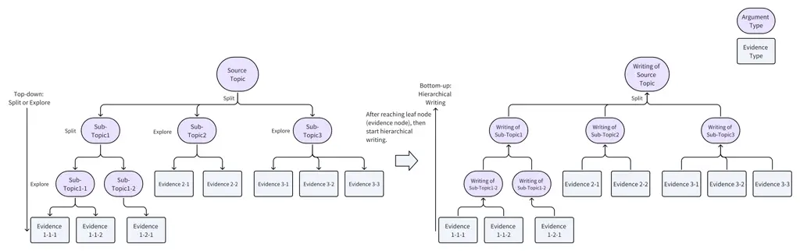
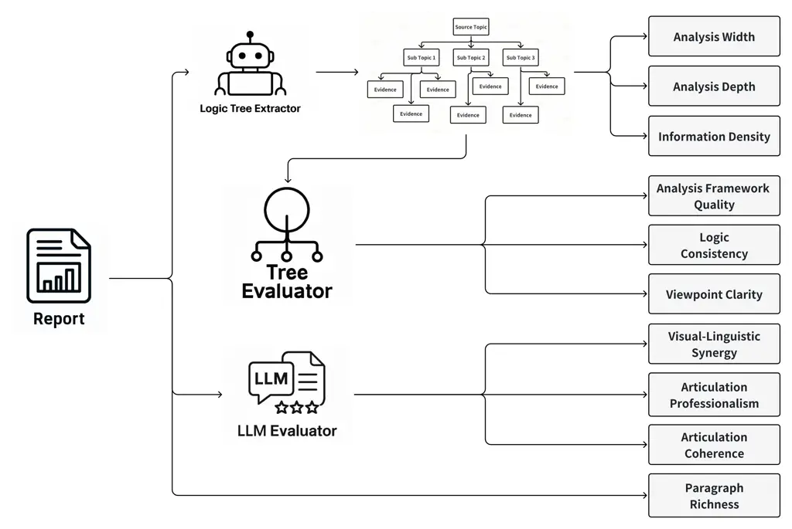

# FinResearchBench: A Logic Tree based Agent-as-a-Judge Evaluation Framework for Financial Research Agents

Conference: 6th ACM International Conference on AI in Finance; November
15–18, 2025; Singapore, Singapore6th ACM International Conference on AI
in Finance (ICAIF ’25), November 15–18, 2025, Singapore,
SingaporeDOI: [10.1145/3768292.3770364](https://doi.org/10.1145/3768292.3770364)ISBN: 979-8-4007-2220-2/2025/11

Rui Sun email: <sunrui@stepfun.com> Affiliation: Stepfun, Shanghai,
China , Zuo Bai email: <baizuo@stepfun.com> Note: Corresponding Author
Affiliation: Stepfun; FinStep, Shanghai, China , Wentao Zhang email:
<zhangwentao@stepfun.com> Affiliation: Stepfun, Shanghai, China ,
Yuxiang Zhang email: <easonzhang@stepfun.com> Affiliation: Stepfun,
Shanghai, China , Li Zhao email: <zhaoli@stepfun.com>
Affiliation: Stepfun, Shanghai, China , Shan Sun email:
<sunshan@finstep.cn> Affiliation: FinStep, Shanghai, China and Zhengwen
Qiu email: <qiuzhengwen@finstep.cn> Affiliation: FinStep, Shanghai,
China

© acmlicensed

###### Abstract.

Recently, AI agents are rapidly evolving in intelligence and are widely
used in professional research applications, such as STEM, software
development, and finance. Among these AI agents, deep research agent is
a key category as it can perform long-horizon tasks and solve problems
of greater complexity. However, there are few evaluation frameworks and
benchmarks that systematically and automatically investigate the
capabilities of these research agents. In addition, financial research
problems have distinct complexity and subtlety. To fill in the gap, we
propose FinResearchBench, which is a logic tree-based Agent-as-a-Judge
and targets specifically for the financial research agents. It provides
a comprehensive and automatic assessment of the research agents across 7
key types of tasks in the financial research domain. The contributions
of this work are two-folded: (1) the first and innovative
Agent-as-a-Judge system that extracts the logic tree of the research
outcome and uses it as the intermediate information to present a
comprehensive, reliable, and robust evaluation; (2) finance-oriented
that it covers 70 typical financial research questions, spreading across
7 frequently-encountered types of task in the domain.

###### Keywords: 

AI agents, financial research agents, logic tree, Agent-as-a-Judge

## 1. Introduction

Large Language Models (LLMs) have been rapidly developing in recent
years and demonstrate superior performance in diverse tasks, such as
story creation (Zhao et al., 2023), machine translation (Xu et al.,
2024), dialogue system (Yi et al., 2025), and sentiment analysis (Zhang
et al., 2024). Furthermore, LLMs are dramatically evolving in both long
text understanding and generation (Team et al., 2024; Anthropic, 2024).
The intrinsic capability of LLM to generate long text is often limited,
which is revealed to be bounded by the training data the model has seen
during the pretraining and alignment stages (Bai et al., 2024). Yet,
long text generation is essential, especially in professional research
areas, such as literature, law, STEM, and finance. Numerous methods have
been proposed to improve LLM’s competence in long text generation,
including scaling the generation length by adding long output training
data (Bai et al., 2024), performing generation in a multi-agent
framework (Hong et al., 2024), and setting up as deep research agents
(Schmidgall et al., 2025; Zheng et al., 2025). Deep research agent is a
prominent category of AI agents and is getting more and more important,
since it could generate a well-articulated, source-attributed research
report by autonomously browsing the Internet, calling various tools,
collecting information from different sources. The research result is
highly valuable and brings a huge improvement in productivity.
Therefore, a comprehensive evaluation of these deep research agents
becomes critical. Various benchmarks and evaluation methods are
proposed, such as HelloBench (Que et al., 2024), Deep Research Bench
(FutureSearch et al., 2025), and LongEval (Wu et al., 2025). However,
these methods do not fully utilize the results of the intermediate
steps, which could be the deciding factor for the quality of the
research outcome. Furthermore, existing benchmarks and evaluation
methods are of general purpose and face severe challenges when applied
for financial research, since it requires deep understanding of
finance-specific terminologies, clauses and domain-specific insights. In
this work, we propose FinResearchBench, a logic tree based
Agent-as-a-Judge that is designed specifically for financial research
agents. It first extracts the logic tree from the research outcome and
then uses the extracted logic tree to build an agentic system to
evaluate the financial research agents. Moreover, FinResearchBench is
finance concentrated and covers 7 key types of tasks in the financial
research domain. With the aim of the extracted logic tree as the
intermediate step, FinResearchBench is able to provide a comprehensive,
reliable and robust evaluation for various financial research agents.



Figure 1. The Illustration of Writing Process

## 2. Related Work

### 2.1. LLM and Deep Research Agent

Large Language Models (LLMs) have shown remarkable performance in
various tasks, such as story creation, machine translation, and dialogue
system (Zhao et al., 2023; Xu et al., 2024; Yi et al., 2025; Zhang
et al., 2024). In terms of dealing with long text, they also demonstrate
superior capability in understanding and processing (Team et al., 2024;
Anthropic, 2024). However, the capability of generating long text
progresses rather slowly. Many AI agent systems are then developed
including single-agent and multi-agent ones. And it represents a
paradigm shift from standalone LLMs towards more autonomous,
task-oriented systems (Hong et al., 2024; Wu et al., 2023). AI agents
largely increase the upper bound of the generation results since they
are able to perform more actions, like web browsing, tool calls, and
code execution. Additionally, AI agents are capable of processing the
obtained information more effectively and accurately, such as
Chain-of-Throughts (CoT) method (Wei et al., 2022), Tree-of-Thoughts
(ToT) method (Yao et al., 2023a), and ReAct method (Yao et al., 2023b).
Deep research agent is a growing category of AI agents, since it can
orchestrate multiple steps in an autonomous manner, including internet
browsing, information retrieval, and tool calling. It is able to provide
in-depth research of highly complicated problems, and thus brings huge
productivity improvement and high commercial values.

### 2.2. General and Domain-Specific Evaluation of Deep Research Agent

The evaluation of AI agents is critical since it determines if the
emergent agents are applicable for real-world problems or not. Moreover,
the evaluation will guide the direction for further improvement.
Numerous general benchmarks and evaluation methods are proposed, such as
AgentBench (Liu et al., 2024), ToolQA (Zhuang et al., 2023), HelloBench
(Que et al., 2024), DeepResearch Bench (Du et al., 2025), and LongEval
(Wu et al., 2025). These benchmarks are constructed with diverse tools
in different environments, enabling extensive evaluation of given
agents. For deep research agent, it is a subcategory of the AI agents
and performs multi-step orchestration in an autonomous manner. It
produces research report that contains rich information and is well
articulated. Many evaluation methods are proposed in the literature,
including Agent-as-a-Judge (Zhuge et al., 2024), and Mind2Web (Deng
et al., 2023).

However, these methods are majorly targeted for general domains and
inadequate for vertical ones, especially knowledge-heavy domains like
law, medicine, STEM and finance. In order to close the gap, many
domain-specific benchmarks and evaluation methods are introduced, for
instance LegalAgentBench (Li et al., 2024a), literature review
evaluation (Tang et al., 2024), FinEval (Guo et al., 2024) and xbench
(Chen et al., 2025). These domain-specific benchmarks and evaluations
are designed to offer valuable and domain-specific insights for
corresponding research.

## 3. FinResearchBench

### 3.1. The Design of FinResearchBench: an Agentic Evaluation System

Financial research is in essence a long text generation problem. And it
is impractical to count on human evaluation for long text generation
results due to two pitfalls, time-consuming and labor-intensive. Many
LLM-as-a-Judge methods were proposed in the literature(Zheng et al.,
2023; Li et al., 2024b). However, it remains questionable if directly
applying LLM as a judge can robustly and reliably evaluate the results
of long text generation, or more specifically in this paper, financial
research agents.

The results of financial research agents are open-ended, meaning that
there are no reference documents to guide the evaluation, not to mention
ground truth to do a simple text-level verification. Asking experienced
human experts to give a direct overall quality score is challenging
enough. It seems impossible to ask a LLM, no matter how well it is
prompted and aligned with humans, to give a direct score and hope it to
be accurate and reliable. HelloBench(Que et al., 2024) provides
category-specific checklists and asks LLMs to answer yes/no questions
for each question on the given checklist. Additionally, financial
research problems have distinct intricacy and subtlety, such as
financial terminology, logic, cognition and deep insights. More
importantly, financial research problems are widely encountered and have
huge potential business impacts. Due to the strong correlation between
the actual performance of financial research agents and real-world
values, we are committed to providing a finance-dedicated evaluation
framework featuring hierarchical structures that encompass correctness,
informativeness, source attribution, professionlism, among other
criteria. And the evaluation framework significantly surpasses existing
methods.

#### 3.1.1. Logic Tree

In order to draft a comprehensive and insightful professional research
document in finance or any other domain, it is mandatory to do a
thorough literature review, prepare ideas, and collect supporting
evidence before starting to write the full report. Cognitive and
linguistic theory defines different stages, i.e. Pre-Writing, Writing
and Re-Writing. It defines the planning stage that contains all the
preparation steps (Rohman, 1965). It lays the foundation for a
potentially coherent, insightful generation outcome. In this paper, we
define the underlying structure of ideas, arguments, and evidences as
the logic tree.

It is natural to derive that discovering the underlying logic tree of
any financial research outcome and using it as the intermediate step
will reduce the difficulty of the evaluation. Furthermore, the logic
tree has some quantifiable metrics, such as depth, width, and number of
nodes. Consequently, rule-based metrics can be formulated, such as
analysis width, analysis depth, information density, as listed in
Table 1.

#### 3.1.2. Writing Method

It remains unclear how to extract the underlying logic tree accurately.
In this section, we will discuss how professionals write in-depth
research. And then it is natural to reverse the writing process and
extract an accurate logic tree from a given research report.

Inspired by the cognitive writing theory (Rohman, 1965), there exists
different stages like pre-writing and writing. The stage of pre-writing
includes multiple operations, such as developing ideas, plans, designs;
active enlistment in the cause of an idea; and consecutive logical
thinking. And the stage of writing combines the ideas, evidence and
words into a fresh, original, well-articulated structure. We show the
process in Figure 1 and formulate it as follows:

1.  (1)
    Split or Explore: Analyze the given \$Topic\$ and decide to choose
    Split or Explore in a top-down manner.
    - •
      Split: if the current \$Topic\$ is too broad or should be analyzed
      from different perspectives, then go with this choice. The split
      list of sub-topics should comply with the following
      requirements: (1) the sub-topics should be independent and fully
      cover all aspects of the source topic; (2) each sub-topic should
      be specific enough for further information retrieval; (3) the
      sub-topics should be logically related.
    - •
      Explore: if the current \$Topic\$ is specific enough, then go with
      this choice to collect supporting information. A search agent will
      be followed up to take in the current \$Topic\$ and to retrieve
      relevant information. Subsequently, a well-written summary will be
      produced based on the \$Topic\$ and the relevant information.

2.  (2)
    Hierarchical Writing: in the order of bottom-up, perform writing for
    each node hierarchically. During the process, writing will be
    initiated on evidence nodes first, then sub-nodes, and finally the
    root node. The writing of a certain node will be triggered if it has
    no sub-node or its sub-nodes are all in ready status. This process
    yields a distinct argument for each topic node. Consequently, the
    terms topic and argument are treated as synonymous throughout this
    paper.

#### 3.1.3. Logic Tree Extraction

By reversing the writing method, it is straightforward to propose the
extraction method of the logic tree.

1.  (1)
    Step1: the node of the logic tree has two types: argument type and
    evidence type, as illustrated Figure 1.
    - •
      Argument Type: nodes of argument type represent claims,
      hypotheses, or analytical insights derived from reasoning.
    - •
      Evidence Type: nodes of evidence type represent concrete, factual
      statements, such as data points, statistical evidence or
      objectively verifiable facts.

    Leverage a well-prompted LLM to extract the research report into a
    logic tree, with nodes being classified into argument or evidence
    type and organized in a hierarchical manner. The extraction must
    obey the rules to preserve the original report without adding or
    interpreting any further information.

2.  (2)
    Step2: Leverage another well-prompted LLM to evaluate if the
    argument node can be supported by its subordinate argument nodes or
    evidence nodes.



Figure 2. The Illustration of Logic Tree Based Agent-as-a-Judge

#### 3.1.4. Logic Tree Based Agent-as-a-Judge

Leveraging the extracted logic tree as the intermediate step,
FinResearchBench is developed. It is an agentic system and essentially a
logic tree based Agent-as-a-Judge, as illustrated in Figure 2. With the
rich intermediate information throughout the writing process,
FinResearchBench is able to provide comprehensive, reliable and robust
evaluation in an automatic way. As indicated in Table 1, there are
several metrics that are rule derived, either based on the extracted
logic tree or not. We explain the rule-based metrics as follows.
Notations used in the following section are detailed in Appendix B. We
note that the hyper-parameters in these scoring functions (e.g.,
constants and weights) have been determined empirically. This approach
is taken to strike a balance between the various analytical dimensions,
such as width and depth, while ensuring the resulting scores are
sufficiently discriminative.

1.  (1)
    Analysis Width: The score of analysis width, $`S_{width}`$, is
    calculated based on the average number of children nodes
    ($`\bar{N}_{child}`$).

    ```math
    S_{width}=\min\left(100,\max\left(0,33.33\cdot(\bar{N}_{child}-1)\right)\right) \tag{1}
    ```

2.  (2)
    Analysis Depth: The score of analysis depth, $`S_{depth}`$, is a
    weighted average of the score from the tree’s maximum depth
    ($`S_{D_{max}}`$) and the score from the average depth of leaf nodes
    ($`S_{\bar{D}_{leaf}}`$).

    ```math
    \displaystyle S_{D_{max}} \displaystyle=\min\left(100,\max\left(0,25\cdot(D_{max}-2)\right)\right) \tag{2}
    ```

    ```math
    \displaystyle S_{\bar{D}_{leaf}} \displaystyle=\min\left(100,\max\left(0,40\cdot(\bar{D}_{leaf}-1.5)\right)\right)
    ```

    ```math
    \displaystyle S_{depth} \displaystyle=0.4\cdot S_{D_{max}}+0.6\cdot S_{\bar{D}_{leaf}}
    ```

3.  (3)
    Information Density: The score of information density, $`S_{info}`$,
    is a weighted average of the score from the total number of nodes
    ($`S_{nodes}`$) and the score from the evidence density
    ($`S_{density}`$).

    ```math
    \displaystyle S_{nodes} \displaystyle=\min\left(100,\max\left(0,2\cdot(N_{total}-5)\right)\right) \tag{3}
    ```

    ```math
    \displaystyle R_{evidence} \displaystyle=\begin{cases}\frac{N_{evidence}}{N_{total}}&\text{if }N_{total}>0\\
    0&\text{otherwise}\end{cases}
    ```

    ```math
    \displaystyle S_{density} \displaystyle=\min\left(100,100\cdot R_{evidence}\right)
    ```

    ```math
    \displaystyle S_{info} \displaystyle=0.7\cdot S_{nodes}+0.3\cdot S_{density}
    ```

4.  (4)
    Paragraph Richness: The score, $`S_{rich}`$, is a piecewise function
    of $`w`$, the average number of words per subtitle.

    ```math
    S_{rich}(w)=\begin{cases}0&w\leq 0\\
    0.6w&0<w<100\\
    60+0.08w&200\leq w<500\\
    100&500\leq w\leq 1000\\
    \max(60,100-0.05(w-1000))&w>1000\end{cases} \tag{4}
    ```

5.  (5)
    Other Metrics: For dimensions that are qualitative in nature, such
    as Articulation Professionalism, Logic Consistency, and Viewpoint
    Clarity, we employ a Large Language Model (LLM) for evaluation. The
    LLM is prompted with a detailed rubric to assess and score each of
    these subjective attributes.

### 3.2. Data Construction

Financial research is skewed and the highly-encountered issues are
closely related to monetary returns, such as financial plate
investigation and stock-specific analysis. Therefore, there is a huge
potential for productivity improvement and real-world values for an
accurate, comprehensive and reliable evaluation of these agents.
Additionally, financial research agents have some unique intricacies,
such as domain-specific terms, clauses and in-depth knowledge.
Therefore, it is crucial to collect sufficiently complex, yet
practically applicable financial research tasks.

- •
  Query Sampling: Randomly sample user queries from our online product:
  AI Cashcat ([https://www.cashcat.cn](https://www.cashcat.cn)). A
  strict privacy protection process is enforced to all raw queries
  before subsequent steps, including anonymization, personal
  identifiable information removal and session information disposal.
- •
  Query Classification: We use a general-purpose large language model at
  hand (step-2 model from
  [https://www.stepfun.com](https://www.stepfun.com)) to classify the
  queries into different categories. In order to determine the category
  list, we consult 3 domain experts, remove semantically duplicate
  answers and compile their responses into a union , which is:
  Stock-Specific Analysis, Event Analysis, Stock Selection from Given
  Plate, Sector Analysis, Investment Morning Brief, Post-Market Recap,
  Expert Opinion, Stock-Specific Performance, Stock-Specific Movements,
  Market Performance and Analysis, Plate Performance and Analysis,
  Criteria-based Stock Filtering, Trade Recommendation, Trending News,
  Investment Education and Others. The top 7 categories in bold font,
  out of the total 16 ones, occupy over 95% online traffic. Therefore,
  we put the focus on these 7 types of tasks.
- •
  Data Curation: Conduct interviews with domain experts from finance
  news agencies, research department of security companies, professional
  investors, and generate 70 questions, 10 typical research problems per
  category.

## 4. Experiments and Analysis

### 4.1. Experiment Settings

This section outlines the experimental setup for our evaluation.

#### 4.1.1. Core Model

We utilized Claude 3.7 Sonnet as the foundational Large Language Model
(LLM) for the agentic system within the proposed FinResearchBench.

#### 4.1.2. Agents and Experiments

We conduct a two-stage evaluation. In the first stage, we run the
FinResearchBench on a range of leading international and domestic AI
agents as well as our proprietary product, Cashcat Pro
( [https://cashcat.cn/?mode=DeepResearch](https://cashcat.cn/?mode=DeepResearch)).
Cashcat Pro is a deep research agent developed by FinStep, targeted
specifically for the finance sector. It integrates a multi-agent
framework for collaborative analysis, a suite of professional tools for
real-time financial data, and cutting-edge AI models to deliver deep,
actionable insights and automate the entire research process. In
addition, Gemini is powered by Gemini Pro 2.5, while OpenAI DeepResearch
is powered by GPT-4o.

In the second stage, we perform a comparison between the top 3 agents
versus human expert written report. We collect 20 financial research
reports from reputable institutions, focusing on the types of
stock-specific analysis and sector analysis. Subsequently, we extract
the research topic from each of these reports and ask the top 3 agents
to generate corresponding report. Finally, these research outcomes from
the agents are compared with the expert written ones, under the same
evaluation framework, FinResearchBench, proposed in this paper.

In this way, we obtain a holistic understanding of deep research agents
in the financial domain, with not only the performance of different
research agents being studied, but also the agents capability versus
human experts.

### 4.2. Main Results

The following section presents a comprehensive evaluation of multiple
deep research agents, together with expert written reports. Detailed
scores are presented in Table 1 and Table 2.

[TABLE]

^(\*)Not officially accessible in Chinese Mainland.

Table 1. Overall Evaluation Results on FinResearchBench

[TABLE]

^(\*)Not officially accessible in Chinese Mainland.

Table 2. Evaluation Results against Human Written Reports

#### 4.2.1. Analysis of Overall Performance on FinResearchBench

Table 1 presents the overall evaluation results of various agents on
FinResearchBench. The key findings are as follows:

- •
  Overall Ranking: Among all agents, Gemini achieves the highest Final
  Score (76.60), establishing as the top-performing agent in this
  benchmark. OpenAI is close behind with the second-highest score
  (74.14).
- •
  Gemini’s Strengths: Gemini’s leading position is predominantly driven
  by its outstanding performance in articulation and analysis. It scores
  highest in Articulation Professionalism (95.56), Articulation
  Coherence (96.72), Analysis Framework Quality (89.41), and Analysis
  Depth (82.67), indicating its strong capability to generate
  professional, coherent, well-structured, and in-depth financial
  reports.
- •
  OpenAI’s Strengths: OpenAI agent excels in different dimensions. It
  delivers the top scores in Logic Consistency (90.39), Viewpoint
  Clarity (93.10), and Paragraph Richness (90.77). This suggests that
  its outputs are highly logical, clear, and contextually rich.
- •
  Cashcat Pro’s Strengths: It demonstrates highly competitive
  performance and ranks in the top tier. It exhibits a unique,
  specialized skill set that differentiates it from other leading
  agents. Cashcat Pro shows exceptional performance in Visual-Linguistic
  Synergy and excels at producing highly structured and methodologically
  sound reports. Furthermore, among the agents accessible in Chinese
  Mainland, it leads by a clear margin.

#### 4.2.2. Comparative Analysis Against Human Experts

Table 2 provides a direct comparison between the top 3 agents and expert
written reports. This analysis reveals a more nuanced view of agent
capabilities.

- •
  Human Benchmark: Expert Written Report is the leading performer with
  the highest Final Score (81.43), confirming that human experts still
  produce the highest quality.
- •
  Dimensions of Human Superiority: The expert’s dominance lies in
  dimensions requiring holistic understanding and synthesis. The expert
  achieves a perfect score in Visual-Linguistic Synergy (100.00) and a
  near-perfect score in Paragraph Richness (99.96). Additionally, the
  expert leads in Analysis Width (55.77), Analysis Depth (83.31), and
  Logic Consistency (90.98).
- •
  Conclusion: In summary, the evaluation results indicate that while no
  single AI agent surpasses human experts in terms of the overall
  intelligence, different agents exhibit unique strengths. The path
  forward to develop a superior deep research agent lies not only in
  improving individual metrics, but also in integrating these disparate
  strengths to a further extend.

### 4.3. Effectiveness of the Logic Tree Extraction

The accuracy of our proposed method, the logic tree based
Agent-as-a-Judge, largely depends on the accuracy of the extraction of
the logic tree. Thus, we design a corresponding experiment to validate
the effectiveness of the logic tree extraction.

#### 4.3.1. Objective

As the efficacy and reliability of our report evaluation methodology
largely hinges upon the precision of the extracted logic tree, we aim to
quantify the accuracy of the logic tree extraction using clearly defined
metrics.

#### 4.3.2. Methodology

As shown in Figure  1, the research process is composed of 2 steps:
top-down Split or Explore strategy, and bottom-up Hierarchical Writing.
It is intuitive to run the 2 steps in a consecutive manner and pack the
outcomes of the second step and the first step to form a pair of report
and ground-truth (GT) logic tree.

For each pair of report-GT logic tree, the logic tree extraction method
will take over and extract corresponding logic tree from the report. And
then, the similarity between the GT logic tree and the extracted one
will be used to quantify the accuracy of the proposed logic tree
extraction method.

#### 4.3.3. Ground Truth Generation

We use some random queries as described in Section 3.2 to generate many
pairs of report-GT logic tree. Furthermore, some rules are applied to
pick out 100 pairs with the GT logic tree having different numbers of
depth and width to enforce diversity on the generated dataset.

#### 4.3.4. Similarity Metrics

We introduce 3 metrics to comprehensively compare the GT logic tree and
the extracted logic tree:

- •
  Total Nodes Similarity: the similarity between the total number of
  nodes in the extracted logic tree and the GT. Here, $`N_{a}`$ and
  $`N_{b}`$ denote the total number of nodes in the extracted logic tree
  and the GT logic tree, respectively.

  ```math
  S_{\text{nodes}}=1-\frac{|N_{a}-N_{b}|}{\max(N_{a},N_{b})}
  ```

- •
  Depth Similarity: the similarity between the average depths of the
  extracted logic tree and the GT. $`d_{a}`$ and $`d_{b}`$ are the
  average depths of the extracted and GT logic trees, respectively.

  ```math
  S_{\text{depth}}=1-\frac{|d_{a}-d_{b}|}{\max(d_{a},d_{b})}
  ```

- •
  Width Similarity: the similarity between the average number of
  children (width) per node in the extracted logic tree and the GT.
  $`w_{a}`$ and $`w_{b}`$ refer to the average number of children per
  node in the extracted and GT, respectively.

  ```math
  S_{\text{width}}=1-\frac{|w_{a}-w_{b}|}{\max(w_{a},w_{b})}
  ```

#### 4.3.5. Results

The metrics are computed and listed as follows:

| Dimension              | Similarity Score |
| ---------------------- | ---------------- |
| Total Nodes Similarity | 0.54             |
| Depth Similarity       | 0.85             |
| Width Similarity       | 0.76             |
| Average Similarity     | 0.72             |

A detailed analysis indicates a significant drop in the extraction
accuracy when the GT logic tree is either too large or too small.
Therefore, we check the metric scores in different bins in terms of the
nodes count of the GT logic tree.

| Dimension              | \[0 - 25) | \[25 - 50) | \[50, +$`\infty)`$ |
| ---------------------- | --------- | ---------- | ------------------ |
| Total Nodes Similarity | 0.37      | 0.78       | 0.48               |
| Depth Similarity       | 0.81      | 0.89       | 0.85               |
| Width Similarity       | 0.66      | 0.82       | 0.81               |
| Average Similarity     | 0.61      | 0.83       | 0.71               |

#### 4.3.6. Insights and Conclusions

The evaluation clearly demonstrates that the logic tree extraction is
robust for moderately complex structures (25-50 nodes), with an average
similarity of 0.83. However, the extraction accuracy significantly
diminishes for smaller (\<25 nodes, similarity 0.61) and larger trees
(\>50 nodes, similarity 0.71). This underscores the necessity to
optimize the extraction step, tailored specifically towards very concise
or extensively detailed reports to ensure reliability of the proposed
method.

To further analyze the applicability of the logic tree, additional
statistics are calculated:

|                            |                        |            |                    |
| -------------------------- | ---------------------- | ---------- | ------------------ |
| Dimension                  | \[0 - 25)              | \[25 - 50) | \[50, +$`\infty)`$ |
| Avg. Extracted Nodes Count | 37                     | 49         | 48                 |
| Min. Word Count            | 403                    | 10901      | 31946              |
| Max. Word Count            | 9103                   | 16532      | 50416              |
| Spearman Correlation       | 0.48 (p-value: 0.0001) |            |                    |

We perform a correlation analysis between the total number of nodes from
the extracted logic tree and the GT. As detailed in the above table, the
analysis yields a Spearman correlation coefficient of $`r=0.48`$, with a
highly statistically significant p-value of less than $`0.0001`$.

This moderate positive correlation indicates that, overall speaking, an
increase in the size of GT logic tree is associated with an increase in
the size of the extracted logic tree. This finding supports our
hypothesis that the logic tree method is sensitive to the underlying
complexity of the source report.

More specifically, this relationship is particularly effective for
documents up to approximately 16,000 words. As shown in the table, when
the document word count increases from the first bin (max 9,103 words)
to the second bin (max 16,532 words), the Avg. Extracted Nodes Count
rises accordingly from 37 to 49. This demonstrates that for short to
medium-length documents, our method robustly captures the increasing
complexity by producing a larger and more complicated logic tree.

However, the data also suggests a potential limitation for extremely
long report. As the word count extends into the third bin (over 30,000
words), the average number of extracted nodes plateaus and slightly
decreases to 48. This implies that while the logic tree method serves as
an accurate indicator of complexity for a majority of documents, its
ability to differentiate the level of complexity diminishes for
exceptionally long and elaborate reports.

## 5. Conclusions

### 5.1. Main Conclusions

In this paper, we introduce FinResearchBench, which is the first logic
tree-based Agent-as-a-Judge system that is capable of performing an
automatic evaluation to financial research agents and providing reliable
and robust results. In addition, we collect 70 head research questions,
spreading across 7 key types of tasks in the financial research domain.
The problems in the domain of financial research have big potentials in
investment activities, making the proposed FinResearchBench to have huge
real-world values. We expect FinResearchBench to become a useful tool
for the developers of any deep research agents in the financial domain
and help those agents to proceed even further.

### 5.2. Challenges and Future Works

Despite the promising results, this study identifies several limitations
that need more attention in future research:

Enhancing Multimodal Generation Capabilities: A significant gap persists
in the visualization capabilities between the current AI agents and
human experts. Even though current advanced agents can generate text
effectively, their ability to create and integrate meaningful charts,
graphs, and diagrams remain nascent. This highlights a critical
direction for future work: advancing the multimodal generation
capability. Future research should focus on enabling agents not only to
analyze visual data but also to generate informative and aesthetically
pleasing visuals that are deeply synergistic with the textual content.

Improving Logic Tree Extraction for Document of Varied Length: Our
analysis indicates that the current logic tree extraction method shows
varied efficacy across document of different lengths. The extraction
method is suboptimal for very short and very long reports. Future work
should aim to enhance the robustness of the extraction algorithm, making
it less sensitive to the length of the document, and thus providing more
reliable intermediate results to further improve the end-to-end
evaluation.

Moving from Logic Trees to Logic Graphs: Furthermore, a more fundamental
limitation lies in the choice of a tree structure itself to represent a
document’s logic. While trees excel at capturing hierarchical, top-down
arguments, they inherently struggle to model the complex, network-like
nature of sophisticated reasoning. Real-world argumentation is rarely a
strict hierarchy; it often involves cross-references where a single
piece of evidence supports multiple disparate claims, feedback loops, or
premises that jointly support a conclusion in a non-linear fashion.

A logic graph, particularly a directed acyclic graph (DAG), offers a far
more robust and complete representational framework. Such a structure
can naturally capture these many-to-many relationships, allowing for a
more nuanced and accurate evaluation of a document’s overall coherence
and logical integrity. Therefore, a pivotal direction for future work is
to move beyond tree-based models and develop novel methods for
extracting and analyzing these more comprehensive logic graphs. This
would represent a significant step towards an AI that can truly
understand the intricate web of arguments presented in a document.

###### Acknowledgements.

This paper was supported by "2025 Special Program for Supporting
Innovative Development in Leading Industries (AI Track) under the
High-Quality Industrial Development Initiative" (Project Name: Finstep
Finsmart Intelligent Service Platform; Project ID: 2025-GZL-RGZN-01024)
from Shanghai Municipal Commission of Economy and Informatization,
Shanghai, China.

## References

- Anthropic (2024) Anthropic. 2024. Anthropic: Introducing Claude 3.5
  Sonnet.
  [https://www.anthropic.com/news/claude-3-5-sonnet](https://www.anthropic.com/news/claude-3-5-sonnet)
- Bai et al. (2024) Yushi Bai, Jiajie Zhang, Xin Lv, Linzhi Zheng, Siqi
  Zhu, Lei Hou, Yuxiao Dong, Jie Tang, and Juanzi Li. 2024. LongWriter:
  Unleashing 10,000+ Word Generation from Long Context LLMs.
  arXiv:2408.07055 \[cs.CL\]
  [https://arxiv.org/abs/2408.07055](https://arxiv.org/abs/2408.07055)
- Chen et al. (2025) Kaiyuan Chen, Yixin Ren, Yang Liu, Xiaobo Hu,
  Haotong Tian, Tianbao Xie, Fangfu Liu, Haoye Zhang, Hongzhang Liu,
  Yuan Gong, Chen Sun, Han Hou, Hui Yang, James Pan, Jianan Lou, Jiayi
  Mao, Jizheng Liu, Jinpeng Li, Kangyi Liu, Kenkun Liu, Rui Wang, Run
  Li, Tong Niu, Wenlong Zhang, Wenqi Yan, Xuanzheng Wang, Yuchen Zhang,
  Yi-Hsin Hung, Yuan Jiang, Zexuan Liu, Zihan Yin, Zijian Ma, and Zhiwen
  Mo. 2025. xbench: Tracking Agents Productivity Scaling with
  Profession-Aligned Real-World Evaluations. arXiv:2506.13651 \[cs.LG\]
  [https://arxiv.org/abs/2506.13651](https://arxiv.org/abs/2506.13651)
- Deng et al. (2023) Xiang Deng, Yu Gu, Boyuan Zheng, Shijie Chen,
  Samuel Stevens, Boshi Wang, Huan Sun, and Yu Su. 2023. MIND2WEB:
  towards a generalist agent for the web. In _Proceedings of the 37th
  International Conference on Neural Information Processing Systems_
  (New Orleans, LA, USA) _(NIPS ’23)_. Curran Associates Inc., Red Hook,
  NY, USA, Article 1220, 24 pages.
- Du et al. (2025) Mingxuan Du, Benfeng Xu, Chiwei Zhu, Xiaorui Wang,
  and Zhendong Mao. 2025. DeepResearch Bench: A Comprehensive Benchmark
  for Deep Research Agents. arXiv:2506.11763 \[cs.CL\]
  [https://arxiv.org/abs/2506.11763](https://arxiv.org/abs/2506.11763)
- FutureSearch et al. (2025) FutureSearch, :, Nikos I. Bosse, Jon Evans,
  Robert G. Gambee, Daniel Hnyk, Peter Mühlbacher, Lawrence Phillips,
  Dan Schwarz, and Jack Wildman. 2025. Deep Research Bench: Evaluating
  AI Web Research Agents. arXiv:2506.06287 \[cs.AI\]
  [https://arxiv.org/abs/2506.06287](https://arxiv.org/abs/2506.06287)
- Guo et al. (2024) Xin Guo, Haotian Xia, Zhaowei Liu, Hanyang Cao, Zhi
  Yang, Zhiqiang Liu, Sizhe Wang, Jinyi Niu, Chuqi Wang, Yanhui Wang,
  Xiaolong Liang, Xiaoming Huang, Bing Zhu, Zhongyu Wei, Yun Chen,
  Weining Shen, and Liwen Zhang. 2024. FinEval: A Chinese Financial
  Domain Knowledge Evaluation Benchmark for Large Language Models.
  arXiv:2308.09975 \[cs.CL\]
  [https://arxiv.org/abs/2308.09975](https://arxiv.org/abs/2308.09975)
- Hong et al. (2024) Sirui Hong, Mingchen Zhuge, Jonathan Chen, Xiawu
  Zheng, Yuheng Cheng, Jinlin Wang, Ceyao Zhang, Zili Wang, Steven
  Ka Shing Yau, Zijuan Lin, Liyang Zhou, Chenyu Ran, Lingfeng Xiao,
  Chenglin Wu, and Jürgen Schmidhuber. 2024. MetaGPT: Meta Programming
  for A Multi-Agent Collaborative Framework. In _ICLR_.
  [https://openreview.net/forum?id=VtmBAGCN7o](https://openreview.net/forum?id=VtmBAGCN7o)
- Li et al. (2024b) Dawei Li, Bohan Jiang, Liangjie Huang, Alimohammad
  Beigi, Chengshuai Zhao, Zhen Tan, Amrita Bhattacharjee, Yuxuan Jiang,
  Canyu Chen, Tianhao Wu, et al. 2024b. From generation to judgment:
  Opportunities and challenges of llm-as-a-judge. _arXiv preprint
  arXiv:2411.16594_ (2024).
- Li et al. (2024a) Haitao Li, Junjie Chen, Jingli Yang, Qingyao Ai, Wei
  Jia, Youfeng Liu, Kai Lin, Yueyue Wu, Guozhi Yuan, Yiran Hu, et al.
  2024a. LegalAgentBench: Evaluating LLM Agents in Legal Domain. _arXiv
  preprint arXiv:2412.17259_ (2024).
- Liu et al. (2024) Xiao Liu, Hao Yu, Hanchen Zhang, Yifan Xu, Xuanyu
  Lei, Hanyu Lai, Yu Gu, Hangliang Ding, Kaiwen Men, Kejuan Yang, Shudan
  Zhang, Xiang Deng, Aohan Zeng, Zhengxiao Du, Chenhui Zhang, Sheng
  Shen, Tianjun Zhang, Yu Su, Huan Sun, Minlie Huang, Yuxiao Dong, and
  Jie Tang. 2024. AgentBench: Evaluating LLMs as Agents. In _The Twelfth
  International Conference on Learning Representations_.
  [https://openreview.net/forum?id=zAdUB0aCTQ](https://openreview.net/forum?id=zAdUB0aCTQ)
- Que et al. (2024) Haoran Que, Feiyu Duan, Liqun He, Yutao Mou,
  Wangchunshu Zhou, Jiaheng Liu, Wenge Rong, Zekun Moore Wang, Jian
  Yang, Ge Zhang, Junran Peng, Zhaoxiang Zhang, Songyang Zhang, and Kai
  Chen. 2024. HelloBench: Evaluating Long Text Generation Capabilities
  of Large Language Models. arXiv:2409.16191 \[cs.CL\]
  [https://arxiv.org/abs/2409.16191](https://arxiv.org/abs/2409.16191)
- Rohman (1965) D Gordon Rohman. 1965. Pre-writing: The stage of
  discovery in the writing process. _College Composition &
  Communication_ 16, 2 (1965), 106–112.
- Schmidgall et al. (2025) Samuel Schmidgall, Yusheng Su, Ze Wang,
  Ximeng Sun, Jialian Wu, Xiaodong Yu, Jiang Liu, Michael Moor, Zicheng
  Liu, and Emad Barsoum. 2025. Agent Laboratory: Using LLM Agents as
  Research Assistants. arXiv:2501.04227 \[cs.HC\]
  [https://arxiv.org/abs/2501.04227](https://arxiv.org/abs/2501.04227)
- Tang et al. (2024) Xuemei Tang, Xufeng Duan, and Zhenguang G
  Cai. 2024. Are LLMs Good Literature Review Writers? Evaluating the
  Literature Review Writing Ability of Large Language Models. _arXiv
  preprint arXiv:2412.13612_ (2024).
- Team et al. (2024) Gemini Team, Petko Georgiev, Ving Ian Lei, Ryan
  Burnell, Libin Bai, Anmol Gulati, Garrett Tanzer, Damien Vincent,
  Zhufeng Pan, Shibo Wang, et al. 2024. Gemini 1.5: Unlocking multimodal
  understanding across millions of tokens of context. _arXiv preprint
  arXiv:2403.05530_ (2024).
- Wei et al. (2022) Jason Wei, Xuezhi Wang, Dale Schuurmans, Maarten
  Bosma, Brian Ichter, Fei Xia, Ed H. Chi, Quoc V. Le, and Denny
  Zhou. 2022. Chain-of-thought prompting elicits reasoning in large
  language models. In _Proceedings of the 36th International Conference
  on Neural Information Processing Systems_ (New Orleans, LA, USA)
  _(NIPS ’22)_. Curran Associates Inc., Red Hook, NY, USA, Article 1800,
  14 pages.
- Wu et al. (2023) Qingyun Wu, Gagan Bansal, Jieyu Zhang, Yiran Wu,
  Beibin Li, Erkang Zhu, Li Jiang, Xiaoyun Zhang, Shaokun Zhang, Jiale
  Liu, Ahmed Hassan Awadallah, Ryen W White, Doug Burger, and Chi
  Wang. 2023. AutoGen: Enabling Next-Gen LLM Applications via
  Multi-Agent Conversation. arXiv:2308.08155 \[cs.AI\]
  [https://arxiv.org/abs/2308.08155](https://arxiv.org/abs/2308.08155)
- Wu et al. (2025) Siwei Wu, Yizhi Li, Xingwei Qu, Rishi Ravikumar,
  Yucheng Li, Tyler Loakman, Shanghaoran Quan, Xiaoyong Wei, Riza
  Batista-Navarro, and Chenghua Lin. 2025. LongEval: A Comprehensive
  Analysis of Long-Text Generation Through a Plan-based Paradigm.
  arXiv:2502.19103 \[cs.CL\]
  [https://arxiv.org/abs/2502.19103](https://arxiv.org/abs/2502.19103)
- Xu et al. (2024) Haoran Xu, Amr Sharaf, Yunmo Chen, Weiting Tan,
  Lingfeng Shen, Benjamin Van Durme, Kenton Murray, and Young Jin
  Kim. 2024. Contrastive preference optimization: pushing the boundaries
  of LLM performance in machine translation. In _Proceedings of the 41st
  International Conference on Machine Learning_ (Vienna, Austria)
  _(ICML’24)_. JMLR.org, Article 2275, 21 pages.
- Yao et al. (2023a) Shunyu Yao, Dian Yu, Jeffrey Zhao, Izhak Shafran,
  Thomas L. Griffiths, Yuan Cao, and Karthik Narasimhan. 2023a. Tree of
  thoughts: deliberate problem solving with large language models. In
  _Proceedings of the 37th International Conference on Neural
  Information Processing Systems_ (New Orleans, LA, USA) _(NIPS ’23)_.
  Curran Associates Inc., Red Hook, NY, USA, Article 517, 14 pages.
- Yao et al. (2023b) Shunyu Yao, Jeffrey Zhao, Dian Yu, Nan Du, Izhak
  Shafran, Karthik R Narasimhan, and Yuan Cao. 2023b. ReAct: Synergizing
  Reasoning and Acting in Language Models. In _The Eleventh
  International Conference on Learning Representations_.
  [https://openreview.net/forum?id=WE_vluYUL-X](https://openreview.net/forum?id=WE_vluYUL-X)
- Yi et al. (2025) Zihao Yi, Jiarui Ouyang, Zhe Xu, Yuwen Liu, Tianhao
  Liao, Haohao Luo, and Ying Shen. 2025. A Survey on Recent Advances in
  LLM-Based Multi-turn Dialogue Systems. arXiv:2402.18013 \[cs.CL\]
  [https://arxiv.org/abs/2402.18013](https://arxiv.org/abs/2402.18013)
- Zhang et al. (2024) Wenxuan Zhang, Yue Deng, Bing Liu, Sinno Pan, and
  Lidong Bing. 2024. Sentiment Analysis in the Era of Large Language
  Models: A Reality Check. In _Findings of the Association for
  Computational Linguistics: NAACL 2024_, Kevin Duh, Helena Gomez, and
  Steven Bethard (Eds.). Association for Computational Linguistics,
  Mexico City, Mexico, 3881–3906.
  [doi:10.18653/v1/2024.findings-naacl.246](https://doi.org/10.18653/v1/2024.findings-naacl.246)
- Zhao et al. (2023) Zoie Zhao, Sophie Song, Bridget Duah, Jamie
  Macbeth, Scott Carter, Monica P Van, Nayeli Suseth Bravo, Matthew
  Klenk, Kate Sick, and Alexandre LS Filipowicz. 2023. More human than
  human: LLM-generated narratives outperform human-LLM interleaved
  narratives. In _Proceedings of the 15th Conference on Creativity and
  Cognition_. 368–370.
- Zheng et al. (2023) Lianmin Zheng, Wei-Lin Chiang, Ying Sheng, Siyuan
  Zhuang, Zhanghao Wu, Yonghao Zhuang, Zi Lin, Zhuohan Li, Dacheng Li,
  Eric P. Xing, Hao Zhang, Joseph E. Gonzalez, and Ion Stoica. 2023.
  Judging LLM-as-a-judge with MT-bench and Chatbot Arena. In
  _Proceedings of the 37th International Conference on Neural
  Information Processing Systems_ (New Orleans, LA, USA) _(NIPS ’23)_.
  Curran Associates Inc., Red Hook, NY, USA, Article 2020, 29 pages.
- Zheng et al. (2025) Yuxiang Zheng, Dayuan Fu, Xiangkun Hu, Xiaojie
  Cai, Lyumanshan Ye, Pengrui Lu, and Pengfei Liu. 2025. DeepResearcher:
  Scaling Deep Research via Reinforcement Learning in Real-world
  Environments. arXiv:2504.03160 \[cs.AI\]
  [https://arxiv.org/abs/2504.03160](https://arxiv.org/abs/2504.03160)
- Zhuang et al. (2023) Yuchen Zhuang, Yue Yu, Kuan Wang, Haotian Sun,
  and Chao Zhang. 2023. ToolQA: a dataset for LLM question answering
  with external tools. In _Proceedings of the 37th International
  Conference on Neural Information Processing Systems_ (New Orleans, LA,
  USA) _(NIPS ’23)_. Curran Associates Inc., Red Hook, NY, USA, Article
  2180, 27 pages.
- Zhuge et al. (2024) Mingchen Zhuge, Changsheng Zhao, Dylan Ashley,
  Wenyi Wang, Dmitrii Khizbullin, Yunyang Xiong, Zechun Liu, Ernie
  Chang, Raghuraman Krishnamoorthi, Yuandong Tian, Yangyang Shi, Vikas
  Chandra, and Jürgen Schmidhuber. 2024. Agent-as-a-Judge: Evaluate
  Agents with Agents. arXiv:2410.10934 \[cs.AI\]
  [https://arxiv.org/abs/2410.10934](https://arxiv.org/abs/2410.10934)

## Appendix A Question Examples

Table 3 lists some examples, one example question for one type of
finance research problem.

| Category                         | Example                                                                                                                                                                                                              |
| -------------------------------- | -------------------------------------------------------------------------------------------------------------------------------------------------------------------------------------------------------------------- |
| Stock-Specific Analysis          | Deep research on Geely Automobile, especially the detailed assessment of the competitiveness of new vehicles and intelligent driving.                                                                                |
| Event Analysis                   | Please analyze the impact of the Trump administration’s proposed new tariffs on A-share listed companies within the Apple supply chain.                                                                              |
| Stock Selection from Given Plate | Conduct an in-depth analysis of the eVTOL plate, requiring comprehensive conceptual explanation and fundamental analysis of the industry to which they belong.                                                       |
| Sector Analysis                  | Analyze the 2025 development trends in the cosmetics industry, identifying potential high-impact breakout opportunities and examining the commercial/industrial dynamics driving them.                               |
| Investment Morning Brief         | Please compile a summary of today’s investment morning brief, which should include key updates from yesterday till now, major industry events, overnight US stock market performance, and today’s opening forecasts. |
| Post-Market Recap                | Analyze the fund flows of today’s market, including the inflow and outflow of the institutional fund and the retail fund.                                                                                            |
| Expert Opinion                   | Compile the latest opinions of the sell-side analysts over the past 12 hours and identify the three most frequently recommended stocks.                                                                              |

Table 3. Question Examples

## Appendix B Notations

Table 4 lists the notations used in logic tree based metrics.

| Notation               | Description                                                          |
| ---------------------- | -------------------------------------------------------------------- |
| $`S_{width}`$          | The final score for Analysis Width.                                  |
| $`\bar{N}_{child}`$    | The average number of children for each node in the logic tree.      |
| $`S_{depth}`$          | The final score for Analysis Depth.                                  |
| $`S_{D_{max}}`$        | The score component related to the maximum depth of the tree.        |
| $`S_{\bar{D}_{leaf}}`$ | The score component related to the average depth of leaf nodes.      |
| $`D_{max}`$            | The maximum depth of the logic tree.                                 |
| $`\bar{D}_{leaf}`$     | The average depth of all leaf nodes.                                 |
| $`S_{info}`$           | The final score for Information Density.                             |
| $`S_{nodes}`$          | The score component related to the total number of nodes.            |
| $`S_{density}`$        | The score component related to the density of evidence.              |
| $`N_{total}`$          | The total number of nodes in the logic tree.                         |
| $`N_{evidence}`$       | The number of nodes that contain evidence.                           |
| $`R_{evidence}`$       | The ratio of evidence-containing nodes to the total number of nodes. |
| $`S_{rich}`$           | The final score for Paragraph Richness.                              |
| $`w`$                  | The average number of words per subtitle in the report.              |

Table 4. Notation for Logic Tree Based Metrics

## Appendix C Example Prompt

This appendix provides illustrative examples of the prompt used to
evaluate the reports.

### C.1. Logic Tree Extraction

The prompt used to extract the logic tree.

1 """

2 \##␣BACKGROUND

3
You␣are␣an␣expert␣in␣logical␣analysis,␣specializing␣in␣identifying␣and␣constructing␣logical␣trees␣from␣text.␣To␣evaluate␣the␣quality␣of␣given␣answers␣based␣on␣metrics␣such␣as␣information␣volume,␣logical␣coherence,␣depth,␣and␣breadth,␣you␣must␣first␣identify␣the␣core␣arguments,␣sub-arguments,␣and␣evidence␣within␣the␣text␣and␣construct␣a␣logical␣tree␣to␣represent␣them.

4 \##␣TASK

5
You␣will␣receive␣a␣query␣and␣the␣corresponding␣generated␣answer.␣This␣answer␣could␣be␣a␣casual␣reply,␣a␣research␣summary␣for␣a␣concept,␣or␣a␣professional␣research␣report.␣Your␣task␣is␣to␣carefully␣read␣the␣answer,␣identify␣all␣core␣arguments,␣sub-arguments,␣and␣evidence,␣and␣construct␣a␣logical␣tree␣to␣represent␣their␣relationships.

6
The␣core␣argument␣serves␣as␣the␣root␣node␣of␣the␣logical␣tree,␣sub-arguments␣are␣intermediate␣nodes,␣and␣evidence␣forms␣the␣leaf␣nodes.␣All␣root,␣intermediate,␣and␣leaf␣nodes␣must␣be␣extracted␣directly␣from␣the␣provided␣text.␣You␣must␣not␣add␣content␣not␣mentioned␣in␣the␣original␣text␣or␣make␣subjective␣inferences.

7 \##␣DEFINITIONS

8
1.␣␣\*\*Evidence\*\*:␣Objective␣facts␣presented␣in␣the␣text,␣including␣but␣not␣limited␣to␣statements␣of␣objective␣situations,␣events,␣or␣data.

9
2.␣␣\*\*Sub-argument\*\*:␣A␣viewpoint␣or␣opinion␣derived␣from␣evidence␣or␣other␣sub-arguments␣through␣rigorous␣logical␣reasoning.

10
3.␣␣\*\*Core␣Argument\*\*:␣A␣central␣claim␣derived␣from␣evidence␣and/or␣sub-arguments␣that␣condenses␣the␣essence␣of␣a␣significant␣portion,␣or␣the␣entirety,␣of␣the␣text.␣It␣represents␣the␣main␣takeaway␣of␣the␣report.

11 \##␣PRINCIPLES␣FOR␣CONSTRUCTING␣THE␣LOGICAL␣TREE

12
1.␣␣\*\*Identify␣Evidence\*\*:␣Read␣the␣text␣carefully␣to␣identify␣every␣piece␣of␣evidence.␣A␣single␣sentence␣may␣contain␣multiple␣pieces␣of␣evidence,␣or␣one␣piece␣of␣evidence␣may␣be␣only␣a␣part␣of␣a␣sentence.␣Strive␣for␣exhaustive␣identification␣without␣omission.

13
2.␣␣\*\*Construct␣Evidence␣Nodes\*\*:␣When␣creating␣evidence␣nodes,␣you␣must␣\*\*strictly␣adhere␣to␣the␣information␣provided␣in␣the␣original␣text\*\*.␣Do␣not␣add␣extraneous␣information,␣make␣subjective␣inferences,␣or␣alter␣the␣original␣meaning.

14 3.␣␣\*\*Construct␣Intermediate␣Nodes␣(Sub-arguments)\*\*:

15 ␣␣␣␣\*␣A␣sub-argument␣can␣be␣formed␣in␣one␣of␣three␣ways:

16
␣␣␣␣␣␣␣␣(i)␣Derived␣entirely␣from␣evidence␣(leaf␣nodes),␣representing␣a␣conclusion␣drawn␣directly␣from␣facts.␣These␣are␣typically␣found␣close␣to␣the␣leaves␣of␣the␣tree.

17
␣␣␣␣␣␣␣␣(ii)␣Derived␣from␣a␣combination␣of␣evidence␣and␣other␣sub-arguments.␣These␣are␣common␣in␣the␣middle␣layers␣of␣the␣tree.

18
␣␣␣␣␣␣␣␣(iii)␣Derived␣entirely␣from␣other␣sub-arguments,␣representing␣a␣higher-level␣conclusion.␣These␣are␣typically␣found␣closer␣to␣the␣root.

19
␣␣␣␣\*␣All␣deductions␣must␣be␣logically␣sound,␣with␣a␣clear␣and␣explicit␣relationship␣between␣a␣parent␣node␣and␣its␣children.

20
4.␣␣\*\*Construct␣the␣Root␣Node␣(Core␣Argument)\*\*:␣The␣root␣node␣is␣primarily␣derived␣from␣sub-arguments,␣sometimes␣supplemented␣by␣key␣evidence.

21

22 User␣Query:

23 {query}

24 Article␣Content:

25 {report}

26

27 \##␣OUTPUT␣FORMAT

28 Please␣strictly␣adhere␣to␣the␣following␣JSON␣format.␣Note:

29 1.␣All␣strings␣must␣be␣enclosed␣in␣English␣double␣quotes␣("").

30 2.␣There␣should␣be␣no␣quotation␣marks␣within␣a␣string␣value.

31
3.␣Ensure␣the␣JSON␣syntax␣is␣correct,␣including␣commas,␣brackets,␣and␣braces.

32
4.␣Do␣not␣include␣any␣comments␣or␣additional␣explanations␣in␣the␣output.

33
5.␣The␣tree␣does␣not␣need␣to␣be␣strictly␣three␣levels␣deep;␣its␣depth␣and␣breadth␣are␣determined␣by␣the␣article’s␣structure.

34
6.␣If␣the␣article␣contains␣multiple␣independent␣core␣arguments,␣the␣root␣node␣can␣be␣null,␣and␣the␣core␣arguments␣can␣be␣treated␣as␣first-level␣children.

35
7.␣Generally,␣the␣complexity␣of␣the␣logical␣tree␣should␣be␣proportional␣to␣the␣length␣and␣complexity␣of␣the␣answer.␣Keep␣this␣in␣mind␣during␣extraction.

36 \##␣REQUIREMENTS

37 1.␣␣Identify␣the␣core␣argument(s)␣of␣the␣text␣(root␣node).

38
2.␣␣Identify␣the␣sub-arguments␣and␣evidence␣that␣support␣the␣core␣argument(s)␣(child␣nodes).

39
3.␣␣Statements␣supported␣by␣data␣are␣classified␣as␣evidence;␣all␣others␣are␣considered␣arguments.

40
4.␣␣Leaf␣nodes␣can␣be␣either␣arguments␣or␣evidence,␣depending␣on␣the␣specific␣context␣and␣the␣rule␣above.

41 """

Listing 1: Prompt for Logic Tree Extraction
