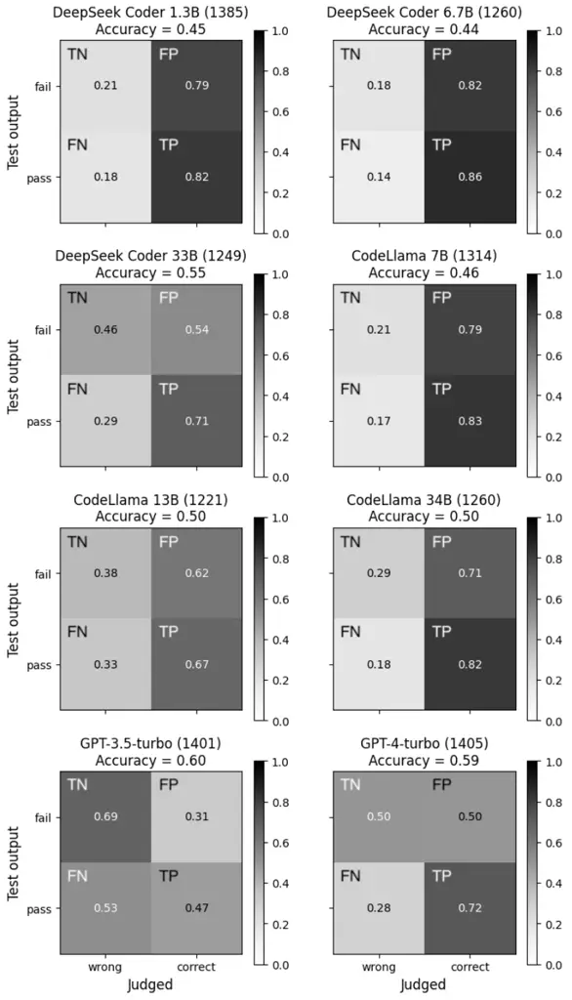
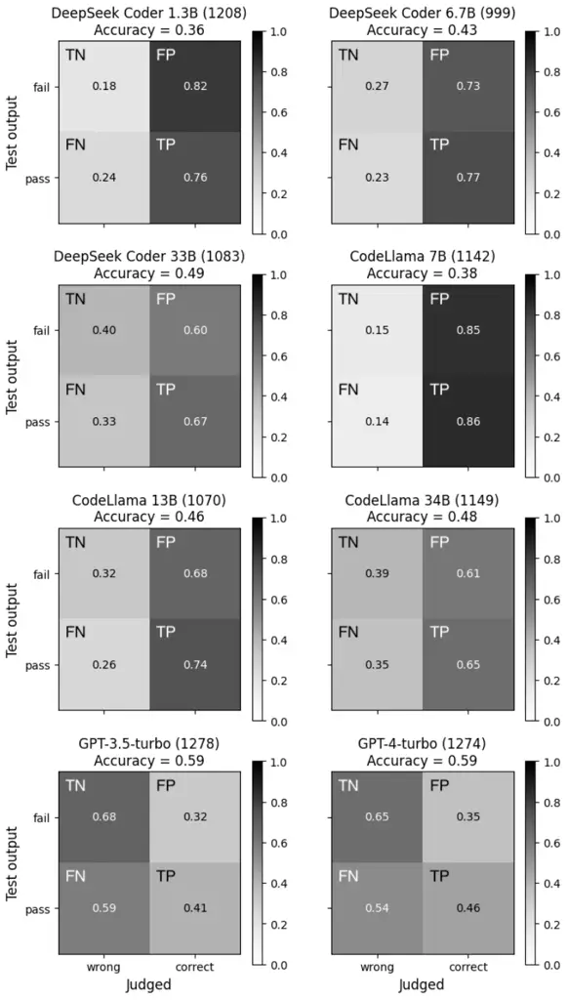
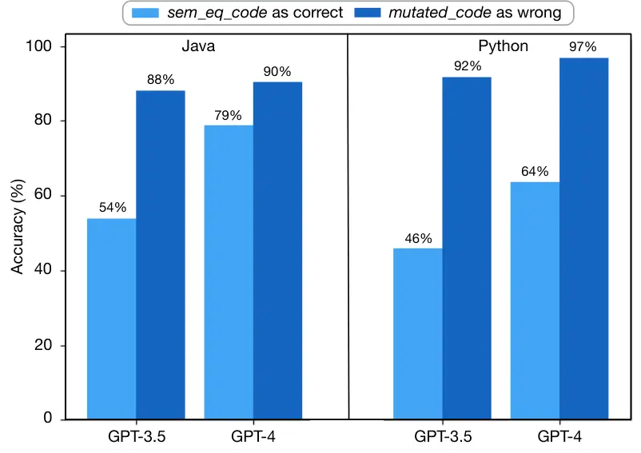
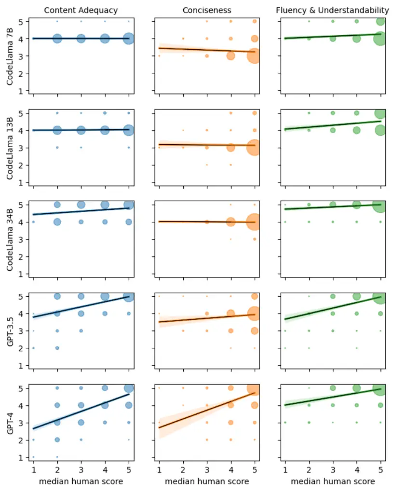

# On the Effectiveness of LLM-as-a-judge for Code Generation and SummarizationThanks: G. Crupi is with SEART @ Software Institute, Università della Svizzera italiana, Switzerland. E-mail: giuseppe.crupi@usi.ch R. Tufano is with SEART @ Software Institute, Università della Svizzera italiana, Switzerland. E-mail: rosalia.tufano@usi.ch A. Velasco is with W&M. E-mail: svelascodimate@wm.edu A. Mastropaolo is with W&M. E-mail: amastropaolo@wm.edu D. Poshyvanyk is with W&M. E-mail: denys@cs.wm.edu G. Bavota is with SEART @ Software Institute, Università della Svizzera italiana, Switzerland. E-mail: gabriele.bavota@usi.ch

Giuseppe Crupi    Rosalia Tufano    Alejandro Velasco
Affiliation: Antonio Mastropaolo, Denys Poshyvanyk, and Gabriele Bavota

###### Abstract

Large Language Models (LLMs) have been recently exploited as judges for
complex natural language processing tasks, such as Q&A (Question &
Answer). The basic idea is to delegate to an LLM the assessment of the
“quality” of the output provided by an automated technique (often
another LLM) for tasks for which: (i) quantitative metrics would only
tell part of the story, and; (ii) a large-scale human-based evaluation
would be too expensive. LLMs-as-a-judge, if proven effective for a
specific task, can also unlock new possibilities for automation, with
several LLMs proposing a solution for a given instance of the task
(_e.g.,_ an answer to a question) and others judging and deciding what
is the best output to show the user. We study the effectiveness of
LLMs-as-a-judge for two code-related tasks, namely _code generation_ and
_code summarization_. The rationale for choosing these tasks is
two-fold. First, quantitative metrics are usually not enough for the
assessment of code summarizers/generators. For example, it is well
documented that metrics such as BLEU are quite weak proxies for the
quality of the generated summaries. Second, even state-of-the-art
techniques still struggle with handling complex instances of these tasks
(_e.g.,_ summarizing a quite long / complex function), making them good
candidates for benefiting from more advanced solutions envisioning
collaboration among LLMs. For _code generation_, we check whether eight
LLMs are able to judge the correctness of 1,405 Java methods and 1,281
Python functions generated by the same LLMs or implemented by humans.
For _code summarization_, we compare the judgment of five LLMs to those
provided by nine humans for $`\sim`$1.2k summaries, related to both Java
and Python functions. Our findings show that GPT-4-turbo is the best LLM
in terms of judging capabilities for both tasks, with “smaller” LLMs
featuring tens of billions parameters not being able to cope with
judging tasks. However, even the best-performing LLM frequently
misjudges the correctness of the code and summary quality.

###### Index Terms: 

LLM-as-a-judge, AI4SE, Empirical Study, Large Language Models for Code

## I Introduction

Large Language Models (LLMs) have been exploited in software engineering
(SE) to (partially) automate a variety of tasks, including code
generation \[5, 7\], clone detection \[41\], code summarization \[27,
2\], code review \[36, 28\], bug fixing \[20, 38, 40\] and others
\[37\]. The wide adoption of LLMs in SE resulted in a shift in focus
from classification (_e.g.,_ defect detection, requirements
classification) to generative problems requiring the synthesis of text
(_e.g.,_ code summarization) and/or code (_e.g.,_ code generation).
Generative problems, in addition to being harder to automate, also bring
with them challenges related to the evaluation of automated solutions.
For example, assessing if a natural language text is a good summary for
a given code would require developers’ judgment. Since human-based
studies are expensive and difficult to scale up, researchers frequently
employ quantitative metrics such as BLEU \[31\], ROUGE \[29\], and
METEOR \[4\] as proxies for the “quality” of the generated summaries.
These metrics are based on the idea that the more similar the generated
summary is to a _reference_ summary (usually being the comment written
by the developers for the code provided as input), the higher its
quality. However, recent works in the literature \[33, 15, 21, 30\]
showed the shortcomings of these metrics when applied to code
summarization: First, the reference summary, usually extracted from
software repositories, may be of low quality, thus not being a good
“oracle” to compare with. Second, the generated summary may be
completely different from the reference one, while still being of high
quality. In short, the automatic assessment of code summarization
techniques and, more generally, of approaches automating
software-related generative tasks, is still an open research avenue.

A helping hand to address this challenge may come from LLMs themselves.
Indeed, Lianmin _et al._ \[46\] proposed the idea of LLM-as-a-judge in
the natural language processing (NLP) field: The LLM is prompted with
instructions asking it to evaluate the output produced by other
techniques (often other LLMs) according to specific criteria. Recent
works also pioneered the usage of LLM-as-a-judge for assessing the
correctness of an implementation given functional requirements described
in natural language \[49, 35\]. While these works report some
preliminary promising findings, they also show that LLMs struggle when
dealing with the judgement of more complex implementations. In this
paper, we build on top of these works, experimenting with more recent
LLMs and with two code-related tasks. The first is the already presented
_code summarization_. The second is _code generation_, namely the
automated implementation of a functionality starting from its natural
language intent (_i.e.,_ textual description)¹¹ 1 Same task investigated
in \[49, 35\]. We focus on these two tasks since (i) they have been the
subject of works proposing AI-based techniques for their automation
\[37\], and (ii) due to their generative nature, they pose major
challenges in the assessment of techniques automating them. For _code
summarization_, we already discussed these challenges. Concerning
automatically generated code, researchers usually exploit two evaluation
strategies. The first relies on code similarity metrics (_e.g.,_
CrystalBLEU \[8\]) indicating how close the generated code is to a
reference one. These metrics, however, are not a good proxy for the
“correctness” of the implemented code. Indeed, as observed for
summaries, the same function may be implemented in different ways, thus
resulting in misjudging correct code being different from the expected
target. The second strategy is aimed at exploiting benchmarks such as
HumanEval \[9\] or CoderEval \[45\], presenting code generation problems
featuring (i) a textual description of the code to implement, and (ii) a
test suite to check the correctness of the generated code. Using these
benchmarks, it is possible to compute metrics such as $`pass@k`$, which
assesses the percentage of cases in which the LLM was able to generate a
solution passing the tests using a maximum of $`k`$ attempts. For
example, $`pass@1`$=50% indicates that the LLM managed to generate a
“correct” solution (according to the tests) for 50% of the code
generation problems using only a single attempt for each problem. While
extremely valuable, these benchmarks are usually quite limited in
dimension (_e.g.,_ HumanEval features 160 Python code generation
problems), resulting in a $`pass@k`$ value which only reflects the LLM’s
performance on a small set of coding problems, which does not really
promote generalizability. Also, as we will demonstrate later, the
accompanying test suites cannot always be trusted, even when assessing
some trivial cases. For example, we found that for 9 of the 230
CoderEval Java problems \[45\] a trivial empty function (_i.e.,_ a
function only having the signature) passes the associated tests, thus
possibly inflating the $`pass@k`$ score in an empirical evaluation.
Having LLMs able to reliably judge the correctness of
automatically-generated code would allow to substantially scale-up the
evaluations performed in _code generation_, even in scenarios in which
tests are not available (or not completely reliable).

For _code generation_, we instructed eight LLMs (_i.e.,_ DeepSeek Coder
1.3B, 6.7B, and 33B \[13\], CodeLlama 7B, 13B, and 34B \[10\],
GPT-3.5-turbo and GPT-4-turbo \[3\]) to generate functions for the
CoderEval benchmark \[45\], which features 230 Java and 230 Python code
generation problems. Then, the LLMs judged the correctness of each
other’s solution as well as of functions written by humans, for a total
of 2,686 assessments per model. During the judgement task, we only
provided the LLMs with (i) the textual description of the code to
implement, and (ii) a function to be judged, either generated by the LLM
or written by humans. We do not also provide an example of reference
(correct) implementation for the code to implement. While this would
substantially help the model in the judging task, it does not represent
a real usage scenario in which _e.g.,_ we want to use the LLM in the
context of automated code review to assess the correctness of a given
implementation (for which a reference implementation is not available).
We verified the appropriateness of LLMs’ assessment by running the
generated functions on the test suites provided for each problem,
checking if there is a relationship between a positive correctness
assessment made by the LLMs and the test results (pass/fail).

For _code summarization_ we compare the judgments provided by five of
the eight LLMs (since three were clearly not able to perform the task)
for 1,163 summaries ($`\sim`$50% related to Java $`\sim`$50% to Python
functions) with judgments expressed by humans for those same summaries.
Human judgments have been performed by a total of nine humans (with
_code summarization_ background), ensuring that each summary has been
independently assessed by three humans. In the _code summarization_
study, the judged summaries include both summaries automatically
generated by the same judged LLMs, as well as summaries written by
humans.

We show that GPT-4-turbo is the best judge for both tasks, with smaller
LLMs substantially struggling (_e.g.,_ not being able to execute the
task or presenting completely wrong judgments). GPT-4-turbo, while the
best, still frequently misjudges the correctness of the code, especially
lacking in the identification of wrong implementations, which are
misjudged as correct in 50% of the cases. GPT-4-turbo works better for
assessing code summary quality, with moderate agreement with human
judgments.

## II Study Design

The _goal_ of our study is to assess the effectiveness of
LLMs-as-a-judge for software-related tasks. In particular, we formulate
the following research question (RQ): _To what extent can LLMs act as a
judge for code generation and summarization?_

### II-A Context Selection: LLMs

We use eight LLMs (_i.e.,_ DeepSeek Coder 1.3B, 6.7B, and 33B \[13\],
CodeLlama 7B, 13B, and 34B \[10\], GPT-3.5-turbo and GPT-4-turbo \[3\])
as judges. Since the LLMs must be able to judge generated code and code
summaries, we only use LLMs that have been trained on a corpus including
source code. Also, we consider LLMs of different sizes (_i.e.,_ number
of trainable parameters) since the larger the language model, the higher
its inference (judgment) cost. The latter may become a factor in
deciding whether to use an LLM as a judge since the cost may be
excessive to judge _e.g.,_ millions of generated functions. In the
following, we briefly describe each family of LLMs we consider. For all
models, we consider their “_instruct_” variants, that is, those also
trained to understand instructions expressed in natural language.

DeepSeek Coder \[13\]. DeepSeek Coder is a range of LLMs of different
sizes, all trained from scratch on a corpus of 2 trillion tokens (87%
code, 10% English and 3% Chinese text). The _instruct_ versions of the
model have then been fine-tuned on a dataset featuring human
instructions with the following dialogues. We use DeepSeek Coder
versions that have 1.3B, 6.7B, and 33B parameters. We generate judgments
by exploiting the Hugging Face inference endpoints \[19\].

CodeLlama \[10\]. CodeLlama is a family of LLMs for code built on top of
Llama2. CodeLlama has been trained on a corpus of 500B tokens featuring
85% of code and 15% of natural language. The models also underwent
fine-tuning of the instruction to answer questions and perform required
tasks. We adopt CodeLlama 7B, 13B, and 34B. In this case, the Hugging
Face inference endpoints \[19\] have been used to generate predictions
(_i.e.,_ judgments).

GPT-3.5-turbo and GPT-4-turbo \[3\]. Both models are behind OpenAI
ChatGPT and have been shown to be able to handle code-related tasks
\[34, 26, 14\]. Being the models on top of which a chatbot has been
built, both GPT variants have been trained to follow instructions for
required tasks. While the technical details behind these models are not
publicly available, we can safely claim that (i) they are substantially
larger than the DeepSeek Coder/CodeLlama variants previously described,
with rumors placing GPT-3.5 and GPT-4 at over 150B and 1.5T trainable
parameters, respectively; and (ii) their training set features massive
amounts of textual data, including code mined from GitHub repositories.
We exploit these models through the ChatGPT APIs.

### II-B Context Selection: Evaluation Datasets

To assess the effectiveness of LLMs as a judge for _code generation_ and
_summarization_ we exploit two different datasets.

#### II-B1 Code generation: CoderEval \[45\]

Presented at ICSE’24, CoderEval is the most recent benchmark for code
generation proposed in the literature. It features 460 code generation
problems, 230 in Java and 230 in Python. Each problem is composed by (i)
a natural language description specifying requirements for a function to
implement; (ii) a target function showcasing a possible correct
implementation; and (iii) a test suite to assess the correctness of
automatically generated solutions. As detailed in Section II-C, we take
advantage of CoderEval to verify whether LLMs are able to judge the
correctness of a given function. In particular, we will feed the LLM
with a prompt that includes the problem description and the expected
function signature. Then, we ask the model to judge if a _candidate_
implementation is correct or not. In addition, because the test suite is
available, we can check whether the _candidate_ is actually correct and,
as a consequence, whether the LLM’s judgment was appropriate. For
example, if the LLM says that _candidate_ correctly implements the
requirements in the problem description, but the tests fail, we can
detect a misjudgment.

Before adopting all 460 CoderEval’s code generation problems in our
study, we performed a “quality assurance” procedure aimed at verifying
that the test results from such a dataset were reliable. Indeed, if the
test results cannot be trusted due to a weak test suite, this would
introduce a notable bias in our study. For example, a wrongly
implemented function passing the tests and being correctly judged by an
LLM as “wrong” would be unfairly accounted for as an LLM’s misjudgment.
For this reason, we performed the following quality checks on the
CoderEval benchmark. First, we ensure that the target function
associated with each code generation problem (_i.e.,_ the function that
demonstrates a possible correct implementation) actually passes the
test. This was not the case for 20 Java and 39 Python problems that we
decided to exclude. Second, we checked whether there were code
generation problems for which an empty implementation (_i.e.,_ a
function that only has a signature and an empty body) would pass the
tests. This occurred for another 9 Java problems raising concerns about
the quality of the accompanying test suites and, as a consequence,
resulting in their exclusion from our study. Finally, for the remaining
201 Java problems we further inspected all those for which the target
signature had a non-void return type and implemented for each of them a
dummy function just featuring a return statement appropriate for the
expected return type. For example, for functions expected to return an
object, the dummy function only featured in its body a “return null;”
statement, while for those returning an int a “return 0;” was placed. We
found that for an additional 17 problems, a dummy function was
sufficient to make the test suite passes. We performed a similar check
on the remaining 191 Python problems. However, since Python functions do
not have an explicit return type, we always included in the dummy
function to test a “return None” statement. One of these dummy functions
managed to pass the tests and has been excluded. In the end, we could
rely on 184 of the 230 Java and 190 of the 230 Python code generation
problems featured in CoderEval.

#### II-B2 Code summarization

Our starting idea was to use the dataset by Roy _et al._ \[33\] for the
_code summarization_ study: This is a large-scale dataset featuring
6,253 code summary evaluations performed by 226 developers on 2,292
summaries (on average, 2.73 human evaluations each). Each participant
was asked to assess the quality of Java methods’ summaries in terms of
conciseness, fluency, and content adequacy, with participants giving a
score on a scale from 1 to 5 to each quality attribute (the higher the
better). Unfortunately, by inspecting the dataset we found it to be
suboptimal for our study. This was mostly due to the fact that the
agreement between the developers who judged each summary was in general
quite low (_e.g.,_ we found a Krippendorff’s $`\alpha`$ \[25\] of
$`\sim`$0.2 when looking at the judgements for content adequacy, which
highlights a weak agreement). While some level of subjectivity in the
judgements is expected, we thought that using such a human judgement as
“oracle” to assess the LLMs judgement could be problematic. On top of
this, the dataset features automatically-generated summaries judged by
humans which were the output of quite old techniques, with the newest
published in 2020 \[16\]. These summaries are not representative of what
modern LLMs are able to do (*e.g.,* some of them even featured
$`<`$UNK$`>`$ tokens) and thus do not represent an ideal target for our
study, since we want to assess whether LLMs-as-a-judge could work for
summaries automatically generated by modern LLMs. Finally, the dataset
by Roy _et al._ \[33\] only features Java methods’ summaries, while our
aim is to perform also the _code summarization_ study on both Java and
Python.

For these reasons, we built (and make publicly available \[1\]) our own
dataset that features human judgments of 1,163 summaries. To build the
data set, we selected the top 100 Java and the top-100 Python functions
in terms of the number of statements they feature from the CoderEval
\[45\] benchmark (_i.e.,_ the one used in the _code generation_ study).
We decided to focus on the longest functions since those are the ones
for which a good summary is likely to make a difference in terms of code
comprehension, and thus assessing the quality of summaries for these
functions may make more sense. Among these 200 functions, we found one
Java and one Python functions that were a duplicate and were thus
removed from the set. For each of the remaining 198 functions (99 per
language), we have the associated code summary written by the original
developer of the function. Furthermore, we asked five LLMs (_i.e.,_
CodeLlama 7B, 13B, and 34B \[10\], GPT-3.5-turbo and GPT-4-turbo \[3\])
to generate a summary for each of these 198 functions. This process
should have resulted in 198 (manually written) + 198$`\times`$5
(automatically generated) = 1,188 summaries (594 per language). However,
for a few Python functions some of the LLMs outputted an empty summary,
leading to a total of 594 (Java) + 569 (Python) summaries. Note that we
did not use LLMs belonging to the DeepSeek Coder family in building this
dataset since, as explained later, we did not manage to make them work
for the _code summarization_ judging task and we wanted to have the same
LLMs both generating and judging summaries, to also study any form of
self-bias (_e.g.,_ the LLM judges the summary it generates better as
compared to the summaries generated by other LLMs or written by humans).
The prompt used to generate code summaries with LLMs is documented in
our replication package \[1\].

Once obtained the 1,163 summaries we split them among nine human judges,
making sure that each summary was assessed by three judges (for a total
of 1,163 $`\times`$ 3 = 3,489 judgements). All nine judges have a
Master’ degree in Informatics or Computer Science, four of them have a
Ph.D. in Software Engineering. On average, they have 5.8 years of
experience (min = 1, max = 17) in Java programming and 6.9 in Python
programming (min = 4, max = 10). Taking inspiration from the work of Roy
_et al._ \[33\], we asked participants to evaluate the quality of the
summary in three dimensions: _content adequacy_, _conciseness_, and
_fluency & understandability_. Note that compared to Roy _et al._, we
changed _fluency_ into _fluency & understandability_ since, when looking
at code summaries generated by modern LLMs (or written by humans), it is
unlikely to find nonfluent text. Instead, it is possible that the
summary, while fluent in terms of used English, is difficult to
understand, for example, for people not having a deep domain knowledge
of the code. Each of the three “quality attributes” has been assessed on
a scale from 1 to 5 (the higher the better). We give clear guidelines to
participants on how to interpret the scores. For example, in the case of
_fluency & understandability_, these were the indications provided:

- 0.  The summary is easy to read and understand and does not require
      specific domain knowledge to be understood.
- 0.  The summary is easy to read and understand, but may require some
      specific domain knowledge to be understood.
- 0.  The summary is easy to read and understand for developers with
      experience with that system.
- 0.  The summary is difficult to read and understand, but is grammatically
      correct.
- 0.  The summary is difficult to read and understand and is grammatically
      incorrect.

Complete guidelines are publicly available \[1\].

After having finalized the dataset, we again inspected the agreement
among the humans judges for the three quality aspects using the
Krippendorff $`\alpha`$ \[25\]. The Krippendorff’s $`\alpha`$ can be
interpreted as follows: $`<`$ 0.10 = agreement equivalent to chance;
0.10–0.20 = weak agreement; 0.21–0.40 = fair agreement; 0.41–0.60 =
moderate agreement; 0.61–0.80 = substantial agreement; 0.81–0.99 =
near-perfect agreement; and 1 = perfect agreement. For the _content
adequacy_ we obtained $`\alpha`$=0.81 for the Java instances and
$`\alpha`$=0.69 for the Python instances, for _conciseness_
$`\alpha`$=0.58 (Java) and $`\alpha`$=0.57 (Python), and for _fluency &
understandability_ $`\alpha`$=0.62 (Java) and $`\alpha`$=0.56 (Python).
Overall, the guidelines provided to the participants resulted in quite
high agreement in all three quality attributes.

### II-C Data Collection

#### II-C1 Code Generation

CoderEval \[45\] provides a set of code generation problems, tests to
assess the accuracy of candidate solutions, and a target, exemplar,
generation. The target implementations for 374 code generation problems
we consider in our study (184 Java and 190 Pythjon) represent the first
batch of solutions we ask the LLMs to judge.

Experimented prompts. We experiment with four different prompts for the
_code generation_ judging task. The first, referred to as “_zero shot_”,
is a prompt inspired by Weyssow _et al._ \[39\] who defined prompts to
assess the extent to which LLMs are able to judge if an implementation
satisfies specific non-functional requirements. Note that the focus of
the authors \[39\] is not on evaluating the judging capabilities of LLMs
(as we do), but rather on exploiting them to check if LLMs can address
non-functional requirements (more in Section V). The main idea we
inherit from this work is to prompt models for the rationale behind the
score:

_You will be provided with the description (“Description”) and the
signature (“Signature”) of a {language} function to implement. You will
also see a candidate implementation (“Candidate”). Your role is to
evaluate the correctness of the Candidate, providing as output a rating
and a rationale. Rate the Candidate with either 0 to 1:_

- 0.  _\*\*Wrong Implementation\*\*: The implementation does not correctly
      implement the described function._
- 1.  _\*\*Correct Implementation\*\*: The implementation correctly
      implements the described function._

_\# Description: {description}_

_\# Signature: {signature}_

_\# Candidate: {candidate}_

The definition of this prompt was driven by a trial-and-error procedure
in which we tested multiple variants of the prompt with the eight LLMs
subject of our study to ensure that the LLMs understood the task and
provided an output that would be meaningful in most cases. This was
quite challenging considering the variety of LLMs we considered. We
tested the judging capabilities of the LLMs using different variations
of the prompt on simple tasks, under the assumption that if they were
not working on toy examples it would be very unlikely that they would
work in a real scenario. By toy examples, we refer to situations in
which it was evident that the candidate did not implement the
requirements in the description (_e.g.,_ the description asked for a
method to sum two numbers, but the candidate was multiplying two
numbers).

The second prompt, named “_zero shot W/O rationale_” is just a
simplified version of the previous prompt in which we do not ask the LLM
to also generate a rationale for the provided score.

The third prompt, referred to as “_automated CoT_”, is the classic
“Automated Chain-of-Thought” prompting \[23\] vastly used in the
literature to elicit reasoning in LLMs. This prompting strategy takes
advantage of two steps. In the first, a _reasoning extraction_ prompt is
provided, which, in our case, is the following:

_You will be provided with the description (“Description”) and the
signature (“Signature”) of a {language} function to implement. You will
also see a candidate implementation (“Candidate”)._

_\# Description: {description}_

_\# Signature: {signature}_

_\# Candidate: {candidate}_

_\# Question: is the Candidate correct according to all the functional
requirements of the Description? Answer choices: “Yes” or “No”._

_\# Reasoning: Let’s think step by step._

In the second step, the output of the above prompt (_i.e.,_
$`<`$REASONING$`>`$) is used to build the _answer extraction_ prompt,
which is basically identical to the previous one but it includes the
generated $`<`$REASONING$`>`$ (rather than asking for it) and, after it,
ends with: _Therefore, the answer (“Yes” or “No”) is:_.

Finally, the fourth experimented prompt named “_slow thinking_”, is a
variant of the CoT prompt explicitly proposed by Tong and Zhang \[35\]
to assess the code correctness in their approach named CodeJudge (built
on top of GPT-3.5, more in Section V). We do not report the full prompt
here for the sake of brevity, but it can be found in \[35\] and in our
replication package \[1\], together with all other prompts used in our
study.

Judging functions. On top of the target implementations, we use the same
four prompts to ask the LLMs to judge candidate implementations
automatically generated by them. The prompt used for the code generation
was composed of (i) the description of the code generation task as
provided in CoderEval, and (ii) the signature of the target function in
CoderEval. The main challenge at this point was to automatically extract
the implemented function from the output of each LLM. Indeed, we
observed that LLMs rarely output just the required function (even if
explicitly prompted to do so), but tend to accompany the generated
method with textual explanations, alternative implementations, etc. For
this reason, we developed an _implementation extractor_ which exploits
the lizard code analyzer \[43\] to identify the first outputted function
and consider it as the candidate implementation generated by the LLM.
This script is publicly available \[1\] and, based on our manual
analysis described below, always succeeded in extracting the candidate
function, when present. There were, indeed, some code generation tasks
for which the LLMs did not produce any output (documented in the results
discussion — Section III).

We use the same prompts exploited for the judging of the target
implementations also for the 1,221 Java and 1,091 Python candidate
implementations generated by the LLMs. Note that each LLM, besides
judging methods outputted by other LLMs, also judges its own solution.
This allows us to investigate whether a bias exists when LLMs are used
as a judge for _code generation_.

Once all judging tasks have been run, a cleaning process on the LLMs’
output was needed to collect their judgment. Also in this case we
observed variety in the output template used by the LLMs, with some
being more verbose than others and providing additional unrequested
information (_e.g.,_ a summary of the judged implementation). Thus, we
extracted the judgments using a combination of parsing scripts (for
simple cases) and manual extraction. To be confident about the extracted
judgments, all of them have been manually checked by two authors, even
the automatically collected ones. Also in this case, some LLMs failed to
provide a judgment for some instances (as documented in the results
discussion).

The above-described process provided us with a list of 80,556 total
judgments referring to both functions written by humans (10,954
judgments) and automatically generated by LLMs (69,602). We describe in
Section II-D how we analyze these data to answer our RQ.

#### II-C2 Code summarization

Our dataset features code summaries written by humans and generated by
LLMs, which we ask LLMs to judge.

Experimented prompts. Also for _code summarization_ we tested four
different judging prompts. The fist, named _zero shot_, is shown in the
following:

_You will be provided with a {language} function (“Function”) and a
textual summary of it (“Comment”). The goal of the Comment is to
document the functionality implemented in the Function. Your role is to
evaluate the Comment across three criteria, providing as output for each
of them a rating (# Rating) and a rationale (# Rationale) as described
in the following._

_\# Evaluation Criteria_

- \*
  _Content adequacy: the extent to which the comment summarizes all
  information that can be inferred from the source code._
- \*
  _Conciseness: the extent to which the comment contains unnecessary
  information._
- \*
  _Fluency & Understandability: the extent to which the comment is easy
  to read and understand._

_For each criterion, provide a score on a scale from 1 to 5: 1 (Very
poor), 2 (Poor), 3 (Fair), 4 (Good), 5 (Very good)._

_\# Function: {function}_

_\# Comment: {comment}_

The second (_zero shot + instructions_) is a more complex version of the
_zero shot_ prompt in which we provided the LLMs with the same “judging
instructions” we gave to the human judges when building our dataset (see
Section II-B2). This basically means that we instruct the LLM on cases
in which, for example, a 5 score for content adequacy was appropriate.
Due to its length, we point the interested reader to our replication
package for the full version of this prompt.

The third experimented prompt (_automated CoT_) mirrors the one seen for
_code generation_, with the first step featuring a _reasoning
extraction_ prompt ending with “_\# Reasoning: Let us think step by
step._”. The output of this step is then used in the second step
(_answer extraction_) to produce the actual judgement. Finally, the
fourth prompt (_automated CoT + instructions_) is basically the
_automated CoT_ prompt augmented with “judging instructions”, as
explained for _zero shot + instructions_.

Judging summaries. Also in this case the extraction of the judgments
required some manual effort due to models outputting unrequested
information and not adopting a consistent output format when reporting
their judgments. We developed extraction scripts and verified each piece
of collected information manually. Cases where the script did not report
any information were also inspected manually, to make sure no judgment
was left out. We found out that all models belonging to the DeepSeek
Coder family were not able to understand the _code summarization_
judging task, despite our efforts in trying to tune the prompt. Indeed,
for over half of the summaries, the DeepSeek Coder models did not manage
to output a judgment. This may be due to the multi-level judgment we
require in this case (three criteria), which is substantially more
complex than what was used for _code generation_. For the other models,
we discuss the failure cases (_i.e.,_ no judgment provided) in the
results section.

At the end, we obtained 22,304 total judgments referring to 3,865
summaries written by humans and 18,439 summaries automatically
generated.

### II-D Data Analysis

For both tasks we start by reporting the best-performing prompt, and we
discuss in the paper only the results achieved with that prompt, while
all others are included in our replication package \[1\]. It is
important to give a clear definition of what we considered to be the
best-performing prompt. Indeed, there are at least three dimensions to
consider. First, different prompts may result in a different percentage
of cases in which the LLMs fail to perform the judgment. These are cases
in which the output of the LLMs, manually checked, did not feature the
required judgment. Second, once collected the valid judgements, they may
exhibit different levels of “accuracy” with different prompts. For
example, a prompt may always succeed in outputting a judgement which,
however, is always wrong (_e.g.,_ correct functions always classified as
wrong implementations), while another one may fail in a few cases but be
quite accurate for the outputted judgements. Third, different LLMs may
benefit more or less from different prompts. Since for both tasks there
was one judge LLM which was the clear winner independently from the used
prompt (_i.e.,_ GPT-4-turbo), we selected as best-performing prompt the
one ensuring the best performance on it (measured, as explained later,
via inter-rater agreement metrics between the produced judgements and
the oracles). Such a prompt also ensured a very low number of invalid
outputs (_i.e.,_ no judgement) outputted by GPT-4-turbo for both tasks
and languages, not really posing a question about the selection of the
best prompt to consider.

We report the percentage of cases in which each LLM did not manage to
perform the judgment. We consider the judgment task failed if: (i) for
the _code generation_ task, the LLM did not output the required score;
(ii) for the _code summarization_ task, the LLM did not output all three
required scores.

Code generation analyses. We report eight confusion matrices (one per
LLM) showing the percentage of (i) _true positives_, _i.e.,_ the
candidate passes the tests and the LLM judges the candidate as a correct
implementation of the requirements; (ii) _true negatives_, _i.e.,_ the
candidate fails the tests and the LLM judges the candidate as not
correct; (iii) _false negatives_, _i.e.,_ the candidate passes the tests
but the LLM judges the candidate as not correct; and (iv) _false
positives_, _i.e.,_ the candidate fails the tests but the LLM judges the
candidate as correct.

We complement the above analysis with the computation of an inter-rater
agreement metric between the “oracle” (_i.e.,_ test execution) and the
LLMs’ judgements. In particular, we report the Cohen’s Kappa \[6\]
inter-rater agreement, which is suitable when only two categories of
classifications are possible (in our case, the implementation is
classified as either correct or wrong by both the LLMs and the tests
execution). The interpretation is the same previously reported for the
Krippendorff’s $`\alpha`$.

We also verify whether the LLMs tend to give better score to code they
generated as compared to code generated by others or written by humans.
We run an unpaired Mann-Whitney test \[42\] comparing the scores
assigned by each LLM to its own code to three other distributions,
representing (i) the code generated by the other 7 LLMs; (ii) the code
generated by the other LLMs excluding those belonging to the same
family, with DeepSeek Coder, CodeLlama, and GPT being the three
families; and (iii) the code written by humans. We use the unpaired
Mann-Whitney test in this analysis because we are comparing
distributions having a different number of elements. Indeed, let us
assume we have 100 code generation tasks for which 5 LLMs (LLM₁, LLM₂,
LLM₃, LLM₄, LLM₅) generated code. The same five LLMs are then asked to
judge the generated code. To study the presence of self-bias, the scores
assigned by LLM₁ to the 100 functions it generated are compared with the
scores LLM₁ assigned to the 400 functions generated by LLM₂, LLM₃, LLM₄
and LLM₅. We account for multiple tests by adjusting the _p_-values
using the Benjamini-Hochberg procedure \[44\]. We use Cliff’s $`d`$ elta
\[11\] as effect size. Cliff’s $`d`$ ranges in the interval $`[-1,1]`$
and is negligible for $`|d|<0.148`$, small for $`0.148\leq|d|<0.33`$,
medium for $`0.33\leq|d|<0.474`$, and large for $`|d|\geq 0.474`$.

Finally, we perform a manual analysis to disclose the reasons for the
misjudgments made by the LLMs. We randomly selected for each LLM 15
cases of _false positives_ and 15 cases of _false negatives_. We
assigned 30 of the instances to inspect (15 _false positives_ and 15
_false negatives_) to three authors, who independently defined one or
more labels summarizing the reasons behind the LLM misjudgment. The
definition of the labels was performed by looking at: (i) the prompt
provided as input, (ii) the function to be judged, and (iii) the score
and rationale provided by the LLM. For example, based on this
information, we found that some _false negatives_ were due to the LLM
assessing nonfunctional requirements rather than the code correctness,
_e.g.,_ giving a negative evaluation to a correct code because it was
not efficient in terms of performance. After this first round, the three
authors met and consolidated the labels used, involving then a fourth
author to inspect all other remaining instances. In this step, each
instance was assigned to two evaluators, who could reuse the already
defined labels or add new ones when needed. The conflicts were solved by
two additional authors not involved in the original labeling.

|                     |                 |        |     |        |        |     |     |                    |       |     |        |       |
| ------------------- | --------------- | ------ | --- | ------ | ------ | --- | --- | ------------------ | ----- | --- | ------ | ----- |
|                     | Code generation |        |     |        |        |     |     | Code summarization |       |     |        |       |
| LLM                 | Java            |        |     | Python |        |     |     | Java               |       |     | Python |       |
|                     | \#              | %      |     | \#     | %      |     |     | \#                 | %     |     | \#     | %     |
| DeepSeek Coder 1.3B | 20              | 1.42%  |     | 73     | 5.70%  |     |     | \-                 | \-    |     | \-     | \-    |
| DeepSeek Coder 6.7B | 145             | 10.32% |     | 282    | 22.01% |     |     | \-                 | \-    |     | \-     | \-    |
| DeepSeek Coder 33B  | 156             | 11.10% |     | 198    | 15.46% |     |     | \-                 | \-    |     | \-     | \-    |
| CodeLlama 7B        | 91              | 6.48%  |     | 139    | 10.85% |     |     | 1                  | 0.17% |     | 1      | 0.18% |
| CodeLlama 13B       | 184             | 13.10% |     | 211    | 16.47% |     |     | 23                 | 3.87% |     | 1      | 0.18% |
| CodeLlama 34B       | 145             | 10.32% |     | 132    | 10.30% |     |     | 2                  | 0.34% |     | 20     | 3.51% |
| GPT-3.5-turbo       | 4               | 0.28%  |     | 3      | 0.23%  |     |     | 0                  | 0.00% |     | 0      | 0.00% |
| GPT-4-turbo         | 0               | 0.00%  |     | 7      | 0.55%  |     |     | 0                  | 0.00% |     | 0      | 0.00% |

TABLE I: Number (#) and percentage (%) of instances for which the LLMs
did not manage to output a valid judgment.

Code summarization analyses. We show three scatterplots for each judging
LLM, one for each of the three criteria used in the assessment of
summary quality (_i.e.,_ content adequacy, conciseness, fluency &
understandability). The scatterplots allow us to visually identify the
existence of a relationship between the quality assessments made by
humans and by each LLM.

As an agreement metric, we compute the Krippendorff’s $`\alpha`$ \[25\]
for each of the three assessed quality attributes. Since we have three
human judgements for each summary, we use their median score as the
“oracle” against which the LLM judgements are compared. Given the rather
substantial agreement we observed in the human judgements, this choice
is not expected to substantially influence the achieved results.

|                         |          |          |         |       |        |        |         |       |
| ----------------------- | -------- | -------- | ------- | ----- | ------ | ------ | ------- | ----- |
|                         | DSC 1.3B | DSC 6.7B | DSC 33B | CL 7B | CL 13B | CL 34B | GPT-3.5 | GPT-4 |
| Java                    |          |          |         |       |        |        |         |       |
| zero-shot               | -0.15    | 0.00     | 0.14    | -0.01 | 0.13   | 0.16   | 0.10    | 0.17  |
| zero-shot W/O rationale | 0.05     | 0.00     | 0.11    | -0.06 | 0.06   | 0.21   | 0.07    | 0.16  |
| automated CoT           | 0.03     | 0.03     | 0.15    | 0.04  | 0.05   | 0.10   | 0.16    | 0.21  |
| slow-thinking           | 0.02     | 0.03     | 0.06    | 0.00  | 0.04   | 0.06   | 0.07    | 0.15  |
| Python                  |          |          |         |       |        |        |         |       |
| zero-shot               | 0.02     | -0.01    | 0.10    | -0.02 | -0.01  | 0.04   | 0.05    | 0.07  |
| zero-shot W/O rationale | 0.01     | 0.01     | 0.10    | -0.04 | 0.02   | 0.03   | 0.03    | 0.05  |
| automated CoT           | -0.04    | 0.03     | 0.05    | 0.01  | 0.05   | 0.03   | 0.09    | 0.10  |
| slow-thinking           | 0.00     | 0.08     | 0.06    | 0.00  | 0.01   | 0.06   | 0.06    | 0.11  |

TABLE II: Code Generation: Kappa score between the LLMs’ judgements
(correct/wrong) and the output of test execution (pass/fail). Values
below 0.10 indicate the complete lack of agreement.

Also, for the _code summarization_ judgments, we verify whether the LLMs
tend to be biased towards the summary they generate. This is done with a
statistical analysis that mirrors that described for _code generation_.

Although we also considered performing the qualitative analysis of the
reasons behind the misjudgments for _code summarization_ (similarly to
what was done for _code generation_), we found it difficult to run it
systematically, since we are dealing with three evaluation criteria and
a 5-point score for each criteria, thus blurring the definition of false
positives/negatives.

## III Results Discussion

### III-A Code Generation



(a) Java



(b) Python

Fig. 1: Code Generation: Confusion matrices for LLM’s judgment for Java
(left) and Python (right). The $`x`$-axis reports the given judgment
(_i.e.,_ the function is a wrong or correct implementation of the
textual requirements), while the $`y`$-axis shows the results of the
test execution (_i.e.,_ pass/fail). Within each matrix, true negatives
are in the top-left box, true positives in the bottom-right.

The left part of Table I shows the number and percentage of times for
which using the best-performing prompt (_i.e.,_ _automated CoT_), each
of the LLM-as-a-judge did not manage to output a judgment for the _code
generation_ scenario. As it can be seen, larger LLMs are almost always
able to understand the required task and execute it. For example,
GPT-4-turbo always outputs a valid correctness judgement when dealing
with Java functions, and it only fails for 7 Python functions. Instead,
smaller LLMs with parameters of a few billion tend to fail in
$`\sim`$15% of cases, with minor differences observed between different
LLMs (see Table I).

Understanding a task to be executed does not imply a correct execution
(_i.e.,_ a meaningful judgment), and this leads to the focus of our
study. Table II shows the results of Cohen’s Kappa between the judgments
given by the 8 LLMs and the test results (pass/fail). In this case, we
report the data for the four experimented prompts, to (i) justify our
selection of the _automated CoT_ prompt as the best-in-class prompt to
discuss in the paper; and (ii) showing that our findings are not
strongly impacted by the choice of the prompt. In Table II the higher
the agreement, the better the judgment. Recall that anything below 0.10
indicates the lack of agreement between the LLMs’ correctness judgements
and the test results. To save space, Table II uses acronyms for LLMs
(DSC = DeepSeek Coder, CL = CodeLlama).

The first observation that can be made is that our findings do not
substantially change using different prompts. In fact, when focusing on
the single LLM in isolation (columns in Table II), it can be seen that
the variations in Kappa scores are rather minor using different prompts.
Second, when considering the overall performance achieved in both
languages (Java in the upper part of Table II, and Python in the lower
part), GPT-4 is the best performing LLM. Still, Cohen’s Kappa between
the judgments of GPT-4 and the ground truth is 0.21 for Java (with 0.20
being the lower limit at which the agreement can be considered _fair_)
and 0.10 for Python (_i.e.,_ the lower limit at which the agreement can
be considered _weak_). Smaller LLMs are simply unable to assess code
correctness. Indeed, DeepSeek Coder 1.3B and 6.7B as well as CodeLlama
7B obtain very low (even negative) agreement values in both languages
(see Table II). Larger models (DeepSeek Coder 33B, CodeLlama 34B, and
GPT-3.5) tend to perform better, with performance closer to that of
GPT-4.

To better understand what these agreement coefficients indicate, Fig. 1
shows the confusion matrices that depict the boolean judgments given by
the eight LLMs to the correctness of the evaluated Java (left) and
Python (right) functions. These refer to the judgments produced with the
_automated CoT_ prompt.

The $`x`$-axis reports the given judgment (_i.e.,_ the function is a
wrong or correct implementation of the textual requirements), while the
$`y`$-axis shows the results of the test execution (_i.e.,_ pass/fail).
To better understand the content of these matrices, let us discuss the
findings for DeepSeek Coder 1.3B on the Java dataset (top-left confusion
matrix). The top left cell reports the percentage (21%) of failing
implementations (_i.e.,_ wrong implementations according to the test
execution) which are correctly judged by the LLM as wrong (_true
negatives_), while the top-right cell shows the percentage (79%) of
misjudgments in this category, namely _false positives_, _i.e.,_ failing
implementations judged as correct. The bottom row of the matrix shows
instead the LLM’s judgments related to passing implementations, with 18%
of them misjudged as wrong (_false negatives_) and 82% properly judged
as correct (_true positives_). The darker the background color of a
cell, the higher the percentage of judgments falling into that category.
This means that a successful judge would have the top left and bottom
right cells of its confusion matrix substantially darker than the top
right and bottom left cells. The numbers in parentheses in addition to
the name of each model indicate the total judgments that the LLM
successfully outputted. Finally, below each model’s name we also report
the overall accuracy computed based on the confusion matrix.

Fig. 1 shows that being the best among the experimented models does not
make GPT-4 a ready and reliable solution for the automatic judgement of
code correctness. In fact, if we look at the confusion matrices of its
judgments for Java, we see that GPT-4 correctly classifies 72% of the
correct implementations but misjudges 50% of the wrong ones. Basically,
GPT-4 has a tendency to positively judge implementation, missing code
bugs, and / or lack of features explicitly requested in the input
requirements text. In the Python data set, instead, GPT-4 correctly
classifies 46% of the correct implementations and misjudges 35% of the
wrong ones, showing an inverse trend compared to Java. In general, even
the best-performing model (GPT-4) often misjudges the correctness of the
code.

One may conjecture that a possible reason for the observed wrong
judgments could be the fact that the LLM has a “limited view” of the
coding context when judging. Indeed, the code generation problems in
CoderEval feature both functions which are self-contained (_i.e.,_ they
only have dependencies towards the Java/Python standard library), as
well as functions which exploit _e.g.,_ utility functions from
third-party libraries. The latter represents more challenging code
generation and judging scenarios. Indeed, the LLM-as-a-judge may, for
example, complain about the usage in the judged function of a call
towards a “non-existing” (_i.e.,_ not visible) function. To account for
such a scenario, we repeated all our analyses when considering only the
80 Java and 58 Python functions in CoderEval that do not have external
dependencies. Our findings did not change in terms of the effectiveness
of judgment and the identification of the best judge (see the
replication package \[1\]), dismissing the lack of coding context as a
major factor influencing the judging abilities of LLMs.

|                                                                                                                               |      |      |      |      |      |      |      |      |         |          |                      |            |
| ----------------------------------------------------------------------------------------------------------------------------- | ---- | ---- | ---- | ---- | ---- | ---- | ---- | ---- | ------- | -------- | -------------------- | ---------- |
|                                                                                                                               | DSC  | DSC  | DSC  | CL   | CL   | CL   | GPT  | GPT  | Human   | Own _vs_ | Own _vs_             | Own _vs_   |
|                                                                                                                               | 1.3B | 6.7B | 33B  | 7B   | 13B  | 34B  | 3.5  | 4    | Written | LLMs     | LLMs $`\setminus`$ F | Human      |
| DSC 1.3B                                                                                                                      | 0.58 | 0.57 | 0.43 | 0.60 | 0.43 | 0.49 | 0.41 | 0.47 | -0.25   | (N)      | (N)                  | \*\*\* (L) |
| DSC 6.7B                                                                                                                      | 0.55 | 0.49 | 0.56 | 0.57 | 0.47 | 0.51 | 0.56 | 0.60 | -0.24   | (N)      | (N)                  | \*\*\* (L) |
| DSC 33B                                                                                                                       | 0.31 | 0.36 | 0.24 | 0.33 | 0.29 | 0.30 | 0.29 | 0.28 | -0.36   | (N)      | (N)                  | \*\*\* (L) |
| CL 7B                                                                                                                         | 0.54 | 0.55 | 0.48 | 0.59 | 0.49 | 0.49 | 0.42 | 0.48 | -0.22   | (N)      | (N)                  | \*\*\* (L) |
| CL 13B                                                                                                                        | 0.30 | 0.33 | 0.29 | 0.35 | 0.26 | 0.33 | 0.43 | 0.34 | -0.42   | (N)      | (N)                  | \*\*\* (L) |
| CL 34B                                                                                                                        | 0.53 | 0.47 | 0.41 | 0.48 | 0.41 | 0.37 | 0.46 | 0.42 | -0.27   | (N)      | (N)                  | \*\*\* (L) |
| GPT-3.5                                                                                                                       | 0.08 | 0.12 | 0.03 | 0.14 | 0.05 | 0.00 | 0.13 | 0.13 | -0.72   | (N)      | (N)                  | \*\*\* (L) |
| GPT-4                                                                                                                         | 0.19 | 0.27 | 0.24 | 0.27 | 0.30 | 0.21 | 0.35 | 0.41 | -0.47   | \*\* (N) | \*\* (N)             | \*\*\* (L) |
| Average (all)                                                                                                                 | 0.28 | 0.31 | 0.24 | 0.32 | 0.26 | 0.24 | 0.33 | 0.32 | -0.45   | -        | -                    | -          |
| Average (large)                                                                                                               | 0.39 | 0.41 | 0.32 | 0.42 | 0.34 | 0.34 | 0.38 | 0.39 | -0.37   | -        | -                    | -          |
| Adjusted $`p`$-values: \* $`<`$0.05, \*\* $`<`$0.01, \*\*\* $`<`$0.001. Cliff delta: N=Negligible, S=Small, M=Medium, L=Large |      |      |      |      |      |      |      |      |         |          |                      |            |

TABLE III: Code Generation (Java): Average of differences between the
LLM judgments (0 or 1) and the ground truth (_i.e.,_ 1 if the method
passes the test and 0 otherwise). Last three columns report adj.
$`p`$-value (Mann-Whitney test, p-value adjusted using the
Benjamini-Hochberg procedure) and effect size when comparing the
judgments each LLM gave to functions it generated against those it gave
when judging functions (i) generated by all other LLMs, (ii) generated
by all other LLMs but those belonging to the same family, and (iii)
written by humans.

#### III-A1 Self-bias Analysis

We also analyzed whether LLMs are biased towards code they generate,
providing better judgment for it. Table III shows a “_bias coefficient_”
of the LLMs-as-a-judge (rows) with respect to the code generated by the
generator LLMs or manually written by humans (columns). We report the
data for the Java dataset, since the findings for Python (available in
\[1\]) are aligned. The coefficient, which ranges in $`[-1,1]`$, is the
average difference between the judgments (either 0 or 1) given by the
LLM-as-a-judge and the ground truth (_i.e.,_ 1 if the implementation
passes the test suite and 0 otherwise). Given an LLM-as-a-judge
($`LLM_{J}`$), and a specific set of $`I_{G}`$ implementations to judge
(_e.g.,_ all methods generated by a specific generator $`G`$), the _bias
coefficient_ ($`bc`$) is computed as follows:

```math
bc_{J,G}=\frac{\sum_{i\in I_{G}}J_{i}-\sum_{i\in I_{G}}O_{i}}{|I_{G}|}
```

where $`J_{i}`$ is the judgement (0 or 1 in this scenario) given by the
judging LLM ($`LLM_{J}`$) to the $`i^{th}`$ code implementation to
judge, while $`O_{i}`$ is the oracle score for that same code
implementation (again, 0 or 1, depending on the tests outcome).
Basically, if $`bc_{LLM_{J}}`$ is positive, this means that $`LLM_{J}`$
tends to overestimate the correctness of the assessed implementations
(positive bias), while if $`bc_{LLM_{J}}`$ is negative it tends to have
a negative bias. Note that a $`bc_{LLM_{J}}=0`$, while indicating the
absence of bias, does not imply the correctness of the judgements. For
example, let us assume that $`LLM_{J}`$ has $`n=10`$ implementations to
judge, with the first five passing the test execution and the last five
failing it. Let us also assume that $`LLM_{J}`$ misjudges all 10
instances, reporting the first five as wrong and the last five as
correct. Both $`\sum_{i=1}^{n}J_{i}`$ and $`\sum_{i=1}^{n}O_{i}`$ will
be equal 5, so their difference will be 0, indicating the lack of bias
but not the correctness of the judgements.

We report in grey the assessments made by the LLMs which our former
analyses revealed to be completely off in the judgments (DeepSeek Coder
1.3B, DeepSeek Coder 6.7B, CodeLlama 7B), since any conclusion based on
these judgments would be irrelevant. The last three columns of Table III
show the results of the Mann-Whitney tests (adj. $`p`$-value and effect
size) in which we compare the judgments each LLM gave to functions it
generated against those it gave when judging functions (i) generated by
all other LLMs, (ii) generated by all other LLMs but those belonging to
the same family (LLM $`\setminus`$ F), and (iii) written by humans.

From Table III two main observations can be made. First, with the
exception of GPT-4, the LLMs are not biased in the judgements. If we
focus on the five most reliable judges, GPT-3.5, DeepSeek Coder 33B,
CodeLlama 13B, and CodeLlama 34B do not overestimate the quality of the
code they generated more than they do with the code generated by other
LLMs. For example, GPT-3.5 adds on average 0.13 points to the code it
generated, and 0.14 points to the code generated by CodeLlama 7B. On the
other hand, GPT-4 tends to slightly overestimate its own code more as
compared to the code generated by other LLMs, revealing some sort of
self-bias. Still, the statistical test shows that such a self-bias is
minimum (_i.e.,_ significant $`p`$-value but accompanied by a negligible
effect size). The last two rows of Table III show the average bias
coefficient exhibited by the LLMs-as-a-judge for each code generator,
either an LLM or a human. In grey we report the average across all eight
judging LLMs, while in black when only considering the five that
performed the best. In general, all LLMs tend to overestimate the
correctness of the code generated by all other LLMs.

Second, it is interesting to see that LLMs have a higher chance of
overestimating the quality of the code generated by LLMs rather than the
code written by humans. Such a result can be seen from (i) the average
bias coefficient achieved by the human written code (-0.37), indicating
that the correctness of the code written by humans is systematically
underestimated by LLMs, as compared to the coefficients of the LLMs
which are all positive, and (ii) the results of the statistical tests
(last column in Table III). Indeed, all the judge models underestimate
the correctness of the human-written code in a statistically significant
manner with a large effect size. This negative bias may be explained by
the fact that human-written code is, from the LLMs’ point-of-view, less
natural as compared to code written by themselves or by other LLMs.

#### III-A2 Analysis of False Positives and Negatives

We then looked at the reasons behind the _false positive_ and _false
negative_ judgments performed by the eight models as identified in our
manual analysis. We report in the replication package \[1\] the most
frequent reasons per LLM, while we discuss here the general trend,
considering the Java and Python instances as a single dataset. For false
positives, most of the misjudgments (37%) were due to _uncaught wrong
behavior_, with the LLM not catching bugs in the function (_e.g.,_ the
lack of checking for null values, explicitly asked in a code
description). The second-most frequent reason (32%) relates to the
_coding context_, and encompasses cases in which the LLM misjudges the
function as correct since it is not aware of the need for using specific
code elements (_e.g.,_ objects) to successfully implement the
requirements (and pass the tests). Note that while our former analysis
showed that LLMs also frequently fail in correctly judging
self-contained functions, this does not exclude that in some cases the
lack of context may result in a false positive classification. These
cases may be addressed with more specific requirements text which,
however, are not always available in code generation datasets. Indeed,
we found that in 27% of cases the judgment failure can be attributed to
the _ambiguous requirements text_ used as input for the code generation.
Those are not really failures of the judging LLMs, but are still
representative of what would happen by employing LLMs as judges on code
generation datasets.

When looking at false negatives, _artificial hallucination_ was the most
popular reason (33%) behind the misjudgments, with LLMs commenting about
wrongly implemented statements which do not even appear in the judged
function or commenting about non-implemented requirements which,
instead, were implemented. The second top-reason for false negatives was
the _misunderstanding of code statements_ (19%), with LLMs just
misunderstanding code and, as a consequence, wrongly assessing its
correctness. Other less popular causes for false negatives included the
limited _coding context_ (_i.e.,_ the LLM complaining about the usage of
code elements which were not visible in the code but, _e.g.,_ part of
the standard Java library), and _focus on non-functional requirements_
(_e.g.,_ the LLM gives a negative judgment of the code not because of
its correctness). Finally, a few unreliable test outcomes led to false
negatives, _i.e.,_ the implementation was actually wrong (so the LLM was
right), but it was passing the CoderEval tests.

Finally, we also tried to understand to what extent the cases in which
the LLMs managed to correctly judge code correctness were due to chance
or to the actual LLMs’ ability to understand the code. To do this, we
collected the true positive instances outputted by the two
best-performing LLMs, namely GPT-4 and GPT-3.5. The true positives are
correct implementations that have been correctly judged as such by those
models. To reduce the number of implementations to consider in this
analysis (which, as it will be clear later, requires substantial manual
work), we only considered correct instances properly judged by both
models. This still resulted in 236 Java and 96 Python implementations.
Then, we used the Universalmutator tool \[12\] to generate, for each of
the 332 implementations, a buggy version of them. Universalmutator is a
regexp-based tool for mutating code across several languages, including
Java and Python. We randomly selected one of the generated mutants for
each of the 332 correct implementations, obtaining 332 pairs of
$`<`$$`correct\_code`$, $`mutated\_code`$$`>`$. Finally, we add to each
of these pairs a transformed version of $`correct\_code`$, being
slightly different but semantically equivalent to it (thus, being
correct). To obtain such a semantically-equivalent version, we applied a
subset of the transformation operators implemented by Islam Rabin and
Alipour in their ProgramTransformer tool \[32\]. ProgramTransformer is
meant to generate semantically-equivalent transformed programs, but it
does not support Python (only Java and C#). For this reason, we selected
from its transformation operators those which can be easily applied to
both Java and Python code, and we manually created from each pair
$`<`$$`correct\_code`$, $`mutated\_code`$$`>`$ a triplet
$`<`$$`correct\_code`$, $`mutated\_code`$, $`sem\_eq\_code`$$`>`$. The
operators we considered are \[32\]:

1.  1.  _Loop Exchange_: It refactors a for loop in an equivalent while loop
        or vice versa.
2.  2.  _Reorder Condition_: It switches the order of the true and false
        parts of an if statement.
3.  3.  _Permute Statement_: It swaps two independent statements, ensuring
        no change in the code behavior.
4.  4.  _Boolean Exchange_: It negates a boolean variable and propagates the
        change as needed to not change the behavior.
5.  5.  _Variable Renaming_: It renames a local variable as var.
6.  6.  _Dead/Useless Code Insertion_: It inserts an unused statement or a
        statement which does not affect in any way the code behavior at a
        random place (_e.g.,_ an unused variable declaration).

The order in which we list the above operators reflects the order in
which we tried to apply them given an instance. Indeed, some operators
can only be applied if the $`correct\_code`$ to transform features
specific code constructs (_e.g.,_ _Loop Exchange_ requires the existence
of a for/while loop) and, thus, cannot always be implemented. We
prioritized these operators, and rely on _Dead/Useless Code Insertion_
(which can always be implemented) as a last resort when none of the
previous operators can be applied. Table IV shows the number and
percentage of instances in which we managed to apply each operator for
both Java and Python implementations. Worth noting is that we did not
manage to equally use all the transformation operators, since some of
them were rarely applicable on the benchmark’s functions (_e.g.,_ the
_Boolean Exchange_ operator requires functions defining local boolean
variables, which was rarely the case). Also, there are major differences
across the two languages, again due to the types of functions present in
the benchmark.

|                               |            |              |
| ----------------------------- | ---------- | ------------ |
| Operator                      | \#Java (%) | \#Python (%) |
| _Loop Exchange_               | 59 (25%)   | 3 (3%)       |
| _Reorder Condition_           | 45 (19%)   | 23 (24%)     |
| _Permute Statement_           | 45 (19%)   | 30 (31%)     |
| _Boolean Exchange_            | 0 (0%)     | 2 (2%)       |
| _Variable Renaming_           | 42 (18%)   | 23 (24%)     |
| _Dead/Useless Code Insertion_ | 45 (19%)   | 15 (16%)     |

TABLE IV: Transformation operators applied to generate
semantically-equivalent implementations of the 236 Java and 96 Python
correct implementations.



Fig. 2: Code generation: Results of the mutants injection and
semantically-equivalent code transformations applied on true positives.

Once obtained the triplets, for each of them we asked GPT-4 and GPT-3.5
to judge the correctness of the $`mutated\_code`$ and of the
$`sem\_eq\_code`$. Since both LLMs already judged $`correct\_code`$ as
correct, assuming that their correct assessment was due to understanding
of the implemented code, in an ideal scenario they should (i) spot the
bug in $`mutated\_code`$, classifying it as “wrong”, and (ii) confirm
the correctness of $`sem\_eq\_code`$.

Fig. 2 depicts the percentage of cases in which the two LLMs managed to
(i) correctly classify $`sem\_eq\_code`$ as correct, thus confirming
their original assessment of $`correct\_code`$ (light blue bars); and
(ii) correctly classify $`mutated\_code`$ as wrong, thus spotting the
bug we injected in $`correct\_code`$ (dark blue bars). The left part of
Fig. 2 shows the results achieved in Java, while the right part refers
to Python. The results in Fig. 2 paint a mixed picture. The models
struggle to confirm their positive assessment of the correctness of
$`sem\_eq\_code`$: GPT-3.5 reports only 54% (Java) and 46% (Python) of
$`sem\_eq\_code`$ instances as correct. The situation is better for
GPT-4, which reports 79% (Java) and 64% (Python) of $`sem\_eq\_code`$ as
correct. Still, even the best-performing LLM changes its opinion about
code correctness in 21% (Java) and 36% (Python) of cases, despite being
presented with a semantically equivalent code.

On the positive side, the LLMs seem to be able to recognize buggy
patterns related to the mutants we injected. In fact, both LLMs
classified most of the $`mutated\_code`$ instances ($`\geq`$88%) as
wrong, with GPT-4 even achieving a 97% in Python.

In summary, at least for GPT-4 the achieved findings allow to claim some
code understanding capabilities of the LLMs. Still, this analysis also
showed limitations that partially explain the mostly negative results we
got when applying LLM-as a judge for _code generation_.

### III-B Code Summarization

We remind readers of the exclusion of the DeepSeek Coder family from the
_code summarization_ study, as we did not manage to define a prompt to
guide these LLMs towards an effective task resolution in most cases. We
also point back to Table I which shows that the five LLMs considered in
the _code summarization_ study rarely fail to produce a valid judgement
(either correct or incorrect). As discussed later, the best prompt for
this task was simple _zero shot_. Thus, the data in Table I and the
discussion of the results for _code summarization_ refer to this prompt
(additional results available in \[1\]).

|                             |                              |        |        |         |       |        |        |        |         |       |
| --------------------------- | ---------------------------- | ------ | ------ | ------- | ----- | ------ | ------ | ------ | ------- | ----- |
|                             | Java                         |        |        |         |       | Python |        |        |         |       |
|                             | CL 7B                        | CL 13B | CL 34B | GPT-3.5 | GPT-4 | CL 7B  | CL 13B | CL 34B | GPT-3.5 | GPT-4 |
|                             | zero shot                    |        |        |         |       |        |        |        |         |       |
| Content Adequacy            | -0.04                        | -0.02  | -0.11  | 0.18    | 0.58  | -0.26  | -0.17  | -0.10  | 0.17    | 0.63  |
| Conciseness                 | -0.64                        | -0.68  | -0.40  | -0.23   | 0.40  | 0.06   | -0.23  | -0.10  | -0.37   | 0.36  |
| Fluency & Understandability | 0.04                         | 0.16   | -0.02  | 0.41    | 0.29  | 0.03   | -0.06  | 0.03   | 0.25    | 0.44  |
|                             | zero shot + instructions     |        |        |         |       |        |        |        |         |       |
| Content Adequacy            | -0.11                        | 0.05   | -0.11  | 0.05    | 0.52  | -0.42  | -0.14  | -0.19  | 0.07    | 0.55  |
| Conciseness                 | -0.26                        | -0.82  | 0.02   | 0.13    | 0.20  | -0.04  | -0.31  | -0.16  | 0.29    | 0.03  |
| Fluency & Understandability | -0.05                        | -0.04  | 0.15   | 0.25    | 0.23  | -0.18  | 0.04   | 0.03   | 0.21    | 0.38  |
|                             | automated CoT                |        |        |         |       |        |        |        |         |       |
| Content Adequacy            | 0.05                         | 0.03   | 0.04   | -0.09   | 0.60  | -0.07  | 0.01   | -0.02  | -0.19   | 0.51  |
| Conciseness                 | -0.06                        | -0.42  | -0.10  | 0.20    | 0.17  | 0.04   | -0.24  | 0.04   | 0.29    | 0.31  |
| Fluency & Understandability | 0.08                         | -0.02  | 0.07   | 0.11    | 0.22  | -0.14  | 0.00   | -0.03  | -0.07   | 0.37  |
|                             | automated CoT + instructions |        |        |         |       |        |        |        |         |       |
| Content Adequacy            | -0.04                        | -0.02  | 0.07   | 0.08    | 0.58  | -0.19  | 0.06   | -0.02  | 0.04    | 0.42  |
| Conciseness                 | -0.06                        | -0.43  | -0.22  | 0.11    | 0.16  | -0.05  | -0.32  | -0.10  | 0.19    | 0.42  |
| Fluency & Understandability | 0.05                         | -0.08  | 0.07   | 0.05    | 0.41  | -0.03  | 0.04   | 0.08   | -0.06   | 0.42  |

TABLE V: Code Summarization: Krippendorff’s $`\alpha`$ between the LLMs
judgments and the median human rating. Values below 0.10 indicate the
complete lack of agreement.

Table V reports the Krippendorff’s $`\alpha`$ agreement score between
the LLMs and human judgment for each quality criterion (_i.e.,_ _content
adequacy_, _conciseness_, and _fluency & understandability_) and when
considering the four experimented prompts (_i.e.,_ _zero shot_, _zero
shot + instructions_, _automated CoT_, _automated CoT + instructions_).

When considering the agreement score obtained by the best-performing LLM
(_i.e.,_ GPT-4) across all three code summary quality criteria, the
_zero shot_ prompt represents the best compromise. Indeed, while not
ensuring the best judging performance for all quality criteria, it does
not exhibit strong drops for a specific criterion as it happens with
other prompts. For example, _automated CoT_ is the best performing in
terms of _content adequacy_ on the Java data set (left part of Table V),
with $`\alpha`$ = 0.60 versus 0.58 of _zero shot_. However, it suffers
in judging _conciseness_ (0.17 versus 0.40 of _zero shot_) and _fluency
& understandability_ (0.22 _vs_ 0.29). Similar observations can be made
for the Python dataset (right part of Table V).

Similarly to what observed for _code generation_, it is fair to claim
that the choice of the prompt has some impact, but it does not
substantially changes the overall findings: the Krippendorff’s
$`\alpha`$ of the LLMs look quite stable when changing prompt (with a
few notable exceptions), and the best-performing LLMs is usually GPT-4
(again, with a few exceptions discussed in the following).

To better support the results discussion, Fig. 3 shows the scatterplots
depicting, for each of the three quality criteria subject of the
judgment (“columns” in Fig. 3) and for each LLM (“rows”), (i) the median
of the ratings provided by the three human judges ($`x`$-axis), and (ii)
the score assigned by the LLM ($`y`$-axis) when using the _zero shot_
prompt. For the sake of brevity, we show the graph only for the Java
dataset, since the findings for Python are very similar (and available
in \[1\]), as can also be seen from the agreement scores in Table V. A
blue dot placed at coordinates ($`x`$=2, $`y`$=3) in a graph of the
first column indicates a summary for which the median human judgment for
_content adequacy_ was 2, while the LLM score was 3. A successful judge
would result in most of the points placed on the antidiagonal of the
scatterplot (_i.e.,_ the diagonal going from top right towards bottom
left). The size of the dots in each graph is proportional to the number
of cases that fall into the specific judging scenario. For example, if
we focus on the graph related to CodeLlalma 7B judgments for
_conciseness_ (first row, second column), the largest dot is placed in
position ($`x`$=5, $`y`$=3) and features 354 cases (out of the 594 Java
summaries), while the specular scenario ($`x`$=3, $`y`$=5) only features
2 cases. To help interpret the scatter plot, we also include the
regression line between the two variables.

Fig. 3 suggests the lack of a relationship between scores assigned by
humans and those provided by the smaller LLMs used in our study (_i.e.,_
CodeLlama 7B, 13B, 34B). Indeed, the regression line does not show any
sort of trend aligned with the anti-diagonal, with almost a flatten
line. The Krippendorff test (Table V) confirms the lack of agreement
between the judgments provided by the models in the CodeLlama family and
those assigned by humans for all quality criteria and for both
languages. In fact, most of the agreement scores are negative.



Fig. 3: Code summarization (Java): Scatterplots relating human to LLM
judgments. The three quality criteria subject of the judgment are shown
as “columns”, while the judging LLMs are “rows”. Within each scatterplot
the median of the ratings provided by the three human judges is on the
$`x`$-axis, and the score assigned by the LLM is on the $`y`$-axis.

The situation is different when one looks at much larger models
belonging to the GPT family. When judging _content adequacy_ and
_fluency & understandability_, both models show the ability to mirror
human judgment. Both GPT-3.5 and GPT-4 achieve positive Krippendorff
alphas for _content adequacy_: GPT-3.5 gets $`\alpha=0.18`$ on the Java
and $`\alpha=0.17`$ on Python summaries; for GPT-4 these values go up to
$`\alpha=0.58`$ (Java) and $`\alpha=0.63`$ (Python). The level of
agreement achieved by GPT-4 is surprisingly high considering the
challenges of a 5-level classification task and reveals the ability of
GPT-4 to assess the quality of the information featured in the summary
similarly to humans. GPT-4 is also the only LLM that reaches moderate
agreement with humans when it comes to the _conciseness_ of the code
summaries ($`\alpha=0.40`$ for Java and $`\alpha=0.36`$ for Python).
Finally, GPT-4 also achieves a fair (Java $`\alpha=0.29`$) and a
moderate (Python $`\alpha=0.44`$) agreement with humans when evaluating
_fluency & understandability_.

It is also interesting to note that the agreement between the best
performing LLM (_i.e.,_ GPT-4) and humans is the highest for the same
quality aspects for which it is also the highest among humans. Indeed,
as explained in Section II-B2, also humans had the highest agreement
when judging the _content adequacy of summaries_ ($`\alpha`$=0.81 for
Java and $`\alpha`$=0.69 for Python).

|                                                                                                                               |       |        |        |         |       |               |               |                               |                |
| ----------------------------------------------------------------------------------------------------------------------------- | ----- | ------ | ------ | ------- | ----- | ------------- | ------------- | ----------------------------- | -------------- |
|                                                                                                                               | CL 7B | CL 13B | CL 34B | GPT-3.5 | GPT-4 | Human Written | Own _vs_ LLMs | Own _vs_ LLMs $`\setminus`$ F | Own _vs_ Human |
| Content Adequacy                                                                                                              |       |        |        |         |       |               |               |                               |                |
| human                                                                                                                         | 2.88  | 3.68   | 3.80   | 4.11    | 4.68  | 2.97          | -             | -                             | -              |
| CL 7B                                                                                                                         | 1.14  | 0.33   | 0.21   | -0.11   | -0.68 | 1.03          | \*\*\* (L)    | \*\*\* (L)                    | (N)            |
| CL 13B                                                                                                                        | 1.17  | 0.36   | 0.29   | -0.14   | -0.64 | 1.01          | (N)           | \*\*\* (M)                    | \*\*\* (S)     |
| CL 34B                                                                                                                        | 1.65  | 1.04   | 0.71   | 0.81    | 0.32  | 1.43          | (N)           | (N)                           | \*\*\* (S)     |
| GPT-3.5                                                                                                                       | 1.59  | 1.04   | 1.00   | 0.73    | 0.30  | 0.78          | (N)           | \*\*\* (S)                    | (N)            |
| GPT-4                                                                                                                         | 0.63  | 0.13   | 0.20   | 0.39    | 0.13  | 0.29          | (N)           | (N)                           | (N)            |
| Conciseness                                                                                                                   |       |        |        |         |       |               |               |                               |                |
| human                                                                                                                         | 4.45  | 4.62   | 4.51   | 4.92    | 4.81  | 4.80          | -             | -                             | -              |
| CL 7B                                                                                                                         | -1.15 | -1.39  | -1.17  | -1.71   | -1.67 | -1.53         | \*\* (S)      | \*\*\* (S)                    | \*\* (S)       |
| CL 13B                                                                                                                        | -1.37 | -1.55  | -1.34  | -1.77   | -1.61 | -1.74         | (N)           | (N)                           | \* (S)         |
| CL 34B                                                                                                                        | -0.49 | -0.63  | -0.50  | -0.91   | -0.81 | -0.86         | \*\*\* (S)    | \*\*\* (S)                    | \*\*\* (M)     |
| GPT-3.5                                                                                                                       | -0.69 | -0.56  | -0.63  | -0.86   | -0.83 | -1.10         | \*\* (S)      | \*\* (S)                      | \*\* (S)       |
| GPT-4                                                                                                                         | -0.08 | -0.25  | -0.39  | 0.06    | -0.08 | 0.00          | (N)           | (N)                           | (N)            |
| Fluency & Understandability                                                                                                   |       |        |        |         |       |               |               |                               |                |
| human                                                                                                                         | 4.40  | 4.68   | 4.81   | 4.67    | 4.82  | 3.71          | -             | -                             | -              |
| CL 7B                                                                                                                         | -0.21 | -0.51  | -0.59  | -0.45   | -0.47 | 0.52          | \*\* (S)      | \* (N)                        | \*\*\* (M)     |
| CL 13B                                                                                                                        | 0.04  | -0.24  | -0.42  | -0.05   | -0.36 | 0.71          | (N)           | (N)                           | \*\*\* (L)     |
| CL 34B                                                                                                                        | 0.58  | 0.31   | 0.15   | 0.33    | 0.17  | 1.16          | \* (N)        | (N)                           | \*\*\* (L)     |
| GPT-3.5                                                                                                                       | 0.41  | 0.18   | 0.10   | 0.31    | 0.18  | 0.56          | (N)           | (N)                           | (S)            |
| GPT-4                                                                                                                         | 0.46  | 0.16   | -0.01  | 0.31    | 0.18  | 0.76          | (N)           | (N)                           | \*\*\* (M)     |
| Adjusted $`p`$-values: \* $`<`$0.05, \*\* $`<`$0.01, \*\*\* $`<`$0.001. Cliff delta: N=Negligible, S=Small, M=Medium, L=Large |       |        |        |         |       |               |               |                               |                |

TABLE VI: Code Summarization (Java): Average of differences between the
LLM judgments and the ground truth (_i.e.,_ the median of the score
given by the three human raters). Last three columns report adj.
$`p`$-value and effect size when comparing the judgments each LLM gave
to summaries it generated against those it gave when judging summaries
(i) generated by all other LLMs, (ii) generated by all other LLMs but
those belonging to the same family, and (iii) written by humans.

#### III-B1 Self-bias Analysis

As in the case of _code generation_ task, in this case we also assess
the extent to which the LLMs are biased when judging the summaries they
generate. Table VI shows the _bias coefficient_ for each LLM-as-a-judge
(row) with respect to the summaries either automatically generated by
the five subject LLMs or written by humans (column). The formula for
computing the bias coefficient is the same as defined in Section III-A,
_i.e.,_ the average of the differences between the LLM judgement and the
ground truth (_e.g.,_ the median of the score provided by human raters):
It represents how much, on average, a summary created by a generator
(column) is overestimated (positive values) or underestimated (negative
values) by the judge (row). Unlike the _code generation_ task, here the
scores are between 1 and 5 for each of the three quality attributes
(_i.e.,_ _content adequacy_, _conciseness_, and _fluency &
understandability_). In each row, we highlight in dark gray the
strongest positive bias exhibited by the judging LLM and in light gray
the strongest negative bias. For each quality attribute, we also report
the average median score given by humans to the summaries generated by
each LLM or written by humans (see the first row in each of the three
subtables in Table VI). Finally, as already done for the _code
generation_ study, the last three columns of Table VI report the results
of the statistical tests that compare the judgements each LLM gave to
the summary it generates versus those (i) generated by other LLMs
(_i.e.,_ Own _vs_ LLMs), (ii) generated by LLMs of a different family
(_i.e.,_ Own _vs_ LLMs $`\setminus`$ F) and (iii) written by humans.
Data in Table VI refer to the Java data set and, again, to the _zero
shot_ prompting. Those related to Python and other prompts lead to the
same conclusions and are thus included in our replication package \[1\].

To better understand the content of the three subtables in Table VI, let
us focus on _content adequacy_ (the top part of Table VI). From its
first row (median human judgement), we can see that the participants
evaluated the summaries generated by GPT-4 as the best overall in terms
of information they feature (_content adequacy_), with an average median
score of 4.68. For comparison, human-written summaries were evaluated
with an average median score of 2.97, which is considered worse than
most LLM-generated ones. Although this is not the focus of our work
(since it is not related to the capabilities of LLM as a judge), it is
an interesting side finding that deserves further investigation (_i.e.,_
Did LLM become better than humans at documenting code?).

Moving to the bias coefficients, let us take the example of CodeLlalma
7B as a judge, which exhibits a bias coefficient of 1.14, which means
that on average it overestimates the _content adequacy_ of the summaries
it generates by 1.14 points over the median human judgement. This is the
strongest positive bias it has (dark gray), while its strongest negative
bias is towards summaries generated by GPT-4 (light gray).

|                |                |                |                |                |                |
| -------------- | -------------- | -------------- | -------------- | -------------- | -------------- |
| Human          | CL 7B          | CL 13B         | CL 34B         | GPT-3.5        | GPT-4          |
| GPT-4 (4.68)   | CL 7B (4.02)   | GPT-4 (3.95)   | GPT-4 (5.00)   | GPT-4 (4.98)   | GPT-4 (4.81)   |
| GPT-3.5 (4.11) | CL 13B (4.01)  | human (3.92)   | GPT-3.5 (4.92) | GPT-3.5 (4.84) | GPT-3.5 (4.51) |
| CL 34B (3.80)  | CL 34B (4.01)  | CL 13B (3.90)  | CL 13B (4.72)  | CL 34B (4.80)  | CL 34B (4.00)  |
| CL 13B (3.68)  | GPT-3.5 (4.00) | CL 7B (3.86)   | CL 7B (4.47)   | CL 13B (4.72)  | CL 13B (3.81)  |
| human (2.97)   | GPT-4 (4.00)   | GPT-3.5 (3.82) | CL 34B (4.45)  | CL 7B (4.46)   | CL 7B (3.51)   |
| CL 7B (2.88)   | human (3.96)   | CL 34B (3.75)  | human (4.40)   | human (3.75)   | human (3.26)   |

TABLE VII: Content adequacy (Java): ranking of the generators of
summaries according to each judge, including both humans and LLMs.

To simplify the discussion of the possible bias exhibited by LLM judges,
Table VII reports the classification of summary creators according to
what concerns _content adequacy_ according to humans (first column) and
each LLM judge (second to sixth columns). Similar tables are available
in our replication package for the other two quality attributes \[1\]
and for Python.

Looking at Table VI for what concerns _content adequacy_, it may seem
that all models are positively biased toward CodeLlama 7B. However, the
only two models exhibiting a statistically significant bias towards such
a model are CodeLlama 7B itself and its 13B version. Also, looking at
Fig. 3 and Table VII, it can be seen that these two models mostly act as
“constant” classifiers when assessing _content adequacy_, giving a score
of 4 for almost every input. This results in a strong positive bias
towards what are considered the worst summaries according to humans
(_i.e.,_ those generated by CodeLlama 7B). However, given the “constant
behavior” of these models, we do not claim any sort of self-bias, but
rather their (already discussed) lack of ability to act as judges for
the quality of code summary.

Models from the GPT family tend to overestimate the _content adequacy_
of summaries, both those generated by automatic techniques and written
by humans. However, their ranking of “summaries generators” (Table VII)
is quite aligned to that of humans, with the only exception of
considering as worst the summaries written by humans rather than those
generated by CodeLlama 7B. Also, looking at these data, it is clear that
GPT-4 is a major step ahead in judging capabilities as compared to
GPT-3.5: In fact, the former only overestimates the _content adequacy_
of CodeLlama 7B by 0.63 points, on average, while the latter by 1.59
points. GPT-4 also does not exhibit any sort of self-bias, as confirmed
by the statistical tests.

Moving to the summaries’ _conciseness_, most of the bias coefficients
are negative for all LLMs, indicating that they tend to give lower
scores as compared to humans. Also, excluding the judges mostly acting
as constant classifiers (those from the CodeLlama family), again GPT-4
does not show any form of self-bias, while GPT-3.5 has a slight negative
bias towards the _conciseness_ of summaries generated by the GPT family.
Once again, no particular self-bias can be observed.

Finally, while all LLMs tend to overestimate _fluency &
understandability_ summaries written by humans, for this quality
attribute, we also did not observe any form of self-bias.

### III-C Discussion

For both subject tasks (_i.e.,_ _code generation_ and _code
summarization_) we found that smaller LLMs (_e.g.,_ DeepSeek Coder,
CodeLlalma) struggle as judges, while the largest model we considered
(_i.e.,_ GPT-4-turbo) was the best in class. However, there are profound
differences among the two tasks in what that means from a practical
point of view.

In the context of _code generation_, even the best-performing model
(GPT-4) frequently misjudges the correctness of code, also showing
different trends among the two experimented languages: When assessing
Java code, GPT-4 lacked especially in the identification of wrong code
implementations, while for Python it misjudged several correct
implementations as wrong. Although some misjudgments can be addressed by
providing LLMs with more detailed requirements about what is expected
from the judged code, we also noted that even extremely large LLMs such
as GPT-4 struggle in reasoning about code correctness. This would raise
questions about the practical application of LLMs as a judge in _e.g.,_
automated code review or bug fixing.

The situation is quite different when it comes to the _code
summarization_ task. Here, GPT-4 showed quite high agreement with human
judgment of code summaries, especially when assessing _content
adequacy_. The higher effectiveness in assessing the quality of natural
language text (rather than code correctness) may somehow be expected
considering the vast amount of text seen by the LLM during training.

Given the low correlation between human judgment of the quality of
summaries and metrics frequently used to assess the performance of code
summarization techniques (_e.g.,_ BLEU \[31\], ROUGE \[29\], METEOR
\[4\]) \[33, 15, 30\], it seems reasonable to start considering the use
of LLM as a judge in this context. Additional studies are needed to also
investigate their complementarity with state-of-the-art metrics.

## IV Threats to Validity

Construct validity. Using tests as a proxy for code correctness is a
limitation of our study. To partially mitigate this issue, we performed
preliminary checks aimed at excluding code generation problems clearly
accompanied by an inadequate test suite. For the _code summarization_
study, we assessed the agreement among the human judges, showing the
reliability of their judgement as an oracle.

Internal validity. As for any work relying on manual analysis, there are
possible subjectiveness issues in our findings. To alleviate such a
threat, multiple evaluators were always involved in any manual step
required in our paper. Another threat relates to the prompts used. We
experimented with four different prompts for each task, with full
results available in \[1\]. As discussed, while the prompts have an
impact, they do not really affect the overall findings / lessons learned
from our study.

External validity. Although we experimented with several (8) LLMs, the
generalizability of our findings is capped by (i) the two code-related
tasks subject of the study and (ii) the focus on the Java and Python
programming languages. Differentiated replications can help to
corroborate/contradict our findings.

## V Related Work

LLM-as-a-judge have become quite popular in the NLP community for the
assessment of tools automating challenging generative problems. For
example, Zheng _et al._ \[47\] studied the usage of LLMs-as-a-judge to
evaluate the capabilities of LLM-based chat assistants. The authors
highlight four key limitations: (i) positional bias (_e.g.,_ the LLM
favors solutions in the first position when assessing a pool of
different solutions); (ii) verbosity (_i.e.,_ tendency to favor longer
responses); (iii) self-enhancement bias (_i.e.,_ the LLM favors answers
generated by itself) and; (iv) limited reasoning ability (_i.e.,_ the
LLM experiences issues when assessing answers related to math/reasoning
questions). Our study design has been influenced by these findings.
Indeed, our decision to ask the LLMs to judge each solution in isolation
rather than in a comparative setting (_e.g.,_ providing the LLM with
$`n`$ possible implementations of a given function asking it to judge
all of them in one shot) aims at avoiding positional bias and limit
verbosity bias, since the model only sees one candidate to judge. In
addition, we investigated self-enhancement bias.

With the aim of addressing the limitations of LLM as a judge, Huang
_et al._ \[18\] explicitly fine-tuned LLM for judging tasks, showing
that while some improvements can be observed, limitations still remain.
These include loss in generalizability (_i.e.,_ the model specializes
for a specific judging task, thus being unable to perform other tasks),
fairness, and scalability. Investigating with DL models specifically
fine-tuned as judges for code-related tasks is part of our future
research agenda.

There are four works mostly related to our study \[24, 39, 49, 35\].
Weyssow _et al._ \[39\] propose the use of LLM-as-a-judge for evaluating
a software-related task automated by other LLMs. The judgment aimed to
evaluate the LLMs capable of implementing code by meeting specific
non-functional requirements (_e.g.,_ maximizing code readability).
Unlike our work, their focus is not on evaluating the LLMs as a judge,
but rather on exploiting them in their methodology. In fact, as the only
data point that shows that LLMs as judges can work in this context, the
authors show that different LLMs tend to agree on the fact that the
solutions generated by the GPT-based models are superior to others,
similar to what we observed.

Koutcheme _et al._ \[24\] evaluate the effectiveness of LLMs in
generating feedback for 57 programming assignments at the beginner
level. Two analyses are performed. The first is a qualitative analysis
in which annotators focused on revealing the main issues experienced by
the models while judging (_e.g.,_ hallucination by mentioning
non-existent bugs). The second is a quantitative one in which other LLMs
judge the feedback generated by each LLM. Unlike Koutcheme _et al._, the
quantitative analysis in our work does not rely on other LLMs, but on
“more reliable” oracles such as tests (_code generation_) and human
assessments (_code summarization_). In addition, we focus on two
different tasks and substantially larger datasets.

Zhuo _et al._ \[49\] present ICE-Score, an evaluation metric that
exploits GPT-3.5-turbo as a judge for code implementations. The authors
experiment with both judging code “usefulness” and code “functional
correctness”. The latter is basically the same _code generation_ task as
considered in our work. The authors ask ICE-Score to judge 20
implemented versions generated for each of the 164 coding problems
featured in the HumanEval-X benchmark \[48\]. These 164 problems are
available in 18 different languages, four of which are considered by the
authors (Java, C++, Python, and JavaScript). Then, they analyze the
correlation between the ICE-Score’s judgements and the test outcome,
reporting weak to moderate correlations, depending on the programming
language and on whether the reference solution (_i.e.,_ an example of
correct implementation) was provided or not in the prompt asking the
judgement. When not provided, the judging performance of the ICE-Score
usually drops. Unlike Zhuo _et al._ \[49\], we adopt a more challenging
benchmark (_i.e.,_ CoderEval \[45\]) that features more complex coding
problems compared to HumanEval-X. Indeed, the latter only includes
simple and standalone functions (_i.e.,_ functions invoking or accessing
only built-in functions and standard libraries) which might be easier to
judge, and only represent a small percentage of the real functions which
can be found in open source projects \[45\]. Also, we look at aspects
such as self-bias which are ignored in \[49\], we experiment with more
recent LLMs (GPT-4) and with two code-related tasks (_code
summarization_ on top of _code generation_).

Tong and Zhang present CodeJudge \[35\], another application of
GPT-3.5-as-a-judge for code correctness. The main novelty compared to
the ICE-Score is a prompt that guides the LLM in performing “slow
thinking” \[22\]. The authors show that, thanks to such a prompt,
CodeJudge outperforms ICE-Score. For this reason, in our study we adopt
the prompt proposed in \[35\] showing, however, no major improvements in
the LLMs’ capabilities of assessing the correctness of code
implementations. Note that our findings for _code generation_ are
aligned with those reported by Tong and Zhang \[35\]. In fact, CodeJudge
has been tested on four different benchmarks, two of which (_i.e.,_ APPS
\[17\] and BigCodeBench \[50\]) are similar in complexity to CoderEval.
On these two (Python) benchmarks, the authors report an overall accuracy
of 57.00% (APPS) and 54.56% (BigCodeBench), which is aligned with what
we observed on Python (56%). Unlike \[35\], also in this case we look at
additional aspects (such as self-bias) and an additional task (_code
summarization_) for which we had to manually build evaluation
benchmarks.

## VI Conclusions and Future Work

We investigated the effectiveness of LLMs-as-a-judge for two
code-related tasks, namely _code generation_ and _code summarization_.
We considered LLMs having different sizes, ranging from $`\sim`$1B
(DeepSeek Coder \[13\]) to hundreds of billions (GPT-4-turbo \[3\]). The
judgement tasks focused on code correctness (_i.e.,_ is a given function
correct?) and on code summary quality. For code correctness, we used
test results to assess the correctness of the judgment, while for
summary quality we correlated the LLMs’ and humans’ judgments. Our
findings show that “small” LLMs struggle in judging tasks, with
GPT-4-turbo being the model that achieves the best results. Still, even
GPT-4-turbo frequently fails in assessing code correctness, while being
a reliable judge of code summary quality.

Our future work will focus on experimenting with small LLMs specifically
fine-tuned for code-related judgment tasks and extending our study to
additional code-related tasks (_e.g.,_ bug-fixing).

## References

- \[1\] “Replication package,”
  [https://github.com/crupig/LLMs-as-a-judge-for-SE-tse_RP](https://github.com/crupig/LLMs-as-a-judge-for-SE-tse_RP),
  \[n.d.\].
- \[2\] T. Ahmed and P. Devanbu, “Few-shot training llms for
  project-specific code-summarization,” in _Proceedings of the 37th
  IEEE/ACM International Conference on Automated Software Engineering_,
  ser. ASE ’22, 2023.
- \[3\] O. AI, “Open AI ChatGPT,”
  [https://chatgpt.com](https://chatgpt.com).
- \[4\] S. Banerjee and A. Lavie, “METEOR: An automatic metric for MT
  evaluation with improved correlation with human judgments,” in
  _Proceedings of the ACL Workshop on Intrinsic and Extrinsic Evaluation
  Measures for Machine Translation and/or Summarization_. Ann Arbor,
  Michigan: Association for Computational Linguistics, Jun. 2005, pp.
  65–72. \[Online\]. Available:
  [https://aclanthology.org/W05-0909](https://aclanthology.org/W05-0909)
- \[5\] M. Ciniselli, N. Cooper, L. Pascarella, A. Mastropaolo,
  E. Aghajani, D. Poshyvanyk, M. D. Penta, and G. Bavota, “An empirical
  study on the usage of transformer models for code completion,” _IEEE
  Trans. Software Eng._, vol. 48, no. 12, pp. 4818–4837, 2022.
- \[6\] J. Cohen, “A coefficient of agreement for nominal scales,” _Educ
  Psychol Meas._, 1960.
- \[7\] X. Du, M. Liu, K. Wang, H. Wang, J. Liu, Y. Chen, J. Feng,
  C. Sha, X. Peng, and Y. Lou, “Evaluating large language models in
  class-level code generation,” in _Proceedings of the IEEE/ACM 46th
  International Conference on Software Engineering_, ser. ICSE
  ’24, 2024.
- \[8\] A. Eghbali and M. Pradel, “Crystalbleu: Precisely and
  efficiently measuring the similarity of code,” in _Proceedings of the
  37th IEEE/ACM International Conference on Automated Software
  Engineering_, ser. ASE ’22, 2023.
- \[9\] C. etal, “Evaluating large language models trained on
  code,” 2021. \[Online\]. Available:
  [https://arxiv.org/abs/2107.03374](https://arxiv.org/abs/2107.03374)
- \[10\] R. etal, “Code llama: Open foundation models for code,” 2024.
  \[Online\]. Available:
  [https://arxiv.org/abs/2308.12950](https://arxiv.org/abs/2308.12950)
- \[11\] R. J. Grissom and J. J. Kim, _Effect sizes for research: A
  broad practical approach_, 2nd ed. Lawrence Earlbaum Associates, 2005.
- \[12\] A. Groce, J. Holmes, D. Marinov, A. Shi, and L. Zhang, “An
  extensible, regular-expression-based tool for multi-language mutant
  generation,” in _Proceedings of the 40th International Conference on
  Software Engineering: Companion Proceeedings_, ser. ICSE ’18, 2018, p.
  25–28.
- \[13\] D. Guo, Q. Zhu, D. Yang, Z. Xie, K. Dong, W. Zhang, G. Chen,
  X. Bi, Y. Wu, Y. K. Li, F. Luo, Y. Xiong, and W. Liang,
  “Deepseek-coder: When the large language model meets programming – the
  rise of code intelligence,” 2024. \[Online\]. Available:
  [https://arxiv.org/abs/2401.14196](https://arxiv.org/abs/2401.14196)
- \[14\] Q. Guo, J. Cao, X. Xie, S. Liu, X. Li, B. Chen, and X. Peng,
  “Exploring the potential of chatgpt in automated code refinement: An
  empirical study,” in _Proceedings of the 46th IEEE/ACM International
  Conference on Software Engineering_, 2024, pp. 1–13.
- \[15\] S. Haque, Z. Eberhart, A. Bansal, and C. McMillan, “Semantic
  similarity metrics for evaluating source code summarization,” in
  _Proceedings of the 30th IEEE/ACM International Conference on Program
  Comprehension_, ser. ICPC ’22, 2022, p. 36–47.
- \[16\] S. Haque, A. LeClair, L. Wu, and C. McMillan, “Improved
  automatic summarization of subroutines via attention to file
  context,” 2020.
- \[17\] D. Hendrycks, S. Basart, S. Kadavath, M. Mazeika, A. Arora,
  E. Guo, C. Burns, S. Puranik, H. He, D. Song, and J. Steinhardt,
  “Measuring coding challenge competence with apps,” _NeurIPS_, 2021.
- \[18\] H. Huang, Y. Qu, H. Zhou, J. Liu, M. Yang, B. Xu, and T. Zhao,
  “On the Limitations of Fine-tuned Judge Models for LLM Evaluation,”
  Jun. 2024, arXiv:2403.02839 \[cs\]. \[Online\]. Available:
  [http://arxiv.org/abs/2403.02839](http://arxiv.org/abs/2403.02839)
- \[19\] HuggingFace, “Inference endpoints,”
  [https://huggingface.co/inference-endpoints/](https://huggingface.co/inference-endpoints/).
- \[20\] M. Jin, S. Shahriar, M. Tufano, X. Shi, S. Lu, N. Sundaresan,
  and A. Svyatkovskiy, “Inferfix: End-to-end program repair with llms,”
  in _Proceedings of the 31st ACM Joint European Software Engineering
  Conference and Symposium on the Foundations of Software Engineering_,
  ser. ESEC/FSE 2023, 2023, p. 1646–1656.
- \[21\] X. Jin and Z. Lin, “Simllm: Calculating semantic similarity in
  code summaries using a large language model-based approach,”
  _Proceedings of the ACM on Software Engineering_, vol. 1, no. FSE, pp.
  1376–1399, 2024.
- \[22\] D. Kahneman, _Thinking, fast and slow_. Farrar, Straus and
  Giroux, 2011.
- \[23\] T. Kojima, S. S. Gu, M. Reid, Y. Matsuo, and Y. Iwasawa, “Large
  language models are zero-shot reasoners,” _Advances in neural
  information processing systems_, vol. 35, pp. 22 199–22 213, 2022.
- \[24\] C. Koutcheme, N. Dainese, A. Hellas, S. Sarsa, J. Leinonen,
  S. Ashraf, and P. Denny, “Evaluating Language Models for Generating
  and Judging Programming Feedback,” Jul. 2024, arXiv:2407.04873 \[cs\].
  \[Online\]. Available:
  [http://arxiv.org/abs/2407.04873](http://arxiv.org/abs/2407.04873)
- \[25\] K. Krippendorff, “Reliability in content analysis: Some common
  misconceptions and recommendations,” _Human communication research_,
  vol. 30, no. 3, pp. 411–433, 2004.
- \[26\] T. H. M. Le, M. A. Babar, and T. H. Thai, “Software
  vulnerability prediction in low-resource languages: An empirical study
  of codebert and chatgpt,” in _Proceedings of the 28th International
  Conference on Evaluation and Assessment in Software Engineering_,
  2024, pp. 679–685.
- \[27\] A. LeClair, S. Haque, L. Wu, and C. McMillan, “Improved code
  summarization via a graph neural network,” in _Proceedings of the 28th
  International Conference on Program Comprehension_, ser. ICPC ’20,
  2020, p. 184–195.
- \[28\] Z. Li, S. Lu, D. Guo, N. Duan, S. Jannu, G. Jenks, D. Majumder,
  J. Green, A. Svyatkovskiy, S. Fu, and N. Sundaresan, “Automating code
  review activities by large-scale pre-training,” in _Proceedings of the
  30th ACM Joint European Software Engineering Conference and Symposium
  on the Foundations of Software Engineering_, ser. ESEC/FSE 2022,
  2022, p. 1035–1047.
- \[29\] C.-Y. Lin, “Rouge: A package for automatic evaluation of
  summaries,” in _Text summarization branches out_, 2004, pp. 74–81.
- \[30\] A. Mastropaolo, M. Ciniselli, M. D. Penta, and G. Bavota,
  “Evaluating code summarization techniques: A new metric and an
  empirical characterization,” in _Proceedings of the 46th IEEE/ACM
  International Conference on Software Engineering, ICSE 2024, Lisbon,
  Portugal, April 14-20, 2024_. ACM, 2024, pp. 218:1–218:13. \[Online\].
  Available:
  [https://doi.org/10.1145/3597503.3639174](https://doi.org/10.1145/3597503.3639174)
- \[31\] K. Papineni, S. Roukos, T. Ward, and W.-J. Zhu, “Bleu: a method
  for automatic evaluation of machine translation,” in _Proceedings of
  the 40th annual meeting of the Association for Computational
  Linguistics_, 2002, pp. 311–318.
- \[32\] M. R. I. Rabin and M. A. Alipour, “Programtransformer: A tool
  for generating semantically equivalent transformed programs,” _Softw.
  Impacts_, vol. 14, p. 100429, 2022.
- \[33\] D. Roy, S. Fakhoury, and V. Arnaoudova, “Reassessing automatic
  evaluation metrics for code summarization tasks,” in _29th ACM Joint
  Meeting on European Software Engineering Conference and the
  ACM/SIGSOFT Symposium on the Foundations of Software Engineering,
  ESEC-FSE_, 2021, p. 1105–1116.
- \[34\] H. Tian, W. Lu, T. O. Li, X. Tang, S.-C. Cheung, J. Klein, and
  T. F. Bissyandé, “Is chatgpt the ultimate programming assistant–how
  far is it?” _arXiv preprint arXiv:2304.11938_, 2023.
- \[35\] W. Tong and T. Zhang, “CodeJudge: Evaluating code generation
  with large language models,” in _Proceedings of the 2024 Conference on
  Empirical Methods in Natural Language Processing_, Y. Al-Onaizan,
  M. Bansal, and Y.-N. Chen, Eds. Association for Computational
  Linguistics, Nov. 2024, pp. 20 032–20 051. \[Online\]. Available:
  [https://aclanthology.org/2024.emnlp-main.1118/](https://aclanthology.org/2024.emnlp-main.1118/)
- \[36\] R. Tufano, S. Masiero, A. Mastropaolo, L. Pascarella,
  D. Poshyvanyk, and G. Bavota, “Using pre-trained models to boost code
  review automation,” in _Proceedings of the 44th International
  Conference on Software Engineering_, ser. ICSE ’22, 2022, p.
  2291–2302.
- \[37\] C. Watson, N. Cooper, D. N. Palacio, K. Moran, and
  D. Poshyvanyk, “A systematic literature review on the use of deep
  learning in software engineering research,” _ACM Trans. Softw. Eng.
  Methodol._, vol. 31, no. 2, 2022.
- \[38\] G. Weng and A. Andrzejak, “Automatic bug fixing via deliberate
  problem solving with large language models,” in _2023 IEEE 34th
  International Symposium on Software Reliability Engineering Workshops
  (ISSREW)_, 2023, pp. 34–36.
- \[39\] M. Weyssow, A. Kamanda, and H. Sahraoui, “Codeultrafeedback: An
  llm-as-a-judge dataset for aligning large language models to coding
  preferences,” 2024.
- \[40\] M. White, M. Tufano, M. Martínez, M. Monperrus, and
  D. Poshyvanyk, “Sorting and transforming program repair ingredients
  via deep learning code similarities,” in _2019 IEEE 26th International
  Conference on Software Analysis, Evolution and Reengineering (SANER)_,
  2019, pp. 479–490.
- \[41\] M. White, M. Tufano, C. Vendome, and D. Poshyvanyk, “Deep
  learning code fragments for code clone detection,” in _Proceedings of
  the 31st IEEE/ACM International Conference on Automated Software
  Engineering_, ser. ASE ’16. New York, NY, USA: Association for
  Computing Machinery, 2016, p. 87–98. \[Online\]. Available:
  [https://doi.org/10.1145/2970276.2970326](https://doi.org/10.1145/2970276.2970326)
- \[42\] F. Wilcoxon, “Individual comparisons by ranking methods,”
  _Biometrics Bulletin_, vol. 1, no. 6, pp. 80–83, 1945.
- \[43\] T. Yin, “Lizard,”
  [https://github.com/terryyin/lizard](https://github.com/terryyin/lizard).
- \[44\] B. Yoav and H. Yosef, “Controlling the false discovery rate: A
  practical and powerful approach to multiple testing,” _Journal of the
  Royal Statistical Society. Series B (Methodological)_, vol. 57, no. 1,
  pp. 289–300, 1995.
- \[45\] H. Yu, B. Shen, D. Ran, J. Zhang, Q. Zhang, Y. Ma, G. Liang,
  Y. Li, Q. Wang, and T. Xie, “Codereval: A benchmark of pragmatic code
  generation with generative pre-trained models,” in _Proceedings of the
  46th IEEE/ACM International Conference on Software Engineering_, 2024,
  pp. 1–12.
- \[46\] L. Zheng, W.-L. Chiang, Y. Sheng, S. Zhuang, Z. Wu, Y. Zhuang,
  Z. Lin, Z. Li, D. Li, E. Xing, H. Zhang, J. E. Gonzalez, and
  I. Stoica, “Judging llm-as-a-judge with mt-bench and chatbot arena,”
  in _Advances in Neural Information Processing Systems_, A. Oh,
  T. Naumann, A. Globerson, K. Saenko, M. Hardt, and S. Levine, Eds.,
  vol. 36. Curran Associates, Inc., 2023, pp. 46 595–46 623.
- \[47\] L. Zheng, W.-L. Chiang, Y. Sheng, S. Zhuang, Z. Wu, Y. Zhuang,
  Z. Lin, Z. Li, D. Li, E. P. Xing, H. Zhang, J. E. Gonzalez, and
  I. Stoica, “Judging LLM-as-a-Judge with MT-Bench and Chatbot Arena,”
  Dec. 2023, arXiv:2306.05685 \[cs\]. \[Online\]. Available:
  [http://arxiv.org/abs/2306.05685](http://arxiv.org/abs/2306.05685)
- \[48\] Q. Zheng, X. Xia, X. Zou, Y. Dong, S. Wang, Y. Xue, Z. Wang,
  L. Shen, A. Wang, Y. Li _et al._, “Codegeex: A pre-trained model for
  code generation with multilingual evaluations on humaneval-x,” _arXiv
  preprint arXiv:2303.17568_, 2023.
- \[49\] T. Y. Zhuo, “ICE-score: Instructing large language models to
  evaluate code,” in _Findings of the Association for Computational
  Linguistics: EACL 2024_, Y. Graham and M. Purver, Eds. Association for
  Computational Linguistics, Mar. 2024, pp. 2232–2242. \[Online\].
  Available:
  [https://aclanthology.org/2024.findings-eacl.148/](https://aclanthology.org/2024.findings-eacl.148/)
- \[50\] T. Y. Zhuo, M. C. Vu, J. Chim, H. Hu, W. Yu, R. Widyasari,
  I. N. B. Yusuf, H. Zhan, J. He, I. Paul _et al._, “Bigcodebench:
  Benchmarking code generation with diverse function calls and complex
  instructions,” _arXiv preprint arXiv:2406.15877_, 2024.
