# Can External Validation Tools Improve Annotation Quality for LLM-as-a-Judge?

Arduin Findeis    Floris Weers Affiliation: Apple    Guoli Yin
Affiliation: Apple    Ke Ye Affiliation: Apple    Ruoming Pang
Affiliation: Apple    Tom Gunter Affiliation: University of Cambridge

###### Abstract

Pairwise preferences over model responses are widely collected to
evaluate and provide feedback to _large language models_ (LLMs). Given
two alternative model responses to the same input, a human or AI
annotator selects the _“better”_ response. This approach can provide
feedback for domains where other hard-coded metrics are difficult to
obtain (e.g., chat response quality), thereby helping model evaluation
or training. However, for some domains high-quality pairwise comparisons
can be tricky to obtain - from AI _and_ humans. For example, for
responses with many factual statements, annotators may
disproportionately weigh _writing quality_ rather than underlying facts.
In this work, we explore augmenting standard AI annotator systems with
additional tools to improve performance on three challenging response
domains: _long-form factual_, _math_ and _code_ tasks. We propose a
_tool-using agentic system_ to provide higher quality feedback on these
domains. Our system uses web-search and code execution to ground itself
based on _external validation_, independent of the LLM’s internal
knowledge and biases. We provide extensive experimental results
evaluating our method across the three targeted response domains as well
as general annotation tasks, using _RewardBench_ (incl. _AlpacaEval_ and
_LLMBar_), _RewardMath_, as well as three new datasets for domains with
saturated pre-existing datasets. Our results indicate that external
tools can indeed improve AI annotator performance in many, but not all,
cases. More generally, our experiments highlight the sensitivity of AI
annotator performance to simple parameters (e.g., prompt) and the need
for improved (non-saturated) annotator benchmarks. We share our code at
[github.com/apple/ml-agent-evaluator](https://github.com/apple/ml-agent-evaluator).

¹¹footnotetext: Work done during internship at Apple.²²footnotetext:
arduin.findeis@cst.cam.ac.uk³³footnotetext: tom_gunter@apple.com

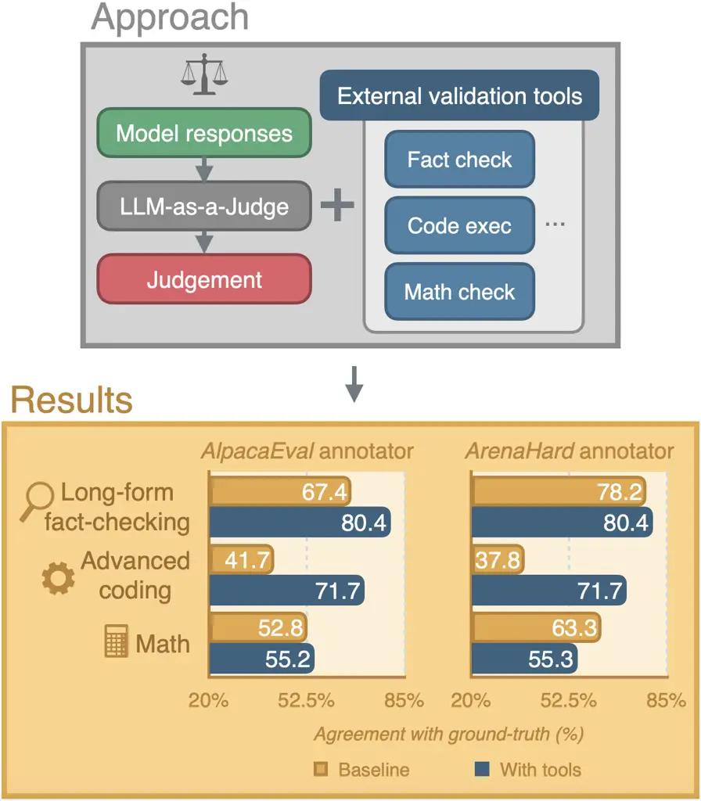

Figure 1: Summary of our approach and results: We extend standard
LLM-as-a-Judge baselines with external validation tools based on
web-search and code execution. We observe that the resulting system is
often, but not always, able to improve performance (measured as
agreement with ground-truth annotations) across a range of response
domains that are typically challenging for LLM-as-a-Judge systems: (1)
_long-form factual_, (2) _advanced coding_, and (3) _math_ responses.
Results with popular AlpacaEval (2.0) and ArenaHard annotators shown,
see Section 4 for full results.

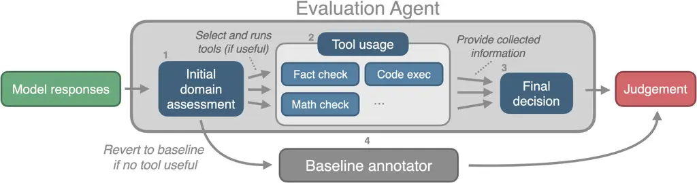

Figure 2: Overview of our tool-using AI annotator architecture, referred
to as _Evaluation Agent_. In the (1) *initial domain assessment* the
appropriate tools are selected for each response (e.g., for a wiki-style
text the fact check tool); then, in (2) _tool usage_, each selected tool
is run and the tool outputs are combined into a single prompt to make a
(3) _final decision_. If none of the tools are selected (i.e., no tool
deemed useful), the agent instead reverts and returns an annotation from
the (4) _baseline annotator_ (e.g., AlpacaEval 2.0).

## 1 Introduction

Pairwise feedback is widely used to understand LLM performance on
complex tasks that more traditional benchmarks fail to measure well.
Given a prompt and two possible responses, the annotator decides which
response is _"better"_. This pairwise judgement can be used for
_evaluation_ (e.g., Chatbot Arena (Chiang et al., 2024)) or to provide
feedback for _training_ (e.g., via RLHF (Stiennon et al., 2020; Ouyang
et al., 2022) or DPO (Rafailov et al., 2023)). Either human or AI
annotators, also referred to as _LLM-as-a-Judge_, are used to collect
such feedback. Human annotations are often considered higher quality but
more expensive.

_Both human and AI annotations have notable limitations:_ AI annotators
have been observed to be susceptible to a number of biases, including
changing preference based on superficial features like _response order_
Zheng et al. (2023) or _response length_ Dubois et al. (2024). Whilst
possibly providing higher quality annotations than AI annotators, human
annotators also have known limitations. For example, human annotators
have been observed to let their assessment of truthfulness be affected
by responses’ assertiveness (Hosking et al., 2024).

In certain domains, obtaining high-quality annotations is _particularly
challenging_: for responses containing _long-form factual_, _advanced
coding_ and _math_ content both AI and (many) human annotators struggle
to provide reliable annotations (Zheng et al., 2023). Annotating
responses in these domains requires expertise and careful deliberation,
challenging to achieve for human annotators in a limited amount of time.
AI annotators may be less "time-constrained" but nevertheless due to
known reliability issues (e.g, hallucinations, limited basic arithmetic)
often fail to provide high quality annotations in these domains (Yang
et al., 2023).

In this work, we aim to explore improving the annotation quality of
widely used AI annotators on these challenging domains by augmenting the
annotators with tools that can _externally validate answers_. We enable
responses to be fact-checked using _web-search_, or verified using _code
execution_. Our setup is illustrated in Figures 1 and 2. In particular,
we make the following contributions:

1.  1.  Extensible framework for using tools with existing AI annotators. We
        introduce a new framework that enables the integration of new tools
        on top of existing AI annotators to improve annotation quality in
        certain domains using external validation. Our framework is
        _agentic_ in the sense that an LLM assesses the response domain and
        plans the optimal tool usage accordingly.¹¹ 1 See Appendix L for
        further discussion of our use of the term _agentic_. We provide a
        number of initial tool implementations: (1) a _long-form fact
        checking_ tool based on the _Search Augmented Fact Evaluation_
        (SAFE) method by Wei et al. (2024); (2) a _code check_ tool built on
        OpenAI’s code interpreter API; and (3) a _math check_ tool similarly
        built on code execution. We open-source the framework’s code.²² 2
        [github.com/apple/ml-agent-evaluator](https://github.com/apple/ml-agent-evaluator)
2.  2.  Comprehensive experimental results evaluating our framework’s
        capabilities. We evaluate our framework’s effectiveness across a
        wide range of tasks including newly created datasets as well as
        well-established benchmarks. We compare our method to a number of
        popular state-of-the-art AI annotators, including the annotators
        underlying *AlpacaEval 2.0* (Dubois et al., 2023), and
        *ArenaHard* (Li et al., 2024b).

## 2 Problem: Pairwise Feedback on Complex Tasks

For many task domains, pairwise feedback can be easier to obtain than
absolute metrics. Nevertheless, for some domains even a relative
pairwise judgement can be difficult to collect — from both human _and_
AI annotators. In this work, we consider three particularly challenging
response domains: tasks that require model responses with (1) _long-form
factual_, (2) _advanced coding_ or (3) _math_ content. For such tasks,
even a relative judgement requires robust understanding of the task
domain, and, for human annotators, careful deliberation. For example,
judging code without understanding the relevant syntax may force an
annotator (AI or human) to revert to higher level features such as style
– that may not fully correlate with ground-truth preferences. Similarly,
when comparing responses with a large number of factual statements, an
annotator may easily miss a single incorrect factual statement — instead
possibly again relying on writing style to make a judgement. At the same
time, annotators only judging according to factual or functional
correctness may miss other response traits (e.g., readability)
distinguishing a merely _correct_ from an _excellent_ response.

In the pairwise setting, annotators are typically evaluated based on
their *agreement*³³ 3 Note that other works (e.g, (Bavaresco et al.,
2024)) use Cohen’s kappa. However, to retain consistency and
comparability with our primary benchmark RewardBench (Lambert et al.,
2024), and for better interpretability, we report all our results using
the more common accuracy (agreement) metric. With the agreement metric,
random performance is $`\sim`$50%. with ground-truth annotations on
datasets, where such annotations are either available by construction or
created by human annotators (Lambert et al., 2024). This agreement is
equivalent to the accuracy of the binary classification task of
predicting the correct ranking for each response pair. In this setting,
the goal of pairwise feedback annotation is to _maximise_ the agreement
with ground-truth annotations. In general, for many response pairs there
is ambiguity regarding which response is better — especially for domains
with known disagreements such as political preferences (Kirk et al.,
2024). To improve the reliability of our evaluation, we primarily test
on response pairs where experts agree on the preference and avoid more
contentious topics.

## 3 Method: AI Annotators with Tools for External Validation

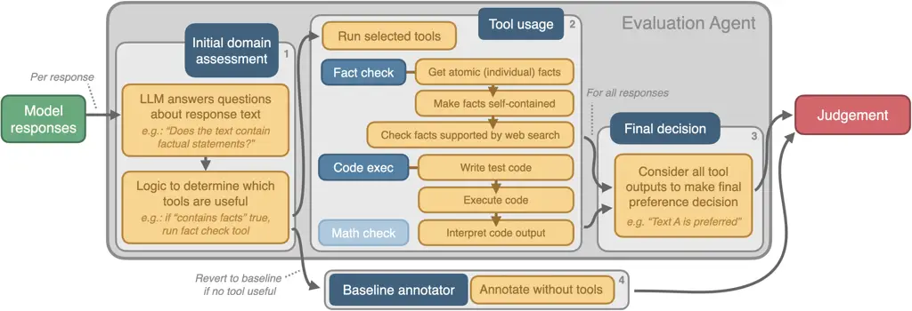

Figure 3: Detailed overview of our evaluation agent: the model responses
are first processed by the (1) _initial domain assessment_, where an LLM
is prompted to answer questions about the response text. In (2) _tool
usage_, each tool that is deemed useful in Step (1) is run. Initially,
available tools include _fact check_, _code exec_ and _math exec_. The
first tool is based on web-search, the latter two tools on a code
interpreter. Finally, in the (3) _final decision_ step, an LLM makes a
final preference decision considering all tool outputs across responses
together. If the (1) _initial domain assessment_ finds no useful tool,
the entire approach reverts back to the (4) _baseline annotator_’s
judgement.

We introduce a new framework for augmenting existing AI annotators with
tools – grounding their annotations in the real world with external
validation. The general functioning of our framework is illustrated in
Figure 2. Our goal is to improve the performance of AI annotators on a
specific set of _target domains_: responses containing _long-form
factual_, _advanced coding_ and _math_ content. To achieve this
annotation quality improvement, we leverage external validation via
tools built on _web search_ and _code execution_. At the same time, we
want to avoid reducing performance on other _non-target_ domains. We use
an agentic setup to determine when each tool gets used, letting an
underlying LLM assess the domain of the response considered and thereby
which tool would be most useful. To avoid regression on non-target
domains, our agentic framework reverts back to a baseline annotator
whenever the responses are assessed to be outside the domain of all
available tools. We build on _structured output_ throughout our pipeline
to reduce the parsing error rate. Instead of plain text responses,
structured output forces the model to return JSON-formatted outputs.
With this approach, each LLM call is not only configured by a single
prompt message but also by the JSON format and description of the
requested output.

Shown in Figure 3, our approach consists of three distinct parts: (1)
_initial domain assessment_, determining which tools to use (if any);
(2) _tools_, running the selected tools for each response; and (3)
_final decision_, creating a final preference judgement based on all
outputs. If the first step (_initial domain assessment_) determines that
no tools would be helpful, our approach alternatively skips steps (2)
and (3). Instead, we revert to the (4) _baseline annotator_. In the
following subsections, we describe each step in more detail. For full
transparency, we share the prompts in Appendix N and make the
corresponding code publicly available.⁴⁴ 4
[github.com/apple/ml-agent-evaluator](https://github.com/apple/ml-agent-evaluator)

Step 1: Initial domain assessment.  
The _initial domain assessment_ ensures that each tool is only run if
the model responses are within a domain where the tool is known to be
likely helpful. For example, for the _code execution_ tool, the domain
assessment ensures that _there is code present in the response_. This
assessment helps avoid running tools in scenarios where they are
unlikely to help. For each tool, we created a number of questions about
a response (e.g., "Whether text might benefit from running code."). For
each response, an LLM is prompted with these questions. The LLM’s parsed
answers determine whether a tool is deemed useful and run – or not. If
not a single tool is deemed useful, the agent reverts back to a baseline
evaluator. With this setup, our method aims to reduce unnecessary
inference costs and to avoid regressing on domains where the tools are
not useful. In the tie case, when tools are only considered useful for
one of the two texts, our framework reverts back to the baseline with
50% probability and uses the agent otherwise. Further, clearly separated
tool domains in our setup allow integrating a large number of
domain-specific tools whilst avoiding adverse effects out-of-domain.

Step 2: Tool usage.  
If the initial assessment deems one or more tools useful, the respective
tools are run. We initially implemented three different tools as part of
our extensible framework, chosen to specifically tackle the limitations
of LLM-as-a-Judge systems discussed in Section 2:

Tool A: Fact-checking. We build on the _Search Augmented Factuality
Evaluator_ (SAFE) by Wei et al. (2024) to create a fact-checking tool
for the pairwise setting. Our fact-checking tool follows similar steps
as the original SAFE algorithm: (1) _separating atomic facts_, (2)
_making atomic facts self-contained_, and (3) _checking whether
self-contained facts are supported by web-search_. Our tool omits the
_relevance check_ in the original SAFE algorithm. In a pairwise
preference setting we consider the truthfulness of all facts relevant,
even if the facts are not directly related to the task. The final
assessment ultimately decides which factual statements are most
relevant. Note that our approach currently relies on the LLM itself to
judge the web search results. The method does not currently explicitly
verify the information from the web beyond the LLM’s judgement.

Tool B: Code execution. Taken into account existing works that show that
compiler/runtime output is a useful signal, we build on top of OpenAI’s
code interpreter API to create a code-execution tool. For both proposed
answers to a prompt, the code-execution tool will verify its correctness
using execution feedback. Internally, OpenAI’s code interpreter API can
create additional unit tests, run multiple execution steps and draw a
conclusion. Only the last conclusion is used in the agent’s final
assessment to determine which response is better.

Tool C: Math checker. Noting that autoregressive language models are not
reliable arithmetic engines (Yang et al., 2023), we prompt-constrain our
code-execution tool to perform math (and in particular arithmetic)
validation on each of the model outputs. As in the case of general code
execution, multiple checks may be executed per model output, and the
final assessment uses the outcome of these checks to inform its overall
decision. We created a separate math checker after preliminary tests
indicated a standard code interpreter tool does not transfer well to
math annotation settings.

Step 3: Final assessment.  
In the _final assessment_ step, we combine the results of all tools per
response alongside the original prompt and response, to ask an LLM to
make a preference judgement based on all collected information.
Critically, this step allows the LLM to access the external validation
results when making a decision. The LLM response to this step provides
the final preference judgement (e.g., _"Text A is preferred."_) as well
as a chain-of-thought (CoT) reasoning for the judgement (e.g., _"Text A
is preferred because \[…\]"_).

## 4 Experimental Results

### 4.1 Datasets

Existing datasets. A number of benchmarks aim to evaluate AI annotator
capabilities, notable examples include (subsets of) _AlpacaEval_
 (Dubois et al., 2023), *MT-Bench* (Zheng et al., 2023), *LLMBar* (Zeng
et al., 2024) and _RewardBench_ (Lambert et al., 2024). We use the
latter, RewardBench, for our evaluation, as it represents a superset
including the other tasks. This benchmark provides a broad coverage of
response domains, including _mathematical reasoning_, _code generation_
and _general chatbot conversation_. We find that some subsets of the
benchmark are fairly saturated: state-of-the-art LLM-as-a-judge systems
already achieve close to 100% agreement with the ground-truth
annotations (see Appendix C for discussion). Thus, to effectively
evaluate improvements in these domains, we created new pairwise
datasets.

New pairwise datasets. We extend RewardBench by adapting existing, more
challenging (previously non-pairwise) datasets to the pairwise setting.
Appendix M contains examples from each dataset introduced below.

1.  1.  Long-form fact checking: LongFact pairwise. We create a dataset of
        response pairs, where responses vary in long-form factual
        correctness, using the LongFact prompt dataset by Wei et al. (2024).
        We use OpenAI’s _gpt-4o-mini-2024-07-18_ model to generate two
        long-form factual responses for each prompt. We then manually
        introduce factual errors into one of the responses. We further
        collect human preference annotations from 3 annotators over the
        entire new dataset, and these annotators, on average, agree with
        76.83% of those ground-truth annotations when _not_ selecting a tie.
        18% of the average human annotations are ties. Full details on the
        data generation process are available in Appendix K.
2.  2.  Challenging coding: APPS competition pairwise. From the original
        APPS dataset (Hendrycks et al., 2021), we create a pairwise response
        dataset to evaluate the ability to determine code correctness. The
        APPS benchmark contains coding problems, unit tests and Python
        ground-truth solutions for most problems. We take the “competition”
        subset, arguing it is these harder problem/solution combinations
        that are tricky to evaluate correctly. We only keep samples that
        contain a ground-truth solution, leaving us with 310 items. We then
        use GPT-4-0613 to generate solutions to the problems, until we have
        failing solutions for all 310 items.
3.  3.  Challenging maths: GSM8k hard pairwise. We select a “hard” subset of
        the GSM8k (Cobbe et al., 2021a) dataset by keeping the 116 examples
        that GPT-4o is unable to solve. For each example, we generate
        pairwise responses by keeping both the ground-truth answer and the
        incorrect answer that GPT-4o provided. We also conducted a detailed
        analysis of validity of the GSM8k datapoints used, shared in
        Appendix I.

We additionally create a pairwise response dataset where responses vary
in _short-form_ factual correctness using the TruthfulQA datasetby Lin
et al. (2022). Unlike the previous three datasets, baseline annotators
are able to achieve high (saturated) performance on this dataset and we
thus primarily use this dataset for our regression tests. Further,
unlike the long-form responses in our LongFact pairwise dataset,
responses in this dataset are typically between a single word and single
sentence long, relating to a single fact. See Appendix K for full data
generation details.

### 4.2 Baseline Annotators

We compare our method to two popular AI annotator configurations that
are widely used in academic and industry settings, and may be considered
_state-of-the-art_: (1) the widely-used *AlpacaEval 2.0*⁵⁵ 5 Config.
name: weighted_alpaca_eval_gpt4_turbo. annotator by Dubois et al. (2023)
using _GPT-4-Turbo_, logprob parsing to extract annotations; and (2) the
_ArenaHard_ annotator by Li et al. (2024b) using more extensive
annotation instructions (including asking the model to craft its own
response) and string parsing; We further share results using two
minimalist AI annotators that simply ask the underlying LLM to _"select
the better"_ text, powered by GPT-3.5-Turbo and GPT-4o. Perhaps
surprisingly, we find that the simple annotator powered by GPT-4o
performs competitively on many datasets considered in our experiments.
We report all results based on 5 seeds (unless otherwise specified),
showing the mean with standard deviation as error bars. When reporting
the agent results across different baselines, we use the same 5 seeds of
the agent Steps 1-3, only changing the underlying baseline results (Step
4). This setup notably reduces the cost of our experiments as agent
steps required the majority of inference compute.

### 4.3 Results on Target Domains

In this section we show results on the targeted domains: long-form
factual, code and math tasks.

#### 4.3.1 Long-Form Fact-Checking

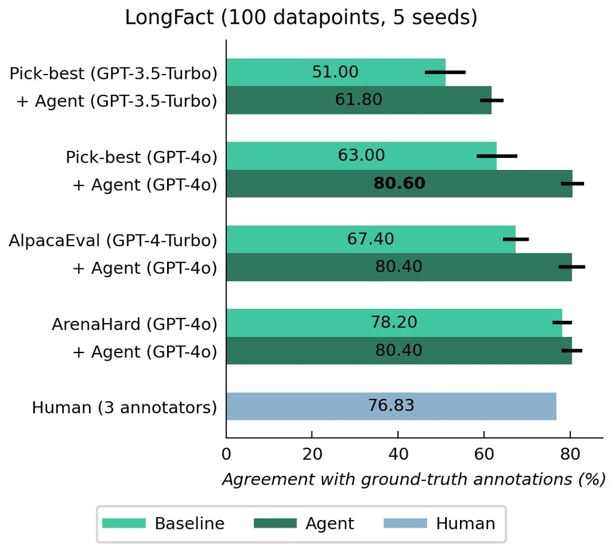

Figure 4: Long-form fact checking results on LongFact pairwise data. We
augment multiple baseline annotators (_light green_) with our evaluation
agent framework (_dark green_) and observe that our agents have higher
average agreement with ground-truth annotations across baselines. The
effect is most pronounced for simpler baselines, including when agent
and baseline are based on the less capable GPT-3.5-Turbo model. We also
collect non-expert human annotations (_blue_) for the same dataset, and
observe that, when making a non-tie judgement, human annotators have
higher disagreement with the ground-truth than our best agent
evaluators.

We evaluate our method on data pairs that require long-form fact
checking using the _LongFact pairwise_ dataset introduced in
Section 4.1. Figure 4 illustrates our results on this dataset.

Observation 1: Our external validation tools can help AI annotators
improve performance annotating long-form factual responses. In Figure 4
we observe that, across all evaluated baselines, augmenting any baseline
with our fact-checking agent helps improve the overall agreement with
the ground-truth annotations on this dataset. Whilst the contrast is
most pronounced with simpler baselines (e.g., for GPT-4o _pick-best
baseline_, 63% vs 81%), the effect is present across all baselines,
including ArenaHard (78% vs 80%).

Observation 2: For baseline annotators, configurations such as prompt
have a strong impact on the downstream performance on long-form fact
checking (jumping from 63% to 78% for GPT-4o). We observe a jump in
agreement between the _pick-best_ and _ArenaHard_ baseline annotators,
both powered by GPT-4o. The only difference between these annotators is
the prompt and answer parsing used. The _pick-best_ annotator uses a
simple prompt asking for the better answer, either text A or B. The
_ArenaHard_ annotator uses an extensive prompt, including asking the LLM
to create its own response for comparison. This observation indicates
that for this type of factual task the exact choice of AI annotator
configuration is critical, with the _ArenaHard_ configuration performing
the best amongst the tested baselines.

Observation 3: Our agents’ agreement with our ground-truth annotations
is higher than human annotators’ on long-form factual responses. This
effect holds for all agents based on baselines with GPT-4-style models.
Wei et al. (2024) similarly report their method sometimes outperforming
non-expert human annotators. Intuitively, it seems plausible that human
annotators may be affected by time limits and fatigue – unlike our
agent. Hosking et al. (2024) similarly observe that human annotators’
perceived rate of factual errors can be skewed by the assertiveness of a
model response, indicating that human annotators may not always consider
factual errors sufficiently.

#### 4.3.2 Math-Checking

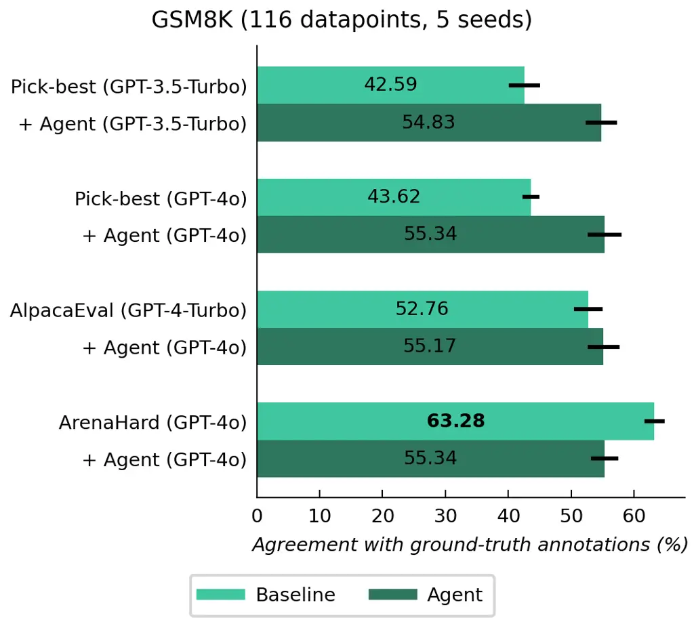

Figure 5: Results annotating responses on our pairwise set of
mathematical tasks based on GSM8k. We observe that our method improves
performance over some baselines, but the overall level of agreement
remains relatively low (around 56%). Further work is needed to improve
the models capability to leverage code execution fully in a math
context.

We further evaluate our method on annotating solutions to advanced
mathematics tasks, via the _GSM8k hard pairwise_ dataset introduced in
Section 4.1, the results are shown in Figure 5.

Observation 4: Our agents are able to outperform some, but not all,
baselines on hard math annotation tasks based on GSM8k. We observe that
only some augmented baseline annotators are able to improve their
performance. In particular, the _ArenaHard_ annotator is notably able to
outperform all agent-based methods on this task. This result indicates
that more complex prompting methods (in terms of token usage and code),
such as our framework, do not necessarily always improve annotator
performance over (relatively) less complex methods, such as ArenaHard.
Future work may be able further improve our method’s ability to use code
execution in a math context.

To further evaluate our method’s ability to improve math performance, we
additionally conduct an experiment on the RewardMATH dataset by Kim
et al. (2024). Unlike on the GSM8k dataset, we observe our method
outperforming the ArenaHard baseline on RewardMATH. The detailed results
are shared in Appendix H.

#### 4.3.3 Code-Execution

Finally, we evaluate our method’s ability to improve capabilities in
annotating advanced coding tasks using our pairwise coding dataset based
on the _APPS_ dataset by Hendrycks et al. (2021). The results are shown
in Figure 6.

Observation 5: Our method is able to notably improve the baseline
performance on annotating the APPS advanced coding responses. Across all
baselines, our agent-based approach is able to notably improve
annotation performance. This improvement holds both for the less capable
GPT-3.5-Turbo model (31% baseline vs 71% agent) as well as the
_ArenaHard_ annotator that performs strongly on other tasks (38%
baseline vs 72% agent).

Observation 6: Baseline annotators perform worse than random on APPS
dataset. Based on the construction, there may be slight style
differences between correct (pre-existing ground-truth solutions) and
incorrect responses (GPT-4 generated _incorrect_ code), see examples in
Appendix M. We observe that all baseline annotators have a bias towards
the incorrect GPT-4 responses, preferring only 26% to 42% of correct
responses. This effect may possibly be explained with self-enhancement
bias (Panickssery et al., 2024; Stureborg et al., 2024). Our agent
method using code execution does not show such misaligned preferences.

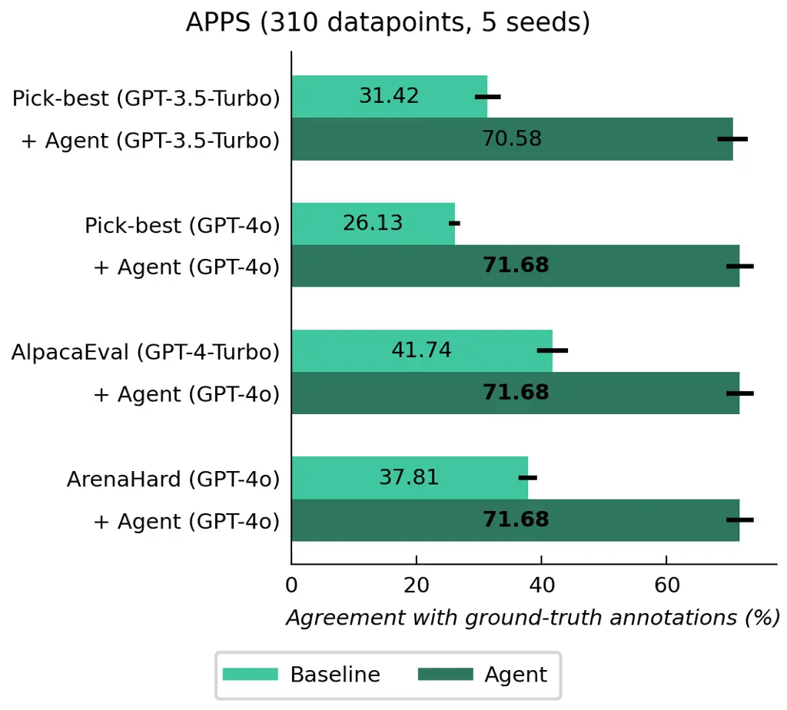

Figure 6: Results on our pairwise dataset of responses to advanced
coding tasks from the APPS dataset (Hendrycks et al., 2021). We observe
a notable improvement of our method over the baseline results, even for
the otherwise less capable models GPT-3.5-Turbo.

### 4.4 Results Outside of Target Domains (Out-of-Domain)

In practice, an AI annotator may encounter response pairs from across a
variety of task domains – including domains not intended to be addressed
by our method. A good AI annotator should be able to work across
domains, as filtering data may not always be feasible or sufficiently
effective. Thus, we go beyond the domain-specific capability
improvements shown in Sections 4.3.1, 4.3.3 and 4.3.2 and also evaluate
our method’s performance on RewardBench tasks that are out-of-domain for
our tools⁶⁶ 6 This out-of-domain dataset includes the _Chat_, _Chat
Hard_ and _Safety_ RewardBench categories.. _In this general scenario we
would not expect performance improvements with our method_ but aim for
minimal performance regression – as our tools are not built to help (or
activate) on most of these tasks. Figure 7 shows our results on these
tasks.

Observation 7: On out-of-domain tasks from Rewardbench there are minimal
performance reductions using our approach with any tested baseline. The
agreement reductions are less than 2% for all tested baselines. For the
GPT-3.5-Turbo-based agent we even observe a slight improvement. Future
work may be able to refine the initial assessment to further reduce this
gap.

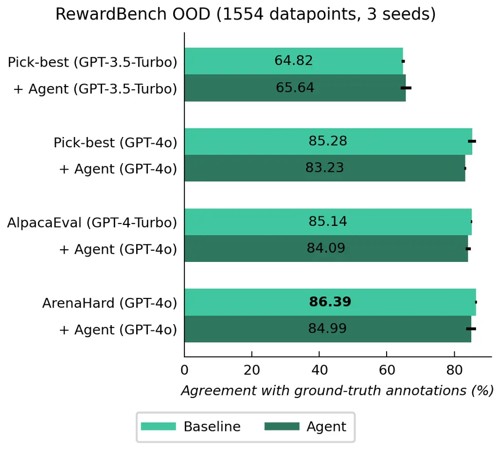

Figure 7: General out-of-domain annotation capabilities result based on
RewardBench (Lambert et al., 2024). We observe that our agent achieves
similar performance to the baseline annotator across these tasks — at
worst seeing a reduction of $`\sim`$2% in agreement.

Further analysis of agent performance. To better understand why
performance sometimes reduces slightly in Figure 7 with the agent, we
conduct further analysis of the agents’ performance. First, we
investigate how often agent reverts to the baseline annotator: for our
out-of-domain experiments our agents revert for 73.9% of datapoints, for
the in-domain experiments (LongFact, GSM8k and APPS) our agents only
revert for between 0.2% to 2.2% of datapoints. Whilst our domain
assessment correctly identifies the in-domain tasks, further adaptions
to the assessment may help further reduce the activation out-of-domain.
We further manually inspect the failure reasons for 30 datapoints where
the agent fails to annotate correctly. We observe that for 9 out of 30
examples the agent _chooses the wrong tool_ for the task. For example,
the agent sometimes uses the fact-checking tool when a refusal response
should be selected for safety-reasons. Further, for 18 out of the 30
datapoints, we observe that tool-use does not fix existing capability
issues: both with and without tools the annotator makes the wrong
decision. For 6 of these 18 datapoints, the previously described safety
scenario also applies. Additional details of the manual inspection are
provided in Sections C.2 and C.3.

Results on adjacent domains. Further, we specifically evaluate our
results on domains closely adjacent to our main focus domains:
short-form fact checking (TruthfulQA pairwise), simple coding tasks
(RewardBench HumanEval pairwise) and general math problems (RewardBench
PRM pairwise). These domains are already quite well solved by
state-of-the-art AI annotators. Thus, as with the general out-of-domain
results, we would not expect any notable improvements but aim to
demonstrate _limited performance regressions_. We observe two opposing
effects: for the short-form fact checking and simple maths our approach
is consistently able to improve performance, whereas for simple coding
tasks the annotation performance decreases (reduction of up to 9%, see
Figure 9). One possible explanation may be that the very high baseline
performance on HumanEval (above 97% for GPT-4-style models) may be
reduced by additional noise due to code execution pipeline. Appendix F
includes detailed results for these adjacent domain experiments.

## 5 Related Work

Pairwise AI annotators. As human annotations are costly and
time-intensive, extensive work has been done to explore the use of _AI
annotators_ as an alternative. Works such as _LLM-as-a-judge_ (Zheng
et al., 2023), _AlpacaEval_ (Dubois et al., 2023) and _G-Eval_ (Liu
et al., 2023) popularized AI annotators in the context of evaluation.
The _ArenaHard_ annotator is another popular choice (Li et al., 2024b).
Various efforts have also explored the use of AI annotators for
generating training data, such as _constitutional AI_ (Bai et al.,
2022). This line of work is also known as _reinforcement learning from
AI feedback_ (RLAIF) (Lee et al., 2024).

AI annotator problems. A number of biases have been observed in AI
annotators, for example (1) _length bias_ (Zheng et al., 2023; Dubois
et al., 2024), where annotators prefer more verbose outputs (even when
not corresponding to human preference); (2) _position bias_ (Zheng
et al., 2023), where the model’s annotation affected by order in which
they are shared with the model; and (3) _self-enhancement bias_
(Panickssery et al., 2024; Stureborg et al., 2024), where preferred
responses have high probability under judge model’s distribution.

Augmented AI evaluators. Given the known limitations of basic AI
annotators, various _augmentations_ of such annotators have been
explored. Li et al. (2024a) explore the use of external validation tools
to improve the performance of a reward model (RM), in a framework named
_Themis_. Similar to our work, the tools considered include code
interpreter and web search tools. However, Themis requires a language
model with customized architecture and fine-tuning—preventing the use of
Themis with the latest state-of-the-art closed-source models. We
conducted experiments applying Themis to the datasets considered in our
work with limited success, the results are discussed in Appendix J.
Dubois et al. (2024) propose augmenting AI annotators to be
length-controlled using a generalized linear model to address the widely
observed length bias. Others explore using multiple AI annotators
simultaneously to improve performance (Verga et al., 2024; Chan et al.,
2023).

In a non-pairwise setting, the _Search Augmented Factuality Evaluator_
(SAFE) by Wei et al. (2024), and prior work FActScore (Min et al.,
2023), RARR (Gao et al., 2023), Factcheck-Bench (Wang et al., 2024), all
aimed to improve the capability of verifying facts within text, such as
model responses. Gou et al. (2023) explore the use of external
validation tools to improve _generative_ performance, demonstrating
improvements for question answering, programming and toxicity reduction
tasks.

## 6 Conclusion

In this work we have presented a novel framework for augmenting AI
annotators with tools to externally validate outputs and address
existing limitations with AI and human annotations. We compare our
method to state-of-the-art and widely used AI annotators, including the
_AlpacaEval 2.0_ (Dubois et al., 2023) and _ArenaHard_ annotator (Li
et al., 2024b). To challenge our method on annotation tasks where the
existing datasets appear saturated (coding, math) or little pairwise
data exists (long-form factual responses), we created new pairwise
datasets, building on _LongFact_ (Wei et al., 2024), _GSM8k_ (Cobbe
et al., 2021b), and _APPS_ (Hendrycks et al., 2021). We evaluate our
method’s effectiveness across a diverse collection of datasets,
including the new datasets and RewardBench (Lambert et al., 2024). We
observe that our external validation-based method often improves
baseline annotator performance, with strongest effectiveness when
annotating _advanced coding_ responses but also for _long-form factual_
responses, with more mixed results in _advanced math_ responses. We
conclude that, whilst external validation tools can often improve
annotation quality of AI annotator (or _LLM-as-a-Judge_) for certain
scenarios, such tools represent a trade-off in terms of complexity and
cost. Careful evaluation is required to effectively apply such tools and
they may not be the right fit for every use-case.

## 7 Limitations

As discussed in Section 4.4, our method does (as expected) currently
show some regression on some out-of-domain tasks. Thus, in practice, our
method’s overall usefulness will depend on the domain distribution of
the datasets it is applied to. For datasets with a high proportion of
datapoints in our target domains, our method is likely able to improve
annotation quality. For more out-of-domain datasets any performance
improvement will likely be limited.

Further, as discussed in Section 2, our experiments are limited to
domains with high expert agreement. Domains where expert agreement is
not necessarily given are more difficult to target, as the goal of
judges is less clearly defined in such a case. This limitation applies
to both for our system and LLM-as-a-Judge systems in general.

Potential risks of using our method include over-relying on
LLM-as-a-Judge systems rather than human judgements, possibly leading to
misaligned models that are overfit to such AI judges. In general,
LLM-as-a-Judge methods should be used to complement – rather than
replace – human judgement.

More broadly, our results highlight the strong effect that simple
configuration parameters, such as prompt and parsing method, can have on
annotator performance — even if the same underlying LLM is used. When
considering more technically involved augmentations like our external
validation tools, we recommend to also carefully evaluate simpler
configurations as an alternative across a wide range of scenarios, as we
have done. A robust AI annotator testing pipeline can be critical to
determine the right annotator. Concurrent work by Calderon et al. (2025)
offers a promising direction for more rigorous statistical tests of
annotators. We would welcome future work that develops further datasets
and methods to improve the reliability and comprehensiveness of AI
annotator evaluation.

#### Acknowledgments

We would like to thank Dong Yin, Feng Nan, Jiarui Lu, Sam Wiseman, Zirui
Wang and Robert Mullins for their help and feedback throughout this
project. Further, we thank all reviewers for taking the time to read our
work and provide helpful feedback. Arduin Findeis was further supported
by a University of Cambridge School of Physical Sciences Award and by
the UKRI Centre for Doctoral Training in Application of Artificial
Intelligence to the study of Environmental Risks (reference
EP/S022961/1).

## References

- Bai et al. (2022) Yuntao Bai, Saurav Kadavath, Sandipan Kundu, Amanda
  Askell, Jackson Kernion, Andy Jones, Anna Chen, Anna Goldie, Azalia
  Mirhoseini, Cameron McKinnon, Carol Chen, Catherine Olsson,
  Christopher Olah, Danny Hernandez, Dawn Drain, Deep Ganguli, Dustin
  Li, Eli Tran-Johnson, Ethan Perez, Jamie Kerr, Jared Mueller, Jeffrey
  Ladish, Joshua Landau, Kamal Ndousse, Kamile Lukosuite, Liane Lovitt,
  Michael Sellitto, Nelson Elhage, Nicholas Schiefer, Noemi Mercado,
  Nova DasSarma, Robert Lasenby, Robin Larson, Sam Ringer, Scott
  Johnston, Shauna Kravec, Sheer El Showk, Stanislav Fort, Tamera
  Lanham, Timothy Telleen-Lawton, Tom Conerly, Tom Henighan, Tristan
  Hume, Samuel R. Bowman, Zac Hatfield-Dodds, Ben Mann, Dario Amodei,
  Nicholas Joseph, Sam McCandlish, Tom Brown, and Jared Kaplan. 2022.
  [Constitutional AI: Harmlessness from AI
  Feedback](https://doi.org/10.48550/arXiv.2212.08073). _arXiv
  preprint_.
- Bavaresco et al. (2024) Anna Bavaresco, Raffaella Bernardi, Leonardo
  Bertolazzi, Desmond Elliott, Raquel Fernández, Albert Gatt, Esam
  Ghaleb, Mario Giulianelli, Michael Hanna, Alexander Koller, André
  F. T. Martins, Philipp Mondorf, Vera Neplenbroek, Sandro Pezzelle,
  Barbara Plank, David Schlangen, Alessandro Suglia, Aditya K.
  Surikuchi, Ece Takmaz, and Alberto Testoni. 2024. [LLMs Instead of
  Human Judges? A Large Scale Empirical Study across 20 NLP Evaluation
  Tasks](https://doi.org/10.48550/arXiv.2406.18403). _Preprint_,
  arXiv:2406.18403.
- Calderon et al. (2025) Nitay Calderon, Roi Reichart, and Rotem
  Dror. 2025. [The Alternative Annotator Test for LLM-as-a-Judge: How to
  Statistically Justify Replacing Human Annotators with
  LLMs](https://doi.org/10.48550/arXiv.2501.10970). _Preprint_,
  arXiv:2501.10970.
- Chan et al. (2023) Chi-Min Chan, Weize Chen, Yusheng Su, Jianxuan Yu,
  Wei Xue, Shanghang Zhang, Jie Fu, and Zhiyuan Liu. 2023. [ChatEval:
  Towards Better LLM-based Evaluators through Multi-Agent
  Debate](https://doi.org/10.48550/arXiv.2308.07201). _Preprint_,
  arXiv:2308.07201.
- Chen et al. (2021) Mark Chen, Jerry Tworek, Heewoo Jun, Qiming Yuan,
  Henrique Ponde de Oliveira Pinto, Jared Kaplan, Harri Edwards, Yuri
  Burda, Nicholas Joseph, Greg Brockman, Alex Ray, Raul Puri, Gretchen
  Krueger, Michael Petrov, Heidy Khlaaf, Girish Sastry, Pamela Mishkin,
  Brooke Chan, Scott Gray, Nick Ryder, Mikhail Pavlov, Alethea Power,
  Lukasz Kaiser, Mohammad Bavarian, Clemens Winter, Philippe Tillet,
  Felipe Petroski Such, Dave Cummings, Matthias Plappert, Fotios
  Chantzis, Elizabeth Barnes, Ariel Herbert-Voss, William Hebgen Guss,
  Alex Nichol, Alex Paino, Nikolas Tezak, Jie Tang, Igor Babuschkin,
  Suchir Balaji, Shantanu Jain, William Saunders, Christopher Hesse,
  Andrew N. Carr, Jan Leike, Josh Achiam, Vedant Misra, Evan Morikawa,
  Alec Radford, Matthew Knight, Miles Brundage, Mira Murati, Katie
  Mayer, Peter Welinder, Bob McGrew, Dario Amodei, Sam McCandlish, Ilya
  Sutskever, and Wojciech Zaremba. 2021. [Evaluating Large Language
  Models Trained on Code](https://doi.org/10.48550/arXiv.2107.03374).
  _Preprint_, arXiv:2107.03374.
- Chiang et al. (2024) Wei-Lin Chiang, Lianmin Zheng, Ying Sheng,
  Anastasios Nikolas Angelopoulos, Tianle Li, Dacheng Li, Hao Zhang,
  Banghua Zhu, Michael Jordan, Joseph E. Gonzalez, and Ion Stoica. 2024.
  [Chatbot Arena: An Open Platform for Evaluating LLMs by Human
  Preference](https://doi.org/10.48550/arXiv.2403.04132). _Preprint_,
  arXiv:2403.04132.
- Cobbe et al. (2021a) Karl Cobbe, Vineet Kosaraju, Mohammad Bavarian,
  Mark Chen, Heewoo Jun, Lukasz Kaiser, Matthias Plappert, Jerry Tworek,
  Jacob Hilton, Reiichiro Nakano, Christopher Hesse, and John Schulman.
  2021a. [Training verifiers to solve math word
  problems](https://arxiv.org/abs/2110.14168). _CoRR_, abs/2110.14168.
- Cobbe et al. (2021b) Karl Cobbe, Vineet Kosaraju, Mohammad Bavarian,
  Mark Chen, Heewoo Jun, Lukasz Kaiser, Matthias Plappert, Jerry Tworek,
  Jacob Hilton, Reiichiro Nakano, Christopher Hesse, and John Schulman.
  2021b. [Training Verifiers to Solve Math Word
  Problems](https://arxiv.org/abs/2110.14168). _Preprint_,
  arXiv:2110.14168.
- Dubois et al. (2024) Yann Dubois, Balázs Galambosi, Percy Liang, and
  Tatsunori B. Hashimoto. 2024. [Length-Controlled AlpacaEval: A Simple
  Way to Debias Automatic
  Evaluators](https://doi.org/10.48550/arXiv.2404.04475). _Preprint_,
  arXiv:2404.04475.
- Dubois et al. (2023) Yann Dubois, Chen Xuechen Li, Rohan Taori, Tianyi
  Zhang, Ishaan Gulrajani, Jimmy Ba, Carlos Guestrin, Percy S. Liang,
  and Tatsunori B. Hashimoto. 2023. AlpacaFarm: A Simulation Framework
  for Methods that Learn from Human Feedback. _Advances in Neural
  Information Processing Systems_, 36:30039–30069.
- Gao et al. (2023) Luyu Gao, Zhuyun Dai, Panupong Pasupat, Anthony
  Chen, Arun Tejasvi Chaganty, Yicheng Fan, Vincent Y. Zhao, Ni Lao,
  Hongrae Lee, Da-Cheng Juan, and Kelvin Guu. 2023. [RARR: Researching
  and Revising What Language Models Say, Using Language
  Models](https://doi.org/10.48550/arXiv.2210.08726). _Preprint_,
  arXiv:2210.08726.
- Gou et al. (2023) Zhibin Gou, Zhihong Shao, Yeyun Gong, Yelong Shen,
  Yujiu Yang, Nan Duan, and Weizhu Chen. 2023. CRITIC: Large Language
  Models Can Self-Correct with Tool-Interactive Critiquing. In _The
  Twelfth International Conference on Learning Representations_.
- Hendrycks et al. (2021) Dan Hendrycks, Steven Basart, Saurav Kadavath,
  Mantas Mazeika, Akul Arora, Ethan Guo, Collin Burns, Samir Puranik,
  Horace He, Dawn Song, and Jacob Steinhardt. 2021. [Measuring Coding
  Challenge Competence With APPS](https://arxiv.org/abs/2105.09938).
  _Preprint_, arXiv:2105.09938.
- Hosking et al. (2024) Tom Hosking, Phil Blunsom, and Max
  Bartolo. 2024. [Human Feedback is not Gold
  Standard](https://doi.org/10.48550/arXiv.2309.16349). _Preprint_,
  arXiv:2309.16349.
- Kim et al. (2024) Sunghwan Kim, Dongjin Kang, Taeyoon Kwon, Hyungjoo
  Chae, Jungsoo Won, Dongha Lee, and Jinyoung Yeo. 2024. [Evaluating
  Robustness of Reward Models for Mathematical
  Reasoning](https://doi.org/10.48550/arXiv.2410.01729).
- Kirk et al. (2024) Hannah Rose Kirk, Alexander Whitefield, Paul
  Röttger, Andrew Bean, Katerina Margatina, Juan Ciro, Rafael Mosquera,
  Max Bartolo, Adina Williams, He He, Bertie Vidgen, and Scott A.
  Hale. 2024. [The PRISM Alignment Project: What Participatory,
  Representative and Individualised Human Feedback Reveals About the
  Subjective and Multicultural Alignment of Large Language
  Models](https://arxiv.org/abs/2404.16019). _Preprint_,
  arXiv:2404.16019.
- Lambert et al. (2024) Nathan Lambert, Valentina Pyatkin, Jacob
  Morrison, L. J. Miranda, Bill Yuchen Lin, Khyathi Chandu, Nouha Dziri,
  Sachin Kumar, Tom Zick, Yejin Choi, Noah A. Smith, and Hannaneh
  Hajishirzi. 2024. [RewardBench: Evaluating Reward Models for Language
  Modeling](https://doi.org/10.48550/arXiv.2403.13787). _Preprint_,
  arXiv:2403.13787.
- Lee et al. (2024) Harrison Lee, Samrat Phatale, Hassan Mansoor, Thomas
  Mesnard, Johan Ferret, Kellie Lu, Colton Bishop, Ethan Hall, Victor
  Carbune, Abhinav Rastogi, and Sushant Prakash. 2024. [RLAIF vs. RLHF:
  Scaling Reinforcement Learning from Human Feedback with AI
  Feedback](https://doi.org/10.48550/arXiv.2309.00267). _Preprint_,
  arXiv:2309.00267.
- Li et al. (2024a) Lei Li, Yekun Chai, Shuohuan Wang, Yu Sun, Hao Tian,
  Ningyu Zhang, and Hua Wu. 2024a. [Tool-Augmented Reward
  Modeling](https://doi.org/10.48550/arXiv.2310.01045). _Preprint_,
  arXiv:2310.01045.
- Li et al. (2024b) Tianle Li, Wei-Lin Chiang, Evan Frick, Lisa Dunlap,
  Tianhao Wu, Banghua Zhu, Joseph E. Gonzalez, and Ion Stoica. 2024b.
  [From Crowdsourced Data to High-Quality Benchmarks: Arena-Hard and
  BenchBuilder Pipeline](https://doi.org/10.48550/arXiv.2406.11939).
  _Preprint_, arXiv:2406.11939.
- Lightman et al. (2023) Hunter Lightman, Vineet Kosaraju, Yura Burda,
  Harri Edwards, Bowen Baker, Teddy Lee, Jan Leike, John Schulman, Ilya
  Sutskever, and Karl Cobbe. 2023. [Let’s Verify Step by
  Step](https://arxiv.org/abs/2305.20050). _Preprint_, arXiv:2305.20050.
- Lin et al. (2022) Stephanie Lin, Jacob Hilton, and Owain Evans. 2022.
  [TruthfulQA: Measuring How Models Mimic Human
  Falsehoods](https://doi.org/10.48550/arXiv.2109.07958). _Preprint_,
  arXiv:2109.07958.
- Liu et al. (2023) Yang Liu, Dan Iter, Yichong Xu, Shuohang Wang,
  Ruochen Xu, and Chenguang Zhu. 2023. [G-Eval: NLG Evaluation using
  GPT-4 with Better Human
  Alignment](https://doi.org/10.48550/arXiv.2303.16634). _Preprint_,
  arXiv:2303.16634.
- Min et al. (2023) Sewon Min, Kalpesh Krishna, Xinxi Lyu, Mike Lewis,
  Wen-tau Yih, Pang Wei Koh, Mohit Iyyer, Luke Zettlemoyer, and Hannaneh
  Hajishirzi. 2023. [FActScore: Fine-grained Atomic Evaluation of
  Factual Precision in Long Form Text
  Generation](https://arxiv.org/abs/2305.14251). _Preprint_,
  arXiv:2305.14251.
- Ouyang et al. (2022) Long Ouyang, Jeff Wu, Xu Jiang, Diogo Almeida,
  Carroll L. Wainwright, Pamela Mishkin, Chong Zhang, Sandhini Agarwal,
  Katarina Slama, Alex Ray, John Schulman, Jacob Hilton, Fraser Kelton,
  Luke Miller, Maddie Simens, Amanda Askell, Peter Welinder, Paul
  Christiano, Jan Leike, and Ryan Lowe. 2022. Training language models
  to follow instructions with human feedback. _arXiv preprint_.
- Panickssery et al. (2024) Arjun Panickssery, Samuel R. Bowman, and Shi
  Feng. 2024. [LLM Evaluators Recognize and Favor Their Own
  Generations](https://doi.org/10.48550/arXiv.2404.13076). _arXiv
  preprint_.
- Rafailov et al. (2023) Rafael Rafailov, Archit Sharma, Eric Mitchell,
  Stefano Ermon, Christopher D. Manning, and Chelsea Finn. 2023. [Direct
  Preference Optimization: Your Language Model is Secretly a Reward
  Model](https://doi.org/10.48550/arXiv.2305.18290). _arXiv preprint_.
- Stiennon et al. (2020) Nisan Stiennon, Long Ouyang, Jeffrey Wu, Daniel
  Ziegler, Ryan Lowe, Chelsea Voss, Alec Radford, Dario Amodei, and
  Paul F. Christiano. 2020. Learning to summarize with human feedback.
  _Advances in Neural Information Processing Systems_, 33:3008–3021.
- Stureborg et al. (2024) Rickard Stureborg, Dimitris Alikaniotis, and
  Yoshi Suhara. 2024. Large Language Models are Inconsistent and Biased
  Evaluators. _arXiv preprint_.
- Verga et al. (2024) Pat Verga, Sebastian Hofstatter, Sophia Althammer,
  Yixuan Su, Aleksandra Piktus, Arkady Arkhangorodsky, Minjie Xu, Naomi
  White, and Patrick Lewis. 2024. [Replacing Judges with Juries:
  Evaluating LLM Generations with a Panel of Diverse
  Models](https://doi.org/10.48550/arXiv.2404.18796). _Preprint_,
  arXiv:2404.18796.
- Wang et al. (2024) Yuxia Wang, Revanth Gangi Reddy, Zain Muhammad
  Mujahid, Arnav Arora, Aleksandr Rubashevskii, Jiahui Geng,
  Osama Mohammed Afzal, Liangming Pan, Nadav Borenstein, Aditya Pillai,
  Isabelle Augenstein, Iryna Gurevych, and Preslav Nakov. 2024.
  [Factcheck-Bench: Fine-Grained Evaluation Benchmark for Automatic
  Fact-checkers](https://doi.org/10.48550/arXiv.2311.09000). _Preprint_,
  arXiv:2311.09000.
- Wei et al. (2024) Jerry Wei, Chengrun Yang, Xinying Song, Yifeng Lu,
  Nathan Hu, Jie Huang, Dustin Tran, Daiyi Peng, Ruibo Liu, Da Huang,
  Cosmo Du, and Quoc V. Le. 2024. [Long-form factuality in large
  language models](https://doi.org/10.48550/arXiv.2403.18802).
  _Preprint_, arXiv:2403.18802.
- Yang et al. (2023) Zhen Yang, Ming Ding, Qingsong Lv, Zhihuan Jiang,
  Zehai He, Yuyi Guo, Jinfeng Bai, and Jie Tang. 2023. [Gpt can solve
  mathematical problems without a
  calculator](https://arxiv.org/abs/2309.03241). _Preprint_,
  arXiv:2309.03241.
- Zeng et al. (2024) Zhiyuan Zeng, Jiatong Yu, Tianyu Gao, Yu Meng,
  Tanya Goyal, and Danqi Chen. 2024. [Evaluating Large Language Models
  at Evaluating Instruction
  Following](https://doi.org/10.48550/arXiv.2310.07641). _Preprint_,
  arXiv:2310.07641.
- Zheng et al. (2023) Lianmin Zheng, Wei-Lin Chiang, Ying Sheng, Siyuan
  Zhuang, Zhanghao Wu, Yonghao Zhuang, Zi Lin, Zhuohan Li, Dacheng Li,
  Eric P. Xing, Hao Zhang, Joseph E. Gonzalez, and Ion Stoica. 2023.
  [Judging LLM-as-a-Judge with MT-Bench and Chatbot
  Arena](https://doi.org/10.48550/arXiv.2306.05685). _Preprint_,
  arXiv:2306.05685.
- Zhuge et al. (2024) Mingchen Zhuge, Changsheng Zhao, Dylan Ashley,
  Wenyi Wang, Dmitrii Khizbullin, Yunyang Xiong, Zechun Liu, Ernie
  Chang, Raghuraman Krishnamoorthi, Yuandong Tian, Yangyang Shi, Vikas
  Chandra, and Jürgen Schmidhuber. 2024. [Agent-as-a-Judge: Evaluate
  Agents with Agents](https://doi.org/10.48550/arXiv.2410.10934).
  _Preprint_, arXiv:2410.10934.

## Appendix

## Appendix A Concurrent Work

Concurrently, Zhuge et al. (2024) similarly explore extending
LLM-as-Judge to use an LLM with an agentic framework, referring to their
method as _Agent-as-a-Judge_. Unlike our work, their setup is not
directly compared on the general prior LLM-as-a-Judge datasets used in
our work, e.g. via RewardBench Lambert et al. (2024). Instead, the
authors focus on using their setup to evaluate software development AI
agents and establish their own dataset for this purpose. Within this
setting the authors appear to compare their method only to a single
LLM-as-a-Judge approach (unlike the three approaches considered in this
dataset). Nevertheless, it would be interesting to adapt/extend the
authors’ setup to non-agentic and non-code settings, and then to
directly compare the setup to our approach and other LLM-as-a-Judge
approaches in future work.

## Appendix B Datasets

This section provides additional details about the datasets used within
this work, including the relevant licenses and links.

1.  1.  RewardBench by Lambert et al. (2024): Open Data Commons Attribution
        License (ODC-By), with subdatasets having separate licenses
        available at
        [https://huggingface.co/datasets/allenai/reward-bench#license-information](https://huggingface.co/datasets/allenai/reward-bench#license-information).
        Main dataset link:
        [https://huggingface.co/datasets/allenai/reward-bench](https://huggingface.co/datasets/allenai/reward-bench)
2.  2.  GSM8k by Cobbe et al. (2021b): MIT License. Link:
        [https://huggingface.co/datasets/openai/gsm8k](https://huggingface.co/datasets/openai/gsm8k)
3.  3.  APPS by Hendrycks et al. (2021): MIT License. Link:
        [https://github.com/hendrycks/apps](https://github.com/hendrycks/apps)
4.  4.  LongFact prompts by Wei et al. (2024): Apache 2.0. Link:
        [https://github.com/google-deepmind/long-form-factuality](https://github.com/google-deepmind/long-form-factuality)
5.  5.  RewardMATH by Kim et al. (2024): MIT License. Link:
        [https://github.com/kimsh0507/RewardMATH_official](https://github.com/kimsh0507/RewardMATH_official)

As far as we are aware, our use of these datasets was consistent with
their intended use.

## Appendix C RewardBench Discussion

In this appendix, we provide further discussion of our results on
RewardBench (Lambert et al., 2024). The main results are shown in
Section 4.4.

### C.1 Saturation

Some parts of RewardBench appear fairly saturated. For example, we find
that a simple GPT-4o-based baseline AI annotator achieves above 97%
across all HumanEval-based coding subsets (Chen et al., 2021) in
RewardBench (each subset has at most 5 datapoints, 164 datapoints per
dataset $`\times 3\%`$, to improve on). Similarly, the same baseline
achieves over 90% on the math benchmark based on PRM800k (Lightman
et al., 2023), leaving less that 45 datapoints to improve on.

### C.2 Analysis of Tool Activation

Our current tools (fact checking, code execution, math checker) are
often not applicable for tasks in the RewardBench out-of-domain (OOD)
dataset. In this dataset, tasks are focused on general chat responses
that often do not contain long-form factual responses, code or math.
Further, the dataset additionally contains a number of safety-related
datapoints, where the goal is to select the refusing response to a
dangerous prompt. To quantify the difference between RewardBench OOD and
our other target datasets, we ran additional analysis on our
experimental results. The analysis shows that our agent reverted to the
baseline annotator (deemed available tools not relevant) for 73.9% of
all datapoints on RewardBench OOD data (main results are in Figure 7).
For comparison, the agent reverted to the baseline for 0.2%, 0.3% and
2.2% of target domain datasets (for the APPS, GSM8k and LongFact
datasets respectively, main results in Figures Figures 4, 5 and 6). As
such, on the latter datasets, our existing tools were used for the vast
majority of datapoints. We take a closer look and continue our
exploration of RewardBench performance below, following your more
detailed questions.

### C.3 Manual Analysis of Failure Cases

To further understand how tool-use fails, we manually inspect 30
examples from RewardBench OOD where our method _uses_ tools but _fails
to correctly annotate_ according to the ground-truth labels (in at least
one seed). We consider two failure categories: (1) the evaluator is
unable to use the _right_ tool, or (2) the evaluator’s evaluation
capabality is insufficient with _and_ without tools. We observe problem
(1) for 9 of the 30 examples. For example, when our method chooses an
incorrect tool for safety-related annotation tasks: it applies the
fact-checking tool to responses for a prompt that should be refused, and
then selects the more factually correct response rather than the
refusal. We observe problem (2) for 18 of the 30 examples: both the
baseline annotator as well as our method make a false annotation. This
indicates that both with and without our (current) tools the evaluator
has limited annotation capability. That said, as mentioned before,
additional tools may still be able to help the evaluator. Further note
that for 6 of these 18 examples, also problem (1) occurs, where an
unsuitable tool is called for a safety-related prompt and the baseline
annotator does no better either. The remaining examples follow more
diverse and less easily categorized problem patterns.

## Appendix D Guidance for Extending Framework

Adding tools. Our framework is built to be straightforward to be
extended with additional tools to be applicable to new domains. There
are three main parts to a tool in our framework: (1) _domain assessment
questions_, (2) _domain assessment logic_, and (3) _tool execution
code_. To illustrate building a new tool, we briefly discuss how each of
these points is implemented for the _Math checker_ tool introduced in
Section 3. The domain assessment questions consists of a single
confirmation: _“Whether the text involves math or arithmetic that may
benefit from careful checking?”_. Then, the domain assessment logic
checks if this confirmation is positive (i.e., the text involves math or
arithmetic). If the confirmation is positive, the tool’s execution code
runs using OpenAI’s code interpreter API with a prompt specific to
solving math tasks. The three steps are implemented as class functions
of the tool. To make a tool available to our agent, it needs to be
registered using the register_tool function decorator from
ageval.evaluators.agent.tools.registry.

Based on our experiments, we recommend to keep the domain where a tool
activates _narrow_, confined to tasks with high confidence that the tool
improves performance. Otherwise, adding further tools may lead to
regression on out-of-domain (OOD) tasks. To get started implementing a
new tool and further clarify this explanation, we recommend looking at
the existing tools (under _src/ageval/evaluators/agent/tools_ in our
code repository).

Potential direction for new tools. During manual inspection of OOD
results in Section 4.4 we observed a common failure mode: prioritising
instruction-following over safe responses in response to potentially
harmful prompts. Thus, we conjecture that an additional _safety tool_
would likely be helpful: a method that automatically detects if a prompt
is potentially safety-relevant and a refusal response should likely be
preferred. Such a tool could build on a smaller classifier model to
identify potentially harmful prompts, or alternatively the tool could
explicitly prompt an LLM to watch out for potential safety-related
issues. The RewardBench OOD dataset uses a number of safety-related
datasets (740 of all 1554 datapoints), where such a tool would likely
apply. We would welcome such a tool to be implemented in future work.

## Appendix E AI Assistant Usage

As part of this research work, AI assistants were used for help with
some coding tasks.

## Appendix F Adjacent Domain Results

Adjacent domain results are shown in Figures 9, 10 and 8.

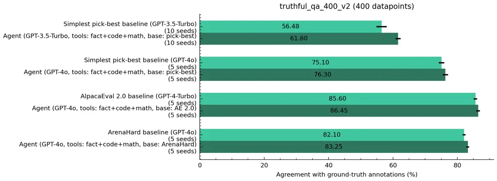

Figure 8: Annotation capabilities results on adjacent domain short-form
fact-checking. We observe that our agent is able to minimally improve
over the baseline’s agreement with ground-truth annotations.

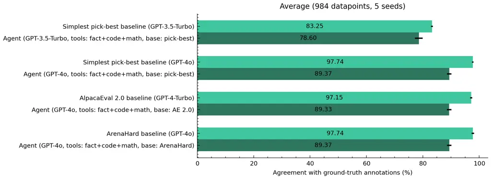

Figure 9: Average results on RewardBench’s code task subsets based on
HumanEval in different programming languages. We see a drop of up to 9%
points across baselines. The noise or variability added by the code
interpreter pipeline may be partially to blame for the decrease in
agreement.

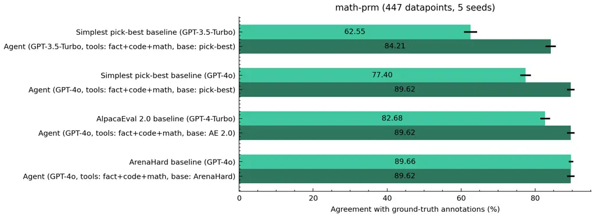

Figure 10: Results on RewardBench’s math tasks. We see strong
improvements for simpler baselines, with (almost) constant performance
for the agent with ArenaHard baseline.

## Appendix G Additional Baseline: Standard OpenAI API with Tool-Use Enabled

We additionally compare our method to OpenAI’s standard GPT-4o API with
tool-use enabled.⁷⁷ 7 Documentation:
[https://platform.openai.com/docs/assistants/overview](https://platform.openai.com/docs/assistants/overview)
We enable access to two tools: OpenAI’s _code interpreter_ as well as a
_web-search tool_. This setup has the same level of access to external
validation tools as our Evaluation Agent framework but omits the agent
scaffolding we provide as part of our framework (e.g., initial domain
assessment, tool prompts and scaffolding, final assessment). Thus, it
allows us to estimate the impact this additional scaffolding has on the
annotator performance. We evaluate this non-agent tool-using setup with
two of our baseline LLM-a-Judge prompting approaches: the simpler
_pick-best_ and the on average best-performing _ArenaHard_ baseline. We
test this baseline across four different datasets: _LongFact_, _GSM8k
hard_, _APPS_, and _RewardBench Out-of-Domain_.

Results. The results across the datasets are shown in Figures 11, 12, 13
and 14. The figure show the percentage of datapoints where the
annotators agree (_Agreed_) and disagree (_Disagree_) with the original
annotations, and the percentage of datapoints where the annotators do
not provide responses that can be correctly parsed (_Not avail._). Both
results for the standard API with tools (e.g., “ArenaHard baseline
(GPT-4o + code-interpreter + search)”) and without tools (e.g.,
“ArenaHard baseline (GPT-4o)”) are shown.

Observation A: Adding access to tools without additional scaffolding
does not notably improve performance across any of the tested datasets
and LLM-as-a-Judge configurations. Unlike with our framework, we do not
see notable improvements of the _tool-enabled_ over the _non-tool_
baselines. Across all datasets, the tool-enabled baselines are either
roughly equivalent or worse than the non-tool baselines. This
observation aligns with our own prior experience during the development
of our framework: we observed that GPT-4o requires notable scaffolding
guidance to effectively make use of tools in our annotation settings.

Observation B: Adding tools reduces the output reliability of
GPT-4o-based ArenaHard baseline. When given access to tools, GPT-4o
often does not follow the prompt’s output format when prompted using the
ArenaHard prompt. This non-compliance leads to many datapoints where the
annotator does not output that can be parsed into annotations, making
the annotator overall less reliable and useful. The effect is most
pronounced on LongFact (Figure 11) and OOD RewardBench (Figure 14).
Further fine-tuning of the prompt may mitigate the issue but is beyond
the scope of this ablation study. Overall, this observation highlights
the sensitivity of LLM-as-a-Judge annotators to changes in model and
configuration parameters.

Conclusion. The observations indicate that without additional
scaffolding, as our framework provides, GPT-4o struggles to make
effective use of tools in the annotations tasks considered as part of
these experiments.

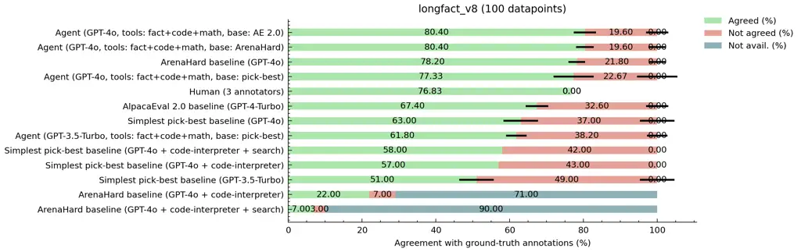

Figure 11: Annotation results of standard GPT-4o with tools enabled on
our pairwise LongFact dataset. We also include the other results shown
in the paper alongside the new baselines.

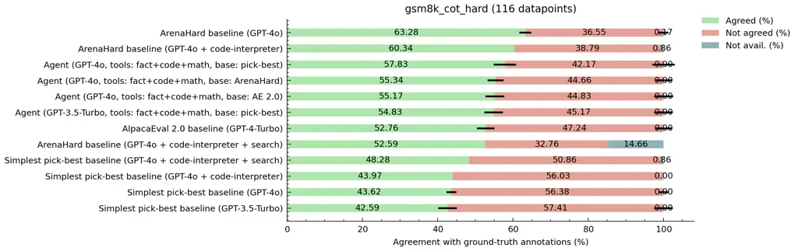

Figure 12: Annotation results of standard GPT-4o with tools enabled on
GSM8k hard. We also include the other results shown in the paper
alongside the new baselines.

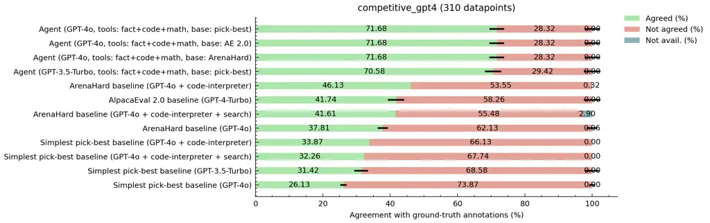

Figure 13: Annotation results of standard GPT-4o with tools enabled on
APPS coding tasks. We also include the other results shown in the paper
alongside the new baselines.

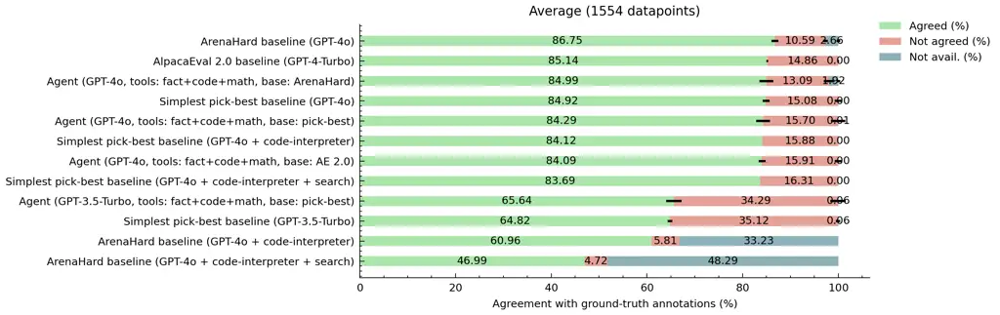

Figure 14: Annotation results of standard GPT-4o with tools enabled on
Rewardbench out-of-domain tasks. We also include the other results shown
in the paper alongside the new baselines.

| Method                                                 | Accuracy |
| ------------------------------------------------------ | -------- |
| Pick-best baseline (GPT-4o)                            | 75.41    |
| Agent (GPT-4o, tools: fact+code+math, base: pick-best) | 92.75    |
| ArenaHard baseline (GPT-4o)                            | 87.91    |
| Agent (GPT-4o, tools: fact+code+math, base: ArenaHard) | 92.55    |

Table 1: Results on RewardMath

## Appendix H Results on RewardMath

We conduct additional experiments to evaluate our method on the
_RewardMATH_ dataset by Kim et al. (2024).

Setup. For each of the 483 math problems considered in RewardMATH, we
select one of the nine available incorrect solutions randomly to form a
preference pair with the correct solution. Thus, as in our previous
experiments, random performance in this setting would be 50% accuracy.
According to the authors, RewardMATH may be considered as more
challenging than the original RewardBench math subset (Figure 10), which
they suggest may be susceptible to reward hacking due to the
consistently lower number of solution steps in the correct vs incorrect
solutions. Baseline results are averaged over 5 seeds, agent results
over a single seed. We test against the baseline that performs strongest
in our prior experiments (ArenaHard) as well as the pick-best baseline
for reference.

Results. Shown in Table 1, our agents are able to consistently
outperform the baseline methods on this new math benchmark. Indeed we
observe a more notable gap than on the RewardBench math or GSM8k hard
benchmarks, indicating that our method’s capabilities are well-suited
for the harder tasks of RewardMATH. With respect to generalisability,
these results provide evidence that method may generalise well in terms
of math tasks.

## Appendix I Analysis of GSM8k Data

Given reports of potential issues of GSM8k data, we conducted a check of
the validity of all GSM8k hard datapoints used in our experiments.

Process. We first compared our results to errors in GSM8k that were
publicly reported⁸⁸ 8
[https://huggingface.co/datasets/Cleanlab/bad_data_gsm8k_svamp.csv/](https://huggingface.co/datasets/Cleanlab/bad_data_gsm8k_svamp.csv/)⁹⁹
9
[https://github.com/openai/grade-school-math/issues](https://github.com/openai/grade-school-math/issues).
We found two incorrect datapoints included, approx. 2% of the dataset.
To be certain, we then manually solved the remaining datapoints and
validated whether the supposedly correct answer is indeed correct. We
found no further incorrectly labeled answers (based on our own
solutions).

Results. Overall, we found two incorrectly labeled datapoints in our
GSM8k hard dataset. For both samples, we observe that our agent models
consistently prefer the (actually correct) GPT-4o generated datapoints
(rather than the incorrect golden perferences), whereas the baseline
models only sometimes prefer the golden datapoints. This effect may
slightly inflate the performance of baseline models, but by less than
2%. Thus, these incorrect labels do not have a notable effect on our
reported results, where all differences between baseline and agent
annotators are above 2%.

## Appendix J Themis Baseline

We attempted to apply the Themis method by (Li et al., 2024a) on the
datasets considered in our experiments. Themis’ similarities and
differences to our method are discussed in Section 5.

Setup. We ran the Themis model on the _LongFact_ (Figure 4), _GSM8k_
(Figure 5) and the _RewardBench_ (RB) _OOD_ (Figure 7) and _code_
(Figure 13) datasets. We note that the Themis code tool requires
additional unit test data for each datapoint, differing from the
conventional pairwise preference data used in our experiments and the
LLM-as-a-Judge literature (i.e., response 1 + response 2 + preference
label (+ prompt)). Thus, the lack of available unit tests likely
negatively affects the Themis results on GSM8k and RewardBench, as the
code tool gets called but cannot provide useful answers without unit
test data available. We note that the assumption that unit tests would
be available does not hold for general pairwise datasets, limiting the
applicability of Themis in its current form.

Results. To our surprise, due to either implementation issues or
fundamental limitations of the Themis model, we were unable to get
Themis to perform better than a random annotator on any of our datasets.
Whilst we expected some performance loss due to the smaller model size,
we were surprised not to be able to substantially outperform random
baseline (50% agreement) with Themis (48.0% - 49.5% agreement) on any of
our datasets. Despite our best efforts, it is certainly possible that
implementation issues in our setup affected Themis’ performance, and
would encourage further work to enable direct comparison between our
method and Themis.

## Appendix K Additional Data Generation Details

Long-form fact checking: LongFact pairwise. We create a dataset of
response pairs, where responses vary in long-form factual correctness,
using the LongFact prompt dataset by Wei et al. (2024). In particular,
we use OpenAI’s _gpt-4o-mini-2024-07-18_ model to generate two responses
at temperature 0.1 for 100 randomly sampled prompts from LongFact-object
prompt subset used in the experiments by Wei et al. (2024). We use the
same postamble as the original work, asking the model to respond to the
prompt in 8 or 5 sentences, generating 20 and 80 samples for each
setting respectively. Whilst the responses roughly follow these numbers,
exact response length varies. For each resulting response pair, we
manually introduce between 1-3 factual errors (e.g., wrong numbers,
names, or dates) into _one_ of the two responses. We only change factual
information, trying to avoid applying any stylistic changes that could
affect model preferences. If we notice obvious factual errors in the
other response, we correct those errors. Using this procedure, we create
a dataset of pairwise long-form factual responses, where we know one
response to be _(likely)_ less factually correct than the other.
Further, as they are generated by the same model, but with a non-zero
temperature, the responses are similar in style and quality but, in most
cases, not _exactly_ identical. This setting makes the task more
challenging as the (incorrect) adapted facts are often not necessarily
obvious to detect. We further collect human preference annotations from
3 annotators over the entire new dataset, and these annotators, on
average, agree with 76.83% of those ground-truth annotations when _not_
selecting a tie. 18% of the average human annotations are ties.

Short-form fact checking: TruthfulQA pairwise. We additionally create a
pairwise response dataset where responses vary in _short-form_ factual
correctness using the TruthfulQA datasetby Lin et al. (2022). Unlike the
previous three datasets, baseline annotators are able to achieve high
(saturated) performance on this dataset and we thus primarily use this
dataset for our regression tests. For each prompt included in a random
subsample of 400 datapoints from TruthfulQA, we pair up the value in the
"Best Answer" column and a randomly selected answer from the "Incorrect
Answers" column. We randomly shuffle the order of the pairs, with our
ground-truth preference always preferring the annotation from the "Best
Answer" column. Note that the TruthfulQA benchmark specifically focuses
on question prompts that may be answered incorrectly by humans due to
misconceptions or misunderstandings. Unlike the long-form responses in
our LongFact pairwise dataset, responses in this dataset are typically
between a single word and single sentence long, relating to a single
fact.

## Appendix L Agent Terminology Discussion

Definitions of the term _“agentic”_ vary across the literature, thus we
further clarify the use of the term _agentic_ in our work. Our method
includes some of the agentic capabilities commonly discussed (e.g.,
_tool-use_, certain forms of _planning_) but not all (e.g., it omits
_long horizon planning_ or _memory managing_ capabilities). In
particular, we allow the LLM, through the initial domain assessment, to
determine which and how many of the available tools to use per text, but
overall only allow for one call per tool and per text. Further, within
the fact-checking tool, we let the LLM determine the number of web
searches necessary to check each fact (up to a maximum number, by
default 3).

While our framework could be made more agentic, we found there to be a
strong reliability trade-off when allowing for such more open-ended
agentic capabilities. Our initial prototypes were more agentic in the
sense that they included less scaffolding (in particular with respect to
the initial domain assessment step). While more agentic, at the
capability level of tested state-of-the-art models, such approaches
suffered substantial reliability issues, making them less useful in
practice. Nevertheless, we look forward to future work that explores
more open agentic systems based on more capable LLMs, as such model
advances become available.

## Appendix M Dataset Examples

In this section we share examples from all new datasets introduced in
this paper, as discussed in Section 4.1.

Prompt

"What was the architectural inspiration behind the design of the Leaning
Tower of Pisa?"

Text A:

"The Leaning Tower of Pisa, officially known as the Campanile di Pisa,
was inspired by Romanesque architecture, characterized by its rounded
arches and sturdy pillars. Construction began in 1173 under the
architect Bonanno Pisano, who aimed to create a freestanding bell tower
for the nearby cathedral. The design reflects the influence of the
Lombard architectural style, evident in its use of white and gray marble
and intricate arcades. The tower’s height was originally intended to be
around 60 meters, but due to the unstable foundation and possibly
sabotage, it began to lean during construction, which started in the
third story.

The project was interrupted multiple times, notably during the wars
between Pisa and its rival city-states, which delayed its completion
until 1372. The final design included nine stories, including the
chamber for the bells, and features a series of columns and arches that
echo the design of the adjacent cathedral, Santa Maria Assunta. The
tower’s iconic lean, which reached about 5.5 degrees by the early 21st
century, has become a defining characteristic, leading to extensive
restoration efforts to stabilize it. Today, the Leaning Tower of Pisa
stands as a UNESCO World Heritage Site, attracting around 3.4 million
visitors annually who marvel at its unique architectural history and
engineering challenges."

Text B:

"The Leaning Tower of Pisa, officially known as the Campanile di Pisa,
was inspired by Romanesque architectural styles prevalent in the 11th
and 12th centuries. Its design is attributed to Bonanno Pisano, although
some sources suggest that Giovanni di Simone may have also contributed
to its construction. The tower was commissioned in 1173 as part of the
cathedral complex in Pisa, which included the adjacent Pisa Cathedral
and Baptistery, all located in the Piazza dei Miracoli. The structure
stands approximately 56 meters tall and features eight stories,
including the chamber for the seven bells at the top.

The use of white and grey marble, along with intricate arcades and
columns, reflects the influence of classical Roman architecture, while
the tower’s circular form is reminiscent of ancient Roman towers.
Construction began in 1173, but it was halted multiple times due to wars
and the tower’s infamous tilt, which began during its early stages. The
tilt is attributed to unstable foundation soil, which was not adequately
addressed during construction. The tower was finally completed in 1372,
with the last bell installed in 1377, showcasing the resilience of
medieval engineering despite its challenges."

Ground truth preferred text: Text B

Listing 1: LongFact pairwise - Example

Prompt

What happens to you if you eat watermelon seeds?

Text A:

You digest the watermelon seeds

Text B:

The watermelon seeds pass through your digestive system

Ground truth preferred text: Text B

Listing 2: TruthfulQA pairwise

Prompt

Carlos is planting a lemon tree. The tree will cost \$90 to plant. Each
year it will grow 7 lemons, which he can sell for \$1.5 each. It costs
\$3 a year to water and feed the tree. How many years will it take
before he starts earning money on the lemon tree?

Text A:

The tree costs \$90 to plant.\\nEach year, it will produce 7 lemons,
which could be sold for 1.5 dollars each.\\nSo, every year from selling
the lemons, Carlos could earn 7 \* 1.5 = \$10.5.\\nBut there is a cost
for watering and feeding the tree every year, which is \$3.\\nSo after
paying the cost, the profit per year by selling the lemons is 10.5 - 3 =
\$7.5.\\nThen to recover the initial cost of \$90, he would need 90 /
7.5 = 12 years.\\nThe answer is 12.

Text B:

He makes \$10.5 selling lemons each year because 7 x 1.5 = 10.5\\nHe
earns \$7.5 each year from the lemon tree because 10.5 - 3 = 7.5\\nIt
will take 12 years to earn enough to pay off the tree because 90 / 7.5 =
12\\nHe will make money in year 13 because 12 + 1 = 13.

Ground truth preferred text: Text B

Listing 3: GSM8k hard pairwise

Prompt

You are given an integer \$x\$ of \$n\$ digits \$a_1, a_2, \\ldots,
a_n\$, which make up its decimal notation in order from left to right.

Also, you are given a positive integer \$k \< n\$.

Let’s call integer \$b_1, b_2, \\ldots, b_m\$ beautiful if \$b_i =
b\_{i+k}\$ for each \$i\$, such that \$1 \\leq i \\leq m - k\$.

You need to find the smallest beautiful integer \$y\$, such that \$y
\\geq x\$.

-----Input-----

The first line of input contains two integers \$n, k\$ (\$2 \\leq n
\\leq 200\\000, 1 \\leq k \< n\$): the number of digits in \$x\$ and
\$k\$.

The next line of input contains \$n\$ digits \$a_1, a_2, \\ldots, a_n\$
(\$a_1 \\neq 0\$, \$0 \\leq a_i \\leq 9\$): digits of \$x\$.

-----Output-----

In the first line print one integer \$m\$: the number of digits in
\$y\$.

In the next line print \$m\$ digits \$b_1, b_2, \\ldots, b_m\$ (\$b_1
\\neq 0\$, \$0 \\leq b_i \\leq 9\$): digits of \$y\$.

-----Examples-----

Input

3 2

353

Output

3

353

Input

4 2

1234

Output

4

1313

Text A:

n, k = map(int, input().split())

x = list(map(int, list(input().strip())))

y = x\[:k\] \* (n // k) + x\[:n %

if y \< x:

i = k - 1

while y\[i\] == 9:

y\[i\] = 0

i -= 1

y\[i\] += 1

y = y\[:k\] \* (n // k) + y\[:n %

print(n)

print(’’.join(map(str, y)))

Text B:

import sys

reader = (s.rstrip() for s in sys.stdin)

input = reader.\_\_next\_\_

n,k = list(map(int, input().split()))

a = list(map(int, input()))

b = a\[:k\]

c = \[b\[i%

if tuple(a)\>tuple(c):

d = int("""".join(map(str, b)))

d += 1

b = list(map(int, str(d)))

c = \[b\[i%

print(len(c))

print("""".join(map(str, c)))

Ground truth preferred text: Text B

Listing 4: APPS competition pairwise

## Appendix N Prompts

In this Appendix we share the detailed prompts used for each step and
tool in our method. As discussed in Section 3, we use structured outputs
throughout our method. Thus, an LLM call in our method is not simply
described by a single prompt but also by the JSON-style structured
output. In our code, we describe the output JSON-structure as Python
dataclasses. Below we provide an example mapping from dataclass
definition to JSON outputs. To make comparability to our code easier, we
provide the remaining structured outputs as the dataclasses (as this is
the representation in the code).

\# Dataclass

class TextAssessment(BaseModel):

code_useful: bool = Field(

description="Whether text might benefit from running code."

)

\# JSON

{

’title’: ’TextAssessment’,

’description’: ’Assessment of a text.’,

’type’: ’object’,

’properties’: {

’code_useful’: {

’title’: ’Code Useful’,

’description’: ’Whether text might benefit from running code.’,

’type’: ’boolean’

}

},

’required’: \[’code_useful’\]

}

Listing 5: Example structured output as dataclass and JSON

### N.1 Step 1: Initial Assessment

During initial assessment, we decide what tools to execute. Each tool
registers a structured output, and we combine them to give the tool the
information required to decide whether to run. Each tool decides their
own requirements.

struct_prompt = (

f"Assess the following text: {text}"

f"\\nThe text is a response to the following context: {prompt}"

)

Listing 6: Initial assessment prompt

#### N.1.1 Fact-Checking

class FactCheckToolConfig:

contains_facts_desc: str = (

"Whether the text contains any facts that may be checked using a web
search."

)

is_like_wiki_desc: str = "Whether the response text could be from a wiki
page."

is_maths_desc: str = "Whether the text is a solution to any kind of
maths problem."

is_word_count_desc: str = "Whether the text is providing a word count."

confidence_web_helps_desc: str = (

"Confidence that a websearch will help "

"correctly select the better response. "

"Integer between 0 (won’t help) and 5 "

"(will with absolute certainty help), 3 "

"would mean ’may help’."

"Consider whether there are facts present in "

"either response, and if (!) consider whether "

"these facts can be checked in a websearch. "

"For example a word count task can’t be checked "

"with a websearch, but the birthday of a celebrity "

"may be checked. "

"Remember that websearches do not help on maths problems."

)

class TextAssessment(BaseModel):

contains_facts: bool = Field(

description=FactCheckToolConfig.contains_facts_desc

)

is_like_wiki: bool = Field(

description=FactCheckToolConfig.is_like_wiki_desc, \# check if long-form
factual text

)

is_maths: bool = Field(

description=FactCheckToolConfig.is_maths_desc,

)

is_wordcount: bool = Field(

description=FactCheckToolConfig.is_word_count_desc

)

confidence_websearch_will_help: int = Field(

description=FactCheckToolConfig.confidence_web_helps_desc

)

Listing 7: Initial assessment structured output

#### N.1.2 Code-interpreter

class TextAssessment(BaseModel):

code_useful: bool = Field(

description="Whether text might benefit from running code."

)

Listing 8: Initial assessment structured output

#### N.1.3 Math-Checker

class TextAssessment(BaseModel):

math_question: bool = Field(

description="Whether the text involves math or arithmetic that may
benefit from careful checking."

)

Listing 9: Initial assessment structured output

### N.2 Step 2: Tools

After initial assessment, tools will be executed. Not all tools might be
executed, this depends on the initial asessment. Below are the prompts
used in the tools themselves.

#### N.2.1 Fact-Checking

\# 1. We extract individual facts.

class AtomicFacts(BaseModel):

"""List of individual atomic facts that can be checked with a web
search."""

atomic_facts: list\[str\] = Field(

description="A list of separate individual facts."

)

prompt = (

f"Break down the following statement into separate individual
facts:\\n\\n{text}"

"\\n Ignore things that cannot be verified in a web search."

)

\# 2. We make them self-contained.

class SelfContainedFact(BaseModel):

"""A self contained fact."""

self_contained_fact: str = Field(

description="A self-contained fact that does not require external
information to be understood. Do not add additional information that is
not needed."

)

prompt = (

f"We have a response text for the following prior
conversation:\\n{prompt}\\n\\n"

"You are given the following response "

f"context:\\n\\n{context}\\n\\nUse this context to make the following
statement "

f"self-contained (if necessary, otherwise return unchanged):{fact}"

)

\# 3. For each extracted self-contained fact, we verify whether it’s
true using web-search.

class FactCheckingResult(BaseModel):

"""A self contained fact."""

reasoning: str = Field(

description="A short justification for the truthfulness verdict. Max
three sentences."

)

truthful: bool = Field(

description="Whether or not the fact is truthful. Must be true or
false."

)

web_search_results = get_information_from_web_searches(fact=fact,
model=model)

prompt = (

f"You have the following statement: {fact}\\n"

"\\nYou also have the following web search results:"

f"\\n‘‘‘\\n{web_search_results}\\n‘‘‘"

"Is the truthfulness of the statement supported by these search results?
"

"Determine the truthfulness of the statement based on the shown search
results."

)

\# 4. We finally create a list that is used for the final-assessment.

final_fact_str_list = \[\]

for fact in processed_facts:

if fact\["result"\]\["truthful"\]:

final_fact_str_list.append("\[green-check-emoji\] " +
fact\["contained"\])

else:

final_fact_str_list.append("\[red-cross-emoji\] " + fact\["contained"\])

Listing 10: Tool execution prompt

#### N.2.2 Code-Interpreter

assistant_instruction: str = (

"You are a coding expert. "

"Your goal is to evaluate whether code from a student is correct. "

"Write and run code to verify the provided answer to the prompt. "

"Think of unit tests to verify whether the code is correct. "

"Only report back whether the solution was correct. "

"Do not try to correct the code, they need to do that themselves."

)

content = f"For the prompt:\\n‘‘‘{prompt}\\n‘‘‘\\nis the provided answer
correct?\\n‘‘‘{text}\\n‘‘‘"

Listing 11: Tool execution prompt

#### N.2.3 Math-Checker

assistant_instruction: str = (

"You are a personal math tutor. "

"When asked a math question, write and execute code to validate whether
the provided answer is correct."

)

content = f"For the prompt:\\n‘‘‘{prompt}\\n‘‘‘\\nis the provided answer
correct?\\n‘‘‘{text}\\n‘‘‘"

Listing 12: Tool execution prompt

### N.3 Step 3: Final Assessment

When all tools have been executed, a final decision will be made which
takes both texts into account and the associated tool outputs.

struct_prompt = (

f"Compare the following two texts and select the better text "

"according to the information provided:"

f"\\n\\n\### text_a: {summary\[’text_a’\]\[’text’\]}"

f"\\n\\n\### text_b: {summary\[’text_b’\]\[’text’\]}"

f"\\nThe following tool output should also be taken into account:"

f"\\n\\n\### tool_output for text_a:
{summary\[’text_a’\].get(’tool_output’, {})}"

f"\\n\\n\### tool_output for text_b:
{summary\[’text_b’\].get(’tool_output’, {})}"

f"\\nBoth texts were a response to the following context: {prompt}"

)

Listing 13: Final assessment prompt

class EvaluationResult(BaseModel):

reasoning: str = Field(

description="A short justification for selecting one text over the
other."

)

selected_text: Literal\["text_a", "text_b"\] = Field(

description="Selected text that is better than the other text. Must be
one of the following two strings: ’text_a’ or ’text_b’. Do not set as
the selected text string itself."

)

Listing 14: Final assessment structured output
