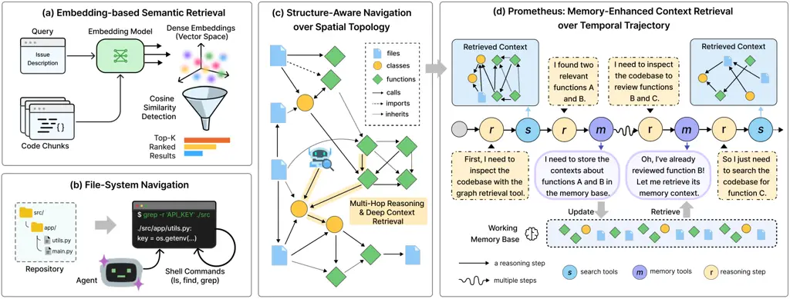
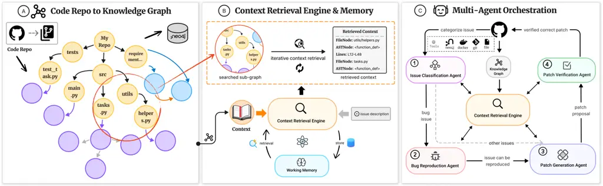
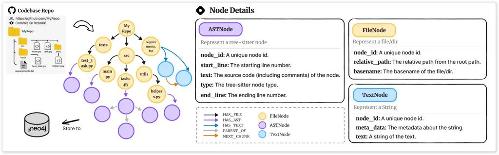
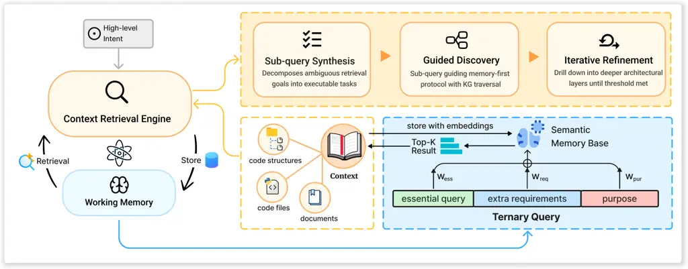
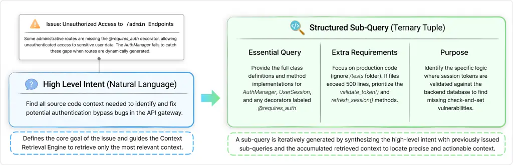
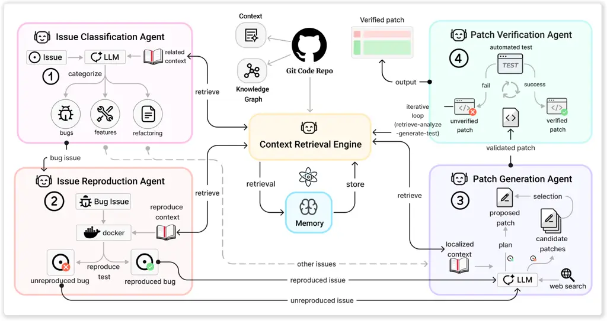
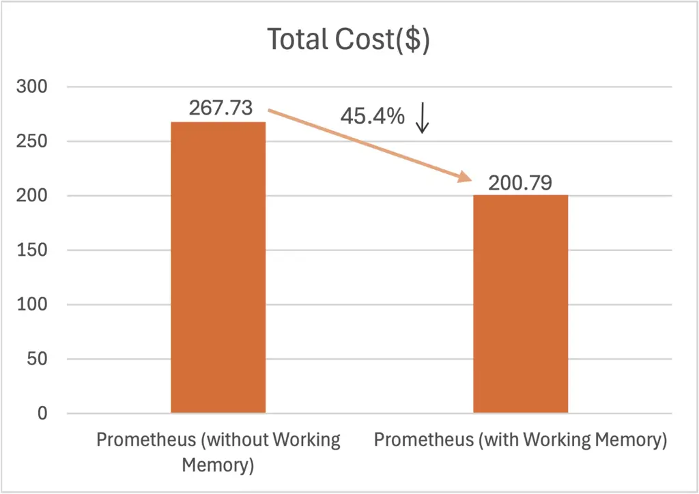
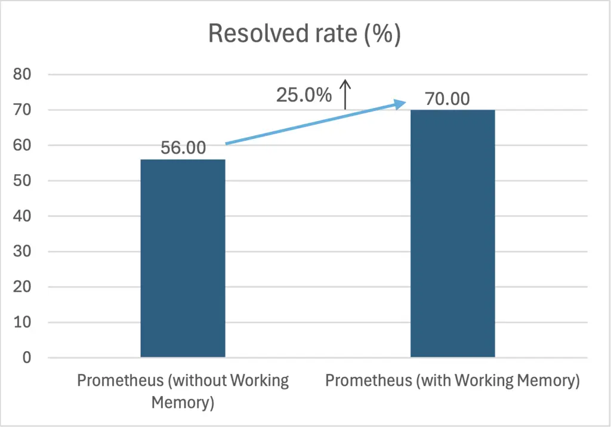

# Prometheus: Towards Long-Horizon Codebase Navigation for Repository-Level Problem SolvingThanks: ^(∗)Equal contribution. ^(†)Corresponding author. Email: he.ye@ucl.ac.uk.

Journal: PACMSEVolume: 1111CCS: Software and its engineering Software
creation and management

Yue Pan^(∗) Affiliation: University College London, London, United
Kingdom email: <jack.pan.23@ucl.ac.uk> , Zimin Chen^(∗) Affiliation:
Sana Labs, Stockholm, Sweden email: <zimin@sanalabs.com> , Siyu Lu
Affiliation: Uppsala University, Uppsala, Sweden email:
<siyu.lu.6562@student.uu.se> , Zhaoyang Chu Affiliation: University
College London, London, United Kingdom email:
<zhaoyang.chu.25@ucl.ac.uk> , Xiang Li Affiliation: University College
London, London, United Kingdom email: <x.li.25@ucl.ac.uk> , Han Li
Affiliation: Nanjing University, Nanjing, China email:
<231220161@smail.nju.edu.cn> , Yang Feng Affiliation: Nanjing
University, Nanjing, China email: <Fengyang@nju.edu.cn> , Claire Le
Goues Affiliation: Carnegie Mellon University, Pittsburgh, United States
email: <clegoues@cs.cmu.edu> , Federica Sarro Affiliation: University
College London, London, United Kingdom email: <f.sarro@ucl.ac.uk> ,
Martin Monperrus Affiliation: KTH Royal Institute of Technology,
Stockholm, Sweden email: <monperrus@kth.se> and He Ye^(†) Affiliation:
University College London, London, United Kingdom email:
<he.ye@ucl.ac.uk>

2026

###### Abstract.

Large Language Models (LLMs) have shown remarkable capabilities in
automating software engineering tasks, spurring the emergence of coding
agents that scaffold LLMs with external tools to resolve
repository-level problems. However, existing agents still struggle to
navigate large-scale codebases, as the “Needle-in-a-Haystack” problem
persists even with million-token context windows, where relevant
evidence is often overwhelmed by large volumes of irrelevant code and
documentation. Prior codebase navigation approaches, including
embedding-based retrieval, file-system exploration, and graph-based
retrieval, address parts of this challenge but fail to capture the
temporal continuity of agent reasoning, rendering agents stateless and
causing repeated repository traversals that hinder scalable planning and
reasoning. To address these limitations, we present Prometheus, a
memory-centric coding agent framework for long-horizon codebase
navigation. Prometheus represents the repository as a unified knowledge
graph to encode semantic dependencies and employs a context engine
augmented with working memory that retains and reuses previously
explored contexts to ensure continuity across reasoning steps. Built
upon this engine, Prometheus integrates memory-enhanced navigation into
a multi-agent system for automated issue resolution, encompassing issue
classification, bug reproduction, patch generation, and verification.
Comprehensive experiments are conducted on two widely used issue
resolution benchmarks, i.e., SWE-bench Verified and SWE-PolyBench
Verified. Powered by GPT-5, Prometheus achieves state-of-the-art
performance with 74.4% and 33.8% resolution rates on the two benchmarks,
ranking Top-6 and Top-1 among open-source agent systems, respectively.
Our data and code are available at
[https://github.com/EuniAI/Prometheus](https://github.com/EuniAI/Prometheus).

###### Keywords:

Agentic Issues Resolution, Repository-level Context Retrieval, Memory
Enhanced Context Retrieval

## 1. Introduction

Large Language Models (LLMs) have demonstrated strong capabilities in
automating software engineering tasks, including code generation (Liu et
al., 2023; Jiang et al., 2024; Jiang et al., 2025), code summarization
(Sun et al., 2025; Virk et al., 2025), and program repair (Zhang et al.,
2024a; Ni et al., 2024; Ye et al., 2022b; Ye et al., 2022a). Driven by
this progress, coding agents have emerged as autonomous systems that
scaffold LLMs with external tools to accomplish complex,
repository-level tasks in real development environments (Jimenez et al.,
2024; Pan et al., 2025), as exemplified by SWE-agent (Yang et al.,
2024), AutoCodeRover (Zhang et al., 2024b), and OpenHands (Wang et al.,
2025).

Despite substantial progress, existing coding agents still struggle to
navigate large-scale codebases that comprise millions of lines of code
and intricate dependency relationships. While recent LLMs have
dramatically expanded their context windows to millions of tokens and
beyond (Singh et al., 2025; Anthropic, 2025b; Google DeepMind, 2025),
these models still face the “Needle-in-a-Haystack” challenge (Liu et
al., 2024; Hsieh et al., 2024). Specifically, task-relevant context
evidence is overwhelmed by large volumes of irrelevant content, leading
to inaccurate retrieval and degraded reasoning. Here, context refers to
code and accompanying documentation relevant to issue resolution. As a
result, effective codebase navigation for retrieving relevant context
remains crucial for enabling long-horizon reasoning and decision-making
throughout repository-level workflows.

Existing Approaches and Limitations. A straightforward navigation
approach for coding agents is to apply embedding-based semantic
retrieval, as illustrated in Figure 1 (a), which encodes code chunks
into embeddings and ranks them by their cosine similarity to the query
embedding (Xia et al., 2024; Zhang et al., 2023b; Reddy et al., 2025;
Anysphere, ). While enabling efficient navigation without step-by-step
exploration, this approach relies heavily on chunking and embedding
quality; irrelevant or noisy retrieval results can mislead the agent and
degrade subsequent reasoning. Another line of work adopts file-system
navigation, as illustrated in Figure 1 (b), which grounds context
retrieval within the codebase by executing shell commands (e.g., ls,
find, and grep) (Wang et al., 2025; Anthropic, 2025a; Anysphere, ;
OpenAI, 2025) or interacting through specialized interfaces (Yang et
al., 2024; Xia et al., 2025). However, this method lacks a global view
of the repository architecture, resulting in a fragmented understanding
of the codebase that impairs long-horizon reasoning and planning. More
importantly, both approaches are limited in handling the intricate
semantic dependencies within the codebase, which are essential for
repository-level problem solving.

Recently, structure-aware navigation has emerged as a promising
alternative for coding agents (Zhang et al., 2024b; Tao et al., 2025;
Ouyang et al., 2024; Yang et al., 2025b; Chen et al., 2025b), as shown
in Figure 1 (c), which models the repository as a graph, where nodes
represent code entities (e.g., files, classes, and functions) and edges
capture their dependencies (e.g., syntax trees, control flows, and data
flows). By explicitly encoding the hierarchical structure of the
repository, these agents achieve powerful multi-hop reasoning and deep
context retrieval across complex codebases. While these agents
effectively capture the spatial topology of the codebase, they fail to
model the temporal history of their own exploration. They operate
essentially as stateless functions, lacking persistent memory of
previously explored code. As a result, agents repeatedly traverse the
same regions of the repository, incurring substantial computational
overhead. Consequently, current agents remain inadequate for planning,
reasoning, and memorizing required to navigate complex software systems
on par with human developers.



Figure 1. An illustration of existing codebase navigation methods for
coding agents.

Our Work: Long-Horizon Codebase Navigation via Memory. To address this
gap, this paper introduces Prometheus, a memory-centric coding agent
framework that models codebase navigation from a temporal perspective,
enabling long-horizon reasoning in repository-level workflows such as
bug fixing, feature implementation, and refactoring. Specifically,
Prometheus transforms the codebase into a unified knowledge graph that
captures complex semantic dependencies and serves as the foundation for
context retrieval. Subsequently, Prometheus employs a context engine
augmented with working memory, as illustrated in Figure 1 (d), which
automatically retains and reuses previously explored contexts to
maintain continuity across reasoning steps. Finally, Prometheus
integrates the context engine into a multi-agent system for automated
issue resolution, where specialized agents for issue classification, bug
reproduction, patch generation, and patch verification operate
sequentially under memory-enhanced navigation.

We conduct comprehensive experiments to validate the effectiveness of
Prometheus using the state-of-the-art LLM (i.e., GPT-5 (Singh et al.,
2025)) on two widely used issue resolution benchmarks (i.e., SWE-bench
Verified (Jimenez et al., 2024) and SWE-PolyBench Verified (Rashid et
al., 2025)). Experimental results demonstrate that Prometheus achieves
leading performance with 74.4% and 33.8% resolution rates on the two
benchmarks, ranking Top-6 and Top-1 among open-sourced agent systems,
respectively, at the time of writing. In particular, Prometheus achieves
over 30% balanced resolution rate across Java, Python, JavaScript, and
TypeScript, indicating its strong multilingual generalization and
consistent cross-language performance on SWE-PolyBench Verified.
Moreover, we conduct a fine-grained analysis of context retrieval
performance by comparing retrieved contexts against human-annotated gold
standards. Results show that Prometheus significantly outperforms
leading agents, such as Agentless (Xia et al., 2024), SWE-agent (Yang et
al., 2024), and OpenHands (Wang et al., 2025), retrieving a higher
proportion of gold contexts at the file, function/class, and span levels
under the same GPT-5 backbone. Our ablation study further demonstrates
that the working memory mechanism reduces LLM invocation cost by 45.4%
while improving the issue resolution rate by 25%.

Contributions. The primary contributions of this paper are summarized as
follows.

- •
  Memory-Enhanced Context Retrieval. We propose a novel context
  retrieval approach augmented with working memory, which models the
  temporal trajectory of agent navigation. This mechanism enables agents
  to automatically retain and reuse previously explored contexts,
  achieving continuity and coherence in long-horizon reasoning.
- •
  Prometheus: A Novel Issue Resolution Agent. We develop Prometheus, a
  multi-agent system that integrates memory-enhanced navigation into
  issue resolution workflows. This system coordinates specialized agents
  for issue classification, bug reproduction, patch generation, and
  patch verification, establishing a unified workflow for automated
  issue resolution at the repository level.
- •
  Extensive Evaluation and Analysis. We conduct comprehensive
  experiments on two widely used issue resolution benchmarks (i.e.,
  SWE-bench Verified (Jimenez et al., 2024) and SWE-PolyBench Verified
  (Rashid et al., 2025)), demonstrating the superiority of Prometheus
  over existing agent systems. We further demonstrate the superiority of
  Prometheus in both context retrieval and multilingual adaptability,
  and validate the effectiveness of the working memory mechanism.

## 2. Methodology



Figure 2. An overview of Prometheus.

Figure 2presents an overview of Prometheus, which is composed of three
core components: (A) Repository to Knowledge Graph, which constructs a
unified code index representing the structural and semantic
relationships within the target codebase; (B) Memory Enhanced Context
Retrieval, which enables effective identification and reuse of relevant
code and documentation to support reasoning; and (C) Multi-Agent
Architectural Design, which coordinates specialized agents to
collaboratively perform issue resolution tasks. The following sections
describe each component in detail.

### 2.1. Repository to Knowledge Graph

To facilitate semantic understanding and context retrieval across
large-scale codebases, we propose a unified knowledge graph
representation that integrates file structures, ASTs, and textual
content into a coherent graph abstraction. As shown in Figure 3, our
knowledge graph is built around three core components: (1) defining a
node and edge schema, (2) constructing the graph from source files, and
(3) persisting the graph data in a scalable database.

##### Graph Schema

The knowledge graph represents codebases as heterogeneous graphs
composed of three primary node types: ❶
,
❷
,
and ❸
.
A FileNode represents a file or directory with three attributes: a
unique node_id, the relative_path from the repository root, and the
basename of the file or directory. It anchors structural links in the
knowledge graph. An ASTNode represents a Tree-sitter syntax node. It
includes a unique node_id, the start_line and end_line indicating its
position in the source file, the text of the code it covers (including
comments), and its type, per the Tree-sitter grammar node type. A
TextNode represents a chunk of unstructured textual content in the
knowledge graph. Each TextNode is associated with a unique node_id,
descriptive meta_data, and the corresponding text span. TextNodes are
extracted from documentation-oriented file types, including .markdown,
.md, .txt, and .rst. The text is segmented into chunks based on a
configurable chunk_size. Depending on the file content and structure,
adaptive splitters are applied using hierarchical separators, including
paragraph-level (\n\n), line-level (\n), word-level (space), and
character-level splitting.

To capture relationships across FileNodes, ASTNodes, and TextNodes, we
define five directed edge types. These relationships are essential for
representing the structural, syntactic, and lexical context necessary
for code understanding and issue resolution. The HAS_FILE edge (black)
connects directories to their child files or subdirectories, preserving
the repository hierarchy. The HAS_AST edge (purple) links each file node
to the root of its corresponding abstract syntax tree. PARENT_OF edges
(gray) connect AST nodes to reflect syntactic hierarchy within the tree.
HAS_TEXT edges (blue) associate file nodes with their segmented textual
content, and NEXT_CHUNK edges (orange) connect sequential text chunks to
maintain document order. Together, these relationships enable the graph
to represent structural, syntactic, and lexical information in an
integrated and practical format, exposing the repository knowledge graph
through a set of structured query tools.

To our knowledge, this work introduces a highly extensible knowledge
graph schema that unifies repository structure, program syntax, and
unstructured text. In contrast to prior graph-based approaches (Ouyang
et al., 2024) that rely on specialized or task-coupled designs, we adopt
a deliberately minimal yet expressive schema, consisting of only three
node types and a small set of well-defined relations. On SWE-bench
Verified (Jimenez et al., 2024), we observe an average knowledge graph
construction time of 1.99 seconds per instance over all 500 instances,
indicating that the proposed schema is lightweight enough for practical,
large-scale use. This simplicity enables efficient graph construction
and incremental updates as codebases evolve, while preserving sufficient
structural and semantic coverage for repository-level reasoning.
Consequently, the resulting knowledge graph provides a reusable
substrate for tasks such as semantic retrieval, long-horizon dependency
analysis, and agent-based code navigation, without requiring
task-specific re-engineering.



Figure 3. An overview of our knowledge graph construction for the
codebase.

### 2.2. Memory-Enhanced Context Retrieval

#### 2.2.1. Context Retrieval Engine

As shown in Figure 4, the Context Retrieval Engine adopts a three-stage
retrieval cycle that incrementally maps a high-level intent expressed in
natural language to structured contextual evidence. As summarized in
Algorithm 1, the process begins with Sub-query Synthesis, where a
structured and specific sub-query in natural language is generated with
high-level intent and the current collected context. The sub-query is
formulated as a ternary tuple comprising an essential query, which
captures the core information needed, extra requirements, which encode
retrieval constraints such as prioritizing specific files or truncating
oversized artifacts, and a purpose, which specifies the motivation or
objective of the retrieval. Figure 5 provides an example and
illustration for both high-level intent and its corresponding sub-query.
For example, a high-level intent to “locate authentication bugs” can
generate a structured query targeting authentication-related classes,
decorators, and their associated call sites.

Following synthesis, the context engine performs sub-query guided
context retrieval and context organization under a memory-first
protocol. As shown in Algorithm 1, the system first retrieves from the
working memory for previously stored context associated with the current
sub-query. If no relevant context is retrieved, the engine exposes the
repository knowledge graph through a set of structured search tools,
allowing the LLM to iteratively traverse file-level and AST-level nodes
via multi-hop relations. Guided by the sub-query, the LLM autonomously
decides which graph relations to follow and when to expand or stop
traversal. For the set of discovered contexts, the engine first performs
a structural deduplication by cross-referencing their file paths and
line-number intervals ($`start\_line,end\_line`$). These contexts are
categorized relative to each other as duplicate, contained, contains, or
separate. For those identified as non-redundant, the LLM then performs
an extraction step to distill the most relevant information. The engine
keeps the code’s structure intact by grouping snippets by their source
files and restoring their original order, forming a validated context.
The validated contexts is then stored in memory for future use. This
process is repeated and dynamically updated.



Figure 4. An overview of the memory-enhanced context retrieval engine.

#### 2.2.2. Working Memory

The goal of working memory is to prevent Prometheus from repeated query
and reduce the token cost. As shown in Figure 4, the working memory
system in Prometheus implements a structured and persistent context
layer for repository-level evidence. We define a _context unit_ as a
minimal reusable piece of context, represented as a tuple of (code
snippet, metadata), where metadata includes the originating file path
and start/end line numbers. Working memory maintains a set of _memory
records_, each functioning as a logical container that binds a
structured sub-query (as synthesized by the Context Engine) to its
corresponding context units. This design ensures that retrieval is not
treated as a monolithic string search; instead, subsequent reasoning
steps can perform fine-grained lookups by aligning their intent with the
structured sub-queries preserved within the memory records. By the
definition of agent memory in recent surveys on agentic memory systems
(Hu et al., 2025), this module is classified as an agent memory
component rather than a standard RAG module, because it maintains a
persistent and continually updated internal memory instead of retrieving
from a static external corpus.

##### Storage.

Unlike conventional agentic memory that embeds a single concatenated
query into one vector, Prometheus adopts a Multi-vector Weighted
Retrieval design. For each synthesized sub-query comprising three
distinct fields—essential query, extra requirements, and purpose—the
storage pipeline computes semantic embeddings for these fields using a
configurable embedding model API. This process yields a 3-vector
representation for each memory record, which is then persisted in a
database. Each vector is stored in a dedicated column, denoted as
$`\mathbf{e}_{ess}`$, $`\mathbf{e}_{req}`$, and $`\mathbf{e}_{pur}`$,
representing the essential query, extra requirement, and purpose of the
sub-query, respectively. These are stored alongside their corresponding
text fields for traceability and debugging. These memory records are
linked to their associated context units, and insertion is executed as a
single database transaction (memory record, context unit, and linkage)
to ensure referential integrity under concurrent agent execution.

##### Retrieval.

During retrieval, the system encodes the structured input query into the
same set of query vectors
($`\mathbf{q}_{ess},\mathbf{q}_{req},\mathbf{q}_{pur}`$). Prior work
(Khattab and Zaharia, 2020) has shown that aggregating multiple
similarity signals via weighted linear combination is a standard and
theoretically well-founded practice in information retrieval. For a
candidate memory record $`m`$, we compute a weighted similarity score by
aggregating cosine similarities across the three vectors:

```math
s(m)=w_{ess}\cdot\cos(\mathbf{q}_{ess},\mathbf{e}^{m}_{ess})+w_{req}\cdot\cos(\mathbf{q}_{req},\mathbf{e}^{m}_{req})+w_{pur}\cdot\cos(\mathbf{q}_{pur},\mathbf{e}^{m}_{pur}),
```

where $`w_{ess},w_{req},w_{pur}`$ control the relative importance of
each intent component. To accelerate nearest-neighbor search, we build
IVFFlat indexes over the vector columns and perform retrieval in two
stages: (i) run approximate nearest-neighbor (ANN) search independently
for each vector column to obtain top-$`n`$ candidates per component;
(ii) take the union of candidates and re-rank them using the aggregated
score $`s(m)`$. Finally, we filter results below a similarity threshold
and return the top-$`k`$ memory records, whose linked context units are
provided as reusable evidence for downstream reasoning. This
multi-vector weighted retrieval improves alignment between query intent
and stored evidence, enhancing precision (by respecting auxiliary
constraints) and recall (by capturing purpose-level signals) compared to
single-vector agentic memory baselines.



Figure 5. An example of high-level intent and sub-query.

### 2.3. Multi-Agent Architectural Design

Input: High-level retrieval intent $`\mathcal{Q}`$, Knowledge Graph
$`\mathcal{G}`$, Working Memory $`\mathcal{M}`$, maximum query number
$`T_{\max}`$

Output: Refined contextual evidence set $`\mathcal{C}`$

Initialize empty context set $`\mathcal{C}`$;

Initialize refinement step counter $`t\leftarrow 0`$;

// Stage 1: Sub-query Synthesis;

Synthesize a single structured sub-query $`q=(q_{ess},q_{req},q_{pur})`$
from $`\mathcal{Q}`$;

// $`q_{ess}`$: Essential Query; $`q_{req}`$: Extra Requirements;
$`q_{pur}`$: Purpose;

while _q is not empty and $`t<T_{\max}`$_ do

   // Stage 2: Structural Discovery & Context Organization
(Memory-First);

   Query context $`\mathcal{C}_{q}`$ from Working Memory $`\mathcal{M}`$
with sub-query $`q`$;

   if _not $`\mathcal{C}_{q}`$_ then

      Traverse Knowledge Graph $`\mathcal{G}`$ guided by $`q_{ess}`$ and
$`q_{req}`$;

      Extract structural entities (e.g., FileNodes, ASTNodes);

      Group retrieved contexts by source file;

      Sort contexts within each file by $`(start\_line,end\_line)`$;

      Persist organized context $`\mathcal{C}_{q}`$ into
$`\mathcal{M}`$;

   Merge $`\mathcal{C}_{q}`$ into global context set $`\mathcal{C}`$;

   // Stage 3: Iterative Context Refinement;

   Refine sub-query $`q`$ by updating $`(q_{ess},q_{req},q_{pur})`$;

   // e.g., drill down into caller hierarchies or dependency chains;

   $`t\leftarrow t+1`$;

return _$`\mathcal{C}`$_

Algorithm 1 Context Retrieval Engine with Single-Query Refinement

As shown in Figure 6, the architecture of Prometheus consists of four
primary functional agents, unified by a workflow. The orchestration
follows a pipeline from issue classification to verified resolution,
where the context and retrieved knowledge are shared across the Issue
Classification Agent, Bug Reproduction Agent, Patch Generation Agent,
and Patch Verification Agent.



Figure 6. An overview of our multi-agent architecture.

#### 2.3.1. Issue Classification Agent

The Issue Classification Agent serves as the intelligent gateway of
Prometheus, tasked with analyzing and categorizing incoming repository
issues into distinct types, such as bug, feature, or refactoring. By
performing this context-aware classification prior to repair planning,
the agent enables the system to route heterogeneous issues to
specialized downstream workflows, ensuring that each problem type is
addressed by a tailored resolution strategy. This architectural choice
constitutes a key novelty of our system. Unlike prior automatic program
repair pipelines that are narrowly scoped to bug fixing, our approach
explicitly generalizes issue understanding to reflect real-world
software maintenance practices. By moving away from a uniform bug-fixing
paradigm, Prometheus can function as a general-purpose agentic issue
resolution system, capable of handling the diverse mixture of problem
types found in modern issue trackers.

#### 2.3.2. Bug Reproduction Agent

The Bug Reproduction Agent aims to automatically construct a minimal yet
executable reproduction of reported bugs, serving as a concrete and
verifiable foundation for subsequent repair. Given an issue report
consisting of the title, description, and discussion history, the agent
first synthesizes a structured reproduction context that captures the
expected failure behavior and relevant environmental assumptions. In
real-world issue resolution, such a reproduction is indispensable, as it
transforms ambiguous natural language descriptions into a deterministic
test oracle. This design reflects Prometheus’s commitment to
evidence-based repair; by grounding the resolution process in a
verifiable reproduction script, the system ensures that proposed fixes
are validated against the actual failure, significantly reducing the
risk of regression or incomplete repair in complex, large-scale
repositories.

To ground reproduction in repository semantics, the agent retrieves
issue-relevant code and documentation context through the context
retrieval engine. This retrieved context is then used to guide the
synthesis of reproduction artifacts, including test scripts, driver
code, or configuration changes, depending on the project’s build system
and testing conventions (e.g., Maven, npm, or custom commands).
Reproduction is realized through an iterative write–execute–analyze
loop. The agent incrementally modifies the codebase or test suite to
introduce reproduction logic, materializes these changes as explicit
patches, and deploys them to the execution environment. Within this
environment, the agent executes synthesized reproduction commands to
empirically validate whether the reported failure can be reliably
triggered. Execution results are analyzed by an LLM via simple few-shot
prompting that determines whether the bug has been successfully
reproduced. If reproduction fails, the agent leverages execution logs
and diagnostic feedback from prior attempts to iteratively refine the
reproduction procedure. This feedback-driven loop continues until a
reproducible failure is established or a predefined iteration budget is
reached.

By producing executable reproduction tests and verified failure traces,
the Bug Reproduction Agent transforms ambiguous natural-language bug
reports into concrete, measurable failure cases. This not only
stabilizes the repair objective but also provides a precise baseline
against which candidate patches can be evaluated in later stages of the
pipeline.

#### 2.3.3. Patch Generation Agent

The Patch Generation Agent adapts its orchestration strategy based on
the outcome of the Bug Reproduction Agent. We categorize bugs into two
types: verified bugs, where a reproduction test has successfully
triggered the failure, and unverified bugs, where a deterministic
reproduction could not be established, or the issue pertains to feature
requests and refactoring.

For a verified bug, the agent initiates a targeted retrieval process via
the Context Retrieval Engine to gather localized context. During the
subsequent analysis phase, the LLM is equipped with a web search tool to
cross-reference external documentation or similar issues, enabling it to
synthesize a comprehensive bug fix plan. Following this plan, the agent
iteratively edits the source code to generate a candidate patch. If the
generated patch does not pass through the Patch Verification Agent, the
Patch Generation Agent re-enters the analysis loop to further refine its
fix. This iterative generation process continues until a plausible patch
is produced. In contrast, for an unverified bug, the agent follows a
modified workflow that bypasses test-grounded reasoning. While the
initial context retrieval and planning phases remain consistent, the
agent compensates for the lack of test-based validation by executing the
generation process multiple times. This results in a diverse set of
candidate patches, allowing the system to explore multiple potential fix
hypotheses through repeated sampling rather than relying on a single
iterative refinement loop.

#### 2.3.4. Patch Verification Agent

The Patch Verification Agent evaluates the correctness and robustness of
candidate patches generated by the Patch Generation Agent.

For verified bugs, each candidate patch is validated by executing both
the reproduction test and a selected set of regression tests. Candidate
regression tests are first retrieved by the Context Retrieval Engine
based on their semantic relevance to the modified code regions. An LLM
then selects a focused subset of these tests that are most likely to be
impacted by the patch and thus informative for validation. A patch is
immediately accepted as the final fix once it passes both the
reproduction test and all selected regression tests. Otherwise, the
patch is discarded, and control is returned to the Patch Generation
Agent. This generate–verify loop continues until a valid patch is found
or the iteration budget is exhausted.

For unverified bugs as well as feature or refactoring issues, the agent
relies solely on selected regression tests for validation. All patches
that pass regression testing are collected into a verified patch pool,
which is subsequently normalized and deduplicated to remove semantically
equivalent candidates. Normalization canonicalizes patch representations
(e.g., formatting and edit ordering), while deduplication is
approximated using structural similarity of code edits. From the
remaining candidates, the most suitable patch is selected via an
LLM-based aggregation mechanism and majority voting. This design follows
prior work such as TRAE (Gao et al., 2025) and Agentless (Xia et al.,
2024), which employ multi-patch generation and aggregation when
executable verification is unavailable. If no patch passes verification,
the same aggregation mechanism is applied over all generated candidates
to ensure graceful degradation and the return of a plausible solution.

## 3. Experimental Methodology

### 3.1. Research Questions

- •
  RQ1 (Effectiveness Comparison): How effectively does Prometheus
  resolve issues compared to related code agents?
- •
  RQ2 (Analysis of Context Retrieval): What’s the quality of
  Prometheus’s context retrieval compared to prior techniques?
- •
  RQ3 (Ablation Study of Core Components): How does removing key
  components of Prometheus —namely, working memory, multiple patch
  selection, bug reproduction agent, and regression testing—affect
  overall issue resolution performance and reliability?

### 3.2. Experimental Setup

Prometheus is implemented in Python, and uses GPT-5 (temperature 1.0)
for generation and reasoning, and codestral-embed-2505 for subquery
embedding in working memory. Experiments are conducted on an Ubuntu
24.04 server with 32 CPU cores (Intel Xeon E5-2667 v4), 125 GiB RAM. We
utilize Neo4j for Knowledge Graph storage and PostgreSQL for working
memory. For context retrieval, AST nodes are chunked at traversal depth
1, while documentation uses 5,000-token chunks (500-token overlap). The
working memory module filters context using a 0.85 similarity threshold,
retaining the top-5 entries. We generate up to 5 candidate patches per
issue, all evaluated in a uniform environment to ensure reproducibility.
Both Bug Reproduction and Patch Verification Agents operate within
isolated Docker containers to ensure environment consistency and
security. For the web search tool, the agent integrates Tavily (, 2024)
as its web search tool to obtain up-to-date documentation and
repository-related knowledge when required.

#### 3.2.1. Benchmarks

|                        |       |                                      |                                                 |
| ---------------------- | ----- | ------------------------------------ | ----------------------------------------------- |
| Benchmark              | Tasks | Languages                            | Task Types                                      |
| SWE-bench Verified     | 500   | Python                               | Bug Fixing                                      |
| SWE-PolyBench Verified | 382   | Python, Java, JavaScript, TypeScript | Bug Fixing, Feature Implementation, Refactoring |

Table 1. Statistics of evaluation benchmarks used in our work.

We evaluate Prometheus through a series of comprehensive experiments
designed to assess its efficacy, stability, and generalization
capabilities in automated software engineering. As shown in Table 1, our
evaluation centers on two primary benchmarks: SWE-bench Verified
(Jimenez et al., 2024), a human-curated subset of 500 instances from the
original SWE-bench characterized by high-quality problem statements and
reliable unit tests for Python-based issue resolution, and SWE-PolyBench
Verified (Rashid et al., 2025), a multi-language benchmark of 382
instances that extends evaluation beyond bug fixing to include feature
implementation and refactoring across 3 additional languages, such as
Java, JavaScript, and TypeScript. Both benchmarks provide only the issue
description and the full repository, without explicit fault localization
or additional oracle information. Together, these benchmarks enable a
robust assessment of the agent’s generality and its ability to adapt to
heterogeneous, real-world codebases. Systems are therefore required to
reason over repository-level context, reflecting realistic software
maintenance settings.

#### 3.2.2. Methodology

##### Effectiveness Comparison (RQ1)

To evaluate the effectiveness of Prometheus, we evaluate it on two
real-world software engineering benchmarks: SWE-bench Verified (Jimenez
et al., 2024) and SWE-PolyBench Verified (Rashid et al., 2025).

We compare Prometheus with several strong baselines reported in prior
work and public leaderboards, namely OpenHands (Wang et al., 2025)
Agentless (Xia et al., 2024), live-SWE-agent (Xia et al., 2025), and
SWE-agent (Yang et al., 2024) on SWE-bench Verified, and Amazon Q
Developer Agent (Amazon Web Services (AWS), 2025), Aider (Aider-AI,
2024), SWE-agent (Yang et al., 2024), and Agentless (Xia et al., 2024)
on SWE-Polybench. We do not reimplement any baseline systems; instead,
we directly adopt results reported in the corresponding papers or
official benchmark leaderboards. We report the percentage of resolved
issues as the primary evaluation metric to assess the effectiveness of
Prometheus under identical benchmark definitions.

##### Analysis of Context Retrieval (RQ2)

To analyze how the context retrieval mechanism of Prometheus differs
from existing agents, we conduct a trajectory-based comparative analysis
focusing on the quality of retrieved context rather than end-to-end task
success.

We randomly select 100 instances from SWE-bench Verified due to limited
resources, and we run these instances using GPT-5 on Prometheus,
Agentless (Xia et al., 2024), OpenHands (Wang et al., 2025), and
SWE-agent (Yang et al., 2024). We selected these agents because they are
open-sourced and well-maintained. For each instance, we use the gold
patch provided by the benchmark to construct a gold context. Starting
from the files and code regions modified in the gold patch, we engage
six professional developers to manually trace the relevant functions and
dependency-related code required to understand and implement the fix,
yielding a minimal gold context that generates a valid patch. For each
agent, we extract all contextual artifacts retrieved throughout its
execution trajectory, including files, functions, and code spans
accessed via search, ranking, or navigation actions, and aggregate them
to form the agent-retrieved context. We then compare the agent-retrieved
context against the corresponding gold context to assess context
retrieval accuracy and characterize retrieval behavior across agents.

##### Ablation Study of Core Components (RQ3)

We consider four core components: working memory, multiple patch
selection, bug reproduction agent, and regression testing. Starting from
the full Prometheus configuration, we create ablated variants by
disabling each component independently, while keeping all other
components, model backbones, prompts, and execution settings unchanged.
This controlled setup allows us to isolate the impact of each component
on overall system behavior. Each ablated variant is evaluated under the
same benchmark protocols as the full system. We measure issue resolution
performance using the percentage of resolved issues. By comparing the
ablated variants against the full configuration, we quantify how the
absence of individual components affects both effectiveness and
reliability in repository-level issue resolution.

## 4. Experimental Results

### 4.1. RQ1: Effectiveness Comparison

|                                              |                  |
| -------------------------------------------- | ---------------- |
| Agent                                        | Resolve Rate (%) |
| SWE-Exp                                      | 42.0             |
| Agentless-1.5 + Claude-3.5 Sonnet (20241022) | 50.8             |
| mini-SWE-agent + Gemini 2.5 Pro (2025-05-06) | 53.6             |
| mini-SWE-agent + DeepSeek V3.2 Reasoner      | 60.0             |
| mini-SWE-agent + GPT-5                       | 65.0             |
| SWE-agent + Claude 4 Sonnet                  | 66.6             |
| OpenHands + Claude 4 Sonnet                  | 70.4             |
| Lingxi v1.5 + Kimi K2                        | 71.2             |
| OpenHands + GPT-5                            | 71.8             |
| Prometheus + GPT-5 (Our Work)                | 74.4             |

Table 2. Prometheus Performance on SWE-bench Verified.

|                                                       |         |      |        |            |            |
| ----------------------------------------------------- | ------- | ---- | ------ | ---------- | ---------- |
| Agent                                                 | Overall | Java | Python | JavaScript | TypeScript |
| Part A: Overall and Language-Wise Resolution Rate (%) |         |      |        |            |            |
| Aider-PB (Mistral-Large)                              | 8.4     | 10.1 | 9.7    | 5.0        | 9.0        |
| AgentlessPB (Sonnet 3.5)                              | 13.3    | 17.4 | 23.0   | 7.0        | 6.0        |
| Aider-PB (Deepseek R1)                                | 13.9    | 8.7  | 18.6   | 14.0       | 12.0       |
| SWE-agent-PB (Sonnet 3.5)                             | 14.4    | 18.8 | 22.1   | 5.0        | 12.0       |
| Aider-PB (Sonnet 3.5)                                 | 16.2    | 20.3 | 20.4   | 11.0       | 14.0       |
| Amazon Q Developer Agent (v20240402)                  | 28.8    | 37.7 | 35.4   | 20.0       | 24.0       |
| Prometheus + GPT-5 (Our Work)                         | 33.8    | 33.3 | 36.3   | 30.0       | 35.0       |
| Part B: Task-Wise Resolve Rate of Prometheus (%)      |         |      |        |            |            |
| Bug Fixing                                            | 37.5    |      |        |            |            |
| Feature Implementation                                | 18.6    |      |        |            |            |
| Refactoring                                           | 30.8    |      |        |            |            |

Table 3. Prometheus Performance on SWE-PolyBench Verified.

As shown in Table 2 and Table 3, we compare Prometheus against a diverse
set of representative agents on two widely used benchmarks: SWE-bench
Verified (Jimenez et al., 2024) and SWE-PolyBench Verified (Rashid et
al., 2025). SWE-bench Verified focuses on single-language,
execution-verified bug-fixing tasks, while SWE-PolyBench evaluates
robustness in a more challenging multi-language and multi-task setting.
Together, these benchmarks provide a comprehensive view of effectiveness
and generalization.

On SWE-bench Verified, Prometheus achieves a resolution rate of 74.4%,
placing it among the top-performing systems. It outperforms a wide range
of strong baselines, including fully autonomous agents such as OpenHands
(Wang et al., 2025) with GPT-5 (71.8%) and SWE-agent (Yang et al., 2024)
with Claude 4 Sonnet (66.6%), as well as recent competitive systems such
as Lingxi v1.5 (Yang et al., 2025c) + Kimi K2 (71.2%). Prometheus also
consistently surpasses lighter-weight or search-based approaches,
including Agentless-1.5 (Xia et al., 2024) (50.8%) and multiple
mini-SWE-agent variants using Gemini 2.5 Pro (53.6%), DeepSeek V3.2
Reasoner (60.0%), and GPT-5 (65.0%). These results indicate that the
performance gains of Prometheus cannot be attributed solely to model
choice, but rather stem from its system-level design.

We further compare the sets of unique resolved instances across
Prometheus, OpenHands, and mini-SWE-agent using the same GPT-5 model.
Prometheus resolves the largest number of unique instances (29),
followed by OpenHands (16) and mini-SWE-agent (4). The larger unique
region associated with Prometheus indicates that its performance gains
stem not only from common cases, but also from resolving harder issues.
We attribute this advantage to its repository-level Knowledge Graph and
Memory Enhanced Context Retrieval Engine, which supports more reliable
long-horizon reasoning.

As shown in Table 3, Prometheus attains an overall resolution rate of
33.8% on SWE-PolyBench Verified, ranking first on this more challenging
benchmark. It outperforms other strong baselines, including Amazon Q
Developer Agent (Amazon Web Services (AWS), 2025) (28.8%), and more than
doubles the performance of widely used tools such as Aider-PB (Aider-AI, 2024) with Sonnet 3.5 (16.2%). In particular, Prometheus substantially
surpasses SWE-agent-PB (Yang et al., 2024) (14.4%) and AgentlessPB (Xia
et al., 2024) (13.3%), demonstrating stronger robustness in
multi-language and multi-task settings. Task-wise analysis further shows
that Prometheus performs best on bug-fixing tasks (37.5%), while also
achieving strong results on refactoring (30.8%) and maintaining
competitive performance on feature implementation tasks (18.6%). To the
best of our knowledge, Prometheus is the first work to report task-wise
resolution rates on SWE-Polybench.

Overall, these results show that Prometheus goes beyond patch
generation, exhibiting strong capabilities in long-horizon issue
resolution and repository-level understanding. By integrating
repository-level Knowledge Graph with a Memory Enhanced Context
Retrieval Engine, Prometheus resolves a broader range of issues,
including many unsolved by prior agent frameworks. This marks a clear
shift from patch-centric repair toward holistic, program-level
reasoning, bringing automated program repair closer to practical,
real-world applicability.


### 4.2. RQ2: Analysis of Context Retrieval

|            |                           |                                     |                           |
| ---------- | ------------------------- | ----------------------------------- | ------------------------- |
| Agent      | File Hit Rate$`\uparrow`$ | Class/Function Hit Rate$`\uparrow`$ | Span Hit Rate$`\uparrow`$ |
| Agentless  | 0.802                     | 0.395                               | 0.054                     |
| OpenHands  | 0.876                     | 0.579                               | 0.541                     |
| SWE-Agent  | 0.632                     | 0.524                               | 0.482                     |
| Prometheus | 0.915                     | 0.850                               | 0.807                     |

Table 4. Average context hit rate comparison at file, class/function,
and span levels.

We conduct a qualitative analysis of context retrieval quality for
representative top-performing agents on SWE-bench (Jimenez et al.,
2024), examining their ability to retrieve relevant context at multiple
level. As shown in Table 4, Prometheus consistently outperforms all
baselines across file-, symbol-, and span-level hit rates, indicating a
substantially stronger alignment between retrieved context and the gold
patch evidence.

At the file level, Prometheus achieves a hit rate of 0.915, surpassing
OpenHands (0.876) and Agentless (0.802), suggesting that it more
reliably identifies the set of files relevant to the underlying issue.
This advantage becomes more pronounced at finer granularities. At the
symbol level, Prometheus attains a hit rate of 0.850, representing a
large margin over all baselines, which remain below 0.58. This result
indicates that Prometheus is markedly more effective at recovering
semantically relevant functions, classes, and variables, rather than
relying primarily on coarse file-level context. The gap widens further
at the span level, where Prometheus reaches a hit rate of 0.807,
substantially outperforming OpenHands (0.541), SWE-Agent (0.482), and
especially Agentless (0.054). This demonstrates Prometheus ’s superior
ability to localize fine-grained code regions that directly correspond
to the modifications made in the gold patches. Such fine-grained
retrieval is critical for downstream patch generation, as precise
localization of relevant code spans provides stronger and less ambiguous
evidence for reasoning about bug causes and fixes.

Overall, these results highlight that Prometheus ’s retrieval mechanism
is not only broader in coverage but also more structurally precise
across multiple levels of granularity. By effectively bridging
file-level discovery and span-level localization, Prometheus enables a
more comprehensive and actionable understanding of the program context,
which is essential for reliable long-horizon issue resolution compared
to prior agent-based approaches.


### 4.3. RQ3: Ablation Study of Core Components





Figure 7. Ablation study on working memory.

#### 4.3.1. Ablation Study on Working Memory

To evaluate the efficiency of the working memory mechanism, we have done
an ablation study by removing it. Our results show that incorporating
working memory substantially improves both efficiency and performance.
Due to limited resources, we randomly select 50 instances from SWE-bench
Verified (Jimenez et al., 2024) and run them in both configurations. As
summarized in Figure 7, Prometheus with working memory achieves a
resolution rate of 70.00% while incurring a total inference cost of
\$200.79 across 50 issues. In contrast, the variant without working
memory resolves only 56.00% of issues and incurs a significantly higher
cost of \$367.73. This demonstrates that working memory yields
significant resource savings, reducing inference cost by approximately
45.4% $`\downarrow`$, while simultaneously improving the issue
resolution rate by 25.0% $`\uparrow`$. This demonstrates that working
memory effectively reduces redundant context retrieval and excessive
token consumption, while stabilizing long-horizon reasoning by
preserving query-relevant context across iterative repair steps. Without
working memory, repeated retrieval and short-horizon context not only
increases inference cost but also degrades decision quality.

Case Study: Impact of Working Memory on Retrieval Efficiency. We present
a representative case from SWE-bench Verified to illustrate how working
memory improves retrieval efficiency and stabilizes long-horizon
reasoning. The issue requests setting a default value of FILE_UPLOAD
\_PERMISSIONS to 0o644, motivated by inconsistent file permissions
caused by different upload handlers and temporary file backends.

In the configuration without working memory, the agent repeatedly
retrieved the same core files across multiple iterations, including
django/core/files/storage.py, django/core/files /uploadhandler.py, and
django/core/files/uploadedfile.py. Because previously retrieved context
was not preserved, each reasoning step re-triggered similar
repository-level searches and re-encoding of identical code regions. As
the agent attempted to reconcile interactions between upload handlers,
temporary file creation, and final storage semantics, this repeated
retrieval caused substantial token overhead and context redundancy.
Moreover, the lack of persistent memory led to fragmented reasoning
about the permission propagation path, resulting in unstable patch
exploration and significantly increased inference cost.

When working memory is enabled, the same files are retrieved once and
stored as query-relevant context. Subsequent reasoning steps directly
reuse these memory entries rather than re-fetching identical code from
the repository. This allows the agent to maintain a coherent view of how
upload handlers, temporary files, and storage backends jointly affect
file permissions. In addition, related contextual information—such as
where permissions are ultimately applied during file saving—is retained
across iterations, enabling more focused retrieval of only genuinely new
context. As a result, the agent converges more quickly to a consistent
solution while substantially reducing redundant token consumption.

#### 4.3.2. Ablation Study on Multiple Patch Selection

|                          |                  |                      |
| ------------------------ | ---------------- | -------------------- |
| Removed Component        | Resolve Rate (%) | Performance Drop     |
| No Component Removed     | 74.40            | -                    |
| Regression Testing       | 70.20            | 5.6% $`\downarrow`$  |
| Multiple Patch Selection | 68.80            | 7.0% $`\downarrow`$  |
| Bug Reproduction         | 64.00            | 14.0% $`\downarrow`$ |

Table 5. Ablation study of core components of Prometheus.

To evaluate the contribution of multiple patch selection, we conduct an
ablation experiment by disabling this component. We evaluate this
variant on all 500 instances from SWE-bench Verified (Jimenez et al.,
2024). As a result, the overall resolution rate score drops from 74.4
for the full system to 69.2 without multiple patch selection,
corresponding to a degradation of 7.0% $`\downarrow`$. The results
highlight the importance of multi-patch selection. This approach allows
the system to evaluate diverse candidates, preventing it from settling
on an incorrect solution. These results suggest that aggregating and
selecting among multiple candidate patches substantially enhances
robustness and reliability in agentic issue resolution.

#### 4.3.3. Ablation Study on Bug Reproduction

To assess the impact of the Bug Reproduction Agent, we perform an
ablation study by disabling the reproduction test. We evaluate this
variant on the full SWE-bench Verified benchmark. The resolution rate
score decreases from 74.4 with the full system to 64.0 without bug
reproduction, representing a substantial drop of 14.0% $`\downarrow`$.
This substantial drop highlights the importance of explicitly
reproducing reported bugs, as reproduction tests provide a strong
execution-based signal for verifying whether a candidate patch truly
addresses the root cause of the issue. Without this signal, the system
is more prone to accepting patches that pass partial validation but fail
to resolve the original bug, leading to reduced effectiveness and
reliability.

#### 4.3.4. Ablation Study on Regression Testing

To examine the role of regression testing component, we conduct an
ablation study by removing this component from Prometheus and evaluating
candidate patches without executing additional regression tests beyond
bug reproduction. We evaluate this variant on the full SWE-bench
Verified benchmark. The resolution rate score decreases from 74.4 with
the full system to 70.2 without regression testing, corresponding to a
reduction of 5.6% $`\downarrow`$. This result demonstrates that
regression tests provide an important complementary verification signal,
helping to detect patches that fix the target bug but inadvertently
break existing functionality. Removing regression testing increases the
risk of accepting overfitted or brittle patches, leading to reduced
overall reliability despite a smaller performance drop compared to
removing bug reproduction.


## 5. Related Work

### 5.1. Agentic Issue Resolution

The field of software maintenance is transitioning from traditional
Automated Program Repair (APR) toward comprehensive agentic issue
resolution. Historically, APR focused on generating patches for
localized bugs, relying on predefined patterns (Liu et al., 2019) or
heuristics (Le Goues et al., 2011; Ye et al., 2021) validated against
functional-level test oracles (Ye and Monperrus, 2024). While effective
for well-scoped bugs, these methods struggle with the complexity of
repository-level issues. Recent advancements in LLMs have catalyzed a
shift toward autonomous code agents capable of long-horizon reasoning
across multiple components (Jimenez et al., 2024; Xia et al., 2023).
Existing coding agents can be categorized into two primary paradigms
based on their orchestration: fully-autonomous agents and workflow-based
agents.

##### Fully-autonomous Agent

This paradigm utilizes LLMs to dynamically determine execution
workflows, allowing for flexible tool invocation based on the evolving
context of a task. SWE-Agent (Yang et al., 2024) is a pioneer in this
category, introducing the Agent-Computer Interface (ACI) to facilitate
more effective interaction between the agent and the software
environment. OpenHands (Wang et al., 2025) builds upon the foundation of
an ACI similar to SWE-Agent. ClaudeCode (Anthropic, 2025a) further
pushes the boundaries of agency by integrating deep reasoning with a
CLI-based execution loop for real-time, autonomous repository
maintenance. Codex (OpenAI, 2025) represents a significant milestone,
demonstrating sophisticated autonomous problem-solving capabilities
across large-scale codebases. Expanding this autonomy further,
Live-SWE-Agent (Xia et al., 2025) introduces a self-evolving paradigm
that allows the agent to autonomously and continuously refine its own
scaffold implementation on-the-fly during runtime. By evolving from
basic tools to complex scaffolds without offline training, it has
achieved state-of-the-art performance on benchmarks such as SWE-bench
Verified (Jimenez et al., 2024). While highly flexible, these fully
autonomous agent systems often struggle with non-deterministic execution
paths and significant computational overhead.

##### Workflow-based Agent

Workflow-based (or pipeline-based) agents follow a predefined,
human-designed workflow to ensure stability, efficiency, and
reproducibility. Agentless (Xia et al., 2024) is a representative method
that intentionally avoids complex agentic loops, instead following a
strict "localization-generation-validation" sequence. AutoCodeRover
(Zhang et al., 2024b) and SpecRover (Ruan et al., 2024) enhance this
process by combining spectrum-based fault localization with LLM-guided
code search within a structured pipeline. TRAE (Gao et al., 2025) and
Lingxi (Yang et al., 2025c) also adopt this paradigm, utilizing more
sophisticated but fixed orchestration layers to manage large-scale
repository edits. By constraining the agent’s action space to a
structured execution graph, these workflow-based systems mitigate the
risks of "hallucinated" workflows and significantly reduce the search
space for software patches.

Despite their success, existing coding agents—from fully-autonomous
loops to workflow-based pipelines—frequently encounter a "retrieval
bottleneck" in large codebases due to a lack of structured memory and
iterative refinement. Unlike prior works that rely on one-off tool
invocations, Prometheus utilizes a special context retrieval mechanism
integrated with a multi-vector working memory. By transitioning from
static search to iterative, memory-augmented traversal, our approach
ensures precise evidence collection across complex repository
structures.

### 5.2. Repository-level Context Retrieval

Effective issue resolution in real-world software repositories often
requires coherent, repository-level context, as bugs frequently span
multiple files, cross-file dependencies, and multi-layer abstractions.
To address this challenge, recent work has explored repository-level
context retrieval as a core primitive for downstream tasks such as code
completion, understanding, and repair. Focusing on efficiency, REPOFUSE
(Liang et al., 2024) retrieves analogy- and rationale-based context
while optimizing for latency and token usage. Similarly, RepoCoder
(Zhang et al., 2023a) leverages iterative retrieval to capture
semantically related code chunks across the repository. Beyond raw code,
DocPrompting (Zhou et al., 2023) retrieves documentation-relevant
snippets via embedding-based techniques, while LTFix (Cheng et al., 2025) targets memory errors in C codebases by retrieving
typestate-guided usage traces.

To capture the structural complexity of codebases, recent research has
turned to Knowledge Graphs. RepoGraph (Ouyang et al., 2024) models code
entities and their interactions as graphs, while KGCompass (Yang et al.,
2025a) further links code with repository artifacts such as issues and
pull requests to enable path-based reasoning. In contrast, Code Graph
Model (Tao et al., 2025) embeds repository-level code graphs directly
into LLMs to support joint semantic and structural reasoning. By
formalizing repositories as structured semantic networks, knowledge
graph-based methods provide a coherent architectural map that improves
contextual integrity for downstream tasks.

Prometheus features a language-agnostic graph model for repository-scale
retrieval across diverse tasks. While agents such as OpenHands (Wang et
al., 2025) are efficient executors, they often lack deep contextual
reasoning for long-horizon issues. In contrast, Prometheus incorporates
a _working memory_ mechanism to persistently maintain and selectively
update salient context during issue resolution, reducing redundant
retrieval and repeated reasoning while improving logical consistency and
computational efficiency.

### 5.3. Memory for Agents

Recent agent-based systems increasingly incorporate explicit memory
mechanisms to support long-horizon reasoning, contextual consistency,
and continual improvement, moving beyond treating memory as a transient
by-product of the context window.

MemGPT (Packer et al., 2023) introduces an OS-inspired memory hierarchy
that separates a limited working context from persistent external
storage, enabling agents to retain long-term factual information through
explicit read and write operations. Voyager (Wang et al., 2023)
accumulates reusable skills distilled from successful task trajectories,
allowing agents to progressively expand procedural capabilities without
retraining. While these memory mechanisms are primarily studied in
agents with other purposes or tasks, similar ideas have recently been
adapted to software issue resolution, where agents must reason over
large codebases and maintain evolving repair context across multiple
steps. EXPEREPAIR (Mu et al., 2025) and SWE-Exp (Chen et al., 2025a)
explicitly model cross-issue repair experience by distilling reusable
repair demonstrations and abstracted problem-solving insights from prior
issue-resolution trajectories, which are dynamically retrieved to guide
future repository-level fixes. RepairAgent (Bouzenia et al., 2024)
maintains a dynamically updated interaction state within a single repair
episode, preserving gathered code context, hypotheses, and tool outputs
to support iterative decision making, but does not persist experience
across issues.

In contrast to these approaches, Prometheus adopts a system-oriented
working memory design tailored to software repositories. Rather than
maintaining issue-local interaction traces or retrieving past
trajectories, its working memory explicitly organizes and updates
query-relevant repository artifacts (e.g., files, functions, and tests)
and evolving repair states across iterative steps, enabling semantically
grounded context management for long-horizon software engineering tasks.

## 6. Threats to Validity

##### Internal Validity.

A potential internal threat lies in whether the observed improvements
truly result from the proposed memory mechanism rather than random
factors or implementation variance. Due to the high computational and
API costs of running LLM-based agents, we conduct each experiment once
under strictly controlled settings, using fixed random seeds, identical
prompts, and consistent tool configurations across all baselines.
Although this limitation prevents repeated trials, the performance
differences between Prometheus and prior agents are substantial and
consistent across tasks, suggesting that the observed trends are robust.

##### External Validity.

External validity threats concern the generalizability of our findings
to other repositories, programming languages, and LLM backbones. To
mitigate this threat, we evaluate Prometheus on two representative issue
resolution benchmarks, SWE-bench Verified and SWE-PolyBench Verified,
where the latter covers multiple programming languages and diverse
repository structures. Although these benchmarks may not fully capture
the scale and complexity of real-world industrial systems, the
consistent performance of Prometheus across both datasets and multiple
programming languages suggests that the findings generalize well,
thereby alleviating this threat.

##### Construct Validity.

Construct validity concerns whether our evaluation metrics accurately
reflect the capability of long-horizon codebase navigation. We measure
issue resolution accuracy using standardized success criteria defined in
SWE-bench and SWE-PolyBench, and further assess context retrieval
precision against human-annotated gold contexts to capture the quality
of contextual reasoning. Although these metrics may not fully represent
all qualitative aspects of real-world software development, their
consistency across both task-level and retrieval-level evaluations
provides mutual validation, mitigating this threat.

## 7. Conclusion

We presented Prometheus, a multi-agent system that shifts the focus of
automated software issue resolution from local patch generation to
long-horizon, repository-level software engineering. By integrating
repository-level knowledge graphs with a memory-enhanced retrieval
engine, Prometheus enables deep program understanding and iterative
reasoning across complex codebases. Through the coordination of
specialized agents for retrieval, generation, and verification, the
system effectively unifies structural dependencies, historical context,
and execution feedback. Our evaluations on SWE-bench Verified and
SWE-PolyBench Verified demonstrate that Prometheus significantly
outperforms existing baselines, particularly in challenging
multi-language and multi-task scenarios. These results underscore that
robust automated maintenance requires principled mechanisms for
long-horizon reasoning and repository-level abstraction beyond simple
code generation. Prometheus represents a critical step toward practical,
reliable software agents that align with real-world development
workflows.

## 8. Data Availability

All the experimental data and code used in this paper are available at
[https://github.com/EuniAI/Prometheus](https://github.com/EuniAI/Prometheus).

## References

- Aider-AI (2024) Aider-AI Aider: ai pair programming in your terminal.
  Note:
  [https://github.com/Aider-AI/aider](https://github.com/Aider-AI/aider)Accessed:
  2026-01-25 Cited by: §3.2.2, §4.1.
- Amazon Web Services (AWS) (2025) Amazon Web Services (AWS) What is
  amazon q developer?. Amazon Web Services. Note:
  [https://docs.aws.amazon.com/amazonq/latest/qdeveloper-ug/what-is.html](https://docs.aws.amazon.com/amazonq/latest/qdeveloper-ug/what-is.html)Accessed:
  2026-01-25 Cited by: §3.2.2, §4.1.
- Anthropic (2025a) Anthropic Claude code technical report. Note:
  [https://claude.com/product/claude-code](https://claude.com/product/claude-code)Accessed:
  2026-01-30 Cited by: §1, §5.1.
- Anthropic (2025b) Anthropic Introducing claude opus 4.5. Note:
  [https://www.anthropic.com/news/claude-opus-4-5](https://www.anthropic.com/news/claude-opus-4-5)Accessed:
  2026-01-30 Cited by: §1.
- \[5\] Anysphere Cursor. Note:
  [https://cursor.com/](https://cursor.com/)Accessed: 2026-01-30 Cited
  by: §1.
- Bouzenia et al. (2024) I. Bouzenia, P. Devanbu, and M. Pradel
  Repairagent: an autonomous, llm-based agent for program repair. arXiv
  preprint arXiv:2403.17134. Cited by: §5.3.
- Chen et al. (2025a) S. Chen, S. Lin, X. Gu, Y. Shi, H. Lian, L.
  Yun, D. Chen, W. Sun, L. Cao, and Q. Wang Swe-exp: experience-driven
  software issue resolution. arXiv preprint arXiv:2507.23361. Cited by:
  §5.3.
- Chen et al. (2025b) Z. Chen, R. Tang, G. Deng, F. Wu, J. Wu, Z.
  Jiang, V. Prasanna, A. Cohan, and X. Wang LocAgent: graph-guided LLM
  agents for code localization. In Proceedings of the 63rd Annual
  Meeting of the Association for Computational Linguistics (Volume 1:
  Long Papers), W. Che, J. Nabende, E. Shutova, and M. T. Pilehvar
  (Eds.), Vienna, Austria, pp. 8697–8727. External Links:
  [Link](https://aclanthology.org/2025.acl-long.426/),
  [Document](https://dx.doi.org/10.18653/v1/2025.acl-long.426), ISBN
  979-8-89176-251-0 Cited by: §1.
- Cheng et al. (2025) X. Cheng, Z. Guo, H. Huo, and Y. Sui Tracing
  errors, constructing fixes: repository-level memory error repair via
  typestate-guided context retrieval. External Links: 2506.18394,
  [Link](https://arxiv.org/abs/2506.18394) Cited by: §5.2.
- Gao et al. (2025) P. Gao, Z. Tian, X. Meng, X. Wang, R. Hu, Y.
  Xiao, Y. Liu, Z. Zhang, J. Chen, C. Gao, et al. Trae agent: an
  llm-based agent for software engineering with test-time scaling. arXiv
  preprint arXiv:2507.23370. Cited by: §2.3.4, §5.1.
- Google DeepMind (2025) Google DeepMind Gemini 3 pro. Note:
  [https://deepmind.google/models/gemini/pro/](https://deepmind.google/models/gemini/pro/)Accessed:
  2026-01-30 Cited by: §1.
- Hsieh et al. (2024) C. Hsieh, S. Sun, S. Kriman, S. Acharya, D.
  Rekesh, F. Jia, Y. Zhang, and B. Ginsburg RULER: what’s the real
  context size of your long-context language models?. arXiv preprint
  arXiv:2404.06654. Cited by: §1.
- Hu et al. (2025) Y. Hu, S. Liu, Y. Yue, G. Zhang, B. Liu, F. Zhu, J.
  Lin, H. Guo, S. Dou, Z. Xi, et al. Memory in the age of ai agents.
  arXiv preprint arXiv:2512.13564. Cited by: §2.2.2.
- Jiang et al. (2025) J. Jiang, F. Wang, J. Shen, S. Kim, and S. Kim A
  survey on large language models for code generation. ACM Transactions
  on Software Engineering and Methodology. External Links: ISSN
  1049-331X, [Link](https://doi.org/10.1145/3747588),
  [Document](https://dx.doi.org/10.1145/3747588) Cited by: §1.
- Jiang et al. (2024) X. Jiang, Y. Dong, L. Wang, Z. Fang, Q. Shang, G.
  Li, Z. Jin, and W. Jiao Self-planning code generation with large
  language models. ACM Transactions on Software Engineering and
  Methodology 33 (7). External Links: ISSN 1049-331X Cited by: §1.
- Jimenez et al. (2024) C. E. Jimenez, J. Yang, A. Wettig, S. Yao, K.
  Pei, O. Press, and K. R. Narasimhan SWE-bench: can language models
  resolve real-world github issues?. In The Twelfth International
  Conference on Learning Representations, Cited by: 3rd item, §1, §1,
  §2.1, §3.2.1, §3.2.2, §4.1, §4.2, §4.3.1, §4.3.2, §5.1, §5.1.
- Khattab and Zaharia (2020) O. Khattab and M. Zaharia Colbert:
  efficient and effective passage search via contextualized late
  interaction over bert. In Proceedings of the 43rd International ACM
  SIGIR conference on research and development in Information Retrieval,
  pp. 39–48. Cited by: §2.2.2.
- Le Goues et al. (2011) C. Le Goues, T. Nguyen, S. Forrest, and W.
  Weimer Genprog: a generic method for automatic software repair. Ieee
  transactions on software engineering 38 (1), pp. 54–72. Cited by:
  §5.1.
- Liang et al. (2024) M. Liang, X. Xie, G. Zhang, X. Zheng, P. Di, wei
  jiang, H. Chen, C. Wang, and G. Fan REPOFUSE: repository-level code
  completion with fused dual context. External Links: 2402.14323,
  [Link](https://arxiv.org/abs/2402.14323) Cited by: §5.2.
- Liu et al. (2023) J. Liu, C. S. Xia, Y. Wang, and L. ZHANG Is your
  code generated by chatgpt really correct? rigorous evaluation of large
  language models for code generation. In Advances in Neural Information
  Processing Systems, A. Oh, T. Naumann, A. Globerson, K. Saenko, M.
  Hardt, and S. Levine (Eds.), Vol. 36, pp. 21558–21572. Cited by: §1.
- Liu et al. (2019) K. Liu, A. Koyuncu, D. Kim, and T. F. Bissyandé
  TBar: revisiting template-based automated program repair. In
  Proceedings of the 28th ACM SIGSOFT international symposium on
  software testing and analysis, pp. 31–42. Cited by: §5.1.
- Liu et al. (2024) N. F. Liu, K. Lin, J. Hewitt, A. Paranjape, M.
  Bevilacqua, F. Petroni, and P. Liang Lost in the middle: how language
  models use long contexts. Transactions of the Association for
  Computational Linguistics 12, pp. 157–173. External Links:
  [Link](https://aclanthology.org/2024.tacl-1.9/),
  [Document](https://dx.doi.org/10.1162/tacl%5Fa%5F00638) Cited by: §1.
- Mu et al. (2025) F. Mu, J. Wang, L. Shi, S. Wang, S. Li, and Q. Wang
  EXPEREPAIR: dual-memory enhanced llm-based repository-level program
  repair. arXiv preprint arXiv:2506.10484. Cited by: §5.3.
- Ni et al. (2024) A. Ni, M. Allamanis, A. Cohan, Y. Deng, K. Shi, C.
  Sutton, and P. Yin NExT: teaching large language models to reason
  about code execution. In Proceedings of the 41st International
  Conference on Machine Learning, ICML’24. Cited by: §1.
- OpenAI (2025) OpenAI Codex technical report. Note:
  [https://openai.com/index/introducing-codex/](https://openai.com/index/introducing-codex/)Accessed:
  2025-12-20 Cited by: §1, §5.1.
- Ouyang et al. (2024) S. Ouyang, W. Yu, K. Ma, Z. Xiao, Z. Zhang, M.
  Jia, J. Han, H. Zhang, and D. Yu Repograph: enhancing ai software
  engineering with repository-level code graph. arXiv preprint
  arXiv:2410.14684. Cited by: §1, §2.1, §5.2.
- Packer et al. (2023) C. Packer, V. Fang, S. Patil, K. Lin, S. Wooders,
  and J. Gonzalez MemGPT: towards llms as operating systems.. Cited by:
  §5.3.
- Pan et al. (2025) J. Pan, X. Wang, G. Neubig, N. Jaitly, H. Ji, A.
  Suhr, and Y. Zhang Training software engineering agents and verifiers
  with SWE-gym. In Forty-second International Conference on Machine
  Learning, Cited by: §1.
- Rashid et al. (2025) M. S. Rashid, C. Bock, Y. Zhuang, A. Buchholz, T.
  Esler, S. Valentin, L. Franceschi, M. Wistuba, P. T. Sivaprasad, W. J.
  Kim, et al. SWE-polybench: a multi-language benchmark for repository
  level evaluation of coding agents. arXiv preprint arXiv:2504.08703.
  Cited by: 3rd item, §1, §3.2.1, §3.2.2, §4.1.
- Reddy et al. (2025) R. G. Reddy, T. Suresh, J. Doo, Y. Liu, X. P.
  Nguyen, Y. Zhou, S. Yavuz, C. Xiong, H. Ji, and S. Joty SweRank:
  software issue localization with code ranking. arXiv preprint
  arXiv:2505.07849. Cited by: §1.
- Ruan et al. (2024) H. Ruan, Y. Zhang, and A. Roychoudhury Specrover:
  code intent extraction via llms. arXiv preprint arXiv:2408.02232.
  Cited by: §5.1.
- Singh et al. (2025) A. Singh, A. Fry, A. Perelman, A. Tart, A.
  Ganesh, A. El-Kishky, A. McLaughlin, A. Low, A. Ostrow, A. Ananthram,
  et al. OpenAI gpt-5 system card. arXiv preprint arXiv:2601.03267.
  Cited by: §1, §1.
- Sun et al. (2025) W. Sun, Y. Miao, Y. Li, H. Zhang, C. Fang, Y.
  Liu, G. Deng, Y. Liu, and Z. Chen Source code summarization in the era
  of large language models. In 47th IEEE/ACM International Conference on
  Software Engineering, ICSE 2025, Ottawa, ON, Canada, April 26 - May 6,
  2025, pp. 1882–1894. Cited by: §1.
- Tao et al. (2025) H. Tao, Y. Zhang, Z. Tang, H. Peng, X. Zhu, B.
  Liu, Y. Yang, Z. Zhang, Z. Xu, H. Zhang, et al. Code graph model
  (cgm): a graph-integrated large language model for repository-level
  software engineering tasks. arXiv preprint arXiv:2505.16901. Cited by:
  §1, §5.2.
- \[35\] (2024) Tavily: a search api for llm agents. Note:
  [https://www.tavily.com/](https://www.tavily.com/)Accessed: 2026-01-22
  Cited by: §3.2.
- Virk et al. (2025) Y. Virk, P. Devanbu, and T. Ahmed Calibration of
  large language models on code summarization. Proc. ACM Softw. Eng. 2
  (FSE). Cited by: §1.
- Wang et al. (2023) G. Wang, Y. Xie, Y. Jiang, A. Mandlekar, C.
  Xiao, Y. Zhu, L. Fan, and A. Anandkumar Voyager: an open-ended
  embodied agent with large language models. arXiv preprint
  arXiv:2305.16291. Cited by: §5.3.
- Wang et al. (2025) X. Wang, B. Li, Y. Song, F. F. Xu, X. Tang, M.
  Zhuge, J. Pan, Y. Song, B. Li, J. Singh, H. H. Tran, F. Li, R. Ma, M.
  Zheng, B. Qian, Y. Shao, N. Muennighoff, Y. Zhang, B. Hui, J. Lin, and
  et al. OpenHands: an open platform for AI software developers as
  generalist agents. In The Thirteenth International Conference on
  Learning Representations, ICLR 2025, Singapore, April 24-28, 2025,
  Cited by: §1, §1, §1, §3.2.2, §3.2.2, §4.1, §5.1, §5.2.
- Xia et al. (2024) C. S. Xia, Y. Deng, S. Dunn, and L. Zhang Agentless:
  demystifying llm-based software engineering agents. arXiv preprint
  arXiv:2407.01489. Cited by: §1, §1, §2.3.4, §3.2.2, §3.2.2, §4.1,
  §4.1, §5.1.
- Xia et al. (2025) C. S. Xia, Z. Wang, Y. Yang, Y. Wei, and L. Zhang
  Live-swe-agent: can software engineering agents self-evolve on the
  fly?. arXiv preprint arXiv:2511.13646. Cited by: §1, §3.2.2, §5.1.
- Xia et al. (2023) C. S. Xia, Y. Wei, and L. Zhang Automated program
  repair in the era of large pre-trained language models. In 2023
  IEEE/ACM 45th International Conference on Software Engineering (ICSE),
  pp. 1482–1494. Cited by: §5.1.
- Yang et al. (2025a) B. Yang, J. Ren, S. Jin, Y. Liu, F. Liu, B. Le,
  and H. Tian Enhancing repository-level software repair via
  repository-aware knowledge graphs. arXiv preprint arXiv:2503.21710.
  Cited by: §5.2.
- Yang et al. (2025b) B. Yang, J. Ren, S. Jin, Y. Liu, F. Liu, B. Le,
  and H. Tian Enhancing repository-level software repair via
  repository-aware knowledge graphs. arXiv preprint arXiv:2503.21710.
  Cited by: §1.
- Yang et al. (2024) J. Yang, C. E. Jimenez, A. Wettig, K. Lieret, S.
  Yao, K. R. Narasimhan, and O. Press SWE-agent: agent-computer
  interfaces enable automated software engineering. In The Thirty-eighth
  Annual Conference on Neural Information Processing Systems, Cited by:
  §1, §1, §1, §3.2.2, §3.2.2, §4.1, §4.1, §5.1.
- Yang et al. (2025c) X. Yang, J. Zhou, M. Pacheco, W. Zhu, P. He, S.
  Wang, K. Liu, and R. Pan Lingxi: repository-level issue resolution
  framework enhanced by procedural knowledge guided scaling. arXiv
  preprint arXiv:2510.11838. Cited by: §4.1, §5.1.
- Ye et al. (2021) H. Ye, M. Martinez, T. Durieux, and M. Monperrus A
  comprehensive study of automatic program repair on the quixbugs
  benchmark. Journal of Systems and Software 171, pp. 110825. External
  Links: ISSN 0164-1212,
  [Document](https://dx.doi.org/https%3A//doi.org/10.1016/j.jss.2020.110825),
  [Link](https://www.sciencedirect.com/science/article/pii/S0164121220302193)
  Cited by: §5.1.
- Ye et al. (2022a) H. Ye, M. Martinez, X. Luo, T. Zhang, and M.
  Monperrus SelfAPR: self-supervised program repair with test execution
  diagnostics. In Proceedings of the 37th IEEE/ACM International
  Conference on Automated Software Engineering, ASE ’22, New York, NY,
  USA. External Links: ISBN 9781450394758,
  [Link](https://doi.org/10.1145/3551349.3556926),
  [Document](https://dx.doi.org/10.1145/3551349.3556926) Cited by: §1.
- Ye et al. (2022b) H. Ye, M. Martinez, and M. Monperrus Neural program
  repair with execution-based backpropagation. In Proceedings of the
  44th International Conference on Software Engineering, ICSE ’22, New
  York, NY, USA, pp. 1506–1518. External Links: ISBN 9781450392211,
  [Link](https://doi.org/10.1145/3510003.3510222),
  [Document](https://dx.doi.org/10.1145/3510003.3510222) Cited by: §1.
- Ye and Monperrus (2024) H. Ye and M. Monperrus ITER: iterative neural
  repair for multi-location patches. In Proceedings of the IEEE/ACM 46th
  International Conference on Software Engineering, ICSE ’24, New York,
  NY, USA. External Links: ISBN 9798400702174,
  [Link](https://doi.org/10.1145/3597503.3623337),
  [Document](https://dx.doi.org/10.1145/3597503.3623337) Cited by: §5.1.
- Zhang et al. (2023a) F. Zhang, B. Chen, Y. Zhang, J. Keung, J. Liu, D.
  Zan, Y. Mao, J. Lou, and W. Chen RepoCoder: repository-level code
  completion through iterative retrieval and generation. In Proceedings
  of the 2023 Conference on Empirical Methods in Natural Language
  Processing, H. Bouamor, J. Pino, and K. Bali (Eds.), Singapore,
  pp. 2471–2484. External Links:
  [Link](https://aclanthology.org/2023.emnlp-main.151/),
  [Document](https://dx.doi.org/10.18653/v1/2023.emnlp-main.151) Cited
  by: §5.2.
- Zhang et al. (2023b) F. Zhang, B. Chen, Y. Zhang, J. Keung, J. Liu, D.
  Zan, Y. Mao, J. Lou, and W. Chen RepoCoder: repository-level code
  completion through iterative retrieval and generation. In Proceedings
  of the 2023 Conference on Empirical Methods in Natural Language
  Processing, H. Bouamor, J. Pino, and K. Bali (Eds.), Singapore,
  pp. 2471–2484. External Links:
  [Link](https://aclanthology.org/2023.emnlp-main.151/),
  [Document](https://dx.doi.org/10.18653/v1/2023.emnlp-main.151) Cited
  by: §1.
- Zhang et al. (2024a) Q. Zhang, C. Fang, Y. Xie, Y. Ma, W. Sun, Y.
  Yang, and Z. Chen A systematic literature review on large language
  models for automated program repair. arXiv preprint arXiv:2405.01466.
  Cited by: §1.
- Zhang et al. (2024b) Y. Zhang, H. Ruan, Z. Fan, and A. Roychoudhury
  AutoCodeRover: autonomous program improvement. In Proceedings of the
  33rd ACM SIGSOFT International Symposium on Software Testing and
  Analysis, ISSTA 2024, New York, NY, USA, pp. 1592–1604. External
  Links: ISBN 9798400706127 Cited by: §1, §1, §5.1.
- Zhou et al. (2023) S. Zhou, U. Alon, F. F. Xu, Z. Wang, Z. Jiang,
  and G. Neubig DocPrompting: generating code by retrieving the docs.
  External Links: 2207.05987, [Link](https://arxiv.org/abs/2207.05987)
  Cited by: §5.2.
