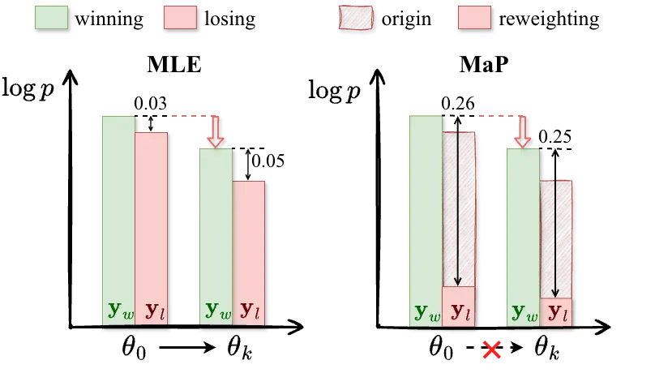
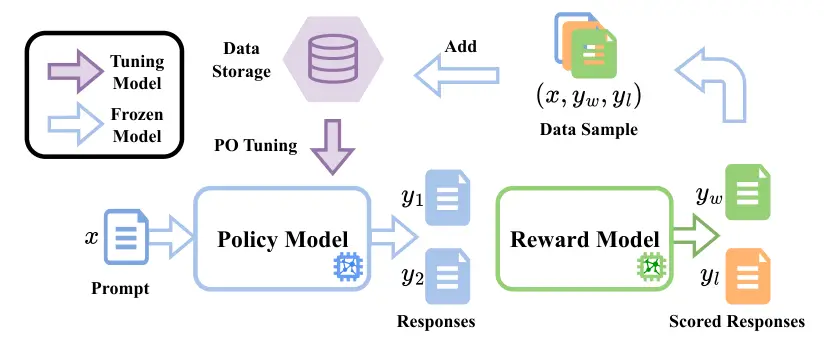

# MaPPO: Maximum a Posteriori Preference Optimization with Prior Knowledge

Guangchen Lan ^(†)^(†)thanks: Equal contribution. Correspondence to:
Guangchen Lan \<lan44@purdue.edu\> Affiliation: Purdue University   
Sipeng Zhang^(\*) Affiliation: University of California, San Diego   
Tianle Wang Affiliation: Purdue University    Yuwei Zhang
Affiliation: University of California, San Diego    Xinpeng Wei
Affiliation: Amazon, AGI SF Lab    Xiaoman Pan Affiliation: Amazon   
Hongming Zhang Affiliation: FAIR, Meta    Dong-Jun Han
Affiliation: Yonsei University    Christopher G. Brinton
Affiliation: Purdue University

###### Abstract

As the era of large language models (LLMs) unfolds, Preference
Optimization (PO) methods have become a central approach to aligning
LLMs with human preferences and improving performance. We propose
Maximum a Posteriori Preference Optimization (MaPPO), a methodology for
learning from preferences that explicitly incorporates prior reward
knowledge into the optimization objective. Building on the paradigm
employed by Direct Preference Optimization (DPO) and its variants of
treating preference learning as a Maximum Likelihood Estimation (MLE)
problem, MaPPO integrates prior reward estimates into a principled
Maximum a Posteriori (MaP) objective. This not only generalizes DPO and
its variants, but also enhances alignment by mitigating the
oversimplified binary classification of responses. Additionally, MaPPO
introduces no additional hyperparameters, and supports preference
optimization in both offline and online settings. In addition, MaPPO can
be used as a plugin for DPO variants, including widely used SimPO, IPO
and CPO, and produce consistent improvements. Extensive empirical
evaluations of different model sizes and model series on three standard
benchmarks (MT-Bench, AlpacaEval 2.0, and Arena-Hard) demonstrate
consistent improvements in alignment performance without sacrificing
computational efficiency.

## 1 Introduction

Reinforcement Learning from Human Feedback (RLHF) has shown promise in
aligning large language models (LLMs) with human preferences. Pioneering
work framed the problem as RL on a reward model trained from group-wise
comparisons, yielding notable improvements in tasks including
games \[8\] and dialogue \[53\]. Subsequent systems such as
InstructGPT \[42\] demonstrated that RLHF could scale to
billion-parameter models and substantially boost helpfulness and
safety \[29\]. Despite its practical successes, RLHF still has a
multitude of challenges stemming from noisy feedback, reward-model
misalignment, optimization instability, and computation inefficiency
with high memory cost, which together hinder its scalability and
reliability \[6, 11, 44\].

Direct Preference Optimization (DPO) \[47\] has addressed some of these
issues by reframing the preference learning with a Kullback–Leibler (KL)
regularized log-odds objective, effectively turning the task into
Maximum Likelihood Estimation (MLE) over pairwise comparisons. In DPO,
the model is trained to assign a higher likelihood to the preferred
response than to the rejected, while staying close to a reference
policy. The MLE perspective enhances the efficiency of RLHF, as it
eliminates the need for rollouts or value functions. On the other hand,
it introduces a new limitation: by considering only the relative
likelihoods within each pair, DPO overlooks the absolute reward
magnitude and any external prior knowledge \[2, 15\]. The training
signal in DPO is inherently local, bounded by pairwise comparisons, and
lacks global calibration across pre-trained knowledge.

##### Challenge.

A fundamental limitation of MLE-based preference optimization lies in
its purely relative nature: it focuses on maximizing the _gap_ between
chosen and rejected responses, yet lacks a mechanism to anchor their
absolute probabilities. As training progresses, the MLE objective tends
to suppress the likelihood of the rejected response rather than elevate
that of the preferred one. Empirical investigations \[43, 46, 59, 70\]
consistently show a simultaneous reduction in the absolute probabilities
assigned to both preferred and rejected answers, resulting in abnormal
output distributions. This undesirable dynamic, empirically known as the
squeezing effect \[49\], undermines policy calibration and injects
instability into generation. The issue is especially severe in near-tie
cases (see Figure 2), where models approach human-level
performance \[37, 23\]. Both responses are reasonable yet MLE still
enforces an artificial separation, draining probability mass from the
high-quality region of the output space. Motivated by this, the key
question that this paper aims to address is:

How can we improve language model alignment through a more principled
training signal, instead of an oversimplified MLE pipeline?

##### Overview of approach.

In this paper, we answer the above question by introducing
Maximum-a-Posteriori Preference Optimization (MaPPO), a simple yet
principled extension of DPO that injects data-driven prior knowledge
into preference training. MaPPO augments the standard maximum-likelihood
objective with a lightweight MaP regularizer – an additional log-prior
scaled by a calibrated reward gap – which proportionally adjusts each
update to the confidence differential between the preferred and rejected
answers. Instead of the oversimplified binary classification in MLE,
this mechanism curbs the excessive penalization of near-tie pairs while
preserving DPO’s closed form and computational efficiency. Moreover, the
proposed MaPPO is suitable for both offline and online settings.
Furthermore, MaPPO is designed as a drop-in regularization module and
seamlessly integrates with a broad spectrum of recent DPO variants.

Extensive experiments demonstrate that MaPPO delivers consistently
stronger performance across three public alignment benchmarks:
AlpacaEval 2.0, Arena-Hard, and MT-Bench. We evaluate MaPPO on multiple
model families, including Llama-3, Qwen2.5, and Mistral, under multiple
model sizes. Compared with DPO on Mistral-7B-Instruct, MaPPO improves
the win rate on AlpacaEval 2.0 from $`18.24`$ to $`30.56`$, an absolute
gain of $`12.32`$ points, and improves Arena-Hard from $`14.2`$ to
$`18.4`$, an absolute gain of $`4.2`$ points. These results validate
that a lightweight prior is sufficient to produce stronger and
better-calibrated policies. Furthermore, we evaluate MaPPO integrated
with Iterative-DPO \[13\], SimPO \[41\], IPO \[18\], and CPO \[62\] in
Appendix B.1 and D.2.1. In all cases, we observe consistent gains up to
$`31.3\%`$ on Arena-Hard in alignment scores without requiring
additional computation or changes to the optimization pipeline. This
suggests that MaPPO serves as a robust and general enhancement strategy
for advanced preference training pipelines.

##### Contributions.

In summary, the main contributions of this work are as follows:

1.  1.  We propose MaPPO, a principled generalization of Direct Preference
        Optimization, which incorporates data-driven prior reward estimates
        into a Maximum-a-Posteriori (MaP) objective.
2.  2.  We demonstrate that MaPPO naturally supports both offline (e.g.,
        DPO) and online (e.g., Iterative-DPO) preference optimization.
3.  3.  We show that MaPPO is compatible with and enhances existing DPO
        variants, including SimPO, IPO, and CPO. For all variants, no
        additional hyperparameters are needed.
4.  4.  Experiments across multiple model series and model sizes confirm
        consistent improvements in alignment performance on standard
        benchmarks, including MT-Bench, AlpacaEval 2.0, and Arena-Hard.

## 2 Preliminaries and Problem Setup

### 2.1 RL Tuning

First, we introduce the general framework of Reinforcement Learning
(RL). Consider the Markov decision process (MDP) as a tuple
$`(\mathcal{S},\mathcal{A},\mathcal{P},\mathcal{R})`$, where
$`\mathcal{S}`$ is the state space, $`\mathcal{A}`$ is a finite action
space,
$`\mathcal{P}:\mathcal{S}\times\mathcal{A}\times\mathcal{S}\rightarrow\mathbb{R}`$
is a Markov kernel that determines transition probabilities, and
$`\mathcal{R}:\mathcal{S}\times\mathcal{A}\rightarrow\mathbb{R}`$ is a
reward function. At each time step $`t`$, the agent executes an action
$`\mathbf{y}_{t}\in\mathcal{A}`$ from the current state
$`\mathbf{s}_{t}\in\mathcal{S}`$, following a stochastic policy $`\pi`$,
i.e., $`\mathbf{y}_{t}\sim\pi(\cdot|\mathbf{s}_{t})`$. The corresponding
reward is defined as $`r_{t}`$.

Following the conventional setting in LLMs, the policy $`\pi_{\theta}`$
represents the LLM with model parameters $`\theta`$. The action space
$`\mathcal{A}`$ is set as the vocabulary. At step $`t`$,
$`\mathbf{s}_{t}=(\mathbf{x},\mathbf{y}_{<t})`$ is a cascade of the
query $`\mathbf{x}`$ and the tokens
$`\mathbf{y}_{<t}=(\mathbf{y}_{1},\cdots,\mathbf{y}_{t-1})`$ that have
been predicted, and $`\mathbf{y}_{t}`$ is the next token to be
predicted. The transition kernel $`\mathcal{P}`$ is deterministic as
$`\mathbf{s}_{t+1}=(\mathbf{s}_{t},\mathbf{y}_{t})`$. The complete
answer $`\mathbf{y}=(\mathbf{y}_{1},\cdots,\mathbf{y}_{T})`$ with length
$`|\mathbf{y}|=T`$. The step reward
$`r_{t}=r(\mathbf{x},\mathbf{y}_{\leq t})`$ can be obtained from a
trained reward model.

After formalizing the LLM tuning as an RL problem, the goal of RL
tuning \[42\] is to maximize the expectation of the cumulative reward
$`r\coloneqq r(\mathbf{x},\mathbf{y})`$ with a Kullback–Leibler (KL)
constraint as follows

```math
\displaystyle\max_{\pi_{\theta}}\mathop{\mathbb{E}}_{\mathbf{x}\sim\mathcal{D},\atop\mathbf{y}\sim\pi_{\theta}(\cdot|\mathbf{x})}\left[r(\mathbf{x},\mathbf{y})\right]-\beta\mathbb{D}_{\rm KL}\left[\pi_{\theta}(\cdot|\mathbf{x})||\pi_{\rm ref}(\cdot|\mathbf{x})\right], \tag{1}
```

where $`\mathbb{D}_{\rm KL}(\cdot||\cdot)`$ denotes the KL divergence,
and $`\beta`$ is a constant weight. $`\pi_{\rm ref}`$ is a reference
model, which is usually the initial policy model before tuning. This
optimization problem can be solved by any RL algorithms, e.g., PPO
\[51\] and GRPO \[52\].

### 2.2 Direct Preference Optimization

In Direct Preference Optimization (DPO) \[47\], a closed-form expression
of (1) is used, and a connection between policy $`\pi`$ and reward
function $`r`$ is built as

```math
\displaystyle\pi(\mathbf{y}|\mathbf{x})~= \displaystyle\frac{1}{Z(\mathbf{x})}\pi_{\rm ref}(\mathbf{y}|\mathbf{x})\exp\big(\frac{1}{\beta}r(\mathbf{y},\mathbf{x})\big), \tag{2}
```

where
$`Z(\mathbf{x})=\sum_{\mathbf{y}}\pi_{\mathrm{ref}}(\mathbf{y}\mid\mathbf{x})\exp\left(\frac{1}{\beta}r(\mathbf{x},\mathbf{y})\right)`$
is a partition function to normalize the probability and irrelevant to
$`\theta`$.

With a prompt $`\mathbf{x}`$, we sample two responses from the current
policy model
$`\mathbf{y}_{1},\mathbf{y}_{2}\sim\pi_{\theta}(\cdot|\mathbf{x})`$. A
human expert then demonstrates the preference and ranks the responses as
$`\mathbf{y}_{w}`$ (win) and $`\mathbf{y}_{l}`$ (lose). After plugging
in (2) into the reward model training (MLE) loss function, the target of
RL tuning becomes to minimize the loss function shown below

```math
\displaystyle\mathcal{L}(\theta)~= \displaystyle\mathop{\mathbb{E}}_{(\mathbf{y}_{w},\mathbf{y}_{l},\mathbf{x})\sim\mathcal{D}}\Big[-\log\sigma\Big(\beta\log\frac{\pi_{\theta}(\mathbf{y}_{w}|\mathbf{x})}{\pi_{\rm ref}(\mathbf{y}_{w}|\mathbf{x})}-\beta\log\frac{\pi_{\theta}(\mathbf{y}_{l}|\mathbf{x})}{\pi_{\rm ref}(\mathbf{y}_{l}|\mathbf{x})}\Big)\Big], \tag{3}
```

where $`\sigma(\cdot)`$ is the logistic function. The training process
can be done using mini-batch gradient descent and the variants, e.g.,
AdamW \[40\]. Notably, the derivation on reward model training is based
on MLE, which oversimplifies the process as a binary classification
problem. As a result, minimizing (3) is nothing but increasing the gap
between the output probability of $`\mathbf{y}_{w}`$ and
$`\mathbf{y}_{l}`$.

### 2.3 Current issues with MLE

The learning process is to estimate the parameters $`\theta`$ via
maximum likelihood, which is to maximize the gap of the output
probability between the winning response
$`\pi_{\theta}(\mathbf{y}_{w}|\mathbf{x})`$ and the losing response
$`\pi_{\theta}(\mathbf{y}_{l}|\mathbf{x})`$.

Despite its computational efficiency and simplicity, the MLE formulation
introduces a critical limitation: It focuses solely on relative
probabilities within each preference pair, while ignoring the absolute
magnitude of confidence in the responses. Shown as Figure 2, training
encourages simultaneous downscaling of both
$`\pi_{\theta}(\mathbf{y}_{w}|\mathbf{x})`$ and
$`\pi_{\theta}(\mathbf{y}_{l}|\mathbf{x})`$, to enlarge the preference
gap. This undesired tendency can lead to over-penalization of both
responses, especially in near-tie cases, thereby reducing output
confidence and harming policy calibration \[49\].

Such issues become particularly problematic as models approach
human-level performance, where both the winning and losing responses may
be of high quality. For example, consider a preference pair where both
$`\mathbf{y}_{w}`$ and $`\mathbf{y}_{l}`$ are grammatically correct,
contextually relevant, and factually accurate, with the only preference
driven by stylistic nuances. In this case, the MLE objective may still
enforce a large probability gap by downscaling both log-likelihoods.
This inadvertently shifts the probability mass away from the
high-quality response space, introducing unnecessary uncertainty into
the policy, and can lead to erratic or unstable generation in downstream
usage.


Figure 1: An example of $`(\mathbf{x},\mathbf{y}_{w},\mathbf{y}_{l})`$
pair. Both responses $`\mathbf{y}_{w}`$ and $`\mathbf{y}_{l}`$ have good
quality as they achieve high rewards, where
$`r(\mathbf{x},\mathbf{y}_{w})=0.95`$,
$`r(\mathbf{x},\mathbf{y}_{l})=0.91`$, and $`r\in[0,1]`$.

| Model | $`\log p(\mathbf{y}_{w})`$ | $`\log p(\mathbf{y}_{l})`$ | $`\log p(\mathbf{y}_{w})`$-$`\log p(\mathbf{y}_{l})`$ |
| ----- | -------------------------- | -------------------------- | ----------------------------------------------------- |
| IT    | $`-14.3`$                  | $`-43.4`$                  | $`+29.1`$                                             |
| DPO   | $`-121.5`$                 | $`-443.2`$                 | $`+321.7`$                                            |
| MaPPO | $`-10.4`$                  | $`-321.1`$                 | $`+310.7`$                                            |

Table 1: Comparison of log-probabilities for responses
$`\mathbf{y}_{w}`$ and $`\mathbf{y}_{l}`$ in PO methods.

In Figure 1, we show an example of the prompt and response pair
$`(\mathbf{x},\mathbf{y}_{w},\mathbf{y}_{l})`$. Given the prompt
$`\mathbf{x}`$, both $`\mathbf{y}_{w}`$ and $`\mathbf{y}_{l}`$ have
correct answers, while in slightly different expressions. Both
$`\mathbf{y}_{w}`$ and $`\mathbf{y}_{l}`$ have high rewards, which
reflect the high qualities. However, in MLE and its derived DPO, the
learning objective is nothing but to increase the gap between
$`\mathbf{y}_{w}`$ and $`\mathbf{y}_{l}`$, regardless of the fact that
both of them have high qualities with correct answers, and their
qualities match each other. We also list an example with long responses
in Appendix F. As shown in Table 1, after DPO training, the log output
probability of $`\mathbf{y}_{w}`$ decreases from $`-14.3`$ to
$`-121.5`$, and $`\mathbf{y}_{l}`$ decreases from $`-43.4`$ to
$`-443.2`$. Although the gap indeed increases from $`29.1`$ to
$`321.7`$, it violates the principal goal: Increase the output
probability of the high-quality responses.

These issues highlight the need for a more principled formulation that
preserves relative preferences while incorporating global calibration
and prior reward knowledge. In the next section, we introduce our
Maximum-a-Posteriori (MaP) framework that addresses these shortcomings
in a unified and efficient manner.



Figure 2: Under the standard MLE-based DPO (left), empirical
studies \[43, 46, 59, 49\] demonstrated that training tends to
simultaneously downscale (with different magnitudes) both the chosen and
rejected responses to increase their gap. Our MaP-based method (right)
mitigates this harmful tendency by re-weighting the rejected response
based on prior knowledge. Here, the x-axis denotes the initial model
$`\theta_{0}`$ and a potentially harmful model $`\theta_{k}`$ that may
arise during training, while the y-axis shows the log-likelihood of a
fixed preference pair under different policies.

## 3 MaPPO Design

### 3.1 MaPPO Loss

In this subsection, we start the derivation step by step from the first
principle.

With a prompt $`\mathbf{x}`$ and responses
$`(\mathbf{y}_{1},\mathbf{y}_{2})`$, an oracle gives its preference on
the responses as $`(\mathbf{y}_{w},\mathbf{y}_{l})`$. The Bradley-Terry
(BT) model \[5\] builds the connection between the rewards and the
preference probability as follows:

```math
\displaystyle p(\mathbf{y}_{w}\succ\mathbf{y}_{l}|\mathbf{x})~=~\frac{\exp(r(\mathbf{y}_{w},\mathbf{x}))}{\exp(r(\mathbf{y}_{w},\mathbf{x}))+\exp(r(\mathbf{y}_{l},\mathbf{x}))}~=~\frac{1}{1+\exp(r(\mathbf{y}_{l},\mathbf{x})-r(\mathbf{y}_{w},\mathbf{x}))}. \tag{4}
```

The preference dataset has $`N`$ samples denoted as
$`\mathcal{D}=\{\mathbf{y}_{w}^{i},\mathbf{y}_{l}^{i},\mathbf{x}^{i}\}_{i=1}^{N}`$.
We can parametrize a reward model with model parameters $`\phi`$ as
$`r_{\phi}(\mathbf{y},\mathbf{x})`$. Given $`\mathbf{x}`$, assume we
have prior knowledge of rewards as $`r_{w}`$ and $`r_{l}\in[-1,0]`$.
This can be obtained from an oracle, e.g., a pre-trained reward model.
To incorporate the prior knowledge of rewards, we need to use the gap
$`\Delta_{r}=r_{w}-r_{l}\in[0,1]`$ as suggested in (4). To keep the
softmax form in the BT model, we can construct the prior probability as
follows

```math
\displaystyle p(r_{\phi})~=~\frac{\exp(r_{\phi}(\mathbf{y}_{w},\mathbf{x}))+\exp(r_{\phi}(\mathbf{y}_{l},\mathbf{x}))}{\exp(r_{\phi}(\mathbf{y}_{w},\mathbf{x}))+\exp(\Delta_{r}r_{\phi}(\mathbf{y}_{l},\mathbf{x}))}. \tag{5}
```

We use the reward gap $`\Delta_{r}`$ on the softmax probability to make
the probability always greater than $`0`$ and smaller than $`1`$.
Notably, this form is not unique, and other forms are also acceptable if
they satisfy the properties of the probability function. We further
discuss the prior function in Appendix E.1.

The MaP loss is the combination of the MLE loss and the prior knowledge
loss as follows

```math
\displaystyle\mathcal{L}_{\rm MaP}(r_{\phi})~= \displaystyle\mathcal{L}_{\rm MLE}(r_{\phi})+\mathcal{L}_{\rm p}(r_{\phi}) \tag{6}
```

```math
\displaystyle~= \displaystyle\mathop{\mathbb{E}}_{(\mathbf{y}_{w},\mathbf{y}_{l},\mathbf{x})\sim\mathcal{D}}\Big[-\log\sigma\Big(r_{\phi}(\mathbf{y}_{w},\mathbf{x})-r_{\phi}(\mathbf{y}_{l},\mathbf{x})\Big)-\log p(r_{\phi})\Big]
```

```math
\displaystyle~= \displaystyle\mathop{\mathbb{E}}_{(\mathbf{y}_{w},\mathbf{y}_{l},\mathbf{x})\sim\mathcal{D}}\Big[-\log\sigma\Big(r_{\phi}(\mathbf{y}_{w},\mathbf{x})-\Delta_{r}r_{\phi}(\mathbf{y}_{l},\mathbf{x})\Big)\Big].
```

As proved in previous works \[47, 19, 28\], we have a closed-form
connection between the policy $`\pi`$ and an implicit reward function
$`r(\mathbf{y},\mathbf{x})`$ as

```math
\displaystyle r(\mathbf{y},\mathbf{x})~= \displaystyle\beta\log\big(\frac{\pi(\mathbf{y}|\mathbf{x})}{\pi_{\rm ref}(\mathbf{y}|\mathbf{x})}\big). \tag{7}
```

With a parametrized policy $`\pi_{\theta}`$, we can plug this result
into the loss function (6), and get the MaPPO loss

```math
\displaystyle\mathcal{L}_{\rm MaP}(\theta)~=~\mathop{\mathbb{E}}_{(\mathbf{y}_{w},\mathbf{y}_{l},\mathbf{x})\sim\mathcal{D}}\Big[-\log\sigma\Big(\beta\log\frac{\pi_{\theta}(\mathbf{y}_{w}|\mathbf{x})}{\pi_{\rm ref}(\mathbf{y}_{w}|\mathbf{x})}-\Delta_{r}\beta\log\frac{\pi_{\theta}(\mathbf{y}_{l}|\mathbf{x})}{\pi_{\rm ref}(\mathbf{y}_{l}|\mathbf{x})}\Big)\Big]. \tag{8}
```

With the MaP estimation, we achieve a clean result compared to the MLE
estimation in DPO with a calibration term $`\Delta_{r}\in[0,1]`$ from
the prior knowledge.

##### Remark.

In our MaPPO method, no additional hyperparameter is introduced compared
to the original DPO method. Thus, MaPPO offers a clean and easily
pluggable solution, and no extra hyperparameter tuning is needed.

### 3.2 Analysis of MaPPO

In this subsection, we analyze the connection with MaPPO and DPO.

##### Connection with DPO.

In (8), when $`r_{w}=0`$ and $`r_{l}=-1`$, we have $`\Delta_{r}=1`$. The
loss function becomes

```math
\displaystyle\mathcal{L}(\theta)~=~\mathop{\mathbb{E}}_{(\mathbf{y}_{w},\mathbf{y}_{l},\mathbf{x})\sim\mathcal{D}}\Big[-\log\sigma\Big(\beta\log\frac{\pi_{\theta}(\mathbf{y}_{w}|\mathbf{x})}{\pi_{\rm ref}(\mathbf{y}_{w}|\mathbf{x})}-\beta\log\frac{\pi_{\theta}(\mathbf{y}_{l}|\mathbf{x})}{\pi_{\rm ref}(\mathbf{y}_{l}|\mathbf{x})}\Big)\Big], \tag{9}
```

which degenerates to the DPO loss function in (3).

Overall, DPO loss function can be taken as _special cases_ of MaPPO. In
this sense, MaPPO can be taken as a dynamic weighted mechanism, where
the weight depends on the relative quality (rewards) of the winning
response $`\mathbf{y}_{w}`$ and the losing response $`\mathbf{y}_{l}`$.

##### Gradient Dynamics Analysis.

To analyze the update of MaPPO, the gradient of (8) is

```math
\displaystyle\nabla\mathcal{L}_{\rm MaP}(\theta)~=~\mathop{\mathbb{E}}_{(\mathbf{y}_{w},\mathbf{y}_{l},\mathbf{x})\sim\mathcal{D}}\Big[-\beta(1-\sigma(u))\Big(\nabla\log{\pi_{\theta}(\mathbf{y}_{w}|\mathbf{x})}-\Delta_{r}\nabla\log{\pi_{\theta}(\mathbf{y}_{l}|\mathbf{x})}\Big)\Big], \tag{10}
```

where
$`u=\beta\big(\log\frac{\pi_{\theta}(\mathbf{y}_{w}|\mathbf{x})}{\pi_{\rm ref}(\mathbf{y}_{w}|\mathbf{x})}-\Delta_{r}\log\frac{\pi_{\theta}(\mathbf{y}_{l}|\mathbf{x})}{\pi_{\rm ref}(\mathbf{y}_{l}|\mathbf{x})}\big)`$
serves as a confidence measure of preference separation. $`1-\sigma(u)`$
down-weights the gradient when the model is already confident in
distinguishing $`\mathbf{y}_{w}`$ and $`\mathbf{y}_{l}`$. $`\Delta_{r}`$
directly scales the contribution of the losing sample
$`\mathbf{y}_{l}`$, modulating the penalization. The gradient norm of
MaPPO is upper-bounded compared to DPO, leading to less aggressive
updates and more stable policy calibration. We provide a more detailed
theoretical analysis, including the stationary convergence analysis in
Appendix C.2 and Lipschitz stability analysis in Appendix C.3.

### 3.3 Online MaPPO

Beyond the offline setting, our MaPPO method can be directly used in the
online or iterative settings. As shown in Algorithm 1, we describe the
online version of MaPPO. In online MaPPO, one key difference is that the
responses $`\{\mathbf{y}\}`$ are generated online from the current
policy $`\pi_{\theta}`$ instead of the initial policy
$`\pi_{\theta_{0}}`$ in the offline setting.

0:  Prompt data set $`\mathcal{D}`$; Number of iterations $`K`$; Initial
policy model $`{\theta_{0}}`$.

1:  for $`k=0,\cdots,K-1`$ do

2:          Sample a prompt $`\mathbf{x}\sim\mathcal{D}`$.

3:          Sample responses from the current policy
$`\mathbf{y}_{w},\mathbf{y}_{l}\sim\pi_{\theta_{k}}(\cdot|\mathbf{x})`$.

4:          Get corresponding rewards
$`r_{w}\leftarrow r(\mathbf{y}_{w},\mathbf{x})`$ and
$`r_{l}\leftarrow r(\mathbf{y}_{l},\mathbf{x})`$.

5:
         $`\Delta_{r}\leftarrow r(\mathbf{y}_{w},\mathbf{x})-r(\mathbf{y}_{l},\mathbf{x})`$

6:          Compute $`\mathcal{L}(\theta_{k})`$ according to (8).

7:
         $`\theta_{k+1}\leftarrow\theta_{k}-\eta\nabla\mathcal{L}(\theta_{k})`$    #
Or other optimizer, e.g., AdamW.

8:  end for

8:  $`{\theta_{K}}`$

Algorithm 1 Online MaPPO

In practice, considering training efficiency, online PO can be
implemented in an iterative way, known as I-DPO \[13\]. We illustrate
the pipeline of iterative DPO in Appendix B.1. With a prompt set
$`\mathcal{D}`$, we can equally divide $`\mathcal{D}`$ into $`K`$
subsets as $`\mathcal{D}_{1}\cdots\mathcal{D}_{K}`$. In the $`k`$-th
iteration, we first freeze the current policy model $`\pi_{\theta}`$,
and then get responses $`(\mathbf{y}_{1},\mathbf{y}_{2})`$ from the
policy according to the prompt set $`\mathcal{D}_{k}`$. We then use a
reward model to get the responses’ corresponding rewards and collect
$`(\mathbf{y}_{w},\mathbf{y}_{l})`$ pairs, which reflect the preference.
After response collection on $`\mathcal{D}_{k}`$, we conduct the MaPPO
training process using (8) on the subset $`\mathcal{D}_{k}`$. After
training on the prompt subset, we repeat the process in the next
iteration $`k+1`$ until we finish all $`K`$ training iterations in
MaPPO.

##### Remark.

A reward model (or rule-based verifier) is necessary for all online
methods, including online DPO (iterative DPO) \[13\] and reject sampling
\[12\].

## 4 Experiments

### 4.1 Setup

##### Pipeline Settings.

We follow the RLHF framework in \[13\]. Instead of costly human
annotations, we employ off-the-shelf reward models to generate the
preferences. We use the public pre-trained BT reward model¹¹ 1
https://huggingface.co/sfairXC/FsfairX-LLaMA3-RM-v0.1 as the prior
knowledge. For the response selection, we follow the rejection sampling
strategy suggested by \[39, 21\]. For each prompt, we generate $`n=8`$
responses and use the best-of-8 as $`\mathbf{y}_{w}`$ and the worst-of-8
as $`\mathbf{y}_{l}`$. We provide hyperparameter details and computing
resources in Appendix D.1.

##### Dataset.

We use the prompt set from UltraFeedback \[10, 13\], which is publicly
available²² 2
https://huggingface.co/datasets/RLHFlow/UltraFeedback-preference-standard.
In the offline setting, we generate responses from the initial model
with the whole prompt set. In the online (iterative) setting, we
separate the prompt set into three subsets of the same size. The
learning process lasts for $`K=3`$ iterations. In each iteration, we
sample responses from our current policy with one prompt subset, and use
preference signals on these responses to improve our policy.

##### Models.

To show the scalability of our methods, we choose models in two
dimensions: (1) Model sizes: Qwen2.5-{1.5B, 3B, 7B, 14B, 32B}-Instruct.
(2) Model series: Qwen2.5-7B-Instruct \[63\],
Mistral-7B-Instruct-v0.3 \[27\], and Llama-3-8B-Instruct \[20\] in our
experiments.

##### Evaluation.

We evaluate the model performance on three widely used benchmarks:
MT-Bench \[74\], AlpacaEval 2.0 \[32\], and Arena-Hard v0.1 \[31\].
MT-Bench contains $`80`$ questions from $`8`$ categories, with answers
rated by GPT-4 on a scale of $`1-10`$. Arena-Hard v0.1 contains $`500`$
technical problem-solving questions, and the answers are compared to
reference responses from the baseline model GPT-4-0314. We report the
win rate (WR) in percentage as judged by GPT-4 Turbo (Preview-1106).
AlpacaEval 2.0 includes $`805`$ questions from five datasets, with the
judge model GPT-4 Turbo (Preview-1106) comparing the answers to
reference responses from itself. We report the length-controlled (LC) WR
as suggested in \[14\].

### 4.2 Main Results

Our main results on three standard benchmarks, introduced in Section
4.1, are shown in Table 3. For the alignment methods, we show the
evaluation results of Instruction Tuning (IT), the original offline
setting \[47\] (DPO), and the online setting \[13\] (I-DPO) as described
in Section 3.3. For DPO and I-DPO, we show their improvements that
incorporate the MaPPO design (+MaPPO).

For all Llama-3-8B-Instruct, Mistral-7B-Instruct, and
Qwen2.5-7B-Instruct models, the performances are significantly improved
with MaPPO on AlpacaEval 2.0 and Arena-Hard v0.1 in both the offline
setting (DPO) and the online setting (I-DPO). It reflects the
effectiveness of MaPPO on different model series in both online and
offline settings. On the MT-Bench, the performances are slightly
improved on Qwen2.5-7B-Instruct and Llama-3-8B-Instruct, because the
base models have already achieved very good results on this benchmark,
which has limitations to reflect the effective improvement. The
improvement on MT-Bench becomes much more significant on models with
mediocre base or DPO performances, e.g., Mistral-7B-Instruct and
Qwen2.5-1.5B-Instruct. In one model series, the larger models achieve
higher overall scores in both base performances and after online &
offline alignment tuning, suggesting that scaling up model size enhances
alignment capability as expected. With MaPPO, the improvement is
consistent in scale with different model sizes in both online and
offline settings, and the alignment can make smaller models outperform
larger base models.

For AlpacaEval 2.0, the standard errors are consistently small, ranging
from $`1.02`$ to $`1.67`$ points across model sizes. $`1.02`$ occurs on
the small model Qwen2.5-1.5B-Instruct, and $`1.67`$ occurs on the large
32B model. For Arena-Hard, the confidence intervals are narrow,
typically about $`(-1.5,+1.5)`$ points from 1.5B to 32B models. For
MT-Bench, our reported number is the average of $`3`$ judge scores.
Importantly, our main improvements on AlpacaEval 2.0 and Arena-Hard are
substantially larger than these uncertainty ranges, for example, on
Qwen2.5-7B, MaPPO improves DPO by $`+6.23`$ on AlpacaEval 2.0 and
$`+13.7`$ on Arena-Hard, and improves I-DPO by $`+5.30`$ and $`+14.7`$,
respectively.

| Method | AlpacaEval 2.0 $`\uparrow`$ | Arena-Hard $`\uparrow`$ | MT-Bench $`\uparrow`$ |
| ------ | --------------------------- | ----------------------- | --------------------- |
| DPO    | 32.01                       | 45.5                    | 8.56                  |
| +MaPPO | 38.24 (+6.23)               | 59.2 (+13.7)            | 8.79 (+0.23)          |
| I-DPO  | 33.80                       | 46.9                    | 8.55                  |
| +MaPPO | 39.10 (+5.30)               | 61.6 (+14.7)            | 8.54 (-0.01)          |
| SimPO  | 25.15                       | 64.2                    | 9.02                  |
| +MaPPO | 32.75 (+7.60)               | 69.5 (+5.3)             | 8.94 (-0.08)          |
| IPO    | 27.76                       | 53.0                    | 8.83                  |
| +MaPPO | 28.84 (+1.08)               | 64.4 (+11.4)            | 8.84 (+0.01)          |
| CPO    | 32.94                       | 47.6                    | 8.62                  |
| +MaPPO | 33.71 (+0.77)               | 54.1 (+6.5)             | 8.68 (+0.06)          |

Table 2: Evaluation results of DPO variants with the MaPPO plugin.
$`\uparrow`$ indicates higher is better.

Overall, the gains are substantial across several metrics. For example,
on AlpacaEval 2.0 with Mistral-7B-Instruct, MaPPO improves DPO from
$`18.24`$ to $`30.56`$, an absolute gain of $`12.32`$ points, and
improves I-DPO from $`17.11`$ to $`33.28`$, an absolute gain of
$`16.17`$ points. For Qwen2.5-3B-Instruct, MaPPO improves DPO from
$`20.16`$ to $`26.68`$, an absolute gain of $`6.52`$ points, and
improves I-DPO from $`19.69`$ to $`25.99`$, an absolute gain of $`6.30`$
points.

|                       |         |                                                      |                                                    |                                                    |
| --------------------- | ------- | ---------------------------------------------------- | -------------------------------------------------- | -------------------------------------------------- |
| Model                 | Method  | AlpacaEval 2.0 $`\uparrow`$                          | Arena-Hard $`\uparrow`$                            | MT-Bench $`\uparrow`$                              |
| Mistral-7B-Instruct   | IT      | $`15.35`$                                            | $`13.1`$                                           | $`5.40`$                                           |
|                       | DPO     | $`18.24`$                                            | $`14.2`$                                           | $`6.86`$                                           |
|                       | \+MaPPO | $`\mathbf{30.56}`$ $`{\color[rgb]{0,0.88,0}+12.32}`$ | $`\mathbf{18.4}`$ $`{\color[rgb]{0,0.88,0}+4.2}`$  | $`\mathbf{7.51}`$ $`{\color[rgb]{0,0.88,0}+0.65}`$ |
|                       | I-DPO   | $`17.11`$                                            | $`14.3`$                                           | $`6.92`$                                           |
|                       | \+MaPPO | $`\mathbf{33.28}`$ $`{\color[rgb]{0,0.88,0}+16.17}`$ | $`\mathbf{19.6}`$ $`{\color[rgb]{0,0.88,0}+5.3}`$  | $`\mathbf{7.59}`$ $`{\color[rgb]{0,0.88,0}+0.67}`$ |
| Llama-3-8B-Instruct   | IT      | $`10.85`$                                            | $`10.2`$                                           | $`7.52`$                                           |
|                       | DPO     | $`22.48`$                                            | $`22.4`$                                           | $`8.07`$                                           |
|                       | \+MaPPO | $`\mathbf{28.37}`$ $`{\color[rgb]{0,0.88,0}+5.89}`$  | $`\mathbf{29.5}`$ $`{\color[rgb]{0,0.88,0}+7.1}`$  | $`\mathbf{8.18}`$ $`{\color[rgb]{0,0.88,0}+0.11}`$ |
|                       | I-DPO   | $`{29.47}`$                                          | $`25.6`$                                           | $`8.01`$                                           |
|                       | \+MaPPO | $`\mathbf{32.68}`$ $`{\color[rgb]{0,0.88,0}+3.21}`$  | $`\mathbf{31.0}`$ $`{\color[rgb]{0,0.88,0}+5.4}`$  | $`\mathbf{8.04}`$ $`{\color[rgb]{0,0.88,0}+0.03}`$ |
| Qwen2.5-1.5B-Instruct | IT      | 11.10                                                | 5.0                                                | 7.06                                               |
|                       | DPO     | $`18.71`$                                            | $`11.6`$                                           | $`7.29`$                                           |
|                       | \+MaPPO | $`\mathbf{19.35}`$ $`{\color[rgb]{0,0.88,0}+0.64}`$  | $`\mathbf{15.3}`$ $`{\color[rgb]{0,0.88,0}+3.7}`$  | $`\mathbf{7.57}`$ $`{\color[rgb]{0,0.88,0}+0.28}`$ |
|                       | I-DPO   | $`17.89`$                                            | $`12.1`$                                           | $`7.39`$                                           |
|                       | \+MaPPO | $`\mathbf{19.84}`$ $`{\color[rgb]{0,0.88,0}+1.95}`$  | $`\mathbf{15.7}`$ $`{\color[rgb]{0,0.88,0}+3.6}`$  | $`\mathbf{7.63}`$ $`{\color[rgb]{0,0.88,0}+0.24}`$ |
| Qwen2.5-3B-Instruct   | IT      | $`18.91`$                                            | $`24.0`$                                           | $`7.92`$                                           |
|                       | DPO     | $`20.16`$                                            | $`29.2`$                                           | $`{8.02}`$                                         |
|                       | \+MaPPO | $`\mathbf{26.68}`$ $`{\color[rgb]{0,0.88,0}+6.52}`$  | $`\mathbf{35.1}`$ $`{\color[rgb]{0,0.88,0}+5.9}`$  | $`\mathbf{8.13}`$ $`{\color[rgb]{0,0.88,0}+0.11}`$ |
|                       | I-DPO   | $`19.69`$                                            | $`\mathbf{36.6}`$                                  | $`\mathbf{8.10}`$                                  |
|                       | \+MaPPO | $`\mathbf{25.99}`$ $`{\color[rgb]{0,0.88,0}+6.30}`$  | $`35.8`$ $`{\color[rgb]{1,0.68,0.48}-0.8}`$        | $`8.01`$ $`{\color[rgb]{1,0.68,0.48}-0.09}`$       |
| Qwen2.5-7B-Instruct   | IT      | $`27.03`$                                            | $`42.9`$                                           | $`8.61`$                                           |
|                       | DPO     | $`32.01`$                                            | $`45.5`$                                           | $`8.56`$                                           |
|                       | \+MaPPO | $`\mathbf{38.24}`$ $`{\color[rgb]{0,0.88,0}+6.23}`$  | $`\mathbf{59.2}`$ $`{\color[rgb]{0,0.88,0}+13.7}`$ | $`\mathbf{8.79}`$ $`{\color[rgb]{0,0.88,0}+0.23}`$ |
|                       | I-DPO   | $`33.80`$                                            | $`46.9`$                                           | $`\mathbf{8.55}`$                                  |
|                       | \+MaPPO | $`\mathbf{39.10}`$ $`{\color[rgb]{0,0.88,0}+5.30}`$  | $`\mathbf{61.6}`$ $`{\color[rgb]{0,0.88,0}+14.7}`$ | $`8.54`$ $`{\color[rgb]{1,0.68,0.48}-0.01}`$       |
| Qwen2.5-14B-Instruct  | IT      | $`31.09`$                                            | $`43.6`$                                           | $`8.62`$                                           |
|                       | DPO     | $`39.84`$                                            | $`52.3`$                                           | $`8.46`$                                           |
|                       | \+MaPPO | $`\mathbf{44.92}`$ $`{\color[rgb]{0,0.88,0}+5.08}`$  | $`\mathbf{59.1}`$ $`{\color[rgb]{0,0.88,0}+6.8}`$  | $`\mathbf{8.68}`$ $`{\color[rgb]{0,0.88,0}+0.22}`$ |
|                       | I-DPO   | $`{45.07}`$                                          | $`54.5`$                                           | $`8.64`$                                           |
|                       | \+MaPPO | $`\mathbf{48.89}`$ $`{\color[rgb]{0,0.88,0}+3.82}`$  | $`\mathbf{62.1}`$ $`{\color[rgb]{0,0.88,0}+7.6}`$  | $`\mathbf{8.80}`$ $`{\color[rgb]{0,0.88,0}+0.16}`$ |
| Qwen2.5-32B-Instruct  | IT      | $`35.26`$                                            | $`74.2`$                                           | $`8.89`$                                           |
|                       | DPO     | $`46.32`$                                            | $`81.4`$                                           | $`8.47`$                                           |
|                       | \+MaPPO | $`\mathbf{51.68}`$ $`{\color[rgb]{0,0.88,0}+5.36}`$  | $`\mathbf{87.1}`$ $`{\color[rgb]{0,0.88,0}+5.7}`$  | $`\mathbf{8.90}`$ $`{\color[rgb]{0,0.88,0}+0.43}`$ |
|                       | I-DPO   | $`{51.12}`$                                          | $`86.0`$                                           | $`8.97`$                                           |
|                       | \+MaPPO | $`\mathbf{58.68}`$ $`{\color[rgb]{0,0.88,0}+7.56}`$  | $`\mathbf{89.8}`$ $`{\color[rgb]{0,0.88,0}+3.8}`$  | $`\mathbf{8.99}`$ $`{\color[rgb]{0,0.88,0}+0.02}`$ |

Table 3: Main evaluation results on three standard benchmarks.
$`\uparrow`$ indicates the higher the better.

In Table 2, we present the performance improvements achieved by applying
MaPPO to vanilla DPO \[47\] and its variants, including widely used
methods such as I-DPO \[13\], SimPO \[41\], IPO \[18\], and CPO \[62\].
All experiments are conducted using Qwen2.5-7B-Instruct. The overall
results further demonstrate the broad compatibility of MaPPO and
consistently validate its effectiveness. More detailed discussions are
provided in Appendix D.2.1.

### 4.3 Other Results

Additional experimental results are provided in Appendix D.2 for further
evaluation of MaPPO.

##### Adaptation to DPO Variants.

In Appendix D.2.1, we provide a more detailed discussions on the
improvement of the vanilla DPO \[47\] and its variants with MaPPO,
including widely used I-DPO \[13\], SimPO \[41\], IPO \[18\], and
CPO \[62\]. The corresponding equations are provided in Appendix B.2.

##### Academic Benchmarks.

In Appendix D.2.2, we test the performance on six widely used academic
benchmarks, including IFEval, GPQA, MMLU, HellaSwag, TruthfulQA and
GSM8K. It shows that the gains observed on MT-Bench, AlpacaEval 2.0, and
Arena-Hard generalize to a broader set of evaluation tasks.

##### Broader Evaluation.

In Appendix D.2.3, we provide human evaluation, and the model
performance with a direct head-to-head comparison between the baseline
and MaPPO-enhanced modes.

##### Reward Signals.

To better understand the role of RMs, in Appendix D.2.4, we conduct an
ablation study by integrating different open-source RMs into our
framework, highlighting the robustness of our approach under varying
prior signals. We justify the equivalence of prior knowledge design and
RMs in Appendix C.1.

##### Compatibility.

Finally, in Appendix D.2.5, we compare our approach with complementary
SFT-B, illustrating that MaPPO provides additive benefits and can be
effectively combined with SFT-B.

## 5 Related Work

Here we discuss the most relevant prior work and leave a broader related
work to Appendix A.

Recent preference-optimization research has largely focused on improving
the efficiency and stability of DPO-style alignment methods. DPO \[47\]
casts preference learning as maximum-likelihood estimation under the
Bradley–Terry model \[5\], and follow-up variants such as IPO \[18\],
CPO \[62\], KTO \[17\], ORPO \[25\], R-DPO \[45\], SimPO \[41\],
Weighted-Reward PO \[65\], and RainbowPO \[72\] extend this framework
through alternative objectives, regularization, or weighting strategies.
At the same time, several works have identified a key limitation of the
MLE formulation: It can reduce the absolute likelihood of both preferred
and rejected responses, producing confidence degeneration and the
squeezing effect \[43, 46, 59, 49\]. Nemotron-4 \[1\] adds a
reward-margin constraint, but it does not provide a general theoretical
account and is less flexible for adaptation to other DPO variants. In
contrast, MaPPO injects prior reward knowledge directly into the
objective, preserving DPO-style efficiency while improving calibration
and mitigating these instability issues.

## 6 Discussions

### 6.1 Limitations and Future Work

1.  1.  Our results indicate that larger models consistently perform better
        with the MaPPO method. Future work with more computing resources
        could explore applying the proposed training pipeline to models
        larger than 32B parameters.
2.  2.  The prior knowledge function design relies on experts’ domain
        knowledge. We give a reasonable and general design. Future works
        could explore different designs in specific domains.
3.  3.  Human evaluation is limited to 1,000 prompts and one model family.
        If resources permit, human evaluation can be scaled for better
        judgment of alignment.

### 6.2 Broader Impacts

MaPPO aligns language models by incorporating prior reward knowledge
into preference optimization, leading to better-calibrated and more
robust outputs. While beneficial, it relies on reward models that may
encode biases or misrepresent human values, potentially reinforcing
harmful patterns. Its use in persuasive or deceptive applications also
poses potential impacts. To mitigate these impacts, we encourage careful
curation and auditing of reward models, broader involvement in defining
reward signals, and transparency in how preference optimization
frameworks, such as MaPPO, are applied in real-world AI systems.

### 6.3 Conclusion

We propose MaPPO, a general and principled framework for preference
optimization that incorporates prior knowledge into the optimization
objective. By extending the Maximum Likelihood Estimation (MLE)-based
Preference Optimization (PO) approach to a Maximum a Posteriori (MaP)
formulation, MaPPO effectively mitigates confidence degeneration and
provides a calibrated training signal. Our method requires no additional
hyperparameters, supports both offline and online settings, and can be
seamlessly integrated into existing Direct Preference Optimization (DPO)
variants, including widely used SimPO, IPO, and CPO. Without sacrificing
efficiency, extensive empirical results demonstrate that MaPPO
consistently improves alignment performance on different model series
(Qwen, Mistral, and Llama), and on scaling to different model sizes
(1.5B, 3B, 7B, 8B, 14B, and 32B) across three standard benchmarks,
including MT-Bench, AlpacaEval 2.0, and Arena-Hard. We further evaluate
the performance on six academic benchmarks, which shows that MaPPO
maintains the performance in various dimensions.

## Acknowledgments

We thank all reviewers for their invaluable feedback that helped us
significantly strengthen the work. C. Brinton acknowledges support from
the National Science Foundation (NSF) under grant CNS-2146171, the
Office of Naval Research (ONR) under grant N00014-22-1-2305, and the Air
Force Office of Scientific Research (AFOSR) under grant
FA9550-24-1-0083.

## References

- \[1\] B. Adler, N. Agarwal, A. Aithal, D. H. Anh, P. Bhattacharya, A.
  Brundyn, J. Casper, B. Catanzaro, S. Clay, J. Cohen, et al. (2024)
  Nemotron-4 340B technical report. arXiv preprint arXiv:2406.11704.
  Cited by: §A.2, §5.
- \[2\] A. Amini, T. Vieira, and R. Cotterell (2024) Direct preference
  optimization with an offset. In Findings of the Association for
  Computational Linguistics (ACL), pp. 9954–9972. Cited by: §1.
- \[3\] M. G. Azar, Z. D. Guo, B. Piot, R. Munos, M. Rowland, M. Valko,
  and D. Calandriello (2024) A general theoretical paradigm to
  understand learning from human preferences. In International
  Conference on Artificial Intelligence and Statistics (AISTATS),
  pp. 4447–4455. Cited by: §B.2.
- \[4\] D. Blei, L. Carin, and D. Dunson (2010) Probabilistic topic
  models. IEEE Signal Processing Magazine 27 (6), pp. 55–65. Cited by:
  §E.1.
- \[5\] R. A. Bradley and M. E. Terry (1952) Rank analysis of incomplete
  block designs: i. the method of paired comparisons. Biometrika 39
  (3/4), pp. 324–345. Cited by: §A.1, §3.1, §5.
- \[6\] S. Casper, X. Davies, C. Shi, T. K. Gilbert, J. Scheurer, J.
  Rando, R. Freedman, T. Korbak, D. Lindner, P. Freire, T. Wang, S.
  Marks, C. Segerie, M. Carroll, A. Peng, P. Christoffersen, M.
  Damani, S. Slocum, U. Anwar, A. Siththaranjan, M. Nadeau, E. J.
  Michaud, J. Pfau, D. Krasheninnikov, X. Chen, L. Langosco, P. Hase, E.
  Bıyık, A. Dragan, D. Krueger, D. Sadigh, and D. Hadfield-Menell (2023)
  Open problems and fundamental limitations of reinforcement learning
  from human feedback. arXiv preprint arXiv:2307.15217. Cited by: §1.
- \[7\] C. Chen, Y. Zhang, Y. Li, J. Wang, L. Qi, X. Xu, X. Zheng,
  and J. Yin (2024) Post-training attribute unlearning in recommender
  systems. ACM Transactions on Information Systems 43 (1), pp. 1–28.
  Cited by: §A.1.
- \[8\] P. F. Christiano, J. Leike, T. Brown, M. Martic, S. Legg, and D.
  Amodei (2017) Deep reinforcement learning from human preferences.
  Advances in Neural Information processing Systems (NeurIPS) 30. Cited
  by: §1.
- \[9\] K. Cobbe, V. Kosaraju, M. Bavarian, M. Chen, H. Jun, L.
  Kaiser, M. Plappert, J. Tworek, J. Hilton, R. Nakano, C. Hesse, and J.
  Schulman (2021) Training verifiers to solve math word problems. arXiv
  preprint arXiv:2110.14168. Cited by: §D.2.2.
- \[10\] G. Cui, L. Yuan, N. Ding, G. Yao, B. He, W. Zhu, Y. Ni, G.
  Xie, R. Xie, Y. Lin, Z. Liu, and M. Sun (2024) UltraFeedback: boosting
  language models with scaled AI feedback. In Forty-first International
  Conference on Machine Learning (ICML), Cited by: §4.1.
- \[11\] J. Dai, X. Pan, R. Sun, J. Ji, X. Xu, M. Liu, Y. Wang, and Y.
  Yang (2023) Safe RLHF: safe reinforcement learning from human
  feedback. arXiv preprint arXiv:2310.12773. Cited by: §1.
- \[12\] H. Dong, W. Xiong, D. Goyal, Y. Zhang, W. Chow, R. Pan, S.
  Diao, J. Zhang, K. SHUM, and T. Zhang (2023) RAFT: reward ranked
  finetuning for generative foundation model alignment. Transactions on
  Machine Learning Research (TMLR). Cited by: §3.3.
- \[13\] H. Dong, W. Xiong, B. Pang, H. Wang, H. Zhao, Y. Zhou, N.
  Jiang, D. Sahoo, C. Xiong, and T. Zhang (2024) RLHF workflow: from
  reward modeling to online RLHF. Transactions on Machine Learning
  Research (TMLR). Cited by: §D.2.1, §1, §3.3, §3.3, §4.1, §4.1, §4.2,
  §4.2, §4.3.
- \[14\] Y. Dubois, P. Liang, and T. Hashimoto (2024) Length-controlled
  AlpacaEval: a simple debiasing of automatic evaluators. In Conference
  on Language Modeling (COLM), Cited by: §4.1.
- \[15\] K. D’Oosterlinck, W. Xu, C. Develder, T. Demeester, A.
  Singh, C. Potts, D. Kiela, and S. Mehri (2025) Anchored preference
  optimization and contrastive revisions: addressing underspecification
  in alignment. Transactions of the Association for Computational
  Linguistics (ACL) 13, pp. 442–460. Cited by: §1.
- \[16\] K. Ethayarajh, W. Xu, N. Muennighoff, D. Jurafsky, and D.
  Kiela (2024) KTO: model alignment as prospect theoretic optimization.
  arXiv preprint arXiv:2402.01306. Cited by: §D.2.3.
- \[17\] K. Ethayarajh, W. Xu, N. Muennighoff, D. Jurafsky, and D.
  Kiela (2024) Model alignment as prospect theoretic optimization. In
  International Conference on Machine Learning (ICML), Cited by: §A.1,
  §5.
- \[18\] M. Gheshlaghi Azar, Z. Daniel Guo, B. Piot, R. Munos, M.
  Rowland, M. Valko, and D. Calandriello (2024) A general theoretical
  paradigm to understand learning from human preferences. In
  International Conference on Artificial Intelligence and Statistics
  (AISTATS), Vol. 238, pp. 4447–4455. Cited by: §A.1, §D.2.1, §1, §4.2,
  §4.3, §5.
- \[19\] D. Go, T. Korbak, G. Kruszewski, J. Rozen, N. Ryu, and M.
  Dymetman (2023) Aligning language models with preferences through
  $`f`$-divergence minimization. In International Conference on Machine
  Learning (ICML), pp. 11546–11583. Cited by: §3.1.
- \[20\] A. Grattafiori, A. Dubey, A. Jauhri, A. Pandey, A. Kadian, A.
  Al-Dahle, A. Letman, A. Mathur, A. Schelten, A. Vaughan, et al. (2024)
  The Llama 3 herd of models. arXiv preprint arXiv:2407.21783. Cited by:
  §4.1.
- \[21\] C. Gulcehre, T. L. Paine, S. Srinivasan, K. Konyushkova, L.
  Weerts, A. Sharma, A. Siddhant, A. Ahern, M. Wang, C. Gu, W.
  Macherey, A. Doucet, O. Firat, and N. de Freitas (2023) Reinforced
  self-training (rest) for language modeling. arXiv preprint
  arXiv:2308.08998. Cited by: §4.1.
- \[22\] K. Guo, Y. Li, and Z. Chen (2025) Proximalized preference
  optimization for diverse feedback types: a decomposed perspective on
  DPO. In The Thirty-ninth Annual Conference on Neural Information
  Processing Systems (NeurIPS), Cited by: §E.2.
- \[23\] Y. Guo, L. Yin, B. Jiang, and J. Zhang (2024) TODO: enhancing
  LLM alignment with ternary preferences. arXiv preprint
  arXiv:2411.02442. Cited by: §1.
- \[24\] D. Hendrycks, C. Burns, S. Basart, A. Zou, M. Mazeika, D. Song,
  and J. Steinhardt (2021) Measuring massive multitask language
  understanding. In International Conference on Learning Representations
  (ICLR), Cited by: §D.2.2.
- \[25\] J. Hong, N. Lee, and J. Thorne (2024) ORPO: monolithic
  preference optimization without reference model. In Proceedings of the
  2024 Conference on Empirical Methods in Natural Language Processing
  (EMNLP), pp. 11170–11189. Cited by: §A.1, §5.
- \[26\] E. T. Jaynes (2007) Prior probabilities. IEEE Transactions on
  Systems Science and Cybernetics 4 (3), pp. 227–241. Cited by: §E.1.
- \[27\] A. Jiang, A. Sablayrolles, A. Mensch, C. Bamford, D.
  Chaplot, D. Casas, F. Bressand, G. Lengyel, G. Lample, L. Saulnier, et
  al. (2023) Mistral 7B. arXiv preprint arXiv:2310.06825. Cited by:
  §4.1.
- \[28\] T. Korbak, H. Elsahar, G. Kruszewski, and M. Dymetman (2022) On
  reinforcement learning and distribution matching for fine-tuning
  language models with no catastrophic forgetting. In Advances in Neural
  Information Processing Systems (NeurIPS), Cited by: §3.1.
- \[29\] G. Lan, H. A. Inan, S. Abdelnabi, J. Kulkarni, L. Wutschitz, R.
  Shokri, C. Brinton, and R. Sim (2025) Contextual integrity in LLMs via
  reasoning and reinforcement learning. In The Thirty-ninth Annual
  Conference on Neural Information Processing Systems (NeurIPS), Cited
  by: §1.
- \[30\] Y. Lei, Q. Shen, and J. Song (2026) A multi-scale graph
  learning framework with temporal consistency constraints for financial
  fraud detection in transaction networks under non-stationary
  conditions. International Journal of Data Science and Analytics 22
  (1), pp. 272. Cited by: §A.1.
- \[31\] T. Li, W. Chiang, E. Frick, L. Dunlap, B. Zhu, J. E. Gonzalez,
  and I. Stoica (2024) From live data to high-quality benchmarks: the
  Arena-Hard pipeline. arXiv preprint arXiv:2406.11939. Cited by: §4.1.
- \[32\] X. Li, T. Zhang, Y. Dubois, R. Taori, I. Gulrajani, C.
  Guestrin, P. Liang, and T. B. Hashimoto (2023) AlpacaEval: an
  automatic evaluator of instruction-following models. GitHub. Note:
  [https://github.com/tatsu-lab/alpaca_eval](https://github.com/tatsu-lab/alpaca_eval)
  Cited by: §4.1.
- \[33\] Y. Li, X. Feng, C. Chen, and Q. Yang (2025) A Survey on
  Recommendation Unlearning: Fundamentals, Taxonomy, Evaluation, and
  Open Questions. IEEE Transactions on Knowledge & Data Engineering,
  pp. 1–20. Cited by: §A.1.
- \[34\] Y. Li, Y. Zhang, W. Liu, X. Feng, Z. Han, C. Chen, and C.
  Yan (2025) Multi-objective unlearning in recommender systems via
  preference guided pareto exploration. IEEE Transactions on Services
  Computing. Cited by: §A.1.
- \[35\] S. Lin, J. Hilton, and O. Evans (2022) TruthfulQA: measuring
  how models mimic human falsehoods. In Proceedings of the 60th Annual
  Meeting of the Association for Computational Linguistics (ACL),
  pp. 3214–3252. Cited by: §D.2.2.
- \[36\] Y. Lin, H. Lin, W. Xiong, S. Diao, J. Liu, J. Zhang, R. Pan, H.
  Wang, W. Hu, H. Zhang, H. Dong, R. Pi, H. Zhao, N. Jiang, H. Ji, Y.
  Yao, and T. Zhang (2024) Mitigating the alignment tax of RLHF. In
  Empirical Methods in Natural Language Processing (EMNLP), Cited by:
  §D.2.2.
- \[37\] J. Liu, D. Ge, and R. Zhu (2024) Reward learning from
  preference with ties. arXiv preprint arXiv:2410.05328. Cited by: §1.
- \[38\] M. Liu, Y. Sun, R. Sun, X. Dong, X. Shen, H. Wang, H. Xiong,
  and Y. Song (2026) IPS: in-prompt process supervision for short video
  content moderation. In Proceedings of the 64th Annual Meeting of the
  Association for Computational Linguistics (ACL) (Volume 6: Industry
  Track), pp. 1277–1288. Cited by: §A.1.
- \[39\] T. Liu, Y. Zhao, R. Joshi, M. Khalman, M. Saleh, P. J. Liu,
  and J. Liu (2024) Statistical rejection sampling improves preference
  optimization. In The Twelfth International Conference on Learning
  Representations (ICLR), Cited by: §4.1.
- \[40\] I. Loshchilov and F. Hutter (2019) Decoupled weight decay
  regularization. In International Conference on Learning
  Representations (ICLR), Cited by: §2.2.
- \[41\] Y. Meng, M. Xia, and D. Chen (2024) SimPO: simple preference
  optimization with a reference-free reward. In The Thirty-eighth Annual
  Conference on Neural Information Processing Systems (NeurIPS), Cited
  by: §A.1, §B.2, §D.2.1, §1, §4.2, §4.3, §5.
- \[42\] L. Ouyang, J. Wu, X. Jiang, D. Almeida, C. Wainwright, P.
  Mishkin, C. Zhang, S. Agarwal, K. Slama, A. Ray, J. Schulman, J.
  Hilton, F. Kelton, L. Miller, M. Simens, A. Askell, P. Welinder, P. F.
  Christiano, J. Leike, and R. Lowe (2022) Training language models to
  follow instructions with human feedback. Advances in Neural
  Information Processing Systems (NeurIPS) 35, pp. 27730–27744. Cited
  by: §D.2.2, §1, §2.1.
- \[43\] A. Pal, D. Karkhanis, S. Dooley, M. Roberts, S. Naidu, and C.
  White (2024) Smaug: fixing failure modes of preference optimisation
  with DPO-positive. arXiv preprint arXiv:2402.13228. Cited by: §A.2,
  §1, Figure 2, §5.
- \[44\] A. Pan, K. Bhatia, and J. Steinhardt (2022) The effects of
  reward misspecification: mapping and mitigating misaligned models.
  arXiv preprint arXiv:2201.03544. Cited by: §1.
- \[45\] R. Park, R. Rafailov, S. Ermon, and C. Finn (2024)
  Disentangling length from quality in direct preference optimization.
  arXiv preprint arXiv:2403.19159. Cited by: §A.1, §5.
- \[46\] R. Rafailov, J. Hejna, R. Park, and C. Finn (2024) From $`r`$
  to $`Q^{*}`$: your language model is secretly a Q-function. arXiv
  preprint arXiv:2404.12358. Cited by: §A.2, §1, Figure 2, §5.
- \[47\] R. Rafailov, A. Sharma, E. Mitchell, C. D. Manning, S. Ermon,
  and C. Finn (2023) Direct preference optimization: your language model
  is secretly a reward model. In Advances in Neural Information
  Processing Systems (NeurIPS), Vol. 36, pp. 53728–53741. Cited by:
  §A.1, §D.2.1, §1, §2.2, §3.1, §4.2, §4.2, §4.3, §5.
- \[48\] D. Rein, B. L. Hou, A. C. Stickland, J. Petty, R. Y. Pang, J.
  Dirani, J. Michael, and S. R. Bowman (2024) GPQA: a graduate-level
  google-proof q&a benchmark. In Conference on Language Modeling (COLM),
  Cited by: §D.2.2.
- \[49\] Y. Ren and D. J. Sutherland (2024) Learning dynamics of LLM
  finetuning. arXiv preprint arXiv:2407.10490. Cited by: §A.2, §D.2.5,
  §1, Figure 2, §2.3, §5.
- \[50\] M. Santacroce, Y. Lu, H. Yu, Y. Li, and Y. Shen (2023)
  Efficient RLHF: reducing the memory usage of ppo. arXiv preprint
  arXiv:2309.00754. Cited by: §A.1.
- \[51\] J. Schulman, F. Wolski, P. Dhariwal, A. Radford, and O.
  Klimov (2017) Proximal policy optimization algorithms. arXiv preprint
  arXiv:1707.06347. Cited by: §2.1.
- \[52\] Z. Shao, P. Wang, Q. Zhu, R. Xu, J. Song, X. Bi, H. Zhang, M.
  Zhang, Y. Li, Y. Wu, et al. (2024) DeepSeekMath: pushing the limits of
  mathematical reasoning in open language models. arXiv preprint
  arXiv:2402.03300. Cited by: §2.1.
- \[53\] N. Stiennon, L. Ouyang, J. Wu, D. Ziegler, R. Lowe, C. Voss, A.
  Radford, D. Amodei, and P. F. Christiano (2020) Learning to summarize
  with human feedback. Advances in Neural Information Processing Systems
  (NeurIPS) 33, pp. 3008–3021. Cited by: §1.
- \[54\] J. Su, M. R. Jafari, Y. Zhang, and W. Zhang (2024) FastMatch:
  enhancing data pipeline efficiency for accelerated distributed
  training. In 2024 IEEE 42nd International Conference on Computer
  Design (ICCD), pp. 239–246. Cited by: §A.1.
- \[55\] J. Su, W. Zhang, Y. Zhang, K. Chu, H. Guo, Y. Lu, and W.
  Zhang (2026) TrustWeave: integrity measurement and attestation for
  multi-cloud LLMs. In Proceedings of the 21st European Conference on
  Computer Systems, pp. 641–656. Cited by: §A.1.
- \[56\] J. Su, Y. Zhang, S. Lin, S. Zhao, Y. Zheng, Y. Yang, and W.
  Zhang (2026) SAIR: cost-efficient multi-stage ML pipeline autoscaling
  via in-context reinforcement learning. arXiv preprint
  arXiv:2601.22397. Cited by: §A.1.
- \[57\] W. Sun, Q. Shen, Y. Gao, Q. Mao, T. Qi, and S. Xu (2025)
  Objective over architecture: fraud detection under extreme imbalance
  in bank account opening. Computation 13 (12), pp. 290. Cited by: §A.1.
- \[58\] Y. Sun, Y. Li, R. Sun, C. Liu, F. Zhou, Z. Jin, L. Wang, X.
  Shen, Z. Hao, and H. Xiong (2025) Audio-enhanced vision-language
  modeling with latent space broadening for high quality data expansion.
  In Proceedings of the 31st ACM SIGKDD Conference on Knowledge
  Discovery and Data Mining, pp. 4872–4881. Cited by: §A.1.
- \[59\] F. Tajwar, A. Singh, A. Sharma, R. Rafailov, J. Schneider, T.
  Xie, S. Ermon, C. Finn, and A. Kumar (2024) Preference fine-tuning of
  LLMs should leverage suboptimal, on-policy data. arXiv preprint
  arXiv:2404.14367. Cited by: §A.2, §1, Figure 2, §5.
- \[60\] Z. Wang, Y. Sun, H. Wang, B. Jing, X. Shen, X. Dong, Z. Hao, H.
  Xiong, and Y. Song (2025) Reasoning-enhanced domain-adaptive
  pretraining of multimodal large language models for short video
  content governance. In Proceedings of the 2025 Conference on Empirical
  Methods in Natural Language Processing (EMNLP): Industry Track,
  pp. 1104–1112. Cited by: §A.1.
- \[61\] Z. Wu, X. Su, F. Yang, S. You, Y. Luo, and J. Long (2026)
  Injection without distortion: geometrically constrained knowledge
  enhancement for vision-language models. In AAAI Conference on
  Artificial Intelligence (AAAI), Cited by: §A.1.
- \[62\] H. Xu, A. Sharaf, Y. Chen, W. Tan, L. Shen, B. Van Durme, K.
  Murray, and Y. J. Kim (2024) Contrastive preference optimization:
  pushing the boundaries of LLM performance in machine translation. In
  Proceedings of the 41st International Conference on Machine Learning
  (ICML), Cited by: §A.1, §B.2, §D.2.1, §1, §4.2, §4.3, §5.
- \[63\] A. Yang, B. Yang, B. Zhang, B. Hui, B. Zheng, B. Yu, C. Li, D.
  Liu, F. Huang, H. Wei, et al. (2024) Qwen2.5 technical report. arXiv
  preprint arXiv:2412.15115. Cited by: §4.1.
- \[64\] K. Yang, J. Tao, J. Lyu, C. Ge, J. Chen, W. Shen, X. Zhu,
  and X. Li (2024) Using human feedback to fine-tune diffusion models
  without any reward model. In 2024 IEEE/CVF Conference on Computer
  Vision and Pattern Recognition (CVPR), pp. 8941–8951. Cited by:
  §D.2.3.
- \[65\] Z. Yang, F. Wan, L. Zhong, T. Shi, and X. Quan (2025)
  Weighted-reward preference optimization for implicit model fusion. In
  The Thirteenth International Conference on Learning Representations
  (ICLR), Cited by: §A.1, §5.
- \[66\] Q. Yu, Z. Zhang, R. Zhu, Y. Yuan, X. Zuo, YuYue, W. Dai, T.
  Fan, G. Liu, J. Liu, L. Liu, X. Liu, H. Lin, Z. Lin, B. Ma, G.
  Sheng, Y. Tong, C. Zhang, M. Zhang, R. Zhang, W. Zhang, H. Zhu, J.
  Zhu, J. Chen, J. Chen, C. Wang, H. Yu, Y. Song, X. Wei, H. Zhou, J.
  Liu, W. Ma, Y. Zhang, L. Yan, Y. Wu, and M. Wang (2025) DAPO: an
  open-source LLM reinforcement learning system at scale. In The
  Thirty-ninth Annual Conference on Neural Information Processing
  Systems (NeurIPS), Cited by: §E.2.
- \[67\] R. Zellers, A. Holtzman, Y. Bisk, A. Farhadi, and Y.
  Choi (2019) HellaSwag: can a machine really finish your sentence?. In
  Proceedings of the 57th Annual Meeting of the Association for
  Computational Linguistics (ACL), pp. 4791–4800. Cited by: §D.2.2.
- \[68\] X. Zeng, J. Lin, Y. Yan, F. Guo, L. Shi, J. Wu, and D.
  Zhou (2026) HalluGuard: demystifying data-driven and reasoning-driven
  hallucinations in LLMs. In International Conference on Learning
  Representations (ICLR), Cited by: §A.1.
- \[69\] X. Zeng, H. Wang, J. Lin, J. Wu, T. Cody, and D. Zhou (2025)
  LensLLM: unveiling fine-tuning dynamics for LLM selection. In
  International Conference on Machine Learning (ICML), Cited by: §A.1.
- \[70\] R. Zhang, L. Lin, Y. Bai, and S. Mei (2024) Negative preference
  optimization: from catastrophic collapse to effective unlearning. In
  First Conference on Language Modeling (COLM), Cited by: §1.
- \[71\] Y. Zhang, D. Yu, B. Peng, L. Song, Y. Tian, M. Huo, N.
  Jiang, H. Mi, and D. Yu (2025) Iterative Nash policy optimization:
  aligning LLMs with general preferences via no-regret learning. In The
  Thirteenth International Conference on Learning Representations
  (ICLR), Cited by: §D.2.2.
- \[72\] H. Zhao, G. I. Winata, A. Das, S. Zhang, D. Yao, W. Tang,
  and S. Sahu (2025) RainbowPO: a unified framework for combining
  improvements in preference optimization. In The Thirteenth
  International Conference on Learning Representations (ICLR), Cited by:
  §A.1, §5.
- \[73\] C. Zheng, S. Liu, M. Li, X. Chen, B. Yu, C. Gao, K. Dang, Y.
  Liu, R. Men, A. Yang, et al. (2025) Group sequence policy
  optimization. arXiv preprint arXiv:2507.18071. Cited by: §E.2.
- \[74\] L. Zheng, W. Chiang, Y. Sheng, S. Zhuang, Z. Wu, Y. Zhuang, Z.
  Lin, Z. Li, D. Li, E. Xing, H. Zhang, J. E. Gonzalez, and I.
  Stoica (2023) Judging LLM-as-a-judge with MT-bench and chatbot arena.
  In Advances in Neural Information Processing Systems (NeurIPS)
  Datasets and Benchmarks Track, Cited by: §4.1.
- \[75\] R. Zheng, S. Dou, S. Gao, Y. Hua, W. Shen, B. Wang, Y. Liu, S.
  Jin, Q. Liu, Y. Zhou, L. Xiong, L. Chen, Z. Xi, N. Xu, W. Lai, M.
  Zhu, C. Chang, Z. Yin, R. Weng, W. Cheng, H. Huang, T. Sun, H. Yan, T.
  Gui, Q. Zhang, X. Qiu, and X. Huang (2023) Secrets of RLHF in large
  language models Part I: PPO. arXiv preprint arXiv:2307.04964. Cited
  by: §A.1.
- \[76\] J. Zhou, T. Lu, S. Mishra, S. Brahma, S. Basu, Y. Luan, D.
  Zhou, and L. Hou (2023) Instruction-following evaluation for large
  language models. arXiv preprint arXiv:2311.07911. Cited by: §D.2.2.

Appendix

## Appendix A Supplementary Related Work

### A.1 Direct Preference Optimization and its Variants.

Driven by the complexity of online RLHF algorithms \[50, 75\], recent
research has pivoted toward efficient offline preference optimization.
Direct Preference Optimization (DPO) \[47\] frames preference alignment
as maximum-likelihood estimation (MLE) under the Bradley-Terry (BT)
model \[5\], while IPO \[18\] generalizes this framework without the
pointwise-reward assumption. Further, CPO \[62\] jointly optimizes the
sequence likelihood and a contrastive reward to perform supervised
fine-tuning (SFT) and alignment in one pass. KTO \[17\] extends the
paradigm to single-response feedback via prospect theoretic utility.
Recent DPO variants, ORPO \[25\], R-DPO \[45\], and SimPO \[41\],
further push performance by discarding the reference model or
regularizing response length. \[65\] further introduces a weight
hyperparameter to balance the influence of preference pairs from
different policies. \[72\] then aims to combine the previous PO methods
into one cohesive objective. However, all DPO-style variants rely on MLE
in the training process, which oversimplifies the tuning of preferred
and unpreferred responses as a binary classification problem.

Beyond preference optimization, recent work has also improved the
efficiency, scalability, and trustworthiness of ML/LLM pipelines \[54,
56, 55\]. More broadly, recent studies have examined LLM fine-tuning
dynamics \[69\] and hallucinations \[68\]. Related studies have explored
multimodal content understanding and governance through process
supervision, domain-adaptive pretraining, and multimodal data expansion
\[61, 38, 60, 58\]. Related post-training research has also studied
machine unlearning in recommender systems, including multi-objective
preference-guided approaches, attribute unlearning, and broader
formulations of recommendation unlearning \[34, 7, 33\]. Recent works
has also investigated objective design under severe class
imbalance \[57\] and temporal consistency constraints under
non-stationary conditions \[30\].

### A.2 Confidence Degeneration in DPO.

Pal et al. \[43\] and Tajwar et al. \[59\] show analytically and
empirically that the expected DPO gradient often decreases the
log-likelihood of the preferred response $`\mathbf{y}_{w}`$ instead of
increasing it, leading to a simultaneous shrinkage of both responses.
Rafailov et al. \[46\] observe the same trend, attributing the drop to
the expected log ratio between the optimized and reference models. By
showing that this is equivalent to the non-negative KL divergence, they
conclude that DPO training inevitably lowers the likelihood of the
chosen response. Nemotron-4 \[1\] constraints the DPO loss with the
reward margin. However, no motivation or theoretical perspective is
given. Moreover, it cannot be used in the online setting and is unable
to enhance the other DPO variants. More recent analyses of the learning
dynamics in \[49\] have identified a phenomenon termed the squeezing
effect, whereby DPO training aggressively drains probability mass from
all responses except the most confident one,
$`\mathbf{y}^{*}=\arg\max_{i\in[V]\setminus{\mathbf{y}_{l}}}\pi_{\theta}(\mathbf{y}=i)`$,
consequently funneling this mass towards $`\mathbf{y}^{*}`$. Our method
utilizes prior knowledge to soften the downward pressure on the rejected
response $`\mathbf{y}_{l}`$, it markedly mitigates the squeezing effect.

## Appendix B Supplementary Concepts

### B.1 Iterative DPO Illustration

In Figure 3, we illustrate the iterative MaPPO pipeline.



Figure 3: Illustration of the iterative MaPPO pipeline in each iteration
$`k`$.

### B.2 Adaptation to Other PO Methods

We have shown MaPPO in the offline and online DPO settings. As this
Maximum a Posteriori (MaP) method is generally suitable for all DPO
variants, we show how MaPPO modifies other DPO variants in this
subsection.

Simply replace the MLE part in preference optimization with MaP, and
follow the same derivation in Section 3.1. Most DPO variants, as long as
MLE is used in the original methods, can be modified with MaPPO as a
plugin. We show some widely adopted methods as examples here, including
SimPO, IPO, and CPO.

First, in SimPO \[41\], with the length control penalty, the loss
function is given as

```math
\displaystyle\mathcal{L}_{\rm SimPO}(\theta)~=~\mathop{\mathbb{E}}_{(\mathbf{y}_{w},\mathbf{y}_{l},\mathbf{x})\sim\mathcal{D}}\Big[-\log\sigma\Big(\frac{\beta}{|\mathbf{y}_{w}|}\log{\pi_{\theta}(\mathbf{y}_{w}|\mathbf{x})}-\frac{\beta}{|\mathbf{y}_{l}|}\log{\pi_{\theta}(\mathbf{y}_{l}|\mathbf{x})}-\gamma\Big)\Big], \tag{11}
```

where $`\gamma`$ is a constant hyperparameter, $`|\mathbf{y}_{w}|`$ and
$`|\mathbf{y}_{l}|`$ denote the lengths of $`\mathbf{y}_{w}`$ and
$`\mathbf{y}_{l}`$, respectively.

With the MaPPO plugin, the loss function is modified as

```math
\displaystyle\mathcal{L}_{\rm SimPO+}(\theta)~=~\mathop{\mathbb{E}}_{(\mathbf{y}_{w},\mathbf{y}_{l},\mathbf{x})\sim\mathcal{D}}\Big[-\log\sigma\Big(\frac{\beta}{|\mathbf{y}_{w}|}\log{\pi_{\theta}(\mathbf{y}_{w}|\mathbf{x})}-\Delta_{r}\frac{\beta}{|\mathbf{y}_{l}|}\log{\pi_{\theta}(\mathbf{y}_{l}|\mathbf{x})}-\gamma\Big)\Big]. \tag{12}
```

In IPO \[3\], the original loss function is

```math
\displaystyle\mathcal{L}_{\rm IPO}(\theta)~=~\mathop{\mathbb{E}}_{(\mathbf{y}_{w},\mathbf{y}_{l},\mathbf{x})\sim\mathcal{D}}\Big[\Big(\log\frac{\pi_{\theta}(\mathbf{y}_{w}|\mathbf{x})}{\pi_{\rm ref}(\mathbf{y}_{w}|\mathbf{x})}-\log\frac{\pi_{\theta}(\mathbf{y}_{l}|\mathbf{x})}{\pi_{\rm ref}(\mathbf{y}_{l}|\mathbf{x})}-\frac{1}{2\beta}\Big)^{2}\Big]. \tag{13}
```

With the MaPPO plugin, the loss function is modified as

```math
\displaystyle\mathcal{L}_{\rm IPO+}(\theta)~=~\mathop{\mathbb{E}}_{(\mathbf{y}_{w},\mathbf{y}_{l},\mathbf{x})\sim\mathcal{D}}\Big[\Big(\log\frac{\pi_{\theta}(\mathbf{y}_{w}|\mathbf{x})}{\pi_{\rm ref}(\mathbf{y}_{w}|\mathbf{x})}-\Delta_{r}\log\frac{\pi_{\theta}(\mathbf{y}_{l}|\mathbf{x})}{\pi_{\rm ref}(\mathbf{y}_{l}|\mathbf{x})}-\frac{1}{2\beta}\Big)^{2}\Big]. \tag{14}
```

In CPO \[62\], the original loss is

```math
\displaystyle\mathcal{L}_{\rm CPO}(\theta)~=~\mathop{\mathbb{E}}_{(\mathbf{y}_{w},\mathbf{y}_{l},\mathbf{x})\sim\mathcal{D}}\Big[-\log\sigma\Big(\beta\log{\pi_{\theta}(\mathbf{y}_{w}|\mathbf{x})}-\beta\log{\pi_{\theta}(\mathbf{y}_{l}|\mathbf{x})}\Big)-\lambda\log{\pi_{\theta}(\mathbf{y}_{w}|\mathbf{x})}\Big], \tag{15}
```

where $`\lambda`$ is a constant hyperparameter.

With the MaPPO plugin, the CPO loss is modified as

```math
\displaystyle\mathcal{L}_{\rm CPO+}(\theta)~=~\mathop{\mathbb{E}}_{(\mathbf{y}_{w},\mathbf{y}_{l},\mathbf{x})\sim\mathcal{D}}\Big[-\log\sigma\Big(\beta\log{\pi_{\theta}(\mathbf{y}_{w}|\mathbf{x})}-\beta\Delta_{r}\log{\pi_{\theta}(\mathbf{y}_{l}|\mathbf{x})}\Big)-\lambda\log{\pi_{\theta}(\mathbf{y}_{w}|\mathbf{x})}\Big]. \tag{16}
```

To verify the effectiveness of this MaPPO plugin, we show the
experimental results with the improvement of these DPO variants in
Appendix D.2.1.

Remark. With our MaPPO plugin, no additional hyperparameter and
computational cost is introduced in all DPO variants.

## Appendix C Theoretical Results

### C.1 The Equivalence of Prior Signals

In this subsection, we mathematically formalize the following
equivalence.

###### Proposition C.1.

Equivalence between a class of prior designs and transformed reward
models.

For a preference pair $`(\mathbf{x},\mathbf{y}_{w},\mathbf{y}_{l})`$,
define

```math
A_{\theta}:=\beta\log\frac{\pi_{\theta}(\mathbf{y}_{w}\mid\mathbf{x})}{\pi_{\mathrm{ref}}(\mathbf{y}_{w}\mid\mathbf{x})},\qquad B_{\theta}:=\beta\log\frac{\pi_{\theta}(\mathbf{y}_{l}\mid\mathbf{x})}{\pi_{\mathrm{ref}}(\mathbf{y}_{l}\mid\mathbf{x})}.
```

The standard MaPPO loss is

```math
\ell_{\mathrm{MaPPO}}(\theta)=-\log\sigma\!\left(A_{\theta}-\Delta r\,B_{\theta}\right),\qquad\Delta r:=r(\mathbf{y}_{w},\mathbf{x})-r(\mathbf{y}_{l},\mathbf{x}).
```

Now consider a generalized prior design whose only effect is to replace
$`\Delta_{r}`$ by a scalar coefficient

```math
\alpha(\mathbf{x},\mathbf{y}_{w},\mathbf{y}_{l})=g\big(r(\mathbf{y}_{w},\mathbf{x}),r(\mathbf{y}_{l},\mathbf{y})\big).
```

The resulting loss becomes

```math
\ell_{g}(\theta)=-\log\sigma\!\left(A_{\theta}-\alpha(\mathbf{x},\mathbf{y}_{w},\mathbf{y}_{l})\,B_{\theta}\right).
```

Then the following statements hold.

(1) Exact equivalence at the level of the effective calibration signal.

Define

```math
\widetilde{\Delta}(\mathbf{x},\mathbf{y}_{w},\mathbf{y}_{l}):=g\big(r(\mathbf{y}_{w},\mathbf{x}),r(\mathbf{y}_{l},\mathbf{x})\big).
```

Then

```math
\ell_{g}(\theta)=-\log\sigma\!\left(A_{\theta}-\widetilde{\Delta}(\mathbf{x},\mathbf{y}_{w},\mathbf{y}_{l})\,B_{\theta}\right),
```

which is exactly the standard MaPPO objective with effective calibration
coefficient $`\widetilde{\Delta}`$. Hence, the two objectives are
pointwise identical for every $`\theta`$, and therefore they also have
identical gradients:

```math
\nabla_{\theta}\ell_{g}(\theta)=\nabla_{\theta}\ell_{\mathrm{MaPPO}}(\theta;\widetilde{\Delta}).
```

Thus, under the same optimizer, initialization, and minibatches, the
optimization trajectory is the same.

(2) Exact equivalence to a different reward model under a mild
structural condition.

Assume that the alternative prior design is difference-separable, i.e.,

```math
g(a,b)=T(a)-T(b)
```

for some scalar function $`T`$. Define a transformed reward model

```math
\widetilde{r}(\mathbf{y},\mathbf{x}):=T(r(\mathbf{y},\mathbf{x})).
```

Then

```math
\widetilde{r}(\mathbf{y}_{w},\mathbf{x})-\widetilde{r}(\mathbf{y}_{l},\mathbf{x})=T\Big(r(\mathbf{y}_{w},\mathbf{x}))-T(r(\mathbf{y}_{l},\mathbf{x})\Big)=g\Big(r(\mathbf{y}_{w},\mathbf{x}),r(\mathbf{y}_{l},\mathbf{x})\Big).
```

Substituting this into the loss gives

```math
\ell_{g}(\theta)=-\log\sigma\!\left(A_{\theta}-\big(\widetilde{r}(\mathbf{y}_{w},\mathbf{x})-\widetilde{r}(\mathbf{y}_{l},\mathbf{x})\big)B_{\theta}\right),
```

which is exactly the standard MaPPO loss with the same prior form and
the transformed reward model $`\widetilde{r}`$.

Part (1) follows immediately by defining
$`\widetilde{\Delta}(\mathbf{x},\mathbf{y}_{w},\mathbf{y}_{l})=g(r(\mathbf{y}_{w},\mathbf{x}),r(\mathbf{y}_{l},\mathbf{x}))`$
and substituting it into the loss. Since the two losses are equal for
every parameter value $`\theta`$, their gradients with respect to
$`\theta`$ are also equal.

For part (2), if $`g`$ is difference-separable, define
$`\widetilde{r}(\mathbf{y},\mathbf{x})=T\big(r(\mathbf{y},\mathbf{x})]\big)`$.
Then

```math
\widetilde{r}(\mathbf{y}_{w},\mathbf{x})-\widetilde{r}(\mathbf{y}_{l},\mathbf{x})=g\Big(r(\mathbf{y}_{w},\mathbf{x}),r(\mathbf{y}_{l},\mathbf{x})\Big),
```

so the generalized-prior loss can be rewritten exactly as the standard
MaPPO loss with reward model $`\widetilde{r}`$. This proves the
equivalence. $`\square`$

We emphasize that this equivalence holds for the broad and practically
relevant class of prior designs that enter MaPPO only through a scalar
calibration coefficient, and it becomes an exact reward-model
equivalence when that coefficient is difference-separable.

### C.2 Stationary Convergence of MaPPO

Recall that

```math
\displaystyle\mathcal{L}_{\rm MaP}(\theta)~= \displaystyle\mathop{\mathbb{E}}_{(\mathbf{y}_{w},\mathbf{y}_{l},\mathbf{x})\sim\mathcal{D}}\Big[-\log\sigma\Big(\beta\log\frac{\pi_{\theta}(\mathbf{y}_{w}|\mathbf{x})}{\pi_{\rm ref}(\mathbf{y}_{w}|\mathbf{x})}-\Delta_{r}\beta\log\frac{\pi_{\theta}(\mathbf{y}_{l}|\mathbf{x})}{\pi_{\rm ref}(\mathbf{y}_{l}|\mathbf{x})}\Big)\Big] \tag{17}
```

```math
\displaystyle~= \displaystyle\mathop{\mathbb{E}}_{(\mathbf{y}_{w},\mathbf{y}_{l},\mathbf{x})\sim\mathcal{D}}\Big[-\log\sigma(u)\Big].
```

At the first-order stationary point (FOSP), the gradient of the loss
with respect to $`\theta`$ becomes $`0`$. Thus, we have

```math
\displaystyle\nabla\mathcal{L}_{\rm MaP}(\theta)~= \displaystyle\mathop{\mathbb{E}}_{(\mathbf{y}_{w},\mathbf{y}_{l},\mathbf{x})\sim\mathcal{D}}\Big[-\beta(1-\sigma(u))\Big(\nabla\log{\pi_{\theta}(\mathbf{y}_{w}|\mathbf{x})}-\Delta_{r}\nabla\log{\pi_{\theta}(\mathbf{y}_{l}|\mathbf{x})}\Big)\Big]=0. \tag{18}
```

Let the optimal policy be $`\pi_{\star}`$. The above equation holds when

```math
\displaystyle\nabla\log{\pi_{\star}(\mathbf{y}_{w}|\mathbf{x})}-\Delta_{r}\nabla\log{\pi_{\star}(\mathbf{y}_{l}|\mathbf{x})}~=~0. \tag{19}
```

Thus, the optimal policy achieves

```math
\displaystyle\log{\pi_{\star}(\mathbf{y}_{w}|\mathbf{x})}~=~\Delta_{r}\log{\pi_{\star}(\mathbf{y}_{l}|\mathbf{x})}+c, \tag{20}
```

where $`c`$ is a scaling constant determined by the initialization.
Thus, the model learns a stable log-linear relationship between
preferred and less-preferred responses, scaled by the prior reward gap.

In DPO, the optimal policy at the FOSP is

```math
\displaystyle\log{\pi_{\star}(\mathbf{y}_{w}|\mathbf{x})}~=~\log{\pi_{\star}(\mathbf{y}_{l}|\mathbf{x})}+c. \tag{21}
```

DPO converges to maximizing the log-odds between $`\mathbf{y}_{w}`$ and
$`\mathbf{y}_{l}`$, but no inherent bound on the preference gap, which
can lead to confidence degeneration. As training progresses, DPO may
tend to decrease the likelihood of both $`\mathbf{y}_{w}`$ and
$`\mathbf{y}_{l}`$ (the _squeezing effect_), because there is no
constraint on absolute probabilities – only the relative gap matters.

MaPPO prevents overconfidence and instability by grounding optimization
in the reward-based prior. The FOSP of MaPPO guarantees a bounded,
calibrated log-probability ratio between $`\mathbf{y}_{w}`$ and
$`\mathbf{y}_{l}`$. Naturally limits the _squeezing effect_ by scaling
the impact of $`\mathbf{y}_{l}`$ via $`\Delta_{r}`$. Therefore, MaPPO is
theoretically more stable, especially for near-tie preference pairs and
in large models where DPO can exacerbate miscalibration.

### C.3 Lipschitz Stability

First, we list the standard assumptions for the analysis.

###### Assumption C.2.

1.  1.  The score function is Lipschitz continuous as
        $`\left\|\nabla\log\pi_{\theta}(\mathbf{y}|\mathbf{x})-\nabla\log\pi_{\theta^{\prime}}(\mathbf{y}|\mathbf{x})\right\|\leq M_{g}\|\theta-\theta^{\prime}\|`$.

Let the gradient operator be defined as

```math
\displaystyle\tau_{\theta}~\coloneqq~\nabla\mathcal{L}_{\rm MaP}(\theta). \tag{22}
```

Then, the gradient operator $`\tau`$ is Lipschitz continuous with

```math
\displaystyle\|\tau_{\theta}-\tau_{\theta^{\prime}}\|\leq L_{\rm MaP}\|\theta-\theta^{\prime}\|, \tag{23}
```

where
$`L_{\rm MaP}=\beta(1-\sigma(u))(1+\Delta_{r})M_{g}<\beta(1+\Delta_{r})M_{g}`$.

###### Proof.

We have

```math
\displaystyle\tau_{\theta}~=~-\beta(1-\sigma(u))\Big(\nabla\log{\pi_{\theta}(\mathbf{y}_{w}|\mathbf{x})}-\Delta_{r}\nabla\log{\pi_{\theta}(\mathbf{y}_{l}|\mathbf{x})}\Big). \tag{24}
```

The norm of the gradient difference is

```math
\displaystyle\|\tau_{\theta}-\tau_{\theta^{\prime}}\|~\leq \displaystyle\beta(1-\sigma(u))\cdot\|\nabla\log{\pi_{\theta}(\mathbf{y}_{w}|\mathbf{x})}-\nabla\log{\pi_{\theta^{\prime}}(\mathbf{y}_{w}|\mathbf{x})}\| \tag{25}
```

```math
\displaystyle+\beta(1-\sigma(u))\Delta_{r}\cdot\|\nabla\log{\pi_{\theta}(\mathbf{y}_{l}|\mathbf{x})}-\nabla\log{\pi_{\theta^{\prime}}(\mathbf{y}_{l}|\mathbf{x})}\|.
```

We have that $`\sigma(u)`$ is Lipschitz with constant $`\frac{1}{4}`$.
Combining the $`M_{g}`$ Lipschitz of the score function
$`\nabla\log\pi_{\theta}(\mathbf{y}|\mathbf{x})`$, we have

```math
\displaystyle\|\tau_{\theta}-\tau_{\theta^{\prime}}\|\leq\beta(1-\sigma(u))(1+\Delta_{r})M_{g}\|\theta-\theta^{\prime}\|~\coloneqq~L_{\rm MaP}\|\theta-\theta^{\prime}\|. \tag{26}
```

∎

In contrast, in DPO, the gradient is Lipschitz continuous as

```math
\displaystyle\|\tau_{\theta}-\tau_{\theta^{\prime}}\|\leq L_{\rm DPO}\|\theta-\theta^{\prime}\|, \tag{27}
```

where $`L_{\rm DPO}=2\beta M_{g}>2\beta(1-\sigma(u))M_{g}`$. The
Lipschitz constant of the gradients in DPO is larger than that in MaPPO,
which shows the gradients have less stability in DPO.

With a formal upper bound on MaPPO’s gradient variation, we show a clear
theoretical justification for why MaPPO is less prone to instability and
exploding confidence gaps, compared to DPO.

## Appendix D Supplementary Experiments

### D.1 Supplementary Experimental Settings

#### D.1.1 Hyperparameter settings.

We follow the standard settings and list the hyperparameter details in
the training process of MaPPO in Table 4. We keep the hyperparameter
settings for different model series and model sizes, including
Qwen2.5-{1.5B, 3B, 7B}-Instruct, Mistral-7B-Instruct, and
Llama-3-8B-Instruct models.

| Hyperparameter            | Value               |     |
| ------------------------- | ------------------- | --- |
| global batch size         | $`128`$             |     |
| learning rate $`\eta`$    | $`5\times 10^{-7}`$ |     |
| warmup steps              | $`100`$             |     |
| weight decay              | $`0.01`$            |     |
| optimizer                 | AdamW               |     |
| KL weight $`\beta`$       | $`0.1`$             |     |
| number of responses $`n`$ | $`8`$               |     |
| temperature $`T`$         | $`1.0`$             |     |
| precision                 | $`{\tt bfloat16}`$  |     |

Table 4: Hyperparameter settings in MaPPO.

| Hyperparameter    | Value   |     |
| ----------------- | ------- | --- |
| SimPO: $`\gamma`$ | $`1`$   |     |
| IPO: $`\beta`$    | $`0.1`$ |     |
| CPO: $`\lambda`$  | $`0.2`$ |     |

Table 5: Hyperparameter settings in DPO Variants.

In Table 5, we list the extra hyperparameters in the reproduction of the
DPO variants. The other hyperparameter settings keep the same in Table 4. Notably, we choose nearly the best hyperparameters for the other
methods, and our reproduction achieves higher performances than the
original or other reproduction reports on some benchmarks, e.g., SimPO
on Arena-Hard.

#### D.1.2 Computing Resources.

All tasks are trained and evaluated on a platform with $`8`$ NVIDIA H100
GPUs on each node, and $`80`$ GB of memory for each GPU. Each training
task requires between $`4`$ and $`40`$ hours to execute, depending on
the size of the model.

### D.2 Supplementary Results

#### D.2.1 Adaptation to DPO Variants

In Table 6, we show the improvement of the vanilla DPO \[47\] and its
variants with MaPPO, including widely used I-DPO \[13\], SimPO \[41\],
IPO \[18\], and CPO \[62\]. We list the hyperparameter settings in the
DPO variants in Appendix D. Their loss functions with MaPPO adaptation
are shown in Section 3.3 and Appendix B.2. For all DPO variants, no
additional hyperparameter is needed from the MaPPO plugin. For the model
in evaluation, we keep Qwen2.5-7B-Instruct as the default model.

In general, MaPPO consistently improves all DPO variants with the MLE
design on all three benchmarks. Although it drops a little on MT-Bench
in some methods, the original approach has essentially saturated at the
achievable score on MT-Bench, which barely reflects the improvement with
a variance in evaluation. The overall consistent improvements observed
across DPO variants after applying the MaPPO plugin underscore its
flexibility and generality in enhancing preference optimization methods.
Notably, MaPPO effectively complements both simple and complex variants
without requiring architectural modifications or hyperparameter tuning.
For instance, SimPO benefits from the MaPPO adjustment by further
balancing the length-controlled optimization with better calibration of
confidence scores, while IPO and CPO experience gains due to MaPPO’s
capacity to regularize reward signals with prior knowledge, mitigating
overfitting to pairwise preferences. The improvements span diverse
evaluation metrics and benchmarks, demonstrating that MaPPO’s
reward-aware calibration systematically addresses the shortcomings of
MLE-based objectives inherent in existing variants. This indicates that
MaPPO is not merely a tweak, but a general principle that can be
seamlessly integrated into the PO pipelines to achieve more reliable
alignment results.

| Method | AlpacaEval 2.0 $`\uparrow`$                         | Arena-Hard $`\uparrow`$                            | MT-Bench $`\uparrow`$                              |
| ------ | --------------------------------------------------- | -------------------------------------------------- | -------------------------------------------------- |
| DPO    | $`32.01`$                                           | $`45.5`$                                           | $`8.56`$                                           |
| +MaPPO | $`\mathbf{38.24}`$ $`{\color[rgb]{0,0.88,0}+6.23}`$ | $`\mathbf{59.2}`$ $`{\color[rgb]{0,0.88,0}+13.7}`$ | $`\mathbf{8.79}`$ $`{\color[rgb]{0,0.88,0}+0.23}`$ |
| I-DPO  | $`33.80`$                                           | $`46.9`$                                           | $`\mathbf{8.55}`$                                  |
| +MaPPO | $`\mathbf{39.10}`$ $`{\color[rgb]{0,0.88,0}+5.30}`$ | $`\mathbf{61.6}`$ $`{\color[rgb]{0,0.88,0}+14.7}`$ | $`8.54`$ $`{\color[rgb]{1,0.68,0.48}-0.01}`$       |
| SimPO  | $`25.15`$                                           | $`64.2`$                                           | $`\mathbf{9.02}`$                                  |
| +MaPPO | $`\mathbf{32.75}`$ $`{\color[rgb]{0,0.88,0}+7.60}`$ | $`\mathbf{69.5}`$ $`{\color[rgb]{0,0.88,0}+5.3}`$  | $`{8.94}`$ $`{\color[rgb]{1,0.68,0.48}-0.08}`$     |
| IPO    | $`27.76`$                                           | $`53.0`$                                           | $`8.83`$                                           |
| +MaPPO | $`\mathbf{28.84}`$ $`{\color[rgb]{0,0.88,0}+1.08}`$ | $`\mathbf{64.4}`$ $`{\color[rgb]{0,0.88,0}+11.4}`$ | $`\mathbf{8.84}`$ $`{\color[rgb]{0,0.88,0}+0.01}`$ |
| CPO    | $`32.94`$                                           | $`47.6`$                                           | 8.62                                               |
| +MaPPO | $`\mathbf{33.71}`$ $`{\color[rgb]{0,0.88,0}+0.77}`$ | $`\mathbf{54.1}`$ $`{\color[rgb]{0,0.88,0}+6.5}`$  | $`\mathbf{8.68}`$ $`{\color[rgb]{0,0.88,0}+0.06}`$ |

Table 6: Evaluation results of DPO variants with a MaPPO plugin.
$`\uparrow`$ indicates the higher the better. The results confirm the
broad applicability of MaPPO across existing methods.

#### D.2.2 Results on Academic Benchmarks

It is widely observed that alignment impairs models’ performance on
calibration, reasoning, and accuracy \[42, 36, 71\], which is also known
as the alignment tax. As a result, it is also needed to assess the
model’s performance using more academic benchmarks. In this subsection,
we investigate whether the several methods for alignment with human
preference could sacrifice the general model performance.

| Method  | IFEval $`\uparrow`$ | GPQA $`\uparrow`$ | MMLU $`\uparrow`$ | HellaSwag $`\uparrow`$ | TruthfulQA $`\uparrow`$ | GSM8K $`\uparrow`$ |
| ------- | ------------------- | ----------------- | ----------------- | ---------------------- | ----------------------- | ------------------ |
| IT      | $`70.4`$            | $`30.2`$          | $`62.4`$          | $`78.6`$               | $`53.7`$                | $`73.4`$           |
| DPO     | $`77.0`$            | $`27.5`$          | $`62.7`$          | $`79.5`$               | $`51.5`$                | $`75.5`$           |
| \+MaPPO | $`\mathbf{82.0}`$   | $`\mathbf{29.5}`$ | $`\mathbf{63.2}`$ | $`\mathbf{80.1}`$      | $`\mathbf{58.2}`$       | $`\mathbf{79.5}`$  |
| I-DPO   | $`74.6`$            | $`\mathbf{29.8}`$ | $`63.1`$          | $`80.5`$               | $`60.7`$                | $`81.3`$           |
| \+MaPPO | $`\mathbf{76.4}`$   | $`{28.8}`$        | $`\mathbf{63.5}`$ | $`\mathbf{80.7}`$      | $`\mathbf{63.7}`$       | $`\mathbf{82.4}`$  |

Table 7: Evaluation results on six academic benchmarks with
Llama-3-8B-Instruct model.

| Method  | IFEval $`\uparrow`$ | GPQA $`\uparrow`$ | MMLU $`\uparrow`$ | HellaSwag $`\uparrow`$ | TruthfulQA $`\uparrow`$ | GSM8K $`\uparrow`$ |
| ------- | ------------------- | ----------------- | ----------------- | ---------------------- | ----------------------- | ------------------ |
| IT      | $`73.5`$            | $`31.5`$          | $`71.8`$          | $`62.1`$               | $`56.4`$                | $`81.7`$           |
| DPO     | $`73.2`$            | $`32.0`$          | $`71.9`$          | $`62.0`$               | $`57.1`$                | $`71.3`$           |
| \+MaPPO | $`\mathbf{73.8}`$   | $`\mathbf{33.1}`$ | $`\mathbf{72.0}`$ | $`\mathbf{62.1}`$      | $`\mathbf{59.2}`$       | $`\mathbf{80.1}`$  |
| I-DPO   | 72.9                | $`33.0`$          | $`71.9`$          | $`62.2`$               | $`55.9`$                | $`73.2`$           |
| \+MaPPO | $`72.6`$            | 33.3              | $`\mathbf{72.9}`$ | $`\mathbf{62.2}`$      | $`\mathbf{56.2}`$       | $`\mathbf{82.0}`$  |

Table 8: Evaluation results on six academic benchmarks with
Qwen2.5-7B-Instruct model.

We test the performance on six widely used academic benchmarks,
evaluating various model abilities, including explicit instruction
following (IFEval) \[76\], general knowledge (GPQA) \[48\], multitask
language understanding (MMLU) \[24\], commonsense reasoning (HellaSwag)
\[67\], human falsehoods mimicking (TruthfulQA) \[35\], and math word
problem-solving (GSM8K) \[9\].

We show the results on the six academic benchmarks from
Llama-3-8B-Instruct model in Table 7, and Qwen2.5-7B-Instruct model in
Table 8. In general, for offline DPO with MaPPO outperforms the original
DPO in all benchmarks for both models. The improvement is significant on
GSM8K for Qwen2.5-7B-Instruct, and on TruthfulQA for
Llama-3-8B-Instruct. For the iterative DPO with MaPPO, the performances
are better than the original I-DPO on most benchmarks, and maintains the
performances on IFEval and GPQA. Overall, the performances of online
methods are better than offline methods, and MaPPO generally improves or
maintains the performances on academic benchmarks in both settings.

#### D.2.3 Broader Evaluation

##### Human Evaluation.

Following the setting in Ethayarajh et al. \[16\], Yang et al. \[64\],
we randomly sampled $`1000`$ prompts from the prompt set and generated
outputs from the Qwen2.5-7B-Instruct models optimized with DPO and
+MaPPO. Each rater scored the response pair with preferred & unpreferred
label. Each response pair was evaluated by $`5`$ raters, and a prompt
was counted as a win if at least 3 raters preferred the response. We
then report the winrates generated from Qwen2.5-7B-Instruct with
different PO methods. Under the $`95\%`$ confidence interval, the
standard error (SE) is $`0.0155`$, and CI =
Mean$`\pm`$($`1.96\times`$SE). The results demonstrate the superiority
of DPO+MaPPO ($`0.594\pm 0.0304`$) compared to vanilla DPO
($`0.406\pm 0.0304`$).

##### Evaluation Instructions.

For each example, evaluators were shown a prompt and two candidate
responses, Response A and Response B. Evaluators were instructed to
select the response that they preferred based on overall quality,
including correctness, relevance, helpfulness, and clarity.

##### LLM as a Judge Comparison.

The model performance with a direct head-to-head comparison between the
baseline and MaPPO-enhanced models may bring more information than only
comparing both against GPT-4. We therefore conducted this additional
evaluation with GPT-4.1 as the judge in Table 9. In the DPO vs.
DPO+MaPPO comparison, for Qwen2.5-7B-Instruct, MaPPO achieves a
$`52.86`$ win rate, while DPO obtains $`47.14`$ with the standard error
$`1.74`$. As expected, these win rates are close to $`50`$ because the
comparison is between two much closer models, but the result still
consistently favors MaPPO.

| Model                 | DPO Win Rate | DPO+MaPPO Win Rate | Standard Error |
| --------------------- | ------------ | ------------------ | -------------- |
| Qwen2.5-14B-Instruct  | $`46.31`$    | $`\mathbf{53.69}`$ | $`1.72`$       |
| Qwen2.5-7B-Instruct   | $`47.14`$    | $`\mathbf{52.86}`$ | $`1.74`$       |
| Qwen2.5-3B-Instruct   | $`46.53`$    | $`\mathbf{53.47}`$ | $`1.52`$       |
| Qwen2.5-1.5B-Instruct | $`47.26`$    | $`\mathbf{52.74}`$ | $`1.31`$       |

Table 9: Head-to-head comparison of DPO and DPO+MaPPO win rates
($`\%`$).

#### D.2.4 Ablation Study on RMs

As illustrated in Equation (5), the prior signal is instantiated via a
reward model (RM). We formalize a theoretical statement in Appendix C.1:
Compared to changing the prior function, changing the reward model could
achieve an equivalent effect on the prior signal. Thus, this section
provides the empirical results with different RMs.

To better understand the role of RMs, we conduct an ablation study by
integrating different open-source RMs into our framework, including BT
model³³ 3 https://huggingface.co/sfairXC/FsfairX-LLaMA3-RM-v0.1
(sfairXC/FsfairX-LLaMA3-RM-v0.1), MoE model⁴⁴ 4
https://huggingface.co/RLHFlow/ArmoRM-Llama3-8B-v0.1
(RLHFlow/ArmoRM-Llama3-8B-v0.1), uncertainty-aware (UA) model⁵⁵ 5
https://huggingface.co/LxzGordon/URM-LLaMa-3.1-8B
(LxzGordon/URM-LLaMa-3.1-8B), and a low-quality (LQ) RM⁶⁶ 6
https://huggingface.co/weqweasdas/RM-Gemma-2B (weqweasdas/RM-Gemma-2B).
weqweasdas/RM-Gemma-2B is the sixth from the bottom on the RewardBench⁷⁷
7 https://huggingface.co/spaces/allenai/reward-bench. Thus, this RM’s
quality is not that ideal compared to previous RMs. We add a standard
logistic function on the absolute rewards to make sure $`r\in[0,1]`$.

As shown in Table 10, the absolute performance of I-DPO varies
considerably depending on the chosen RM. Importantly, across all
settings, our proposed MaPPO plugin consistently boosts performance on
AlpacaEval 2.0, Arena-Hard, and MT-Bench. These results highlight two
key insights: (i) the choice of RM can influence the strength of
supervision and the final outcomes, and (ii) MaPPO is robust to such
variation, reliably enhancing DPO regardless of the underlying RM. This
robustness underscores the generality and flexibility of our framework.

| Model         | Reward Model | Method  | AlpacaEval 2.0 $`\uparrow`$                         | Arena-Hard $`\uparrow`$                            | MT-Bench $`\uparrow`$                              |
| ------------- | ------------ | ------- | --------------------------------------------------- | -------------------------------------------------- | -------------------------------------------------- |
| Qwen2.5-7B-IT | BT           | IT      | $`27.03`$                                           | $`42.9`$                                           | $`8.61`$                                           |
|               |              | I-DPO   | $`33.80`$                                           | $`46.9`$                                           | $`\mathbf{8.55}`$                                  |
|               |              | \+MaPPO | $`\mathbf{39.10}`$ $`{\color[rgb]{0,0.88,0}+5.30}`$ | $`\mathbf{61.6}`$ $`{\color[rgb]{0,0.88,0}+14.7}`$ | $`8.54`$ $`{\color[rgb]{1,0.68,0.48}-0.01}`$       |
|               | MoE          | IT      | $`27.03`$                                           | $`42.9`$                                           | $`8.61`$                                           |
|               |              | I-DPO   | $`28.79`$                                           | $`48.3`$                                           | $`8.58`$                                           |
|               |              | \+MaPPO | $`\mathbf{31.56}`$ $`{\color[rgb]{0,0.88,0}+2.77}`$ | $`\mathbf{52.0}`$ $`{\color[rgb]{0,0.88,0}+3.7}`$  | $`\mathbf{8.60}`$ $`{\color[rgb]{0,0.88,0}+0.02}`$ |
|               | UA           | IT      | $`27.03`$                                           | $`42.9`$                                           | $`8.61`$                                           |
|               |              | I-DPO   | $`32.26`$                                           | $`55.1`$                                           | $`8.60`$                                           |
|               |              | \+MaPPO | $`\mathbf{36.17}`$ $`{\color[rgb]{0,0.88,0}+3.91}`$ | $`\mathbf{59.4}`$ $`{\color[rgb]{0,0.88,0}+4.3}`$  | $`\mathbf{8.62}`$ $`{\color[rgb]{0,0.88,0}+0.02}`$ |
|               | low quality  | IT      | $`27.03`$                                           | $`42.9`$                                           | $`8.61`$                                           |
|               |              | I-DPO   | $`27.77`$                                           | $`43.5`$                                           | $`8.06`$                                           |
|               |              | \+MaPPO | $`\mathbf{29.78}`$ $`{\color[rgb]{0,0.88,0}+2.01}`$ | $`\mathbf{48.4}`$ $`{\color[rgb]{0,0.88,0}+4.9}`$  | $`\mathbf{8.63}`$ $`{\color[rgb]{0,0.88,0}+0.57}`$ |
| Llama-3-8B-IT | BT           | IT      | $`10.85`$                                           | $`10.2`$                                           | $`7.52`$                                           |
|               |              | I-DPO   | $`{29.47}`$                                         | $`25.6`$                                           | $`8.01`$                                           |
|               |              | \+MaPPO | $`\mathbf{32.68}`$ $`{\color[rgb]{0,0.88,0}+3.21}`$ | $`\mathbf{31.0}`$ $`{\color[rgb]{0,0.88,0}+5.4}`$  | $`\mathbf{8.04}`$ $`{\color[rgb]{0,0.88,0}+0.03}`$ |
|               | MoE          | IT      | $`10.85`$                                           | $`10.2`$                                           | $`7.52`$                                           |
|               |              | I-DPO   | $`12.69`$                                           | $`8.1`$                                            | $`7.44`$                                           |
|               |              | \+MaPPO | $`\mathbf{16.69}`$ $`{\color[rgb]{0,0.88,0}+4.00}`$ | $`\mathbf{16.4}`$ $`{\color[rgb]{0,0.88,0}+8.3}`$  | $`\mathbf{7.78}`$ $`{\color[rgb]{0,0.88,0}+0.34}`$ |
|               | UA           | IT      | $`10.85`$                                           | $`10.2`$                                           | $`7.52`$                                           |
|               |              | I-DPO   | $`25.61`$                                           | $`30.4`$                                           | $`8.06`$                                           |
|               |              | \+MaPPO | $`\mathbf{27.83}`$ $`{\color[rgb]{0,0.88,0}+2.22}`$ | $`\mathbf{33.7}`$ $`{\color[rgb]{0,0.88,0}+3.3}`$  | $`\mathbf{8.10}`$ $`{\color[rgb]{0,0.88,0}+0.04}`$ |
|               | low quality  | IT      | $`10.85`$                                           | $`10.2`$                                           | $`7.52`$                                           |
|               |              | I-DPO   | $`11.24`$                                           | $`13.4`$                                           | $`7.96`$                                           |
|               |              | \+MaPPO | $`\mathbf{15.76}`$ $`{\color[rgb]{0,0.88,0}+4.52}`$ | $`\mathbf{16.1}`$ $`{\color[rgb]{0,0.88,0}+2.7}`$  | $`\mathbf{8.01}`$ $`{\color[rgb]{0,0.88,0}+0.05}`$ |

Table 10: Ablation on reward models. $`\uparrow`$ indicates the higher
the better.

|                |             |                                                                                    |                                                                                      |                                                                                     |
| -------------- | ----------- | ---------------------------------------------------------------------------------- | ------------------------------------------------------------------------------------ | ----------------------------------------------------------------------------------- |
| Model          | Method      | AlpacaEval 2.0 $`\uparrow`$                                                        | Arena-Hard $`\uparrow`$                                                              | MT-Bench $`\uparrow`$                                                               |
| Llama-3-8B-IT  | IT          | $`10.85`$                                                                          | $`10.2`$                                                                             | $`7.52`$                                                                            |
|                | I-DPO       | $`{29.47}`$                                                                        | $`25.6`$                                                                             | $`8.01`$                                                                            |
|                | +MaP        | $`\mathbf{32.68}`$ $`{\color[rgb]{0,0.88,0}+3.21}`$ $`{\color[rgb]{0,0,1}+3.21}`$  | $`\mathbf{31.0}`$ $`{\color[rgb]{0,0.88,0}+5.4}`$ $`{\color[rgb]{0,0,1}+5.4}`$       | $`\mathbf{8.04}`$ $`{\color[rgb]{0,0.88,0}+0.03}`$ $`{\color[rgb]{0,0,1}+0.03}`$    |
|                | +SFT-B      | $`35.55`$  $`{\color[rgb]{0,0.88,0}+6.08}`$                                        | $`30.1`$  $`{\color[rgb]{0,0.88,0}+4.5}`$                                            | $`8.02`$  $`{\color[rgb]{0,0.88,0}+0.01}`$                                          |
|                | +SFT-B +MaP | $`\mathbf{36.21}`$ $`{\color[rgb]{0,0.88,0}+6.74}`$ $`{\color[rgb]{0,0,1}+0.66}`$  | $`\mathbf{31.5}`$ $`{\color[rgb]{0,0.88,0}+5.9}`$ $`{\color[rgb]{0,0,1}+1.4}`$       | $`\mathbf{8.03}`$ $`{\color[rgb]{0,0.88,0}+0.02}`$ $`{\color[rgb]{0,0,1}+0.01}`$    |
| Qwen2.5-7B-IT  | IT          | $`27.03`$                                                                          | $`42.9`$                                                                             | $`8.61`$                                                                            |
|                | I-DPO       | $`33.80`$                                                                          | $`46.9`$                                                                             | $`\mathbf{8.55}`$                                                                   |
|                | +MaP        | $`\mathbf{39.10}`$ $`{\color[rgb]{0,0.88,0}+5.30}`$  $`{\color[rgb]{0,0,1}+5.30}`$ | $`\mathbf{61.6}`$ $`{\color[rgb]{0,0.88,0}+14.7}`$ $`{\color[rgb]{0,0,1}+14.7}`$     | $`8.54`$ $`{\color[rgb]{1,0.68,0.48}-0.01}`$ $`{\color[rgb]{0,0,1}-0.01}`$          |
|                | +SFT-B      | $`51.36`$ $`{\color[rgb]{0,0.88,0}+17.56}`$                                        | $`33.5`$ $`{\color[rgb]{1,0.68,0.48}-13.4}`$                                         | $`8.01`$ $`{\color[rgb]{1,0.68,0.48}-0.54}`$                                        |
|                | +SFT-B +MaP | 55.84 $`{\color[rgb]{0,0.88,0}+22.04}`$ $`{\color[rgb]{0,0,1}+4.48}`$              | $`\mathbf{43.5}`$  $`{\color[rgb]{1,0.68,0.48}-3.4}`$  $`{\color[rgb]{0,0,1}+10.0}`$ | $`\mathbf{8.40}`$ $`{\color[rgb]{1,0.68,0.48}-0.15}`$ $`{\color[rgb]{0,0,1}+0.39}`$ |
| Qwen2.5-14B-IT | IT          | $`31.09`$                                                                          | $`43.6`$                                                                             | $`8.62`$                                                                            |
|                | I-DPO       | $`45.07`$                                                                          | $`54.5`$                                                                             | $`{8.64}`$                                                                          |
|                | +MaP        | $`\mathbf{48.89}`$ $`{\color[rgb]{0,0.88,0}+3.82}`$  $`{\color[rgb]{0,0,1}+3.82}`$ | $`\mathbf{62.1}`$ $`{\color[rgb]{0,0.88,0}+7.6}`$ $`{\color[rgb]{0,0,1}+7.6}`$       | $`\mathbf{8.80}`$ $`{\color[rgb]{0,0.88,0}+0.16}`$ $`{\color[rgb]{0,0,1}+0.16}`$    |
|                | +SFT-B      | $`54.60`$ $`{\color[rgb]{0,0.88,0}+9.53}`$                                         | $`40.3`$ $`{\color[rgb]{1,0.68,0.48}-14.2}`$                                         | $`8.51`$ $`{\color[rgb]{1,0.68,0.48}-0.13}`$                                        |
|                | +SFT-B +MaP | 57.13 $`{\color[rgb]{0,0.88,0}+12.06}`$ $`{\color[rgb]{0,0,1}+2.53}`$              | $`\mathbf{45.5}`$  $`{\color[rgb]{1,0.68,0.48}-9.0}`$  $`{\color[rgb]{0,0,1}+5.2}`$  | $`\mathbf{8.52}`$ $`{\color[rgb]{1,0.68,0.48}-0.12}`$ $`{\color[rgb]{0,0,1}+0.01}`$ |

Table 11: Comparison w/wo SFT-B and w/wo MaPPO (+MaP). $`\uparrow`$
indicates the higher the better.

#### D.2.5 Comparison and Compatibility with Other Methods

We also compare our approach with complementary techniques, such as the
method proposed by \[49\], which introduces an additional SFT-based
pre-processing (denoted as SFT-B) to mitigate the squeezing effect. It
is worthy to mention that our proposed method is compatible with SFT-B.

In Table 11, we use the blue color to indicate the improvement with the
MaPPO plugin, and the green color to indicate the improvement compared
to I-DPO. We find SFT-B alone can bring substantial gains in certain
metrics but may also introduce trade-offs on others (e.g., lower
Arena-Hard performance on Qwen2.5-7B-Instruct). By contrast, when
combined with MaPPO, the two methods operate jointly and achieve
consistent improvements across most benchmarks. These findings
demonstrate that MaPPO can be seamlessly integrated with diverse
training strategies, further broadening its applicability in practice.

#### D.2.6 Direct Validation of the Near-Tie Calibration Mechanism

To directly examine whether MaPPO mitigates the squeezing effect for
near-tie preference pairs, we conduct a reward-gap-stratified analysis
on the same held-out preference pairs for DPO and MaPPO. For each
response $`y`$, we compute its token-normalized log-likelihood under
policy $`\pi`$ as

```math
\bar{\ell}_{\pi}(y\mid x)=\frac{1}{|y|}\sum_{t=1}^{|y|}\log\pi(y_{t}\mid x,y_{<t}). \tag{28}
```

Token normalization prevents response length from dominating the
comparison. We partition the held-out pairs according to the external
reward gap $`\Delta_{r}=r_{w}-r_{l}`$ using four bins: $`[0,0.1]`$,
$`(0.1,0.3]`$, $`(0.3,0.5]`$, and $`(0.5,1]`$.

##### Rejected-response gradient.

We first evaluate DPO and MaPPO at the same initial policy checkpoint
using identical preference pairs. For each pair, the magnitudes of the
rejected-response gradient components are

```math
G_{l}^{\mathrm{DPO}}=\beta(1-\sigma(u_{\mathrm{DPO}}))\left\|\nabla_{\theta}\log\pi_{\theta}(y_{l}\mid x)\right\|, \tag{29}
```

and

```math
G_{l}^{\mathrm{MaPPO}}=\beta\Delta_{r}(1-\sigma(u_{\mathrm{MaPPO}}))\left\|\nabla_{\theta}\log\pi_{\theta}(y_{l}\mid x)\right\|. \tag{30}
```

This diagnostic captures both the explicit coefficient $`\Delta_{r}`$
and its effect through the logistic factor, and therefore measures the
actual rejected-response gradient component.

| Reward-gap bin | Method | $`\mathbb{E}[\delta_{w}]`$ | $`\mathbb{E}[\delta_{l}]`$ | Chosen-drop rate | Squeezing rate |
| -------------- | ------ | -------------------------- | -------------------------- | ---------------- | -------------- |
| $`[0,0.1]`$    | DPO    | $`-0.183`$                 | $`-0.435`$                 | 78.2%            | 75.9%          |
|                | MaPPO  | $`+0.030`$                 | $`-0.076`$                 | 23.0%            | 22.6%          |
| $`(0.1,0.3]`$  | DPO    | $`-0.156`$                 | $`-0.503`$                 | 57.0%            | 55.4%          |
|                | MaPPO  | $`-0.008`$                 | $`-0.249`$                 | 15.6%            | 15.5%          |
| $`(0.3,0.5]`$  | DPO    | $`-0.126`$                 | $`-0.577`$                 | 11.3%            | 11.0%          |
|                | MaPPO  | $`-0.050`$                 | $`-0.434`$                 | 8.4%             | 8.2%           |
| $`(0.5,1]`$    | DPO    | $`-0.091`$                 | $`-0.687`$                 | 6.5%             | 6.5%           |
|                | MaPPO  | $`-0.085`$                 | $`-0.648`$                 | 4.5%             | 4.4%           |

Table 12: Post-training likelihood dynamics across reward-gap bins.

The attenuation is strongest for near-tie pairs: MaPPO reduces the
rejected-response gradient by $`94.4\%`$ in the smallest-gap bin, while
the reduction progressively decreases to $`23.5\%`$ in the largest-gap
bin. This behavior directly confirms that MaPPO applies stronger
calibration when the two responses have similar rewards and increasingly
approaches the DPO update as the reward gap grows.

##### Post-training likelihood dynamics.

We further compare the trained policies against the initial
instruction-tuned policy $`\pi_{\mathrm{IT}}`$. For
$`M\in\{\mathrm{DPO},\mathrm{MaPPO}\}`$, define

```math
\delta_{w}^{M}=\bar{\ell}_{\pi_{M}}(y_{w}\mid x)-\bar{\ell}_{\pi_{\mathrm{IT}}}(y_{w}\mid x),\qquad\delta_{l}^{M}=\bar{\ell}_{\pi_{M}}(y_{l}\mid x)-\bar{\ell}_{\pi_{\mathrm{IT}}}(y_{l}\mid x), \tag{31}
```

and define the squeezing rate as

```math
S^{M}=\Pr\left(\delta_{w}^{M}<0\wedge\delta_{l}^{M}<0\right). \tag{32}
```

The largest difference between DPO and MaPPO occurs for near-tie pairs.
In the $`[0,0.1]`$ reward-gap bin, MaPPO changes the average
preferred-response log-likelihood from $`-0.183`$ to $`+0.030`$ and
reduces the squeezing rate from $`75.9\%`$ to $`22.6\%`$. As the reward
gap increases, the difference between DPO and MaPPO becomes
progressively smaller, consistent with MaPPO increasingly approaching
DPO for clearly separated pairs.

#### D.2.7 Comparison with Reward-Aware and RL-Style Baselines

We further compare MaPPO against reward-aware and RL-style alternatives.
We consider Nemotron-4 RPO as a reward-margin baseline, RLOO as an
RL-style scalar-reward baseline, and PPO and GRPO as
policy-gradient-based RL baselines.

##### Reward-aware and online baselines.

For controlled comparisons on Qwen2.5-7B-Instruct, RPO, RLOO, DPO, and
MaPPO use the same initial policy, prompt set, reward model, generation
budget, training budget, and evaluation pipeline whenever applicable.

We note that RPO is not fundamentally restricted to offline training.
When new responses and reward-model scores are available at each
iteration, its target reward gap can be recomputed, and RPO can in
principle be incorporated into an iterative preference-optimization
pipeline. The main distinction is therefore in how quantitative reward
information enters the objective: RPO encourages the policy’s implicit
reward gap to match an externally specified reward margin, whereas MaPPO
directly uses the external reward gap to calibrate the rejected-response
contribution.

| Method        | AlpacaEval 2.0 LC WR | Arena-Hard | MT-Bench |
| ------------- | -------------------- | ---------- | -------- |
| IT            | 27.03                | 42.9       | 8.61     |
| DPO           | 32.01                | 45.5       | 8.56     |
| RPO           | 32.76                | 46.2       | 8.56     |
| DPO + MaPPO   | 38.24                | 59.2       | 8.79     |
| RLOO          | 33.12                | 46.7       | 8.64     |
| I-DPO         | 33.80                | 46.9       | 8.55     |
| I-RPO         | 34.82                | 56.7       | 8.54     |
| I-DPO + MaPPO | 39.10                | 61.6       | 8.54     |

Table 13: Comparison with reward-aware and RL-style baselines on
Qwen2.5-7B-Instruct.

Under the matched offline setting, RPO improves over DPO by 0.75 points
on AlpacaEval 2.0 and 0.7 points on Arena-Hard, whereas DPO + MaPPO
improves over DPO by 6.23 and 13.7 points, respectively. Compared
directly with RPO, DPO + MaPPO improves AlpacaEval 2.0 by 5.48 points
and Arena-Hard by 13.0 points.

The same trend holds in the iterative setting. I-DPO + MaPPO improves
over I-RPO by 4.28 points on AlpacaEval 2.0 and 4.9 points on
Arena-Hard, while achieving the same MT-Bench score. Compared with RLOO,
I-DPO + MaPPO improves AlpacaEval 2.0 by 5.98 points and Arena-Hard by
14.9 points.

##### Policy-gradient RL baselines.

We additionally compare against PPO and GRPO on Qwen2.5-14B-Instruct.
These methods belong to a different optimization paradigm and require
online rollouts and reward-driven policy-gradient updates, but provide
complementary RL-style baselines. We use a clip ratio $`\epsilon=0.2`$
for GRPO and otherwise follow the same evaluation protocol. For
AlpacaEval 2.0, the average standard error is 1.15; for Arena-Hard, the
confidence interval is approximately $`\pm 1.5`$ points; and the
MT-Bench score is averaged over three judge runs.

| Method        | AlpacaEval 2.0 $`\uparrow`$ | Arena-Hard $`\uparrow`$ | MT-Bench $`\uparrow`$ |
| ------------- | --------------------------- | ----------------------- | --------------------- |
| GRPO          | 47.17                       | 56.9                    | 8.65                  |
| PPO           | 48.13                       | 57.5                    | 8.61                  |
| I-DPO + MaPPO | 48.89                       | 62.1                    | 8.80                  |

Table 14: Performance comparison with policy-gradient RL baselines on
Qwen2.5-14B-Instruct.

I-DPO + MaPPO achieves higher performance than both PPO and GRPO on
AlpacaEval 2.0 and Arena-Hard while maintaining comparable MT-Bench
performance. Together with the RLOO and RPO comparisons above, these
results show that MaPPO remains effective against iterative preference
optimization, reward-margin-based optimization, and
policy-gradient-based RL baselines. They also suggest that access to
quantitative reward information alone does not explain the observed
gains; how this information is incorporated into the optimization
objective is important.

#### D.2.8 Length Analysis and Practical Costs

We additionally report the raw AlpacaEval 2.0 win rate,
length-controlled win rate, and average response length for the
Qwen2.5-7B-Instruct iterative setting.

| Method        | Raw WR | LC WR | Avg. response length |
| ------------- | ------ | ----- | -------------------- |
| I-DPO         | 57.04  | 33.80 | $`\sim`$3.2k tokens  |
| I-DPO + MaPPO | 62.10  | 39.10 | $`\sim`$3.1k tokens  |

Table 15: Raw and length-controlled AlpacaEval 2.0 results.

MaPPO improves the raw win rate from 57.04 to 62.10, an absolute gain of
5.06 points. The improvement remains after controlling for response
length, with the length-controlled win rate increasing from 33.80 to
39.10, an absolute gain of 5.30 points. Meanwhile, the average response
length slightly decreases from approximately 3.2k to 3.1k tokens. Thus,
the improvement is not attributable to generating longer responses.

##### Computational and reward-model costs.

MaPPO uses the same policy forward and backward passes as I-DPO. Its
additional policy-training computation only requires computing the
scalar reward gap and multiplying the rejected-response log-ratio by
this scalar. In our iterative pipeline, the reward model is already used
to score and rank candidate responses, and MaPPO directly reuses these
scores without additional reward-model calls.

| Method        | Training (s) | RM scoring (s) | Peak memory |
| ------------- | ------------ | -------------- | ----------- |
| I-DPO         | 14           | 39             | 41%         |
| I-DPO + MaPPO | 14           | 39             | 41%         |
| RLOO          | 29           | 39             | 69%         |
| PPO           | 55           | 39             | 92%         |

Table 16: Average practical cost per global batch under the same
training configuration with 8 NVIDIA H100 GPUs.

Under this configuration, MaPPO introduces no measurable additional
policy-training time, reward-model scoring time, or training-engine peak
memory relative to I-DPO. Because the reward scores required by MaPPO
are already computed for response ranking in our iterative pipeline, its
incremental reward-model inference cost is zero. For an offline
human-labeled preference dataset without scalar reward scores, MaPPO
instead requires a one-time reward-model scoring pass over the chosen
and rejected responses.

## Appendix E Further Discussions

### E.1 Prior Signal

In Bayes estimation, the prior distribution is usually constructed by
experts with domain knowledge without an exception to avoid it \[26\].
We choose a simple form in Equation (5), which has the same structure as
the widely used prior function \[4\] and aligns with the softmax
probability. This brings a very clean result in Equation (8). In this
paper, our goal is to introduce the MaP-based preference optimization
framework and present a simple, effective prior that is compatible with
the BT/softmax formulation, rather than to explore the space of possible
prior designs. Other function choices that are designed by domain
experts are also acceptable and open to be used, but will lose the clean
form mathematically and thus make then hard to compute in the loss
function.

Thus, instead of changing the prior function, we argue that changing the
reward model could achieve an equivalent effect on the prior signal.

Specifically, in our current formulation, the prior affects MaPPO
through a scalar calibration coefficient on the rejected-response term.
Therefore, for a broad class of alternative prior designs that only
modify this scalar coefficient, changing the prior design is exactly
equivalent to changing the effective calibration signal used by MaPPO.
Moreover, when the alternative design is difference-separable, i.e., it
can be written as $`g(r_{w},r_{l})=T(r_{w})-T(r_{l})`$, it is exactly
equivalent to keeping the same MaPPO prior form and replacing the reward
model by a transformed reward model $`\tilde{r}=T\circ r`$. We formalize
this theoretical statement in Appendix C.1. Hence, an ablation over
multiple reward models would cover a meaningful family of prior-function
variations.

Empirically, we perform ablation studies on reward models in Appendix
D.2. Table 10 (with low-quality RM results) shows that although the
absolute performance varies with the reward model, MaPPO consistently
improves over the corresponding baseline across settings, suggesting
that the proposed MaP principle is robust to different prior signals.

### E.2 Relation to Recent Policy-Gradient-Based RL Methods

In addition to DPO-style preference optimization, recent
policy-gradient-based methods explore complementary directions for LLM
post-training. DAPO \[66\] introduces a scalable RL framework
incorporating data selection, asymmetric clipping, overlong reward
shaping, and token-level policy-gradient losses. GSPO \[73\] extends
sequence-level policy optimization to groupwise signals and large-scale
mixture-of-experts training, while PRO \[22\] develops a proximalized
formulation that decomposes preference signals into stable update
components.

These approaches primarily improve the policy-gradient optimization
pipeline, whereas MaPPO modifies the DPO-style preference objective by
incorporating reward-gap information into the rejected-response
contribution. The two directions are therefore complementary, and
incorporating MaPPO-style reward calibration into policy-gradient-based
methods is an interesting direction for future work. Quantitative
comparisons with PPO, GRPO, and RLOO are provided in Appendix D.2.7.

## Appendix F Supplementary Examples


### F.1 Before Preference Optimization


Figure 4: Before MLE optimization, the model consistently generates
high-quality (high rewards) answers $`\mathbf{y}_{w}`$ and
$`\mathbf{y}_{l}`$ with prompt $`\mathbf{x}`$.

### F.2 After MLE Optimization


Figure 5: After MLE optimization, the model degenerates, and the outputs
$`\mathbf{y}_{w}`$ and $`\mathbf{y}_{l}`$ become verbose (low rewards)
with prompt $`\mathbf{x}`$.

### F.3 After MaP Optimization


Figure 6: After MaP optimization, the model consistently generates high
quality outputs with prompt $`\mathbf{x}`$.

## NeurIPS Paper Checklist

1.  1.  Claims
2.  Question: Do the main claims made in the abstract and introduction
    accurately reflect the paper’s contributions and scope?
3.  Answer: \[Yes\]
4.  Justification: The main claims made in the abstract and introduction
    accurately reflect the paper’s contributions and scope.
5.  Guidelines:
    - •
      The answer \[N/A\] means that the abstract and introduction do not
      include the claims made in the paper.
    - •
      The abstract and/or introduction should clearly state the claims
      made, including the contributions made in the paper and important
      assumptions and limitations. A \[No\] or \[N/A\] answer to this
      question will not be perceived well by the reviewers.
    - •
      The claims made should match theoretical and experimental results,
      and reflect how much the results can be expected to generalize to
      other settings.
    - •
      It is fine to include aspirational goals as motivation as long as
      it is clear that these goals are not attained by the paper.

6.  2.  Limitations
7.  Question: Does the paper discuss the limitations of the work
    performed by the authors?
8.  Answer: \[Yes\]
9.  Justification: The paper discusses the limitations of the work
    performed by the authors in Section 6.
10. Guidelines:
    - •
      The answer \[N/A\] means that the paper has no limitation while
      the answer \[No\] means that the paper has limitations, but those
      are not discussed in the paper.
    - •
      The authors are encouraged to create a separate “Limitations”
      section in their paper.
    - •
      The paper should point out any strong assumptions and how robust
      the results are to violations of these assumptions (e.g.,
      independence assumptions, noiseless settings, model
      well-specification, asymptotic approximations only holding
      locally). The authors should reflect on how these assumptions
      might be violated in practice and what the implications would be.
    - •
      The authors should reflect on the scope of the claims made, e.g.,
      if the approach was only tested on a few datasets or with a few
      runs. In general, empirical results often depend on implicit
      assumptions, which should be articulated.
    - •
      The authors should reflect on the factors that influence the
      performance of the approach. For example, a facial recognition
      algorithm may perform poorly when image resolution is low or
      images are taken in low lighting. Or a speech-to-text system might
      not be used reliably to provide closed captions for online
      lectures because it fails to handle technical jargon.
    - •
      The authors should discuss the computational efficiency of the
      proposed algorithms and how they scale with dataset size.
    - •
      If applicable, the authors should discuss possible limitations of
      their approach to address problems of privacy and fairness.
    - •
      While the authors might fear that complete honesty about
      limitations might be used by reviewers as grounds for rejection, a
      worse outcome might be that reviewers discover limitations that
      aren’t acknowledged in the paper. The authors should use their
      best judgment and recognize that individual actions in favor of
      transparency play an important role in developing norms that
      preserve the integrity of the community. Reviewers will be
      specifically instructed to not penalize honesty concerning
      limitations.

11. 3.  Theory assumptions and proofs
12. Question: For each theoretical result, does the paper provide the
    full set of assumptions and a complete (and correct) proof?
13. Answer: \[Yes\]
14. Justification: For each theoretical result, the paper provides the
    full set of assumptions and a complete (and correct) proof in
    Appendix C.
15. Guidelines:
    - •
      The answer \[N/A\] means that the paper does not include
      theoretical results.
    - •
      All the theorems, formulas, and proofs in the paper should be
      numbered and cross-referenced.
    - •
      All assumptions should be clearly stated or referenced in the
      statement of any theorems.
    - •
      The proofs can either appear in the main paper or the supplemental
      material, but if they appear in the supplemental material, the
      authors are encouraged to provide a short proof sketch to provide
      intuition.
    - •
      Inversely, any informal proof provided in the core of the paper
      should be complemented by formal proofs provided in appendix or
      supplemental material.
    - •
      Theorems and Lemmas that the proof relies upon should be properly
      referenced.

16. 4.  Experimental result reproducibility
17. Question: Does the paper fully disclose all the information needed
    to reproduce the main experimental results of the paper to the
    extent that it affects the main claims and/or conclusions of the
    paper (regardless of whether the code and data are provided or not)?
18. Answer: \[Yes\]
19. Justification: The paper fully discloses all the information needed
    to reproduce the main experimental results of the paper in 4.1 and
    Appendix D.1.
20. Guidelines:
    - •
      The answer \[N/A\] means that the paper does not include
      experiments.
    - •
      If the paper includes experiments, a \[No\] answer to this
      question will not be perceived well by the reviewers: Making the
      paper reproducible is important, regardless of whether the code
      and data are provided or not.
    - •
      If the contribution is a dataset and/or model, the authors should
      describe the steps taken to make their results reproducible or
      verifiable.
    - •
      Depending on the contribution, reproducibility can be accomplished
      in various ways. For example, if the contribution is a novel
      architecture, describing the architecture fully might suffice, or
      if the contribution is a specific model and empirical evaluation,
      it may be necessary to either make it possible for others to
      replicate the model with the same dataset, or provide access to
      the model. In general. releasing code and data is often one good
      way to accomplish this, but reproducibility can also be provided
      via detailed instructions for how to replicate the results, access
      to a hosted model (e.g., in the case of a large language model),
      releasing of a model checkpoint, or other means that are
      appropriate to the research performed.
    - •
      While NeurIPS does not require releasing code, the conference does
      require all submissions to provide some reasonable avenue for
      reproducibility, which may depend on the nature of the
      contribution. For example
      1.  (a)
          If the contribution is primarily a new algorithm, the paper
          should make it clear how to reproduce that algorithm.
      2.  (b)
          If the contribution is primarily a new model architecture, the
          paper should describe the architecture clearly and fully.
      3.  (c)
          If the contribution is a new model (e.g., a large language
          model), then there should either be a way to access this model
          for reproducing the results or a way to reproduce the model
          (e.g., with an open-source dataset or instructions for how to
          construct the dataset).
      4.  (d)
          We recognize that reproducibility may be tricky in some cases,
          in which case authors are welcome to describe the particular
          way they provide for reproducibility. In the case of
          closed-source models, it may be that access to the model is
          limited in some way (e.g., to registered users), but it should
          be possible for other researchers to have some path to
          reproducing or verifying the results.

21. 5.  Open access to data and code
22. Question: Does the paper provide open access to the data and code,
    with sufficient instructions to faithfully reproduce the main
    experimental results, as described in supplemental material?
23. Answer: \[Yes\]
24. Justification: The data is publicly available and specified in
    Section 4.1. The complete code will be released before publication.
25. Guidelines:
    - •
      The answer \[N/A\] means that paper does not include experiments
      requiring code.
    - •
      Please see the NeurIPS code and data submission guidelines
      ([https://neurips.cc/public/guides/CodeSubmissionPolicy](https://neurips.cc/public/guides/CodeSubmissionPolicy))
      for more details.
    - •
      While we encourage the release of code and data, we understand
      that this might not be possible, so \[No\] is an acceptable
      answer. Papers cannot be rejected simply for not including code,
      unless this is central to the contribution (e.g., for a new
      open-source benchmark).
    - •
      The instructions should contain the exact command and environment
      needed to run to reproduce the results. See the NeurIPS code and
      data submission guidelines
      ([https://neurips.cc/public/guides/CodeSubmissionPolicy](https://neurips.cc/public/guides/CodeSubmissionPolicy))
      for more details.
    - •
      The authors should provide instructions on data access and
      preparation, including how to access the raw data, preprocessed
      data, intermediate data, and generated data, etc.
    - •
      The authors should provide scripts to reproduce all experimental
      results for the new proposed method and baselines. If only a
      subset of experiments are reproducible, they should state which
      ones are omitted from the script and why.
    - •
      At submission time, to preserve anonymity, the authors should
      release anonymized versions (if applicable).
    - •
      Providing as much information as possible in supplemental material
      (appended to the paper) is recommended, but including URLs to data
      and code is permitted.

26. 6.  Experimental setting/details
27. Question: Does the paper specify all the training and test details
    (e.g., data splits, hyperparameters, how they were chosen, type of
    optimizer) necessary to understand the results?
28. Answer: \[Yes\]
29. Justification: The paper specifies all the training and test details
    in Section 4.1 and Appendix D.1.
30. Guidelines:
    - •
      The answer \[N/A\] means that the paper does not include
      experiments.
    - •
      The experimental setting should be presented in the core of the
      paper to a level of detail that is necessary to appreciate the
      results and make sense of them.
    - •
      The full details can be provided either with the code, in
      appendix, or as supplemental material.

31. 7.  Experiment statistical significance
32. Question: Does the paper report error bars suitably and correctly
    defined or other appropriate information about the statistical
    significance of the experiments?
33. Answer: \[Yes\]
34. Justification: The paper reports standard errors and confidence
    intervals in Section 4.2, and Appendices D.2.3 and D.2.7.
35. Guidelines:
    - •
      The answer \[N/A\] means that the paper does not include
      experiments.
    - •
      The authors should answer \[Yes\] if the results are accompanied
      by error bars, confidence intervals, or statistical significance
      tests, at least for the experiments that support the main claims
      of the paper.
    - •
      The factors of variability that the error bars are capturing
      should be clearly stated (for example, train/test split,
      initialization, random drawing of some parameter, or overall run
      with given experimental conditions).
    - •
      The method for calculating the error bars should be explained
      (closed form formula, call to a library function, bootstrap, etc.)
    - •
      The assumptions made should be given (e.g., Normally distributed
      errors).
    - •
      It should be clear whether the error bar is the standard deviation
      or the standard error of the mean.
    - •
      It is OK to report 1-sigma error bars, but one should state it.
      The authors should preferably report a 2-sigma error bar than
      state that they have a 96% CI, if the hypothesis of Normality of
      errors is not verified.
    - •
      For asymmetric distributions, the authors should be careful not to
      show in tables or figures symmetric error bars that would yield
      results that are out of range (e.g., negative error rates).
    - •
      If error bars are reported in tables or plots, the authors should
      explain in the text how they were calculated and reference the
      corresponding figures or tables in the text.

36. 8.  Experiments compute resources
37. Question: For each experiment, does the paper provide sufficient
    information on the computer resources (type of compute workers,
    memory, time of execution) needed to reproduce the experiments?
38. Answer: \[Yes\]
39. Justification: The paper provides sufficient information on the
    computer resources in Appendix D.1.
40. Guidelines:
    - •
      The answer \[N/A\] means that the paper does not include
      experiments.
    - •
      The paper should indicate the type of compute workers CPU or GPU,
      internal cluster, or cloud provider, including relevant memory and
      storage.
    - •
      The paper should provide the amount of compute required for each
      of the individual experimental runs as well as estimate the total
      compute.
    - •
      The paper should disclose whether the full research project
      required more compute than the experiments reported in the paper
      (e.g., preliminary or failed experiments that didn’t make it into
      the paper).

41. 9.  Code of ethics
42. Question: Does the research conducted in the paper conform, in every
    respect, with the NeurIPS Code of Ethics
    [https://neurips.cc/public/EthicsGuidelines](https://neurips.cc/public/EthicsGuidelines)?
43. Answer: \[Yes\]
44. Justification: The research conducted in the paper conforms, in
    every respect, with the NeurIPS Code of Ethics.
45. Guidelines:
    - •
      The answer \[N/A\] means that the authors have not reviewed the
      NeurIPS Code of Ethics.
    - •
      If the authors answer \[No\] , they should explain the special
      circumstances that require a deviation from the Code of Ethics.
    - •
      The authors should make sure to preserve anonymity (e.g., if there
      is a special consideration due to laws or regulations in their
      jurisdiction).

46. 10. Broader impacts
47. Question: Does the paper discuss both potential positive societal
    impacts and negative societal impacts of the work performed?
48. Answer: \[Yes\]
49. Justification: The paper includes a Broader Impacts section in
    Section 6.2, which discusses potential impacts.
50. Guidelines:
    - •
      The answer \[N/A\] means that there is no societal impact of the
      work performed.
    - •
      If the authors answer \[N/A\] or \[No\] , they should explain why
      their work has no societal impact or why the paper does not
      address societal impact.
    - •
      Examples of negative societal impacts include potential malicious
      or unintended uses (e.g., disinformation, generating fake
      profiles, surveillance), fairness considerations (e.g., deployment
      of technologies that could make decisions that unfairly impact
      specific groups), privacy considerations, and security
      considerations.
    - •
      The conference expects that many papers will be foundational
      research and not tied to particular applications, let alone
      deployments. However, if there is a direct path to any negative
      applications, the authors should point it out. For example, it is
      legitimate to point out that an improvement in the quality of
      generative models could be used to generate Deepfakes for
      disinformation. On the other hand, it is not needed to point out
      that a generic algorithm for optimizing neural networks could
      enable people to train models that generate Deepfakes faster.
    - •
      The authors should consider possible harms that could arise when
      the technology is being used as intended and functioning
      correctly, harms that could arise when the technology is being
      used as intended but gives incorrect results, and harms following
      from (intentional or unintentional) misuse of the technology.
    - •
      If there are negative societal impacts, the authors could also
      discuss possible mitigation strategies (e.g., gated release of
      models, providing defenses in addition to attacks, mechanisms for
      monitoring misuse, mechanisms to monitor how a system learns from
      feedback over time, improving the efficiency and accessibility of
      ML).

51. 11. Safeguards
52. Question: Does the paper describe safeguards that have been put in
    place for responsible release of data or models that have a high
    risk for misuse (e.g., pre-trained language models, image
    generators, or scraped datasets)?
53. Answer: \[N/A\]
54. Justification: The paper poses no such risks.
55. Guidelines:
    - •
      The answer \[N/A\] means that the paper poses no such risks.
    - •
      Released models that have a high risk for misuse or dual-use
      should be released with necessary safeguards to allow for
      controlled use of the model, for example by requiring that users
      adhere to usage guidelines or restrictions to access the model or
      implementing safety filters.
    - •
      Datasets that have been scraped from the Internet could pose
      safety risks. The authors should describe how they avoided
      releasing unsafe images.
    - •
      We recognize that providing effective safeguards is challenging,
      and many papers do not require this, but we encourage authors to
      take this into account and make a best faith effort.

56. 12. Licenses for existing assets
57. Question: Are the creators or original owners of assets (e.g., code,
    data, models), used in the paper, properly credited and are the
    license and terms of use explicitly mentioned and properly
    respected?
58. Answer: \[Yes\]
59. Justification: The creators or original owners of assets (code,
    data, models), used in the paper, properly credited and are the
    license and terms of use explicitly mentioned and properly respected
    in Section 4.1 and Appendix D.2.
60. Guidelines:
    - •
      The answer \[N/A\] means that the paper does not use existing
      assets.
    - •
      The authors should cite the original paper that produced the code
      package or dataset.
    - •
      The authors should state which version of the asset is used and,
      if possible, include a URL.
    - •
      The name of the license (e.g., CC-BY 4.0) should be included for
      each asset.
    - •
      For scraped data from a particular source (e.g., website), the
      copyright and terms of service of that source should be provided.
    - •
      If assets are released, the license, copyright information, and
      terms of use in the package should be provided. For popular
      datasets,
      [paperswithcode.com/datasets](https://paperswithcode.com/datasets)
      has curated licenses for some datasets. Their licensing guide can
      help determine the license of a dataset.
    - •
      For existing datasets that are re-packaged, both the original
      license and the license of the derived asset (if it has changed)
      should be provided.
    - •
      If this information is not available online, the authors are
      encouraged to reach out to the asset’s creators.

61. 13. New assets
62. Question: Are new assets introduced in the paper well documented and
    is the documentation provided alongside the assets?
63. Answer: \[N/A\]
64. Justification: The paper does not release new assets.
65. Guidelines:
    - •
      The answer \[N/A\] means that the paper does not release new
      assets.
    - •
      Researchers should communicate the details of the
      dataset/code/model as part of their submissions via structured
      templates. This includes details about training, license,
      limitations, etc.
    - •
      The paper should discuss whether and how consent was obtained from
      people whose asset is used.
    - •
      At submission time, remember to anonymize your assets (if
      applicable). You can either create an anonymized URL or include an
      anonymized zip file.

66. 14. Crowdsourcing and research with human subjects
67. Question: For crowdsourcing experiments and research with human
    subjects, does the paper include the full text of instructions given
    to participants and screenshots, if applicable, as well as details
    about compensation (if any)?
68. Answer: \[N/A\]
69. Justification: The evaluation did not use crowdsourcing or external
    human participants. The model-output preference evaluation was
    conducted by the authors themselves.
70. Guidelines:
    - •
      The answer \[N/A\] means that the paper does not involve
      crowdsourcing nor research with human subjects.
    - •
      Including this information in the supplemental material is fine,
      but if the main contribution of the paper involves human subjects,
      then as much detail as possible should be included in the main
      paper.
    - •
      According to the NeurIPS Code of Ethics, workers involved in data
      collection, curation, or other labor should be paid at least the
      minimum wage in the country of the data collector.

71. 15. Institutional review board (IRB) approvals or equivalent for
        research with human subjects
72. Question: Does the paper describe potential risks incurred by study
    participants, whether such risks were disclosed to the subjects, and
    whether Institutional Review Board (IRB) approvals (or an equivalent
    approval/review based on the requirements of your country or
    institution) were obtained?
73. Answer: \[N/A\]
74. Justification: The evaluation did not involve external human
    participants; the model-output preference judgments were performed
    by the authors themselves. No personal, identifiable, or sensitive
    information was collected.
75. Guidelines:
    - •
      The answer \[N/A\] means that the paper does not involve
      crowdsourcing nor research with human subjects.
    - •
      Depending on the country in which research is conducted, IRB
      approval (or equivalent) may be required for any human subjects
      research. If you obtained IRB approval, you should clearly state
      this in the paper.
    - •
      We recognize that the procedures for this may vary significantly
      between institutions and locations, and we expect authors to
      adhere to the NeurIPS Code of Ethics and the guidelines for their
      institution.
    - •
      For initial submissions, do not include any information that would
      break anonymity (if applicable), such as the institution
      conducting the review.

76. 16. Declaration of LLM usage
77. Question: Does the paper describe the usage of LLMs if it is an
    important, original, or non-standard component of the core methods
    in this research? Note that if the LLM is used only for writing,
    editing, or formatting purposes and does _not_ impact the core
    methodology, scientific rigor, or originality of the research,
    declaration is not required.
78. Answer: \[N/A\]
79. Justification: The LLM is used only for editing, or formatting
    purposes and does _not_ impact the core methodology, scientific
    rigor, or originality of the research. Thus, declaration is not
    required.
80. Guidelines:
    - •
      The answer \[N/A\] means that the core method development in this
      research does not involve LLMs as any important, original, or
      non-standard components.
    - •
      Please refer to our LLM policy in the NeurIPS handbook for what
      should or should not be described.
