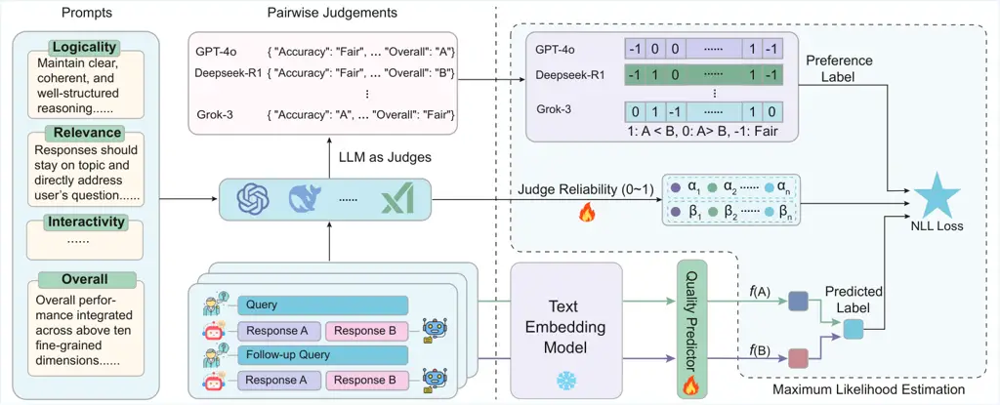

# Learning an Efficient Multi-Turn Dialogue Evaluator from Multiple LLM Judges

Yuqi Tang Affiliation: ZJU–UIUC Institute, Zhejiang University
Affiliation: ZJU–Hangzhou Global Scientific and Technological Innovation
Center, Zhejiang University    Kehua Feng Affiliation: ZJU–Hangzhou
Global Scientific and Technological Innovation Center, Zhejiang
University Affiliation: College of Computer Science and Technology,
Zhejiang University    Yunfeng Wang Affiliation: Alibaba
Groupyuqi.22@intl.zju.edu.cn, {kehuafeng, dingkeyan}@zju.edu.cn   
Zhiwen Chen Affiliation: Alibaba Groupyuqi.22@intl.zju.edu.cn,
{kehuafeng, dingkeyan}@zju.edu.cn    Chengfei Lv Affiliation: Alibaba
Groupyuqi.22@intl.zju.edu.cn, {kehuafeng, dingkeyan}@zju.edu.cn    Gang
Yu Affiliation: Alibaba Groupyuqi.22@intl.zju.edu.cn, {kehuafeng,
dingkeyan}@zju.edu.cn    Qiang Zhang Affiliation: ZJU–UIUC Institute,
Zhejiang University Affiliation: ZJU–Hangzhou Global Scientific and
Technological Innovation Center, Zhejiang University    Keyan Ding   
Huajun Chen ^(†)^(†)thanks: Corresponding author.
Affiliation: ZJU–Hangzhou Global Scientific and Technological Innovation
Center, Zhejiang University Affiliation: College of Computer Science and
Technology, Zhejiang University

###### Abstract

Evaluating the conversational abilities of large language models (LLMs)
remains a challenging task. Current mainstream approaches primarily rely
on the “LLM-as-a-judge" paradigm, where an LLM is prompted to serve as
an evaluator to assess dialogue quality. However, such methods often
suffer from various biases, which undermine the reliability and
consistency of the evaluation results. To mitigate these biases, recent
methods employ multiple LLMs as judges and aggregate their judgments to
select the optimal assessment. Although effective, this multi-judge
approach incurs significant computational overhead during inference. In
this paper, we propose an efficient dialogue evaluator that captures the
collective wisdom of multiple LLM judges by aggregating their preference
knowledge into a single model. Our approach preserves the advantages of
diverse multi-judge feedback while drastically reducing the evaluation
cost, enabling fast, flexible, and fine-grained dialogue quality
assessment. Extensive experiments on seven single rating and pairwise
comparison dialogue evaluation benchmarks demonstrate that our method
outperforms existing baselines across diverse scenarios, showcasing its
efficiency and robustness.

## 1 Introduction

Measuring the quality of dialogues generated by large language models
(LLMs) presents significant challenges due to the inherent complexity
and multi-dimensional nature of dialogue interactions. Recent
advancements in LLMs have significantly enhanced their capability to
evaluate single-turn dialogues Li et al. (2025b), yet assessing LLM
performance in multi-turn dialogue settings remains highly challenging,
particularly in evaluating critical capabilities such as instruction
following, self-coherence, and emotional alignment Sirdeshmukh et al.
(2025). Traditional automated evaluation metrics (e.g., BLEU Papineni
et al. (2002), ROUGE Lin (2004), and BERTScore Zhang et al. (2019)),
which rely on fixed lexical or semantic overlaps, often fail to
effectively capture the flexibility of natural language as perceived by
humans, as well as the rich semantics present in multi-turn dialogues
Feng et al. (2025). Moreover, these metrics require external references
to evaluate knowledge-grounded responses, limiting their applicability
in scenarios where such references are unavailable.

Figure 1: Comparison among different dialogue evaluation paradigms. (a)
The traditional LLM-as-a-Judge approach. (b) Learning an evaluator using
the preference data from a judge. (c) The aggregation of multiple LLMs
for evaluation. (d) Learning an evaluator from multiple LLM judges
(Ours).

In recent years, the “LLM-as-a-judge” paradigm Zheng et al. (2023); Gu
et al. (2024); Li et al. (2024); Li et al. (2025a) has gained increasing
attention for assessing response quality through single rating or
pairwise comparison (Fig. 1). While proprietary LLM judges show high
correlation with human judgments Zheng et al. (2023); Liu et al. (2023);
Zhou et al. (2023), they often suffer from opaque training data, limited
controllability, and high inference cost Kim et al. (2024). To improve
transparency and deployability, recent works have explored training
open-source LLM evaluators, typically by learning from preference data
provided by a single judge Sahoo et al. (2025); Li et al. (2023a); Zhu
et al. (2023). However, these learned evaluators still lag behind in
robustness and scalability, and single-judge annotation is known to
exhibit systematic biases such as self-preference, score compression,
and prompt sensitivity Thakur et al. (2024); Wei et al. (2024a). To
mitigate these biases, recent methods Rahmani et al. (2024); Verga
et al. (2024); Sun et al. (2024a) employ multiple LLM judges and
aggregate their outputs to obtain more reliable assessments. Although
effective, these multi-judge approaches incur substantial inference-time
overhead, which hinders scalability and real-time use in large-scale
dialogue evaluation.

To address these challenges, we propose an efficient multi-turn dialogue
evaluator that learns from multiple LLM judges. Given that pairwise
comparisons are more reliable than direct scoring for LLMs Cui et al.
(2023); Kim et al. (2024); Feng et al. (2025), we first construct a
large-scale pairwise preference dataset for multi-turn dialogues, with
each dialogue annotated by multiple advanced LLM judges. We then develop
a lightweight evaluator composed of a text-embedding model with
specialized scoring heads, using a learning-to-rank training strategy
Liu et al. (2009). In particular, we explicitly incorporate a maximum
likelihood estimation approach to jointly optimize the evaluator and
model the reliability of each judge. Extensive experiments on various
multi-turn dialogue benchmarks show that our model exhibits strong
robustness and wide applicability, surpassing existing baselines across
various evaluation tasks. Our main contributions are as follows:

- •
  We propose a learning framework that effectively aggregates preference
  data from multiple LLM judges into a single evaluator. This
  reference-free method retains the strengths of diverse multi-judge
  feedback while substantially reducing computation costs.
- •
  We develop MTDEval, a lightweight open-source model that can
  efficiently and flexibly evaluate multi-turn dialogues for both single
  rating and pairwise comparison tasks. MTDEval supports evaluations at
  overall or fine-grained levels across ten commonly used dialogue
  quality dimensions.
- •
  We construct P²-MTD, a large-scale preference dataset for multi-turn
  dialogues, where each response pair is annotated by multiple advanced
  LLM judges across ten fine-grained dimensions as well as an overall
  quality, providing rich supervision for training evaluators.
- •
  We release Daily-MTD, a high-quality human-annotated benchmark
  comprising 600 multi-turn dialogues focused on daily-life scenarios.
  Each dialogue is annotated with overall ratings, pairwise preferences,
  and fine-grained judgments across ten evaluation dimensions.

## 2 Related Work

### 2.1 LLM-based Dialogue Evaluation

In the past two years, LLM-as-a-judge Zheng et al. (2023); Gu et al.
(2024); Li et al. (2023c); Chan et al. (2023); Thakur et al. (2024) has
gained attention as a promising paradigm to mimic the depth and
granularity of human in multi-turn dialogue evaluation Kim et al.
(2024). Inspired by the high correlations with human evaluation
capabilities of advanced proprietary LLMs, recent research Wang et al.
(2023); Zeng et al. (2023); Cui et al. (2023); Lee et al. (2024) has
emphasized the development of open-source LLM evaluators. Prometheus2
Kim et al. (2024) enhances adaptability to custom evaluation criteria
via weight merging, supporting both direct assessment and pairwise
ranking tasks. SaMer Feng et al. (2025) introduces a scenario-aware,
multi-dimensional evaluation framework that dynamically selects relevant
evaluation dimensions based on the specific dialogue scenario, thereby
enabling both fine-grained and overall assessment. However, these models
primarily focus on single-turn dialogue evaluation. Although they can be
extended to assess multi-turn dialogues, their performance in this
setting is notably degraded. We aim to fill this gap by introducing
MTDEval, a dialogue evaluator specifically trained for multi-turn
dialogue quality assessment.

### 2.2 Multi-LLM Aggregation for Evaluation

A range of aggregation methods Rahmani et al. (2024); Sun et al.
(2024a); Wei et al. (2024b); Sun et al. (2024b) have been widely
explored for LLM-based evaluation. Simple methods such as majority
voting Bai et al. (2024), averaging probabilities Sun et al. (2024a),
and Crowdlayer Rodrigues and Pereira (2018) have demonstrated the
effectiveness of leveraging multiple LLMs to obtain robust results.
Recent studies, such as PoLL Verga et al. (2024), utilize a
straightforward aggregation approach by assigning equal weight to each
evaluator. Similarly, PRD Li et al. (2023b) employs multiple LLMs for
pairwise ranking. Despite their effectiveness, these methods entail
substantial computational overhead due to the need for repeated
inference across multiple models, which limits their applicability in
large-scale or real-time scenarios. In this study, we aim to develop an
efficient evaluator by learning from multiple LLM judges.



Figure 2: Overview of MTDEval. The left part illustrates the
construction of a multi-judge-annotated, fine-grained preference dataset
used for training. The right part demonstrates the model architecture
and training procedure, which comprises an LLM-based text embedding
model and an MLP-based quality prediction head. The training involves a
probabilistic formulation of pairwise preferences with judge reliability
prediction, which is optimized by maximum likelihood estimation.

## 3 Dataset Construction

### 3.1 Training Dataset: P²-MTD

Since existing pairwise preference datasets focus on single-turn
dialogues and typically annotated by a single judge Havrilla (2023); Kim
et al. (2024); Ji et al. (2024), in this study, we construct P²-MTD, a
novel Pairwise Preference-annotated Multi-Turn Dialogue dataset, where
each dialogue pair is evaluated across ten fine-grained evaluation
dimensions plus an overall rating by multiple LLM judges.

Specifically, we construct P²-MTD based on the Multiturn-Chat-0.8M
dataset Wen et al. (2023), which contains 831K Chinese multi-turn
dialogues. We employ five advanced LLMs as judges, namely
Claude-3.7-Sonnet Anthropic (2024), GPT-4o OpenAI et al. (2024), Grok-3
Grok (2025), DeepSeek-R1 DeepSeek-AI (2025), and Gemini-2.0-Flash Team
et al. (2023). Each judge is guided by a standardized evaluation
template, which requires them to first provide a detailed explanation,
followed by an evaluation along ten fine-grained dimensions, _i.e._,
Accuracy, Logicality, Conversationality, Relevance, Personalization,
Creativity, Interactivity, Emotionality, Informativeness, and Safety.
Each dimension, along with the overall score, is rated on a
three-alternative forced choice: “A”, “B”, or “Fair”. The data
pre-processing procedures are provided in Appendix A.

Finally, we construct a multi-judge annotated preference dataset
comprising $`\sim`$11K multi-turn dialogues. Each instance consists of
two dialogues responding to the same user query, along with preference
annotations $`\{r^{j}\}_{j=1}^{M}`$ from $`M=5`$ LLM judges. Each judge
$`j`$ provides evaluations
$`r^{j}=\{r^{j}_{1},r^{j}_{2},\ldots,r^{j}_{K},r^{j}_{\text{all}}\}`$
where $`K=10`$ represents fine-grained evaluation dimensions and
$`r^{j}_{\text{all}}`$ denotes the overall preference. This dataset is
then used for training a dialogue quality evaluator.

### 3.2 Evaluation Benchmark: Daily-MTD

To provide a reliable benchmark for evaluating multi-turn dialogue
quality, we introduce a novel high-quality human-annotated evaluation
dataset named Daily-MTD, consisting of 600 carefully curated multi-turn
dialogues in daily-life scenarios. Specifically, we recruited ten
undergraduate students majoring in Computer Science to participate in
dialogue collection tasks. Each participant interacted with two distinct
chatbots, engaging in conversations ranging from 2 to 10 turns. This
process yielded an initial pool of 1,080 multi-turn dialogues.
Subsequently, five NLP researchers independently selected 600 diverse
dialogues from the initial collection. Each expert annotates the
dialogues across 10 fine-grained dimensions, along with an overall
quality rating. The final labels for single rating were obtained by
score averaging, while those for pairwise and multi-dimensional
comparisons were determined via majority voting. Finally, we constructed
a high-quality human-annotated evaluation dataset, adapted into three
specialized forms to accommodate different assessment tasks: Daily-MTD
for single rating, Daily-MTD-Pair for pairwise comparison, and
Daily-MTD-Dim for multi-dimensional comparison. More details about
Daily-MTD are presented in Appendix B.

## 4 Proposed Method

In this section, we present MTDEval, an efficient Multi-Turn Dialogue
Evaluator learned from multiple judges. As illustrated in Figure 2,
MTDEval involves: (1) a probabilistic formulation of pairwise
preferences with _dimension-aware_ judge reliability estimation, and (2)
parameter optimization via Maximum Likelihood Estimation.

### 4.1 Problem Formulation

Let
$`\mathcal{D}=\{(A_{i},B_{i}),\mathbf{r}_{i}^{1},\ldots,\mathbf{r}_{i}^{M}\}_{i=1}^{N}`$
be a dataset of $`N`$ multi-turn dialogue pairs, where each pair
$`(A_{i},B_{i})`$ is annotated by $`M`$ LLM judges over $`K`$
fine-grained evaluation dimensions _and_ an overall criterion. We use
$`k\in\{1,\ldots,K,\text{all}\}`$ to index these dimensions. Each judge
$`j`$ outputs preference vector
$`\mathbf{r}^{j}\coloneqq\mathbf{r}^{j}(A,B)=\{r_{k}^{j}(A,B)\}_{k\in\{1,\ldots,K,\text{all}\}}`$,
where each $`r_{k}^{j}`$ takes one of three outcomes:

- •
  $`r_{k}^{j}(A,B)=0`$. The judge $`j`$ prefers $`A`$ over $`B`$ on
  dimension $`k`$.
- •
  $`r_{k}^{j}(A,B)=1`$. Conversely, $`B`$ is preferred over $`A`$ on
  dimension $`k`$.
- •
  $`r_{k}^{j}(A,B)=-1`$. $`A`$ and $`B`$ are considered equally
  preferable (_Fair_) on dimension $`k`$.

By leveraging pairwise signals from multiple LLM judges, our goal is to
learn an efficient evaluator on $`\mathcal{D}`$ that estimates dialogue
quality. MTDEval consists of a frozen embedding model $`f_{g}`$
parameterized by $`g`$ and a trainable quality predictor $`f_{\omega}`$
with parameters $`\omega`$ that comprises two multi-layer perceptron
(MLP) heads: (i) a $`K`$-dimensional head producing fine-grained scores
$`\{f_{\omega\circ g,k}(x)\}_{k=1}^{K}`$, and (ii) an overall head
producing $`f_{\omega\circ g,\text{all}}(x)`$. Both heads are trained
under the same formulation below, conditioning on the corresponding
$`k`$. The construction of $`\mathcal{D}`$ is described in Section 3.1.

### 4.2 Probabilistic Modeling

Let $`q_{k}(x)`$ denote the (latent) quality of a multi-turn dialogue
$`x`$ on dimension $`k`$, and $`z_{k}\in\{0,1\}`$ denote the latent
ground-truth preference label on dimension $`k`$ for a dialogue pair
$`(A,B)`$. To model uncertainty in dialogue quality, we adopt
Thurstone’s Case V model Thurstone (2017). Specifically, we assume that
$`q_{k}(x)`$ follows a Gaussian distribution with mean
$`f_{\omega\circ g,k}(x)`$ and standard deviation $`\sigma`$, _i.e._,
$`q_{k}(x)\sim\mathcal{N}(f_{\omega\circ g,k}(x),\sigma)`$. Under this
assumption, the quality difference $`q_{k}(A)-q_{k}(B)`$ follows
$`\mathcal{N}\big(f_{\omega\circ g,k}(A)-f_{\omega\circ g,k}(B),\,2\sigma^{2}\big)`$.
The probability that dialogue $`B`$ has higher quality than $`A`$
(_i.e._, the probability of $`z_{k}=1`$) is then

```math
\begin{aligned} \Pr\bigl(z_{k}=1|A,B,g,\omega\bigr)&=\Pr\bigl(q_{k}(A)<q_{k}(B)\mid g,\omega\bigr)\\
&=\Phi\!\left(\tfrac{f_{\omega\circ g,k}(B)-f_{\omega\circ g,k}(A)}{\sqrt{2}\sigma}\right),\end{aligned} \tag{1}
```

where $`\Phi(\cdot)`$ is the standard normal cumulative distribution
function (CDF).

To quantify the reliabilities of LLM judges, we assume that they can be
characterized by probabilities of correct annotations (known as “hits"
rate and “correct rejection" rate in signal detection theory Ma et al.
(2019)) for the input dialogue pair $`A`$ and $`B`$. If the latent
ground-truth label on dimension $`k`$ is $`z_{k}=1`$ (favoring B), the
hit rate of judge $`j`$ is

```math
\alpha_{k}^{j}=\Pr(r_{k}^{j}=1\mid z_{k}=1). \tag{2}
```

Similarly, when $`z_{k}=0`$, the correct rejection rate is

```math
\beta_{k}^{j}=\Pr(r_{k}^{j}=0\mid z_{k}=0). \tag{3}
```

The reliability parameters $`\{\alpha_{k}^{j},\beta_{k}^{j}\}`$ can be
jointly estimated with the trainable parameters $`\omega`$. It is worth
noting that "Fair" cases are deliberately excluded, which means that
when $`r_{k}^{j}=-1`$, neither $`\alpha_{k}^{j}`$ nor $`\beta_{k}^{j}`$
is updated.

### 4.3 Maximum Likelihood Estimation

We formulate the parameter optimization as a maximum likelihood
estimation task. Given the assumption that judgments across training
dialogue pairs are independent, we can factorize the likelihood function
over the full set of parameters $`\{\omega,\alpha,\beta\}`$ as

```math
\Pr\big(\mathcal{D}\mid\omega,\alpha,\beta\big)=\prod_{i=1}^{N}\prod_{k=1}^{K}\Pr(r_{ik}^{1},\ldots,r_{ik}^{M_{ik}^{{}^{\prime}}}\mid A_{i},B_{i};g,\omega,\alpha_{k},\beta_{k}), \tag{4}
```

where $`M_{ik}^{{}^{\prime}}`$ refers to the number of judges with
non-_Fair_ labels for $`(A_{i},B_{i})`$ on dimension $`k`$. Since
$`r_{ik}^{j}`$ is conditionally independent given the judge-specific
reliability parameters $`\{\alpha_{k}^{j},\beta_{k}^{j}\}`$ and the
ground-truth preference label $`z_{ik}`$, we decompose the likelihood by
conditioning on $`z_{ik}`$

```math
\begin{aligned} &\Pr\big(r_{ik}^{1},\ldots,r_{ik}^{M_{ik}^{{}^{\prime}}}\mid A_{i},B_{i};g,\omega,\alpha_{k},\beta_{k}\big)=\\
&\Pr(r_{ik}^{1},\ldots,r_{ik}^{M_{ik}^{{}^{\prime}}}\mid z_{ik}=1,\alpha_{k})\Pr(z_{ik}=1\mid A_{i},B_{i};g,\omega)\ +\\
&\Pr(r_{ik}^{1},\ldots,r_{ik}^{M_{ik}^{{}^{\prime}}}\mid z_{ik}=0,\beta_{k})\Pr(z_{ik}=0\mid A_{i},B_{i};g,\omega).\end{aligned} \tag{5}
```

The distribution modeling the noisy annotations from LLM judges can be
expressed as:

```math
\begin{aligned} \Pr\big(r_{ik}^{1},\ldots,r_{ik}^{M_{ik}^{{}^{\prime}}}\mid z_{ik}=1,&\alpha_{k}\big)=\prod_{j=1}^{M_{ik}^{{}^{\prime}}}\Pr(r_{ik}^{j}\mid z_{ik}=1,\alpha_{k}^{j})\\
&=\prod_{j=1}^{M_{ik}^{{}^{\prime}}}(\alpha_{k}^{j})^{r_{ik}^{j}}(1-\alpha_{k}^{j})^{1-r_{ik}^{j}},\end{aligned} \tag{6}
```

and

```math
\begin{aligned} \Pr\big(r_{ik}^{1},\ldots,r_{ik}^{M_{ik}^{{}^{\prime}}}\mid z_{ik}=0,\beta_{k}\big)=\prod_{j=1}^{M_{ik}^{{}^{\prime}}}(\beta_{k}^{j})^{1-r_{ik}^{j}}(1-\beta_{k}^{j})^{r_{ik}^{j}}.\end{aligned} \tag{7}
```

Denoting the probability $`\Pr(z_{ik}=1\mid A_{i},B_{i};g,\omega)`$ from
Eq. (1) as $`\mathcal{P}_{k}(A_{i},B_{i};g,\omega)`$, and the
reliability terms from Eqs. (6) and (7) as
$`\mathcal{A}_{k}(z_{ik},\alpha_{k})`$ and
$`\mathcal{B}_{k}(z_{ik},\beta_{k})`$ respectively, and substituting
them into Eq. (4), we obtain the complete likelihood function

```math
\begin{aligned} \Pr\big(\mathcal{D}\mid\omega,\alpha,\beta\big)&=\prod_{i=1}^{N}\prod_{k=1}^{K}\Big[\mathcal{A}_{k}(z_{ik},\alpha_{k})\mathcal{P}_{k}(A_{i},B_{i};g,\omega)\\
&+\ \mathcal{B}_{k}(z_{ik},\beta_{k})\big(1-\mathcal{P}_{k}(A_{i},B_{i};g,\omega)\big)\Big].\end{aligned} \tag{8}
```

We minimize the Negative Log-Likelihood (NLL)

```math
\ell(\omega,\alpha,\beta)=-\log\Pr\big(\mathcal{D}\mid\omega,\alpha,\beta\big), \tag{9}
```

using stochastic gradient descent to obtain the optimal parameters
$`\{\hat{\omega},\hat{\alpha},\hat{\beta}\}`$ for MTDEval.

## 5 Experiments

In this section, we demonstrate the effectiveness of MTDEval across
comprehensive dialogue evaluation tasks. We first describe our
implementation setup (Section 5.1) and evaluation datasets and metrics
covering single rating, pairwise comparison, and multi-dimensional
comparison tasks (Section 5.2). We then present the main results of
MTDEval, showing significant improvements over open-source baselines and
competitive performance against proprietary LLMs (Section 5.4). Finally,
we conduct ablation studies on the effects of judge composition
(Section 5.5), analyze the learned reliability parameters of different
judges (Section 5.6), and compare inference efficiency against baseline
approaches (Section 5.7).

### 5.1 Implementation of MTDEval

We employ the Llama-3-8B as the text embedding model $`g`$ and
initialize it with parameters from a trained Llama-3-8B reward
model (Wang et al., 2024). An MLP layer $`\omega`$, serving as a quality
predictor, is appended to the embedding model. This MLP is optimized
using the loss defined in Eq. (9), while keeping the embedding model
frozen. During training, we initially set $`\sigma=1`$ in Eq. (1), and
$`\alpha=\beta=0.5`$ in Eq. (2) and (3). The model is trained for 3
epochs with a batch size of 32. More training details are presented in
Appendix C.

|                       |               |          |          |          |           |          |                     |         |                |         |               |         |                |         |
| --------------------- | ------------- | -------- | -------- | -------- | --------- | -------- | ------------------- | ------- | -------------- | ------- | ------------- | ------- | -------------- | ------- |
| Evaluator             | Single Rating |          |          |          |           |          | Pairwise Comparison |         |                |         |               |         |                |         |
|                       | xDial-IEval   |          | MT-Bench |          | Daily-MTD |          | xDial-IEval-Pair    |         | MT-Bench-Human |         | Chatbot-Arena |         | Daily-MTD-Pair |         |
|                       | Pearson       | Spearman | Pearson  | Spearman | Pearson   | Spearman | w/ TIE              | w/o TIE | w/ TIE         | w/o TIE | w/ TIE        | w/o TIE | w/ TIE         | w/o TIE |
| GPT-4o                | 0.615         | 0.641    | 0.708    | 0.707    | 0.691     | 0.440    | 80.51               | 89.28   | 77.30          | 90.58   | 68.63         | 79.53   | 64.86          | 78.18   |
| Grok-3                | 0.598         | 0.612    | 0.673    | 0.657    | 0.687     | 0.448    | 79.92               | 88.41   | 80.26          | 91.93   | 69.72         | 79.92   | 66.67          | 79.41   |
| Claude-3.7-Sonnet     | 0.599         | 0.606    | 0.686    | 0.698    | 0.665     | 0.460    | 80.94               | 90.14   | 79.93          | 91.58   | 68.93         | 80.22   | 66.33          | 79.69   |
| Deepseek-R1           | 0.606         | 0.617    | 0.630    | 0.649    | 0.669     | 0.396    | 81.27               | 89.57   | 80.92          | 91.23   | 70.16         | 81.17   | 68.00          | 80.67   |
| Gemini-3-Pro          | 0.588         | 0.620    | 0.675    | 0.681    | 0.714     | 0.475    | 78.18               | 90.28   | 81.97          | 92.63   | 71.17         | 81.95   | 67.42          | 81.46   |
| GPT-5.1               | 0.605         | 0.608    | 0.676    | 0.699    | 0.684     | 0.398    | 79.98               | 89.05   | 81.52          | 91.49   | 69.92         | 79.57   | 66.57          | 79.92   |
| Majority Vote         | 0.575         | 0.585    | 0.710    | 0.736    | 0.671     | 0.390    | 82.17               | 90.72   | 82.09          | 93.84   | 71.97         | 82.28   | 71.67          | 82.85   |
| Average Scoring       | 0.617         | 0.677    | 0.739    | 0.762    | 0.689     | 0.392    | –                   | –       | –              | –       | –             | –       | –              | –       |
| Llama-3.1-8B-Instruct | 0.438         | 0.441    | 0.442    | 0.440    | 0.613     | 0.341    | 70.13               | 86.96   | 59.21          | 78.60   | 51.93         | 65.60   | 55.50          | 69.33   |
| Qwen2.5-7B-Instruct   | 0.594         | 0.592    | 0.550    | 0.514    | 0.620     | 0.396    | 63.54               | 80.58   | 54.93          | 79.56   | 53.40         | 66.96   | 58.33          | 69.33   |
| Qwen3-8B              | 0.599         | 0.615    | 0.628    | 0.630    | 0.654     | 0.402    | 74.95               | 85.67   | 71.72          | 85.42   | 62.06         | 76.50   | 64.33          | 79.77   |
| DynaEval-125M         | 0.368         | 0.372    | -0.109   | -0.132   | 0.134     | 0.101    | 58.73               | 68.41   | 36.18          | 55.09   | 43.28         | 50.58   | 43.33          | 54.20   |
| AutoJ-13B             | 0.540         | 0.541    | 0.432    | 0.408    | 0.629     | 0.379    | 49.12               | 62.37   | 49.11          | 76.70   | 52.72         | 62.88   | 53.97          | 67.20   |
| Prometheus-7B         | 0.322         | 0.317    | 0.378    | 0.385    | 0.336     | 0.194    | 42.28               | 59.14   | 41.54          | 52.54   | 41.13         | 45.91   | 36.67          | 42.71   |
| Prometheus-2-7B       | 0.591         | 0.607    | 0.548    | 0.509    | 0.594     | 0.357    | 67.30               | 82.30   | 50.45          | 73.48   | 55.85         | 59.94   | 62.20          | 71.15   |
| ArmoRM-8B             | 0.519         | 0.547    | 0.455    | 0.427    | 0.589     | 0.373    | 69.87               | 84.64   | 64.80          | 80.53   | 57.80         | 68.95   | 61.33          | 76.37   |
| SaMer-8B              | 0.434         | 0.422    | 0.384    | 0.377    | 0.496     | 0.372    | 59.75               | 75.52   | 58.86          | 73.94   | 61.56         | 72.46   | 53.11          | 68.45   |
| MTDEval (8B)          | 0.612         | 0.617    | 0.587    | 0.554    | 0.662     | 0.523    | 76.70               | 86.10   | 79.01          | 91.93   | 71.24         | 81.29   | 65.33          | 81.93   |

Table 1: Evaluation results on three single rating and four pairwise
comparison benchmarks. The best result among non-SOTA LLMs is bolded,
and the second best is underlined.

### 5.2 Evaluation Datasets and Metrics

We conduct a comprehensive evaluation of MTDEval using three types of
benchmarks: overall-level single rating and pairwise comparison, as well
as multi-dimensional comparison. Detailed descriptions of the evaluation
datasets are provided in Appendix D.

- •
  Single Rating: This paradigm evaluates the response independently,
  enabling absolute quality assessment without reliance on comparative
  baselines. We measure the correlation between model-generated scores
  and human reference ratings using Pearson and Spearman coefficients.
  Evaluations are performed on three benchmarks:
  xDial-IEval Svikhnushina et al. (2022), MT-Bench Zheng et al. (2023),
  and Daily-MTD.
- •
  Pairwise Comparison: This protocol assesses an evaluator’s ability to
  predict human preferences between two competing responses. We adopt
  two evaluation modes: one excluding tie cases (_w/o tie_) and another
  including them (_w/ tie_), to evaluate both binary and ternary
  judgment accuracy. The evaluation is conducted on four benchmarks:
  xDial-IEval-Pair Svikhnushina et al. (2022), MT-Bench-Human Zheng
  et al. (2023), Chatbot-Arena Chiang et al. (2024), and Daily-MTD-Pair.
- •
  Multi-Dimensional Comparison requires evaluators to generate
  independent preference judgments for response pairs based on a
  specific evaluation dimension. The evaluation is performed on
  Daily-MTD-Dim. This benchmark allows us to validate whether evaluators
  can capture nuanced, aspect-level differences in multi-turn dialogues.

### 5.3 Baselines

To evaluate the performance of MTDEval, we compare against a diverse set
of LLM-based baselines, categorized into the following four groups. (1)
State-of-the-art LLMs, including GPT-4o OpenAI et al. (2024),
Grok-3 Grok (2025), Claude-3.7-Sonnet Anthropic (2024),
DeepSeek-R1 DeepSeek-AI (2025), Gemini-3-Pro Team et al. (2023), and
GPT-5.1 OpenAI et al. (2025). These models serve as strong upper-bound
references in the LLM-as-a-judge paradigm. (2) Classical aggregation
methods, including Majority Vote and Average Scoring, which aggregate
predictions from above SOTA LLMs to establish a consensus-based
reference. (3) Open-source LLMs, including Llama-3.1-8B Instruct  Dubey
et al. (2024), Qwen2.5-7B-Instruct Yang et al. (2024), and Qwen3-8B
 Yang et al. (2025), which represent mid-sized models with comparable
scale to our evaluator. (4) Specialized LLM Evaluator, including
DynaEval-125M Zhang et al. (2021), AutoJ-13B Li et al. (2023a),
SaMer-8B Feng et al. (2025), Prometheus-7B Kim et al. (2023),
Prometheus2-7B Kim et al. (2024), and ArmoRM-8B Wang et al. (2024), all
explicitly trained for dialogue quality assessment. LLMBar Zeng et al.
(2023).

### 5.4 Main Results

We first compare MTDEval with baselines using three benchmark settings:
single rating, pairwise comparison, and multi-dimensional comparison.

| Evaluator             | Acc.  | Log.  | Conv. | Rel.  | Pers. | Crea. | Inter. | Emo.  | Info. | Safe. | Average |
| --------------------- | ----- | ----- | ----- | ----- | ----- | ----- | ------ | ----- | ----- | ----- | ------- |
| GPT-4o                | 85.67 | 79.67 | 58.67 | 85.67 | 63.00 | 67.67 | 59.00  | 54.00 | 67.67 | 92.00 | 71.30   |
| Grok-3                | 75.33 | 72.00 | 57.33 | 74.67 | 51.33 | 56.00 | 55.67  | 50.33 | 63.67 | 92.33 | 64.87   |
| Claude-3.7-Sonnet     | 76.33 | 69.00 | 63.33 | 73.00 | 56.33 | 60.33 | 60.00  | 58.33 | 67.00 | 91.33 | 67.50   |
| Deepseek-R1           | 76.67 | 77.73 | 61.00 | 80.67 | 59.67 | 64.00 | 62.00  | 57.67 | 70.00 | 97.00 | 70.64   |
| Gemini-3-Pro          | 90.67 | 82.33 | 59.00 | 85.67 | 68.67 | 69.00 | 78.00  | 64.67 | 63.33 | 92.67 | 75.40   |
| GPT-5.1               | 84.00 | 72.33 | 51.00 | 83.00 | 69.67 | 59.33 | 64.33  | 62.33 | 65.00 | 83.33 | 69.43   |
| Majority Vote         | 86.96 | 86.29 | 53.56 | 89.90 | 55.36 | 62.27 | 72.89  | 68.76 | 66.19 | 92.68 | 73.49   |
| Llama-3.1-8B-Instruct | 43.67 | 52.33 | 60.33 | 52.67 | 71.67 | 48.00 | 45.00  | 60.00 | 37.00 | 64.67 | 53.53   |
| Qwen2.5-7B-Instruct   | 76.67 | 72.33 | 68.67 | 77.67 | 74.00 | 61.00 | 61.33  | 64.00 | 63.33 | 64.67 | 68.37   |
| Qwen3-8B              | 79.59 | 70.82 | 72.37 | 85.98 | 68.97 | 65.36 | 59.79  | 66.19 | 72.97 | 81.08 | 72.31   |
| AutoJ-13B             | 34.67 | 29.67 | 43.00 | 39.67 | 62.67 | 55.67 | 35.33  | 57.00 | 33.67 | 22.33 | 41.37   |
| Prometheus-7B         | 21.14 | 24.07 | 33.44 | 26.50 | 44.03 | 32.44 | 29.76  | 42.03 | 22.44 | 10.41 | 28.63   |
| Prometheus-2-7B       | 68.33 | 73.67 | 69.92 | 82.33 | 64.00 | 48.67 | 58.72  | 66.00 | 63.67 | 70.33 | 66.56   |
| MTDEval (8B)          | 72.33 | 68.33 | 79.00 | 67.67 | 75.67 | 74.67 | 52.33  | 66.33 | 74.67 | 97.67 | 72.87   |

Table 2: Multi-dimensional evaluation results on the Daily-MTD-Dim
dataset. The best and second-best results among non-SOTA LLMs are bolded
and underlined, respectively. Boxes highlight cases where our method
outperforms all SOTA LLMs.

Figure 3: Performance comparison of models trained on annotations from
individual LLM judges versus our model trained on multi-judge
preferences.

|                    |               |          |          |          |           |          |                     |         |                |         |               |         |                |         |
| ------------------ | ------------- | -------- | -------- | -------- | --------- | -------- | ------------------- | ------- | -------------- | ------- | ------------- | ------- | -------------- | ------- |
| Evaluator          | Single Rating |          |          |          |           |          | Pairwise Comparison |         |                |         |               |         |                |         |
|                    | xDial-IEval   |          | MT-Bench |          | Daily-MTD |          | xDial-IEval-Pair    |         | MT-Bench-Human |         | Chatbot-Arena |         | Daily-MTD-Pair |         |
|                    | Pearson       | Spearman | Pearson  | Spearman | Pearson   | Spearman | w/ TIE              | w/o TIE | w/ TIE         | w/o TIE | w/ TIE        | w/o TIE | w/ TIE         | w/o TIE |
| Default (5 Judges) | 0.612         | 0.617    | 0.587    | 0.554    | 0.662     | 0.523    | 76.70               | 86.10   | 79.01          | 91.93   | 71.24         | 81.29   | 65.33          | 81.93   |
| \- Deepseek-R1     | -0.006        | -0.008   | -0.008   | -0.012   | -0.019    | -0.016   | -1.33               | -0.30   | -1.59          | -0.86   | -0.59         | -0.77   | -0.33          | -0.94   |
| \+ gpt-4o-mini     | -0.004        | -0.005   | -0.002   | -0.003   | -0.006    | -0.009   | -0.50               | -0.59   | -0.71          | 0.00    | -0.27         | -0.55   | -1.00          | -0.82   |
| \+ o4-mini         | +0.005        | +0.006   | +0.009   | +0.005   | +0.005    | +0.002   | +0.52               | +0.20   | +2.24          | +0.35   | +1.07         | -0.40   | +0.50          | +0.42   |

Table 3: Performance of MTDEval under varying compositions of LLM
judges.

In single rating tasks (Table 1), MTDEval demonstrates significant
improvements across all three benchmarks, surpassing open-source
baselines by considerable margins. The performance gains are
particularly notable on xDial-IEval, where MTDEval even outperforms most
proprietary models. Furthermore, MTDEval achieves correlation
coefficient improvements exceeding 10% compared to its ArmoRM backbone
across all benchmarks, providing robust evidence of our framework’s
effectiveness. However, all open-source LLMs still underperform relative
to advanced proprietary LLMs on MT-Bench, underscoring the persistent
challenges posed by this benchmark and highlighting the existing
performance gap with proprietary models.

In pairwise comparison tasks (Table 1), MTDEval establishes clear
superiority among open-source LLMs, securing top performance in 7 out of
8 tasks across four benchmarks and achieving second place in the
remaining task. Although ArmoRM-8B already demonstrates competitive
performance as an open-source baseline, MTDEval achieves at least 5%
improvements across most tasks over this strong foundation. These gains
reach approximately 15% on particularly challenging benchmarks, such as
MT-Bench-Human and Chatbot Arena. Notably, MTDEval outperforms almost
all proprietary LLMs on several pairwise comparison datasets. This
provides compelling evidence of its exceptional cross-task
generalization capabilities.

In multi-dimensional comparison tasks (Table 2), results show that
dimension-level accuracy drops significantly for most evaluators,
underscoring the inherent challenge of precise assessment on the
specific dimension. Importantly, MTDEval achieves substantial
improvements over existing open-source models across most dimensions,
_e.g._, Conversationality and Safety. In particular, MTDEval delivers a
31.5% improvement compared to its original Llama-3-8B-Instruct backbone,
and surpasses most proprietary LLMs in averaged dimension-level
accuracy. These findings collectively validate the efficacy of MTDEval’s
training framework and establish its superior performance in
multi-dimensional dialogue evaluation.

### 5.5 Ablation Study

#### Single Judge vs. Multiple Judges

To further analyze the effectiveness of our method, we conduct ablation
studies on MTDEval by examining the impact of leveraging multiple LLM
judges during training. As shown in Figure 3, we compare MTDEval trained
on preference annotations from all five LLM judges against variants
trained using annotations from each individual judge only. The results
show that the method of learning from multiple judges consistently
surpasses all of them across both single rating and pairwise comparison
benchmarks. This demonstrates that our framework successfully integrates
complementary signals from multiple LLM judges, effectively distilling
their collective expertise into a more robust and generalizable
evaluator.

#### Judge Quality and Quantity

We also examine how judge quality and quantity influence model
performance by varying judge composition. We evaluate several
configurations: (i) removing the most reliable judge (DeepSeek-R1), (ii)
replacing a high-performing judge with a weaker one (GPT-4o-mini), and
(iii) augmenting the judges with an additional strong judge (o4-mini).
Results are summarized in Table 3. The findings show that incorporating
higher-quality judges consistently improves evaluator performance,
although the gains are modest. In contrast, removing reliable judges or
introducing lower-capability ones leads to measurable performance
degradation. These results indicate that both the quantity and, more
importantly, the quality of LLM judges play crucial roles in shaping the
effectiveness of the learned evaluator within our framework.

Figure 4: The learned sensitivity ($`\alpha`$) and specificity
($`\beta`$) of the five LLM judges.

### 5.6 Judge Reliability Analysis

The learned sensitivity ($`\alpha`$) and specificity ($`\beta`$) values
for the five LLM judges are shown in Figure 4. As expected, our method
preferentially weights judges with stronger predictive capabilities,
such that those exhibiting higher accuracy in dialogue quality
assessment exert greater influence during the model’s learning process.
Furthermore, the learned $`\alpha`$ and $`\beta`$ parameters exhibit a
strong correlation, which suggests their potential substitutability with
a unified parameter vector during training.

| Evaluator             | Single Rating | Pairwise Comparison |
| --------------------- | ------------- | ------------------- |
| Llama-3.1-8B-Instruct | 0.57          | 1.11                |
| Qwen2.5-7B-Instruct   | 0.46          | 0.87                |
| Qwen3-8B-Instruct     | 1.33          | 2.33                |
| DynaEval-125M         | 0.13          | 0.24                |
| AutoJ-13B             | 2.32          | 4.77                |
| Prometheus-7B         | 0.69          | 1.79                |
| Prometheus-2-7B       | 1.36          | 3.23                |
| ArmoRM-8B             | 0.75          | 1.53                |
| SaMer-8B              | 0.23          | 0.45                |
| MTDEval (8B)          | 0.10          | 0.19                |

Table 4: Inference efficiency comparison of MTDEval against baselines on
Daily-MTD and Daily-MTD-Pair (average runtime in seconds per instance).

### 5.7 Inference Efficiency Comparison

We further compare the inference efficiency of MTDEval with other
open-source LLMs of similar parameter scale (7$`\sim`$8B parameters) on
the Daily-MTD dataset. All experiments are conducted on dual NVIDIA
GeForce RTX 4090 GPUs with models loaded in bf16 precision, using the
HuggingFace Transformers library. As shown in Table 4, MTDEval achieves
substantially lower average runtime than baseline models, demonstrating
superior inference efficiency. This advantage is primarily due to
MTDEval’s encoder-based architecture, which outputs quality scores in a
single forward pass through MLP layers. In contrast, autoregressive LLM
baselines rely on generative evaluation, resulting in longer latency and
higher computational cost.

## 6 Conclusion

In this work, we present a learning framework for multi-turn dialogue
evaluation that aggregates preference knowledge from multiple LLM judges
into a single evaluator. Built upon this framework, we develop MTDEval,
an efficient evaluator capable of flexible assessment of dialogue
quality through both single rating and pairwise comparison. Moreover, we
contribute two high-quality resources to the community: P²-MTD, a
large-scale multi-judge annotated preference dataset for training
dialogue evaluators, and Daily-MTD, a human-annotated evaluation
benchmark with fine-grained annotations across ten dialogue quality
dimensions. Extensive experiments have demonstrated that MTDEval
outperforms existing baselines in terms of accuracy, robustness, and
inference efficiency.

## Limitations

Despite these advances, several limitations remain. First, our reliance
on multiple SOTA LLMs as judges for fine-grained preferences inevitably
incurs substantial annotation costs, which may reduce the feasibility of
scaling the training dataset to larger scales. Additionally, current
training data is primarily focused on daily-life scenarios, potentially
limiting generalization to more specialized domains. For future work, we
plan to expand the coverage of evaluation scenarios and multilingual
dialogues, and develop a more nuanced evaluation framework with
cost-efficient supervision to further enhance the generalization of
learned evaluators.

## References

- Anthropic (2024) AI Anthropic. 2024. The Claude 3 model family: Opus,
  sonnet, haiku. _Claude-3 Model Card_.
- Bai et al. (2024) Ge Bai, Jie Liu, Xingyuan Bu, Yancheng He, Jiaheng
  Liu, Zhanhui Zhou, Zhuoran Lin, Wenbo Su, Tiezheng Ge, Bo Zheng, and 1
  others. 2024. MT-Bench-101: A fine-grained benchmark for evaluating
  large language models in multi-turn dialogues. _arXiv:2402.14762_.
- Chan et al. (2023) Chi-Min Chan, Weize Chen, Yusheng Su, Jianxuan Yu,
  Wei Xue, Shanghang Zhang, Jie Fu, and Zhiyuan Liu. 2023. ChatEval:
  Towards better LLM-based evaluators through multi-agent debate.
  _arXiv:2308.07201_.
- Chiang et al. (2024) Wei-Lin Chiang, Lianmin Zheng, Ying Sheng,
  Anastasios Nikolas Angelopoulos, Tianle Li, Dacheng Li, Banghua Zhu,
  Hao Zhang, Michael Jordan, Joseph E Gonzalez, and 1 others. 2024.
  Chatbot Arena: An open platform for evaluating LLMs by human
  preference. In _Forty-first International Conference on Machine
  Learning_.
- Cui et al. (2023) Ganqu Cui, Lifan Yuan, Ning Ding, Guanming Yao,
  Bingxiang He, Wei Zhu, Yuan Ni, Guotong Xie, Ruobing Xie, Yankai Lin,
  and 1 others. 2023. UltraFeedback: Boosting language models with
  scaled ai feedback. _arXiv:2310.01377_.
- Dao (2023) Tri Dao. 2023. FlashAttention-2: Faster attention with
  better parallelism and work partitioning. _arXiv:2307.08691_.
- DeepSeek-AI (2025) DeepSeek-AI. 2025. DeepSeek-R1: Incentivizing
  reasoning capability in llms via reinforcement learning.
- DeepSeek-AI et al. (2024) DeepSeek-AI, Aixin Liu, Bei Feng, Bing Xue,
  Bingxuan Wang, Bochao Wu, Chengda Lu, Chenggang Zhao, Chengqi Deng,
  Chenyu Zhang, Chong Ruan, Damai Dai, Daya Guo, Dejian Yang, Deli Chen,
  Dongjie Ji, Erhang Li, Fangyun Lin, Fucong Dai, and 6 others. 2024.
  Deepseek-v3 technical report.
- Dubey et al. (2024) Abhimanyu Dubey, Abhinav Jauhri, Abhinav Pandey,
  Abhishek Kadian, Ahmad Al-Dahle, Aiesha Letman, Akhil Mathur, Alan
  Schelten, Amy Yang, Angela Fan, and 1 others. 2024. The Llama 3 herd
  of models. _arXiv:2407.21783_.
- Feng et al. (2025) Kehua Feng, Keyan Ding, Jing Yu, Yiwen Qu, Zhiwen
  Chen, Gang Yu, Qiang Zhang, Huajun Chen, and 1 others. 2025. Samer: A
  scenario-aware multi-dimensional evaluator for large language models.
  In _The Thirteenth International Conference on Learning
  Representations_.
- Grok (2025) X Grok. 2025. Beta-The age of reasoning agents\|
  xai, 2025. _URL https://x.ai/news/grok-3_.
- Gu et al. (2024) Jiawei Gu, Xuhui Jiang, Zhichao Shi, Hexiang Tan,
  Xuehao Zhai, Chengjin Xu, Wei Li, Yinghan Shen, Shengjie Ma, Honghao
  Liu, and 1 others. 2024. A survey on llm-as-a-judge.
  _arXiv:2411.15594_.
- Havrilla (2023) Alex Havrilla. 2023. Synthetic Instruct GPTJ Pairwise.
- Ji et al. (2024) Jiaming Ji, Donghai Hong, Borong Zhang, Boyuan Chen,
  Josef Dai, Boren Zheng, Tianyi Qiu, Boxun Li, and Yaodong Yang. 2024.
  Pku-Saferlhf: A safety alignment preference dataset for llama family
  models. page arXiv:2406.15513.
- Kim et al. (2023) Seungone Kim, Jamin Shin, Yejin Cho, Joel Jang,
  Shayne Longpre, Hwaran Lee, Sangdoo Yun, Seongjin Shin, Sungdong Kim,
  James Thorne, and 1 others. 2023. Prometheus: Inducing fine-grained
  evaluation capability in language models. In _The Twelfth
  International Conference on Learning Representations_.
- Kim et al. (2024) Seungone Kim, Juyoung Suk, Shayne Longpre,
  Bill Yuchen Lin, Jamin Shin, Sean Welleck, Graham Neubig, Moontae Lee,
  Kyungjae Lee, and Minjoon Seo. 2024. Prometheus 2: An open source
  language model specialized in evaluating other language models.
  _arXiv:2405.01535_.
- Lee et al. (2024) Seongyun Lee, Seungone Kim, Sue Park, Geewook Kim,
  and Minjoon Seo. 2024. Prometheus-Vision: Vision-language model as a
  judge for fine-grained evaluation. In _Findings of the Association for
  Computational Linguistics ACL 2024_, pages 11286–11315.
- Li et al. (2024) Dawei Li, Bohan Jiang, Liangjie Huang, Alimohammad
  Beigi, Chengshuai Zhao, Zhen Tan, Amrita Bhattacharjee, Yuxuan Jiang,
  Canyu Chen, Tianhao Wu, and 1 others. 2024. From generation to
  judgment: Opportunities and challenges of llm-as-a-judge.
  _arXiv:2411.16594_.
- Li et al. (2025a) Dawei Li, Zhen Tan, and Huan Liu. 2025a. Exploring
  large language models for feature selection: A data-centric
  perspective. _ACM SIGKDD Explorations Newsletter_, 26(2):44–53.
- Li et al. (2023a) Junlong Li, Shichao Sun, Weizhe Yuan, Run-Ze Fan,
  Hai Zhao, and Pengfei Liu. 2023a. Generative judge for evaluating
  alignment. _arXiv:2310.05470_.
- Li et al. (2023b) Ruosen Li, Teerth Patel, and Xinya Du. 2023b. Prd:
  Peer rank and discussion improve large language model based
  evaluations. _arXiv:2307.02762_.
- Li et al. (2023c) Xuechen Li, Tianyi Zhang, Yann Dubois, Rohan Taori,
  Ishaan Gulrajani, Carlos Guestrin, Percy Liang, and Tatsunori B
  Hashimoto. 2023c. Alpacaeval: An automatic evaluator of
  instruction-following models.
- Li et al. (2025b) Yubo Li, Xiaobin Shen, Xinyu Yao, Xueying Ding, Yidi
  Miao, Ramayya Krishnan, and Rema Padman. 2025b. Beyond single-turn: A
  survey on multi-turn interactions with large language models.
  _arXiv:2504.04717_.
- Lin (2004) Chin-Yew Lin. 2004. Rouge: A package for automatic
  evaluation of summaries. In _Text summarization branches out_, pages
  74–81.
- Liu et al. (2009) Tie-Yan Liu and 1 others. 2009. Learning to rank for
  information retrieval. _Foundations and Trends® in Information
  Retrieval_, 3(3):225–331.
- Liu et al. (2023) Yang Liu, Dan Iter, Yichong Xu, Shuohang Wang,
  Ruochen Xu, and Chenguang Zhu. 2023. G-Eval: NLG evaluation using
  gpt-4 with better human alignment. _arXiv:2303.16634_.
- Loshchilov and Hutter (2017) Ilya Loshchilov and Frank Hutter. 2017.
  Decoupled weight decay regularization. _arXiv:1711.05101_.
- Ma et al. (2019) Kede Ma, Xuelin Liu, Yuming Fang, and Eero P
  Simoncelli. 2019. Blind image quality assessment by learning from
  multiple annotators. In _2019 IEEE international conference on image
  processing (ICIP)_, pages 2344–2348. IEEE.
- OpenAI et al. (2024) OpenAI, Aaron Hurst, and et al. 2024. GPT-4o
  system card.
- OpenAI et al. (2025) OpenAI, Aaron Hurst, and et al. 2025. Gpt-5
  system card. Technical report, OpenAI.
- Panickssery et al. (2024) Arjun Panickssery, Samuel Bowman, and Shi
  Feng. 2024. LLM evaluators recognize and favor their own generations.
  _Advances in Neural Information Processing Systems_, 37:68772–68802.
- Papineni et al. (2002) Kishore Papineni, Salim Roukos, Todd Ward, and
  Wei-Jing Zhu. 2002. BLEU: a method for automatic evaluation of machine
  translation. In _Proceedings of the 40th annual meeting of the
  Association for Computational Linguistics_, pages 311–318.
- Rahmani et al. (2024) Hossein A Rahmani, Emine Yilmaz, Nick Craswell,
  and Bhaskar Mitra. 2024. JudgeBlender: Ensembling judgments for
  automatic relevance assessment. _arXiv:2412.13268_.
- Rajbhandari et al. (2020) Samyam Rajbhandari, Jeff Rasley, Olatunji
  Ruwase, and Yuxiong He. 2020. Zero: Memory optimizations toward
  training trillion parameter models. In _SC20: International Conference
  for High Performance Computing, Networking, Storage and Analysis_,
  pages 1–16. IEEE.
- Rasley et al. (2020) Jeff Rasley, Samyam Rajbhandari, Olatunji Ruwase,
  and Yuxiong He. 2020. Deepspeed: System optimizations enable training
  deep learning models with over 100 billion parameters. In _Proceedings
  of the 26th ACM SIGKDD international conference on knowledge discovery
  & data mining_, pages 3505–3506.
- Rodrigues and Pereira (2018) Filipe Rodrigues and Francisco
  Pereira. 2018. Deep learning from crowds. In _Proceedings of the AAAI
  conference on artificial intelligence_, volume 32.
- Sahoo et al. (2025) Aishwarya Sahoo, Jeevana Kruthi Karnuthala,
  Tushar Parmanand Budhwani, Pranchal Agarwal, Sankaran Vaidyanathan,
  Alexa Siu, Franck Dernoncourt, Jennifer Healey, Nedim Lipka, Ryan
  Rossi, and 1 others. 2025. Quantitative LLM judges.
  _arXiv:2506.02945_.
- Sirdeshmukh et al. (2025) Ved Sirdeshmukh, Kaustubh Deshpande,
  Johannes Mols, Lifeng Jin, Ed-Yeremai Cardona, Dean Lee, Jeremy Kritz,
  Willow Primack, Summer Yue, and Chen Xing. 2025. MultiChallenge: A
  realistic multi-turn conversation evaluation benchmark challenging to
  frontier llms. _arXiv:2501.17399_.
- Sun et al. (2024a) Guangzhi Sun, Anmol Kagrecha, Potsawee Manakul,
  Phil Woodland, and Mark Gales. 2024a. SkillAggregation: Reference-free
  LLM-dependent aggregation. _arXiv:2410.10215_.
- Sun et al. (2024b) Guangzhi Sun, Potsawee Manakul, Adian Liusie, Kunat
  Pipatanakul, Chao Zhang, Phil Woodland, and Mark Gales. 2024b.
  CrossCheckGPT: Universal hallucination ranking for multimodal
  foundation models. _arXiv:2405.13684_.
- Svikhnushina et al. (2022) Ekaterina Svikhnushina, Anastasiia
  Filippova, and Pearl Pu. 2022. IEval: Interactive evaluation framework
  for open-domain empathetic chatbots. In _Proceedings of the 23rd
  Annual Meeting of the Special Interest Group on Discourse and
  Dialogue_, pages 419–431.
- Team et al. (2023) Gemini Team, Rohan Anil, Sebastian Borgeaud,
  Jean-Baptiste Alayrac, Jiahui Yu, Radu Soricut, Johan Schalkwyk,
  Andrew M Dai, Anja Hauth, Katie Millican, and 1 others. 2023. Gemini:
  a family of highly capable multimodal models. _arXiv:2312.11805_.
- Team et al. (2024) Gemini Team, Petko Georgiev, Ving Ian Lei, Ryan
  Burnell, Libin Bai, Anmol Gulati, Garrett Tanzer, Damien Vincent,
  Zhufeng Pan, Shibo Wang, and 1 others. 2024. Gemini 1.5: Unlocking
  multimodal understanding across millions of tokens of context.
  _arXiv:2403.05530_.
- Thakur et al. (2024) Aman Singh Thakur, Kartik Choudhary,
  Venkat Srinik Ramayapally, Sankaran Vaidyanathan, and Dieuwke
  Hupkes. 2024. Judging the judges: Evaluating alignment and
  vulnerabilities in llms-as-judges. _arXiv:2406.12624_.
- Thurstone (2017) Louis L Thurstone. 2017. A law of comparative
  judgment. In _Scaling_, pages 81–92. Routledge.
- Verga et al. (2024) Pat Verga, Sebastian Hofstatter, Sophia Althammer,
  Yixuan Su, Aleksandra Piktus, Arkady Arkhangorodsky, Minjie Xu, Naomi
  White, and Patrick Lewis. 2024. Replacing judges with juries:
  Evaluating llm generations with a panel of diverse models.
  _arXiv:2404.18796_.
- Wang et al. (2024) Haoxiang Wang, Wei Xiong, Tengyang Xie, Han Zhao,
  and Tong Zhang. 2024. Interpretable preferences via multi-objective
  reward modeling and mixture-of-experts. _arXiv:2406.12845_.
- Wang et al. (2023) Yidong Wang, Zhuohao Yu, Zhengran Zeng, Linyi Yang,
  Cunxiang Wang, Hao Chen, Chaoya Jiang, Rui Xie, Jindong Wang, Xing
  Xie, and 1 others. 2023. PandaLm: An automatic evaluation benchmark
  for LLM instruction tuning optimization. _arXiv:2306.05087_.
- Wei et al. (2024a) Hui Wei, Shenghua He, Tian Xia, Fei Liu, Andy Wong,
  Jingyang Lin, and Mei Han. 2024a. Systematic evaluation of
  llm-as-a-judge in LLM alignment tasks: Explainable metrics and diverse
  prompt templates. _arXiv:2408.13006_.
- Wei et al. (2024b) Jiaheng Wei, Yuanshun Yao, Jean-Francois Ton,
  Hongyi Guo, Andrew Estornell, and Yang Liu. 2024b. Measuring and
  reducing LLM hallucination without gold-standard answers.
  _arXiv:2402.10412_.
- Wen et al. (2023) Cheng Wen, Xianghui Sun, Shuaijiang Zhao, Xiaoquan
  Fang, Liangyu Chen, and Wei Zou. 2023. ChatHome: Development and
  evaluation of a domain-specific language model for home renovation.
  _arXiv:2307.15290_.
- Yang et al. (2025) An Yang, Anfeng Li, Baosong Yang, Beichen Zhang,
  Binyuan Hui, Bo Zheng, Bowen Yu, Chang Gao, Chengen Huang, Chenxu Lv,
  and 1 others. 2025. Qwen3 technical report. _arXiv:2505.09388_.
- Yang et al. (2024) An Yang, Baosong Yang, Binyuan Hui, Bo Zheng, Bowen
  Yu, Chang Zhou, Chengpeng Li, Chengyuan Li, Dayiheng Liu, Fei Huang,
  Guanting Dong, Haoran Wei, Huan Lin, Jialong Tang, Jialin Wang, Jian
  Yang, Jianhong Tu, Jianwei Zhang, Jianxin Ma, and 40 others. 2024.
  Qwen2 technical report. _arXiv:2407.10671_.
- Zeng et al. (2023) Zhiyuan Zeng, Jiatong Yu, Tianyu Gao, Yu Meng,
  Tanya Goyal, and Danqi Chen. 2023. Evaluating Large Language Models at
  evaluating instruction following. _arXiv:2310.07641_.
- Zhang et al. (2021) Chen Zhang, Yiming Chen, Luis Fernando D’Haro, Yan
  Zhang, Thomas Friedrichs, Grandee Lee, and Haizhou Li. 2021. DynaEval:
  Unifying turn and dialogue level evaluation. In _Proceedings of the
  59th Annual Meeting of the Association for Computational Linguistics
  and the 11th International Joint Conference on Natural Language
  Processing (Volume 1: Long Papers)_, pages 5676–5689.
- Zhang et al. (2019) Tianyi Zhang, Varsha Kishore, Felix Wu, Kilian Q
  Weinberger, and Yoav Artzi. 2019. BertScore: Evaluating text
  generation with bert. _arXiv:1904.09675_.
- Zheng et al. (2023) Lianmin Zheng, Wei-Lin Chiang, Ying Sheng, Siyuan
  Zhuang, Zhanghao Wu, Yonghao Zhuang, Zi Lin, Zhuohan Li, Dacheng Li,
  Eric Xing, and 1 others. 2023. Judging llm-as-a-judge with mt-bench
  and chatbot arena. _Advances in Neural Information Processing
  Systems_, 36:46595–46623.
- Zhou et al. (2023) Chunting Zhou, Pengfei Liu, Puxin Xu, Srinivasan
  Iyer, Jiao Sun, Yuning Mao, Xuezhe Ma, Avia Efrat, Ping Yu, Lili Yu,
  and 1 others. 2023. LIMA: Less is more for alignment. _Advances in
  Neural Information Processing Systems_, 36:55006–55021.
- Zhu et al. (2023) Lianghui Zhu, Xinggang Wang, and Xinlong Wang. 2023.
  JudgeLM: Fine-tuned large language models are scalable judges.
  _arXiv:2310.17631_.

## Appendix

## Appendix A Details of P²-MTD Construction

### A.1 Dataset Preprocessing

The detailed preprocessing procedures for P²-MTD are as follows:

- •
  We filtered the data to retain multi-turn dialogues consisting of 2 to
  10 turns.
- •
  The dialogue direction is naturally controlled by the user without
  interference from the assistant, and the content is free from
  excessive technical terminology or irrelevant information through
  keyword-based selection; for example, dialogue turns containing only
  trivial utterances such as “Hello,” “Sorry,” or “Thank you” were
  excluded.
- •
  Leveraging DeepSeek-V3 DeepSeek-AI et al. (2024), we automatically
  filtered dialogues that maintain thematic consistency, logical
  coherence, and smooth transitions between responses, and then
  translated them into English.
- •
  Different models (gpt-4o-mini OpenAI et al. (2024), Qwen2-72B-Instruct
  Yang et al. (2024), gemini-1.5-flash Team et al. (2024), and
  claude-3.5-sonnet Anthropic (2024)) were used to generate alternative
  responses with noticeable quality differences. To mitigate length
  bias, we further ensured that the difference in response lengths
  between each response pair did not exceed 10 words.

### A.2 Data Annotation

The following details outline the specific steps taken during data
annotation:

- •
  To prevent potential overfitting and self-preference, where an LLM
  evaluator rates its own output higher than others’ while human judges
  would consider them of equal quality Panickssery et al. (2024), we
  specifically select five SOTA LLMs distinct from those used during the
  data generation process as judges.
- •
  To eliminate position bias, we swapped the A/B order of each dialogue
  pair, retaining only those samples where all five judges provided
  consistent outputs after the swap.
- •
  To ensure a balanced distribution of annotation labels, the final
  dataset was further filtered to contain 40% “A”, 40% “B” and 20%
  “Fair” annotations.

The following prompt was used to annotate the training data for
multi-turn dialogues, both fine-grained and overall.


Below is an annotated example of our training data.


| Judge             | Preference Labels |       |       |
| ----------------- | ----------------- | ----- | ----- |
|                   | A                 | B     | Fair  |
| Claude-3.7-Sonnet | 4,652             | 4,777 | 1,902 |
| GPT-4o            | 4,013             | 4,530 | 2,788 |
| Grok-3            | 4,623             | 4,578 | 2,130 |
| DeepSeek-R1       | 4,910             | 4,834 | 1,587 |
| Gemini-2.0-Flash  | 4,580             | 4,525 | 2,226 |

Table 5: Statistics of judges’ preference

## Appendix B Details of Daily-MTD Construction

Ten undergraduate students majoring in Computer Science were recruited
to participate in dialogue data collection tasks. Each participant
engaged in interactions with two distinct chatbots, generating dialogues
consisting of 2 to 10 conversational turns. Participants received a \$10
gift card upon completing every 15 dialogue tasks, with each student
eligible to contribute up to 120 dialogues. Dialogue tasks were
administered through personalized links, each directing the participants
to a designated set of tasks hosted on an internal chat interface
deployed on a local server. This procedure resulted in an initial corpus
of 1,080 multi-turn dialogues.

Subsequently, five experts in the field of NLP independently curated a
representative set of 600 diverse dialogues from the initial collection.
Each expert performed annotations across 10 fine-grained dimensions,
accompanied by an overall quality rating, using the same annotation
prompt detailed in Appendix A.2. Annotators received compensation at a
rate of \$5 per 10 dialogues annotated, totaling \$750. The annotation
results demonstrated substantial inter-annotator agreement;
specifically, in terms of overall quality ratings, 45% of the dialogues
received unanimous ratings from all five annotators, 25% had agreement
from four annotators, and 30% from three annotators. Final labels for
single-rating evaluations were determined via score averaging, whereas
labels for pairwise and multi-dimensional comparisons were established
through majority voting. Ultimately, we developed a high-quality,
human-annotated evaluation dataset, structured into three specialized
subsets catering to distinct evaluation tasks: Daily-MTD for
single-rating tasks, Daily-MTD-Pair for pairwise comparisons, and
Daily-MTD-Dim for multi-dimensional assessments.

## Appendix C Details of MTDEval Training

The optimization of MTDEval is facilitated by the DeepSpeed
library (Rasley et al., 2020), leveraging the ZeRO Stage 2
optimizer (Rajbhandari et al., 2020) and FlashAttention2 (Dao, 2023) to
achieve efficient parallelism across two NVIDIA GeForce RTX 4090 GPUs.
We utilize the AdamW optimizer (Loshchilov and Hutter, 2017), configured
with $`\beta_{1}=0.9`$, $`\beta_{2}=0.95`$, and a weight decay of 0.1.
The primary learning rate for the model is set to $`5\times 10^{-5}`$,
whereas the learning rates for $`\alpha`$ and $`\beta`$ are specified as
$`1\times 10^{-2}`$. A linear warm-up is applied during the initial 10%
of training steps, followed by a cosine decay schedule to zero. We
employ a batch size of 32 and limit the maximum sequence length to 8,192
tokens. The model is trained for 3 epochs to ensure convergence and
optimal performance.

The proposed method supports both overall and fine-grained scoring.
Accordingly, we trained two distinct models in our experiments: one for
overall rating and another for evaluating the performance across
specific dimensions.

## Appendix D Introduction of Evaluation Datasets

We conduct a comprehensive evaluation of MTDEval using three types of
benchmarks: overall-level single rating and pairwise comparison, as well
as multi-dimensional comparison.

Single Rating is regarded as an effective evaluation strategy as it
dispenses with the need for comparative baselines. However, its reliance
on the LLM’s intrinsic judgment may introduce subjectivity and overlook
nuanced distinctions. In single rating, we use Pearson and Spearman as
performance metrics to measure scoring correlations with reference
answers using a reference-based method. The three Single Rating
benchmarks are:

- •
  xDial-IEval Svikhnushina et al. (2022): A multi-turn dialogue
  evaluation benchmark consisting of 1,920 dialogue instances and 8
  score rubrics, with each dialogue averaging 6 turns, rated by human
  evaluators on a scale from 1 to 5.
- •
  MT-Bench Zheng et al. (2023): A multi-turn chat benchmark that
  consists of 80 curated prompts, 80 expert-defined scoring rubrics Kim
  et al. (2023); and 320 model responses generated by WizardLM-13B,
  Vicuna-13B, LLaMA-2-13B-Chat, and GPT-3.5-Turbo-0613.
- •
  Daily-MTD: A meticulously constructed multi-turn daily dialogue
  benchmark consisting of 600 instances, 10 fine-grained score rubrics,
  each independently annotated by five experts specializing in NLP. The
  evaluation is conducted on a scale from 1 to 10, and the final score
  for each instance is derived through a score averaging method across
  all judges.

Pairwise Comparison reduces subjectivity while enabling the
identification of finer distinctions by comparing model-generated
response pairs. In pairwise comparison, we use two evaluation
approaches: first, excluding "tie" cases (denoted as ‘w/o tie’); second,
grouping "tie" responses for evaluation (denoted as ‘w/ tie’). And we
use a reference-free method to measure the alignment between model
judgments and human judgments. The four Pairwise Comparison benchmarks
are:

- •
  xDial-IEval-Pair Svikhnushina et al. (2022): A multi-turn benchmark
  that leverages the original xDial-IEval dataset. For each set of four
  identical user queries, two response pairs are randomly selected and
  labeled as ‘win’, ‘fair’, or ‘lose’ based on their respective scores,
  resulting in the creation of 480 pairwise comparison instances.
- •
  MT-Bench-Human Zheng et al. (2023): A multi-turn benchmark that
  utilizes the same 80 test prompts as MT-Bench. Furthermore, it
  provides 3,360 response pairs, which are judged by human evaluators as
  ‘win’, ‘tie’, or ‘lose’.
- •
  Chatbot-Arena Chiang et al. (2024): A benchmark that consists of 30K
  arena data, from which we randomly sample 2K multi-turn dialogues. The
  dataset includes responses from models such as GPT-4, GPT-3.5, Claude,
  Vicuna-7B/13B, Koala-13B, LLaMA-13B. All judgments are provided by
  collected crowd judges.
- •
  Daily-MTD-Pair: A benchmark that utilizes the original Daily-MTD
  dataset. For each user query, two response pairs A/B are available,
  and based on their respective scores, they are labeled as "A", "Fair",
  or "B", which leads to the generation of 300 pairs.

Multi-Dimensional Comparison requires evaluators to generate independent
preference judgments for response pairs based on specific dimensions. To
assess this capability, we constructed the Daily-MTD-Dim dataset using
the annotation information for two alternative responses to each user
query in the original Daily-MTD dataset across ten dimensions,
ultimately yielding 300 pairs.

|                              |                 |              |              |                                        |
| ---------------------------- | --------------- | ------------ | ------------ | -------------------------------------- |
| Model Name                   | Creator         | \#Parameters | Access       | URL                                    |
| GPT-4o-2024-11-20            | OpenAI          | undisclosed  | Official API | https://chat.openai.com                |
| Grok-3-2025-02-17            | xAI             | undisclosed  | Official API | https://x.ai                           |
| Claude-3.7-Sonnet-2025-02-19 | Anthropic       | undisclosed  | Official API | https://claude.ai                      |
| DeepSeek-R1-2025-01-20       | DeepSeek        | 671B         | Official API | https://www.deepseek.com               |
| Gemini-3-Pro-2025-11-18      | Google Deepmind | unclosed     | official API | https://gemini.google.com              |
| GPT-5.1-2025-11-13           | OpenAI          | unclosed     | official API | https://chat.openai.com                |
| Llama3.1-8B-Instruct         | Meta            | 8B           | Weights      | https://llama.meta.com/llama3          |
| Qwen2.5-7B-Instruct          | Alibaba         | 7B           | Weights      | https://qwenlm.github.io/              |
| Qwen3-8B                     | Alibaba         | 8B           | Weights      | https://qwenlm.github.io/              |
| DynaEval-125M                | NUS             | 125M         | Weights      | https://github.com/e0397123/DynaEval   |
| AutoJ-13B                    | Gair            | 13B          | Weights      | https://huggingface.co/GAIR            |
| Prometheus-7B                | prometheus-eval | 7B           | Weights      | https://huggingface.co/prometheus-eval |
| Prometheus-2-7B              | prometheus-eval | 7B           | Weights      | https://huggingface.co/prometheus-eval |
| ArmoRM-8B                    | RLHFlow         | 8B           | Weights      | https://huggingface.co/RLHFlow         |
| SaMer-8B                     | ZJU-HIC         | 8B           | Weights      | https://github.com/Irving-Feng/SaMer   |

Table 6: Overview of the baselines evaluated in our experiments.

## Appendix E Introduction of Baseline Models

We have selected 15 high-performing LLMs as our baselines.
GPT-4o-2024-11-20, Grok-3-2025-02-17, Claude-3.7-Sonnet-2025-02-19,
Deepseek-R1-2025-01-20, Gemini-3-Pro-2025-11-18, GPT-5.1-2025-11-13 are
accessed via their official APIs. The remaining open-source models are
deployed on a local server equipped with two NVIDIA GeForce RTX 4090
GPUs. To ensure fair comparisons, we evaluated all models using their
original prompt templates and manually remove the reference answer
module from the prompt templates of the Prometheus series. For reward
models such as ArmoRM-8B and SaMer-8B, we directly use their original
architectures to score the dialogues. The detailed information of these
models is shown in Table 6.

## Appendix F Ethical Statement

This study aims to advance the reliability and efficiency of automatic
evaluation methods for multi-turn dialogue systems. The data used in
MTDEval primarily target everyday-life scenarios, and the supervision
signals are mainly derived from preference judgments generated by
multiple SOTA LLMs, together with controlled annotations provided by
human experts. This design ensures that no privacy or data
confidentiality risks are involved.

We emphasize that MTDEval is strictly a research-oriented evaluation
model intended for assessing multi-turn dialogues and is not designed
for deployment in real-world, high-risk settings. Given its reliance on
synthetic supervision and simulated evaluation environments, this study
is not expected to raise significant ethical concerns.

## Appendix G Detailed Prompts for Evaluation

To ensure consistency and reproducibility for multi-turn dialogue
evaluation, we design standardized prompts for both single rating and
pairwise comparison tasks, requiring all LLM judges to strictly follow
the specified response formats. Below are the default prompt templates
for these two evaluation tasks.


## Appendix H Examples of Evaluation Results

In this part, we demonstrate three detailed examples regarding three
types of benchmarks to illustrate the performance of different models,
thereby highlighting the superior capability of our model across various
multi-turn dialogue evaluation tasks.


Remark: For multi-dimensional comparison tasks, our model achieves
alignment with human expert annotations in 9 out of 10 fine-grained
dimensions, demonstrating a high degree of consistency. In comparison,
Grok-3 aligns with human ratings in 7 dimensions, while Prometheus-7B
matches in only 5 dimensions.
