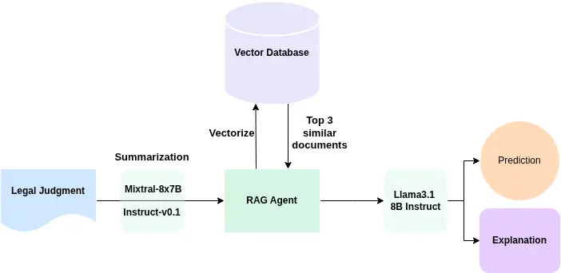

# NyayaRAG: Realistic Legal Judgment Prediction with RAG under the Indian Common Law System

Shubham Kumar Nigam  Balaramamahanthi Deepak Patnaik  Shivam Mishra
Affiliation: Indian Institute of Technology Kanpur, India
Email: [ajaythomas.work@gmail.com](mailto:)    Ajay Varghese Thomas
 Noel Shallum  Kripabandhu Ghosh  Arnab Bhattacharya Affiliation: Indian
Institute of Technology Kanpur, India Affiliation: Symbiosis Law School
Pune, India Affiliation: IISER Kolkata, India
Email: [noelshallum@gmail.com](mailto:)
Email: [kripaghosh@iiserkol.ac.in](mailto:)
Email: [arnabb@cse.iitk.ac.in](mailto:) Affiliation: SRM Institute of
Science and Technology, India Affiliation: University of Birmingham,
Dubai, United Arab Emirates{shubhamkumarnigam, bdeepakpatnaik2002,
shivam1602m,

###### Abstract

Legal Judgment Prediction (LJP) has emerged as a key area in AI for law,
aiming to automate judicial outcome forecasting and enhance
interpretability in legal reasoning. While previous approaches in the
Indian context have relied on internal case content such as facts,
issues, and reasoning, they often overlook a core element of common law
systems – reliance on statutory provisions and judicial precedents. In
this work, we propose NyayaRAG, a Retrieval-Augmented Generation (RAG)
framework that simulates realistic courtroom scenarios by providing
models with factual case descriptions, relevant legal statutes, and
semantically retrieved prior cases. NyayaRAG evaluates the effectiveness
of these combined inputs in predicting court decisions and generating
legal explanations using a domain-specific pipeline tailored for the
Indian legal system. We assess performance across various input
configurations using both standard lexical and semantic metrics as well
as LLM-based evaluators such as G-Eval. Our results show that augmenting
factual inputs with structured legal knowledge significantly improves
both predictive accuracy and explanation quality.

^(\$\*\$)^(\$\*\$)footnotetext: These authors contributed equally to
this work^(\$\dagger\$)^(\$\dagger\$)footnotetext: Corresponding author

## 1 Introduction

The application of artificial intelligence (AI) in legal judgment
prediction (LJP) has the potential to transform legal systems by
improving efficiency, transparency, and access to justice. This is
particularly crucial for India, where millions of cases remain pending
in courts, and decision-making is inherently dependent on factual
narratives, statutory interpretation, and judicial precedents. India
follows a common law system, where prior decisions (precedents) and
statutory provisions play a central role in influencing legal outcomes.
However, most existing AI-based LJP systems do not adequately replicate
this fundamental feature of judicial reasoning.

Previous studies (Malik et al., 2021b; Nigam et al., 2024d; Nigam et
al., 2025a) have focused on predicting legal outcomes using the current
case document, including sections like facts, arguments, issues,
reasoning, and decision. More recent efforts have narrowed the scope to
factual inputs alone (Nigam et al., 2024a; Nigam et al., 2025c); yet
these systems still operate in a setting that is not real, and does not
consider how courts naturally rely on applicable laws and prior rulings.
In reality, judges rarely decide in isolation; instead, they actively
refer to relevant precedents and statutory laws. To bridge this gap, we
propose a framework that more closely mirrors actual courtroom
conditions by explicitly incorporating external legal knowledge during
inference.

In critical domains like law, medicine and finance, decisions must be
grounded in verifiable information. Experts in these domains cannot rely
on opaque, black-box inferences and require systems that ensure factual
consistency. Hallucinations, common in large generative models, can have
severe consequences in legal decision-making. By retrieving and
conditioning model responses on grounded sources such as applicable laws
and precedent cases, the Retrieval-Augmented Generation (RAG) paradigm
offers a principled approach to mitigate hallucination and promote
trustworthy outputs. Furthermore, RAG frameworks like ours can be
flexibly integrated into existing legal systems without requiring the
retraining of core models or the sharing of private or sensitive case
data. This enhances user trust while allowing the legal community to
benefit from AI without sacrificing transparency or data
confidentiality.

Motivated by the above, we introduce NyayaRAG, a Retrieval-Augmented
Generation (RAG) framework for realistic legal judgment prediction and
explanation in the Indian common law system. The term “NyayaRAG” is
derived from two components: “Nyaya” meaning “justice” and “RAG”
referring to “Retrieval-Augmented Generation”. Together, the name
reflects our vision to build a justice-aware generation system that
emulates the reasoning process followed by Indian courts, using facts,
statutes, and precedents.

Unlike prior models that operate purely on internal case content,
NyayaRAG simulates real-world judicial decision-making by providing the
model with: (i) the _summarized factual background_ of the current case,
(ii) *relevant statutory provisions*, and (iii) retrieved top-k
_semantically similar previous judgments_. This structure emulates how
judges deliberate on new cases, consulting both textual statutes and
prior judicial opinions. Through this design, we evaluate how RAG can
help reduce hallucinations, promote faithfulness, and yield legally
coherent predictions and explanations.

Our contributions in this paper are as follows:

1.  1.  _A Realistic RAG Framework for Indian Courts:_ We present NyayaRAG,
        a novel framework that emulates Indian common law decision-making by
        incorporating not only facts but also retrieved legal statutes and
        precedents.
2.  2.  _Retrieval-Augmented Pipelines with Structured Inputs:_ We construct
        modular pipelines representing different combinations of factual,
        statutory, and precedent-based inputs to understand their individual
        and combined contributions to model performance.
3.  3.  _Simulating Common Law Reasoning with LLMs:_ We show that LLMs
        guided by RAG and factual grounding can produce legally faithful
        explanations that are aligned with how real-world decisions are made
        under common law systems.

Our work moves beyond fact-only or self-contained models by replicating
a more faithful legal reasoning pipeline aligned with Indian
jurisprudence. We hope that NyayaRAG opens new directions for building
interpretable, retrieval-aware AI systems in legal settings,
particularly in resource-constrained yet precedent-driven judicial
systems like India’s. We have shared our dataset, code, and RAG-based
pipeline through a GitHub repository¹¹ 1
[https://github.com/ShubhamKumarNigam/NyayaRAG](https://github.com/ShubhamKumarNigam/NyayaRAG).

## 2 Related Work

Figure 1: Illustration of our Legal Judgment Prediction framework using
RAG. The input legal judgment is first summarized; a RAG agent retrieves
top-3 relevant documents from a vector database; and an
instruction-tuned LLM (e.g., LLaMA-3.1 8B Instruct) generates the final
prediction and explanation.

Recent advances in natural language processing (NLP) and large language
models (LLMs) have transformed knowledge-intensive tasks, including
question answering and decision support. Transformer-based architectures
such as BERT (Devlin et al., 2018), GPT (Radford et al., 2019), and
their instruction-tuned successors demonstrate strong multi-hop
reasoning and contextual generation abilities. Retrieval-Augmented
Generation (RAG) further improves factual grounding and reduces
hallucinations by combining external document retrieval with generative
models (Han et al., 2024; Hei et al., 2024).

The domain of Legal Judgment Prediction (LJP) has evolved from outcome
classification toward explanation generation and realistic reasoning.
Foundational work explored case outcome prediction in ECHR and Chinese
datasets (Aletras et al., 2016; Chalkidis et al., 2019; Xiao et al.,
2018), inspiring subsequent benchmarks such as CAIL2018 and ECHR-CASES.
Recent approaches have incorporated statutes, reasoning structures, and
event-based features (Feng et al., 2022; Feng et al., 2023).

Within the Indian legal ecosystem, the ILDC corpus (Malik et al., 2021b)
laid the foundation for Court Judgment Prediction and Explanation
(CJPE). This has been expanded in PredEx (Nigam et al., 2024e),
NyayaAnumana (Nigam et al., 2024c), LegalSeg (Nigam et al., 2025b),
TathyaNyaya (Nigam et al., 2025d), and IBPS for bail prediction
(Srivastava et al., 2025), which collectively focus on segmentation,
factual reasoning, and judgment outcome explanation. Efforts such as
(Nigam et al., 2024b; Nigam and Deroy, 2024) emphasize fact-based LJP as
a realistic alternative to full-text reasoning, aligning predictions
more closely with early-phase decision-making. Other works explore
semantic segmentation (Malik et al., 2021a), legal QA (Nigam et al.,
2023), and structured document generation (Nigam et al., 2025e). These
resources and models highlight the significance of domain-specific
adaptation for Indian law, an underrepresented common law system.

Precedent integration is central to common law reasoning. Early
precedent-aware models such as (Zhao et al., 2018) focused on Chinese
law, while recent works like PLJP (Wu et al., 2023), LexKeyPlan (Santosh
and Hernandez, 2025), and precedent-enhanced ECHR prediction (Santosh et
al., 2024) examine retrieval of historical judgments to guide
predictions. These align with broader multilingual and
cross-jurisdictional LJP studies (Niklaus et al., 2021; Kapoor et al.,
2022). While these efforts highlight the role of past cases, their
settings differ significantly from India’s unique common law context
where both statutory law and judicial precedents guide reasoning.

Retrieval-augmented pipelines are increasingly applied to legal NLP.
LegalBench-RAG (Pipitone and Alami, 2024) and CLERC (Hou et al., 2024)
introduced benchmarks for retrieval-augmented legal reasoning.
Specialized systems like CBR-RAG (Wiratunga et al., 2024), Graph-RAG for
norms (de Martim, 2025), and LexKeyPlan (Santosh and Hernandez, 2025)
explore structured retrieval, case-based reasoning, and keyphrase-driven
planning. Applications range from legal assistants and dispute
resolution (Rafat, 2024; Wahidur et al., 2025) to federated secure
access architectures (Amato et al., 2024). These works demonstrate the
value of augmenting generative reasoning with statutory and
precedent-based retrieval but primarily address civil law or
international corpora.

Our work contributes to this line by contextualizing RAG for the Indian
common law system, simulating how judges reason with case facts,
statutory provisions, and precedents. While prior RAG frameworks in law
(Wiratunga et al., 2024; Hou et al., 2024; Wu et al., 2023; Santosh et
al., 2024) establish the feasibility of retrieval-augmented pipelines,
they have not been applied to Indian courts. By integrating factual,
statutory, and precedential inputs in a unified framework, NyayaRAG
extends the landscape of LJP toward realistic, explainable, and
domain-grounded legal tasks.

## 3 Task Description

India’s judicial system operates within the common law framework, where
judges deliberate cases based on three fundamental pillars: (i) the
factual context of the case, (ii) applicable statutory provisions, and
(iii) relevant judicial precedents. Our task is designed to simulate
such realistic legal decision-making by leveraging Retrieval-Augmented
Generation (RAG), enabling models to access external legal knowledge
during inference.

Figure 1 illustrates our Legal Judgment Prediction (LJP) pipeline
enhanced with RAG. The process begins with a full legal judgment
document, which undergoes summarization to reduce its length and retain
essential factual meaning. This is necessary because legal judgments
tend to be long, and appending retrieved knowledge further increases the
input size. Given limited model capacity and computational resources, we
employ a summarization step (using Mixtral-8x7B-Instruct-v0.1) to create
a condensed representation of both the input case and the retrieved
legal context.

##### Prediction Task:

Based on the summarized factual description and the retrieved top-$`k`$
similar legal documents (statutes or precedents), the model predicts the
likely court judgment. The prediction label $`y\in\{0,1\}`$ indicates
whether the appeal is fully rejected ($`0`$) or fully/partially accepted
($`1`$). This binary framing captures the most common forms of judicial
decisions in Indian appellate courts.

##### Explanation Task:

Alongside the decision, the model is also required to generate an
explanation that justifies its output. This explanation should logically
incorporate the facts, cited statutes, and relevant precedents retrieved
during the RAG process. This step emulates how judges provide reasoned
opinions in written judgments.

By structuring the LJP task in this manner, and by summarizing long
documents and integrating retrieval-based augmentation, we study the
effectiveness of RAG in producing judgments that are both faithful to
legal reasoning and grounded in precedent and statute. The overall
framework allows us to approximate real-world decision-making
environments within Indian courtrooms.

## 4 Dataset

Our dataset is designed to simulate realistic court decision-making in
the Indian legal context, incorporating facts, statutes, and precedent,
which are essential elements under the common law framework. This
dataset enables exploration of Legal Judgment Prediction (LJP) in a
Retrieval-Augmented Generation (RAG) setup.

### 4.1 Dataset Compilation

We curated a large-scale dataset consisting of 56,387 Supreme Court of
India (SCI) case documents up to April 2024, sourced from IndianKanoon²²
2 [https://indiankanoon.org/](https://indiankanoon.org/), a trusted
legal search engine. The website provides structural tags for various
judgment components (e.g., facts, issues, arguments), which allowed for
clean and structured scraping. These documents serve as the foundation
for our summarization, retrieval, and reasoning experiments.

### 4.2 Single versus Multi Partitioning

Another challenge in the SCI proceedings is the presence of cases
containing multiple petitions under a single case identifier, where each
petition may lead to distinct outcomes. To handle this, we partition the
dataset into two subsets. The single partition represents binary
classification tasks (accept/reject) and includes cases with a single
petition or multiple petitions that share the same outcome. The multi
partition contains cases with multiple petitions leading to different
decisions, introducing a more complex multi-label prediction setting
(e.g., partially accepted outcomes). For these cases, if even one appeal
within the group is accepted, the case is assigned the label accepted.
Predicting mixed outcomes remains challenging and will be further
explored in future work.

### 4.3 Dataset Composition

The corpus supports multiple downstream pipelines, each focusing on
specific judgment elements or legal context. Table 1 presents key
statistics across different configurations. An example case is shown in
Table 7 in Appendix.

#### 4.3.1 Case Text

Each judgment includes complete narrative content such as factual
background, party arguments, legal issues, reasoning, and verdict. Due
to length constraints exceeding model context windows, we summarized
these documents using Mixtral-8x7B-Instruct-v0.1 (Jiang et al., 2024),
which supports up to 32k tokens. The summarization preserved critical
legal elements through carefully designed prompts (see Table 2).

| Dataset           | \#Documents | Avg. Length | Max     |
| ----------------- | ----------- | ----------- | ------- |
| SCI (Full)        | 56,387      | 3,495       | 401,985 |
| Summarized Single | 4,962       | 302         | 875     |
| Summarized Multi  | 4,930       | 300         | 879     |
| Sections          | 29,858      | 257         | 27,553  |

Table 1: NyayaRAG data statistics

|                                                                                                                                                                                                                                                                  |
| ---------------------------------------------------------------------------------------------------------------------------------------------------------------------------------------------------------------------------------------------------------------- |
| Summarization Prompt                                                                                                                                                                                                                                             |
| The text is regarding a court judgment for a specific case. Summarize it into 1000 tokens but more than 700 tokens. The summarization should highlight the Facts, Issues, Statutes, Ratio of the decision, Ruling by Present Court (Decision), and a Conclusion. |

Table 2: Instruction prompt used with Mixtral-8x7B-Instruct-v0.1 for
summarizing legal judgments

#### 4.3.2 Precedents

From each judgment, cited precedents were extracted using metadata tags
provided by IndianKanoon. These citations represent explicit legal
reasoning and are retained for use during inference to replicate how
courts consider prior judgments.

#### 4.3.3 Statutes

Statutory references were also programmatically extracted, including
citations to laws like the Indian Penal Code and the Constitution of
India. Where statute sections exceeded length limits, they were
summarized using the same LLM pipeline. Only statutes directly cited in
the respective cases were retained, ensuring relevance.

#### 4.3.4 Previous Similar Cases

To simulate implicit precedent-based reasoning, we employed semantic
similarity retrieval to identify relevant previous cases beyond explicit
citations:

- •
  Corpus Vectorization: All 56,387 documents were embedded into dense
  vector representations using the all-MiniLM-L6-v2 sentence
  transformer.
- •
  Target Encoding: The 5,000 selected training samples were vectorized
  similarly.
- •
  Top-k Retrieval: Using ChromaDB, we retrieved the top-3 most
  semantically similar cases for each document based on cosine
  similarity.
- •
  Augmentation: Retrieved cases were appended to the factual input to
  form the “casetext + previous similar cases” input during model
  inference.

This retrieval step enriches context with precedents that are
semantically close; even if not cited, they enhance the legal realism of
our setup.

#### 4.3.5 Facts

We separately extracted the factual portions of all 56,387 judgments.
These include background information, chronological events, and party
narratives, excluding legal reasoning. These fact-only subsets were used
to simulate realistic courtroom scenarios where judges primarily rely on
facts, relevant law, and precedent for decision-making.

Overall, our dataset is uniquely structured to test legal
decision-making under realistic constraints, aligning with the Indian
legal system’s reliance on factual narratives, statutory frameworks,
precedents, and prior rulings.

## 5 Methodology

To simulate realistic judgment prediction and evaluate the role of RAG
in enhancing legal decision-making, we design a modular experimental
setup. This setup explores how different types of legal information,
such as factual summaries, statutes, and precedents affect model
performance on the dual tasks of prediction and explanation. To ensure
reproducibility and transparency, we detail the full experimental setup,
including model configurations, training routines, and task-specific
hyperparameters. The details are mentioned in Appendix A. This includes
separate sections for explanation generation (summarization) and legal
judgment prediction tasks, outlining all relevant decoding strategies,
optimization settings, and dataset splits used across our pipeline
variants.

### 5.1 Pipeline Construction

To systematically evaluate the impact of legal knowledge sources, we
constructed multiple input pipelines using combinations of the dataset
components described in Section 4. Each pipeline configuration
represents a distinct input scenario reflecting different degrees of
legal context and retrieval augmentation. These pipelines are as
follows:

- •
  CaseText Only: Includes only the summarized version of the full case
  judgment, which contains factual background, arguments, and reasoning.
- •
  CaseText + Statutes: Appends summarized statutory references cited in
  the judgment to the case text, simulating scenarios where relevant
  laws are explicitly considered.
- •
  CaseText + Precedents: Incorporates prior cited judgments mentioned in
  the original case, representing explicitly relied-upon precedents.
- •
  CaseText + Previous Similar Cases: Adds top-3 semantically similar
  past judgments (retrieved via ChromaDB using all-MiniLM-L6-v2
  embeddings), allowing the model to learn from precedents not
  explicitly cited.
- •
  CaseText + Statutes + Precedents: A comprehensive legal input pipeline
  combining the full judgment summary, statutes, and cited prior
  judgments.
- •
  Facts Only: A minimal pipeline containing only the factual summary,
  excluding all legal reasoning and verdicts. This setup evaluates
  whether a model can infer judgments from facts alone.
- •
  Facts + Statutes + Precedents: Combines factual input with statutory
  and precedent context to simulate realistic courtroom conditions where
  judges rely on facts, applicable law, and relevant past cases.

This modular design enables granular control over input features and
facilitates direct comparison of how each knowledge source contributes
to judgment prediction and explanation generation.

### 5.2 Prompt Design

To ensure consistency and interpretability across all pipelines, we used
fixed instruction prompts with minor variations depending on the
available contextual inputs (e.g., facts only vs. facts + law +
precedent). These prompts guide the model in producing both binary
predictions and natural language explanations. Prompts were structured
to reflect real judicial inquiry formats, aligning with the
instruction-following capabilities of modern LLMs. Full prompt templates
are listed in Appendix Table 8, along with prediction examples.

### 5.3 Inference Setup

We use the LLaMA-3.1 8B Instruct Dubey et al. (2024) model for all
experiments in a few-shot prompt setup. Each input sequence, composed
according to one of the pipeline templates, is paired with a relevant
prompt that asks to output:

- •
  A binary judgment prediction: 0 (appeal rejected) or 1 (appeal
  fully/partially accepted)
- •
  A justification: a coherent explanation based on legal facts,
  statutes, and precedent

The model is explicitly instructed to reason with the provided
information and emulate judicial writing. Retrieved knowledge (via RAG)
is included in-context to enhance legal reasoning while minimizing
hallucinations.

This experimental design allows us to evaluate the effectiveness of
legal retrieval and summarization under realistic judicial
decision-making constraints in the Indian common law setting.

## 6 Evaluation Metrics

| Pipeline                          | Partition | Accuracy | Precision | Recall | F1-score |
| --------------------------------- | --------- | -------- | --------- | ------ | -------- |
| CaseText Only                     | Single    | 62.27    | 33.50     | 30.88  | 29.45    |
|                                   | Multi     | 53.10    | 25.26     | 23.95  | 20.81    |
| CaseText + Statutes               | Single    | 67.07    | 45.29     | 44.55  | 44.32    |
|                                   | Multi     | 60.36    | 64.22     | 64.04  | 60.35    |
| CaseText + Precedents             | Single    | 61.73    | 41.92     | 41.35  | 40.81    |
|                                   | Multi     | 57.53    | 61.34     | 61.19  | 57.53    |
| CaseText + Previous Similar Cases | Single    | 57.53    | 61.34     | 61.19  | 57.53    |
|                                   | Multi     | 61.73    | 41.92     | 41.35  | 57.53    |
| CaseText + Statutes + Precedents  | Single    | 64.71    | 43.50     | 42.98  | 42.78    |
|                                   | Multi     | 65.86    | 63.94     | 63.99  | 63.96    |
| CaseFacts Only                    | Single    | 51.13    | 51.36     | 51.30  | 50.68    |
|                                   | Multi     | 53.71    | 51.18     | 51.18  | 51.18    |
| Facts + Statutes + Precedents     | Single    | 50.58    | 33.57     | 33.56  | 33.24    |
|                                   | Multi     | 52.57    | 52.01     | 52.01  | 52.01    |

Table 3: Performance of various pipelines on Binary and Multi-label LJP
task (best results in bold)

To evaluate the effectiveness of our Retrieval-Augmented Legal Judgment
Prediction framework, we adopt a comprehensive set of metrics covering
both classification accuracy and explanation quality. The evaluation is
conducted on two fronts: the judgment prediction task and the
explanation generation task. These metrics are selected to ensure a
holistic assessment of model performance in the legal domain. We report
Macro Precision, Macro Recall, Macro F1, and Accuracy for judgment
prediction, and we use both quantitative and qualitative methods to
evaluate the quality of explanations generated by the model.

1.  1.  Lexical-based Evaluation: We utilized standard lexical similarity
        metrics, including Rouge-L Lin (2004), BLEU Papineni et al. (2002),
        and METEOR Banerjee and Lavie (2005). These metrics measure the
        overlap and order of words between the generated explanations and
        the reference texts, providing a quantitative assessment of the
        lexical accuracy of the model outputs.
2.  2.  Semantic Similarity-based Evaluation: To capture the semantic
        quality of the generated explanations, we employed BERTScore Zhang
        et al. (2020), which measures the semantic similarity between the
        generated text and the reference explanations. Additionally, we used
        BLANC Vasilyev et al. (2020), a metric that estimates the quality of
        generated text without a gold standard, to evaluate the model’s
        ability to produce semantically meaningful and contextually relevant
        explanations.
3.  3.  LLM-based Evaluation (LLM-as-a-Judge): To complement traditional
        metrics, we incorporate an automatic evaluation strategy that uses
        large language models themselves as evaluators, commonly referred to
        as LLM-as-a-Judge. This evaluation is crucial for assessing
        structured argumentation and legal correctness in a format aligned
        with expert judicial reasoning. We adopt G-Eval Liu et al. (2023), a
        GPT-4-based evaluation framework tailored for natural language
        generation tasks. G-Eval leverages chain-of-thought prompting and
        structured scoring to assess explanations along three key criteria:
        factual accuracy, completeness & coverage, and clarity & coherence.
        Each generated legal explanation is scored on a scale from 1 to 10
        based on how well it aligns with the expected content and a
        reference document. The exact prompt format used for evaluation is
        shown in Appendix Table 9. For our experiments, we use the
        GPT-4o-mini model to generate reliable scores without manual
        intervention. This setup provides an interpretable, unified judgment
        metric that captures legal soundness, completeness of reasoning, and
        logical coherence, beyond what traditional similarity-based metrics
        can offer.
4.  4.  Expert Evaluation: To validate the interpretability and legal
        soundness of the model-generated explanations, we conduct an expert
        evaluation involving legal professionals. They rate a representative
        subset of the generated outputs on a 1–10 Likert scale across three
        criteria: factual accuracy, legal relevance, and completeness of
        reasoning. A score of 1 denotes a poor or misleading explanation,
        while a 10 reflects high legal fidelity and argumentative soundness.
        This evaluation provides critical insights beyond automated metrics.
5.  5.  Inter-Annotator Agreement (IAA): To further ensure the reliability
        and consistency of expert judgments, we computed multiple standard
        inter-rater agreement metrics. Specifically, Fleiss’
        Kappa Fleiss (1971) was used to evaluate the overall agreement among
        multiple raters, Cohen’s Kappa Cohen (1960) captured pairwise
        agreement while adjusting for chance, and the Intraclass Correlation
        Coefficient (ICC) Shrout and Fleiss (1979) measured the reliability
        of continuous ratings across raters. In addition, Krippendorff’s
        Alpha Krippendorff (2018) provided a robust measure suitable for
        ordinal scales and missing data, while the Pearson Correlation
        Coefficient Benesty et al. (2009) quantified the linear consistency
        of expert scores. The results demonstrated substantial agreement
        across different measures, reinforcing the credibility of the
        evaluation and lending strong support to the robustness of our
        findings.

Together, these metrics provide a comprehensive, multi-perspective
evaluation of our system’s ability to both predict judicial outcomes and
generate legally coherent, interpretable rationales grounded in
retrieved context.

| Pipelines                         | RL   | BLEU | METEOR | BERTScore | BLANC | G-Eval | Expert Score |
| --------------------------------- | ---- | ---- | ------ | --------- | ----- | ------ | ------------ |
| Single Partition                  |      |      |        |           |       |        |              |
| CaseText Only                     | 0.16 | 0.03 | 0.18   | 0.52      | 0.08  | 4.17   | 5.2          |
| CaseText + Statutes               | 0.17 | 0.03 | 0.20   | 0.53      | 0.09  | 4.21   | 5.5          |
| CaseText + Precedents             | 0.16 | 0.03 | 0.19   | 0.51      | 0.08  | 3.45   | 4.6          |
| CaseText + Previous Similar Cases | 0.16 | 0.03 | 0.20   | 0.52      | 0.08  | 3.72   | 4.9          |
| CaseText + Statutes + Precedents  | 0.16 | 0.03 | 0.19   | 0.52      | 0.08  | 4.11   | 5.4          |
| CaseFacts Only                    | 0.16 | 0.02 | 0.18   | 0.52      | 0.06  | 3.53   | 4.5          |
| Facts + Statutes + Precedents     | 0.16 | 0.02 | 0.18   | 0.51      | 0.06  | 2.97   | 3.9          |
| Multi Partition                   |      |      |        |           |       |        |              |
| CaseText Only                     | 0.16 | 0.03 | 0.18   | 0.52      | 0.08  | 4.00   | 5.0          |
| CaseText + Statutes               | 0.17 | 0.03 | 0.20   | 0.53      | 0.09  | 4.10   | 5.3          |
| CaseText + Precedents             | 0.16 | 0.03 | 0.20   | 0.53      | 0.09  | 3.41   | 4.4          |
| CaseText + Previous Similar Cases | 0.16 | 0.03 | 0.19   | 0.52      | 0.08  | 3.67   | 4.7          |
| CaseText + Statutes + Precedents  | 0.16 | 0.03 | 0.20   | 0.53      | 0.09  | 3.92   | 5.2          |
| CaseFacts Only                    | 0.15 | 0.02 | 0.17   | 0.52      | 0.08  | 3.74   | 4.6          |
| Facts + Statutes + Precedents     | 0.15 | 0.02 | 0.19   | 0.52      | 0.07  | 3.08   | 4.1          |

Table 4: Comparison of explanation generation across different legal
context pipelines

## 7 Results and Analysis

We conducted extensive evaluations across multiple pipeline
configurations to study the impact of different legal information
components on both judgment prediction and explanation quality. Tables 3
and 4 summarize the model’s performance across these configurations for
binary and multi-label settings.

### 7.1 Judgment Prediction Performance

As shown in Table 3, the pipeline combining CaseText + Statutes achieved
the highest accuracy in the single-label setting. This suggests that
legal statutes provide substantial contextual cues for the model to
infer the likely decision. In contrast, CaseText Only achieved 62.27%,
highlighting the importance of augmenting case narratives with
applicable laws. Interestingly, the CaseText + Previous Similar Cases
pipeline showed the highest precision, recall, and F1-score in the
single-label case, indicating that semantically retrieved precedents,
despite not being explicitly cited, help the model align with actual
judicial outcomes.

In the multi-label setting, the best accuracy was observed for the
CaseText + Statutes + Precedents pipeline. This comprehensive context
provides the model with structured legal knowledge, improving
generalization across different outcome labels. Conversely, the Facts
Only pipeline performed worst overall, reaffirming that factual
narratives alone, without legal context, are insufficient for reliably
predicting legal outcomes. The poor performance of the Facts +
Statutes + Precedents pipeline in the single-label setting suggests that
factual sections lack the interpretive cues that full case texts offer
when combined with legal references.

### 7.2 Explanation Generation Quality

Table 4presents the results of explanation evaluation using a diverse
set of metrics, including both automatic lexical and semantic metrics
(ROUGE, BLEU, METEOR, BERTScore, BLANC) and a large language model-based
evaluation (G-Eval). Across both single and multi-label setups, the
CaseText + Statutes pipeline consistently outperformed all other
configurations. In the single-label setting, it achieved the highest
scores across key dimensions, substantially outperforming the CaseText
Only baseline. This result underscores the critical role of statutory
references in enhancing both the factual alignment and interpretability
of model-generated legal explanations.

Interestingly, while the CaseText + Previous Similar Cases pipeline
yielded strong lexical overlap (e.g., top ROUGE-L in the unabridged
version), it lagged behind the statute-enhanced pipeline in metrics that
assess semantic and contextual alignment, such as G-Eval and BLANC. This
indicates that while similar cases might help the model replicate
surface-level language, they may not consistently offer legally grounded
or complete reasoning. Meanwhile, the CaseText + Statutes + Precedents
pipeline also performed competitively, suggesting that combining
structured legal references with precedent data can lead to balanced and
high-quality explanations.

In contrast, configurations that relied solely on factual narratives
(CaseFacts Only and Facts + Statutes + Precedents) exhibited
comparatively poor performance across all evaluation metrics. For
example, the Facts + Statutes + Precedents pipeline recorded a G-Eval
score as low in the single-label setting. This reinforces the notion
that factual descriptions, while essential, are insufficient for
constructing legally persuasive rationales. The absence of structured
legal arguments, statutory alignment, or precedent citation in these
setups appears to undermine their explanatory effectiveness.

| Pipelines                         | Fleiss’ $`\kappa`$ | Cohen’s $`\kappa`$ | ICC  | Kripp. $`\alpha`$ | Pearson Corr. |
| --------------------------------- | ------------------ | ------------------ | ---- | ----------------- | ------------- |
| Single Partition                  |                    |                    |      |                   |               |
| CaseText Only                     | 0.42               | 0.47               | 0.55 | 0.49              | 0.58          |
| CaseText + Statutes               | 0.51               | 0.55               | 0.61 | 0.57              | 0.65          |
| CaseText + Precedents             | 0.37               | 0.42               | 0.50 | 0.45              | 0.52          |
| CaseText + Previous Similar Cases | 0.41               | 0.45               | 0.54 | 0.47              | 0.56          |
| CaseText + Statutes + Precedents  | 0.49               | 0.52               | 0.59 | 0.54              | 0.62          |
| CaseFacts Only                    | 0.34               | 0.39               | 0.47 | 0.43              | 0.49          |
| Facts + Statutes + Precedents     | 0.29               | 0.34               | 0.42 | 0.38              | 0.44          |
| Multi Partition                   |                    |                    |      |                   |               |
| CaseText Only                     | 0.40               | 0.45               | 0.53 | 0.48              | 0.57          |
| CaseText + Statutes               | 0.50               | 0.54               | 0.60 | 0.56              | 0.64          |
| CaseText + Precedents             | 0.36               | 0.41               | 0.49 | 0.44              | 0.51          |
| CaseText + Previous Similar Cases | 0.39               | 0.44               | 0.52 | 0.46              | 0.55          |
| CaseText + Statutes + Precedents  | 0.47               | 0.51               | 0.58 | 0.52              | 0.60          |
| CaseFacts Only                    | 0.32               | 0.37               | 0.46 | 0.41              | 0.48          |
| Facts + Statutes + Precedents     | 0.28               | 0.33               | 0.41 | 0.36              | 0.43          |

Table 5: Inter-Annotator Agreement (IAA) statistics for expert
evaluation of generated legal explanations across different pipeline
settings for both Single and Multi partitions

##### Expert Evaluation:

The results of this evaluation aligned closely with the trends observed
in automatic metrics (Table 4). Pipelines enriched with statutory
provisions, particularly CaseText + Statutes, consistently received the
highest expert ratings, highlighting the value of legal grounding in
improving explanation quality. In contrast, pipelines relying solely on
factual input, such as CaseFacts Only, obtained the lowest expert
scores, underscoring their lack of interpretive depth.

To assess the reliability of these expert judgments, we performed a
detailed Inter-Annotator Agreement (IAA) analysis across multiple
evaluation dimensions, Table 5. The IAA results revealed moderate to
substantial agreement among annotators. For the Single partition,
pipelines such as CaseText + Statutes and CaseText + Statutes +
Precedents achieved higher consistency (Fleiss’ $`\kappa>0.49`$, ICC
$`\approx 0.60`$), reflecting strong consensus on their explanation
quality. In contrast, fact-only or noisy-input pipelines showed weaker
agreement (Fleiss’ $`\kappa<0.35`$, ICC $`<0.50`$), suggesting greater
variability in expert perception of their outputs.

The Multi partition exhibited slightly lower agreement overall, likely
due to the additional complexity of multi-label judgments. Nevertheless,
richer legal context pipelines again demonstrated higher consistency
among experts compared to fact-only inputs. These findings not only
validate the robustness of our expert evaluation protocol but also
corroborate trends from lexical, semantic, and LLM-based evaluations.

Taken together, the results emphasize that Retrieval-Augmented
Generation, when paired with structured legal inputs such as statutes
and precedents, produces explanations that are more accurate,
interpretable, and legally coherent. The combination of automatic
metrics, LLM-based judgment, and human expert ratings provides a
multifaceted and credible framework for assessing explanation quality in
legal judgment prediction.

## 8 Ablation Study: Understanding the Role of Legal Context Components

To assess the individual contribution of each legal context component,
factual narratives, statutory provisions, cited precedents, and
semantically similar past cases, we perform an ablation study by
systematically removing or altering these inputs across pipeline
configurations. This study highlights how each component affects
prediction accuracy and explanation quality, as reported in Tables 3
and 4.

##### Impact on Judgment Prediction:

The CaseText + Statutes + Precedents pipeline serves as the most
comprehensive baseline. Removing statutory references (i.e., CaseText +
Precedents) leads to a noticeable drop in F1-score (from 63.96 to 57.53
in the multi-label setting), indicating that legal provisions provide
structured grounding essential for accurate predictions. Similarly,
eliminating precedents (i.e., CaseText + Statutes) also reduces
performance, though the drop is less steep, suggesting complementary
roles of statutes and precedents. Pipelines relying solely on factual
case narratives (e.g., CaseFacts Only) perform the worst, reaffirming
that factual information alone is insufficient for robust legal outcome
prediction.

##### Impact on Explanation Quality:

A similar pattern emerges in explanation generation. The CaseText +
Statutes pipeline consistently outperforms others across ROUGE, BLEU,
METEOR, BERTScore, and G-Eval metrics, underscoring the importance of
grounding explanations in explicit statutory language. When only
precedents are added (without statutes), as in CaseText + Precedents,
explanation scores drop significantly (e.g., G-Eval: 4.21 to 3.45 in the
single-label case). The worst-performing setup is Facts + Statutes +
Precedents, highlighting that factual inputs, even when supplemented
with legal references, do not suffice for generating coherent and
persuasive explanations if the core case context is missing.

##### Insights:

These findings validate the design choices in NyayaRAG, where
integrating factual case text with statutory and precedential knowledge
mimics real-world judicial reasoning. Statutory references provide
normative structure, while precedents offer context-specific analogies.
Their absence not only reduces predictive performance but also degrades
the factuality, clarity, and legal coherence of the generated
explanations.

This ablation analysis also offers practical guidance: for
retrieval-augmented systems deployed in legal contexts, careful curation
and combination of retrieved statutes and relevant precedents are
critical to ensure trustworthy outputs.

## 9 Conclusions and Future Scope

This paper introduced NyayaRAG, a Retrieval-Augmented Generation
framework tailored for realistic legal judgment prediction and
explanation in the Indian common law system. By combining factual case
details with retrieved statutory provisions and relevant precedents, our
approach mirrors judicial reasoning more closely than prior methods that
rely solely on the case text. Empirical results across prediction and
explanation tasks confirm that structured legal retrieval enhances both
outcome accuracy and interpretability. Pipelines enriched with statutes
and precedents consistently outperformed baselines, as validated by
lexical, semantic, and LLM-based (G-Eval) metrics, as well as expert
feedback.

Future directions include extending to hierarchical verdict structures,
integrating symbolic or graph-based retrieval, modeling temporal
precedent evolution, and leveraging human-in-the-loop mechanisms.
NyayaRAG marks a step toward court-aligned, explainable legal AI and
sets the foundation for future research in retrieval-enhanced legal
systems within under-represented jurisdictions.

## Acknowledgements

We would like to express our sincere gratitude to the anonymous
reviewers for their constructive feedback and valuable suggestions,
which greatly improved the quality of this paper. We also thank the
student research assistants and legal experts from various law colleges
for their dedicated efforts in annotation and expert evaluation. Their
contributions were instrumental in ensuring the quality and reliability
of the dataset and evaluation process. We gratefully acknowledge the
support of BharatGen, India, for providing access to computational
resources and hardware infrastructure used in this research. Their
assistance played a vital role in model training and large-scale
experimentation. The majority of this work was conducted while the first
author was affiliated with the Indian Institute of Technology Kanpur.
The author is currently affiliated with the University of Birmingham
Dubai.

## Limitations

While NyayaRAG marks a significant advance in realistic legal judgment
prediction under the Indian common law framework, several limitations
merit further attention.

First, although Retrieval-Augmented Generation (RAG) helps reduce
hallucinations by grounding outputs in retrieved legal documents, it
does not fully eliminate factual or interpretive inaccuracies. In
sensitive domains such as law, even rare errors in reasoning or
justification may raise concerns about reliability and accountability.

Second, the current framework supports binary and multi-label outcome
structures but does not yet handle the full spectrum of legal verdicts,
such as hierarchical or multi-class decisions involving complex legal
provisions. Expanding to richer verdict taxonomies would enable broader
applicability and deeper case understanding.

Third, NyayaRAG assumes the availability of clean, well-structured legal
documents and relies on summarization pipelines to manage input length.
However, real-world legal texts often contain noise, OCR errors, or
inconsistent formatting. Although summarization aids conciseness, it may
inadvertently omit subtle legal nuances that affect judgment outcomes or
explanation quality.

Finally, due to computational resource constraints, the current system
utilizes instruction-tuned LLMs guided by domain-specific prompts rather
than fully fine-tuning on large-scale Indian legal corpora. While
prompt-based tuning remains efficient and modular, fine-tuning on
in-domain legal texts could further enhance model fidelity and domain
alignment.

Despite these limitations, NyayaRAG provides a robust and interpretable
foundation for judgment prediction and explanation, supported by both
automatic and expert evaluations. Future work that addresses these
constraints, particularly hierarchical decision modeling and
domain-specific fine-tuning, will further strengthen the framework’s
legal relevance and practical deployment potential.

## Ethics Statement

This research adheres to established ethical standards for conducting
work in high-stakes domains such as law. The legal documents used in our
study were sourced from IndianKanoon
([https://indiankanoon.org/](https://indiankanoon.org/)), a publicly
available repository of Indian court judgments. All documents are in the
public domain and do not include sealed cases or personally identifiable
sensitive information, ensuring that our use of the data complies with
privacy and confidentiality norms.

We emphasize that the proposed NyayaRAG system is developed strictly for
academic research purposes to simulate realistic legal reasoning
processes. It is not intended for direct deployment in real-world legal
settings. The model outputs must not be construed as legal advice,
official court predictions, or determinants of legal outcomes. Any
downstream use should be performed with oversight by qualified legal
professionals. We strongly discourage the use of this system in live
legal cases, policymaking, or decisions that may affect individuals’
rights without appropriate human-in-the-loop supervision.

As part of our evaluation protocol, we involved domain experts (legal
professionals and researchers) to assess the quality and legal coherence
of the generated explanations. The evaluation was conducted on a curated
subset of samples, and all participating experts were informed of the
research objectives and voluntarily participated without any coercion or
conflict of interest. No personal data was collected during this
process, and all expert feedback was anonymized for analysis.

While we strive to enhance legal interpretability and transparency, we
acknowledge that legal documents themselves may reflect systemic biases.
Our framework, while replicating judicial reasoning patterns, may
inherit such biases from training data. We do not deliberately introduce
or amplify such biases, but we recognize the importance of further work
in fairness auditing, particularly across litigant identity,
socio-demographic markers, and jurisdictional diversity.

## References

- Aletras et al. (2016) N. Aletras, D. Tsarapatsanis, D.
  Preoţiuc-Pietro, and V. Lampos Predicting judicial decisions of the
  european court of human rights: a natural language processing
  perspective. PeerJ computer science 2, pp. e93. Cited by: §2.
- Amato et al. (2024) F. Amato, E. Cirillo, M. Fonisto, and A. Moccardi
  Optimizing legal information access: federated search and rag for
  secure ai-powered legal solutions. In 2024 IEEE International
  Conference on Big Data (BigData), pp. 7632–7639. Cited by: §2.
- Banerjee and Lavie (2005) S. Banerjee and A. Lavie METEOR: an
  automatic metric for MT evaluation with improved correlation with
  human judgments. In Proceedings of the ACL Workshop on Intrinsic and
  Extrinsic Evaluation Measures for Machine Translation and/or
  Summarization, J. Goldstein, A. Lavie, C. Lin, and C. Voss (Eds.), Ann
  Arbor, Michigan, pp. 65–72. External Links:
  [Link](https://aclanthology.org/W05-0909/) Cited by: item 1.
- Benesty et al. (2009) J. Benesty, J. Chen, Y. Huang, and I. Cohen
  Pearson correlation coefficient. In Noise reduction in speech
  processing, pp. 1–4. Cited by: item 5.
- Chalkidis et al. (2019) I. Chalkidis, I. Androutsopoulos, and N.
  Aletras Neural legal judgment prediction in english. Association for
  Computational Linguistics (ACL). Cited by: §2.
- Cohen (1960) J. Cohen A coefficient of agreement for nominal scales.
  Educational and psychological measurement 20 (1), pp. 37–46. Cited by:
  item 5.
- de Martim (2025) H. de Martim Graph rag for legal norms: a
  hierarchical and temporal approach. arXiv preprint arXiv:2505.00039.
  Cited by: §2.
- Devlin et al. (2018) J. Devlin, M. Chang, K. Lee, and K. Toutanova
  Bert: pre-training of deep bidirectional transformers for language
  understanding. arXiv preprint arXiv:1810.04805. Cited by: §2.
- Dubey et al. (2024) A. Dubey, A. Jauhri, A. Pandey, A. Kadian, A.
  Al-Dahle, A. Letman, A. Mathur, A. Schelten, A. Yang, A. Fan, et al.
  The llama 3 herd of models. arXiv preprint arXiv:2407.21783. Cited by:
  §5.3.
- Feng et al. (2023) G. Feng, Y. Qin, R. Huang, and Y. Chen Criminal
  action graph: a semantic representation model of judgement documents
  for legal charge prediction. Information Processing & Management 60
  (5), pp. 103421. Cited by: §2.
- Feng et al. (2022) Y. Feng, C. Li, and V. Ng Legal judgment prediction
  via event extraction with constraints. In Proceedings of the 60th
  Annual Meeting of the Association for Computational Linguistics
  (Volume 1: Long Papers), S. Muresan, P. Nakov, and A. Villavicencio
  (Eds.), Dublin, Ireland, pp. 648–664. External Links:
  [Link](https://aclanthology.org/2022.acl-long.48/),
  [Document](https://dx.doi.org/10.18653/v1/2022.acl-long.48) Cited by:
  §2.
- Fleiss (1971) J. L. Fleiss Measuring nominal scale agreement among
  many raters.. Psychological bulletin 76 (5), pp. 378. Cited by:
  item 5.
- Han et al. (2024) R. Han, Y. Zhang, P. Qi, Y. Xu, J. Wang, L.
  Liu, W. Y. Wang, B. Min, and V. Castelli Rag-qa arena: evaluating
  domain robustness for long-form retrieval augmented question
  answering. arXiv preprint arXiv:2407.13998. Cited by: §2.
- Hei et al. (2024) Z. Hei, W. Wei, W. Ou, J. Qiao, J. Jiao, Z. Zhu,
  and G. Song DR-rag: applying dynamic document relevance to
  retrieval-augmented generation for question-answering. arXiv preprint
  arXiv:2406.07348. Cited by: §2.
- Hou et al. (2024) A. B. Hou, O. Weller, G. Qin, E. Yang, D. Lawrie, N.
  Holzenberger, A. Blair-Stanek, and B. Van Durme CLERC: a dataset for
  legal case retrieval and retrieval-augmented analysis generation.
  arXiv preprint arXiv:2406.17186. Cited by: §2, §2.
- Jiang et al. (2024) A. Q. Jiang, A. Sablayrolles, A. Roux, A.
  Mensch, B. Savary, C. Bamford, D. S. Chaplot, D. de Las Casas, E. B.
  Hanna, F. Bressand, G. Lengyel, G. Bour, G. Lample, L. R. Lavaud, L.
  Saulnier, M. Lachaux, P. Stock, S. Subramanian, S. Yang, S.
  Antoniak, T. L. Scao, T. Gervet, T. Lavril, T. Wang, T. Lacroix,
  and W. E. Sayed Mixtral of experts. ArXiv abs/2401.04088. External
  Links: [Link](https://api.semanticscholar.org/CorpusID:266844877)
  Cited by: §4.3.1.
- Kapoor et al. (2022) A. Kapoor, M. Dhawan, A. Goel, A. T H, A.
  Bhatnagar, V. Agrawal, A. Agrawal, A. Bhattacharya, P. Kumaraguru,
  and A. Modi HLDC: Hindi legal documents corpus. In Findings of the
  Association for Computational Linguistics: ACL 2022, S. Muresan, P.
  Nakov, and A. Villavicencio (Eds.), Dublin, Ireland, pp. 3521–3536.
  External Links:
  [Link](https://aclanthology.org/2022.findings-acl.278/),
  [Document](https://dx.doi.org/10.18653/v1/2022.findings-acl.278) Cited
  by: §2.
- Krippendorff (2018) K. Krippendorff Content analysis: an introduction
  to its methodology. Sage publications. Cited by: item 5.
- Lin (2004) C. Lin ROUGE: a package for automatic evaluation of
  summaries. In Text Summarization Branches Out, Barcelona, Spain,
  pp. 74–81. External Links: [Link](https://aclanthology.org/W04-1013/)
  Cited by: item 1.
- Liu et al. (2023) Y. Liu, D. Iter, Y. Xu, S. Wang, R. Xu, and C. Zhu
  G-eval: NLG evaluation using gpt-4 with better human alignment. In
  Proceedings of the 2023 Conference on Empirical Methods in Natural
  Language Processing, H. Bouamor, J. Pino, and K. Bali (Eds.),
  Singapore, pp. 2511–2522. External Links:
  [Link](https://aclanthology.org/2023.emnlp-main.153/),
  [Document](https://dx.doi.org/10.18653/v1/2023.emnlp-main.153) Cited
  by: item 3.
- Malik et al. (2021a) V. Malik, R. Sanjay, S. K. Guha, A. Hazarika, S.
  Nigam, A. Bhattacharya, and A. Modi Semantic segmentation of legal
  documents via rhetorical roles. arXiv preprint arXiv:2112.01836. Cited
  by: §2.
- Malik et al. (2021b) V. Malik, R. Sanjay, S. K. Nigam, K. Ghosh, S. K.
  Guha, A. Bhattacharya, and A. Modi ILDC for CJPE: Indian legal
  documents corpus for court judgment prediction and explanation. In
  Proceedings of the 59th Annual Meeting of the Association for
  Computational Linguistics and the 11th International Joint Conference
  on Natural Language Processing (Volume 1: Long Papers), C. Zong, F.
  Xia, W. Li, and R. Navigli (Eds.), Online, pp. 4046–4062. External
  Links: [Link](https://aclanthology.org/2021.acl-long.313/),
  [Document](https://dx.doi.org/10.18653/v1/2021.acl-long.313) Cited by:
  §1, §2.
- Nigam et al. (2025a) S. K. Nigam, D. P. Balaramamahanthi, S.
  Mishra, N. Shallum, K. Ghosh, and A. Bhattacharya NYAYAANUMANA and
  INLEGALLLAMA: the largest Indian legal judgment prediction dataset and
  specialized language model for enhanced decision analysis. In
  Proceedings of the 31st International Conference on Computational
  Linguistics, O. Rambow, L. Wanner, M. Apidianaki, H. Al-Khalifa, B. D.
  Eugenio, and S. Schockaert (Eds.), Abu Dhabi, UAE, pp. 11135–11160.
  External Links: [Link](https://aclanthology.org/2025.coling-main.738/)
  Cited by: §1.
- Nigam et al. (2024a) S. K. Nigam, A. Deroy, S. Maity, and A.
  Bhattacharya Rethinking legal judgement prediction in a realistic
  scenario in the era of large language models. In Proceedings of the
  Natural Legal Language Processing Workshop 2024, N. Aletras, I.
  Chalkidis, L. Barrett, C. Goanță, D. Preoțiuc-Pietro, and G. Spanakis
  (Eds.), Miami, FL, USA, pp. 61–80. External Links:
  [Link](https://aclanthology.org/2024.nllp-1.6/),
  [Document](https://dx.doi.org/10.18653/v1/2024.nllp-1.6) Cited by: §1.
- Nigam et al. (2024b) S. K. Nigam, A. Deroy, S. Maity, and A.
  Bhattacharya Rethinking legal judgement prediction in a realistic
  scenario in the era of large language models. arXiv preprint
  arXiv:2410.10542. Cited by: §2.
- Nigam and Deroy (2024) S. K. Nigam and A. Deroy Fact-based court
  judgment prediction. In Proceedings of the 15th Annual Meeting of the
  Forum for Information Retrieval Evaluation, FIRE ’23, New York, NY,
  USA, pp. 78–82. External Links: ISBN 9798400716324,
  [Link](https://doi.org/10.1145/3632754.3632765),
  [Document](https://dx.doi.org/10.1145/3632754.3632765) Cited by: §2.
- Nigam et al. (2025b) S. K. Nigam, T. Dubey, G. Sharma, N. Shallum, K.
  Ghosh, and A. Bhattacharya LegalSeg: unlocking the structure of indian
  legal judgments through rhetorical role classification. arXiv preprint
  arXiv:2502.05836. Cited by: §2.
- Nigam et al. (2023) S. K. Nigam, S. K. Mishra, A. K. Mishra, N.
  Shallum, and A. Bhattacharya Legal question-answering in the indian
  context: efficacy, challenges, and potential of modern ai models.
  arXiv preprint arXiv:2309.14735. Cited by: §2.
- Nigam et al. (2024c) S. K. Nigam, B. D. Patnaik, S. Mishra, N.
  Shallum, K. Ghosh, and A. Bhattacharya NyayaAnumana & inlegalllama:
  the largest indian legal judgment prediction dataset and specialized
  language model for enhanced decision analysis. arXiv preprint
  arXiv:2412.08385. Cited by: §2.
- Nigam et al. (2025c) S. K. Nigam, B. D. Patnaik, S. Mishra, N.
  Shallum, K. Ghosh, and A. Bhattacharya TathyaNyaya and factlegalllama:
  advancing factual judgment prediction and explanation in the indian
  legal context. External Links: arXiv:2504.04737 Cited by: §1.
- Nigam et al. (2025d) S. K. Nigam, B. D. Patnaik, S. Mishra, N.
  Shallum, K. Ghosh, and A. Bhattacharya TathyaNyaya and factlegalllama:
  advancing factual judgment prediction and explanation in the indian
  legal context. arXiv preprint arXiv:2504.04737. Cited by: §2.
- Nigam et al. (2025e) S. K. Nigam, B. D. Patnaik, A. V. Thomas, N.
  Shallum, K. Ghosh, and A. Bhattacharya Structured legal document
  generation in india: a model-agnostic wrapper approach with
  vidhikdastaavej. arXiv preprint arXiv:2504.03486. Cited by: §2.
- Nigam et al. (2024d) S. K. Nigam, A. Sharma, D. Khanna, N. Shallum, K.
  Ghosh, and A. Bhattacharya Legal judgment reimagined: PredEx and the
  rise of intelligent AI interpretation in Indian courts. In Findings of
  the Association for Computational Linguistics: ACL 2024, L. Ku, A.
  Martins, and V. Srikumar (Eds.), Bangkok, Thailand, pp. 4296–4315.
  External Links:
  [Link](https://aclanthology.org/2024.findings-acl.255/),
  [Document](https://dx.doi.org/10.18653/v1/2024.findings-acl.255) Cited
  by: §1.
- Nigam et al. (2024e) S. K. Nigam, A. Sharma, D. Khanna, N. Shallum, K.
  Ghosh, and A. Bhattacharya Legal judgment reimagined: predex and the
  rise of intelligent ai interpretation in indian courts. External
  Links: 2406.04136, [Link](https://arxiv.org/abs/2406.04136) Cited by:
  §2.
- Niklaus et al. (2021) J. Niklaus, I. Chalkidis, and M. Stürmer
  Swiss-judgment-prediction: a multilingual legal judgment prediction
  benchmark. arXiv preprint arXiv:2110.00806. Cited by: §2.
- Papineni et al. (2002) K. Papineni, S. Roukos, T. Ward, and W. Zhu
  Bleu: a method for automatic evaluation of machine translation. In
  Proceedings of the 40th Annual Meeting of the Association for
  Computational Linguistics, P. Isabelle, E. Charniak, and D. Lin
  (Eds.), Philadelphia, Pennsylvania, USA, pp. 311–318. External Links:
  [Link](https://aclanthology.org/P02-1040/),
  [Document](https://dx.doi.org/10.3115/1073083.1073135) Cited by:
  item 1.
- Pipitone and Alami (2024) N. Pipitone and G. H. Alami Legalbench-rag:
  a benchmark for retrieval-augmented generation in the legal domain.
  arXiv preprint arXiv:2408.10343. Cited by: §2.
- Radford et al. (2019) A. Radford, J. Wu, R. Child, D. Luan, D.
  Amodei, I. Sutskever, et al. Language models are unsupervised
  multitask learners. OpenAI blog 1 (8), pp. 9. Cited by: §2.
- Rafat (2024) M. I. Rafat AI-powered legal virtual assistant: utilizing
  rag-optimized llm for housing dispute resolution in finland.. Cited
  by: §2.
- Santosh et al. (2024) T. Santosh, M. H. Elganayni, S. Sójka, and M.
  Grabmair Incorporating precedents for legal judgement prediction on
  european court of human rights cases. arXiv preprint arXiv:2409.18644.
  Cited by: §2, §2.
- Santosh and Hernandez (2025) T. Santosh and E. Q. Hernandez
  LexKeyPlan: planning with keyphrases and retrieval augmentation for
  legal text generation: a case study on european court of human rights
  cases. In Proceedings of the 63rd Annual Meeting of the Association
  for Computational Linguistics (Volume 2: Short Papers), pp. 425–436.
  Cited by: §2, §2.
- Shrout and Fleiss (1979) P. E. Shrout and J. L. Fleiss Intraclass
  correlations: uses in assessing rater reliability.. Psychological
  bulletin 86 (2), pp. 420. Cited by: item 5.
- Srivastava et al. (2025) P. K. Srivastava, U. Raj, P. Patel, S. K.
  Nigam, N. Shallum, and A. Bhattacharya IBPS: indian bail prediction
  system. arXiv preprint arXiv:2508.07592. Cited by: §2.
- Vasilyev et al. (2020) O. V. Vasilyev, V. Dharnidharka, and J.
  Bohannon Fill in the BLANC: human-free quality estimation of document
  summaries. CoRR abs/2002.09836. External Links:
  [Link](https://arxiv.org/abs/2002.09836), 2002.09836 Cited by: item 2.
- Wahidur et al. (2025) R. S. M. Wahidur, S. Kim, H. Choi, D. S. Bhatti,
  and H. Lee Legal query rag. IEEE Access 13 (), pp. 36978–36994.
  External Links:
  [Document](https://dx.doi.org/10.1109/ACCESS.2025.3542125) Cited by:
  §2.
- Wiratunga et al. (2024) N. Wiratunga, R. Abeyratne, L. Jayawardena, K.
  Martin, S. Massie, I. Nkisi-Orji, R. Weerasinghe, A. Liret, and B.
  Fleisch CBR-rag: case-based reasoning for retrieval augmented
  generation in llms for legal question answering. In International
  Conference on Case-Based Reasoning, pp. 445–460. Cited by: §2, §2.
- Wu et al. (2023) Y. Wu, S. Zhou, Y. Liu, W. Lu, X. Liu, Y. Zhang, C.
  Sun, F. Wu, and K. Kuang Precedent-enhanced legal judgment prediction
  with llm and domain-model collaboration. arXiv preprint
  arXiv:2310.09241. Cited by: §2, §2.
- Xiao et al. (2018) C. Xiao, H. Zhong, Z. Guo, C. Tu, Z. Liu, M.
  Sun, Y. Feng, X. Han, Z. Hu, H. Wang, et al. Cail2018: a large-scale
  legal dataset for judgment prediction. arXiv preprint
  arXiv:1807.02478. Cited by: §2.
- Zhang et al. (2020) T. Zhang, V. Kishore, F. Wu, K. Q. Weinberger,
  and Y. Artzi BERTScore: evaluating text generation with BERT. In 8th
  International Conference on Learning Representations, ICLR 2020, Addis
  Ababa, Ethiopia, April 26-30, 2020, External Links:
  [Link](https://openreview.net/forum?id=SkeHuCVFDr) Cited by: item 2.
- Zhao et al. (2018) J. Zhao, Y. Zhou, Z. Li, W. Wang, and K. Chang
  Learning gender-neutral word embeddings. In Proceedings of the 2018
  Conference on Empirical Methods in Natural Language Processing, E.
  Riloff, D. Chiang, J. Hockenmaier, and J. Tsujii (Eds.), Brussels,
  Belgium, pp. 4847–4853. External Links:
  [Link](https://aclanthology.org/D18-1521/),
  [Document](https://dx.doi.org/10.18653/v1/D18-1521) Cited by: §2.

## Appendix A Experimental Setup and Hyper-parameters

### A.1 Summarization Hyper-parameters

To condense lengthy Indian Supreme Court judgments into structured and
model-friendly inputs, we employed Mixtral-8x7B-Instruct-v0.1, a
mixture-of-experts, instruction-tuned language model developed by
Mistral AI. The summarization was conducted in a zero-shot setting using
tailored legal prompts that extracted key elements such as facts,
statutes, precedents, reasoning, and the final ruling.

The model was accessed via the HuggingFace Transformers interface and
run on an NVIDIA A100 GPU with 80GB VRAM. Inputs were truncated to a
maximum of 27,000 tokens to comply with the model’s context window. The
output length was constrained to between 700 and 1,000 tokens to ensure
consistency and legal completeness. A low decoding temperature of 0.2
was used to encourage determinism and factual alignment. These summaries
served as inputs to the Retrieval-Augmented Generation (RAG) pipelines
used for downstream judgment prediction and explanation.

### A.2 Judgment Prediction Hyper-parameters

For the legal judgment prediction task, we used the LLaMA 3–8B Instruct
model, which supports high-quality reasoning in instruction-following
settings. The model was applied in a few-shot prompting setup without
any task-specific fine-tuning. Input prompts consisted of structured
summaries (produced by Mixtral) along with retrieved statutes and prior
similar cases. These inputs followed a consistent legal instruction
format to guide the model’s prediction and explanation generation.

Inference was performed using the PyTorch backend with HuggingFace
Transformers on an NVIDIA A100 GPU (80GB). The model was loaded using
device_map=‘‘auto’’ for automatic device allocation. We used
deterministic generation parameters (temperature = 0.2, top-p = 0.9) and
controlled output format to ensure faithful and interpretable outputs.
Each output consisted of a binary prediction (0 for appeal rejected, 1
for appeal accepted/partially accepted) followed by a free-text legal
explanation. No supervised fine-tuning was used, which allows our
framework to be easily adapted to different legal datasets without
retraining.

[TABLE]

Table 6: We observe ‘reject’ judgments in the response generated by
LLaMa-3x8B with varying supporting information.

[TABLE]

Table 7: Example of Indian Case Structure. Sections referenced are
highlighted in blue, previous judgments cited are in magenta, and the
final decision is indicated in red.

| Template 1 (prediction + explanation)                                                                                                                                                                                                                                                                                                                                       |
| --------------------------------------------------------------------------------------------------------------------------------------------------------------------------------------------------------------------------------------------------------------------------------------------------------------------------------------------------------------------------- |
| prompt = f“““Task: Your task is to evaluate whether the appeal should be accepted (1) or rejected (0) based on the case proceedings provided below..                                                                                                                                                                                                                        |
| Prediction: You are a legal expert tasked with making a judgment about whether an appeal should be accepted or rejected based on the provided summary of the (case/facts) along with (Precedents/statutes/both) depending on the pipeline. Your task is to evaluate whether the appeal should be accepted (1) or rejected (0) based on the case proceedings provided below. |
| case_proceeding: \# case_proceeding example 1                                                                                                                                                                                                                                                                                                                               |
| Prediction: \# example 1 prediction                                                                                                                                                                                                                                                                                                                                         |
| Explanation: \# example 1 explanation                                                                                                                                                                                                                                                                                                                                       |
| case_proceeding: \# case_proceeding example 2                                                                                                                                                                                                                                                                                                                               |
| Prediction: \# example 2 prediction                                                                                                                                                                                                                                                                                                                                         |
| Explanation: \# example 2 explanation                                                                                                                                                                                                                                                                                                                                       |
| Instructions: L### Now, evaluate the following case: Case proceedings: summarized_text Provide your judgment by strictly following this format: \##PREDICTION: \[Insert your prediction here\]                                                                                                                                                                              |
| \##EXPLANATION: \[Insert your reasoning here that led you to your prediction.\] Strictly do not include anything outside this format. Strictly follow the provided format. Do not generate placeholders like \[Insert your prediction here\]. Just provide the final judgment and explanation. Do not hallucinate/repeat the same sentence again and again”””               |

Table 8: Prompts for Judgment Prediction.

|                                                                                              |
| -------------------------------------------------------------------------------------------- |
| Instructions:                                                                                |
| You are an expert in legal text evaluation. You will be given:                               |
| A document description that specifies the intended content of a generated legal explanation. |
| An actual legal explanation that serves as the reference. A generated legal explanation that |
| needs to be evaluated. Your task is to assess how well the generated explanation aligns with |
| the given description while using the actual document as a reference for correctness.        |
| Evaluation Criteria (Unified Score: 1-10)                                                    |
| Your evaluation should be based on the following factors:                                    |
| Factual Accuracy (50%) – Does the generated document correctly represent the key legal       |
| facts, reasoning, and outcomes from the original document, as expected from the description? |
| Completeness & Coverage (30%) – Does it include all crucial legal arguments, case details,   |
| and necessary context that the description implies?                                          |
| Clarity & Coherence (20%) – Is the document well-structured, logically presented,            |
| and legally sound?                                                                           |
| Scoring Scale:                                                                               |
| 1-3 → Highly inaccurate, major omissions or distortions, poorly structured.                  |
| 4-6 → Somewhat accurate but incomplete, missing key legal reasoning or context.              |
| 7-9 → Mostly accurate, well-structured, with minor omissions or inconsistencies.             |
| 10 → Fully aligned with the description, factually accurate, complete, and coherent.         |
| Input Format:                                                                                |
| Document Description:                                                                        |
| {{doc_des}}                                                                                  |
| Original Legal Document (Reference):                                                         |
| {{Actual_Document}}                                                                          |
| Generated Legal Document (To Be Evaluated):                                                  |
| {{Generated_Document}}                                                                       |
| Output Format:                                                                               |
| Strictly provide only a single integer score (1-10) as the response,                         |
| with no explanations, comments, or additional text.                                          |

Table 9: The prompt is utilized to obtain scores from the G-Eval
automatic evaluation methodology. We employed the GPT-4o-mini model to
evaluate the quality of the generated text based on the provided
prompt/input description, alongside the actual document as a reference.
