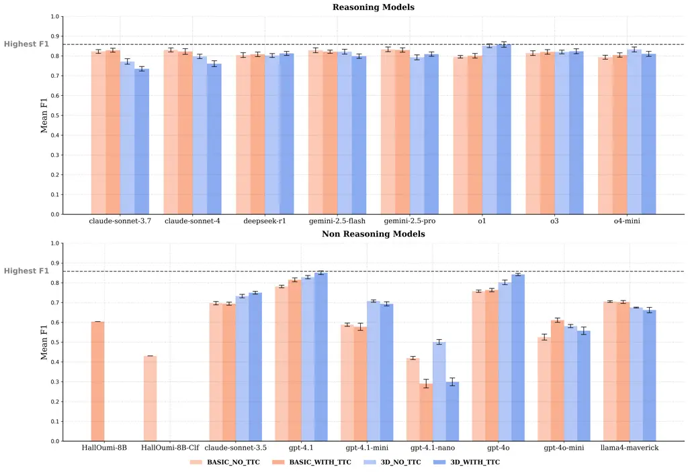
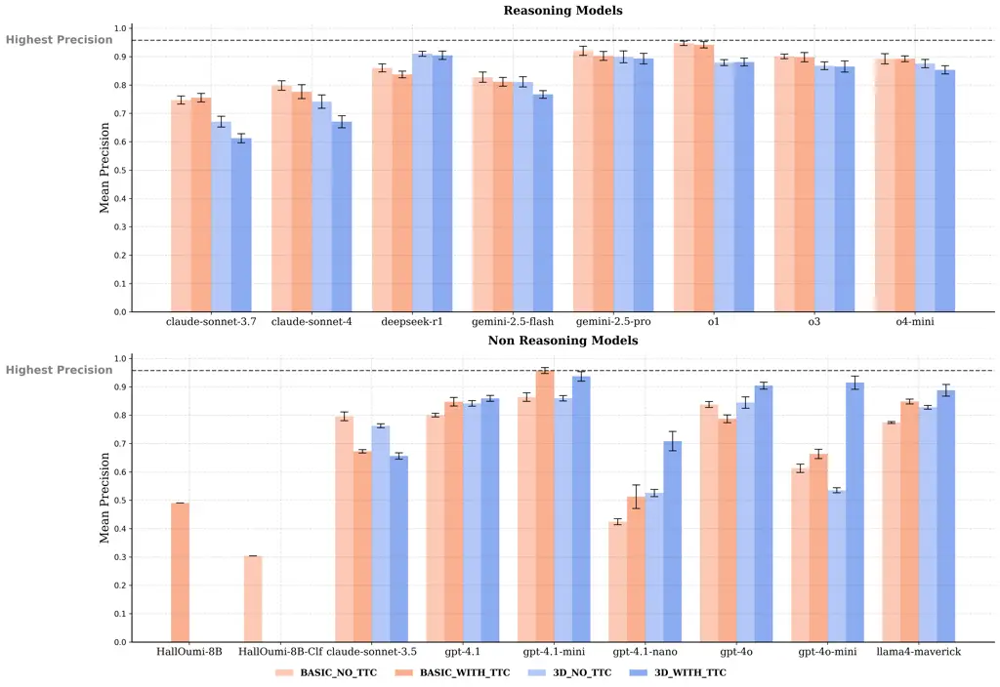
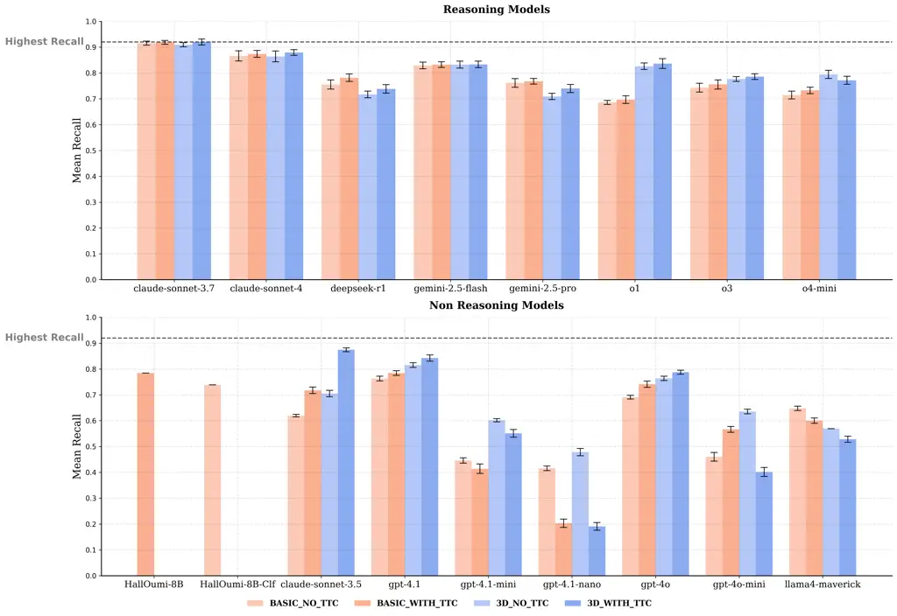

# FECT: Factuality Evaluation of Interpretive AI-Generated Claims in Contact Center Conversation Transcripts

DOI: [XXXXXXX.XXXXXXX](https://doi.org/XXXXXXX.XXXXXXX)Conference: KDD
workshop on Evaluation and Trustworthiness of Agentic and Generative AI
Models ; August 4, 2025; Toronto, ON, CanadaCCS: Computing
methodologies Natural language generationCCS: Computing
methodologies Model verification and validation

Hagyeong Shin

Affiliation: Cresta, Sunnyvale, California, USA email:
<hagyeong.shin@cresta.ai> , Binoy Robin Dalal Affiliation: Cresta,
Sunnyvale, California, USA email: <binoy.dalal@cresta.ai> , Iwona
Bialynicka-Birula Affiliation: Cresta, Sunnyvale, California, USA email:
<iwona.bb@cresta.ai> , Navjot Matharu Affiliation: Cresta, Sunnyvale,
California, USA email: <navjot@cresta.ai> , Ryan Muir
Affiliation: Cresta, Sunnyvale, California, USA email:
<ryan.muir@cresta.ai> , Xingwei Yang Affiliation: Cresta, Sunnyvale,
California, USA email: <xingwei.yang@cresta.ai> and Samuel W. K. Wong
Affiliation: Cresta, University of Waterloo, Waterloo, ON, Canada email:
<sam.wong@cresta.ai> email: <samuel.wong@uwaterloo.ca>

Received  13 June 2025

###### Abstract.

Large language models (LLMs) are known to hallucinate, producing natural
language outputs that are not grounded in the input, reference
materials, or real-world knowledge. In enterprise applications where AI
features support business decisions, such hallucinations can be
particularly detrimental. LLMs that analyze and summarize contact center
conversations introduce a unique set of challenges for factuality
evaluation, because ground-truth labels often do not exist for
analytical interpretations about sentiments captured in the conversation
and root causes of the business problems. To remedy this, we first
introduce a 3D—Decompose, Decouple, Detach—paradigm in the human
annotation guideline and the LLM-judges’ prompt to ground the factuality
labels in linguistically-informed evaluation criteria. We then introduce
FECT, a novel benchmark dataset for Factuality Evaluation of
Interpretive AI-Generated Claims in Contact Center Conversation
Transcripts, labeled under our 3D paradigm. Lastly, we report our
findings from aligning LLM-judges on the 3D paradigm. Overall, our
findings contribute a new approach for automatically evaluating the
factuality of outputs generated by an AI system for analyzing contact
center conversations.

###### Keywords: 

Large Language Models, Evaluation, Trustworthiness, Truthfulness,
Factuality, Hallucination Detection, LLM-as-a-Judge, Benchmark

## 1. Introduction

Figure 1. Most factuality evaluation tasks require fact-checking
evidence, as shown on the left (Li et al., 2023). In contrast, our
evaluation task on the right requires comprehensive consideration of the
conversation context which does not present explicit evidence. Claim 2
is not found in our benchmark, because it is presented solely for the
purpose of illustrating a non-factual claim to contrast with Claim 1.
For the benchmark, we generated only one claim per conversation which
may or may not be considered factual by human evaluators. See Figure 6
for an example of a non-factual claim found in our benchmark dataset.

It remains a significant challenge to evaluate the truthfulness of
outputs generated by large language models (LLMs) and LLM-based AI
agents (Liu et al., 2023; Wei et al., 2025). The most direct way of
detecting LLMs’ hallucinations is to have humans manually evaluate
(“judge”) every LLM-generated response; however, this is a very labor
intensive process, which prohibits scaling to large datasets, or rapidly
iterating on the AI system’s quality. A direction that has been explored
is the development of automated systems that leverage LLMs themselves—an
approach commonly referred to as “LLM-as-a-Judge” or “LLM-Judge”
(Bavaresco et al., 2024; Chiang and Lee, 2023; Liu et al., 2023; Zheng
et al., 2023; Kim et al., 2024). This is a promising direction to take,
yet we observed challenges with our domain-specific evaluation tasks,
namely that some evaluation materials are inherently ambiguous in the
factuality dimension, making it challenging to establish ground-truth
factuality labels.

Our factuality evaluation task originates from an enterprise AI feature
developed to perform business analysis tasks—Cresta’s ai analyst (see
the right panel in Figure 1).¹¹ 1 All conversations presented as
examples in this paper are synthetically generated to reproduce patterns
of original conversations while adhering to Cresta’s data governance
policy. Developed by the authors, AI Analyst leverages LLMs to respond
to enterprise users’ research questions about their contact center
conversations. The input to AI Analyst is a user-provided analysis task
that seeks insightful information from these conversations; for example,
Why did the customer choose the plan? asked about selected
healthcare-enterprise conversations. Leveraging LLMs, AI Analyst
analyzes sampled conversations and generates a single analysis report as
output. This report contains LLM-generated claims, which are
single-sentence summaries of the conversations referenced for the
analysis task. For instance, a claim The customer chose the plan for
specific dentist coverage can be the response to the analysis task
aforementioned. In other words, enterprise users of our AI Analyst often
request analysis tasks that require deep research, and our LLM-generated
claims are often neither verbatim nor near-verbatim copies of the
conversation; most claims are analytical interpretations made about the
conversation. Thus, in the context of our AI Analyst, the factuality
evaluation task is to confirm that the claim---an analytical
interpretation of the conversation made in response to the analysis
task---is grounded in the referenced conversation.²² 2 Our definition of
factuality only takes into account the claim and the referenced
conversation and does not include evaluating whether the claim
adequately satisfies the analysis task. The latter is an orthogonal
requirement outside the scope of this work.

There has been substantial effort to detect hallucinations made by LLMs
(Li et al., 2023; Lin et al., 2021; Bao et al., 2024; Luo et al., 2024;
Tang et al., 2024; Iqbal et al., 2024; Wang et al., 2020). However, this
body of work focuses on evaluating the truthfulness of LLM outputs by
straightforward fact-checking illustrated in the left panel of Figure 1.
Reference materials often contain explicit evidence for LLMs to extract
information from, and an evaluator’s task is to confirm whether the
explicit evidence verifies the LLM output or not. In contrast, most
contact center conversations do not contain explicit evidence to verify
the LLM-generated claims. For instance, Claim 1 in Figure 1 The customer
chose the plan for specific dentist coverage can be verified only when
an evaluator considers the context of the customer’s message Let’s go
ahead and make the change now regarding the VivaCare Plus Dental plan
and the affirmative message Yes, there’s a specific dentist we want to
use. In addition, the evaluator is required to judge whether the link
between customer’s messages and the conversational context verifies the
relation stated in Claim 1, that is, the customer chose the plan
specifically for the specific dentist coverage. Thus, the factuality
evaluation of such claims involves evaluating the factuality of
subjective analytical interpretations made about the conversation, which
cannot be done by straightforward fact-checking. This nature of our AI
Analyst therefore introduces a challenge seldom presented in existing
hallucination detection tasks.

Figure 2. Overview of our methodology to develop a reliable LLM-judge
for factuality evaluations. We start with Phase 1 where we align human
annotators’ judgments with the guideline of the 3D paradigm (described
in Section 2.2). We then identify tasks with ambiguous factuality to
achieve a dataset with ground-truth labels. In Phase 2, we align
LLM-judges with the prompt following the 3D paradigm.

Another challenge in our factuality evaluation task is that our
LLM-generated claims about analytical interpretations of the
conversation often do not yield a ground truth label of factuality. Many
evaluation tasks are inherently ambiguous (Aroyo and Welty, 2015; Gordon
et al., 2022; Schaekermann et al., 2020; Swayamdipta et al., 2020; Zhang
et al., 2023); our tasks exhibit similar ambiguity due to the analytical
nature of the claims. To our knowledge, these challenges—factuality
evaluations of analytical interpretations and ambiguities in ground
truth factuality—have not been addressed directly in the context of
contact center conversations. The most related works in this type of
factuality evaluation are studies that assess the factuality of dialog
summarization (Wang et al., 2022; Akani et al., 2024; Tang et al., 2021)
and the “extreme summarization” dataset of news articles (Narayan
et al., 2018; Wang et al., 2020). It is essential to address these
challenges within the context of contact center interactions, which are
characterized by distinctive features such as the use of
industry-specific terminology, agent hand-offs, and the growing
integration of human and AI agents.

To address this gap, we propose a methodology using LLM-judges to detect
non-factual analytical claims, illustrated in Figure 2. Beginning with
Phase 1, we first sampled pairs of conversation and claim and had human
experts label the factuality of the claims. Unlike previous approaches
in LLM-judge development, where granular evaluation steps only become a
focus during the stage of LLM prompt iterations (Metropolitansky and
Larson, 2025; Tang et al., 2024), we applied granular evaluation steps
starting from the stage of human annotation (3D steps guideline; see
Section 2.2). After the factuality labeling, we identified claims for
which human annotators can reach consensus on factuality, as well as
those where agreement will lack due to the inherently subjective nature
of the judgment. Conversation-claim pairs which humans could reasonably
judge as both factual and non-factual were deliberately omitted from the
dataset, since no single ground-truth label could be established for
them. In Phase 2, we aligned LLM-judges with the prompt following the 3D
paradigm so that LLM-judges are aligned on the granular evaluation
process employed by human annotators. What sets our approach apart in
developing reliable LLM-judges is the deliberate alignment with a
structured and systematic evaluation paradigm.

Our paper thus makes the following key contributions:

1.  (1)
    We introduce the 3D—Decompose, Decouple, Detach—paradigm that
    grounds human evaluators’ factuality annotations on
    linguistically-informed judgments and achieves the inter-annotator
    agreement score of 0.82.
2.  (2)
    We publish FECT, a benchmark dataset for assessing factuality of
    interpretive claims about contact center conversations, publicly
    available on
    [https://github.com/cresta/fect](https://github.com/cresta/fect).
3.  (3)
    We compare the performance of different LLM-judges on FECT and share
    the resulting findings. Aligning LLM-judges on the 3D paradigm can
    achieve a mean F1 of 0.86 without fine-tuning or extensive prompt
    optimizations.

## 2. FECT dataset with human agreement

### 2.1. Data collection

An initial dataset was created by sampling 17 analysis tasks submitted
to the AI Analyst. These tasks were sampled based on salient needs that
our enterprise customers across different industry verticals valued and
requested. For each of the 17 tasks, 30 conversations were sampled to
create LLM-generated claims. In other words, one claim was created as a
summary of one conversation, creating 30 claims per analysis task, 510
in total. Our proprietary dataset will not be published, adhering to
Cresta’s data governance standard. Thus, we created a synthetic dataset
of conversations between fictitious customers and fictitious company
contact centers that exhibit the same properties and challenges as those
we observed in real contact center conversations.

### 2.2. Human evaluation guideline

Figure 3. The visualization of our 3D guideline used by human evaluators
in annotating the factuality of claims. Annotators verified information
from decomposed claims in Steps 1-3. Decomposed parts of claims are
decoupled in Steps 1-3, into parts with concrete meanings and parts
about subjective interpretations of the conversation. In Step 4,
annotators verified the relation between entities, which was detached
from their meanings. In this example, information required in Steps 1
through 4 are verified by the conversation, thus the claim is judged as
factual.

From an initial round of unguided factuality labeling, we observed that
different annotators had different understandings of what qualifies as
“factual” in evaluating analytical claims. Thus, annotators’ judgments
needed to be grounded on a shared systematic evaluation paradigm rather
than on each annotator’s own understanding of factuality. To achieve
this, we established the guideline under the 3D—Decompose, Decouple,
Detach---paradigm³³ 3 3D paradigm is developed based on a linguistics
and compositional semantics framework (see (Szabó, 2020) for an
overview). Specific linguistics concepts utilized in the guideline
include constituency, semantic decomposition, phrase structures,
denotation, connotation, constitutionality, compositionality, and
form-meaning correspondence. that led annotators to ground their
factuality labels on linguistically-informed evaluation criteria (Figure
3). In the beginning of each labeling task, annotators were first
instructed to decompose the claim into minimal informational units. In
practice, annotators parsed the sentence into meaningful phrases or at
word boundaries (e.g., The customer chose the plan for specific dentist
coverage $`\rightarrow`$ customer, chose, plan, specific, dentist
coverage, for specific dentist coverage, etc.). After the decomposition
of the claim, annotators decoupled words that have concrete meanings
(e.g., plan) from words that reflect subjective interpretations of the
conversation (e.g., chose … (specifically) for).

Step 1 of the guideline (see Figure 3) instructed to verify words of
concrete meanings by finding explicit mentions or references of those
words. In practice, those were often nouns and noun phrases (e.g.,
customer, plan, dentist, dentist coverage), which are interpreted with
generally-shared meanings across English speakers and most of the times
do not reflect any subjective interpretations in our claims. Words that
reflect subjective interpretations of the conversation were verified
with explicit or implicit evidence.

Step 2 of our guideline (see Figure 3) instructed annotators to verify
the words that modify the words with concrete meanings. In LLM-generated
claims, those adjectives often reflect LLM’s own interpretations of the
conversation. Annotators were instructed to find either explicit or
implicit evidence to verify these descriptive words and phrases as
factual. In other words, when the conversation explicitly contains
messages such as “We want to use a specific dentist” (explicit evidence)
or “We want to use one particular dentist” (specific dentist coverage is
implied), the factuality of the descriptive phrase specific could be
verified.

Step 3 in our guideline instructed to identify words about subjective
interpretations made based on the entire conversation. In the context of
our claims, these words were descriptions of customer’s sentiment,
attitudes or preferences, and behaviors that reflect those sentiments,
attitudes or preferences. In our example, such words were satisfaction,
confusion or frustration as well as chose in the claim The customer
chose the plan for specific dentist coverage, indicating customer’s
actions reflecting their preferences. Our annotators were instructed to
verify these words by finding implicit evidence from the conversation.
Thus, even when the customer’s message does not explicitly state that
“I’ll chose the plan,” annotators found the evidence that implies
customer’s choosing, such as Let’s go ahead and make the change now (in
Figure 3) to verify that the claim is factual.

After verifying the decomposed and decoupled information (Steps 1-3),
annotators detached the structure of the claim (thus relation between
words) from the meaning of the claim. That is, Step 4 instructed to
verify only the relation between words (who did what to whom, why and
how), ignoring the exact meanings of those wh-words. The relation was
verified by finding explicit or implicit evidence. In the claim The
customer chose the plan for specific dentist coverage, the relation to
verify was the causal relation between customer’s choosing the plan and
the specific dentist coverage. In the conversation referenced for the
claim in Figure 3, the context that the customer mentioned “particular
dentist” and then proceeding to change the plan is considered an implied
evidence showing that the relation stated in the claim is factual.

Finally, the claim was labeled as either factual or non-factual: It was
labeled as factual only if all pieces of information being asked in
Steps from 1 to 4 were verified. If any parts of the information could
not be verified, the claim was labeled as non-factual. Applying the 3D
paradigm to our guideline improved the inter-annotator agreement score
between two annotators from 0.28 (Cohen’s $`\kappa`$ observed from
unguided labeling; considered as “fair” agreement) to 0.58 (considered
as “moderate” agreement). Further processes to improve the agreement
score is described in 2.3 and 2.4.

### 2.3. Identifying ambiguity in human factuality evaluations

Figure 4. Claim 3 exemplifies tasks that could achieve human agreement
in factuality evaluation, despite the fact that the paired conversation
does not include direct references and the “satisfaction” is implied in
highlighted messages. The conversation referenced for Claim 4 does not
include messages that imply “frustration”. The conversation referenced
for Claim 5 does not include messages that imply the relation stated in
Claim 5. Thus, verifying Claims 4 about sentiment and Claim 5 about
relation required subjective assumptions and did not yield human
agreement on their factuality.

Following the factuality labeling, annotators had multiple sessions to
discuss agreement on the factuality labels. As expected, parts of claims
reflecting subjective interpretations of the conversation (i.e.,
information needed to be verified in Steps 2-4 in our guideline and
Figure 3) were likely to introduce variances across human evaluators. As
long as the evidence was implied by the actual messages in the
conversation, human evaluators could reach an agreement on the claims’
factuality without making subjective assumptions. For instance, Claim 3
in Figure 4 required the verification of the sentiment “satisfaction”
and its relation with VividCare Essential Plan. Human annotators agreed
that there is a concrete message That’s great news!, uttered when they
were asked about the coverage of a certain doctor under the VividCare
Essential Plan, clearly implied the customer’s “satisfaction.”

In contrast, human evaluators showed disagreement when the conversation
did not contain any concrete message to ground implicit evidence so that
they were led to use subjective assumptions to make judgments. In our
dataset, claims about (1) sentiment captured from the conversation
and/or (2) relation between entities identified from the conversation
were identified as major categories introducing ambiguity in factuality
labeling. For instance, Claim 4 in Figure 4 doesn’t have any messages
where customer’s frustration is implied. Some evaluators interpreted the
customer’s message I’m concerned because I haven’t received my VividCare
Essentials Card yet, and I’m not sure what the process is to get it as
an expression of a concern, not making any further assumptions. However,
other evaluators assumed that the concern could have led to the
frustration mentioned in the claim. In other words, verifying Claim 4
introduced room for evaluators to make subjective assumptions to verify
“frustration.”

Claim 5 in Figure 4 states that the root cause of the customer’s choice
was the comprehensive coverage. Some evaluators suggested that the
customer’s message I’m happy with the coverage of the new plan indicates
the causal relation between customer’s choice and comprehensive
coverage, thus labeling the Claim 5 as factual. Other evaluators
suggested that the customer’s moving implied in the conversation is a
more plausible cause of the customer’s plan choice. In making these two
interpretations, human evaluators used their own subjective assumptions
to verify the relation.

### 2.4. FECT benchmark dataset

Conversation-claim pairs that are identified as inherently ambiguous to
evaluate are not desired in a benchmark dataset: Claims without a
ground-truth factuality cannot indicate whether the LLM-judges’
factuality labels are correct or incorrect. We thus excluded those
ambiguous pairs from our dataset. The final agreement score of 0.82
(considered as “almost perfect” agreement) was achieved after we
excluded ambiguous tasks. After we achieved the near-perfect agreement,
we confirmed that our 3D guideline and ambiguity identification and
reduction process (Phase 1 in Figure 2) indeed ensured alignment between
human evaluators. The benchmark dataset of synthetic conversations was
labeled by 5 human experts in the domains of ML, AI, NLP, and
linguistics. Our resulting benchmark dataset, FECT (Factuality
Evaluation of Interpretive AI-Generated Claims in Contact Center
Conversation Transcripts), consists of 410 pairs (345 factual; 65
non-factual) of LLM-generated claims deduced from synthetically
generated conversations
([https://github.com/cresta/fect](https://github.com/cresta/fect)).⁴⁴ 4
The distribution of factual and non-factual labels in the the synthetic
conversation dataset is very similar to the one we observed when
analyzing real enterprise customers’ use cases. This suggests that
LLM-judges developed using the synthetic dataset will likely translate
into improvements in LLM-judges employed in real contact center
applications. Label distributions in our dataset are reported in Table

1.

|             | Agreement achieved | Agreement not achieved |          |
| ----------- | ------------------ | ---------------------- | -------- |
|             | FECT               | Sentiment              | Relation |
| Factual     | 345                | 31                     | 53       |
| Non-factual | 65                 |                        |          |
| Total       | 410                |                        |          |

Table 1. Distributions of factual and non-factual claims in our dataset
and claims that required assumption-driven judgments for factuality
labeling. Our benchmark dataset consists of the boldfaced portion where
factuality could be determined based on evidence-driven judgments.

## 3. Alignment between humans and LLM-Judges

### 3.1. Experimental setup

Figure 5. Means and 95% CIs of F1s achieved with reasoning models and
non-reasoning models and with four prompts. Dashed horizontal lines
indicate the highest F1 of 0.86 achieved with o1 with the 3D_WITH_TTC
prompt. Note that our 3D prompt was optimized for its structure and
formatting only with the o1 model, and we didn’t perform extensive
prompt iterations with any of the models.

The goal of our LLM-judge was to achieve optimal alignment with human
evaluators not only on the final factuality labels but also on the
evaluation paradigm. For this, we optimized the structure and the
formatting of our 3D guideline for OpenAI’s o1 model to obtain the 3D
prompt (see B.1 and B.2). The prompt optimization process involved
simple formatting edits without any extensive prompt iterations. In
order to test LLM-judges’ intrinsic capability to align with human
evaluators’ factuality labels without additional explicit reasoning
cues, we compared our 3D prompts with BASIC prompts, which asked to
judge the factuality without the granular 3D steps (“Given a
conversation and a claim about that conversation, determine if the claim
is factual, i.e., supported by the conversation” in B.3 and B.4).

In addition to ablating the 3D prompt in the BASIC prompt, we tested
prompts that allowed LLM-judges to generate intermediate reasoning
tokens before generating the final factuality label, thus leveraging
test-time compute (TTC). Test-time compute has been employed as a common
approach to improving an LLM’s accuracy, especially on tasks that
require complex multi-step reasoning. The approach first emerged in the
form of chain-of-thought prompting (Wei et al., 2023) and has since
become a primary mechanism for improving LLM performance (Zhang et al.,
2025). Overall, our experiment tested prompts 3D_WITH_TTC and
BASIC_WITH_TTC, which instructed the LLM to generate intermediate
outputs before the factuality label; prompts 3D_NO_TTC and BASIC_NO_TTC,
which did not require any intermediate outputs to be generated before
the factuality label. See Appendix B for the 4 prompts used in our
experiments.

We tested 17 LLMs with the 4 different prompt variants described above
and the results can be found in Figure 5 (see Table 3 for the exact
versions of the LLMs used in the experiment). We evaluated a
representative mix of reasoning and non-reasoning models and 2 models
fine-tuned specifically for hallucination detections (HallOumi-8B and
HallOumi-8B-Classifier). Reasoning models refers to the group of models
which generate internal reasoning tokens before the final output, in
addition to the extra tokens explicitly elicited by the \_WITH_TTC
prompt variants. In order to observe the self-consistency of each model,
we ran each model with each of the 4 prompts 10 times.

|                   |                        |                    |               |                 |
| ----------------- | ---------------------- | ------------------ | ------------- | --------------- |
|                   | F1 scores (mean ± std) |                    |               |                 |
| Model Name        | BASIC\_ NO\_ TTC       | BASIC\_ WITH\_ TTC | 3D\_ NO\_ TTC | 3D\_ WITH\_ TTC |
| claude-sonnet-3.5 | 0.70 ± 0.01            | 0.69 ± 0.01        | 0.73 ± 0.01   | 0.75 ± 0.01     |
| claude-sonnet-3.7 | 0.82 ± 0.01            | 0.83 ± 0.01        | 0.77 ± 0.02   | 0.73 ± 0.02     |
| claude-sonnet-4   | 0.83 ± 0.01            | 0.82 ± 0.01        | 0.80 ± 0.01   | 0.76 ± 0.02     |
| deepseek-r1       | 0.80 ± 0.02            | 0.81 ± 0.02        | 0.80 ± 0.01   | 0.81 ± 0.01     |
| gemini-2.5-flash  | 0.83 ± 0.02            | 0.82 ± 0.01        | 0.82 ± 0.02   | 0.80 ± 0.02     |
| gemini-2.5-pro    | 0.83 ± 0.02            | 0.83 ± 0.02        | 0.79 ± 0.02   | 0.81 ± 0.02     |
| gpt-4.1           | 0.78 ± 0.01            | 0.81 ± 0.01        | 0.83 ± 0.01   | 0.85 ± 0.02     |
| gpt-4.1-mini      | 0.59 ± 0.01            | 0.58 ± 0.03        | 0.71 ± 0.01   | 0.69 ± 0.01     |
| gpt-4.1-nano      | 0.42 ± 0.01            | 0.29 ± 0.03        | 0.50 ± 0.02   | 0.31 ± 0.04     |
| gpt-4o            | 0.76 ± 0.01            | 0.76 ± 0.01        | 0.80 ± 0.02   | 0.84 ± 0.01     |
| gpt-4o-mini       | 0.53 ± 0.02            | 0.61 ± 0.02        | 0.58 ± 0.01   | 0.56 ± 0.03     |
| llama4-maverick   | 0.71 ± 0.01            | 0.70 ± 0.01        | 0.67 ± 0.00   | 0.67 ± 0.03     |
| o1                | 0.80 ± 0.01            | 0.80 ± 0.02        | 0.85 ± 0.01   | 0.86 ± 0.02     |
| o3                | 0.81 ± 0.02            | 0.82 ± 0.02        | 0.82 ± 0.01   | 0.82 ± 0.02     |
| o4-mini           | 0.79 ± 0.02            | 0.81 ± 0.02        | 0.83 ± 0.02   | 0.81 ± 0.02     |
| HallOumi-8B       | –                      | 0.60 ± 0.00        | –             | –               |
| HallOumi-8B-Clf   | 0.43 ± 0.00            | –                  | –             | –               |

Table 2. Mean and standard deviation of F1 scores across 17 models under
4 prompting modes. Boldfaced scores indicate the best mean (with the
lowest standard deviation in case of a tie) within each prompt mode.

### 3.2. Results

F1 scores on the task of detecting non-factual claims in FECT are
reported in Figure 5 (see precision scores in Figure 7 and recall scores
in Figure 8). Numeric scores can be found in Table 2, 4 and 5. In all
tables and figures, we report the mean and 95% confidence intervals
(CIs) of scores obtained from each model per each prompt mode
($`CI_{95\%}=t_{0.025,\,df=9}\times\frac{s}{\sqrt{n}}=2.262\times\frac{s}{\sqrt{10}}`$,
$`s`$ = sample standard deviation of F1/Precision/Recall, $`n`$ = 10
runs, $`df=n-1`$).

Overall, reasoning models performed better with all 4 types of prompts
compared to non-reasoning models (Figure 5). OpenAI’s o1 model showed
the best score with the 3D_WITH_TTC prompt. This was expected, because
our prompt iterations were performed to optimize o1’s performance.
Looking into reasoning models’ results first (the top row in Figure 5),
Deepseek-r1 and o3 showed balanced scores across different prompts,
while yielding slightly higher scores with WITH_TTC prompts. This
indicates that these models can consistently align with humans on
reasoning tasks even without explicit reasoning cues provided in the
prompt, while marginal improvement can be expected with the additional
test-time compute step. Two Claude-Sonnet models and two Gemini models
resulted in better scores with BASIC prompts. We address this result in
the discussion section.

Non-reasoning models were more sensitive to the different prompting
techniques, with 3D prompts improving most models’ alignment on the
multi-step evaluation task. Comparing scores from NO_TTC prompts, all
models except Llama4-Maverick showed higher scores with the 3D prompts
than with the BASIC prompts. In the case of frontier models, such as
Claude-Sonnet-3.5, GPT-4.1, and GPT-4o, adding test-time compute
additionally boosted the models’ performance, bringing the OpenAI
non-reasoning models GPT-4.1 and GPT-4o almost on par with the best
reasoning models. This result indicates that when explicit reasoning
cues are combined with the test-time compute, non-reasoning models have
the capability to align with humans’ judgments, to a similar extent as
reasoning models do.

Interestingly, and somewhat counterintuitively, smaller
models—GPT-4.1-mini and GPT-4.1-nano (intended to approximate GPT-4.1)
and GPT-4o-mini (intended to approximate GPT-4o)—showed markedly worse
performance when test-time compute was added. This is especially
apparent with the smallest of these models—GPT-4.1-nano—and more common
with the 3D prompt than with the BASIC prompt. We hypothesize that this
is because the smaller models do not have enough capacity to perform the
complex reasoning required by the task, so giving them the capacity to
perform this reasoning not only does not improve, but can even greatly
hurt performance. The key takeaway from this observation is that adding
test-time compute does not automatically boost performance and can
actually degrade it in the case in which the task involves complex
reasoning and the model used is small.

Lastly, HallOumi-8B models which are fine-tuned specifically for
hallucination detection achieved comparable scores to much larger
models. HallOumi-8B (a generative model; comparing its score with other
BASIC_WITH_TTC scores) showed similar scores to GPT-4.1-mini and
GPT-4o-mini. HallOumi-8B-Classifier (a classifier model; comparing its
score with other BASIC_NO_TTC scores) showed comparable scores to
GPT-4.1-nano. This result confirms the contributions of fine-tuning
reported by the developers of the models (Jeremy Greer et al., 2025).

## 4. Discussion and Future Work

We discussed that human alignment in benchmark labeling can be ensured
by breaking down evaluation tasks into granular steps and by grounding
judgments of each step to linguistically-informed concepts. When the
ambiguity can be removed from evaluation tasks, reasoning LLMs show good
alignment with the human-labeled benchmark without extensive prompt
iterations or further fine-tuning. When the human evaluation process can
be broken down into granular steps (as in our 3D prompt), frontier
non-reasoning models with test-time compute can reach a similar level of
alignment as reasoning models. It is our future work to optimize the
alignment among humans and between humans and LLM-judges on ambiguous
tasks, which were left out from our benchmark (c.f., Subsection 2.3 and
Table 1).

Among the models we tested, o1 with the 3D_WITH_TTC prompt yielded the
highest F1 score (0.86). Other reasoning models, such as Claude-Sonnet,
Gemini, or Deepseek-r1 yielded comparable F1 scores to o1 with BASIC
prompts (0.80–0.83), but did not benefit from the 3D prompts as o1 did.
The boost in o1’s F1 scores after switching from BASIC to 3D prompts is
primarily driven by striking a better balance between precision and
recall. Since we performed prompt iterations only with the o1 model, it
is possible that the other reasoning models’ performances can likewise
be improved by optimizing the prompts for those models. It is our future
work to investigate optimizations of our 3D prompt with different types
of reasoning models other than o1.

## 5. Conclusion

As AI systems are used for tasks that require human-level intelligence,
evaluating their output will also require human-level intelligence. In
this paper, we presented a method to automate evaluations that involve
judging the factuality of analytical interpretations about contact
center conversations. Our evaluation tasks could not be done by
extracting information from reference materials—instead, implicit
understanding of the conversation was needed to evaluate the factuality
of analysis made about the conversation. To establish the ground-truth
labels for the factuality of the analytical claims, we first identified
a human evaluation process that could ensure alignment between human
evaluators. The second phase was to utilize this evaluation process in
the LLM-judges’ prompt. Based on our experimental results, we conclude
that utilizing reasoning models results in good LLM-judge performances
without further prompt iterations or fine-tuning, while using
non-reasoning models with the explicit instructions and additional
test-time compute offered comparable performances. We believe that our
emphasis on achieving alignment between humans as a starting point for
the development of an automatic evaluation system can contribute to the
evaluation of LLMs and AI systems.

## Acknowledgments

We thank Motoki Wu, Fei Fang and Kai Zou for their helpful suggestions
on our drafts. We are grateful to Robert Kugler and Jake McDermott for
their guidance on adhering to Cresta’s data security and privacy
standards. Lastly, we extend our thanks to our reviewers for their
valuable feedback.

## References

- Akani et al. (2024) Eunice Akani, Benoit Favre, Frederic Bechet, and
  Romain Gemignani. 2024. Increasing faithfulness in human-human dialog
  summarization with Spoken Language Understanding tasks.
  [doi:10.48550/arXiv.2409.10070](https://doi.org/10.48550/arXiv.2409.10070)
  arXiv:2409.10070.
- Anthropic (2024) Anthropic. 2024. Claude 3.5 Sonnet Model Card
  Addendum.
  [https://www-cdn.anthropic.com/fed9cc193a14b84131812372d8d5857f8f304c52/Model_Card_Claude_3_Addendum.pdf](https://www-cdn.anthropic.com/fed9cc193a14b84131812372d8d5857f8f304c52/Model_Card_Claude_3_Addendum.pdf)
- Anthropic (2025a) Anthropic. 2025a. Claude 3.7 Sonnet System Card.
  [https://assets.anthropic.com/m/785e231869ea8b3b/original/claude-3-7-sonnet-system-card.pdf](https://assets.anthropic.com/m/785e231869ea8b3b/original/claude-3-7-sonnet-system-card.pdf)
- Anthropic (2025b) Anthropic. 2025b. System Card: Claude Opus 4 &
  Claude Sonnet 4.
  [https://www-cdn.anthropic.com/6be99a52cb68eb70eb9572b4cafad13df32ed995.pdf](https://www-cdn.anthropic.com/6be99a52cb68eb70eb9572b4cafad13df32ed995.pdf)
- Aroyo and Welty (2015) Lora Aroyo and Chris Welty. 2015. Truth Is a
  Lie: Crowd Truth and the Seven Myths of Human Annotation. _AI
  Magazine_ 36, 1 (March 2015), 15–24.
  [doi:10.1609/aimag.v36i1.2564](https://doi.org/10.1609/aimag.v36i1.2564)
- Bao et al. (2024) Forrest Sheng Bao, Miaoran Li, Renyi Qu, Ge Luo,
  Erana Wan, Yujia Tang, Weisi Fan, Manveer Singh Tamber, Suleman Kazi,
  Vivek Sourabh, Mike Qi, Ruixuan Tu, Chenyu Xu, Matthew Gonzales, Ofer
  Mendelevitch, and Amin Ahmad. 2024. FaithBench: A Diverse
  Hallucination Benchmark for Summarization by Modern LLMs.
  [doi:10.48550/arXiv.2410.13210](https://doi.org/10.48550/arXiv.2410.13210)
  arXiv:2410.13210.
- Bavaresco et al. (2024) Anna Bavaresco, Raffaella Bernardi, Leonardo
  Bertolazzi, Desmond Elliott, Raquel Fernández, Albert Gatt, Esam
  Ghaleb, Mario Giulianelli, Michael Hanna, Alexander Koller, André
  F. T. Martins, Philipp Mondorf, Vera Neplenbroek, Sandro Pezzelle,
  Barbara Plank, David Schlangen, Alessandro Suglia, Aditya K.
  Surikuchi, Ece Takmaz, and Alberto Testoni. 2024. LLMs instead of
  Human Judges? A Large Scale Empirical Study across 20 NLP Evaluation
  Tasks.
  [doi:10.48550/arXiv.2406.18403](https://doi.org/10.48550/arXiv.2406.18403)
  arXiv:2406.18403 \[cs\].
- Chiang and Lee (2023) Cheng-Han Chiang and Hung-yi Lee. 2023. A Closer
  Look into Automatic Evaluation Using Large Language Models.
  [doi:10.48550/arXiv.2310.05657](https://doi.org/10.48550/arXiv.2310.05657)
  arXiv:2310.05657 \[cs\].
- DeepSeek (2025) DeepSeek. 2025. DeepSeek-R1 Release.
  [https://api-docs.deepseek.com/news/news250120](https://api-docs.deepseek.com/news/news250120)
- Google (2025a) Google. 2025a. Gemini 2.5 Flash Preview Model Card.
  [https://storage.googleapis.com/model-cards/documents/gemini-2.5-flash-preview.pdf](https://storage.googleapis.com/model-cards/documents/gemini-2.5-flash-preview.pdf)
- Google (2025b) Google. 2025b. Gemini 2.5 Pro Preview Model Card.
  [https://storage.googleapis.com/model-cards/documents/gemini-2.5-pro-preview.pdf](https://storage.googleapis.com/model-cards/documents/gemini-2.5-pro-preview.pdf)
- Gordon et al. (2022) Mitchell L. Gordon, Michelle S. Lam, Joon Sung
  Park, Kayur Patel, Jeff Hancock, Tatsunori Hashimoto, and Michael S.
  Bernstein. 2022. Jury Learning: Integrating Dissenting Voices into
  Machine Learning Models. In _CHI Conference on Human Factors in
  Computing Systems_. ACM, New Orleans LA USA, 1–19.
  [doi:10.1145/3491102.3502004](https://doi.org/10.1145/3491102.3502004)
- Iqbal et al. (2024) Hasan Iqbal, Yuxia Wang, Minghan Wang,
  Georgi Nenkov Georgiev, Jiahui Geng, Iryna Gurevych, and Preslav
  Nakov. 2024. OpenFactCheck: A Unified Framework for Factuality
  Evaluation of LLMs. In _Proceedings of the 2024 Conference on
  Empirical Methods in Natural Language Processing: System
  Demonstrations_. Association for Computational Linguistics, Miami,
  Florida, USA, 219–229.
  [doi:10.18653/v1/2024.emnlp-demo.23](https://doi.org/10.18653/v1/2024.emnlp-demo.23)
- Jeremy Greer et al. (2025) Jeremy Greer, Manos Koukoumidis,
  Konstantinos Aisopos, and Michael Schuler. 2025. Introducing HallOumi:
  A State-of-the-Art Claim-Verification Model.
  [https://oumi.ai/blog/posts/introducing-halloumi](https://oumi.ai/blog/posts/introducing-halloumi)
- Kim et al. (2024) Seungone Kim, Jamin Shin, Yejin Cho, Joel Jang,
  Shayne Longpre, Hwaran Lee, Sangdoo Yun, Seongjin Shin, Sungdong Kim,
  James Thorne, and Minjoon Seo. 2024. Prometheus: Inducing Fine-grained
  Evaluation Capability in Language Models.
  [doi:10.48550/arXiv.2310.08491](https://doi.org/10.48550/arXiv.2310.08491)
  arXiv:2310.08491 \[cs\].
- Li et al. (2023) Junyi Li, Xiaoxue Cheng, Wayne Xin Zhao, Jian-Yun
  Nie, and Ji-Rong Wen. 2023. HaluEval: A Large-Scale Hallucination
  Evaluation Benchmark for Large Language Models.
  [doi:10.48550/arXiv.2305.11747](https://doi.org/10.48550/arXiv.2305.11747)
  arXiv:2305.11747.
- Lin et al. (2021) Stephanie Lin, Jacob Hilton, and Owain Evans. 2021.
  TruthfulQA: Measuring How Models Mimic Human Falsehoods.
  [https://arxiv.org/abs/2109.07958v2](https://arxiv.org/abs/2109.07958v2)
- Liu et al. (2023) Yang Liu, Dan Iter, Yichong Xu, Shuohang Wang,
  Ruochen Xu, and Chenguang Zhu. 2023. G-Eval: NLG Evaluation using
  Gpt-4 with Better Human Alignment. In _Proceedings of the 2023
  Conference on Empirical Methods in Natural Language Processing_.
  Association for Computational Linguistics, Singapore, 2511–2522.
  [doi:10.18653/v1/2023.emnlp-main.153](https://doi.org/10.18653/v1/2023.emnlp-main.153)
- Luo et al. (2024) Wen Luo, Tianshu Shen, Wei Li, Guangyue Peng,
  Richeng Xuan, Houfeng Wang, and Xi Yang. 2024. HalluDial: A
  Large-Scale Benchmark for Automatic Dialogue-Level Hallucination
  Evaluation.
  [doi:10.48550/arXiv.2406.07070](https://doi.org/10.48550/arXiv.2406.07070)
  arXiv:2406.07070 version: 1.
- Meta (2025) Meta. 2025. Llama 4.
  [https://github.com/meta-llama/llama-models/blob/main/models/llama4/MODEL_CARD.md](https://github.com/meta-llama/llama-models/blob/main/models/llama4/MODEL_CARD.md)
- Metropolitansky and Larson (2025) Dasha Metropolitansky and Jonathan
  Larson. 2025. Towards Effective Extraction and Evaluation of Factual
  Claims.
  [doi:10.48550/arXiv.2502.10855](https://doi.org/10.48550/arXiv.2502.10855)
  arXiv:2502.10855 \[cs\].
- Narayan et al. (2018) Shashi Narayan, Shay B. Cohen, and Mirella
  Lapata. 2018. Don’t Give Me the Details, Just the Summary! Topic-Aware
  Convolutional Neural Networks for Extreme Summarization. In
  _Proceedings of the 2018 Conference on Empirical Methods in Natural
  Language Processing_. Association for Computational Linguistics,
  Brussels, Belgium, 1797–1807.
  [doi:10.18653/v1/D18-1206](https://doi.org/10.18653/v1/D18-1206)
- OpenAI (2024a) OpenAI. 2024a. GPT-4.1 nano.
  [https://platform.openai.com/docs/models/gpt-4.1-nano](https://platform.openai.com/docs/models/gpt-4.1-nano)
- OpenAI (2024b) OpenAI. 2024b. GPT-4o mini: advancing cost-efficient
  intelligence.
  [https://openai.com/index/gpt-4o-mini-advancing-cost-efficient-intelligence/](https://openai.com/index/gpt-4o-mini-advancing-cost-efficient-intelligence/)
- OpenAI (2024c) OpenAI. 2024c. GPT-4o System Card.
  [https://cdn.openai.com/gpt-4o-system-card.pdf](https://cdn.openai.com/gpt-4o-system-card.pdf)
- OpenAI (2024d) OpenAI. 2024d. OpenAI o1 System Card.
  [https://cdn.openai.com/o1-system-card-20241205.pdf](https://cdn.openai.com/o1-system-card-20241205.pdf)
- OpenAI (2025a) OpenAI. 2025a. GPT-4.1.
  [https://platform.openai.com/docs/models/gpt-4.1](https://platform.openai.com/docs/models/gpt-4.1)
- OpenAI (2025b) OpenAI. 2025b. GPT-4.1 mini.
  [https://platform.openai.com/docs/models/gpt-4.1-mini](https://platform.openai.com/docs/models/gpt-4.1-mini)
- OpenAI (2025c) OpenAI. 2025c. OpenAI o3 and o4-mini System Card.
  [https://cdn.openai.com/pdf/2221c875-02dc-4789-800b-e7758f3722c1/o3-and-o4-mini-system-card.pdf](https://cdn.openai.com/pdf/2221c875-02dc-4789-800b-e7758f3722c1/o3-and-o4-mini-system-card.pdf)
- Oumi Community (2025) Oumi Community. 2025. Oumi: an Open, End-to-end
  Platform for Building Large Foundation Models.
  [https://github.com/oumi-ai/oumi](https://github.com/oumi-ai/oumi)
- Panos Achlioptas et al. (2025) Panos Achlioptas, Jeremy Greer,
  Konstantinos Aisopos, Michael Schuler, Oussama Elachqar, and Emmanouil
  Koukoumidis. 2025. HallOumi-8B-classifier.
  [https://huggingface.co/oumi-ai/HallOumi-8B-classifier](https://huggingface.co/oumi-ai/HallOumi-8B-classifier)
- Schaekermann et al. (2020) Mike Schaekermann, Graeme Beaton, Elaheh
  Sanoubari, Andrew Lim, Kate Larson, and Edith Law. 2020.
  Ambiguity-aware AI Assistants for Medical Data Analysis. In
  _Proceedings of the 2020 CHI Conference on Human Factors in Computing
  Systems_. ACM, Honolulu HI USA, 1–14.
  [doi:10.1145/3313831.3376506](https://doi.org/10.1145/3313831.3376506)
- Swayamdipta et al. (2020) Swabha Swayamdipta, Roy Schwartz, Nicholas
  Lourie, Yizhong Wang, Hannaneh Hajishirzi, Noah A. Smith, and Yejin
  Choi. 2020. Dataset Cartography: Mapping and Diagnosing Datasets with
  Training Dynamics. In _Proceedings of the 2020 Conference on Empirical
  Methods in Natural Language Processing (EMNLP)_. Association for
  Computational Linguistics, Online, 9275–9293.
  [doi:10.18653/v1/2020.emnlp-main.746](https://doi.org/10.18653/v1/2020.emnlp-main.746)
- Szabó (2020) Zoltán Gendler Szabó. 2020. Compositionality.
  [https://plato.stanford.edu/archives/fall2024/entries/compositionality/](https://plato.stanford.edu/archives/fall2024/entries/compositionality/)
- Tang et al. (2024) Liyan Tang, Philippe Laban, and Greg Durrett. 2024.
  MiniCheck: Efficient Fact-Checking of LLMs on Grounding Documents. In
  _Proceedings of the 2024 Conference on Empirical Methods in Natural
  Language Processing_. Association for Computational Linguistics,
  Miami, Florida, USA, 8818–8847.
  [doi:10.18653/v1/2024.emnlp-main.499](https://doi.org/10.18653/v1/2024.emnlp-main.499)
- Tang et al. (2021) Xiangru Tang, Arjun Nair, Borui Wang, Bingyao Wang,
  Jai Desai, Aaron Wade, Haoran Li, Asli Celikyilmaz, Yashar Mehdad, and
  Dragomir Radev. 2021. CONFIT: Toward Faithful Dialogue Summarization
  with Linguistically-Informed Contrastive Fine-tuning.
  [doi:10.18653/v1/2022.naacl-main.415](https://doi.org/10.18653/v1/2022.naacl-main.415)
- Wang et al. (2020) Alex Wang, Kyunghyun Cho, and Mike Lewis. 2020.
  Asking and Answering Questions to Evaluate the Factual Consistency of
  Summaries. In _Proceedings of the 58th Annual Meeting of the
  Association for Computational Linguistics_. Association for
  Computational Linguistics, Online, 5008–5020.
  [doi:10.18653/v1/2020.acl-main.450](https://doi.org/10.18653/v1/2020.acl-main.450)
- Wang et al. (2022) Bin Wang, Chen Zhang, Yan Zhang, Yiming Chen, and
  Haizhou Li. 2022. Analyzing and Evaluating Faithfulness in Dialogue
  Summarization.
  [doi:10.48550/arXiv.2210.11777](https://doi.org/10.48550/arXiv.2210.11777)
  arXiv:2210.11777.
- Wei et al. (2025) Jason Wei, Zhiqing Sun, Spencer Papay, Scott
  McKinney, Jeffrey Han, Isa Fulford, Hyung Won Chung, Alex Tachard
  Passos, William Fedus, and Amelia Glaese. 2025. BrowseComp: A Simple
  Yet Challenging Benchmark for Browsing Agents.
  [doi:10.48550/arXiv.2504.12516](https://doi.org/10.48550/arXiv.2504.12516)
  arXiv:2504.12516.
- Wei et al. (2023) Jason Wei, Xuezhi Wang, Dale Schuurmans, Maarten
  Bosma, Brian Ichter, Fei Xia, Ed Chi, Quoc Le, and Denny Zhou. 2023.
  Chain-of-Thought Prompting Elicits Reasoning in Large Language Models.
  [doi:10.48550/arXiv.2201.11903](https://doi.org/10.48550/arXiv.2201.11903)
  arXiv:2201.11903 \[cs\].
- Zhang et al. (2025) Qiyuan Zhang, Fuyuan Lyu, Zexu Sun, Lei Wang,
  Weixu Zhang, Wenyue Hua, Haolun Wu, Zhihan Guo, Yufei Wang, Niklas
  Muennighoff, Irwin King, Xue Liu, and Chen Ma. 2025. A Survey on
  Test-Time Scaling in Large Language Models: What, How, Where, and How
  Well?
  [doi:10.48550/arXiv.2503.24235](https://doi.org/10.48550/arXiv.2503.24235)
  arXiv:2503.24235.
- Zhang et al. (2023) Wenbo Zhang, Hangzhi Guo, Ian D. Kivlichan,
  Vinodkumar Prabhakaran, Davis Yadav, and Amulya Yadav. 2023. A
  Taxonomy of Rater Disagreements: Surveying Challenges & Opportunities
  from the Perspective of Annotating Online Toxicity.
  [doi:10.48550/arXiv.2311.04345](https://doi.org/10.48550/arXiv.2311.04345)
  arXiv:2311.04345 \[cs\].
- Zheng et al. (2023) Lianmin Zheng, Wei-Lin Chiang, Ying Sheng, Siyuan
  Zhuang, Zhanghao Wu, Yonghao Zhuang, Zi Lin, Zhuohan Li, Dacheng Li,
  Eric P. Xing, Hao Zhang, Joseph E. Gonzalez, and Ion Stoica. 2023.
  Judging LLM-as-a-Judge with MT-Bench and Chatbot Arena.
  [doi:10.48550/arXiv.2306.05685](https://doi.org/10.48550/arXiv.2306.05685)
  arXiv:2306.05685 \[cs\].

## Appendix A Hallucination example

Figure 6. An example of a typical LLM hallucination observed when
automatically analyzing contact center conversations using LLMs. In this
example, the LLM is asked “What did the customer call about?” in the
conversation only contained a voicemail. The LLM wrongly responded that
The customer called about the management system, presumably because such
voicemail conversations—common in contact center scenarios—are out of
distribution of many LLMs’ training data.

## Appendix B Prompts

### B.1. 3D_WITH_TTC

3D_FACTUALITY_SYSTEM_PROMPT_WITH_TTC = """Given a conversation and a
short answer, verify the short answer by referencing the conversation.
First, break down the short answer into claims using the ‘A Step to
Extract Claims‘ below. Next, verify each part of the claim and the
relation between each part of the claim using ‘Steps to Evaluate Each
Claim‘ below.

\## A Step to Extract Claims \##

Step 1: Identify claims from the short answer. Example: "Customer was
annoyed about slow delivery" -\> "There was a delivery", "The delivery
was slow", "Customer was annoyed", "Customer was annoyed specifically
about slow delivery"

\## Steps to Evaluate Each Claim \##

Step 2: In each claim, identify words that have concrete meanings.
Example: "There was a delivery" -\> "delivery". Verify those words by
finding explicit mentions or references. When a word or a phrase can be
interpreted in more than one way, see if at least one interpretation can
be verified. Example: If a conversation includes discussions of
receiving email notifications, this verifies one meaning of "delivery".

Step 3: In each claim, identify words that subjectively describe other
words having concrete meanings. These words often describe a product or
a service. Example: "The delivery was slow" -\> "slow". Verify these
words loosely with the context of the conversation.

Step 4: In each claim, identify words that are about subjective
interpretation of the conversation. These words often describe
sentiments and emotions from a third-person point of view. Example:
"Customer was annoyed" -\> "annoyed". Verify these words by finding
minimal implicit evidence. Example: "annoyed" is verified with implicit
evidence reflecting negative sentiment.

Step 5: In each claim, verify the relation between words. Focus on
verifying the relation between words, while ignoring the verifications
of the words themselves in this step. Verify the relation with explicit
evidence or by inferring the reason behind an action or a message.
Example: "Customer was annoyed specifically about slow delivery" -\>
Verify that the source of a customer’s sentiment was indeed the "slow
delivery" while ignoring the verifications of "slow" and "annoyed". If a
customer asks about filing a complaint after discussing slow delivery
without explicitly expressing a negative sentiment, the customer must
have been annoyed by the slow delivery. This inferred reason behind the
customer’s action verifies the relation.

\## Output Format as JSON \##

claims: list of all the claims generated above in the mentioned format.

reasoning: A concise summary of the reasoning for the final answer.

answer: True or False (True if short_answer is verified; otherwise,
False)."""

### B.2. 3D_NO_TTC

3D_FACTUALITY_SYSTEM_PROMPT_NO_TTC = """Given a conversation and a short
answer, verify the short answer by referencing the conversation. First,
break down the short answer into claims using the ‘A Step to Extract
Claims‘ below. Next, verify each part of the claim and the relation
between each part of the claim using ‘Steps to Evaluate Each Claim‘
below.

\## A Step to Extract Claims \##

Step 1: Identify claims from the short answer. Example: "Customer was
annoyed about slow delivery" -\> "There was a delivery", "The delivery
was slow", "Customer was annoyed", "Customer was annoyed specifically
about slow delivery"

\## Steps to Evaluate Each Claim \##

Step 2: In each claim, identify words that have concrete meanings.
Example: "There was a delivery" -\> "delivery". Verify those words by
finding explicit mentions or references. When a word or a phrase can be
interpreted in more than one way, see if at least one interpretation can
be verified. Example: If a conversation includes discussions of
receiving email notifications, this verifies one meaning of "delivery".

Step 3: In each claim, identify words that subjectively describe other
words having concrete meanings. These words often describe a product or
a service. Example: "The delivery was slow" -\> "slow". Verify these
words loosely with the context of the conversation.

Step 4: In each claim, identify words that are about subjective
interpretation of the conversation. These words often describe
sentiments and emotions from a third-person point of view. Example:
"Customer was annoyed" -\> "annoyed". Verify these words by finding
minimal implicit evidence. Example: "annoyed" is verified with implicit
evidence reflecting negative sentiment.

Step 5: In each claim, verify the relation between words. Focus on
verifying the relation between words, while ignoring the verifications
of the words themselves in this step. Verify the relation with explicit
evidence or by inferring the reason behind an action or a message.
Example: "Customer was annoyed specifically about slow delivery" -\>
Verify that the source of a customer’s sentiment was indeed the "slow
delivery" while ignoring the verifications of "slow" and "annoyed". If a
customer asks about filing a complaint after discussing slow delivery
without explicitly expressing a negative sentiment, the customer must
have been annoyed by the slow delivery. This inferred reason behind the
customer’s action verifies the relation.

\## Output Format as JSON \##

answer: True or False (True if short_answer is verified; otherwise,
False)."""

### B.3. BASIC_WITH_TTC

BASIC_FACTUALITY_SYSTEM_PROMPT_WITH_TTC = """Given a conversation and a
claim about that conversation, determine if the claim is factual, i.e.,
supported by the conversation.

\### Output Format as JSON:

reasoning: A concise summary of the reasoning for the final answer.

answer: True or False (True if the claim is factual; otherwise,
False)."""

### B.4. BASIC_NO_TTC

BASIC_FACTUALITY_SYSTEM_PROMPT_NO_TTC = """Given a conversation and a
claim about that conversation, determine if the claim is factual, i.e.,
supported by the conversation.

\### Output Format as JSON:

answer: True or False (True if claim is factual; otherwise, False)."""

### B.5. User prompt

FACTUALITY_USER_PROMPT = """### Conversation \###

{conversation}

\### Short answer \###

{short_answer}"""

### B.6. Specifications of XML output format used with Anthropic models

See
[https://github.com/cresta/fect/blob/main/scripts/constants/prompts.py](https://github.com/cresta/fect/blob/main/scripts/constants/prompts.py).

## Appendix C Models

| Model Name             | Model ID                                  | Source                          |
| ---------------------- | ----------------------------------------- | ------------------------------- |
| gemini-2.5-flash       | gemini-2.5-flash-preview-04-17            | (Google, 2025b)                 |
| gemini-2.5-pro         | gemini-2.5-pro-preview-05-06              | (Google, 2025a)                 |
| o1                     | o1-2024-12-17                             | (OpenAI, 2024d)                 |
| o3                     | o3-2025-04-16                             | (OpenAI, 2025c)                 |
| o4-mini                | o4-mini-2025-04-16                        | (OpenAI, 2025c)                 |
| claude-sonnet-3.5      | anthropic.claude-3-5-sonnet-20240620-v1:0 | (Anthropic, 2024)               |
| claude-sonnet-3.7      | anthropic.claude-3-7-sonnet-20250219-v1:0 | (Anthropic, 2025a)              |
| claude-sonnet-4        | anthropic.claude-sonnet-4-20250514-v1:0   | (Anthropic, 2025b)              |
| deepseek-r1            | deepseek-r1-basic                         | (DeepSeek, 2025)                |
| gpt-4.1                | gpt-4.1-2025-04-14                        | (OpenAI, 2025a)                 |
| gpt-4.1-mini           | gpt-4.1-mini-2025-04-14                   | (OpenAI, 2025b)                 |
| gpt-4.1-nano           | gpt-4.1-nano-2025-04-14                   | (OpenAI, 2024a)                 |
| gpt-4o                 | gpt-4o-2024-08-06                         | (OpenAI, 2024b)                 |
| gpt-4o-mini            | gpt-4o-mini-2024-07-18                    | (OpenAI, 2024c)                 |
| llama4-maverick        | llama4-maverick-instruct-basic            | (Meta, 2025)                    |
| HallOumi-8B            | HallOumi-8B                               | (Oumi Community, 2025)          |
| HallOumi-8B-Classifier | HallOumi-8B-Classifier                    | (Panos Achlioptas et al., 2025) |

Table 3. Names, IDs and sources of the models tested in our ablation
study.

## Appendix D Ablation results

Figure 7. Means and 95% CIs of precisions achieved with reasoning models
and non-reasoning models and with four prompts. Dashed horizontal lines
indicate the highest precision of 0.96 achieved with GPT-4.1-mini with
the BASIC_WITH_TTC prompt.

Figure 8. Means and 95% CIs of recalls achieved with reasoning models
and non-reasoning models and with four prompts. Dashed horizontal lines
indicate the highest recall of 0.92 achieved with Claude-sonnet-3.7 with
the 3D_WITH_TTC prompt.

|                   | Precision scores (mean ± std) |                    |               |                 |
| ----------------- | ----------------------------- | ------------------ | ------------- | --------------- |
| Model Name        | BASIC\_ NO\_ TTC              | BASIC\_ WITH\_ TTC | 3D\_ NO\_ TTC | 3D\_ WITH\_ TTC |
| claude-sonnet-3.5 | 0.80                          | 0.67               | 0.76          | 0.65            |
|                   | ±0.02                         | ±0.01              | ±0.01         | ±0.02           |
| claude-sonnet-3.7 | 0.75 ± 0.02                   | 0.76 ± 0.02        | 0.67 ± 0.03   | 0.61 ± 0.02     |
| claude-sonnet-4   | 0.80 ± 0.02                   | 0.78 ± 0.02        | 0.74 ± 0.03   | 0.67 ± 0.02     |
| deepseek-r1       | 0.86 ± 0.02                   | 0.84 ± 0.02        | 0.91 ± 0.01   | 0.90 ± 0.02     |
| gemini-2.5-flash  | 0.83 ± 0.03                   | 0.81 ± 0.02        | 0.81 ± 0.03   | 0.77 ± 0.02     |
| gemini-2.5-pro    | 0.92 ± 0.02                   | 0.90 ± 0.02        | 0.90 ± 0.03   | 0.89 ± 0.03     |
| gpt-4.1           | 0.80 ± 0.01                   | 0.85 ± 0.02        | 0.84 ± 0.01   | 0.86 ± 0.02     |
| gpt-4.1-mini      | 0.86 ± 0.02                   | 0.96 ± 0.01        | 0.86 ± 0.01   | 0.94 ± 0.03     |
| gpt-4.1-nano      | 0.42 ± 0.01                   | 0.51 ± 0.06        | 0.53 ± 0.02   | 0.71 ± 0.08     |
| gpt-4o            | 0.84 ± 0.02                   | 0.79 ± 0.02        | 0.84 ± 0.03   | 0.91 ± 0.02     |
| gpt-4o-mini       | 0.61 ± 0.02                   | 0.66 ± 0.02        | 0.54 ± 0.01   | 0.92 ± 0.03     |
| llama4-maverick   | 0.77 ± 0.00                   | 0.85 ± 0.01        | 0.83 ± 0.01   | 0.92 ± 0.03     |
| o1                | 0.95 ± 0.01                   | 0.94 ± 0.02        | 0.88 ± 0.01   | 0.88 ± 0.02     |
| o3                | 0.90 ± 0.01                   | 0.90 ± 0.02        | 0.87 ± 0.02   | 0.87 ± 0.03     |
| o4-mini           | 0.89 ± 0.03                   | 0.89 ± 0.01        | 0.88 ± 0.02   | 0.85 ± 0.02     |
| HallOumi-8B       | –                             | 0.49 ± 0.00        | –             | –               |
| HallOumi-8B-Clf   | 0.30 ± 0.00                   | –                  | –             | –               |

Table 4. Mean and standard deviation of precision scores across 17
models under 4 prompting modes. Boldfaced scores indicate the best mean
within each prompt mode.

|                   | Recall scores (mean ± std) |                    |               |                 |
| ----------------- | -------------------------- | ------------------ | ------------- | --------------- |
| Model Name        | BASIC\_ NO\_ TTC           | BASIC\_ WITH\_ TTC | 3D\_ NO\_ TTC | 3D\_ WITH\_ TTC |
| claude-sonnet-3.5 | 0.62 ± 0.01                | 0.72 ± 0.02        | 0.70 ± 0.02   | 0.88 ± 0.01     |
| claude-sonnet-3.7 | 0.92 ± 0.01                | 0.92 ± 0.01        | 0.91 ± 0.01   | 0.92 ± 0.02     |
| claude-sonnet-4   | 0.87 ± 0.02                | 0.87 ± 0.01        | 0.86 ± 0.02   | 0.88 ± 0.01     |
| deepseek-r1       | 0.76 ± 0.02                | 0.78 ± 0.02        | 0.72 ± 0.02   | 0.74 ± 0.03     |
| gemini-2.5-flash  | 0.83 ± 0.02                | 0.83 ± 0.02        | 0.83 ± 0.02   | 0.83 ± 0.02     |
| gemini-2.5-pro    | 0.76 ± 0.02                | 0.77 ± 0.02        | 0.71 ± 0.02   | 0.74 ± 0.02     |
| gpt-4.1           | 0.76 ± 0.01                | 0.78 ± 0.01        | 0.82 ± 0.01   | 0.84 ± 0.02     |
| gpt-4.1-mini      | 0.45 ± 0.01                | 0.41 ± 0.03        | 0.60 ± 0.01   | 0.55 ± 0.02     |
| gpt-4.1-nano      | 0.42 ± 0.01                | 0.20 ± 0.02        | 0.48 ± 0.02   | 0.20 ± 0.03     |
| gpt-4o            | 0.69 ± 0.01                | 0.74 ± 0.02        | 0.76 ± 0.01   | 0.79 ± 0.01     |
| gpt-4o-mini       | 0.46 ± 0.02                | 0.56 ± 0.02        | 0.64 ± 0.01   | 0.40 ± 0.03     |
| llama4-maverick   | 0.65 ± 0.01                | 0.60 ± 0.01        | 0.57 ± 0.00   | 0.53 ± 0.03     |
| o1                | 0.69 ± 0.01                | 0.70 ± 0.02        | 0.83 ± 0.02   | 0.83 ± 0.03     |
| o3                | 0.74 ± 0.02                | 0.76 ± 0.02        | 0.78 ± 0.01   | 0.79 ± 0.02     |
| o4-mini           | 0.72 ± 0.02                | 0.73 ± 0.02        | 0.80 ± 0.02   | 0.78 ± 0.02     |
| HallOumi-8B       | –                          | 0.78 ± 0.00        | –             | –               |
| HallOumi-8B-Clf   | 0.74 ± 0.00                | –                  | –             | –               |

Table 5. Mean and standard deviation of recall scores across 17 models
under 4 prompting modes. Boldfaced scores indicate the best mean within
each prompt mode.
