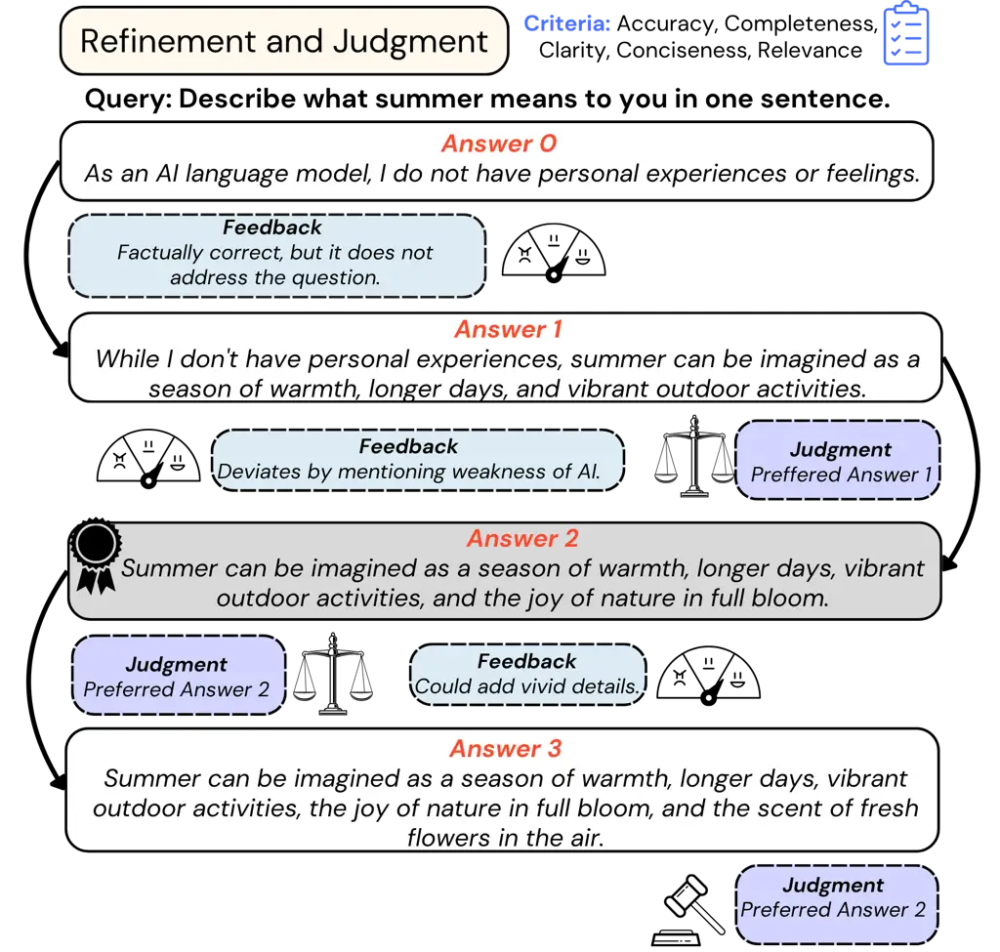
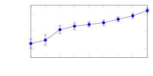
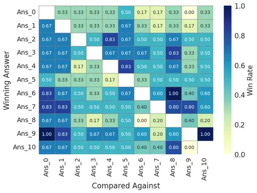
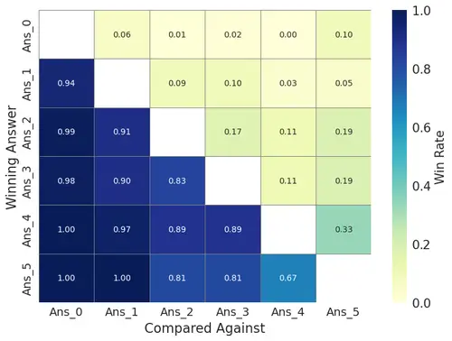
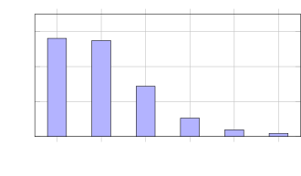

# Refine-n-Judge: Curating High-Quality Preference Chains for LLM-Fine-Tuning

Derin Cayir Affiliation: Florida International University Work done at
Meta    Renjie Tao Affiliation: Meta Reality Labs    Rashi Rungta
Affiliation: Meta Reality Labs    Kai Sun Affiliation: Meta Reality Labs
   Sean Chen Affiliation: Meta Reality Labs    Haidar Khan
Affiliation: Meta Reality Labs    Minseok Kim Affiliation: Meta Reality
Labs    Julia Reinspach Affiliation: Meta Reality Labs    Yue Liu
Affiliation: Meta Reality Labs

###### Abstract

Large Language Models (LLMs) have demonstrated remarkable progress
through preference-based fine-tuning, which critically depends on the
quality of the underlying training data. While human feedback is
essential for improving data quality, it is costly and does not scale
well. In this paper, we introduce Refine-n-Judge, an automated iterative
approach that leverages a single LLM as both a refiner and a judge to
enhance dataset quality. Unlike existing iterative refinement methods,
Refine-n-Judge uniquely employs an LLM to both generate refinements and
explicitly evaluate each improvement, ensuring that every iteration
meaningfully enhances the dataset without requiring additional human
annotation or a separate reward model. At each step, the LLM refines a
response and judges whether the refinement is an improvement over the
previous answer. This process continues iteratively until the LLM
prefers the initial answer over the refinement, indicating no further
improvements. This produces sequences of increasing quality,
preference-labeled responses that are ideal for fine-tuning.

We demonstrate the effectiveness of Refine-n-Judge across a diverse
range of public datasets spanning five different corpora targeting
various tasks such as coding, math, and conversation. Models (Llama
3.1-8B and Llama 3.3-70B) fine-tuned on Refine-n-Judge-enhanced datasets
were preferred by LLM judges in over 74% of direct comparisons against
models tuned on the original dataset by GPT-4. Compared to prior
approaches, our pipeline, guided by an effective judge, consistently
produces valid refinements that improve dataset quality, making each
iteration meaningful. Additionally, we evaluated our models using
established benchmarks, achieving notable performance gains
(Refine-n-Judge models: increase of 5% on AlpacaEval, and AlpacaEval
2.0, and 19% increase on MT-Bench). Our results indicate that
Refine-n-Judge effectively generates high-quality datasets that improve
both the quality of fine-tuning datasets and capabilities of resulting
models. This approach provides a scalable method for generating
preference datasets and models in a continuous improvement loop.

^(†)^(†)date: August 24, 2026^(†)^(†)correspondence: Derin Cayir at
[dcayi001@fiu.edu](mailto:dcayi001@fiu.edu), Rashi Rungta at
[rashirungta@meta.com](mailto:rashirungta@meta.com)

## 1 Introduction

Large Language Models (LLMs) have shown remarkable performance across
various tasks. However, adjusting their outputs to match human
preferences remains a challenging and data-intensive problem. While
fine-tuning LLMs on high-quality datasets can significantly enhance
their performance on downstream tasks and improve alignment with user
intent Rafailov et al. (2023); Chung et al. (2024), the effectiveness of
such fine-tuning is heavily dependent on the quality of the training
data.

Existing methods for curating datasets often involve human feedback.
While beneficial, this approach is costly, limited in scalability, and
sometimes unexplainable due to noise Rafailov et al. (2023). Therefore,
there is a need to focus on creating automated and scalable methods to
improve the quality of training data Dubois et al. (2023).

Figure 1: The Refine-and-Judge process. Starting with a query and an
initial answer, the LLM refines the answer based on generated feedback.
It then compares the refined answer with the initial one and selects the
preferred version. If the refined answer is preferred, it becomes the
new initial answer; otherwise, the process ends.

A promising direction to improve data quality is to use LLMs for
refinement. Previous research demonstrated LLMs’ capablity of
iteratively revising their own outputs to enhance aspects such as
clarity, correctness, and informativeness, all without requiring human
supervision Madaan et al. (2023); Novikov et al. (2025). However, due to
the probabilistic nature of LLMs in generating outputs, not all
refinements are guaranteed to be beneficial and what the model perceives
as an improvement may not actually enhance quality. To address this
limitation, a judge throughout the process is needed. LLMs have also
shown to perform well as judges, achieving results comparable to human
annotators when evaluating the quality of different responses Rafailov
et al. (2023); Dubois et al. (2023). These models can assess nuances in
response quality, with a consistency that often surpasses human
evaluators. By leveraging their deep contextual understanding, LLMs
provide objective and reproducible judgments that reduce variability and
bias inherent in human annotation.

By incorporating judgment into the refinement loop, we evaluate whether
the newly generated response is truly better than the previous one. This
not only improves the reliability of refinement, but also enables a
fully automated and scalable framework for preference-based dataset
curation, where refinements proceed only when quality gains are
confirmed.

Figure 2: Example of Refine-n-Judge. Beginning with an initial
model-generated output, each successive response is produced by
prompting the model to refine the previous one, and the final selected
response is highlighted in gray.

Bringing these capabilities together, we propose Refine-n-Judge, a fully
automated dataset curation pipeline, summarized in Figure 2. In this
framework, an LLM model serves as both the refiner- generating improved
outputs- and the judge-comparing the refined output against the original
and selecting the preferred version. If the refined answer is preferred,
the process continues with this new output as the next candidate for
improvement. However, if the judge perceives the refined answer to be
worse than the initial answer, the process terminates by retaining the
original answer. This loop enables scalable, iterative improvement to
dataset quality without human intervention, resulting in a dataset that
is a query and a list of answers in increasing quality.

We illustrate this interplay between refinement and judgment is
illustrated in Figure 2, using an example from the TULU dataset. The
refinement and judgment criteria included accuracy, completeness,
clarity, conciseness, and relevance. We compared Refine-n-Judge to a
pipeline that solely relies on iterative refinements without a judge
(Figure 4 in Appendix). Although both methods used the same criteria for
the LLMs, these two figures demonstrated that unguided refinement does
not perform as well as Refine-n-Judge. Incorporating judgment at each
step ensured that only meaningful improvements are accepted. In
Refine-n-Judge, the process terminated when the judge observed no
further gains, as illustrated by the selection of the second answer over
the third. However, without a judge, refinements continued even if they
did not add value, as seen in Figure 4 where verbosity increases with
continuous refinements. Therefore, by incorporating a judge, the model’s
answers are prevented from drifting through unnecessary continuous
refinements.

To analyze our proposed framework, we took responses to queries from
publicly available benchmarks. Then, we applied our framework to enhance
the dataset quality across different generation tasks, including code
generation, mathematics, general question and answers, and natural
language. Our proposed Refine-n-Judge framework outperformed baseline
methods like zero-shot generation, and rejection sampling, where GPT-4
prefers Refine-n-Judge 74% of the time compared to refinement-only
pipelines.

To further evaluate the quality of curated datasets, we fine-tuned Llama
models using outputs generated by our pipeline. With Supervised
Fine-Tuning (SFT), Llama 3.1-8B model fine-tuned on our curated dataset
achieved 70% win-rate compared to the same model fine-tuned on the
original unrefined public data, as judged by GPT-4. Similarly, a larger
Llama 3.3-70B model achieved an 75% win rate under the same evaluation
setup. These results suggested that preference based datasets curated
from Refine-n-Judge enhanced model performance and Refine-n-Judge is an
innovative way of curating high-quality datasets with preferences
through LLMs’ capabilities of refinement and judgment. Our results
demonstrated that LLMs’ judgment and refinement capabilities complement
each other and provide a robust pipeline when combined. The curated
dataset from this approach is a strong resource for fine-tuning LLMs, as
our results demonstrate.

In summary, we make the following contributions:

- •
  We introduce Refine-n-Judge, a high-quality dataset curation method
  that utilizes LLMs’ capabilities of refinement and judgment, offering
  a scalable, human-free approach to preference data collection,
  improving upon prior work.
- •
  We applied Refine-n-Judge to a five different corpora, measuring the
  improvement in dataset quality, and used the curated datasets to
  fine-tune LLMs, and improved models across various benchmarks.
- •
  We created a large dataset with over 78,000 queries of
  preference-based ranked output chains using our pipeline, that we
  performed SFT.

## 2 Related Work

Previous work has explored how LLMs can be used as a tool for refinement
and judgment. In this section, we summarize those works and our
differences. A discussion on broader related work is given in the
Appendix.

LLMs as Refiners: Recent studies have investigated the potential of LLMs
to iteratively refine their own outputs through self-generated feedback.
For instance, in SELF-REFINE framework Madaan et al. (2023), the model
generates an initial output ($`Answer_{0}`$) that is subsequently
revised based on feedback it has itself produced. In this work, the
model’s improvement is highly dependent on the quality of the feedback,
where the feedback should be both actionable and specific for the model
to be generating an improved output. However, due to this dependency on
feedback quality, there is no guarantee that refinements will always
lead to improved quality. In fact, refinements can sometimes degrade the
output, given the probabilistic nature of LLMs in generating responses.

LLMs as Judges: Recent studies have demonstrated the potential of LLMs
to replace human-based evaluations by acting as self-judges Zheng et al.
(2023); Dubois et al. (2023). These studies demonstrated that LLMs can
approximate human preferences with reasonable accuracy, offering an
appealing method to evaluate model outputs. However, despite their
effectiveness, LLMs are prone to position bias, where the model may
favor outputs based on their relative position, verbosity bias, where
the model tends to select longer responses regardless of their quality,
and self-enhancement bias, where the model consistently chooses its own
output over other model-generated answers Zheng et al. (2023).
Therefore, when using LLMs as judges, it is important to minimize these
biases—for example, by swapping the positions of choices, and penalizing
lengthy responses, a technique employed by Refine-n-Judge.

Using LLMs for Data Curation: Another promising line of research has
explored the use of LLMs for curating training datasets, particularly
those augmented with AI-generated feedback Cui et al. (2023). For
example, researchers created datasets where responses were generated by
multiple models, and GPT-4 was tasked with annotating these responses
with preferences and feedback. Additionally, other works have
investigated using LLMs to synthesize datasets for text-based
multi-agent simulations Tang et al. (2024). These synthetic datasets
offer valuable resources for training and evaluating various NLP models.
Unlike these approaches, our proposed pipeline focuses on iteratively
refining a single answer until no further improvements can be made,
resulting in quality-ranked chains without relying on multiple LLMs to
generate different answers or a separate reward model.

Despite these works, to the best of our knowledge, no prior work has
fully explored a combined approach that leverages the dual capabilities
of LLMs in refinement and judgment to enhance each other’s performance.
Moreover, integrating this pipeline to curate preference-based datasets
remains an open research direction worthy of further investigation,
which in this work we explore.

## 3 Approach

Our proposed method is a two-phase approach (1) dataset method, and (2)
training method.

### 3.1 Dataset Curation with Refine-n-Judge

In the first part of the proposed method, we perform dataset curation
from the iterative Refine-and-Judge process. For a given query, an
initial answer could either be obtained from publicly available datasets
or it could be generated by an LLM. Recognizing that this answer may not
be of optimal quality, we employ an iterative process to synthesize a
higher-quality dataset from the initial dataset. This iterative process
consists of the following steps:

1. Refinement: The process begins by obtaining the initial answer from a
   dataset (response to the query such as a question), referred as
   $`Ans_{0}`$. The initial answer could also be generated from an LLM.
   Since this answer may not be the most ideal output for the query, we aim
   to iteratively refine $`Ans_{0}`$ into improved versions
   $`Ans_{1},Ans_{2},...,Ans_{n}`$ such that $`Ans_{n}`$ will become the
   most refined and highest quality output. Here, the LLM will be presented
   both the question and the prior answer $`Ans_{t}`$ to generate the
   refined answer, $`Ans_{t+1}`$.

2. Judgment: Due to the probabilistic nature of LLM outputs,
   $`Ans_{t+1}`$ is not guaranteed to be superior to $`Ans_{t}`$.
   Therefore, the quality of refinements and whether they are improving
   should be verified through an LLM. Hence, we propose using LLM as a
   judge. ¹¹ 1 While we use the same LLM (e.g., Llama 3.3-70B) for both
   refinement and judgment, different models can also be employed.
   LLM-Judge evaluates $`Ans_{t}`$ and $`Ans_{t+1}`$ to determine higher
   quality response based on analyzing the responses on a set of criteria
   such as accuracy, completeness, clarity, conciseness, and relevance.

3. Iteration: This process iteratively continues until when the judge
   does not prefer the new response, indicating that the refined response
   is worse or around the same quality as the prior response. However, if
   the refined output $`Ans_{t+1}`$ is judged to be better then the prior
   response $`Ans_{t}`$, then $`Ans_{t+1}`$ becomes the new baseline. The
   process repeats until termination. In cases where refinements
   continuously improve the output without the judge favoring the initial
   answer, we set a maximum of ten iterations to prevent indefinite
   refinement.

This iterative refinement and judgment cycle results in a sequence of
answers for each query: $`[Ans_{0},Ans_{1},...,Ans_{n}]`$, where each
subsequent version ($`Ans_{k}`$) is of demonstrably higher quality than
its predecessor ($`Ans_{k-1}`$).

The iterative refinement and judgment process in Refine-n-Judge employs
structured prompts designed for precise feedback, systematic answer
refinement, and judgment. These prompts are given in Appendix. The
pipeline consists of three sequential prompts (1) feedback prompt, used
to evaluate the initial answers based on specific quality criteria, (2)
refinement prompt, where feedback is incorporated to improve the
answers, (3) judgment prompt, where the refined answers are compared
against previous versions to select the superior response.

### 3.2 Fine-Tuning through Preference Chains

The curated dataset $`Query:[Ans_{0},\ldots,Ans_{n}]`$, which contains
preference-ordered list of responses, can be used to fine-tune LLMs. We
fine-tune a pre-trained model using the final, highest-quality answers
obtained from Refine-n-Judge. Specifically, we pair each query with its
best refined answer, $`Ans_{n}`$ given the corresponding query. This
allows the model to learn from the highest-quality outputs as determined
by the pipeline.

## 4 Experimental Setup

### 4.1 Dataset and Metrics

For the analysis of Refine-n-Judge, we focused on diverse datasets on
assistant-style conversations in English.

We utilized these datasets for distinct purposes within our pipeline.
The datasets, their respective purposes, and the evaluation metrics used
are summarized in Table 1. As shown in the table, some datasets were
used to analyze specific aspects, such as robustness to various types of
noise, while others were employed for fine-tuning the model. We examined
the pipeline’s robustness to inaccuracy, verbosity, misleadingness, and
unhelpfulness, using evaluation metrics like accuracy, length, and
external LLM assessments. To assess the effectiveness of our dataset
curation method within the Refine-n-Judge pipeline, we fine-tuned LLMs
and evaluated them using MT-Bench and AlpacaEval 2.0 benchmarks.

| Dataset       | Target Aspect  | Evaluation Metric            |
| ------------- | -------------- | ---------------------------- |
| Acronym       | Inaccuracy     | Accuracy                     |
| UltraChat     | Verbosity      | Length                       |
| TruthfulQA    | Misleadingness | LLM-as-a-judge score (0-100) |
| OpenAssistant | Helpfulness    | LLM-as-a-judge score (0-100  |
| TULU3         | \-             | AlpacaEval 2.0, MT-Bench     |

Table 1: Datasets and their purposes in the pipeline. Unless otherwise
specified, GPT-4 is used as the LLM-Judge.

### 4.2 Pipeline Analysis Method

We conducted experiments to demonstrate Refine-n-Judge’s effectiveness
by analyzing its core components:

- •
  Iterative refinement: To showcase the significance of continuous
  refinement, we compared Refine-n-Judge against rejection sampling, and
  one-shot answers produced by LLMs.
- •
  Judgment control: To evaluate the importance of judgment within our
  pipeline, we compared Refine-n-Judge with a pipeline employing only
  repeated self-refinements Madaan et al. (2023). With this, we showed
  the importance of having a judge in the pipeline compared to doing
  refinements without a stopping condition.

Additionally, recognizing that the datasets intended to be used with
Refine-n-Judge may contain low-quality answers, we assessed the
robustness of Refine-n-Judge to noise which may come from poor datasets.
We set these answers as $`Ans_{0}`$ and applied our pipeline to convert
them into high-quality responses. For this purpose, we created a custom
dataset that targets inaccuracy, verbosity, and misleadingness through a
combination between online datasets (e.g., TruthfulQA Lin et al. (2021))
and synthetic ones. From TruthfulQA, we sampled one of the available
multiple “wrong answers” which answer a given question through
misconceptions such as to “What happens to you if you eat watermelon
seeds?”, the wrong answer that will be taken as $`Ans_{0}`$ is “You grow
watermelons in your stomach”. We then compared the most-refined answer
derived from the intentionally misleading $`Ans_{0}`$ to a true answer
provided from the same dataset, using LLM judges.

To target inaccuracy, we used Acronym dataset Madaan et al. (2023) where
the objective is to find an acronym for a given title. We generated
inaccurate $`Ans_{0}`$ by using GPT-4 to create prompts that
intentionally produce inaccurate yet believable answers. For verbosity,
we used a dialogue dataset, Ultrachat Ding et al. (2023) where we
obtained the questions and produce verbose, unhelpful responses through
GPT4.

### 4.3 Fine-tuning Setup

For fine-tuning LLMs, we used TULU Lambert et al. (2024). The TULU
dataset is a high-quality instruction-tuning corpus that comprises
diverse and extensive data collected from various domains, including
academic question-answering, coding problems, reasoning tasks, and
multilingual instructions. Due to its diversity and comprehensiveness,
TULU served as a robust baseline for comparative analysis.

In our experiments, we first fine-tuned LLMs using the original TULU
dataset, which provides a baseline performance. Then, we fine-tuned the
same models using the refined dataset produced by Refine-n-Judge. This
approach allowed us to measure the performance gains directly attributed
from the pipeline. Specifically, we evaluated whether models fine-tuned
on refined responses from Refine-n-Judge ($`Ans_{n}`$) exhibited
improved performance over those trained solely on the original responses
($`Ans_{0}`$).

We applied this fine-tuning methodology to Llama 3.3-70B-Instruct, and
Llama 3.1-8B-Instruct. We used a learning rate of 1e-5 with a warmup
phase of 200 steps, and the models were trained for a total of 11,000
steps. The batch size was set to 1, and the sequence length was extended
to 32,768 to accommodate longer inputs. Model parallelism was employed
with a size of 8 to efficiently distribute the computational load. The
performance of these fine-tuned models were evaluated across AlpacaEval,
AlpacaEval 2.0, and MT-Bench. More details are provided in Appendix.

## 5 Experiments

In this section we present our experimental findings where we first
discuss the pipeline’s details such as the need for continuous
refinement, and judge. Then we analyze the pipeline’s robustness to
noisy data and the judge’s consistency when making decisions. Lastly we
present the results obtained from the fine-tuning stage to prove the
curated dataset method’s importance through Refine-n-Judge.

### 5.1 Importance of Continuous Refinement

Continuous refinement is computationally more expensive as it requires
repeated calls to LLMs to obtain judgments and refinements. However, we
found this cost (as detailed in Appendix D) to be justified, as the
performance of Refine-n-Judge was superior to other techniques.

First, we analyzed how Refine-n-Judge compares to generating multiple
answers in zero shot and selecting the best. Specifically, we used the
same LLM for Refine-n-Judge to generate ten different answers to a given
query in zero shot. Then using a separate prompt, we selected the best
among the ten responses. We compared the best answer to the
$`Answer_{n}`$, which was obtained as the “most refined” answer from
Refine-n-Judge. We used GPT-4 as a judge to compare Refine-n-Judge with
the method of generating multiple answers and selecting the best. With
this approach, Refine-n-Judge (average iteration of 3.4) was preferred
98.4% of the time by GPT-4 over generating 10 answers and selecting the
best. This demonstrated that continuous iterations of Refine-n-Judge
outperform the same model generating multiple answers and selecting the
best one, highlighting the importance of a pipeline that incorporates
refinements through a judge.

|               |                   |        |
| ------------- | ----------------- | ------ |
| Dataset       | Method            | % Wins |
| Acronym       | Refine-n-Judge    | 81.2   |
|               | Zero-shot Gen     | 74.8   |
|               | Simple rule based | 62.4   |
| TruthfulQA    | Refine-n-Judge    | 89.0   |
|               | Zero-shot Gen     | 11.0   |
| OpenAssistant | Refine-n-Judge    | 84.8   |
|               | Zero-shot Gen     | 15.2   |
| UltraChat     | Refine-n-Judge    | 87.3   |
|               | Zero-shot Gen     | 12.7   |

Table 2: Refine-n-Judge performance comparison across different
datasets: Acronym Madaan et al. (2023), OpenAssistant Köpf et al.
(2023), TruthfulQA Lin et al. (2021), and UltraChat Ding et al. (2023).
For Acronym, we measure % wins through accuracy (true or false acronym),
others we used GPT-4 as a judge.

Second, we investigated whether iterative refinements are superior to
one-shot answer generation. To do this, we obtained an initial answer
$`Answer_{0}`$ to query from various datasets and then used
Refine-n-Judge to generate $`Answer_{n}`$ from $`Answer_{0}`$. We also
generated $`Answer_{llm}`$, a one-shot answer to the same query. We used
GPT-4 as a judge to choose between $`Answer_{n}`$ and $`Answer_{llm}`$.
Our results are presented in Table 2.

As seen in Table 2, Refine-n-Judge was preferred across all datasets.
Incorporating iterative refinements and judgments in the pipeline
yielded better results than generating answers in a one-shot manner
using the LLM. Specifically, GPT-4 preferred answers improved by
Refine-n-Judge over those generated from scratch. This effect was
particularly evident in the Acronym dataset, where the objective was to
accurately determine the acronym of a title. A simple rule-based
function, which generates acronyms from the first character of each
word, achieved a 62.4% success rate. Generating one-shot answers to the
given titles resulted in 74.8% accuracy, but using Refine-n-Judge and
refining the initial responses was more effective, resulting in an
increase in accuracy to 81.2%. These results suggested that the
continuous refinement process employed by our pipeline is more effective
than generating new answers from scratch via one-shot LLM outputs.

### 5.2 Importance of LLM-Judge

In Refine-n-Judge pipeline, LLM-judge is incorporated to ensure that
each refinement made by the refiner can be validated before the pipeline
continues with its iterations. This validated that the “improvements”
are meaningful and that the pipeline did not suffer from questionable
refinements that reduced the quality of the output.

To assess the importance of including a judge in the pipeline, we
compared a pipeline with only a refiner to Refine-n-Judge (incorporates
both a refiner and a judge). We evaluated the performance of both
pipelines across various iteration counts, as shown in Figure 3. With
fewer iterations, the win rate was around 50%, suggesting that the GPT-4
judge made random selections between the outputs of the refiner-only
pipeline and Refine-n-Judge. This outcome is expected, as the
LLM-Judge’s effectiveness was limited when the refiner performs only one
or two iterations. However, as the number of iterations increased, the
refiner-only pipeline continued refining without quality checks, while
Refine-n-Judge terminated refinements when the quality decreased.
Consequently, Refine-n-Judge achieved a win rate of up to 72.5%,
demonstrating that continuous refinements did not guarantee improved
quality without a judge.

Figure 3: Win % of the Refine-n-Judge pipeline over varying numbers of
refinement iterations. The win rate reflects how often the
Refine-n-Judge pipeline is preferred over a pipeline with only a
refiner, as evaluated by GPT-4. Each experiment was repeated three
times.

We also compared pairwise win rates across refinement iterations for two
pipeline variants: one having only the refiner and another having both
the refiner and judge (Refine-n-Judge). As shown in Figure 5 in
Appendix, the LLM-refiner only pipeline demonstrated inconsistent
quality improvements, with several later-stage answers (e.g.,
$`Ans_{5}`$) performing worse than earlier ones (e.g., $`Ans_{2}`$),
suggesting unstable refinement behavior. In contrast, Refine-n-Judge
pipeline exhibited a clear and consistent trajectory of improvement
where later answers almost always outperformed earlier ones. For
example, $`Ans_{5}`$ wined against $`Ans_{0}`$ 100% of the time and
wined against $`Ans_{2}`$ in 81% of the time which was only 33% for the
pipeline that only has refiner. These results highlighted that
integrating a judgment mechanism not only prevents regression but also
ensures that each refinement iteration leads to a measurable quality
gain.

### 5.3 Robustness to Noisy Data

Since Refine-n-Judge was designed to improve low-quality responses
($`Ans_{0}`$) obtained from publicly available datasets, it was
essential to evaluate whether the pipeline remains effective when the
input data is noisy or flawed. In practical applications, online
datasets may include inaccurate, verbose, biased, or misleading answers.
A robust refinement pipeline should be capable of correcting these flaws
rather than perpetuating or amplifying them.

To analyze this, we tested Refine-n-Judge on intentionally degraded
datasets that simulate real-world imperfections. We defined an answer as
“bad” if it exhibited inaccuracy which contained factual errors,
verbosity which included long or redundant content, unhelpful where the
answer failed to directly address the user’s query, or misleading which
reflected commonly held false beliefs.

We constructed our noisy dataset using a combination of public datasets
and synthetically generated examples via GPT-4, specifically prompted to
produce flawed outputs across the above dimensions, summarized in
Table 1.

To evaluate the robustness, we applied Refine-n-Judge to these noisy
inputs and compared its outputs using targeted metrics. We analyzed
accuracy improvements from acronym generation to a given title,
reduction in verbosity from measuring the average token length, and
helpfulness and gains in helpfulness and truthfulness. These gains were
assessed by GPT-4, which scored the answers out of 100, allowing us to
measure the change in scores.

| Dataset       | Target       | Evaluation                   | Results |
| ------------- | ------------ | ---------------------------- | ------- |
| Acronym       | Accuracy     | Binary accuracy              | +85%    |
| UltraChat     | Verbosity    | Length of token              | -52%    |
| OpenAssistant | Helpfulness  | LLM-as-a-judge score (0-100) | +66%    |
| TruthfulQA    | Truthfulness | LLM-as-a-judge score (0-100) | +92%    |

Table 3: Refine-n-Judge’s performance on noisy data.

Table 3 summarizes the pipeline’s performance across these noisy
conditions. The results showed that Refine-n-Judge is consistently able
to improve answer quality, even when the initial input is significantly
flawed. On acronym-based tasks, binary accuracy improved by
approximately 85%, in summarization tasks, the average length decreased
by 52%, and for dialogue based tasks, GPT-4 judged a 92% improvement in
truthfulness and 66% decrease in unhelpful content. These findings
showed that Refine-n-Judge not only enhances standard datasets but also
offers robust correction capabilities for noisy, and imperfect data.

### 5.4 Robustness of LLM-Judge

Since Refine-n-Judge relies on an LLM-based judge to determine whether
one answer is better than another, it is critical to understand the
robustness and internal consistency of this judge. A consistent judge
should reliably prefer the same choice over time, despite the choices
being randomized. Hence, the LLM-judge in Refine-n-Judge should prefer
higher-quality responses over earlier, lower-quality ones in a
refinement chain.

To test this, we conducted a self-consistency experiment on the
LLM-judge. We evaluated the judge’s decision-making by repeatedly
presenting it with pairwise comparison between successive answers from
the same refinement trajectory -i.e. comparisons between $`Ans_{i}`$ and
$`Ans_{i+1}`$. Because each $`Ans_{i+1}`$ in the chain was generated and
previously judged superior to $`Ans_{i}`$ during the Refine-n-Judge
process, the LLM judge should ideally continue to prefer $`Ans_{i+1}`$
in subsequent evaluations.

To test robustness of the judge, we randomized the position of
$`Ans_{i}`$ and $`Ans_{i+1}`$ across all pairs in our curated data for
ten times per pair to ensure that answer quality- not position- was
basis for preference. We also tested the judge’s reliability in
distinguishing valid answers from rejected ones. Specifically, we
compared $`Ans_{n}`$ (the final accepted answer) with $`Ans_{(}n+1)`$
(the rejected one, discarded for failing to improve). Ideally, the judge
should continue to favor $`Ans_{n}`$ over $`Ans_{n+1}`$.

We observed that the judge shows strong agreement early in refinement
chain, such as 100% agreement for $`Ans_{0}`$ vs $`Ans_{1}`$. However,
there was a gradual decline in consistency (from 100% to 80% within the
first four refinements) as the refinement chain progress. Near 50%
agreement between $`Ans_{n}`$ and $`Ans_{n+1}`$ was reached, indicating
random choice during termination of the pipeline. This pattern suggested
that while the LLM-judge is highly consistent in early refinement stage,
its confidence diminishes towards the termination point. When
differences between successive answers become marginal, the judge
appeared to struggle in distinguishing when to end the pipeline,
effectively making a guess about whether further refinement was
necessary.

### 5.5 Fine-tuning Results

We fine-tuned Llama 3.1-8B and Llama 3.3-70B models on the original
public dataset and Refine-n-Judge enhanced datasets. We then generated
responses for AlpacaEval and MT-Bench prompts.

We first compared three different models. The first was the pre-trained
model without any additional fine-tuning. This served as a control to
measure the impact of fine-tuning on model performance. The second was
the model that is fine-tuned using the original dataset. This step aimed
to enhance the model’s performance by exposing it to more task-specific
data. The last was Refine-n-Judge dataset tuned model which was an
improved version of the original dataset. We compared the models using
multiple-LLM judges (GPT-4, Gemini, Llama 3.1-70B, and Claude). Table 4
shows these results which indicated a strong judge preference for models
fine-tuned on the Refine-n-Judge enhanced dataset compared to original
dataset tuned model.

The Llama 3.3-70B model as a judge demonstrated consistently higher
win-rates, reaching up to 80.1% when tuned-model was also Llama 3.3-70B.
The highest win-rate in Llama 3.1-8B tuned model was also observed in
Llama 3.3-70B as a judge which achieved above 70% win-rate.

| Judge Model   | L3-8B Win-Rate | L3-70B Win-Rate |
| ------------- | -------------- | --------------- |
| GPT-4         | 61.6%          | 68.5%           |
| Gemini        | 64.2%          | 69.2%           |
| Llama 3.3-70B | 69.3%          | 72.1%           |
| Claude        | 62.1%          | 70.9%           |

Table 4: Win-rates between Llama 3.1-8B and Llama 3.3-70B models. The
models fine-tuned on the original TULU dataset and the
Refine-n-Judge-curated dataset are evaluated by various LLM judges. The
win-rate is reported as the percentage of queries where the LLM judge
prefers the output from the Refine-n-Judge-incorporated model.

| Model         | Tuned Dataset            | AlpacaEval | AlpacaEval 2.0 | MT-Bench |
| ------------- | ------------------------ | ---------- | -------------- | -------- |
| Llama 3.1-8B  | -                        | 70.5       | 24.9           | 6.3      |
|               | TULU                     | 79.3       | 34.8           | 6.9      |
|               | TULU with Refine-n-Judge | 84.8       | 37.5           | 7.5      |
| Llama 3.3-70B | -                        | 85.1       | 39.4           | 8.2      |
|               | TULU                     | 88.2       | 51.7           | 8.4      |
|               | TULU with Refine-n-Judge | 90.5       | 54.3           | 8.6      |

Table 5: Fine-tuning results on different benchmarks.

Then, we evaluated the performance of fine-tuned models on established
benchmarks AlpacaEval, AlpacaEval 2.0, and MT-Bench. The details on the
evaluation methodology including the reference and judge models is given
in Table 7 in Appendix.

Table 5 presents the win-rates for Llama 3.1-8B and Llama 3.3-70B models
fine-tuned using the Refine-n-Judge curated dataset, compared against
models fine-tuned on the original TULU dataset and baseline (not
fine-tuned) models. These results clearly demonstrate the advantage of
applying Refine-n-Judge pipeline to the dataset. For the Llama 3.1-8B
model, using the pipeline in fine-tuning improved win-rate of 84.8% for
AlpacaEval compared to 79.3% with the original TULU dataset. Similarly,
performance of AlpacaEval 2.0 and MT-Bench also improved. For the Llama
3.3-70B model, the AlpacaEval performance improved from 88.2% to 91.8%,
AlpacaEval 2.0 increased from 51.7% to 53.0% and MT-Bench resulted in an
increase from 8.4 to 8.6 average score. These results consistently
demonstrate the effectiveness of Refine-n-Judge pipeline, and showcases
meaningful improvements in dataset quality which translates to
fine-tuned models’ performance results.

## 6 Conclusion

In this work, we address a crucial aspect of fine-tuning large language
models (LLMs): the creation of high-quality training datasets. We
introduce the Refine-n-Judge pipeline, which leverages the
self-refinement and judgment capabilities of LLMs to automatically
generate datasets of preference chains. Our results demonstrate that the
Refine-n-Judge pipeline outperforms traditional methods with up to 89%
win rate, such as generating multiple answers and selecting the best
one, as well as zero-shot answer generation. Furthermore, our pipeline
surpasses approaches where multiple LLMs generate answers to a single
query and the best is chosen, and continuous refinement without
judgment.

Our experiments on LLM judge consistency revealed that continuous
refinements and judgments lead to consistent choices by the LLM, with
improvements that are clear rather than vague. Additionally, the
pipeline proved robust to noisy inputs, and models fine-tuned on the
Refine-n-Judge-curated dataset demonstrated that this method can enhance
LLM performance and tailor models to specific tasks. With these
findings, the Refine-n-Judge pipeline emerges as a viable approach for
curating preference datasets for fine-tuning LLMs. The pipeline’s
prompts can be customized to suit a wide range of scenarios targeting
specific goals, such as making LLM responses more engaging by adding
friendliness or chattiness as criteria in the refinement and judgment
prompts. This enables any dataset to be improved through the pipeline
without requiring human annotation. Importantly, these results highlight
the potential of the Refine-n-Judge pipeline as a foundation for future
research beyond the domains tested in this work.

### 6.1 Limitations

While our pipeline remarkably enhances the datasets that lead to better
fine-tuning results, one limitation of Refine-n-Judge is that the
LLM-judge exhibits highly consistent choices (starting from 100%) during
the early refinement stages, but this consistency diminishes as the
process approaches termination. This suggests that when deciding whether
to end the refinement chain, the LLM judge’s binary decision often
becomes more of a guess, probably due to the marginal improvements in
refinements decreasing. To address this, multi-judge voting can be done.
Additionally, as the process approaches termination, using a different
LLM model for further refinements can introduce a fresh perspective,
potentially leading to more substantial changes in the answers which may
motivate the judge to continue with the refinements, and may also reduce
the bias resulting from using a single LLM as a refiner and judge.

### 6.2 Ethics

The Refine-n-Judge pipeline’s automation of dataset generation and
refinement raises ethical concerns, particularly regarding the
amplification of biases inherent in LLMs. It is crucial to implement
mechanisms for bias detection and mitigation to prevent the
reinforcement of harmful stereotypes or misinformation. Additionally,
fine-tuning LLMs for specific tasks, such as enhancing engagement, must
be approached cautiously to avoid manipulative practices. Transparency
in how models are fine-tuned and the criteria used in the refinement
process should be maintained to uphold user trust and accountability. As
the Refine-n-Judge pipeline can be adapted to various domains, it is
essential to ensure that its application aligns with ethical guidelines
and legal standards specific to each field.

## References

- Chung et al. (2024) Hyung Won Chung, Le Hou, Shayne Longpre, Barret
  Zoph, Yi Tay, William Fedus, Yunxuan Li, Xuezhi Wang, Mostafa
  Dehghani, Siddhartha Brahma, et al. Scaling instruction-finetuned
  language models. _Journal of Machine Learning Research_,
  25(70):1–53, 2024.
- Cui et al. (2023) Ganqu Cui, Lifan Yuan, Ning Ding, Guanming Yao,
  Bingxiang He, Wei Zhu, Yuan Ni, Guotong Xie, Ruobing Xie, Yankai Lin,
  et al. Ultrafeedback: Boosting language models with scaled ai
  feedback. _arXiv preprint arXiv:2310.01377_, 2023.
- Ding et al. (2023) Ning Ding, Yulin Chen, Bokai Xu, Yujia Qin, Zhi
  Zheng, Shengding Hu, Zhiyuan Liu, Maosong Sun, and Bowen Zhou.
  Enhancing chat language models by scaling high-quality instructional
  conversations, 2023.
- Dubois et al. (2023) Yann Dubois, Chen Xuechen Li, Rohan Taori, Tianyi
  Zhang, Ishaan Gulrajani, Jimmy Ba, Carlos Guestrin, Percy S Liang, and
  Tatsunori B Hashimoto. Alpacafarm: A simulation framework for methods
  that learn from human feedback. _Advances in Neural Information
  Processing Systems_, 36:30039–30069, 2023.
- Köpf et al. (2023) Andreas Köpf, Yannic Kilcher, Dimitri Von Rütte,
  Sotiris Anagnostidis, Zhi Rui Tam, Keith Stevens, Abdullah Barhoum,
  Duc Nguyen, Oliver Stanley, Richárd Nagyfi, et al. Openassistant
  conversations-democratizing large language model alignment. _Advances
  in Neural Information Processing Systems_, 36:47669–47681, 2023.
- Lambert et al. (2024) Nathan Lambert, Jacob Morrison, Valentina
  Pyatkin, Shengyi Huang, Hamish Ivison, Faeze Brahman, Lester James V.
  Miranda, Alisa Liu, Nouha Dziri, Shane Lyu, Yuling Gu, Saumya Malik,
  Victoria Graf, Jena D. Hwang, Jiangjiang Yang, Ronan Le Bras, Oyvind
  Tafjord, Chris Wilhelm, Luca Soldaini, Noah A. Smith, Yizhong Wang,
  Pradeep Dasigi, and Hannaneh Hajishirzi. Tülu 3: Pushing frontiers in
  open language model post-training. 2024.
- Li et al. (2023) Xuechen Li, Tianyi Zhang, Yann Dubois, Rohan Taori,
  Ishaan Gulrajani, Carlos Guestrin, Percy Liang, and Tatsunori B.
  Hashimoto. Alpacaeval: An automatic evaluator of instruction-following
  models.
  [https://github.com/tatsu-lab/alpaca_eval](https://github.com/tatsu-lab/alpaca_eval),
  5 2023.
- Lin et al. (2021) Stephanie Lin, Jacob Hilton, and Owain Evans.
  Truthfulqa: Measuring how models mimic human falsehoods. _arXiv
  preprint arXiv:2109.07958_, 2021.
- Madaan et al. (2023) Aman Madaan, Niket Tandon, Prakhar Gupta, Skyler
  Hallinan, Luyu Gao, Sarah Wiegreffe, Uri Alon, Nouha Dziri, Shrimai
  Prabhumoye, Yiming Yang, et al. Self-refine: Iterative refinement with
  self-feedback. _Advances in Neural Information Processing Systems_,
  36:46534–46594, 2023.
- Novikov et al. (2025) Alexander Novikov, Ngân Vũ, Marvin Eisenberger,
  Emilien Dupont, Po-Sen Huang, Adam Zsolt Wagner, Sergey Shirobokov,
  Borislav Kozlovskii, Francisco JR Ruiz, Abbas Mehrabian, et al.
  Alphaevolve: A coding agent for scientific and algorithmic discovery.
  _arXiv preprint arXiv:2506.13131_, 2025.
- Rafailov et al. (2023) Rafael Rafailov, Archit Sharma, Eric Mitchell,
  Christopher D Manning, Stefano Ermon, and Chelsea Finn. Direct
  preference optimization: Your language model is secretly a reward
  model. _Advances in Neural Information Processing Systems_,
  36:53728–53741, 2023.
- Tang et al. (2024) Shuo Tang, Xianghe Pang, Zexi Liu, Bohan Tang, Rui
  Ye, Tian Jin, Xiaowen Dong, Yanfeng Wang, and Siheng Chen.
  Synthesizing post-training data for llms through multi-agent
  simulation. _arXiv preprint arXiv:2410.14251_, 2024.
- Wang et al. (2023) Yufei Wang, Wanjun Zhong, Liangyou Li, Fei Mi,
  Xingshan Zeng, Wenyong Huang, Lifeng Shang, Xin Jiang, and Qun Liu.
  Aligning large language models with human: A survey. _arXiv preprint
  arXiv:2307.12966_, 2023.
- Yuan et al. (2024) Weizhe Yuan, Richard Yuanzhe Pang, Kyunghyun Cho,
  Sainbayar Sukhbaatar, Jing Xu, and Jason Weston. Self-rewarding
  language models. _arXiv preprint arXiv:2401.10020_, 3, 2024.
- Zheng et al. (2023) Lianmin Zheng, Wei-Lin Chiang, Ying Sheng, Siyuan
  Zhuang, Zhanghao Wu, Yonghao Zhuang, Zi Lin, Zhuohan Li, Dacheng Li,
  Eric Xing, et al. Judging llm-as-a-judge with mt-bench and chatbot
  arena. _Advances in Neural Information Processing Systems_,
  36:46595–46623, 2023.

## Appendix A Broader Related Work

We compare our framework with prior approaches and analyze the
differences and our contributions. We specifically compare with
preference-based fine-tuning, synthetic preference generation, iterative
self-refinement pipelines, LLMs as fine-grained judges, and iterative
label refinement approaches. The comparisons are summarized in Table 6.

Comparison with preference-based fine-tuning approaches. Alignment
methods such as Reinforcement Learning from Human Feedback (RLHF) and
Direct Preference Optimization (DPO) depend heavily on large-scale human
annotations to train a reward model and fine-tune the language model
accordingly. However, the collection of such annotations is costly and
does not scale well. To address this limitation, recent approaches have
explored leveraging large language models (LLMs) to self-generate
preference data with minimal human involvement. For example, Selfee Wang
et al. (2023) proposes such a method.

Similarly, another recent work introduces a technique where the language
model itself generates rewards for its own outputs during training Yuan
et al. (2024). This approach uses the model as a judge to evaluate the
quality of its responses, effectively creating a reward model from the
same model that produces the outputs. This self-rewarding mechanism
enables the model to iteratively improve both its instruction-following
and reward modeling capabilities without relying on external human
feedback or a separate reward model.

Compared to these works, Refine-n-Judge is about creating datasets of
increasing quality answers. Rather than assigning explicit reward scores
or labels, our approach uses an iterative refinement-and-judgment cycle
in which each refinement step generates progressibely better outputs
verified by the same LLM serving as both refiner and judge. Thus,
Refine-n-Judge systematically constructs chains of preference-labeled
data, providing significant improvements in dataset quality while
eliminating reliance on human annotations or seperate reward models.

Iterative self-refinement pipelines. Iterative self-refinement methods,
such as Self-Refine Madaan et al. (2023) focus primarily on improving
model outputs through internal feedback loops during inference without
generating structure training datasets. Furthermore, other recent
frameworks like Evolve  ( ) explore improve self-refinement capabilities
of LLMs though iterative preference optimization. Evolve alternates
between inference and training phases where model continously produces
refined answers which are then filtered using an external reward model.
The most ideal answer is used to generate a preference-based dataset
used to fine-tune the model used to create refinements.

In contrast, the Refine-n-Judge pipeline integrates a refiner and a
judge that work in alignment at every iteration. At each step, the LLM
explicitly evaluates whether the refined answer is an improvement,
rather than blindly generating successive refinements without
validation. This approach not only reduces computational overhead by
eliminating the need for a separate reward model but also ensures that
every retained refinement is of higher quality, as verified by the
judge. Consequently, unnecessary refinements are avoided, further
optimizing computational efficiency while maintaining answer quality.

Method Human-Free Data Generation Method Judgment Mechanism Dataset
Improvement Process Stopping Criterion RLHF No Human annotation
Human-labeled reward model Fixed labels (no iterative improvement) No
DPO No Human annotation No Yes No Selfee No LLM-generated synthetic
labels External (LLM logits-based scoring) Weak No Self-Refine Yes
Single model refinement loop No No dataset generation, only improves
inference outputs No EVOLVE No Iterative refinement with external
scoring External (separate reward model) Progressive refinement with
external filtering External Refine-n-Judge Yes Iterative refinement
verified by judge Integrated (single LLM as refiner and judge)
Preference labeled data generation through iterative verified
refinements Yes

Table 6: Comparison summary of Refine-n-Judge and related approaches

## Appendix B Illustration of Only Refinement Pipeline

Prior work has shown how LLMs can be used to refine their own
answers Madaan et al. (2023). In Figure 4 we explore a similar pipeline
where only continous refinements are made without incorperating a judge.
The prompt asks for one sentence description of the summer. Starting
from an initial model output, each subsequent answer is generated by
prompting the model to improve upon the previous one.

As can be seen from Figure 4, without a judge, iterative refinement
increased verbosity. Since the refinements did not terminate, this
pipeline would continue making refinements due to the lack of a stopping
condition. However, by incorporation a judgment step at each iteration,
Refine-n-Judge method ensured refinements are both substantive and
aligned with quality criteria, and terminated when further refinements
were no longer beneficial.

These findings are further supported by the pairwise win rate
comparisons showcased in Figure 5. When using only the refinement
pipeline without a judging component (Figure 5(a)), later answers were
not consistently better than earlier ones. For example, $`Ans_{9}`$
outperformed $`Ans_{6}`$ only 40% of the time, indicating that the
quality of answers degraded during the three refinement steps from
$`Ans_{6}`$ to $`Ans_{9}`$. This degradation occurred because, in the
absence of a judge, lower-quality refinements were retained.

In contrast, incorporating a judge into the pipeline led to a more
favorable pattern, as shown in the pairwise comparison matrix in
Figure 5(b). Here, the win rates increased in a downward direction and
decreased horizontally to the right, reflecting a consistent improvement
in answer quality across iterations. For instance, $`Ans_{1}`$ was
preferred over $`Ans_{0}`$ 94% of the time, and $`Ans_{4}`$ was favored
over $`Ans_{0}`$ in 100% of the comparisons. This demonstrates the
effectiveness of judgment-based selection in promoting higher-quality
refinements.

Figure 4: Illustrative example of iterative refinement pipeline without
a stopping condition.

(a) Only LLM-Refine pipeline.

(b) Refine-n-Judge pipeline.

Figure 5: Pairwise win rate comparison across iterations for two
pipelines: (a) LLM-Refine only, proposed in Self-Refine Madaan et al.
(2023), and (b) Refine-n-Judge. For the Refine-n-Judge pipeline, the
matrix spans up to $`Ans_{5}`$ due to the decreasing number of instances
where the refinement count exceeds 5.

## Appendix C Refine-n-Judge Prompts

Figure 6 illustrates the prompts used in Refine-n-Judge.

Figure 6: Prompts for Refine-n-Judge where sequential processes:
feedback generation, refinement, and judgment.

### C.1 LLM-Refiner:

To refine the initial answer, we first ask the LLM to generate a
feedback on the answer. For this, we give the question and the answer
that is wished to be refined. The LLM uses a set of criteria to base
their feedback on. After the feedback is generated, it is used to
compute the refined answer.

### C.2 LLM-Judge:

We leverage the capabilities of LLMs to assess and provide reasoning for
complex tasks. Given a question and two possible responses, LLM is
prompted to grade each response based on a predefined set of criteria.
This prompt is designed to be generalizable across various tasks without
modification, although adjustments can be made depending on the dataset
or task if desired. LLM assigns scores to each criterion for both
responses and sums these scores to determine which response is ranked
higher. Based on this evaluation, LLM selects a preferred answer and
provides a concise justification for its choice.

It is important to note that during the evaluation process, the
positions of the answers are systematically swapped. Specifically, the
locations of $`Ans_{i}`$ and $`Ans_{i+1}`$ are alternated to ensure that
the subsequent answer $`(i+1)`$ is not consistently presented as
$`answer_{A}`$. This procedure helps mitigate the positional bias in
LLM’s judgments.

## Appendix D Computational Cost of Refine-n-Judge

The pipeline was run on TULU dataset Lambert et al. (2024) where the
initial dataset contained 78k samples. The number of refinements count
for the sample sizes are given in Figure 7. Majority of the queries had
only one or two refinements done by the pipeline.

Figure 7: The number of refined answers obtained from Refine-n-Judge
pipeline to TULU dataset. The total number of samples is 78k.

## Appendix E Evaluation Details

We primarily assess our models using two of the most popular chat-based
evaluation benchmarks AlpacEval2 Li et al. (2023) and MT-Bench Zheng
et al. (2023). These benchmarks have been widely adopted by the
community due to their versatile conversational capabilities across many
domains. AlpacaEval 2 consists of 805 questions from 5 datasets, and
MT-Bench covers 8 categories with 80 questions. We ue GPT-4-Preview as
the baseline model in AlpacEval2.0, which is the model our results are
compared against. We report the length controlled win rate against
GPT-4-Preview using GPT-4 as a judge where the temperature is set to
zero. For MT-Bench, we report the average MT-Bench score through GPT-4
as the judge model. The evaluation details for the benchmarks are
summarized in Table 7.

| Benchmark    | Baseline Model | Judge Model | Scoring Type        | Metric      |
| ------------ | -------------- | ----------- | ------------------- | ----------- |
| AlpacaEval   | Davinci003     | GPT-4-Turbo | Pairwise comparison | Win rate    |
| AlpacaEval 2 | GPT-4-Preview  | GPT-4-Turbo | Pairwise comparison | LC Win rate |
| MT-Bench     | \-             | GPT-4-Turbo | Answer grading      | 1-10 score  |

Table 7: Evaluation details for SFT results.
