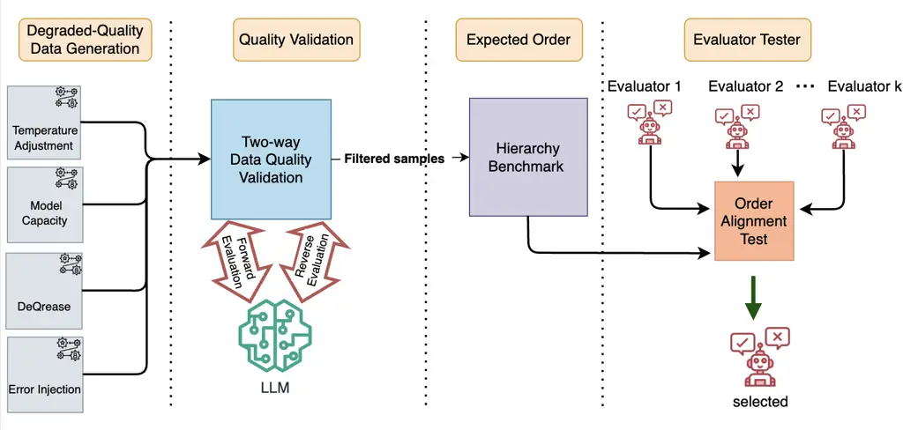
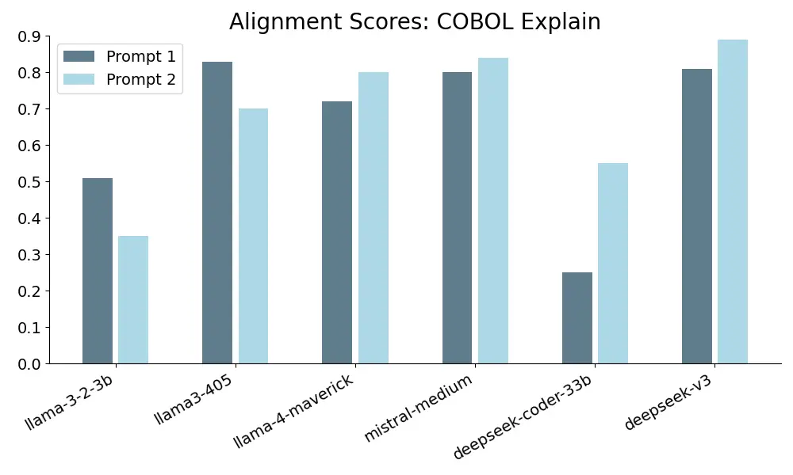
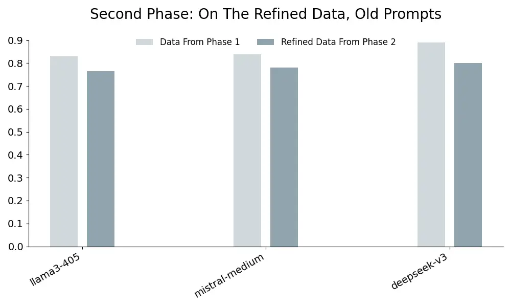
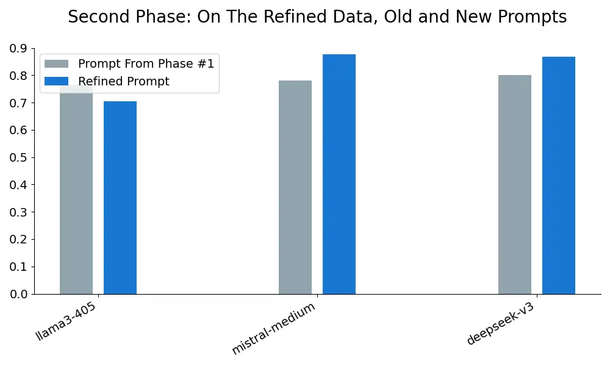
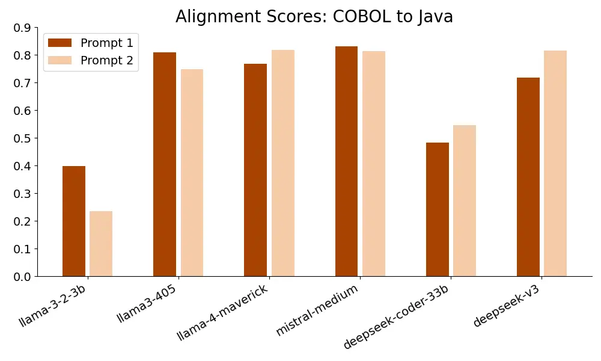
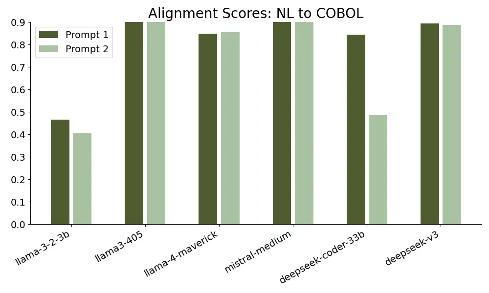

# Automated Validation of LLM-based Evaluators for Software Engineering Artifacts

Ora Fandina    Eitan Farchi    Shmulik Froimovich Affiliation: Rami
Katan, Alice Podolsky, Orna Raz, Avi Ziv Affiliation: IBM Research,
Haifa, Israel Affiliation: {ora.nova.fandina, shmulik.froimovich,
alice.podolsky}@ibm.com Affiliation: {farchi, rami.katan, ornar,
aziv}@il.ibm.com

###### Abstract

Automation in software engineering increasingly relies on large language
models (LLMs) to generate, review, and assess code artifacts. However,
establishing LLMs as reliable evaluators remains an open challenge:
human evaluations are costly, subjective and non-scalable, while
existing automated methods fail to discern fine-grained variations in
artifact quality.

We introduce REFINE—Ranking Evaluators for FIne-grained Nuanced
Evaluation, an automated framework for benchmarking LLM-based evaluators
across software engineering tasks. REFINE comprises of two modules:
Hierarchy Dataset Builder applies novel generation techniques to
automatically synthesize artifacts with progressively reduced quality,
and Evaluator Tester quantifies each candidate evaluator configuration
by measuring how closely its rankings align with expected ordering.

A key feature of REFINE is controllability: users can tune the
granularity of degradation to progressively refine evaluator
configurations, from coarse filtering to stress-testing on subtle
quality gaps.

While the methodology is general, we focus on coding tasks reflecting
the practical demands in our production setting. REFINE was integrated
into IBM’s internal development workflows and applied to code
generation, translation, and summarization for COBOL, an
enterprise-critical programming language, using industrial data. It was
used to identify LLM-as-a-Judge configurations that lifted alignment
scores from below 0.7 to above 0.9 in some coding tasks. These
nuance‑sensitive evaluators are now actively used by model‑training
teams to support model-release decisions.

## I Introduction

Large Language Models (LLMs) are rapidly transforming software
engineering (SE) by enabling advanced automation across tasks such as
code generation, bug detection, test generation and refactoring. In
addition to generating artifacts, LLMs are increasingly used as
evaluators—ranking alternative implementations, identifying potential
issues pull requests, and assessing generated code in end-to-end
workflows. As these roles become embedded in real-world SE pipelines,
ensuring the reliability and consistency of LLM-based evaluators becomes
a critical challenge for industrial adoption.

LLM-based evaluators, often referred to as LLM-as-a-judge, are widely
used across domains. However, numerous studies have identified their
limitations: from bias and verbosity to inconsistency and prompt
sensitivity \[1\], \[2\], \[3\]. These issues cast a doubt on their
trustworthiness in business critical evaluations and pose risks when
such models are used in production pipelines without rigorous
validation.

In the software engineering domain, current approaches to validating
LLM-based evaluators often rely on human judgment, which is inherently
subjective and expensive. Manual evaluation cannot keep pace with the
rapid scale and speed at which LLM-powered tools are being integrated
into modern software development environments. This highlights the
urgent need for automated and scalable validation methods tailored
specifically to software engineering contexts \[4\], \[5, 6\].

Recent research has introduced automated artifact generation as a sanity
check for LLM evaluators. For example, frameworks such as FBI \[7\] and
Drowzee \[8\] inject errors or inconsistencies into textual or code
artifacts to test whether evaluators can appropriately flag them.
Others, such as METAL \[9\] and MORTAR \[10\], employ metamorphic
testing to generate robust perturbations across conversational and
programming contexts.

While these efforts explore important directions in automated
validation, they primarily target obvious flaws (e.g., syntax errors or
factual inaccuracies) and offer limited support for evaluating nuanced
quality aspects that are critical for trustworthy deployment in SE
pipelines, such as code maintainability, efficiency, or adherence to
design patterns. Moreover, existing methods are generally designed for
mainstream languages and are not tailored to enterprise-critical legacy
programming languages (such as COBOL, REXX, etc.), which require
domain-specific handling.



Figure 1: REFINE framework: one step in a refinement cycle. In the first
stage, the most suitable generation method for a given code task is
applied to construct a fine-grained hierarchy of outputs with
progressively reduced quality. This hierarchy is then passed through a
two-way LLM-based validation mechanism to filter out samples that do not
conform to the intended quality ordering. The resulting benchmark is
used in the order test to select the evaluator (judge) that best aligns
with the expected ranking.

In this paper, we present REFINE, a framework designed to rank LLM-based
evaluators through fine-grained, nuanced assessment of software
artifacts in an automated, scalable manner. Our approach systematically
generates code artifacts with intentionally varied and controlled
quality levels, producing benchmarks paired with explicit generated
expectations. These benchmarks allow evaluators to be assessed for their
ability to consistently rank artifacts according to expected quality
hierarchies without requiring human intervention.

A key feature of our framework is fine-grained control over the
granularity of quality differences in the generated artifacts. Users can
configure generation parameters to produce either coarse degradations,
creating large quality gaps, or subtle, nuanced degradations that
challenge more sensitive evaluators. This supports a progressive
refinement strategy: initial rounds can use coarse distinctions to
eliminate weak configurations, followed by increasingly refined
benchmarks to identify evaluators capable of detecting subtle quality
differences. This capability has proven essential in practical
pipelines, where evaluator configuration is often iterative and use-case
dependent.

The core idea of this paper is automated expectation generation: for
each benchmark instance, the Hierarchy Dataset Builder produces a set of
$`k`$ artifact variants with progressively reduced quality.

We developed both novel and straightforward techniques for this quality
degradation process. The straightforward methods include leveraging
known model strength differences and increasing decoding temperature. In
addition, we introduce two novel techniques: DeQrease, a custom decoder
designed for generating lower-quality outputs in a controlled manner,
and Domain-Aware Error Injection, which introduces targeted
perturbations informed by task-specific domain knowledge

While the framework supports arbitrary values of $`k`$, we focus on
$`k=3`$ for clarity and consistency. The resulting variants, denoted
$`O_{1},O_{2},O_{3}`$, are constructed to reflect a descending quality
hierarchy:

```math
s(O_{1})>s(O_{2})>s(O_{3})
```

where $`s(\cdot)`$ denotes the latent quality level assigned to each
variant during benchmark construction—reflecting the expected ordering a
reliable evaluator should follow. To ensure the quality hierarchy holds
in practice, the variants are passed through a two-way high-resolution
LLM-based judgment mechanism, which filters out any samples where the
intended order is not reliably recognized. The Evaluator Tester then
assesses each candidate evaluator by computing the average pairwise
ordering agreement score, which reflects how consistently the evaluator
preserves the expected hierarchy. Based on these scores, the
best-aligned evaluators are selected to proceed to the next refinement
cycle, where a new benchmark with more subtle quality differences is
generated. This iterative process continues, gradually increasing
granularity and refining candidates for reliable evaluator selection.

In this paper, we demonstrate how REFINE can be applied to three tasks:
code translation, code summarization, and natural language–to–code
generation, all focused on COBOL, an enterprise-critical language at the
core of ongoing modernization efforts at IBM. We used real-world
datasets derived from production COBOL systems at IBM for these tasks.

For each task, we test 12 distinct LLM-based candidate evaluator
configurations, spanning three families of LLM models (LLaMa, Mistral,
and DeepSeek), and demonstrate how REFINE can be used to identify the
most aligned configuration within a single iteration phase. While most
tasks in this paper are illustrated using a single refinement cycle, for
the code explanation task we present two full REFINE cycles. This allows
us to showcase how prompt design can be iteratively improved.

Although the complete refinement process involves additional internal
cycles and was used to select evaluator configurations now deployed in
production, we cannot disclose the final production configurations. The
use cases shown nonetheless reflect REFINE’s practical role in guiding
evaluator selection under realistic industrial conditions.

COBOL presents unique challenges for LLM-based evaluators due to its
specialized vocabulary, limited representation in pretraining corpora,
and rigid structural conventions such as long-range control flow and
declarative data definitions. These factors make it difficult for
general-purpose LLMs to reason effectively over COBOL artifacts. To our
knowledge, this is the first systematic study to construct fine-grained
hierarchies and to benchmark LLM-based evaluators on COBOL-centered
software engineering tasks grounded in real production data.

REFINE was integrated directly into IBM’s internal workflows to support
evaluator selection across these tasks. Weak evaluator configurations
were eliminated in early testing rounds, while stronger candidates
underwent successive refinement cycles using progressively nuanced
benchmarks. The top-performing evaluator was ultimately handed off to
training and product teams to support decision-making in release
readiness and quality assurance processes.

Main Contributions. The main contributions are:

1.  1.  An automatic order-based testing framework for evaluating
        LLM-as-a-Judge (LaaJ) configurations.
2.  2.  We demonstrate REFINE’s ability to identify high-quality evaluator
        configurations in a single refinement phase, for three coding tasks
        with real-world data.
3.  3.  A novel decoding algorithm, DeQrease, for fine-grained, controllable
        degradation that might be of interest beyond this work due to its
        general statistical properties.
4.  4.  Domain-Aware Error Injection technique for generating
        quality-controlled variants by introducing targeted perturbations
        informed by task-specific domain knowledge.

## II REFINE - Technical Details

Our framework consists of two main parts: generation and validation of
hierarchical data with expected degraded levels of quality, and using it
for testing the order alignment of a candidate LLM evaluator with the
expected result.

### II-A Degraded‑Quality Data Generation


(a) Summary 1 – O1 quality. The summary is fully correct, adheres to the
instructions, and reflects high-quality output.


(b) Summary 2 – O2 quality. Begins similarly to the first summary but
degrades into general, off-task observations about COBOL. A medium level
summary.


(c) Summary 3 – O3 quality. Degrades quickly into an incorrect
explanation, including inaccurate variable references and misrepresented
functionality. A low-quality summary.

Figure 2: Three quality levels generated by the DeQrease method for the
COBOL explanation task. The input COBOL program (not shown here due to
space constraints) is a synthetic example that computes connected
components in a graph. For brevity, most correct details in the
explanations have been omitted.

We introduce three automatic degradation schemes, each suited to a
different class of code-related tasks. These methods use a generator LLM
to produce outputs at multiple quality levels from task-specific inputs.
Crucially, each scheme supports controllable granularity, enabling users
to generate either large quality gaps for coarse filtering or subtle
degradations for refining nuanced evaluator behavior.

#### Generation with Reduced Model Capacity

Quality is degraded by generating artifacts with lower‑capacity LLMs,
whose weaker representations naturally yield a lower‑quality tier
relative to outputs from stronger models. In code‑translation tasks this
capacity gap is particularly pronounced: large models capture
cross‑language syntax and idiomatic API migration, whereas smaller
models frequently emit syntactically invalid code, retain
source‑language APIs, or omit corner‑case logic.

#### Decoder for Degraded Quality Generation: DeQrease

This method uses a decoding algorithm we designed specifically for
controlled quality reduction. At every generation step, the decoder
restricts candidates to the top‑k tokens, then redistributes probability
mass toward the lower‑ranked tokens in that set. High‑probability tokens
remain selectable but are less favored, yielding outputs intentionally
degraded relative to the model’s default distribution. DeQrease is
especially suited to code‑summarization and explanation tasks, where
“low‑quality” variants must stay coherent and relevant but may include
subtle factual omissions or minor inaccuracies.

To finely control degradation severity, DeQrease introduces several
tunable hyperparameters:

- •
  prefix length ($`0<p\leq 1`$): a fraction of the baseline (potentially
  high-quality) output length that is deterministically copied before
  degradation begins. A shorter prefix results in greater degradation,
  as fewer tokens are inherited from the original high-quality summary.
- •
  top k: sets the candidate tokens at each decoding step. Larger values
  extend variety, beyond the correct tokens contributing to quality
  degradation.
- •
  temperature ($`t>1`$): sharpens the redistribution of probability
  mass, amplifying randomness and pushing generation further from the
  model’s most likely predictions.

Together, these parameters allow DeQrease to produce controlled variants
with varying fidelity while preserving relevance and syntactic fluency.
An example output of DeQrease is shown in Figure 2.

#### Domain-Aware Error Injection

Starting from high‑quality ground‑truth artifacts, this method uses
domain knowledge to insert realistic defects without rendering the
artifact nonsensical. Perturbations include changed constants, misplaced
control logic, off‑by‑one errors, API misuse. The resulting variants
mirror common software‑engineering issues and are especially suited to
tasks such as code generation,

In addition, we designed an automated, LLM-based two-way validation
scheme that evaluates each variant from both directions, assessing the
quality of the output given the input, and vice versa. This phase
retains only samples where both perspectives confirm a consistent
decrease in quality.

### II-B Evaluator Tester: Alignment with Expected Order

Given a code-related task, let $`\mathcal{X}`$ denote its input dataset.
For each input $`x\in\mathcal{X}`$ and an associated output $`o`$, an
evaluator $`E`$ assigns a real-valued quality score $`s_{E}(x,o)`$. We
place no constraints on the form or scale of these scores.

We define the ordering alignment metric. Let
$`(\mathcal{X},O_{1},O_{2},\ldots,O_{k})`$ denote the generated
hierarchy of artifacts for a given task, where $`\mathcal{X}`$ is the
set of task inputs, and $`O_{1},\ldots,O_{k}`$ are the corresponding
sets of degraded outputs, ordered such that the quality of outputs
satisfies $`O_{1}>O_{2}>\cdots>O_{k}`$.

Assume that $`|\mathcal{X}|=n`$ and $`|O_{j}|=n`$ for all $`j`$, so that
each input has exactly one associated output at each quality tier. For
every input $`x\in\mathcal{X}`$ and its corresponding outputs
$`o_{1},o_{2},\ldots,o_{k}`$, where $`o_{j}\in O_{j}`$, we evaluate the
ability of an evaluator $`E`$ to assign scores that respect the expected
quality ordering. We define:

```math
\alpha_{E}(x)=\frac{1}{\binom{k}{2}}\sum_{1\leq u<v\leq k}\mathbb{I}\left[s_{E}(x,o_{u})>s_{E}(x,o_{v})\right],
```

where $`\mathbb{I}[\cdot]`$ is the indicator function that returns 1
when the evaluator assigns a higher score to the higher-quality output,
and 0 otherwise.

The Alignment Score is obtained by averaging over all inputs:

```math
\text{Alignment Score}(E)=\frac{1}{n}\sum_{x\in\mathcal{X}}\alpha_{E}(x).
```

Alignment score close to 1 indicates strong agreement with the benchmark
hierarchy, suggesting that the evaluator reliably detects quality
differences. In contrast, values near 0 reflect poor alignment with the
expected quality ordering.

It is important to note that we intentionally adopt strict inequality in
the comparison, i.e., $`s_{E}(x,o_{u})>s_{E}(x,o_{v})`$, to avoid
overestimating the performance of weak evaluators that produce tied
scores. For example, an evaluator that always assigns the same score (or
only two distinct scores) to all outputs—regardless of their true
quality—would trivially satisfy non-strict monotonicity and achieve a
perfect score under a relaxed definition. By enforcing strict
comparisons, we ensure that the alignment score metric captures the
evaluator’s true ability to discriminate between outputs of different
quality levels.

## III REFINE in Practice: Experimental Snapshot

We demonstrate a representative application of REFINE on three code
tasks directly aligned with IBM’s production needs: code translation,
code summarization, and natural language–to–code generation. While
REFINE has been deployed internally in a full iterative workflow to
support evaluator selection for model-training teams, the results
presented in this section reflect a single evaluation phase conducted on
real-world task specific COBOL data. We now describe the exact
experimental setup used in this snapshot.

COBOL snippets input data. For the code translation and code generation
tasks, the input datasets consist of COBOL snippets sourced from
proprietary enterprise training data.

For the code summarization task, the input COBOL snippets were
synthetically generated. Unlike translation or generation, summarization
does not require fully correct or executable source code. Rather, it
relies on the ability to infer and express the semantic intent conveyed
by the code’s structure and identifiers. As such, synthetic snippets,
while potentially incomplete or imperfect, still provide a valid and
diverse basis for evaluating explanation quality. This approach also
enables targeted variation and inclusion of underrepresented patterns to
stress-test summarization evaluators. We used the generation process
introduced in \[11\].

For all tasks, we generated a three-tiered hierarchy of outputs:
$`O_{1}`$ represents high-quality initial outputs, $`O_{2}`$ corresponds
to medium-quality variants, and $`O_{3}`$ contains low-quality outputs.
We further validated and filtered samples $`(x,o_{1},o_{2},o_{3})`$ to
ensure that the quality levels reflect the intended degradation.

We applied a task-specific, automatic LLM-based two-way validation
procedure to discard samples with inconsistent quality ordering.

Two-way validation and filtering. To ensure high-quality benchmark
construction across tasks, we employed a two-way validation scheme using
high-resolution LLM-based evaluators. These evaluators were designed to
detect subtle quality differences with significantly greater
sensitivity, approximately tenfold compared to the candidate
LLM-as-a-Judge (LaaJ) under evaluation. This setup enables reliable
quality assessment independent of the specific characteristics of the
candidate LaaJ.

Each output artifact $`o_{i}`$, $`i\in\{1,2,3\}`$ was evaluated in both
forward and reverse directions: the forward evaluator scored the quality
of the output $`o_{i}`$ given the input $`x`$, while the reverse
evaluator assessed how well the input $`x`$ could be reconstructed from
the output $`o_{i}`$. Both evaluators produced quality scores on a 0–100
scale. The final score for each artifact was computed as the arithmetic
mean of the two directional scores. Task-specific prompts used in these
evaluations and the base LLM models are provided in the relevant
sections.

To enforce ordinal consistency, the averaged scores were used in a
filtering step. For each input $`x\in\mathcal{X}`$ and its associated
set of artifacts $`o_{1},o_{2},o_{3}`$ we verified that the average
scores respected the expected hierarchy:

```math
\text{avrg\_score}(o_{1})\geq\text{avrg\_score}(o_{2})\geq\text{avrg\_score}(o_{3}).
```

Only triplets satisfying this monotonicity criterion were retained in
the final hierarchy benchmark.

Candidate LaaJs. The resulting benchmark data was used to evaluate
candidate LaaJs tailored to each task. Each evaluator assigns a scalar
score from 1 to 7, with 1 denoting low-quality outputs and 7
representing high-quality outputs. The underlying LLMs in our LaaJs use
greedy decoding, as it aims to satisfy the core requirements of
evaluation: determinism, stability, and consistency.

For the evaluator LLM, we selected six models spanning three major
families, used consistently across all tasks in this work:

- •
  llama-3-2-3b-instruct, llama-3-405b-instruct,
  llama-4-maverick-17b-128e-instruct-fp8
- •
  mistral-medium
- •
  deepseek-v3, deepseek-coder-33b-instruct

Each model was evaluated under two prompt configurations, which are
detailed in Appendix B.

The post-processing LLM used in all tasks in this work was
llama-3-70b-instruct.

All evaluation experiments were conducted using the IBM Watsonx.ai
platform.

## IV COBOL Summarization Task

In this task, a model is given COBOL code snippets and is asked to
generate a summary explaining the program. The desired summaries may
vary in level of detail and focus, depending on the use case.

In our setting, the target summaries are intended to convey the business
purpose of the program, its inputs and outputs, and an overall
functional description.

Input COBOL snippets dataset We automatically generated $`285`$
synthetic COBOL code snippets, spanning various topics, difficulties,
and lengths: from classic graph algorithms to small business
applications \[11\].

Degraded summaries generation In this task, we present a two-phase
refinement scenario for evaluator selection, in which we generated two
sets of degraded summaries using our DeQrease decoding method. DeQrease
is specifically tailored to produce controlled-quality variants of COBOL
program summaries.

In both phases, we began by generating baseline quality summaries,
denoted $`O_{1}`$, using llama-3-405b-instruct model with greedy
decoding and the following prompt:

As a COBOL Expert, please provide a detailed summary of the following
COBOL program, with the following sections:

1. Business purpose.

2. Inputs and outputs of the program.

3. Detailed functional summary per function.

COBOL program: {cobol_code}

We then produced lower-quality variants using the DeQrease method with
the granite-8b-code-instruct model, which is trained for deep COBOL
understanding. The difference between phases lies in the level of
refinement in the degradation process:

- •
  In the first phase, we used coarser-grained degradation, with prefix
  length values set to $`0.7`$ for $`O_{2}`$ and $`0.4`$ for $`O_{3}`$,
  along with top-k = 8 and temperature $`t=7`$.
- •
  In the second phase, we generated a more refined degradation hierarchy
  using adjusted hyperparameters to better capture subtle quality
  distinctions: prefix length=0.8 for $`O_{2}`$, and prefix length=0.6
  for $`O_{3}`$ quality outputs, with top-k=7 and temperature $`t=7`$.

An example of the generated quality levels of the more refined second
pahse appears in Figure 2.

Two-way validation and filtering For both phases we used
llama-3-405b-instruct as the forward evaluator, and mistral-medium as
the backward evaluator, both with greedy decoding. The exact prompts are
in Section A-B.

After the filtering stage 147 triplet samples, each consisting of a
COBOL snippet and its corresponding summaries, were retained and
included in the hierarchy benchmark $`H_{1}`$ for the first-phase data.
For the second-phase data, 138 triplet samples were retained after
filtering for the hierarchy benchmark $`H_{2}`$. After the filtering
stage, 147 triplet samples—each consisting of a COBOL snippet and its
corresponding summaries—were retained and included in the hierarchy
benchmark for the first-phase data. For the second-phase data, 138
triplet samples were retained after filtering.

To validate that the second-phase hierarchy dataset $`H_{2}`$ is indeed
more refined than the first-phase dataset $`H_{1}`$, we compared their
internal separation quality. We computed two quality gap metrics:

```math
\text{Gap}_{1\to 2}^{(H_{1})}=\frac{\sum_{(x,o_{1},o_{2})\in\mathcal{X},O_{1},O_{2}}\text{score}(x,o_{2})-\text{score}(x,o_{1})}{\text{num samples in}\;H_{1}}
```

```math
\text{Gap}_{2\to 3}^{(H_{1})}=\frac{\sum_{(x,o_{2},o_{3})\in\mathcal{X},O_{2},O_{3}}\text{score}(x,o_{3})-\text{score}(x,o_{2})}{\text{num samples in}\;H_{1}}
```

The same computation was performed also for $`H_{2}`$. We obtained the
following results:

```math
\text{Gap}_{1\to 2}^{(H_{1})}=11.82,\;\;\text{Gap}_{2\to 3}^{(H_{1})}=18.40
```

and

```math
\text{Gap}_{1\to 2}^{(H_{2})}=7.31,\;\;\text{Gap}_{2\to 3}^{(H_{2})}=13.01
```

The results confirm that $`H_{2}`$ exhibits lower quality gaps,
indicating a higher level of refinement suitable for fine-grained
evaluation.

REFINE in action: two-phase refinement, evaluators configurations and
results We present two phases of REFINE framework. At the first phase,
we run all 12 judge configurations, as described in Candidate LaaJs
paragraph, on the $`H_{1}`$ hierarchy benchmark data. The alignment
scores of these first phase configurations are presented in Figure 3.



Figure 3: Alignment scores for 12 candidate evaluator configurations on
the COBOL summarization task.

We observe that in the explanation task the relatively weak model
llama-3-2-3b-instruct fails the order test, while the generally strong
deepseek-coder model performs surprisingly poorly. Additionally,
although this REFINE phase allowed us to eliminate four underperforming
configurations, the remaining LaaJs exhibit closely matched performance.
This indicates that further refinement cycles are necessary to reliably
distinguish between the top candidates.

This completes one phase of the REFINE framework. To initiate another
refinement cycle, we select the top-performing LaaJ configurations from
the current phase. Specifically, we chose the top three candidates to
proceed: llama-3-405b-instruct (Prompt 1), mistral-medium (Prompt 2),
and deepseek-v3 (Prompt 2).

We then evaluated these configurations on the refined $`H_{2}`$
hierarchy data and observed that, as expected, the initial LaaJ
configurations struggled to capture the subtle nuances introduced in the
$`H_{2}`$ data, as shown in Figure 4.



Figure 4: Alignment scores for the top three candidate configurations
from Phase 1, evaluated on the original hierarchy $`H_{1}`$ and the more
refined hierarchy $`H_{2}`$. The LaaJs show degraded performance on
$`H_{2}`$, as expected, but remain closely matched—highlighting the need
for further refinement cycles to reliably distinguish between them.

Next, we revise the prompts of the top three candidate configurations by
incorporating insights from the failure cases identified in the order
test. This process results in an improved prompt version, which is
detailed in Appendix B-B. We then evaluate the newly refined
configurations on the $`H_{2}`$ dataset. The alignment scores are shown
in Figure 5.



Figure 5: Top three candidate configurations from Phase 1 and their
respective refined versions from Phase 2.

We observe that in the second REFINE cycle, two candidate LaaJs
demonstrate improved alignment and can be selected to proceed to the
next refinement cycle, if further evaluation is required.

## V Code Translation: Cobol to Java

In this task a model is instructed to translate COBOl code snippets to
an equivalent code in Java language.

Input COBOL snippets dataset Given the rigid structure of code
translation tasks, it is crucial to use well-formed, syntactically
strict COBOL code snippets, each accompanied by variable and class maps
that support the translation process.

Our input dataset $`\mathcal{X}`$ comprises 241 curated COBOL snippets
sourced from the product’s internal evaluation suite. Originally used to
assess product’s performance, these samples were repurposed as
foundational dataset to construct our benchmark. This ensures that
LLM-evaluators capture quality variations across model outputs and
remain aligned with the specific requirements of evaluating
COBOL-to-code translation.

Degraded translation artifacts generation To generate translation
artifacts exhibiting varying degrees of quality degradation, we employed
language models of differing capacities to convert COBOL code snippets
into Java. The translation prompt is intentionally simple and directive
in nature:

Here is a COBOL code sample accompanied by variable and class mappings
to be used in the translation. Please translate the COBOL program into
Java, utilizing the provided mappings. COBOL: {cobol}

Produce only the Java code, without any accompanying explanations or
comments.

Enclose the resulting code between two sets of triple backticks (‘‘‘).

For generating the artifact variants $`O_{1}`$, $`O_{2}`$, and
$`O_{3}`$, we used three models from the LLaMA-3 family, differing in
parameter size, and thus in their generative capabilities:

- •
  llama-3-70b-instruct for higher-quality outputs
- •
  llama-3-3b-instruct moderately degraded outputs
- •
  llama-3-1b-instruct for lower-quality outputs

A notable advantage of this approach lies in its ability to capture
translation errors that arise naturally from the generative behavior of
language models, as opposed to those that are artificially introduced.
This allows for a more authentic and representative assessment of model
performance. If an LLM-evaluator ranks the outputs in accordance with
the expected quality hierarchy, it would demonstrate its capacity to
distinguish between naturally occurring errors of varying severity,
thereby validating its efficacy as a model evaluator.

All translations were generated deterministically using greedy decoding
,i.e. with temperature set to zero.

Two-way validation and filtering For this phase, we used the
llama-3-405b-instruct model with greedy decoding for both forward and
backward evaluation, with the prompts that can be found in Section A-A.

This filtering process effectively removed $`67`$ inconsistent samples
produced during the generation step, resulting in a refined dataset of
$`174`$ translation instances with consistently ordered quality
levels.

Single REFINE phase: evaluator configurations and results

We applied each evaluator configuration to a degraded COBOL-to-Java
dataset to measure alignment with a quality-based reference ordering.
Figure 6 presents the alignment scores across all candidates,
illustrating significant performance variability and the utility of
REFINE in identifying robust evaluators.



Figure 6: Alignment scores for 12 candidate evaluator configurations on
the COBOL-to-Java task.

We observe that some configurations are closely matched and require
further refinement to effectively distinguish between them and identify
the most reliable LaaJ configuration. As expected, the relatively weak
model llama-3-2-3b-instruct fails the alignment test. In contrast, the
specialized and generally strong deepseek-coder performs unexpectedly
poorly, highlighting the importance of task-specific evaluation over
general model strength.

## VI Natural language instruction to COBOL

In this task a model is required to generate COBOL code snippets from
the given instruction in natural language.

Input COBOLs Dataset. For this task, we used enterprise COBOL paragraphs
extracted from a real-world IBM client application that was adapted for
model training process. We sampled 4208 paragraphs from this data,
ranging in length from 20 to 100 lines of code.

For these high-quality, production-grade COBOL snippets, we generated
natural language instructions using the mistral-large model, with the
prompt appearing in Section C. After this step, we designed two
LLM-based judges for evaluating both the NL-to-COBOL task and its
inverse, the COBOL-to-NL task. These judges are based on the
llama-3-70b-instruct model and use a 1–7 evaluation scale. The
evaluation prompts are 4-shot prompts; therefore, we do not disclose
them in this paper. We applied these judges to all 4208 samples and
retained only those for which both directional scores were 7, and
samples from these 300 NL–COBOL pairs. After this filtering step, 300
COBOLs and their corresponding NL instructions were retained.

Degraded COBOLs Generation. For this task, we used the Domain-Aware
Error Injection method. We employed the llama-3-405b-instruct model to
inject controlled errors into COBOL code, thereby lowering the quality
of the (NL, COBOL) pair. To generate an additional quality level we
further degraded the previously injected COBOL by introducing more
errors. The first round of error injection used the following prompt:

Introduce 2 syntax or logical errors into the COBOL code. The errors may
include (but are not limited to):

- Introduce typos into command names (e.g., PERFROM instead of PERFORM,
  DISPALY instead of DISPLAY).
- Replace logical operators with the opposite operator (e.g., \<\>
  instead of =, \< instead of \>).
- Remove ending statements (e.g., END-IF, END-EXEC).
- Delete the paragraph name in a PERFORM statement.

For the second level degradation we instructed the model:

Locate all the names in the code (variable names, paragraph names, file
names, etc.) and change half of them.

In this way we obtained 300 samples of an NL instruction and two
associated COBOLs of regarded quality. We then pass these through
two-way filtering phase.

Two-way validation and filtering. For the forward pass, we used a
llama-3-405b-instruct-based evaluator, and for the backward task, we
used a mistral-medium-based evaluator. Both evaluators produced scores
on a 1–100 scale. The exact prompts are in Appendix A-C. After this
phase 234 samples retained and included in the hierarchy benchmark.

Single REFINE Phase: Evaluator Configurations and Results We tested LaaJ
configurations based on the same LLM models used in the previous tasks,
each evaluated with two task-specific prompt variants, appearing in
Appendix B-C. The resulting alignment scores are presented in Figure 7.



Figure 7: Alignment scores for candidate evaluator configurations on the
NL to COBOL task.

In this task, we observe a similar phenomenon as in the previous two:
the llama-3-2-3b-instruct model fails the order test as expected.
However, the remaining models achieve high alignment scores and are
closely comparable, indicating the need to proceed to the next
refinement cycle to effectively distinguish between them.

## VII Conclusions

We presented REFINE, a framework for automated validation of LLM-based
evaluators in software engineering settings. REFINE combines controlled
degradation with order-preserving alignment tests to support automatic
and fine-grained evaluation of candidate evaluator configurations. It
enables the construction of task-specific hierarchies of quality and
facilitates iterative selection of the most reliable evaluators
configurations.

We demonstrated the use of REFINE across three representative SE tasks:
code translation, code summarization, and natural language–to–code
generation, focusing on COBOL, a legacy enterprise-critical language
central to ongoing modernization efforts.

In each case, we applied REFINE to 12 candidate evaluator configurations
spanning diverse model families and two prompt variants. Our
experiments, grounded in production data from IBM’s internal pipelines.
We observed that while some weak models (e.g., llama-3-2-3b-instruct)
are consistently discarded in early stages of REFINE, other strong
models exhibit task-specific variability, underscoring the importance of
domain-adapted evaluation.

The framework was integrated into IBM’s internal workflows to support
evaluator selection in modernization tasks; while specific production
configurations cannot be disclosed, the snapshot experiments we
presented reflect realistic use cases and real data.

## References

- \[1\] G. H. Chen, S. Chen, Z. Liu, F. Jiang, and B. Wang, “Humans or
  LLMs as the judge? a study on judgement bias,” in _Proceedings of the
  2024 Conference on Empirical Methods in Natural Language
  Processing_, Y. Al-Onaizan, M. Bansal, and Y.-N. Chen,
  Eds. Association for Computational Linguistics, Nov. 2024, pp.
  8301–8327. \[Online\]. Available:
  [https://aclanthology.org/2024.emnlp-main.474/](https://aclanthology.org/2024.emnlp-main.474/)
- \[2\] P. Wang, L. Li, L. Chen, Z. Cai, D. Zhu, B. Lin, Y. Cao, L.
  Kong, Q. Liu, T. Liu, and Z. Sui, “Large language models are not fair
  evaluators,” in _Proceedings of the 62nd Annual Meeting of the
  Association for Computational Linguistics (Volume 1: Long Papers)_,
  L.-W. Ku, A. Martins, and V. Srikumar, Eds. Bangkok, Thailand:
  Association for Computational Linguistics, Aug. 2024, pp. 9440–9450.
  \[Online\]. Available:
  [https://aclanthology.org/2024.acl-long.511/](https://aclanthology.org/2024.acl-long.511/)
- \[3\] L. Zheng, W.-L. Chiang, Y. Sheng, S. Zhuang, Z. Wu, Y.
  Zhuang, Z. Lin, Z. Li, D. Li, E. P. Xing, H. Zhang, J. E. Gonzalez,
  and I. Stoica, “Judging llm-as-a-judge with mt-bench and chatbot
  arena,” in _Proceedings of the 37th International Conference on Neural
  Information Processing Systems_, ser. NIPS ’23. Curran Associates
  Inc., 2023.
- \[4\] D. Cecchini, A. Nazir, K. Chakravarthy, and V. Kocaman,
  “Holistic evaluation of large language models: Assessing robustness,
  accuracy, and toxicity for real-world applications,” in _Proceedings
  of the 4th Workshop on Trustworthy Natural Language Processing
  (TrustNLP 2024)_, Jun. 2024, pp. 109–117. \[Online\]. Available:
  [https://aclanthology.org/2024.trustnlp-1.11/](https://aclanthology.org/2024.trustnlp-1.11/)
- \[5\] M. Kuchnik, V. Smith, and G. Amvrosiadis, “Validating large
  language models with relm,” in _Proceedings of Machine Learning and
  Systems_, vol. 5. Curan, 2023, pp. 457–476. \[Online\]. Available:
  [https://proceedings.mlsys.org/paper_files/paper/2023/file/93c7d9da61ccb2a60ac047e92787c3ef-Paper-mlsys2023.pdf](https://proceedings.mlsys.org/paper_files/paper/2023/file/93c7d9da61ccb2a60ac047e92787c3ef-Paper-mlsys2023.pdf)
- \[6\] S. R. Bowman and G. Dahl, “What will it take to fix
  benchmarking in natural language understanding?” in _Proceedings of
  the 2021 Conference of the North American Chapter of the Association
  for Computational Linguistics: Human Language
  Technologies_. Association for Computational Linguistics, Jun. 2021,
  pp. 4843–4855. \[Online\]. Available:
  [https://aclanthology.org/2021.naacl-main.385/](https://aclanthology.org/2021.naacl-main.385/)
- \[7\] S. Doddapaneni, M. S. U. R. Khan, S. Verma, and M. M. Khapra,
  “Finding blind spots in evaluator LLMs with interpretable checklists,”
  in _Proceedings of the 2024 Conference on Empirical Methods in Natural
  Language Processing_. Miami, Florida, USA: Association for
  Computational Linguistics, Nov. 2024, pp. 16 279–16 309. \[Online\].
  Available:
  [https://aclanthology.org/2024.emnlp-main.911/](https://aclanthology.org/2024.emnlp-main.911/)
- \[8\] N. Li, Y. Li, Y. Liu, L. Shi, K. Wang, and H. Wang, “Drowzee:
  Metamorphic testing for fact-conflicting hallucination detection in
  large language models,” _Proc. ACM Program. Lang._, vol. 8, no.
  OOPSLA2, Oct. 2024. \[Online\]. Available:
  [https://doi.org/10.1145/3689776](https://doi.org/10.1145/3689776)
- \[9\] S. Hyun, M. Guo, and M. A. Babar, “ METAL: Metamorphic Testing
  Framework for Analyzing Large-Language Model Qualities ,” in _2024
  IEEE Conference on Software Testing, Verification and Validation
  (ICST)_. IEEE Computer Society, May 2024, pp. 117–128. \[Online\].
  Available:
  [https://doi.ieeecomputersociety.org/10.1109/ICST60714.2024.00019](https://doi.ieeecomputersociety.org/10.1109/ICST60714.2024.00019)
- \[10\] G. Guo, A. Aleti, N. Neelofar, C. Tantithamthavorn, Y. Qi,
  and T. Y. Chen, “Mortar: Multi-turn metamorphic testing for llm-based
  dialogue systems,” 2025. \[Online\]. Available:
  [https://arxiv.org/abs/2412.15557](https://arxiv.org/abs/2412.15557)
- \[11\] E. Farchi, S. Froimovich, R. Katan, and O. Raz, “Automatic
  generation of benchmarks and reliable llm judgment for code
  tasks,” 2024. \[Online\]. Available:
  [https://arxiv.org/abs/2410.21071](https://arxiv.org/abs/2410.21071)

## Prompts Book

## Appendix A Filtering Phase Prompts

All the prompts we used in two-way filtering phase are presented here.

### A-A Cobol to Java Task

Evaluation Prompt (COBOL $`\rightarrow`$ Java)

> You are a COBOL expert. Your task is to evaluate the Java translation
> of the given COBOL code snippet. Variable and class mappings are
> provided and should be taken into account during evaluation. Assess
> whether the Java code accurately reflects the original COBOL program.
> Provide an overall score from 0 to 100 based on the correctness of the
> Java translation, using the full range to reflect nuances in quality.
> Choose the appropriate score within each range to indicate how
> faithfully the translation captures the original logic.  
> Scoring Criteria:
>
> - •
>   90--100: Fully Correct – Functionally equivalent, concise, and
>   idiomatic translation.
> - •
>   75--89: Functionally Equivalent with Minor Deviations – Accurate but
>   verbose or non-idiomatic.
> - •
>   50--74: Partially Equivalent – Mostly correct; minor issues fixable
>   by a developer with modest effort.
> - •
>   25--49: Marginally Equivalent – Some shared logic but major errors
>   or missing features.
> - •
>   1--24: Not Equivalent – Largely incorrect or functionally unrelated.
> - •
>   0: Completely Incorrect – Empty, broken, unrelated, or
>   non-functional code.
>
> If the sample is unusable, assign a score of -2 and terminate the
> evaluation.  
> COBOL code: {given_code}  
> Java translation: {generated_code}

Evaluation Prompt (Java $`\rightarrow`$ COBOL)

You are a COBOL and Java expert. Your task is to evaluate the COBOL
translation of the given Java code snippet. Variable and class mappings
are provided to aid in interpretation. Assess whether the COBOL code
faithfully replicates the functionality of the Java code.

Scoring Criteria:  
Provide an overall score from 0 to 100 based on how correct the
generated COBOL translation is compared to the original Java code. Use
the full range of scores so that the nuances are reflected in the final
score. For each score range, choose the specific score that most
accurately reflects the degree of equivalence between the generated
COBOL translation and the Java code.  
Use this scale:  
90-100: Fully Correct-The translation is correct, functionally
equivalent, concise, and idiomatic.  
75-89: Functionally Equivalent with Minor Deviations-The translation is
accurate and functionally correct, but the COBOL code is verbose,
stylistically awkward, or non-idiomatic.  
50-74: Partially Equivalent-The translation is mostly correct, but
includes minor errors or omissions that can be corrected with minimal
effort by a COBOL developer.  
25-49: Marginally Equivalent-The translation shares some logical
structure with the Java code but contains significant errors, incorrect
control flows, or missing features.  
1-24: Not Equivalent-The translation is largely incorrect, only
superficially resembles the Java code, or implements unrelated
functionality.  
0: Completely Incorrect -The translation is empty, syntactically broken,
entirely unrelated, or non-executable.  
For the selected score, provide a detailed justification. Include
concrete examples when relevant.  
If the sample is unusable, assign a score of -2 and terminate the
evaluation.  
COBOL translation: {given_code}  
Java code: {generated_code}

### A-B COBOL Summarization Task

Evaluation Prompt (COBOL $`\rightarrow`$ Summary)

> You are a COBOL programming expert. Your task is to carefully evaluate
> whether the provided summary accurately represents the given COBOL
> code.
>
> \*\*\* Evaluation Instructions \*\*\*
>
> Assign a score between 1--100, representing how well the summary
> matches the code. Consider the following aspects:
>
> \*\* Special Cases:
>
> - Assign a score of 1 if the summary is empty, completely unrelated to
>   the code or not written in coherent English. In this case, do not
>   proceed with the rest of the evaluation.
>
> \*\*Content: + Deduct 5 points if the summary is not relevant to the
> code and its functionality.
>
> - Deduct 4 points if the summary does not accurately describe the
>   program’s purpose and main functions.
> - Deduct 3 points for each missing input or output file.
> - Deduct 3 points for each missing external dependency or interface.
> - Deduct 2 points for each missing detail about the program’s logic or
>   control flow.
> - Deduct 1 point if the summary is not concise and to the point.
>
> \*\* Clarity:
>
> - Deduct 5 points if the summary is not easy to understand.
> - Deduct 4 points if the language is not clear and concise.
> - Deduct 3 points for each incorrect technical term.
> - Deduct 2 points for each ambiguous or unclear statement.
> - Deduct 1 point if the summary is not well-organized and easy to
>   follow.
>
> \*\* Accuracy:
>
> - Deduct 5 points for each error or inaccuracy in the summary.
> - Deduct 4 points for each incorrect fact or figure.
> - Deduct 3 points for each inconsistency or contradiction.
> - Deduct 2 points for each inaccurate detail.
> - Deduct 1 point if the summary is not up-to-date and relevant.
>
> \*\*\* Additional Considerations \*\*\*
>
> - Deduct 2 points for each grammatical error.
> - Deduct 1 point for each issue with formatting or presentation.
> - Deduct 3 points if the summary is not comprehensive and complete.
>
> \*\*\* Scoring Guidelines \*\*\*
>
> - Start with a score of 100.
> - Deduct points for each issue or error found.
> - Use the point values listed above as a guide.
>
> \*\*\* COBOL Code and Summary \*\*\*
>
> COBOL code: {generated_code}  
> Summary: {summary}
>
> \*\*\* Answer \*\*\*
>
> Please provide the score (1--100) and a brief explanation of the
> issues that affected the score.

Evaluation Prompt (Summary $`\rightarrow`$ COBOL)

You are a COBOL programming expert. Your task is to carefully evaluate
whether the provided COBOL code corresponds to the given summary.

\*\*\* Evaluation Instructions \*\*\*

Assign a score between 1-100, representing how accurately and completely
the COBOL code matches the summary. Consider the following aspects:

\*\* Special Cases: + Assign a score of 1 if the code is empty, contains
only stubs, or is completely unrelated to the summary. In this case, do
not proceed with the rest of the evaluation.

\*\* Functional Coverage: + Deduct 5 points if the code is largely
irrelevant to the purpose described in the summary. + Deduct 4 points if
the code fails to implement the program’s main goal or functionality. +
Deduct 4 points if the summary mentions a loop or iteration over
records, but code processes only a single record. + Deduct 3 points for
each missing input or output file explicitly mentioned in the summary. +
Deduct 3 points for each missing external dependency or interface (e.g.,
called programs, APIs). + Deduct 2 points for each supporting detail
(e.g., sort step, record structure) present in the summary but not the
code. + Deduct 2 points if the code is generic or templated and lacks
domain-specific logic described in the summary. + Deduct 2 points for
each misuse of control structures (e.g., PERFORM used when IF would be
clearer, or vice versa). + Deduct 2 points if the code ignores a key
concept in the summary (e.g., report formatting, sorting, filtering) +
Deduct 1 point if the code is overly verbose or includes unrelated logic
(i.e., lacks focus).

\*\* Syntax and Semantics: + Deduct 5 points for each incorrect or
illogical variable declaration (e.g., wrong PIC clauses, types). +
Deduct 4 points for each incorrect variable usage (e.g., using a
variable before initialization).. + Deduct 3 points for each usage of
outdated or discouraged constructs like ‘EXIT PROGRAM‘ outside ‘MAIN‘.

\*\* Correctness and Robustness: + Deduct 5 points for each fatal
logical bug — e.g., processing an output file as input. + Deduct 4
points for inconsistent naming or re-use of unrelated variable names. +
Deduct 3 points for redundant or unreachable code blocks.

\*\* Implementation Coverage: + Deduct 5 points for each hallucinated
code element - something mentioned in the code that is not mentioned in
the summary. + Deduct 4 points for each function or subprogram that is
referenced but never defined or described. + Deduct 3 points if the
summary mentions database access, but no database-related logic is
implemented. + Deduct 2 points for each error or failure case mentioned
in the summary that is not handled in the code.

\*\*\* Scoring Guidelines \*\*\* + Start with a score of 100. + Deduct
points for each issue or error found. + Use the point values listed
above as a guide.

\*\*\* COBOL Code and Summary \*\*\*

COBOL code: {code}, Summary: {summary}

\*\*\* Answer \*\*\*

Please provide the score (1-100) and a brief explanation of the issues
that affected the score.

### A-C NL to COBOL Task

Evaluation Prompt (NL $`\rightarrow`$ COBOL)

> You are a COBOL programming expert. Your task is to carefully evaluate
> whether the provided COBOL code corresponds to the given
> instructions.
>
> \*\*\* Evaluation Instructions \*\*\*
>
> Assign a score between 1-100, representing how accurately and
> completely the COBOL code implements the instructions. Consider the
> following aspects:
>
> \*\* Special Cases:
>
> - Assign a score of 1 if the code is empty, contains only stubs, or is
>   completely unrelated to the instructions. In this case, do not proceed
>   with the rest of the evaluation.
>
> \*\* Functional Coverage:
>
> - Deduct 5 points if the code fails to implement the program’s main
>   goal or functionality described in the instructions.
> - Deduct 4 points if the instructions mention a loop or iteration over
>   records, but code processes only a single record.
> - Deduct 3 points for each missing input or output explicitly
>   mentioned in the instructions.
> - Deduct 3 points for each missing external dependency or interface
>   (e.g., called programs, APIs).
> - Deduct 2 points for each supporting detail (e.g., sort step, record
>   structure) present in the instructions but not the code.
> - Deduct 2 points if the code is generic or templated and lacks
>   domain-specific logic described in the instructions.
> - Deduct 2 points for each misuse of control structures (e.g., PERFORM
>   used when IF would be clearer, or vice versa).
> - Deduct 2 points if the code ignores a key concept in the
>   instructions (e.g., report formatting, sorting, filtering).
> - Deduct 1 point if the code is overly verbose or includes unrelated
>   logic (i.e., lacks focus).
>
> \*\* Syntax and Semantics:
>
> - Deduct 5 points for each usage of an "invented" statement that is
>   not a valid COBOL statement (e.g., PERFOM, COMPUT).
> - Deduct 4 points for each incorrect or illogical variable declaration
>   (e.g., wrong PIC clauses, types).
> - Deduct 3 points for each incorrect variable usage (e.g., using a
>   variable before initialization).
> - Deduct 2 points for each usage of outdated or discouraged constructs
>   like ‘EXIT PROGRAM‘ outside ‘MAIN‘.
>
> \*\* Correctness and Robustness:
>
> - Deduct 5 points for each fatal logical bug — e.g., processing an
>   output file as input.
> - Deduct 4 points for inconsistent naming or re-use of unrelated
>   variable names.
> - Deduct 3 points for redundant or unreachable code blocks.
>
> \*\* Implementation Coverage:
>
> - Deduct 4 points if the instructions mention database access, but no
>   database-related logic is implemented.
> - Deduct 3 points for each error or failure case mentioned in the
>   instructions that is not handled in the code.
>
> \*\*\* Scoring Guidelines \*\*\*
>
> - Start with a score of 100.
> - Deduct points for each issue or error found.
> - Use the point values listed above as a guide.
>
> \*\*\* COBOL Code and Instructions \*\*\*
>
> COBOL code: { generated_code }
>
> Instructions: { instructions }
>
> Please provide the score (1-100) and a brief explanation of the issues
> that affected the score. Do not use the character & anywhere. Use
> "and" instead.

Evaluation Prompt (COBOL $`\rightarrow`$ NL)

You are a COBOL programming expert.  
You are provided with a COBOL code snippet and a set of user
instructions that were generated to describe its functionality.  
Carefully evaluate whether the user instructions accurately describe the
given COBOL code.  
\*\*\* Evaluation Instructions \*\*\*  
Assign a score between 1-100, representing how well the summary matches
the code. Consider the following aspects:  
\*\* Special Cases:

- Assign a score of 1 if the summary is empty, completely unrelated to
  the code or not written in coherent English. In this case, do not
  proceed with the rest of the evaluation.  
  \*\* Content: + Deduct 5 points if the instructions do not fully and
  correctly describe the COBOL code.
- Deduct 4 points if the instructions do not accurately describe the
  program’s main functions.
- Deduct 3 points for each missing input or output file.
- Deduct 3 points for each missing external dependency or interface.
- Deduct 2 points for each missing detail about the program’s logic or
  control flow.
- Deduct 1 point if the instructions are not concise and to the point.  
  \*\* Clarity:
- Deduct 5 points if the instructions are not easy to understand.
- Deduct 4 points if the language is not clear and concise.
- Deduct 3 points for each incorrect technical term.
- Deduct 2 points for each ambiguous or unclear statement.  
  \*\* Accuracy:
- Deduct 5 points for each error or inaccuracy in the instructions.
- Deduct 4 points for each incorrect fact or figure.
- Deduct 3 points for each inconsistency or contradiction.
- Deduct 2 points for each inaccurate detail.  
  \*\*\* Additional Considerations \*\*\*
- Deduct 3 points if the instructions are not comprehensive and
  complete.
- Deduct 2 points for each grammatical error.
- Deduct 1 point for each issue with formatting or presentation.  
  \*\*\* Scoring Guidelines \*\*\*
- Start with a score of 100.
- Deduct points for each issue or error found.
- Use the point values listed above as a guide.  
  \*\*\* COBOL Code and Instructions \*\*\*  
  COBOL code: {code}  
  Instructions: {instructions}

Please provide the score (1-100) and a brief explanation of the issues
that affected the score.

## Appendix B Candidate LaaJs Prompts

### B-A COBOL to Java Task

Prompt 1: Here is a COBOL program and Java code translation of the COBOL
program. The COBOL program includes code as well as variable and class
mappings to use in the translation.  
Please assign a score to the correctness of the Java code translation.
Use a scale from 1 to 7:  
7 - Accurately and faithfully translates the COBOL program into Java,
preserving logic and functionality; correct declarations, conditionals,
idiomatic syntax, and no unnecessary changes.  
6 - Mostly correct translation with only minor or subtle issues.  
5 - Incomplete or logically flawed translation; basic structure and some
logic preserved, but major correctness issues exist.  
4 - Significant errors prevent compilation or correct execution;
multiple logical or syntactic flaws.  
3 - Undeclared variables, incomplete translation.  
2 - Lacks implementation of required logic; misunderstanding of COBOL
concepts.  
1 - Empty or nearly empty method; no meaningful logic implemented.
Provide justification for the score. Begin with \###Reasoning and end
with \###End_Reasoning.  
COBOL Program: {cobol}  
Java Translation: {java}

Prompt 2: Here is COBOL program and a Java translation of the COBOL
program. The COBOL program also includes variables and class mapping to
use in the translation. Assign a score of 1-7 to the correctness of the
Java translation. Where 7 is the best and 1 is the worst.

### B-B COBOL summarization task

Prompt 1: You are a programming expert and a very strict evaluator.
Please evaluate the provided ""Source Code"" and ""Provided Summary"" by
following this step-by-step process.  
Step-by-Step Evaluation Process:  
Understand the Source Code: Carefully read and understand the provided
source code. Identify the key functionalities, structures, and logic
implemented.  
Read the Provided Summary: Read the provided summary thoroughly. Note
down the main points it makes about the code’s functionality and
structure. If the summary uses the remarks from the Source Code that is
ok.  
List Correctness Issues: Compare the summary with the source code. If
not perfect, List any discrepancies, inaccuracies, or missing
information in the summary. Note if the summary includes information not
present in the source code than it is not considered good summary and it
should be penalized heavily.  
Assess Correctness Quality: Evaluate how well the summary reflects the
actual functionality and structure of the code. Consider if any
inaccuracies or extraneous details are present in the summary to
evaluate.  
Score Assignment: List Completeness Issues: If not perfect, list any
missing parts in the code that the summary did not address.  
List Conciseness Issues: If not perfect, list any issues in the
conciseness of the summary, list references to and verbose and
repetitive parts in the summary.  
Based on your assessment, give an over all score between 1 and 7.  
Use the following scoring guidelines:  
The score should be penalized if the ""Provided Summary"" is not
directly relevant to the ""Source Code"" . For example, A score of 1
indicates the summary is incorrect or summary is repeating code instead
of text. A score of 3 indicates that summary contains more than 1
inaccurate information which is not supported by the ""Source Code"". A
score of 5 indicates that summary has most of the accurate information
but contain at least 1 inaccurate information. While a score of 7
suggests it accurately describes the Source code functionality and
structure. Penalized if the ""Provided Summary"" doesn’t contain all
information from ""Source Code"" . A score of 1 indicates the summary
doesn’t capture information from Source code. A score of 3 indicates
that summary has few information but also missing few information from
the source code. A score of 5 indicates that summary has most of the
information from Source code but missed out at least 1 information.
While a score of 7 suggests describes the Source code functionality and
structure completely. Penalize if the ""Provided Summary"" is verbose
and repetitive . For example, A score of 1 indicates the summary is
overly verbose or badly repetitive or may contain source. A score of 4
indicates that summary is bit verbose. A score of 5 indicates that
summary is most concise. While a score of 7 suggests that the summary is
perfectly concise and cannot be reduced any further.  
Based on your assessment, give an over all score between 1 and 7.  
code: { code } summary: {summary}

Prompt 2: You are a COBOL expert. Please evaluate the provided COBOL
code and the corresponding code summary using the following criteria:  
Correctness - assess whether the summary accurately reflects the
functionality of the code.  
Completeness - assess whether the summary provides a complete
representation of the code.  
Based on this assessment, assign an overall score between 1 and 7, where
1 reflects a very poor summary and 7 reflects an excellent.  
COBOL code: {code} Summary: {summary}

Refined Prompt From Phase 2:

You are a COBOL programming expert. Your task is to carefully evaluate
whether the provided summary accurately represents the given COBOL
code.

\*\*\* Evaluation Instructions \*\*\*

Assign a score between 1.0 - 7.0, representing how well the summary
matches the code. Consider the following aspects:

\*\* Special Cases:

- Assign a score of 1 if the summary is empty, completely unrelated to
  the code or not written in coherent English. In this case, do not
  proceed with the rest of the evaluation.

\*\* Content: + Deduct 5% if the summary is not relevant to the code and
its functionality.

- Deduct 4% if the summary does not accurately describe the program’s
  purpose and main functions.
- Deduct 3% for each missing input or output file.
- Deduct 3% for each missing external dependency or interface.
- Deduct 2% for each missing detail about the program’s logic or control
  flow.
- Deduct 1% if the summary is not concise and to the point.

\*\* Clarity:

- Deduct 5% if the summary is not easy to understand.
- Deduct 4% if the language is not clear and concise.
- Deduct 3% for each incorrect technical term.
- Deduct 2% for each ambiguous or unclear statement.
- Deduct 1% if the summary is not well-organized and easy to follow.

\*\* Accuracy:

- Deduct 5% for each error or inaccuracy in the summary.
- Deduct 4% for each incorrect fact or figure.
- Deduct 3% for each inconsistency or contradiction.
- Deduct 2% for each inaccurate detail.
- Deduct 1% if the summary is not up-to-date and relevant.

\*\*\* Additional Considerations \*\*\*

- Deduct 2% for each grammatical error.
- Deduct 1% for each issue with formatting or presentation.
- Deduct 3% if the summary is not comprehensive and complete.

\*\*\* Scoring Guidelines \*\*\*

- Start with a score of 7.0.
- Deduct points for each issue or error found.
- Use the point values listed above as a guide.

\*\*\* COBOL Code and Summary \*\*\*

COBOL code: generated_code

Summary: summary

\*\*\* Answer \*\*\*

Please provide the score (1.0 - 7.0) and a brief explanation of the
issues that affected the score.

### B-C NL to COBOL task

Prompt 1: You are a Cobol expert. Task: You are provided with user
instructions describing COBOL code and the corresponding COBOL code
generated by an AI model. Your Goal: Carefully evaluate whether the
provided COBOL matches the user instructions.  
Instructions for Evaluation: Clearly state if the generated COBOL code
fully matches the described requirements.  
If discrepancies or errors exist, explicitly highlight each one,
providing concise explanations and specific references to both the
instruction and relevant COBOL code snippets.  
Key points for problem searching and reporting:

- The code must adhere to the instructions, but no more than that. For
  example, if the instructions do not mention input validation or
  error-handling, the program may lack these features. Do not consider or
  comment about issues that fall outside the scope of the instructions.
- Sometimes, the instructions are ambiguous and can be interpreted in
  several ways. If the code is aligned with a common and reasonable
  implementation, then the code follows the instructions, even if you
  think that there is a more common interpretation for the user
  instructions. Do not consider such case as problematic. - The code does
  not have to comprise a full program, do not decrease score for missing
  variable and procedure definitions.  
  Assign an overall accuracy score from 1 to 7 according to the next
  guidelines:  
  1 (Empty) - when there is no code, only text or empty output  
  2 (Irrelevant) - when the code is not related to the instructions  
  3 (Partially relevant) - when the code is mostly incorrect, but some
  aspects of it are positive and with an effort it can be modified to a
  code that adhere the instructions  
  4 (Relevant but Poor) - when the code is problematic, but mostly follows
  the instructions  
  5 (Fair) - when the code is mostly ok, excluding a few problems to fix
  to make it adhere the instructions  
  6 (Good) - when the code generally follows the instructions, where minor
  correctness may will make it fit the instructions perfectly  
  7 (Excellent) - when the code is entirely correct and fully meet the
  instructions  
  Evaluation Format:  
  Functional Correctness:
- Issues found (if any):

1. description: ...  
   (Repeat as needed)  
   Overall Accuracy Score: \[1–7\]  
   user instructions: {instructions}  
   COBOL code: {code}

Prompt 2: You are a Cobol expert. You are provided with user
instructions describing COBOL code and the corresponding COBOL code.  
Evaluate how well does the COBOL code implement the instructions.  
Assign an overall accuracy score from 1 (worst) to 7 (best) to reflect
much the COBOL code matches the instructions. User instructions:
{instructions}  
COBOL code: {code}

## Appendix C NL Instructions for COBOLs

We started from high-quality, production grade 500 COBOL paragraphs, for
which we generated NL instructions by instructing mistral-large LL model
with the following prompt:

You are a Cobol expert. Task:  
You are provided with COBOL code generated by an AI model from user
instructions.  
Your Goal:  
Analyze what the cobol code does and create a set of instructions which
a user could have used to create the cobol code.  
The instructions should describe the code’s logic, but they should not
describe each single line. If the code does something indirectly (e.g.
by calling a PERFORM statement), mention that in the instructions.  
Do not mention the exact content of print message, just their general
meaning.  
Answer format:  
Start your answer with "Generate Cobol code" and then a high level
description of the program and a more detailed description with variable
names, file names and table names afterward.  
Do not write anything other than the instructions. Do not write in the
instruction anything that is not explicitly mentioned in the cobol
code.  
COBOL code: {code}
