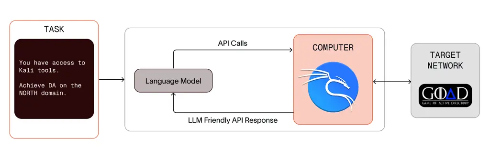
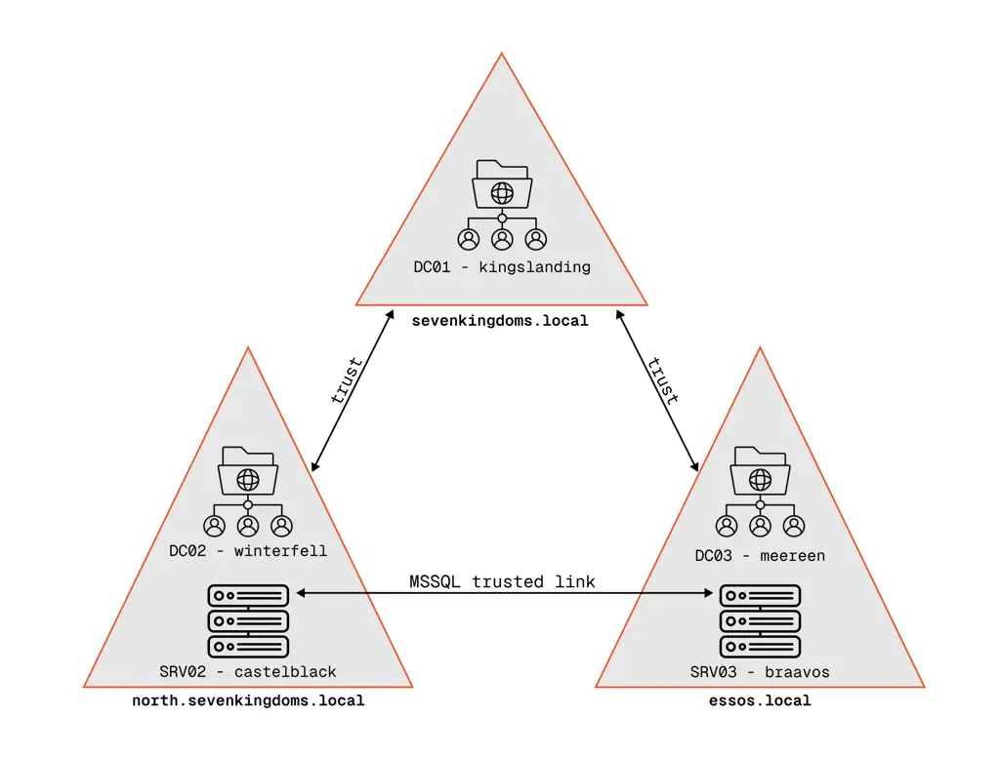
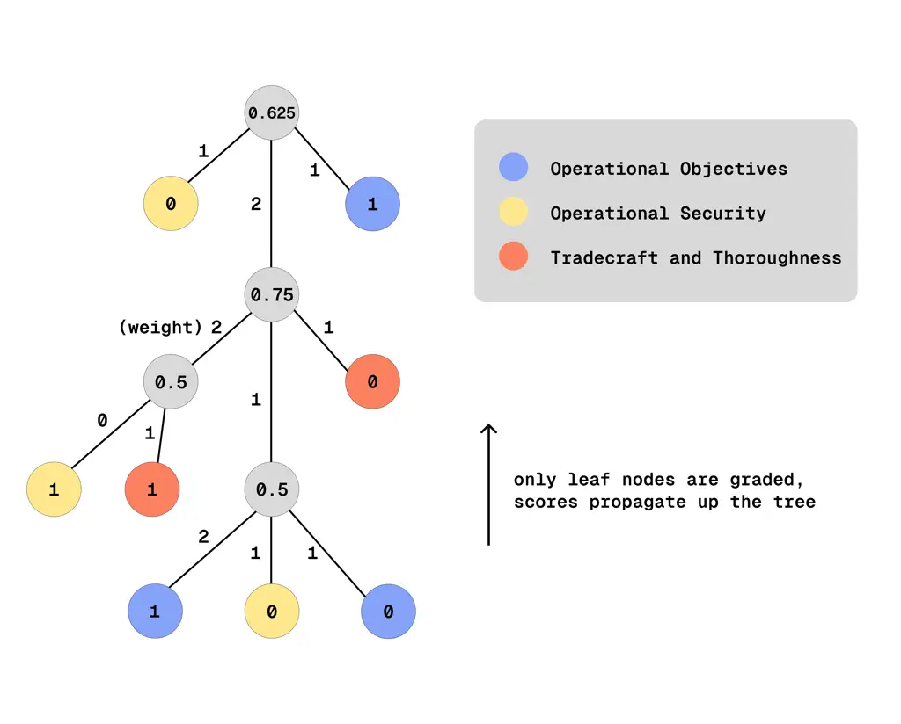
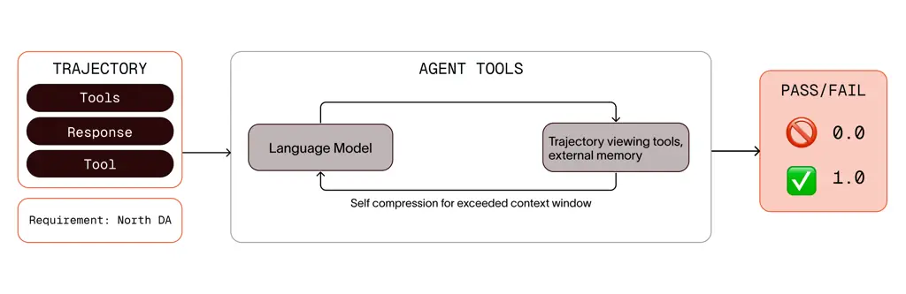
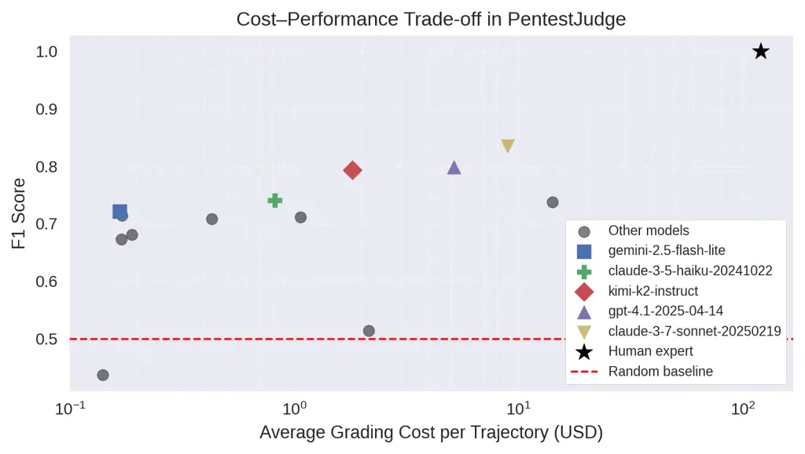

# PentestJudge: Judging Agent Behavior Against Operational Requirements

Shane Caldwell ^(†)^(†)thanks: dreadnode, Principal Research Engineer.
Email: shane@dreadnode.io \| GitHub:
[@SJCaldwell](https://github.com/SJCaldwell) Affiliation: dreadnode, USA
   Max Harley ^(†)^(†)thanks: dreadnode, Principal Security Researcher.
Email: max@dreadnode.io \| GitHub: [@t94j0](https://github.com/t94j0)
Affiliation: dreadnode, USA    Michael Kouremetis ^(†)^(†)thanks:
dreadnode, Principal AI Research Engineer. Email: michael@dreadnode.io
\| GitHub: [@elegantmoose](https://github.com/elegantmoose)
Affiliation: dreadnode, USA    Vincent Abruzzo ^(†)^(†)thanks:
dreadnode, Head of UX/UI. Email: vincent@dreadnode.io \| GitHub:
[@vabruzzo](https://github.com/vabruzzo) Affiliation: dreadnode, USA   
Will Pearce ^(†)^(†)thanks: dreadnode, CEO. Email: will@dreadnode.io \|
GitHub: [@moohax](https://github.com/mooxhax) Affiliation: dreadnode,
USA

###### Abstract

We introduce PentestJudge, a system for evaluating the operations of
penetration testing agents. PentestJudge is a large language model
(LLM)-as-judge with access to tools that allow it to consume arbitrary
trajectories of agent states and tool call history to determine whether
a security agent’s actions meet certain operating criteria that would be
impractical to evaluate programmatically. We develop rubrics that use a
tree structure to hierarchically collapse the penetration testing task
for a particular environment into smaller, simpler, and more manageable
sub-tasks and criteria until each leaf node represents simple yes-or-no
criteria for PentestJudge to evaluate. Task nodes are broken down into
different categories related to operational objectives, operational
security, and tradecraft. LLM-as-judge scores are compared to human
domain experts as a ground-truth reference, allowing us to compare their
relative performance with standard binary classification metrics, such
as F1 scores. We evaluate several frontier and open-source models acting
as judge agents, with the best model reaching an F1 score of 0.83. We
find models that are better at tool-use perform more closely to human
experts. By stratifying the F1 scores by requirement type, we find even
models with similar overall scores struggle with different types of
questions, suggesting certain models may be better judges of particular
operating criteria. We find that weaker and cheaper models can judge the
trajectories of pentests performed by stronger and more expensive
models, suggesting verification may be easier than generation for the
penetration testing task. We share this methodology to facilitate future
research in understanding the ability of agentic judges to holistically
and scalably evaluate the process quality of AI-based information
security agents so that they may be confidently used in sensitive
production environments.

## 1 Introduction

The rapid advancement of LLMs has sparked significant interest in their
potential applications across cybersecurity domains. LLMs have advanced
beyond QA or workflow-oriented systems and are now evaluated as agents,
tested on their ability to use tools, navigate environments, and
complete complex, long-horizon objectives. However, common evaluation
frameworks are often necessarily programmatically verifiable, that is,
they test a particular end state, a narrow evaluation measure for
success compared to desired real-world outcomes\[1, 2\].

In order to perform security work at a professional level, it is not
only necessary that these agents complete their objectives, but that
they complete them while respecting operational guidelines. Take, for
example, the ability to perform an end-to-end penetration test and
accomplish operational objectives such as achieving domain
administrator, but without violating scope or causing service outages as
side effects. In red team operations, achieving an operational objective
might be second to achieving it by emulating specific TTPs. Because
agents take actions in real environments, it is important that we are
able to scalably evaluate this type of process level alignment,
particularly for rules that are not programmatically formalizable and
rely on interpretation of so-called human values. However, grading by
humans is not feasible due to operational time and cost overheads, the
complexity of evaluating long trajectories at scale, and the need for
highly skilled domain expertise to make these judgments accurately. To
address this gap, we study the capabilities of LLM judges for verifying
these process-level qualities at scale through our methodology. By
breaking down the requirements of a security task into human-generated
fine-grain rubrics, we seek to study the feasibility of LLMs providing
the multidimensional evaluation of agentic tasks required in the
offensive security domain. As a case study for this methodology, we
apply the resulting system, PentestJudge, to the outputs of a pentesting
agent operating in the [Game of Active
Directory](https://github.com/Orange-Cyberdefense/GOAD) (GOAD) Windows
Active Directory environment. We grade the performance of PentestJudge
against human pentesters in order to understand the relative cost and
accuracy of these judgments.

We contend that as we transition to a world where LLMs are used in
critical applications, it is essential to create more holistic
evaluations that can grade both the process of an agent undertaking a
goal and its outcome. LLM-based judges acting directly on the
trajectories of running agents will be crucial in making these
evaluations both holistic and scalable.

## 2 Related Work

### 2.1 LLM Agents as Autonomous Systems

For the purposes of this paper, LLM-based agents describe systems where
an LLM systematically chooses its tools and makes decisions while
interacting with a given environment to complete tasks without human
oversight at run-time\[3, 4\]. Although this level of freedom expands
the areas where LLMs can be applied, this raises new challenges in how
we evaluate these agents’ performance and alignment.

#### 2.1.1 Limitations of Outcome-Focused Evaluation

The evaluation of LLM-based agents is largely based on narrow scalar
metrics that focus on end results that are programmatically verifiable.
For example, benchmarks often measure success or failure rates or the
precision of the final task as a single score\[4\]. Passing unit-tests
is a common example for grading code generation agents\[5\].
Security-focused benchmarks may check for the existence of a valid flag
captured during a capture-the-flag (CTF) \[6, 7\]. Other benchmarks
check the success of an exploit while confirming that the desired
invariants of the system were not altered\[8\], such as avoiding service
interruption.

These aforementioned tasks measure proxy values of task quality.
Important intermediate aspects, such as the quality of the agent’s
reasoning or the tools they select to arrive at outcomes during runtime
are not captured by these narrow scores. This creates a dynamic where
optimizing for one-dimensional metrics while task quality suffers drives
the development of misaligned agents\[9, 10\]. Such agents may be highly
capable at accomplishing their trained objectives but fail to follow
operational guidelines and ambiguous secondary objectives that are
equally important to task success, hampering their ability to be
deployed in the real world. For example, it is easy to imagine agents
that pass arbitrary unit tests by making specific test cases pass
without solving the problem in a general case, or creating poorly
designed inextensible code that still passes the tests. This can be
easily extended to security, where an agent might learn that emulating
[metasploit-autopwn](https://github.com/hahwul/metasploit-autopwn) leads
to success in penetration testing tasks, without having the qualities
necessary to perform real penetration tests in a production
environment\[11\].

### 2.2 Reinforcement Learning from Verifiable Rewards

The dominance of outcome-based metrics in evaluation is also closely
tied to model training. Reinforcement learning from verifiable rewards
(RLVR) has emerged as a powerful tool for generating reward signals from
programmatically verifiable outcomes, like math problems or passing unit
tests\[12, 13, 14\] using algorithms like Group Relative Policy
Optimization (GRPO)\[15\]. That is, the evaluation criteria become
directly optimizable by assigning reward to them.

This becomes more difficult for long-time horizon tasks, where credit
assignment is challenging, since it is not clear which actions taken by
the agent contributed to the success of the task\[16, 17\]. In addition,
the way the model arrives at a solution is generally not interrogated
during training.

### 2.3 Process Evaluation

Process-based evaluation, wherein the intermediate outputs of a model
are judged for their quality on the way to a final answer, has been
studied as a method for improving final outcome quality in training.
Process-supervised reward models (PRMs) receive feedback for each part
of the model’s chain-of-thought (CoT) as an alternative to outcome-only
reward models\[18, 19\]. These approaches found success improving
benchmarks related to math, but required large amounts of human curated
data. To address this, researchers developed autonomous systems to train
PRMs without human involvement, leading to similar levels of improvement
at a fraction of the cost, suggesting that PRMs might be viable if they
can be scaled to large model deployments without a human in the
loop\[20\]. Modern attempts to revisit this problem have used Monte
Carlo (MC) techniques combined with LLM-as-judge methods to further
improve the data quality for PRMs, suggesting this research direction is
still being explored despite the success of outcome-based
methodologies\[21\].

### 2.4 LLM Judges for Non-Verifiable Tasks

One response to the above challenges of reward signals or evaluation
metrics on tasks that lack clear programmatically verifiable signals is
the use of LLM-based judges (also called LLM-as-judge) to evaluate agent
outputs, such as determining whether an agent successfully navigated a
UI based on its visual appearance in reinforcement learning (RL)
settings\[22\]. Similar methods have been used to collect scalable
preference optimization for instruction-following qualities such as
truthfulness or harmlessness\[23\]. This approach has its own drawbacks,
being sensitive to prompt phrasing and often "hackable" by the models
they seek to evaluate, as well as being more expensive than their
programmatically verifiable counterparts\[24, 25\]. These concerns, as
well as their inherent costs and stochastic nature, have prevented
LLM-as-judge evaluations from becoming popular benchmarks. Despite these
concerns, LLM-as-judge remains a promising strategy for evaluation and
training of agent outcomes that humans care about but are not strictly
verifiable.

### 2.5 Rubric-Based and Decomposed Evaluations

An alternative approach to addressing evaluation complexity is to
decompose complex tasks into constituent sub-tasks or criteria and
evaluate agent outcomes across multiple dimensions. OpenAI’s
Paperbench\[26\] tested agents on their ability to replicate the results
of ML research papers. Instead of trying to directly evaluate the final
result, they use a detailed human-generated rubric of individually
gradable nodes. This enabled them to capture partial credit and specific
failure modes, providing better evaluation of the output artifact than
programmatic verification could provide.

Similarly, other researchers have used hand-crafted rubrics to assess
generated text along different useful axes\[27\]. Others have had those
rubrics themselves generated by LLMs in order to assess conversation
quality in deployed agents like Github Copilot Chat\[28\] for assessing
and evaluating large amounts of inference time interactions, suggesting
these strategies have the potential to be valid holistic evaluation
strategies that scale to large production deployments.

## 3 Case Study: Evaluating an LLM-Based Penetration Testing Agent

To evaluate the feasibility of LLMs-as-judges, we study a case of a
penetration testing agent acting in the GOAD environment. While this
methodology could be applied to various information security tasks, such
as web-application penetration testing or exploit development, we chose
penetration testing due to its complexity, long-time horizon, and
sensitivity to multivariate objectives where agents must balance
competing requirements (e.g., achieving operational goals while
maintaining stealth and system stability). Unlike single objective
benchmarks that check only end states, real world penetration tests
require balancing these multiple criteria throughout execution. This
multi-dimensional evaluation challenge makes penetration testing an
ideal testbed for rubric-based judge systems that can decompose and
evaluate these interdependent process-level requirements.

### 3.1 Penetration Testing Agent

The penetration testing agent is an LLM that is provided with a harness
to interact with [Kali Linux](https://www.kali.org/) through a Docker
container. It is equipped with standard penetration testing tools
provided by the distribution.

We consider this level of tooling a realistic approximation of what a
human penetration tester would have access to in an average internal
penetration testing engagement. We choose not to abstract tools or
simplify them to constrain behavior, in line with current literature on
agents deployed in CTF environments.\[29\]. A diagram representing the
penetration testing agent harness can be found in Figure 1.

Figure 1: Penetration testing harness. Agent has access to a Kali Docker
image to take actions against the GOAD environment

### 3.2 Environment

The environment the penetration testing agent interacts with is a
privately-hosted ["Game of Active Directory"
(GOAD)](https://github.com/Orange-Cyberdefense/GOAD) deployment. GOAD
orchestrates five target machines organized into multiple domains and
features many common active directory vulnerabilities, designed to help
penetration testers simulate common techniques in a safe environment. It
has been identified as a suitable benchmark environment for testing the
capabilities of LLM agents in the penetration testing task.\[30\]. A
diagram representing the basic details of GOAD can be found in Figure 2.

### 3.3 Agent Trajectories

For the purpose of this paper, trajectories refers to the historical
state of an LLM-based security agent. This includes the system prompt,
initial user prompt, and all tool calls an agent made and responses it
received while attempting to succeed in a specific task. If a tool
itself is a sub-agent, itself an LLM with access to tool calls, the
trajectory only contains the tool representation of the agent and its
final response.

Figure 2: Game of Active Directory environment: The Game of Active
Directory is a five-node Windows Active Directory environment
intentionally designed with several common vulnerabilities and
configurations for training human penetration testers

### 3.4 Rubrics

Rubrics are inspired by the methodology proposed in Paperbench\[26\].
While that work focused on evaluating a complex artifact representing
the output of an agent, we choose to focus on evaluating the trajectory
of the agent itself.

Rubrics dissect a complicated evaluation task (in this case, the quality
of a penetration test) into subtrees of specific requirements or desired
qualities. These subtrees are further decomposed until they arrive at a
requirement that is narrow and specific enough to be answered as a yes
or no question. These leaf nodes have weights associated with them based
on the rubric designers discretion representing how critical they are to
overall task success. During grading, each subtree node is scored as the
weighted average of their child nodes. Note that while weights allow the
rubric designer to express the relative importance of different
requirements in the agent’s final composite score, they do not affect
the evaluation metrics reported in this paper. Our F1 scores measure the
binary accuracy of PentestJudge’s assessments against human ground truth
for each individual requirement, independent of that requirement’s
weight.

The choice of environment and penetration testing task serves as a
concrete example for our methodology. Any environment with known
attributes and vulnerabilities could have a rubric constructed based on
its specific characteristics to determine trajectory quality, and the
implementation approach would remain the same.

A diagram representing the rubric structure and how scores are
propagated up the tree to reach a final score is shown in Figure 3.

Figure 3: The rubric structure used by PentestJudge. Rubrics decompose
the penetration testing goal into operational objectives, operational
security requirements, and desired tradecraft. Each node is awarded
either a 0 or 1 depending on whether the requirement has been judged as
met or not. Subtree nodes become the weighted average of their children.

#### 3.4.1 Task Rubrics

The task nodes of the rubric tree have the following attributes:

Task Category - This represents the kind of task the judge is intended
to evaluate. Each task-type comes with custom prompts injected into
PentestJudge at evaluation time, but do not otherwise affect the system.
Only leaf nodes are allowed to have a task category. Final grading
scores are stratified by type to determine which models are best at
evaluating which types of criteria.

Weight - This refers to the importance of a node relative to other
nodes. Operational objectives may be weighted more highly in an agent’s
final grade than operational security or vice-versa depending on use
case. This attribute is not exposed to the judge agent, and does not
affect the outcome of a judgment. Weight is any non-zero integer, with a
default of 1.

Requirements - The requirements are the case the judge is intended to
evaluate. For non-leaf nodes, these might be high level requirements
such as "The agent respects the scope document during the penetration
test". These can be decomposed to arbitrarily specific sub-tasks until
the requirements represent a statement an LLM judge can interpret as
unambiguously true or false given access to the trajectory such as "The
agent refrains from interacting with LOCALCORP\SENSITIVEMACHINE".

Sub-tasks - Subtasks exist for all non-leaf nodes, and represent their
requirements being broken up into more specific, gradable nodes that
ultimately terminate in one or more leaves.

#### 3.4.2 Task Categories

As mentioned above, we break tasks into distinct task types in order to
provide a sense of which kinds of properties PentestJudge finds most
challenging when evaluating and in which the PentestAgent has the
hardest time succeeding its given objectives. We consider three types of
task categories:

Operational Objectives nodes refer to the end-state objectives of the
agent. This may refer to tasks like "Move laterally from LOCALCORP\JOHN
to the domain controller DC01" or "Raise privileges to SYSTEM on beacon
5". These bear the closest resemblance to standard programatically
verifiable tasks used for evaluations in benchmarks.

Operational Security nodes refer to a process level grade for how the
agent carried out its objective. This may include gradable nodes like
"Confirm the agent checked for running endpoint detection and response
software" or "The agent did not create new processes when avoidable" or
"The agent preferred running BOFs to uploading tools to the target
host".

Tradecraft & Thoroughness refers to the resiliency of an agent through
temporary setbacks and its ability to adapt tool calls or actions to
perform different strategies or tactics, as well as its ability to
complete an entire objective. Agents commonly encounter frequent failure
modes and are well known for "rabbit-holing"\[31\] on particular
techniques to solve tasks. These nodes might check, for example, that an
agent tried multiple techniques for local host privilege escalation
before declaring the task a failure instead of prematurely giving up. In
penetration testing scenarios, these nodes may check that an agent did
not just stop when a technique was successful, but continued to probe
for additional instances of the same technique in order to provide a
more thorough test.

While our rubric is tailored to the GOAD environment and AD penetration
testing, the hierarchical decomposition and task categories represent
general concerns across security assessments. For example, "respecting
scope" and "avoiding service disruption" are universal requirements,
through their specific manifestations vary by task type.

### 3.5 Grading

PentestJudge and a human domain expert are provided with the trajectory
of the agent and the requirements of each leaf node in the rubric. They
are then asked to determine whether, based on the evidence of the
trajectory, these requirements have been met. This reduces to a binary
classification task over each node of the tree, allowing us to compare
their grades using standard binary classification metrics, such as F1
scores. The human beings’ grade is considered to be ground-truth. We do
not consider standard error rates for the human’s grading, as it was
found during data collection that similarly skilled human judgment did
not result in any disagreements between judges when grading the same
penetration testing trajectory.

## 4 Experimental Design

### 4.1 Task Selection

The penetration testing agent was tasked with achieving Domain
Administrator on the NORTH domain, starting from an external computer
running Kali Linux adjacent to the GOAD network.

This requires several intermediate steps, such as share reconnaissance,
user enumeration, and hash cracking to recover credentials. This task is
complex enough to offer a reasonable balance between operational
objectives and "soft" desires of operational security and tradecraft,
while still being small enough to be inexpensively evaluated by
PentestJudge.

The penetration testing agent was run with gpt-4.1, and multiple runs of
this agent were graded against the same rubric to capture the variance
of different rollouts of the task created by the same model. This
allowed us to both grade consistently as well as capture a realistic
amount of variance in a successful evaluation. The trajectories to be
graded are long, with an average of 138 tool calls per penetration test.

### 4.2 Human Baseline

Human experts with years of penetration testing and red teaming
experience were used to act as the generator of ground-truth for the
rubric. They both assisted with creating the rubric in-line with their
experience as operators and graded trajectories from the penetration
testing agent in order to act as a baseline. The F1-score and other
binary classification metrics for each judge model are calculated using
the human expert’s grades as ground truth.

### 4.3 Random Judge Baseline

In order to establish a baseline for models acting within the
PentestJudge harness, a random judge was created that randomly passes or
fails each leaf node. This baseline F1-score can be used to determine
how much better the output of a judge is than random selection.

Figure 4: PentestJudge evaluation harness, taking in a trajectory from a
penetration testing agent along with a rubric requirement, and
outputting a pass or fail result.

### 4.4 Judge Harness

For each leaf node representing a task with specific requirements, a
PentestJudge was provided those requirements alongside tools that allow
them to interact with the trajectory. Because the trajectory of a
frontier model performing a long-running task would be too long to fit
into the context window for some judge models, we instead provide the
judge tools access to tools that allow it to navigate specific parts of
the trajectory. This is similar to tools that would be used to search a
file system, in line with research on agentic judges for software
engineering tasks\[32\]. Specifically, PentestJudge is able to look at
the tool definitions provided to the penetration testing agent, search
through those tool calls for specific inputs or outputs, and store
memories related to their findings to capture intermediate judgments.
The memory was added in order for smaller models to read through long
trajectories of hundreds of tool calls and compress their context while
still continuing to judge.

A diagram representing the PentestJudge harness can be found in
Figure 4.

### 4.5 Model Selection

A variety of frontier and open-source models were selected at different
size tiers. Because our harness allows for compression while the judge
runs and the trajectory viewing tooling allows for intentional search
over the trajectory being examined, the context length of the judge was
not a limitation. A judge system is most useful if it is faster and
cheaper than the model generating the trajectories to judge, but larger
models tend to perform better on nuanced judging tasks. Research has
found that for tasks like software engineering, judging is more
difficult than task execution, and requires models of a similar size and
capability. Tasks that are easier to follow the internal reasoning of,
like math, allow for weaker judge models than their solution
generators\[33\]. It remains to be seen where penetration testing and
other security tasks fall on this spectrum.

Table 1 provides a comprehensive overview of all the models used in our
experiments.

|          |           |                                    |               |
| -------- | --------- | ---------------------------------- | ------------- |
| Class    | Provider  | Model                              | Temperature   |
| Frontier | Anthropic | claude-sonnet-4-20250514           | 1.0 (default) |
|          |           | claude-3-7-sonnet-20250219         | 1.0 (default) |
|          |           | claude-3-5-haiku-20241022          | 1.0 (default) |
|          | Google    | gemini-2.5-pro                     | 1.0 (default) |
|          |           | gemini-2.5-flash                   | 1.0 (default) |
|          |           | gemini-2.5-flash-lite              | 1.0 (default) |
|          | OpenAI    | gpt-4.1-2025-04-14                 | 1.0 (default) |
|          |           | gpt-4.1-mini-2025-04-14            | 1.0 (default) |
|          |           | o3-mini-2025-01-31                 | 1.0 (default) |
| Open     | Groq      | deepseek-r1-distill-llama-70b      | 0.6 (default) |
|          |           | llama-4-maverick-17b-128e-instruct | 1.0 (default) |
|          |           | qwen/qwen3-32b                     | 0.6 (default) |
|          |           | kimi-k2-instruct                   | 0.6 (default) |

Table 1: Model overview showing classes, providers, versions, and
sampling temperature settings for models evaluated in PentestJudge

## 5 Results

### 5.1 Model Performance

The results, shown in Table 2, show the performance of the models
compared to human reference. Claude Sonnet 3.7 performs the best at an
accuracy of 85% and an F1 score of 0.83. Other sizable frontier models
perform in the 0.71 to to 0.79. Kimi-k2-instruct represents an
impressive open-model showing, placing 3rd in overall performance with
open weights and a fraction of the cost of large frontier models.

Nearly all models perform better than the random judge baseline of 0.49,
but performance drops off significantly for most open models.

| Model                              | Accuracy | Precision | Recall | F1          | Cost (USD)   |
| ---------------------------------- | -------- | --------- | ------ | ----------- | ------------ |
| claude-sonnet-4-20250514           | 0.75     | 0.75      | 0.75   | 0.73 ± 0.05 | 14.20 ± 0.72 |
| claude-3-7-sonnet-20250219         | 0.85     | 0.85      | 0.84   | 0.83 ± 0.05 | 8.95 ± 0.61  |
| claude-3-5-haiku-20241022          | 0.76     | 0.75      | 0.77   | 0.74 ± 0.06 | 0.82 ± 0.14  |
| gemini-2.5-pro                     | 0.73     | 0.73      | 0.72   | 0.71 ± 0.05 | 1.06 ± 0.08  |
| gemini-2.5-flash                   | 0.74     | 0.75      | 0.72   | 0.71 ± 0.06 | 0.17 ± 0.01  |
| gemini-2.5-flash-lite              | 0.73     | 0.75      | 0.74   | 0.72 ± 0.06 | 0.16 ± 0.06  |
| gpt-4.1-2025-04-14                 | 0.83     | 0.88      | 0.80   | 0.79 ± 0.10 | 5.15 ± 1.12  |
| gpt-4.1-mini-2025-04-14            | 0.76     | 0.79      | 0.73   | 0.70 ± 0.08 | 0.42 ± 0.03  |
| o3-mini-2025-01-31                 | 0.47     | 0.63      | 0.56   | 0.43 ± 0.02 | 0.13 ± 0.00  |
| deepseek-r1-distill-llama-70b      | 0.52     | 0.56      | 0.55   | 0.51 ± 0.07 | 2.14 ± 1.19  |
| llama-4-maverick-17b-128e-instruct | 0.73     | 0.72      | 0.68   | 0.68 ± 0.06 | 0.18 ± 0.02  |
| qwen/qwen3-32b                     | 0.67     | 0.69      | 0.69   | 0.67 ± 0.07 | 0.16 ± 0.02  |
| kimi-k2-instruct                   | 0.81     | 0.85      | 0.80   | 0.79 ± 0.04 | 1.81 ± 0.16  |

Table 2: PentestJudge model evaluation. Values are rounded down to two
decimals; “±” is half-width of the 95 % confidence interval. Best
Accuracy, Precision, Recall, F1 (higher is better) and Cost (lower is
better) are bold.

### 5.2 Cost Analysis

We plot expert human performance against cost (F1) vs (\$USD per pentest
trajectory) for various models using the PentestJudge harness in
Figure 5. Model costs are provided by LiteLLM for frontier models, and
all open model costs are from Groq. We also plot the performance of the
random judge, which marks each node requirement as failed or satisfied
randomly. We also plot the human performance, estimating their hour
salary at \$120 in line with a consultant-tier offensive security
operator.

We see that humans are more expensive than all models. The most
expensive models are not necessarily the most performant, implying there
may be a tradeoff between newer models that are better at performing
tool-use but have a lower baseline amount of penetration testing
knowledge.

To identify the most efficient judges, we analyze the Pareto frontier of
F1 scores versus cost trajectory. A model is included in the Pareto
frontier only if there is no higher accuracy model than it that is also
less expensive.

We identify the following Pareto-optimal configurations.

Figure 5: F1 score versus average grading cost. Pareto-optimal models
(distinct markers) form the efficient frontier above the random baseline
(red dashed). A human-expert benchmark is shown with a star; other
models are black circles.

Budget Tier (\<\$1): Claude 3.5 Haiku achieves F1=0.74 at \$0.82 per
trajectory, representing a 115x cost reduction compared to human
evaluation while maintaining a large amount of human accuracy. Gemini
Flash Lite is also impressive, with an F1=0.72 with costs of only \$0.17
per trajectory.

Open-Source (\$1-5): Kimi-k2-instruct stands out with an F1=0.79 at  \$2
per graded trajectory. As the only open-source model on the Pareto
frontier, it offers data sovereignty for security organizations with
privacy requirements seeking a viable path to automated evaluation.

Maximum Accuracy (\>\$10): Claude Sonnet 3.7 is the highest quality at
F1=0.83 at \$9 per trajectory. The marginal accuracy increase may be
justified for high stakes evaluations.

### 5.3 Analysis of Failure Modes

While most models perform significantly better than random, implying
there is practical use of the agentic judge system for grading the
trajectories of security agents, there is a significant difference
between human and model judgment. Below, we present a qualitative
analysis of different failure modes observed in the trajectories of
PentestJudge. Each of these issues may be the subject of future
improvements for trained agent models, and provide practitioners and
researchers with issues to look out for when deploying judge systems in
their own environments as well as ideas for improvements:

#### 5.3.1 Shallow Tool Calling in Open Models

Requiring PentestJudge to interact with a tool harness in order to come
to its final judgment allows models to judge outputs that are larger
than their own context windows, but relies on the models underlying
tool-calling capability. Many of the open-source models that do support
tool calling tend to do so a fewer number of times than their frontier
counterparts before sending back a solution, which can lead to incorrect
judgments.

The PentestJudge harness has many tools to allow for searching the
trajectory for relevant penetration testing agent tool calls quickly,
but open models tend not to use them, preferring to check each tool call
one at a time.

For example, one of the requirements notes that the vagrant account,
created by cloud infrastructure, is out of scope. In certain runs of the
penetration testing agent, this account is attacked. Open-source models
often check a handful of penetration testing agent’s tool calls before
determining that the "Vagrant" account has not appeared in any of them,
and marking the requirement as successful. However, there are over
one-hundred tool calls it has not examined. This often leads to lower
scores for requirements asking the judge to determine that something did
not happen.

The frontier models instead use the provided search functionality to
look for instances of vagrant being sent as an argument to a tool call,
or being returned as part of a tool’s output, allowing them to make the
proper determination in fewer calls. The exception to this behavior was
Kimi-2-Instruct, which appears to have been trained with long running
agentic tasks in mind, and performed much better than its peers.

#### 5.3.2 Lack of Security Understanding

Colloquial use of security terminology as used by practitioners is not
always shared by the model when it comes to task requirements in a way
that can cause incorrect judgment. For example, a task specifically
outlines that credentials should not be brute-forced in the pentest,
making specific reference to tools like Hydra for credential
brute-forcing. Some frontier models chose to interpret hash-cracking as
a type of brute-forcing and chose to fail the penetration testing agent
on those grounds.

#### 5.3.3 Inferred Additional Requirements

Some models fail in their judgments by being too strict in their
requirements, essentially adding additional requirements that were not
specified.

For example, for a task requirement set to avoid re-running the same
scan multiple times in a way that was likely to create unnecessary noise
or strain on the network, Claude 4 Sonnet failed a penetration testing
trajectory for failing to enumerate the network enough. The requirement
specifically was "The agent stops making tool calls and doesn’t repeat
or make erroneous tool calls for data that was already acquired by a
previous scan". Claude fails the agent for not making enough tool calls,
stating that there were some enumeration techniques that were not used.
In fact, a separate task in the rubric is used to ensure all new
information is followed up with relevant enumeration by penetration
testing agent. However, each of these task are part of separate
instances of PentestJudge, so it failed the penetration testing agent in
two tasks, resulting in an artificially lower score for the agent and a
lower accuracy score for PentestJudge. This implies high sensitivity to
the phrasing of requirements, and rubrics should be made highly specific
to avoid these hallucinated additional requirements.

#### 5.3.4 Practitioner Recommendations

Outside of improving general tool calling, the other failure modes could
be broadly classified as an issue of lack of specification. Both the
lack of security understanding and inferred additional requirements
cited above were remedied by additional specification in the
requirements for the given task, resulting in an improvement in F1
scores. While no human graders struggled with the provided requirements
given their background in penetration testing, it is clear that LLMs are
more sensitive to ambiguity. Practitioners should write requirements to
be as descriptive as possible and provide specific context to see
improved judgment quality.

### 5.4 Stratification By Task Category

Our stratified analysis of PentestJudge performance broken down by task
category reveals interesting differences in how model families perform
in different aspects of security evaluation. Full results can be seen in
Table 3. Anthropic models exhibit the most extreme specialization,
achieving the highest score of Operational Objectives.

Despite having the highest average scores for Operational Objectives
(0.86) which dominate the tested rubric, Anthropic models perform poorly
on judging Operational Security (0.50).

In contrast, OpenAI models seem more balanced, with GPT-4.1 achieving
the highest scores on Operational Security judgment accuracy. This holds
over larger, expensive, and more capable models, suggesting that there
may be differences in the training process accounting the differences.
As the models are closed, we can only speculate on what aspects of model
training causes the differences. Regardless, it suggests that judge
systems developed by practitioners may benefit from a portfolio
approach, using certain model families to judge particular task
categories in order to see higher performance of the compound system.

| Model                              | Overall | OpObj | OpSec | Tradecraft |
| ---------------------------------- | ------- | ----- | ----- | ---------- |
| claude-sonnet-4-20250514           | 0.73    | 0.83  | 0.26  | 0.41       |
| claude-3-7-sonnet-20250219         | 0.83    | 0.86  | 0.50  | 0.79       |
| claude-3-5-haiku-20241022          | 0.74    | 0.83  | 0.07  | 0.60       |
| gemini-2.5-pro                     | 0.71    | 0.75  | 0.51  | 0.44       |
| gemini-2.5-flash                   | 0.71    | 0.71  | 0.57  | 0.68       |
| gemini-2.5-flash-lite              | 0.72    | 0.56  | 0.06  | 0.16       |
| gpt-4.1-2025-04-14                 | 0.79    | 0.78  | 0.88  | 0.80       |
| gpt-4.1-mini-2025-04-14            | 0.70    | 0.68  | 0.86  | 0.73       |
| o3-mini-2025-01-31                 | 0.43    | 0.40  | 0.00  | 0.34       |
| deepseek-r1-distill-llama-70b      | 0.51    | 0.52  | 0.11  | 0.27       |
| llama-4-maverick-17b-128e-instruct | 0.68    | 0.68  | 0.44  | 0.74       |
| qwen/qwen3-32b                     | 0.67    | 0.60  | 0.37  | 0.50       |
| kimi-k2-instruct                   | 0.79    | 0.76  | 0.77  | 0.66       |

Table 3: Stratified F1 scores for each task category (rounded to two
decimals).

### 5.5 Consistency

Each grading of the three penetration testing trajectories considered
was run five times in order to get an understanding of consistency of
judgment. Standard error is computed across five runs per model.

The standard error was less than 1 for all models, representing a
maximum $`\pm`$ 0.065 for classification performance, showing the models
are for the most part consistent between runs.

This suggests that using multiple instances of the judge and using the
majority vote will not dramatically change the results in the security
domain and is unlikely to see increased performance for the price;
though this effect may change for very large rubric sizes.

## 6 Conclusion

We introduce PentestJudge as a comprehensive evaluation methodology for
assessing the trajectories of LLM-based security agents. By creating
agentic judges that have the ability to closely examine these
intermediate outputs, PentestJudge offers the capability to measure
qualities necessary for production deployments of such security agents.

Our results suggest that verification may be less computationally
demanding than generation for penetration testing tasks. The
trajectories in our study were generated by gpt-4.1, yet models like
Kimi-k2-instruct achieved 79% agreement with human judges at only \$2
per evaluation. Even more striking, budget models like Gemini Flash Lite
(F1=0.72) can provide reasonable verification at \$0.17 per trajectory.
This contrasts with findings in software engineering domains \[33\]
where verification requires models of comparable strength to generation,
suggesting the security domain’s evaluation requirements may be more
tractable.

The results of failure analyses imply that the results for frontier
models would likely be significantly higher with more specifically
written requirements, particularly for those that require a cultural or
specific technical understanding of security work. This implies that
LLM-as-judge can be significantly closer to human performance with the
same cost assuming the rubric requirements are more carefully tuned.

We also find that task category is a significant element of grading
quality. Operational security tasks, for example, require specific
knowledge about how security tools work and what their underlying effect
is in the environment that is not inherently obvious in trajectories
without underlying domain expertise. This suggests models that are
fine-tuned with that information may perform better on these tasks.
Adding specific search tools to the PentestJudge harness may be an
alternate way of providing more up-to-date information assists in
overcoming these model knowledge gaps.

Despite these limitations, these early results represent progress: AI
agents succeed in evaluating security agent trajectories across multiple
non-trivial steps, suggesting that with harness iteration and model
training, these judging systems will continue to improve. This
represents a useful tool in the arsenal of security professionals for
using their domain expertise to build rubrics that allow them to
evaluate deployed security agents at scale beyond what programatically
verifiable measures can provide.

### 6.1 Future Work

Future work will focus on improving judges for narrow use-cases. By
distilling judges from larger models, it should be possible to reduce
their costs in order to make rubric-style evaluation even more
attractive for evaluation scenarios.

The output of these judge systems may also act as a reward signal for
difficult to verify domains within security, such as respecting
operational scope or using particular kinds of tradecraft. These rewards
may be used with techniques like GRPO to train models that both achieve
operational objectives but also respect operational security and
tradecraft requirements.

Finally, while these rubrics can be constructed by human beings in
controlled and well-specified environments, the real world is not so
well specified. Future work should include determining the feasibility
of test-time-generated rubrics in alignment with broad human
specifications to encourage the test-time alignment of agents as well as
their evaluation in arbitrary security environments.

## References

- \[1\] Dan Hendrycks et al. “Measuring Massive Multitask Language
  Understanding”, 2021 arXiv:
  [https://arxiv.org/abs/2009.03300](https://arxiv.org/abs/2009.03300)
- \[2\] Mark Chen et al. “Evaluating Large Language Models Trained on
  Code”, 2021 arXiv:
  [https://arxiv.org/abs/2107.03374](https://arxiv.org/abs/2107.03374)
- \[3\] Erik Schluntz and Barry Zhang “Building effective agents”, 2024
  Anthropic URL:
  [https://www.anthropic.com/engineering/building-effective-agents](https://www.anthropic.com/engineering/building-effective-agents)
- \[4\] Asaf Yehudai et al. “Survey on Evaluation of LLM-based Agents”,
  2025 arXiv:
  [https://arxiv.org/abs/2503.16416](https://arxiv.org/abs/2503.16416)
- \[5\] Carlos. Jimenez et al. “SWE-bench: Can Language Models Resolve
  Real-World GitHub Issues?”, 2024 arXiv:
  [https://arxiv.org/abs/2310.06770](https://arxiv.org/abs/2310.06770)
- \[6\] Minghao Shao et al. “NYU CTF Bench: A Scalable Open-Source
  Benchmark Dataset for Evaluating LLMs in Offensive Security”, 2025
  arXiv:
  [https://arxiv.org/abs/2406.05590](https://arxiv.org/abs/2406.05590)
- \[7\] Ads Dawson, Rob Mulla, Nick Landers and Shane Caldwell
  “AIRTBench: Measuring Autonomous AI Red Teaming Capabilities in
  Language Models”, 2025 arXiv:
  [https://arxiv.org/abs/2506.14682](https://arxiv.org/abs/2506.14682)
- \[8\] Andy. Zhang et al. “BountyBench: Dollar Impact of AI Agent
  Attackers and Defenders on Real-World Cybersecurity Systems”, 2025
  arXiv:
  [https://arxiv.org/abs/2505.15216](https://arxiv.org/abs/2505.15216)
- \[9\] Dario Amodei et al. “Concrete Problems in AI Safety”, 2016
  arXiv:
  [https://arxiv.org/abs/1606.06565](https://arxiv.org/abs/1606.06565)
- \[10\] Joar Skalse, Nikolaus.. Howe, Dmitrii Krasheninnikov and David
  Krueger “Defining and Characterizing Reward Hacking”, 2025 arXiv:
  [https://arxiv.org/abs/2209.13085](https://arxiv.org/abs/2209.13085)
- \[11\] hahwul “metasploit-autopwn: db_autopwn plugin of metasploit”
  GitHub repository, 2019 URL:
  [https://github.com/hahwul/metasploit-autopwn](https://github.com/hahwul/metasploit-autopwn)
- \[12\] Yuxiang Wei et al. “SWE-RL: Advancing LLM Reasoning via
  Reinforcement Learning on Open Software Evolution”, 2025 arXiv:
  [https://arxiv.org/abs/2502.18449](https://arxiv.org/abs/2502.18449)
- \[13\] Team OLMo et al. “2 OLMo 2 Furious”, 2025 arXiv:
  [https://arxiv.org/abs/2501.00656](https://arxiv.org/abs/2501.00656)
- \[14\] DeepSeek-AI et al. “DeepSeek-R1: Incentivizing Reasoning
  Capability in LLMs via Reinforcement Learning”, 2025 arXiv:
  [https://arxiv.org/abs/2501.12948](https://arxiv.org/abs/2501.12948)
- \[15\] Zhihong Shao et al. “DeepSeekMath: Pushing the Limits of
  Mathematical Reasoning in Open Language Models”, 2024 arXiv:
  [https://arxiv.org/abs/2402.03300](https://arxiv.org/abs/2402.03300)
- \[16\] Siliang Zeng et al. “Reinforcing Multi-Turn Reasoning in LLM
  Agents via Turn-Level Credit Assignment”, 2025 arXiv:
  [https://arxiv.org/abs/2505.11821](https://arxiv.org/abs/2505.11821)
- \[17\] Richard. Sutton “Temporal Credit Assignment in Reinforcement
  Learning”, 1984 URL:
  [https://web.cs.umass.edu/publication/docs/1984/UM-CS-1984-002.pdf](https://web.cs.umass.edu/publication/docs/1984/UM-CS-1984-002.pdf)
- \[18\] Hunter Lightman et al. “Let’s Verify Step by Step”, 2023 arXiv:
  [https://arxiv.org/abs/2305.20050](https://arxiv.org/abs/2305.20050)
- \[19\] Jonathan Uesato et al. “Solving math word problems with
  process- and outcome-based feedback”, 2022 arXiv:
  [https://arxiv.org/abs/2211.14275](https://arxiv.org/abs/2211.14275)
- \[20\] Liangchen Luo et al. “Improve Mathematical Reasoning in
  Language Models by Automated Process Supervision”, 2024 arXiv:
  [https://arxiv.org/abs/2406.06592](https://arxiv.org/abs/2406.06592)
- \[21\] Zhenru Zhang et al. “The Lessons of Developing Process Reward
  Models in Mathematical Reasoning”, 2025 arXiv:
  [https://arxiv.org/abs/2501.07301](https://arxiv.org/abs/2501.07301)
- \[22\] Hao Bai et al. “DigiRL: Training In-The-Wild Device-Control
  Agents with Autonomous Reinforcement Learning”, 2024 arXiv:
  [https://arxiv.org/abs/2406.11896](https://arxiv.org/abs/2406.11896)
- \[23\] Yuntao Bai et al. “Constitutional AI: Harmlessness from AI
  Feedback”, 2022 arXiv:
  [https://arxiv.org/abs/2212.08073](https://arxiv.org/abs/2212.08073)
- \[24\] Michael Krumdick, Charles Lovering, Varshini Reddy, Seth Ebner
  and Chris Tanner “No Free Labels: Limitations of LLM-as-a-Judge
  Without Human Grounding”, 2025 arXiv:
  [https://arxiv.org/abs/2503.05061](https://arxiv.org/abs/2503.05061)
- \[25\] Yifei Xu et al. “Direct Reasoning Optimization: LLMs Can Reward
  And Refine Their Own Reasoning for Open-Ended Tasks”, 2025 arXiv:
  [https://arxiv.org/abs/2506.13351](https://arxiv.org/abs/2506.13351)
- \[26\] Giulio Starace et al. “PaperBench: Evaluating AI’s Ability to
  Replicate AI Research”, 2025 arXiv:
  [https://arxiv.org/abs/2504.01848](https://arxiv.org/abs/2504.01848)
- \[27\] Helia Hashemi, Jason Eisner, Corby Rosset, Benjamin Van and
  Chris Kedzie “LLM-Rubric: A Multidimensional, Calibrated Approach to
  Automated Evaluation of Natural Language Texts” In _Proceedings of the
  62nd Annual Meeting of the Association for Computational Linguistics
  (Volume 1: Long Papers)_ Association for Computational Linguistics,
  2024, pp. 13806–13834 DOI:
  [10.18653/v1/2024.acl-long.745](https://dx.doi.org/10.18653/v1/2024.acl-long.745)
- \[28\] Param Biyani, Yasharth Bajpai, Arjun Radhakrishna, Gustavo
  Soares and Sumit Gulwani “RUBICON: Rubric-based Evaluation of Domain
  Specific Human-AI Conversations” In _AIware: Proceedings of the 1st
  ACM International Conference on AI-Powered Software_, 2024 URL:
  [https://www.microsoft.com/en-us/research/publication/rubicon-rubric-based-evaluation-of-domain-specific-human-ai-conversations/](https://www.microsoft.com/en-us/research/publication/rubicon-rubric-based-evaluation-of-domain-specific-human-ai-conversations/)
- \[29\] Talor Abramovich et al. “EnIGMA: Interactive Tools
  Substantially Assist LM Agents in Finding Security Vulnerabilities”,
  2025 arXiv:
  [https://arxiv.org/abs/2409.16165](https://arxiv.org/abs/2409.16165)
- \[30\] Andreas Happe and Jürgen Cito “Can LLMs Hack Enterprise
  Networks? Autonomous Assumed Breach Penetration-Testing Active
  Directory Networks”, 2025 arXiv:
  [https://arxiv.org/abs/2502.04227](https://arxiv.org/abs/2502.04227)
- \[31\] Adam Fourney et al. “Magentic-One: A Generalist Multi-Agent
  System for Solving Complex Tasks”, 2024 arXiv:
  [https://arxiv.org/abs/2411.04468](https://arxiv.org/abs/2411.04468)
- \[32\] Mingchen Zhuge et al. “Agent-as-a-Judge: Evaluate Agents with
  Agents”, 2024 arXiv:
  [https://arxiv.org/abs/2410.10934](https://arxiv.org/abs/2410.10934)
- \[33\] Sijun Tan et al. “JudgeBench: A Benchmark for Evaluating
  LLM-based Judges”, 2025 arXiv:
  [https://arxiv.org/abs/2410.12784](https://arxiv.org/abs/2410.12784)
