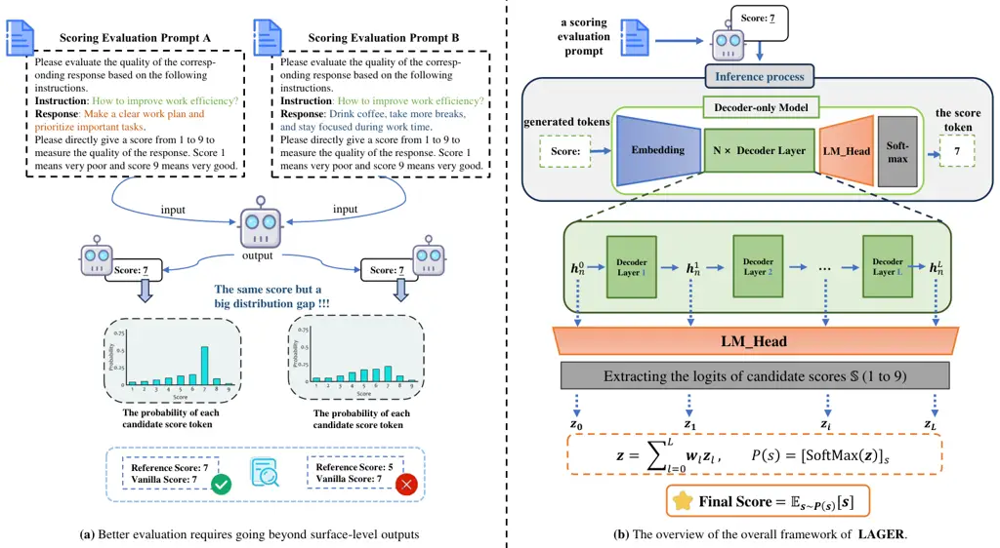
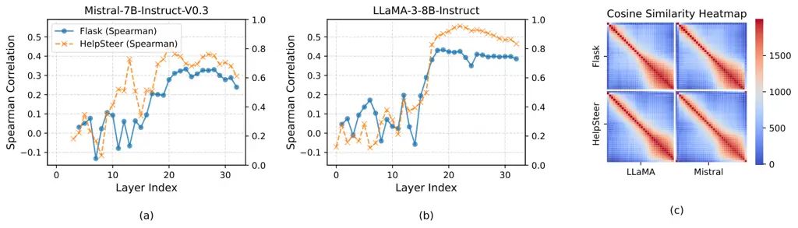
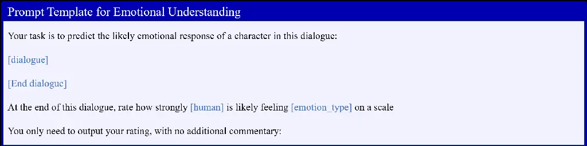

# Beyond the Surface: Enhancing LLM-as-a-Judge Alignment with Human via Internal Representations

Peng Lai Affiliation: Southern University of Science and Technology   
Jianjie Zheng Affiliation: Southern University of Science and Technology
   Sijie Cheng Affiliation: Tsinghua University    Yun Chen
Affiliation: Shanghai University of Finance and Economics    Peng Li
Affiliation: Tsinghua University    Yang Liu Affiliation: Tsinghua
University    Guanhua Chen ^(†)^(†)thanks: Corresponding author.
Affiliation: Southern University of Science and Technology

###### Abstract

The growing scale of evaluation tasks has led to the widespread adoption
of automated evaluation using LLMs, a paradigm known as
"LLM-as-a-judge". However, improving its alignment with human
preferences without complex prompts or fine-tuning remains challenging.
Previous studies mainly optimize based on shallow outputs, overlooking
rich cross-layer representations. In this work, motivated by preliminary
findings that middle-to-upper layers encode semantically and
task-relevant representations that are often more aligned with human
judgments than the final layer, we propose lager, a post-hoc,
plug-and-play framework for improving the alignment of LLM-as-a-Judge
point-wise evaluations with human scores, by leveraging internal
representations. lager produces fine-grained judgment scores by
aggregating cross-layer score-token logits and computing the expected
score from a softmax-based distribution, while keeping the LLM backbone
frozen and ensuring no impact on the inference process. lager fully
leverages the complementary information across different layers,
overcoming the limitations of relying solely on the final layer. We
evaluate our method on the standard alignment benchmarks Flask,
HelpSteer, and BIGGen using Spearman correlation, and find that lager
achieves improvements of up to 7.5% over the best baseline across these
benchmarks. Without reasoning steps, lager matches or outperforms
reasoning-based methods. Experiments on downstream applications, such as
data selection and emotional understanding, further show the
generalization of lager.

## 1 Introduction

Large language models (LLMs) have witnessed significant progress in
various tasks like math reasoning (Ying et al., 2024; Duan & Wang, 2024)
and open-domain question answering (Allemang & Sequeda, 2024),and
exhibit great generalization and reasoning abilities on unseen tasks and
domains (Li et al., 2024c; Ye, 2024; Ni et al., 2024), which makes it
possible to evaluate the model generations with an LLM (Bavaresco
et al., 2024; Zheng et al., 2023). LLM-as-a-judge (Lin & Chen, 2023; Li
et al., 2024a; Wu et al., 2024; Shiwen et al., 2024), an emerging
approach to text evaluation, uses large language models to perform
automated and scalable assessment of textual responses, reducing the
reliance on human annotation. This paradigm has found widespread
applications in various scenarios such as model evaluation (Lin & Chen,
2023), data synthesis (Kim et al., 2024a; Cui et al., 2023b; Wang
et al., 2024b), and model enhancement via verification and critic agents
(Pace et al., 2024; Badshah & Sajjad, 2024).

Researchers have explored various approaches to improve the consistency
of judgment with human experts. Prompt-based methods (Lin & Chen, 2023;
Liu et al., 2023) improve the judge performance with guidelines
encouraging step-by-step reasoning (Chen et al., 2024; Lin & Chen, 2023;
Zhuo, 2024) or carefully curated examples (Song et al., 2025). However,
these methods rely on chain-of-thought reasoning, which introduces
additional computational cost (Gu et al., 2024). Other researchers
propose to finetune a LLM with a specialized dataset (Ye et al., 2024a;
Cui et al., 2023a)to adapt the LLM to the judgment task. Although
effective, these methods face the generalization problem (Doostmohammadi
et al., 2024) as they have been adapted to the domain of the training
data.

In this paper, we propose an effective LLM-as-a-judge framework called
lager, to enhance LLM-as-a-Judge alignment with human via internal
representations. Inspired by prior studies (Wang et al., 2020; Yang
et al., 2022; Roh et al., 2024) showing that middle-to-upper layers
encode richer semantic and task-specific information, we propose to
aggregate the logits of score tokens from different layers. By applying
a weighted combination followed by a softmax, we obtain a probability
distribution over candidate scores, from which the final score is
computed as the expected value. lager leverages the semantic diversity
across different layers, allowing the final score to integrate both
low-level lexical cues and high-level reasoning signals, thereby
providing a more comprehensive reflection of the model’s understanding
of the scoring task. lager is plug-and-play, leaving model parameters
and next-token predictions unchanged. lager outperforms baselines on
alignment benchmarks such as Flask, HelpSteer, and BIGGen, with
improvements of up to 7.5% in Spearman correlation. Although
reasoning-based evaluation methods provide more transparency by exposing
intermediate reasoning steps, their reasoning is often shallow and fails
to improve reliability, leading to inferior performance. In contrast,
without explicit reasoning, lager achieves comparable or superior
results to these reasoning-based baselines. We further select
instruction data with lager method and achieve better performance on the
AlpacaEval-2.0 benchmark than various baselines. Experiments on more
downstream applications show the effectiveness of the lager method. ¹¹ 1
Our code is publicly available at
[https://github.com/sustech-nlp/LAGER](https://github.com/sustech-nlp/LAGER).



Figure 1: (a): Vanilla scores may overlook meaningful distinctions by
relying solely on the most probable score token. Better evaluation
requires leveraging deeper signals beyond surface-level outputs. (b):
The framework of lager. lager fully considers candidate score
probabilities and aggregates cross-layer logits, enabling LLMs to act as
robust evaluators with probabilistic scoring for reliable assessment.

## 2 Preliminary

A decoder-only LLM $`f`$ consists of an embedding layer
$`f_{\text{embd}}`$, $`L`$ decoder layers $`f_{\text{decoder}}`$, and an
output projection layer $`f_{\text{unembd}}`$. Given an input
instruction $`x`$, the model generates a response $`y`$ through the
following computation:

```math
y=f(x)=f_{\text{unembd}}\circ\underbrace{f_{\text{decoder}}^{(L)}\circ\cdots\circ f_{\text{decoder}}^{(1)}}_{\text{all decoder layers}}\circ f_{\text{embd}}(x), \tag{1}
```

where $`\circ`$ denotes function composition, i.e.,
$`(f\circ g)(x)=f(g(x))`$. To predict the next token $`x_{i}`$, the
model typically relies on the hidden state produced by the final decoder
layer, denoted as

```math
\mathbf{h}^{(L)}_{i}=f_{\text{decoder}}^{(L)}\circ\cdots\circ f_{\text{decoder}}^{(1)}\circ f_{\text{embd}}(x_{<i}), \tag{2}
```

where $`x_{<i}=(x_{1},\dots,x_{i-1})`$ represents the sequence of
previous tokens. The output logits for token $`x_{i}`$ are then computed
as:

```math
\hat{\mathbf{z}}_{i}=f_{\text{unembd}}(\mathbf{h}^{(L)}_{i}). \tag{3}
```

When incorporating a general LLM as the judge for a model response, the
prompt template includes the evaluation task description $`x_{d}`$, user
instruction $`x_{i}`$, the response to be evaluated $`x_{r}`$, and the
scoring criteria and output format requirement $`x_{c}`$ (Liu et al.,
2023; Liu et al., 2024; Hu et al., 2024a). We denote the full input as
$`X=\{x_{d},x_{i},x_{r},x_{c}\}`$, and the set of candidate scores as
$`\mathbb{S}\subset\mathcal{V}`$, where $`\mathcal{V}`$ is the model’s
vocabulary. Let $`\mathbf{h}^{(L)}_{n}`$ denote the final-layer hidden
state at the position where the score token is to be generated (e.g.,
after ’Score:’). The model produces output logits:

```math
\hat{\mathbf{z}}_{n}=f_{\text{unembd}}(\mathbf{h}^{(L)}_{n}),
```

which are then passed through a softmax over the model’s vocabulary
$`\mathcal{V}`$:

```math
P_{L}(t|X,y_{<n})=\frac{\exp(\hat{\mathbf{z}}_{n}[t])}{\sum_{t^{{}^{\prime}}\in\mathcal{V}}\exp(\hat{\mathbf{z}}_{n}[t^{\prime}])}. \tag{4}
```

The score token with the highest probability is the final score,
referred to as the vanilla score:

```math
s_{L}^{*}=\arg\max_{s\in\mathbb{S}}P_{L}(s|X,y_{<n}). \tag{5}
```

Figure 1(a) shows that vanilla score overlooks informative score
distributions by relying solely on the top-probability score token,
limiting its ability to distinguish response quality. More reliable and
fine-grained evaluation requires the use of deeper internal
representations beyond surface output.

## 3 Methods

### 3.1 Motivation

Figure 2: Agreement Between Human Ratings and Internal Layer Scores of
Different Models.

Hidden representations across different layers have been widely observed
to exhibit distinct characteristics: the bottom layers focus more on
local lexical information, while the middle and top layers focus more on
semantic and global information(Wang et al., 2020; Yang et al., 2022;
Roh et al., 2024; Sun et al., 2025). Previous works (Sun et al., 2025;
Alabi et al., 2024) using techniques such as PCA and shared-space
analysis have shown that middle-layer hidden states are highly
consistent and interchangeable across language adaptations, suggesting a
shared representation space. Thus, they can be directly transformed to
logits with the shared LLM output unembedding layer
$`f_{\text{unembd}}`$.

Previous works on LLM-as-a-Judge predominantly rely on the final-layer
hidden state, while ignoring the intermediate representations across
layers. Hence, we investigate the judge scores derived from hidden
representations at different layers to better understand the layer-wise
evaluation behavior. Specifically, the logits at the $`l_{th}(l<L)`$
layer can be computed as follows:

```math
\hat{\mathbf{z}}_{l}=f_{\text{unembd}}(f_{\text{decoder}}^{(l)}\circ\cdots\circ f_{\text{decoder}}^{(1)}\circ f_{\text{embd}}(x_{<n}))=f_{\text{unembd}}(\mathbf{h}^{(l)}_{n}), \tag{6}
```

Following Equation 4, we can obtain the probability distribution
$`P_{l}(t|X,y_{<n})`$over the vocabulary for each token, which allows us
to compute the final judge score at the $`l_{th}`$ layer:

```math
s^{*}_{l}=\arg\max_{s\in\mathbb{S}}P_{l}(s|X,y_{<n}). \tag{7}
```

Following the above setup, we conduct evaluations of different models’
layer-wise scoring performance across multiple benchmarks and analyzed
their alignment with human judgments. The results²² 2 For certain
layers, if the calculated scores are identical across all samples, the
Spearman correlation cannot be computed; such cases are shown as missing
points in the figure. in Figure 2 show a consistent pattern across
various benchmarks and models: one or more intermediate layers yield
better agreement with human evaluations than the final layer.

In this paper, we focus on point-wise LLM evaluators without reference
response. Inspired by our preliminary observations, we explore
incorporating the hidden representations from intermediate layers to
improve the judge score estimation. We propose the lager framework to
enhance the consistency with judgment from human experts while
maintaining the generalization ability of the LLM evaluator, and achieve
better alignment with human score distributions.

### 3.2 Score Estimation Based on LLM Hidden Representations

For improved formality and clarity, we rewrite the LLM output
unembedding layer $`f_{\text{unembd}}`$ as $`\bm{W}_{\mathrm{unembd}}`$,
so $`\hat{\bm{z}_{l}}`$ can rewrite as:

```math
\hat{\bm{z}_{l}}=(f_{\text{decoder}}^{(l)}\circ\cdots\circ f_{\text{decoder}}^{(1)}\circ f_{\text{embd}}(x_{<n}))\bm{W}_{\mathrm{unembd}}=\mathbf{h}^{(l)}_{n}\bm{W}_{\mathrm{unembd}}. \tag{8}
```

Based on the results in Figure 2, identifying consistently
well-performing layers is challenging, as the layers exhibit varying
levels of alignment with human judgments across different datasets. To
address this, we first aggregate the logits corresponding to the set of
candidate scores $`\mathbb{S}`$ from different layers using a set of
weights $`\bm{w}=\{w_{0},w_{1},\cdots,w_{L}\}`$, where $`w_{0}`$
corresponds to the output of the embedding layer. The above procedure
can be represented as:

```math
\hat{\bm{z}}=\sum_{i=0}^{L}w_{i}\hat{\bm{z}_{i}}=\sum_{i=0}^{L}w_{i}\mathbf{h}^{(i)}_{n}\bm{W}_{\mathrm{unembd}}, \tag{9}
```

following Equations 4 and 5, we can calculate a integer judge score.
However, as illustrated in Figure 1(b), instead of relying on a single
token, the full probability distribution over score candidates can be
leveraged to capture richer evaluative information. This yields a
probability distribution over the discrete score set, from which we
compute a continuous, fine-grained score by taking the expected value.
Therefore, we first extract the logits corresponding to all candidate
score tokens from the full vocabulary logits and then aggregate them:

```math
\hat{\bm{z}}_{[\mathcal{M}]}=\sum_{i=0}^{L}w_{i}\hat{\bm{z}_{i}}_{[\mathcal{M}]}=\sum_{i=0}^{L}w_{i}[\mathbf{h}^{(i)}_{n}\bm{W}_{\mathrm{unembd}}]_{\mathcal{M}}, \tag{10}
```

where $`\mathcal{M}=\{\mathrm{Tokenize}(s)|s\in\mathbb{S}\}`$ denotes
the set of tokenized sequences from $`\mathbb{S}`$. The final
probability distribution of $`\mathbb{S}`$ is then obtained by applying
a softmax over the aggregated logits:

```math
P(s)=\frac{\exp(\hat{\mathbf{z}}[s])}{\sum_{s^{{}^{\prime}}\in\mathbb{S}}\exp(\hat{\mathbf{z}}[s^{\prime}])},\hskip 10.00002pts\in\mathbb{S} \tag{11}
```

by taking the expectation over the score distribution, we can obtain the
final fine-grained judge score:

```math
s^{*}=\mathbb{E}_{s\sim P(s)}[s]=\sum_{s\in\mathbb{S}}s\times P(s). \tag{12}
```

Normalizing before aggregation removes the relative scale information of
logits and overemphasizes less important layers. We compare both
settings in the ablation study (Section 4.3).

### 3.3 Lightweight Training of Layer Weights

We propose two types of layer weights $`\bm{w}`$. One is to apply
average aggregation $`w_{l}=1/(L+1)`$ (denoted as lager (w.o. tuning) in
Table 1), the other is to tune the lightweight $`L+1`$ parameters ($`L`$
is the number of transformer layers) with a small-scale validation set
(denoted as lager (w. tuning)). With a frozen backbone and minimal
learnable parameters, we refer to the dataset as a validation set to
distinguish it from finetuning-based LLM evaluators. To enhance the
model’s performance while aligning its predictions more closely with the
distribution of human scores, we adopt a combination of
cross-entropy(CE) loss and mean absolute error (MAE) loss, balanced by a
weighting hyperparameter $`\alpha`$.

```math
\displaystyle\mathcal{L}_{\text{Final}} \displaystyle=\alpha\cdot\mathcal{L}_{\text{CE}}+(1-\alpha)\cdot\mathcal{L}_{\text{MAE}} \tag{13}
```

```math
\displaystyle=\alpha\cdot\left(-\frac{1}{\mathcal{|B|}}\sum_{i=1}^{\mathcal{|B|}}\sum_{s=1}^{\mathbb{S}}\mathbb{I}(s=s_{\mathrm{truth}}^{i})\log P_{i}(s)\right)+\left(1-\alpha\right)\cdot\left(\frac{1}{2\mathcal{|B|}}\sum_{i=1}^{\mathcal{|B|}}(s_{i}^{*}-s_{\mathrm{truth}}^{i})^{2}\right)
```

where $`\mathcal{B}`$ is the batch of samples in a training step, and
$`s_{truth}^{i}`$ is the human-annotated score for each sample. Please
refer to Appendix E.5 for specific training settings and details. It is
important to note that the weights are tuned only once for each backbone
and subsequently applied across all benchmarks and downstream tasks. As
the LLM remains frozen, no additional judge model is needed for
scenarios like self-improvement. Our method is implemented without
altering the model’s next-token prediction process or logits, thereby
offering plug-and-play capability. In contrast, finetuning-based methods
require domain-specific judge models and suffer from limited
generalization due to scarce labeled data.

### 3.4 Discussion: Applicability under Restricted Access Settings

While lager relies on accessing the intermediate layers of the LLM, it
can naturally adapt to more restricted scenarios. For instance, when
only final-layer logits are available (e.g., API-based models), we can
extract the logits corresponding to score tokens, apply softmax, and
compute the expected score (this method is proposed in G-Eval (Liu
et al., 2023)). We refer to this setup as expectation score (E-Score).
The evaluation uses the vanilla score, based on the most likely token,
when only the final token prediction is observable. Both settings can be
viewed as simplified special cases within our framework. We treat both
scores as comparable baselines in our experiments. Nonetheless, powerful
open-source models still remain the mainstream for large-scale
evaluation due to their lower cost and performance comparable to
closed-source models (Lambert et al., 2024; Gu et al., 2024; Malik
et al., 2025), making lager broadly applicable and easily extensible to
future models.

## 4 Experiments

### 4.1 Experiments Setup

Benchmarks. Due to potential preference leakage (Li et al., 2025)
between models, we evaluate our method on human-annotated datasets for
reliable results. We chose three diverse point-wise benchmarks to ensure
a comprehensive evaluation: Flask (Ye et al., 2024a), HelpSteer (Wang
et al., 2023), and BiGGen Bench³³ 3
[https://huggingface.co/datasets/prometheus-eval/BiGGen-Bench-Results](https://huggingface.co/datasets/prometheus-eval/BiGGen-Bench-Results)
 (Kim et al., 2024b). In these benchmarks, human-annotated scores range
from 1 to 5. Please refer to Appendix E.2 for the details.

Models. We experiment with multiple backbone models of varying sizes and
from different families, including Mistral-7B-Instruct-v0.3 (Jiang
et al., 2023a), InternLM3-8B-Instruct (Cai et al., 2024),
LLaMA3.1-8B-Instruct (Grattafiori et al., 2024),
Qwen-2.5-14B-Instruct (Qwen et al., 2025), Mistral-Small-24B-Instruct
and LLAMA-3.3-70B-Instruct.

Baselines. We compare lager with three baselines: GPTScore, vanilla
score (VScore) and expectation score (E-Score). At the same time, we
compare the commonly used API-based model GPT-4o-mini. We also
experiment with methods that explicitly train the LLM backbones, namely
TIGERScore-7B and Prometheus2-7B. While lager does not modify the
backbone models, these methods are included solely for reference and are
not directly compared. Please refer to Appendix E.3 for specific details
about the baselines.

Evaluation Metrics. Following previous works (Gu et al., 2024; Bai
et al., 2023; Liu et al., 2025), we use the commonly adopted Pearson and
Spearman correlations to measure the consistency between LLM-predicted
scores and human annotations. See Appendix E.4 for further details.

|                            |     |        |           |           |           |              |           |         |
| -------------------------- | --- | ------ | --------- | --------- | --------- | ------------ | --------- | ------- |
| Model                      |     | Flask  |           | HelpSteer |           | BIGGen Bench |           | Average |
|                            |     | Direct | Reasoning | Direct    | Reasoning | Direct       | Reasoning |         |
| Fine-tuned Models          |     |        |           |           |           |              |           |         |
| TIGERscore-7B              |     | \-     | 0.175     | \-        | 0.118     | \-           | 0.171     | 0.155   |
| Prometheus2-7B             |     | \-     | 0.413     | \-        | 0.514     | \-           | 0.367     | 0.431   |
| Close-source Model via API |     |        |           |           |           |              |           |         |
| GPT-4o-mini                |     |        |           |           |           |              |           |         |
| Vscore                     |     | 0.526  | 0.535     | 0.482     | 0.535     | 0.534        | 0.509     | 0.520   |
| E-Score                    |     | 0.579  | 0.561     | 0.500     | 0.541     | 0.573        | 0.530     | 0.547   |
| Open-source Models         |     |        |           |           |           |              |           |         |
| Mistral-7B-Instruct-v0.3   |     |        |           |           |           |              |           |         |
| GPTScore                   |     | 0.258  | \-        | 0.209     | \-        | 0.183        | \-        | 0.217   |
| Vscore                     |     | 0.266  | 0.269     | 0.267     | 0.364     | 0.138        | 0.280     | 0.264   |
| E-Score                    |     | 0.239  | 0.279     | 0.296     | 0.380     | 0.185        | 0.283     | 0.277   |
| lager (w.o tuning)         |     | 0.338  | 0.295     | 0.401     | 0.377     | 0.353        | 0.329     | 0.349   |
| lager (w. tuning)          |     | 0.347  | 0.298     | 0.403     | 0.376     | 0.357        | 0.333     | 0.352   |
| LLaMA3.1-8B-Instruct       |     |        |           |           |           |              |           |         |
| GPTScore                   |     | 0.061  | \-        | -0.022    | \-        | -0.162       | \-        | -0.041  |
| Vscore                     |     | 0.334  | 0.429     | 0.374     | 0.518     | 0.273        | 0.390     | 0.386   |
| E-Score                    |     | 0.386  | 0.446     | 0.464     | 0.525     | 0.352        | 0.403     | 0.429   |
| lager (w.o tuning)         |     | 0.472  | 0.456     | 0.520     | 0.524     | 0.475        | 0.443     | 0.482   |
| lager (w. tuning)          |     | 0.477  | 0.460     | 0.515     | 0.524     | 0.482        | 0.444     | 0.484   |
| InternLM3-8B-Instruct      |     |        |           |           |           |              |           |         |
| GPTScore                   |     | -0.087 | \-        | -0.062    | \-        | -0.257       | \-        | -0.135  |
| Vscore                     |     | 0.423  | 0.449     | 0.388     | 0.425     | 0.374        | 0.441     | 0.417   |
| E-Score                    |     | 0.515  | 0.472     | 0.453     | 0.430     | 0.470        | 0.470     | 0.468   |
| lager (w.o tuning)         |     | 0.449  | 0.468     | 0.426     | 0.429     | 0.374        | 0.469     | 0.436   |
| lager (w. tuning)          |     | 0.545  | 0.489     | 0.515     | 0.474     | 0.507        | 0.490     | 0.501   |
| Qwen-2.5-14B-Instruct      |     |        |           |           |           |              |           |         |
| GPTScore                   |     | 0.001  | \-        | -0.014    | \-        | -0.142       | \-        | -0.052  |
| Vscore                     |     | 0.547  | 0.537     | 0.420     | 0.423     | 0.458        | 0.461     | 0.474   |
| E-Score                    |     | 0.579  | 0.555     | 0.447     | 0.452     | 0.502        | 0.457     | 0.499   |
| lager (w.o tuning)         |     | 0.572  | 0.567     | 0.433     | 0.473     | 0.503        | 0.507     | 0.509   |
| lager (w. tuning)          |     | 0.612  | 0.572     | 0.443     | 0.472     | 0.567        | 0.524     | 0.531   |
| Mistral-Small-24B-Instruct |     |        |           |           |           |              |           |         |
| GPTScore                   |     | 0.016  | \-        | -0.008    | \-        | -0.147       | \-        | -0.046  |
| Vscore                     |     | 0.528  | 0.505     | 0.420     | 0.459     | 0.542        | 0.533     | 0.498   |
| E-Score                    |     | 0.577  | 0.532     | 0.442     | 0.486     | 0.585        | 0.555     | 0.530   |
| lager (w.o tuning)         |     | 0.591  | 0.542     | 0.452     | 0.485     | 0.589        | 0.562     | 0.537   |
| lager (w. tuning)          |     | 0.596  | 0.542     | 0.449     | 0.487     | 0.598        | 0.566     | 0.540   |
| LLAMA-3.3-70B-Instruct     |     |        |           |           |           |              |           |         |
| GPTScore                   |     | 0.042  | \-        | 0.014     | \-        | -0.193       | \-        | -0.046  |
| Vscore                     |     | 0.518  | 0.567     | 0.435     | 0.494     | 0.559        | 0.539     | 0.519   |
| E-Score                    |     | 0.464  | 0.540     | 0.444     | 0.488     | 0.530        | 0.506     | 0.495   |
| lager (w.o tuning)         |     | 0.610  | 0.598     | 0.506     | 0.520     | 0.597        | 0.585     | 0.569   |
| lager (w. tuning)          |     | 0.611  | 0.598     | 0.504     | 0.519     | 0.602        | 0.584     | 0.570   |

Table 1: Spearman Correlation Results: lager vs. Baselines on Flask,
HelpSteer, and BiGGen Bench. These results are statistically
significant, with p-values less than 1e-5. See Table 5 for the full
Pearson correlation results.

Evaluation Details. We adopt greedy decoding for its stability and
consistency in evaluation (Lin & Chen, 2023). To comprehensively assess
the effectiveness of our method, we conduct evaluations under two
different conditions: 1) Direct: Directly providing a score during
evaluation without reasoning. 2) Reasoning: Previous work (Liu et al.,
2023; Wang et al., 2024a; Hu et al., 2024a) shows that reasoning
improves judgment quality, with reasoning-first setups performing
best(Chen et al., 2024; Murugadoss et al., 2024; Gu et al., 2024). Thus,
we adopt a reasoning-first approach in this study. The prompt template
used in our work follows the standard configuration widely adopted in
prior studies (Kim et al., 2024b; Liu et al., 2023; Xu et al., 2023),
please refer to Appendix G for the prompt templates. Unless otherwise
specified, we highlight the best results in each table using bold, and
denote the second-best with underlining.

### 4.2 Main Results

Tables 1 report Spearman results of lager compared to baselines across
three benchmarks. Section 5.3 further analyzes the performance variation
of lager and baseline methods across different model scales, under the
setting where models from the Qwen2.5 family are used as frozen
backbones, and compares their results on the same set of benchmarks.
Specifically, lager (w. tuning) achieves near-best performance on these
benchmarks and demonstrates strong stability, so it serves as the main
approach in our work.

#### The Effectiveness and Scalability of LAGER.

lager with tuning consistently outperforms all non-training baselines
across diverse LLM backbones on all three benchmarks. This highlights
the importance of leveraging internal logits and output distributions
for accurate scoring. Although Mistral-Small-24B-Instruct and
Qwen2.5-14B-Instruct underperform GPT-4o-mini on Vscore, they achieve
comparable results when using lager. GPTScore performs poorly due to its
reliance on generation probabilities, which overlook the semantic and
logical quality. Due to its focus on error detection, the fine-tuned
TIGERscore-7B shows relatively limited performance. Compared to the
fine-tuned Prometheus2-7B, lager also enables InternLM3-8B-Instruct and
LLaMA3.1-8B-Instruct, two models of comparable size, to surpass it even
though they initially have weaker performance on Vscore. Even without
tuning, lager outperforms E-Score in 5 out of 6 backbone models, with an
average improvement of 4.5%. In the few cases where it underperforms,
the performance gap is within 3%. Moreover, it consistently outperforms
V-Score.

#### The Robustness of LAGER.

The average E-Score performance of models like Qwen-2.5-14B-Instruct,
LLAMA-3.3-70B-Instruct, and Mistral-7B-Instruct-v0.3 is sometimes lower
than VScore. Specifically, the average E-score performance of
LLAMA-3.3-70B-instruct across all benchmarks is 2.4 points lower than
Vscore. In contrast, lager with tuning achieves almost the best
performance across all settings and benchmarks, consistently outperforms
Vscore. lager can closely match human score distribution and incorporate
more fine-grained information. More details are discussed in Section 5.
Therefore, we primarily recommend the lager with tuning approach and
conduct subsequent analyses based on it. The performance gains of LAGER
stem not from large-scale fine-tuning, but from a more efficient and
structured utilization of the model’s internal representations.

#### Reasoning Is Not Always Better.

The richness of information aggregation increases gradually from Vscore,
E-Score to lager (with tuning). Figure 6 shows that reasoning leads to
an improvement in Vscore performance, a divergence in E-Score
performance (with half of the models improving and the other half
declining), and consistently weaker results for lager (with tuning)
under the reasoning setting compared to direct. We speculate that this
phenomenon may be due to reasoning potentially causing the model to
become overconfident (Yang et al., 2024; Wagner et al., 2024), which in
turn leads to inaccurate evaluation scores. This is also consistent with
the findings of previous work (Ge et al., 2025; Guo et al., 2024; Li
et al., 2024d): As the reasoning steps progress, the model’s focus on
the original input and the text to be evaluated gradually diminishes,
shifting more toward its self-generated reasoning trajectory.

|                      |                |                |                |                |                |            |           |         |           |
| -------------------- | -------------- | -------------- | -------------- | -------------- | -------------- | ---------- | --------- | ------- | --------- |
| Strategies For lager |                |                |                |                |                | InternalLM |           | Mistral |           |
| ID                   | Exp.           | Max.           | Logits agg.    | Prob. agg.     | Tuning         | Flask      | HelpSteer | Flask   | HelpSteer |
| ①                    | $`\checkmark`$ | $`\times`$     | $`\checkmark`$ | $`\times`$     | $`\checkmark`$ | 0.545      | 0.515     | 0.347   | 0.403     |
| ②                    | $`\checkmark`$ | $`\times`$     | $`\times`$     | $`\checkmark`$ | $`\checkmark`$ | 0.452      | 0.448     | 0.299   | 0.344     |
| ③                    | $`\times`$     | $`\checkmark`$ | $`\checkmark`$ | $`\times`$     | $`\checkmark`$ | 0.373      | 0.374     | 0.268   | 0.264     |
| ④                    | $`\times`$     | $`\checkmark`$ | $`\times`$     | $`\checkmark`$ | $`\checkmark`$ | 0.367      | 0.379     | 0.268   | 0.267     |
| ⑤                    | $`\checkmark`$ | $`\times`$     | $`\checkmark`$ | $`\times`$     | $`\times`$     | 0.449      | 0.426     | 0.338   | 0.401     |
| ⑥                    | $`\checkmark`$ | $`\times`$     | $`\times`$     | $`\checkmark`$ | $`\times`$     | 0.442      | 0.445     | 0.306   | 0.358     |
| ⑦                    | $`\times`$     | $`\checkmark`$ | $`\checkmark`$ | $`\times`$     | $`\times`$     | 0.379      | 0.367     | 0.265   | 0.264     |
| ⑧                    | $`\times`$     | $`\checkmark`$ | $`\times`$     | $`\checkmark`$ | $`\times`$     | 0.364      | 0.363     | 0.268   | 0.267     |
| ⑨                    | $`\checkmark`$ | $`\times`$     | $`\times`$     | $`\times`$     | $`\times`$     | 0.515      | 0.453     | 0.239   | 0.296     |
| \small{10}⃝          | $`\times`$     | $`\checkmark`$ | $`\times`$     | $`\times`$     | $`\times`$     | 0.423      | 0.388     | 0.266   | 0.267     |

Table 2: Ablation Study Results on FLASK and HelpSteer Datasets
Evaluated by Spearman Corr.

### 4.3 Ablation Study

To better understand each design choice of lager, we conduct a
comprehensive ablation study on the direct setup using
Mistral-7B-Instruct-v0.3 and InternLM3-8B-Instruct. Table 2 shows the
results of the Spearman correlation. The expectation (Exp.) score and
the maximum (Max.) score are alternative designs. Given the score
distribution of a certain layer, we use Eqn.12 to calculate the expected
score or use the score with the highest probability. Logits agg. and
prob. agg. are two alternative designs, aggregating information from all
hidden layers at the logits level or output distribution level. Removing
logits agg. and prob. agg. indicates that we do not use internal states.
It is observed that the full configuration (Exp. score + Logits agg. +
Tuning) achieves the best performance across all settings, with a
maximum Spearman correlation of 0.545; Fine-tuning brings up to +0.10
improvement; expectation scoring outperforms maximum scoring (up to
+0.17); and logits aggregation surpasses probability aggregation (up to
+0.07). Multi-layer integration is generally effective, especially for
Mistral; however, in untuned settings, InternalLM occasionally performs
better without aggregation, indicating model-specific differences.

## 5 Analyses

### 5.1 Understanding Internal States



Figure 3: Analysis of Llama3.1-8B-Instruct and Mistral-7B-Instruct-V0.3
using HelpSteer and Flask. (a) and (b) illustrate the performance of
E-scores computed from different layers. (c) depicts the average cosine
similarity heatmap of hidden states across layers.

Having observed that internal states contribute significantly to the
success of lager, we now aim to understand how internal states in each
layer contribute to the judgment score. Specifically, we apply lager to
each layer of the backbone LLM, namely using the expected score from the
output distribution of each layer, and report the consistency with human
scores. Figure 3 illustrates the results of the Mistral-7B-Instruct-v0.3
and LLaMA-3.1-8B-Instruct backbones. We observe the following: (1)The
bottom layers exhibit low or even negative correlation with human
scores, indicating their limited utility in evaluation tasks. (2)The
middle-upper layers (approximately layers 20 to 30) show the highest
correlation with human scores, suggesting they carry the most
informative representations for judgment. However, there is a drop in
correlation at the topmost layer, implying that certain
judgment-relevant signals may be diluted or lost in the final
transformation stages. Thus, relying solely on the top layer is
insufficient for precise evaluation.

To better understand the differences between internal and top layers, we
visualize the cosine similarity between hidden states across layers at
the position of the score token using the Flask and HelpSteer datasets.
Based on Figure 3(c), the similarity between layers generally decreases
as the distance between layers increases. For the bottom layers, the
representation changes rapidly with increasing layer number. In
contrast, the representation changes relatively slowly for the
middle-upper layers, and the representations across these layers remain
similar over a broader range. The topmost layer exhibits low similarity
to its neighboring layers, displaying a distinct pattern.

Based on the above observations, we believe that: The middle-upper
layers exhibit relatively consistent representations and stronger
alignment with human scores, indicating that these layers may deserve
more attention. Meanwhile, the topmost layer shows comparatively weaker
judgment ability, likely because its focus on next-token prediction
leads to the loss of fine-grained evaluative information. Instead of
searching for optimal layers, which vary across LLM backbones and are
hard to identify, lager directly learns a weighted combination of all
layers. This approach is both lightweight and effective, requiring only
a small validation set and transferring well across benchmarks
(Section 4.2, Appendix D.1, Appendix D.2) and tasks (Section 6.1,
Appendix D).

### 5.2 LAGER Yields More Human-Aligned and Fine-Grained Score Distributions

Figure 4: The KDE Plot of Different Score Distributions, evaluated on
Flask with LLaMA-3.1-8B-Instruct backbone.

To better understand how lager improves over both the VScore and the
E-Score, we evaluate LLaMA-3.1-8B-Instruct on the Flask dataset to
obtain the Vanilla Score, E-Score, and lager, and visualize the min-max
normalized scores and human annotations using Gaussian kernel density
estimation (KDE). Details of the KDE visualization procedure can be
found in Appendix E.1. Figure 4 visualizes the score distributions.
Compared to E-Score and VScore, lager yields a distribution that more
closely matches human judgments, with noticeably higher overlap. lager
mitigates the high-score bias of VScore and E-Score by shifting the
score distribution to the left and producing more evenly distributed
scores.

|                       |                                 |                              |
| --------------------- | ------------------------------- | ---------------------------- |
| LLaMA-3.1-8B-Instruct | $`\mathrm{D_{KL}}(\downarrow)`$ | $`\mathrm{MSE}(\downarrow)`$ |
| VScore                | 0.312                           | 0.112                        |
| E-Score               | 0.102                           | 0.092                        |
| lager (w. tuning)     | 0.087                           | 0.060                        |

Table 3: Distribution distance of VScore and lager to human score,
evaluated on Flask with LLaMA-3.1-8B-Instruct backbone.

We also quantitatively compare lager, E-Score, and VScore by evaluating
the Kullback-Leibler (KL) divergence and the mean squared error (MSE).
The KL divergence of a candidate score $`S`$ is computed as
$`\mathrm{D}_{\mathrm{KL}}(\tilde{p}_{hs}||\tilde{p}_{s})`$ where
$`\tilde{p}_{hs}`$ and $`\tilde{p}_{s}`$ represent the human score
distribution and the candidate score distribution, respectively. The
results in Table 3, demonstrate that lager more accurately approximates
the distribution of human-annotated scores.

### 5.3 From Tiny to Huge: LAGER Brings Improvements Across Model Scales

To further investigate whether lager can enhance human alignment across
a broader range of model scales, we conducted experiments using three
benchmarks on instruct models of varying sizes from the Qwen2.5 family,
including 0.5B, 1.5B, 3B, 7B, 14B, 32B and 72B.

The Figure 5 and Figure 7 show the alignment effectiveness of Vanilla
Score, E-Score, and lager (w. tuning) across Qwen2.5 models from 0.5B to
72B. Both direct and reasoning conditions show a mostly upward trend in
Spearman correlation coefficients as model size increases across Flask,
Helpsteer, and BIGGen datasets, with lager leading (e.g., 0.658 in Flask
for direct, 0.598 for reasoning). When the model size exceeds 14B, lager
achieves greater performance gains over the backbone model than the
VScore computed using GPT-4o-mini. Notably, on the BIGGen dataset, lager
shows a significant improvement on the 0.5B model scale, elevating the
Spearman correlation from a negative value (-0.4 for the Vanilla Score)
to a positive 0.1, marking a substantial gain compared to the baseline.
These results demonstrate its effectiveness across different model
scales and datasets, and the benefits brought by lager are
scale-transferable and synergistically amplified as model capacity
grows.

Figure 5: Comparison of Spearman Results for Qwen2.5 Models Across
FLASK, HelpSteer and BIGGen Bench Using Vanilla Score, E-Score, and
lager (w. tuning) (Direct Condition).

## 6 Applications of LAGER

### 6.1 Instruction Data Selection

Instruction data selection (Cao et al., 2024; Shen, 2024) involves
choosing a subset of high-quality data from a given instruction dataset
to enhance both the efficiency and performance of the tuning process. In
this experiment, we use lager as a scoring metric to select a 10% subset
from the alpaca-cleaned-52k dataset⁴⁴ 4
[https://huggingface.co/datasets/yahma/alpaca-cleaned](https://huggingface.co/datasets/yahma/alpaca-cleaned)
(Taori et al., 2023). We compare our subset, Highest lager, with four
baselines on finetuning the LLaMA3-8B-base model: Longest instructions,
Longest responses (Shen, 2024), Highest VScore, and SuperFiltering (Li
et al., 2024e). SuperFiltering is an explicitly designed instruction
data filtering method. For methods that require a backbone LLM, we
utilize LLaMA3.1-8B-Instruct for a fair comparison. More details are in
Appendix F.

|                             |       |     |                |                |
| --------------------------- | ----- | --- | -------------- | -------------- |
| Filtering criteria          | Ratio |     | AlpacaEval-2.0 |                |
|                             |       |     | LC win rate    | average length |
| No filtering                | 100%  |     | 7.73           | 1070           |
| Longest instructions        | 10%   |     | 6.92           | 946            |
| Highest VScore              | 10%   |     | 9.42           | 1206           |
| Highest E-Score             | 10%   |     | 11.50          | 1282           |
| SuperFiltering              | 10%   |     | 10.69          | 1367           |
| Longest responses           | 10%   |     | 11.82          | 1506           |
| Highest lager (w.o. tuning) | 10%   |     | 11.77          | 1325           |
| Highest lager (w. tuning)   | 10%   |     | 12.65          | 1248           |

Table 4: The Performance of LLaMA3-8B-Base Fine-tuning with Instruction
Data Subsets on AlpacaEval 2.0: Length-Controlled (LC) win rate against
GPT-4-1106-Preview (805 Test Examples), evaluated with GPT-4o-mini.

As shown in Table 4, our method with tuning achieves the best
performance, outperforming the second-best method, the Longest
responses, and the explicitly designed method, SuperFiltering, by 0.83
and 1.96 LC win rate, respectively. Even without tuning, our method
outperforms most baselines, improving the VScore by a 2.35 LC win rate.
And the highest lager (w tuning) has relatively shorter average lengths
than most baselines. This indicates that our tuning model does not
achieve better scores by generating longer responses, but by learning to
follow instructions more effectively.

In addition to the application mentioned above, lager can be applied to
other scoring-based tasks, such as LLM emotional understanding and LLM
Recognizing its Knowledge Boundaries. lager shows strong
transferability, even when there is a mismatch between the task’s
scoring range and that of the data used for training. Please refer to
Appendix D.1 and Appendix D.2 for detailed discussions.

## 7 Conclusion

In this work, we propose lager, an effective LLM-as-a-judge framework to
estimate the judge score from the logits information from different LLM
layers. lager offers training-free and tunable options, allowing
flexible integration with various LLMs to deliver fine-grained judgment
services. Unlike previous methods that explicitly update LLM backbones,
lager provides a lightweight tuning solution that only trains weights on
a small validation dataset, and the learned weights can be transferred
across tasks. Experiments on three comprehensive alignment benchmarks
demonstrate the effectiveness of lager. Specifically, lager outperforms
all baselines that do not explicitly train LLM backbones. Additionally,
lager demonstrates strong performance in improving alignment with human
annotations across models of varying scales and families. Even without
explicit reasoning, lager outperforms various reasoning-based baselines,
including those specifically trained for reasoning tasks, while
requiring fewer generation tokens and offering higher efficiency. lager
is quite general and can be applied to various use cases, including but
not limited to instruction data selection, recognizing its knowledge
boundaries and emotional understanding.

## Acknowledgements

This project was supported by National Natural Science Foundation of
China (No. 62306132), Guangdong Basic and Applied Basic Research
Foundation (No. 2025A1515011564), Natural Science Foundation of Shanghai
(No. 25ZR1402136). We thank the anonymous reviewers for their insightful
feedback on this work.

## References

- Alabi et al. (2024) Alabi, J. O., Mosbach, M., Eyal, M., Klakow, D.,
  and Geva, M. The hidden space of transformer language adapters, 2024.
  URL
  [https://aclanthology.org/2024.acl-long.356](https://aclanthology.org/2024.acl-long.356).
- Allemang & Sequeda (2024) Allemang, D. and Sequeda, J. Increasing the
  llm accuracy for question answering: Ontologies to the rescue!, 2024.
  URL
  [https://arxiv.org/abs/2405.11706](https://arxiv.org/abs/2405.11706).
- Badshah & Sajjad (2024) Badshah, S. and Sajjad, H. Reference-guided
  verdict: Llms-as-judges in automatic evaluation of free-form
  text, 2024. URL
  [https://arxiv.org/abs/2408.09235](https://arxiv.org/abs/2408.09235).
- Bai et al. (2023) Bai, Y., Ying, J., Cao, Y., Lv, X., He, Y., Wang,
  X., Yu, J., Zeng, K., Xiao, Y., Lyu, H., Zhang, J., Li, J., and
  Hou, L. Benchmarking foundation models with
  language-model-as-an-examiner, 2023. URL
  [https://arxiv.org/abs/2306.04181](https://arxiv.org/abs/2306.04181).
- Bavaresco et al. (2024) Bavaresco, A., Bernardi, R., Bertolazzi, L.,
  Elliott, D., Fernández, R., Gatt, A., Ghaleb, E., Giulianelli, M.,
  Hanna, M., Koller, A., Martins, A. F. T., Mondorf, P., Neplenbroek,
  V., Pezzelle, S., Plank, B., Schlangen, D., Suglia, A., Surikuchi,
  A. K., Takmaz, E., and Testoni, A. Llms instead of human judges? a
  large scale empirical study across 20 nlp evaluation tasks, 2024. URL
  [https://arxiv.org/abs/2406.18403](https://arxiv.org/abs/2406.18403).
- Cai et al. (2024) Cai, Z., Cao, M., Chen, H., Chen, K., Chen, K.,
  Chen, X., Chen, X., Chen, Z., Chen, Z., Chu, P., Dong, X., Duan, H.,
  and et.al. Internlm2 technical report, 2024.
- Cao et al. (2024) Cao, Y., Kang, Y., Wang, C., and Sun, L. Instruction
  mining: Instruction data selection for tuning large language
  models, 2024. URL
  [https://arxiv.org/abs/2307.06290](https://arxiv.org/abs/2307.06290).
- Chen et al. (2024) Chen, Y.-P., Chu, K., and Nakayama, H. Llm as a
  scorer: The impact of output order on dialogue evaluation, 2024. URL
  [https://arxiv.org/abs/2406.02863](https://arxiv.org/abs/2406.02863).
- Chung et al. (2023) Chung, J., Kamar, E., and Amershi, S. Increasing
  diversity while maintaining accuracy: Text data generation with large
  language models and human interventions. In Rogers, A., Boyd-Graber,
  J., and Okazaki, N. (eds.), _Proceedings of the 61st Annual Meeting of
  the Association for Computational Linguistics (Volume 1: Long
  Papers)_, pp. 575–593, Toronto, Canada, July 2023. Association for
  Computational Linguistics. doi: 10.18653/v1/2023.acl-long.34. URL
  [https://aclanthology.org/2023.acl-long.34](https://aclanthology.org/2023.acl-long.34).
- Cui et al. (2023a) Cui, G., Yuan, L., Ding, N., Yao, G., Zhu, W., Ni,
  Y., Xie, G., Liu, Z., and Sun, M. Ultrafeedback: Boosting language
  models with high-quality feedback, 2023a.
- Cui et al. (2023b) Cui, G., Yuan, L., Ding, N., Yao, G., Zhu, W., Ni,
  Y., Xie, G., Liu, Z., and Sun, M. Ultrafeedback: Boosting language
  models with high-quality feedback, 2023b.
- Dong et al. (2024) Dong, Y. R., Hu, T., and Collier, N. Can llm be a
  personalized judge?, 2024. URL
  [https://arxiv.org/abs/2406.11657](https://arxiv.org/abs/2406.11657).
- Doostmohammadi et al. (2024) Doostmohammadi, E., Holmström, O., and
  Kuhlmann, M. How reliable are automatic evaluation methods for
  instruction-tuned llms?, 2024. URL
  [https://arxiv.org/abs/2402.10770](https://arxiv.org/abs/2402.10770).
- Duan & Wang (2024) Duan, Z. and Wang, J. Multi-tool integration
  application for math reasoning using large language model, 2024. URL
  [https://arxiv.org/abs/2408.12148](https://arxiv.org/abs/2408.12148).
- Fu et al. (2023) Fu, J., Ng, S.-K., Jiang, Z., and Liu, P. Gptscore:
  Evaluate as you desire, 2023. URL
  [https://aclanthology.org/2024.naacl-long.365/](https://aclanthology.org/2024.naacl-long.365/).
- Ge et al. (2025) Ge, H., Li, Y., Wang, Q., Zhang, Y., and Tang, R.
  When backdoors speak: Understanding LLM backdoor attacks through
  model-generated explanations. In Che, W., Nabende, J., Shutova, E.,
  and Pilehvar, M. T. (eds.), _Proceedings of the 63rd Annual Meeting of
  the Association for Computational Linguistics (Volume 1: Long
  Papers)_, pp. 2278–2296, Vienna, Austria, July 2025. Association for
  Computational Linguistics. ISBN 979-8-89176-251-0. doi:
  10.18653/v1/2025.acl-long.114. URL
  [https://aclanthology.org/2025.acl-long.114/](https://aclanthology.org/2025.acl-long.114/).
- Grattafiori et al. (2024) Grattafiori, A., Dubey, A., Jauhri, A.,
  Pandey, A., Kadian, A., Al-Dahle, A., Letman, A., Mathur, A.,
  Schelten, A., Vaughan, A., Yang, A., Fan, A., and et.al. The llama 3
  herd of models, 2024. URL
  [https://arxiv.org/abs/2407.21783](https://arxiv.org/abs/2407.21783).
- Gu et al. (2024) Gu, J., Jiang, X., Shi, Z., Tan, H., Zhai, X., Xu,
  C., Li, W., Shen, Y., Ma, S., Liu, H., Wang, Y., and Guo, J. A survey
  on llm-as-a-judge, 2024. URL
  [https://arxiv.org/abs/2411.15594](https://arxiv.org/abs/2411.15594).
- Guo et al. (2024) Guo, T., Pai, D., Bai, Y., Jiao, J., Jordan, M. I.,
  and Mei, S. Active-dormant attention heads: Mechanistically
  demystifying extreme-token phenomena in llms, 2024. URL
  [https://arxiv.org/abs/2410.13835](https://arxiv.org/abs/2410.13835).
- Hu et al. (2024a) Hu, X., Gao, M., Hu, S., Zhang, Y., Chen, Y., Xu,
  T., and Wan, X. Are llm-based evaluators confusing nlg quality
  criteria?, 2024a. URL
  [https://arxiv.org/abs/2402.12055](https://arxiv.org/abs/2402.12055).
- Hu et al. (2024b) Hu, X., Lin, L., Gao, M., Yin, X., and Wan, X.
  Themis: A reference-free NLG evaluation language model with
  flexibility and interpretability. In _Proceedings of the 2024
  Conference on Empirical Methods in Natural Language Processing_, pp.
  15924–15951, Miami, Florida, USA, November 2024b.
- Jiang et al. (2023a) Jiang, A. Q., Sablayrolles, A., Mensch, A.,
  Bamford, C., Chaplot, D. S., de las Casas, D., Bressand, F., Lengyel,
  G., Lample, G., Saulnier, L., Lavaud, L. R., Lachaux, M.-A., Stock,
  P., Scao, T. L., Lavril, T., Wang, T., Lacroix, T., and Sayed, W. E.
  Mistral 7b, 2023a. URL
  [https://arxiv.org/abs/2310.06825](https://arxiv.org/abs/2310.06825).
- Jiang et al. (2023b) Jiang, D., Li, Y., Zhang, G., Huang, W., Lin,
  B. Y., and Chen, W. Tigerscore: Towards building explainable metric
  for all text generation tasks. _ArXiv_, abs/2310.00752, 2023b. URL
  [https://api.semanticscholar.org/CorpusID:263334281](https://api.semanticscholar.org/CorpusID:263334281).
- Jung et al. (2024) Jung, J., Brahman, F., and Choi, Y. Trust or
  escalate: Llm judges with provable guarantees for human
  agreement, 2024. URL
  [https://arxiv.org/abs/2407.18370](https://arxiv.org/abs/2407.18370).
- Kim et al. (2024a) Kim, S., Shin, J., Cho, Y., Jang, J., Longpre, S.,
  Lee, H., Yun, S., Shin, S., Kim, S., Thorne, J., and Seo, M.
  Prometheus: Inducing fine-grained evaluation capability in language
  models, 2024a. URL
  [https://arxiv.org/abs/2310.08491](https://arxiv.org/abs/2310.08491).
- Kim et al. (2024b) Kim, S., Suk, J., Longpre, S., Lin, B. Y., Shin,
  J., Welleck, S., Neubig, G., Lee, M., Lee, K., and Seo, M. Prometheus
  2: An open source language model specialized in evaluating other
  language models, 2024b. URL
  [https://arxiv.org/abs/2405.01535](https://arxiv.org/abs/2405.01535).
- Lambert et al. (2024) Lambert, N., Pyatkin, V., Morrison, J., Miranda,
  L., Lin, B. Y., Chandu, K., Dziri, N., Kumar, S., Zick, T., Choi, Y.,
  Smith, N. A., and Hajishirzi, H. Rewardbench: Evaluating reward models
  for language modeling, 2024.
- Li et al. (2025) Li, D., Sun, R., Huang, Y., Zhong, M., Jiang, B.,
  Han, J., Zhang, X., Wang, W., and Liu, H. Preference leakage: A
  contamination problem in llm-as-a-judge, 2025. URL
  [https://arxiv.org/abs/2502.01534](https://arxiv.org/abs/2502.01534).
- Li et al. (2024a) Li, H., Dong, Q., Chen, J., Su, H., Zhou, Y., Ai,
  Q., Ye, Z., and Liu, Y. Llms-as-judges: A comprehensive survey on
  llm-based evaluation methods, 2024a. URL
  [https://arxiv.org/abs/2412.05579](https://arxiv.org/abs/2412.05579).
- Li et al. (2024b) Li, J., Sun, S., Yuan, W., Fan, R.-Z., hai zhao, and
  Liu, P. Generative judge for evaluating alignment. In _The Twelfth
  International Conference on Learning Representations_, 2024b. URL
  [https://openreview.net/forum?id=gtkFw6sZGS](https://openreview.net/forum?id=gtkFw6sZGS).
- Li et al. (2024c) Li, J., Yang, Y., and et.al. Fundamental
  capabilities of large language models and their applications in domain
  scenarios: A survey. In Ku, L.-W., Martins, A., and Srikumar, V.
  (eds.), _Proceedings of the 62nd Annual Meeting of the Association for
  Computational Linguistics (Volume 1: Long Papers)_, pp. 11116–11141,
  Bangkok, Thailand, August 2024c. Association for Computational
  Linguistics. doi: 10.18653/v1/2024.acl-long.599. URL
  [https://aclanthology.org/2024.acl-long.599/](https://aclanthology.org/2024.acl-long.599/).
- Li et al. (2024d) Li, K., Liu, T., Bashkansky, N., Bau, D., Viégas,
  F., Pfister, H., and Wattenberg, M. Measuring and controlling
  instruction (in)stability in language model dialogs. In _First
  Conference on Language Modeling_, 2024d. URL
  [https://openreview.net/forum?id=60a1SAtH4e](https://openreview.net/forum?id=60a1SAtH4e).
- Li et al. (2024e) Li, M., Zhang, Y., He, S., Li, Z., Zhao, H., Wang,
  J., Cheng, N., and Zhou, T. Superfiltering: Weak-to-strong data
  filtering for fast instruction-tuning. In Ku, L.-W., Martins, A., and
  Srikumar, V. (eds.), _Proceedings of the 62nd Annual Meeting of the
  Association for Computational Linguistics (Volume 1: Long Papers)_,
  pp. 14255–14273, Bangkok, Thailand, August 2024e. Association for
  Computational Linguistics. doi: 10.18653/v1/2024.acl-long.769. URL
  [https://aclanthology.org/2024.acl-long.769/](https://aclanthology.org/2024.acl-long.769/).
- Li et al. (2024f) Li, Z., Wang, C., Ma, P., Wu, D., Wang, S., Gao, C.,
  and Liu, Y. Split and merge: Aligning position biases in LLM-based
  evaluators. In Al-Onaizan, Y., Bansal, M., and Chen, Y.-N. (eds.),
  _Proceedings of EMNLP_, pp. 11084–11108, Miami, Florida, USA, November
  2024f.
- Lin (2004) Lin, C.-Y. ROUGE: A package for automatic evaluation of
  summaries. In _Text Summarization Branches Out_, pp. 74–81, Barcelona,
  Spain, July 2004. Association for Computational Linguistics. URL
  [https://aclanthology.org/W04-1013](https://aclanthology.org/W04-1013).
- Lin & Chen (2023) Lin, Y.-T. and Chen, Y.-N. Llm-eval: Unified
  multi-dimensional automatic evaluation for open-domain conversations
  with large language models, 2023. URL
  [https://arxiv.org/abs/2305.13711](https://arxiv.org/abs/2305.13711).
- Liu et al. (2023) Liu, Y., Iter, D., Xu, Y., Wang, S., Xu, R., and
  Zhu, C. G-eval: Nlg evaluation using gpt-4 with better human
  alignment, 2023. URL
  [https://aclanthology.org/2023.emnlp-main.153/](https://aclanthology.org/2023.emnlp-main.153/).
- Liu et al. (2024) Liu, Y., Yang, T., Huang, S., Zhang, Z., Huang, H.,
  Wei, F., Deng, W., Sun, F., and Zhang, Q. Hd-eval: Aligning large
  language model evaluators through hierarchical criteria
  decomposition, 2024. URL
  [https://aclanthology.org/2024.acl-long.413/](https://aclanthology.org/2024.acl-long.413/).
- Liu et al. (2025) Liu, Y., Zhou, H., Guo, Z., Shareghi, E., Vulić, I.,
  Korhonen, A., and Collier, N. Aligning with human judgement: The role
  of pairwise large language model evaluators in preference
  aggregation, 2025. URL
  [https://arxiv.org/abs/2403.16950](https://arxiv.org/abs/2403.16950).
- Malik et al. (2025) Malik, S., Pyatkin, V., Land, S., Morrison, J.,
  Smith, N. A., Hajishirzi, H., and Lambert, N. Rewardbench 2: Advancing
  reward model evaluation, 2025. URL
  [https://arxiv.org/abs/2506.01937](https://arxiv.org/abs/2506.01937).
- Murugadoss et al. (2024) Murugadoss, B., Poelitz, C., Drosos, I., Le,
  V., McKenna, N., Negreanu, C. S., Parnin, C., and Sarkar, A.
  Evaluating the evaluator: Measuring llms’ adherence to task evaluation
  instructions, 2024. URL
  [https://arxiv.org/abs/2408.08781](https://arxiv.org/abs/2408.08781).
- Ni et al. (2024) Ni, S., Wu, H., Yang, D., Qu, Q., Alinejad-Rokny, H.,
  and Yang, M. Small language model as data prospector for large
  language model, 2024. URL
  [https://arxiv.org/abs/2412.09990](https://arxiv.org/abs/2412.09990).
- Pace et al. (2024) Pace, A., Mallinson, J., Malmi, E., Krause, S., and
  Severyn, A. West-of-n: Synthetic preferences for self-improving reward
  models, 2024. URL
  [https://arxiv.org/abs/2401.12086](https://arxiv.org/abs/2401.12086).
- Paech (2024) Paech, S. J. Eq-bench: An emotional intelligence
  benchmark for large language models, 2024. URL
  [https://arxiv.org/abs/2312.06281](https://arxiv.org/abs/2312.06281).
- Papineni et al. (2002) Papineni, K., Roukos, S., Ward, T., and Zhu,
  W.-J. Bleu: a method for automatic evaluation of machine translation.
  In Isabelle, P., Charniak, E., and Lin, D. (eds.), _Proceedings of the
  40th Annual Meeting of the Association for Computational Linguistics_,
  pp. 311–318, Philadelphia, Pennsylvania, USA, July 2002. Association
  for Computational Linguistics. doi: 10.3115/1073083.1073135. URL
  [https://aclanthology.org/P02-1040](https://aclanthology.org/P02-1040).
- Qwen et al. (2025) Qwen, :, Yang, A., Yang, B., Zhang, B., Hui, B.,
  Zheng, B., Yu, B., Li, C., Liu, D., Huang, F., Wei, H., Lin, H., Yang,
  J., Tu, J., Zhang, J., Yang, J., Yang, J., Zhou, J., Lin, J., Dang,
  K., Lu, K., Bao, K., Yang, K., Yu, L., Li, M., Xue, M., Zhang, P.,
  Zhu, Q., Men, R., Lin, R., Li, T., Tang, T., Xia, T., Ren, X., Ren,
  X., Fan, Y., Su, Y., Zhang, Y., Wan, Y., Liu, Y., Cui, Z., Zhang, Z.,
  and Qiu, Z. Qwen2.5 technical report, 2025. URL
  [https://arxiv.org/abs/2412.15115](https://arxiv.org/abs/2412.15115).
- Roh et al. (2024) Roh, Y., Liu, Q., Gui, H., Yuan, Z., Tang, Y.,
  Whang, S. E., Liu, L., Bi, S., Hong, L., Chi, E. H., and Zhao, Z.
  Levi: generalizable fine-tuning via layer-wise ensemble of different
  views. In _Proceedings of the 41st International Conference on Machine
  Learning_, ICML’24, 2024.
- Shen (2024) Shen, M. Rethinking data selection for supervised
  fine-tuning, 2024. URL
  [https://arxiv.org/abs/2402.06094](https://arxiv.org/abs/2402.06094).
- Shiwen et al. (2024) Shiwen, T., Liang, Z., Liu, C. Y., Zeng, L., and
  Liu, Y. Skywork critic model series.
  [https://huggingface.co/Skywork](https://huggingface.co/Skywork),
  September 2024. URL
  [https://huggingface.co/Skywork](https://huggingface.co/Skywork).
- Song et al. (2025) Song, M., Zheng, M., Luo, X., and Pan, Y. Can
  many-shot in-context learning help llms as evaluators? a preliminary
  empirical study, 2025. URL
  [https://aclanthology.org/2025.coling-main.548/](https://aclanthology.org/2025.coling-main.548/).
- Sun et al. (2025) Sun, Q., Pickett, M., Nain, A. K., and Jones, L.
  Transformer layers as painters, 2025. URL
  [https://arxiv.org/abs/2407.09298](https://arxiv.org/abs/2407.09298).
- Taori et al. (2023) Taori, R., Gulrajani, I., Zhang, T., Dubois, Y.,
  Li, X., Guestrin, C., Liang, P., and Hashimoto, T. B. Stanford alpaca:
  An instruction-following llama model.
  [https://github.com/tatsu-lab/stanford_alpaca](https://github.com/tatsu-lab/stanford_alpaca), 2023.
- Wagner et al. (2024) Wagner, N., Desmond, M., Nair, R., Ashktorab, Z.,
  Daly, E. M., Pan, Q., Cooper, M. S., Johnson, J. M., and Geyer, W.
  Black-box uncertainty quantification method for llm-as-a-judge, 2024.
  URL
  [https://arxiv.org/abs/2410.11594](https://arxiv.org/abs/2410.11594).
- Wang et al. (2020) Wang, Q., Li, C., Zhang, Y., Xiao, T., and Zhu, J.
  Layer-wise multi-view learning for neural machine translation. In
  _Proceedings of the 28th International Conference on Computational
  Linguistics_, pp. 4275–4286, Barcelona, Spain (Online), December 2020.
- Wang et al. (2024a) Wang, Y., Yuan, J., Chuang, Y.-N., Wang, Z., Liu,
  Y., Cusick, M., Kulkarni, P., Ji, Z., Ibrahim, Y., and Hu, X. Dhp
  benchmark: Are llms good nlg evaluators?, 2024a. URL
  [https://arxiv.org/abs/2408.13704](https://arxiv.org/abs/2408.13704).
- Wang et al. (2023) Wang, Z., Dong, Y., Zeng, J., Adams, V., Sreedhar,
  M. N., Egert, D., Delalleau, O., Scowcroft, J. P., Kant, N., Swope,
  A., and Kuchaiev, O. Helpsteer: Multi-attribute helpfulness dataset
  for steerlm, 2023. URL
  [https://aclanthology.org/2024.naacl-long.185/](https://aclanthology.org/2024.naacl-long.185/).
- Wang et al. (2024b) Wang, Z., Bukharin, A., Delalleau, O., Egert, D.,
  Shen, G., Zeng, J., Kuchaiev, O., and Dong, Y. Helpsteer2-preference:
  Complementing ratings with preferences, 2024b. URL
  [https://arxiv.org/abs/2410.01257](https://arxiv.org/abs/2410.01257).
- Wu et al. (2024) Wu, T., Yuan, W., Golovneva, O., Xu, J., Tian, Y.,
  Jiao, J., Weston, J., and Sukhbaatar, S. Meta-rewarding language
  models: Self-improving alignment with llm-as-a-meta-judge, 2024. URL
  [https://arxiv.org/abs/2407.19594](https://arxiv.org/abs/2407.19594).
- Xu et al. (2024) Xu, S., Hu, J., and Jiang, M. Large language models
  are active critics in nlg evaluation, 2024. URL
  [https://arxiv.org/abs/2410.10724](https://arxiv.org/abs/2410.10724).
- Xu et al. (2023) Xu, W., Wang, D., Pan, L., Song, Z., Freitag, M.,
  Wang, W., and Li, L. INSTRUCTSCORE: Towards explainable text
  generation evaluation with automatic feedback. In Bouamor, H., Pino,
  J., and Bali, K. (eds.), _Proceedings of the 2023 Conference on
  Empirical Methods in Natural Language Processing_, pp. 5967–5994,
  Singapore, December 2023. Association for Computational Linguistics.
  doi: 10.18653/v1/2023.emnlp-main.365. URL
  [https://aclanthology.org/2023.emnlp-main.365](https://aclanthology.org/2023.emnlp-main.365).
- Yang et al. (2024) Yang, H., Wang, Y., Xu, X., Zhang, H., and Bian, Y.
  Can we trust llms? mitigate overconfidence bias in llms through
  knowledge transfer, 2024. URL
  [https://arxiv.org/abs/2405.16856](https://arxiv.org/abs/2405.16856).
- Yang et al. (2022) Yang, J., Yin, Y., Yang, L., Ma, S., Huang, H.,
  Zhang, D., Wei, F., and Li, Z. Gtrans: Grouping and fusing transformer
  layers for neural machine translation. _IEEE/ACM Trans. Audio, Speech
  and Lang. Proc._, 31:1489–1498, November 2022. ISSN 2329-9290.
- Ye & Ng (2024) Ye, H. and Ng, H. T. Self-judge: Selective instruction
  following with alignment self-evaluation, 2024. URL
  [https://arxiv.org/abs/2409.00935](https://arxiv.org/abs/2409.00935).
- Ye (2024) Ye, Q. Cross-task generalization abilities of large language
  models. In Cao, Y. T., Papadimitriou, I., Ovalle, A., Zampieri, M.,
  Ferraro, F., and Swayamdipta, S. (eds.), _Proceedings of the 2024
  Conference of the North American Chapter of the Association for
  Computational Linguistics: Human Language Technologies (Volume 4:
  Student Research Workshop)_, pp. 255–262, Mexico City, Mexico,
  June 2024. Association for Computational Linguistics. doi:
  10.18653/v1/2024.naacl-srw.27. URL
  [https://aclanthology.org/2024.naacl-srw.27/](https://aclanthology.org/2024.naacl-srw.27/).
- Ye et al. (2024a) Ye, S., Kim, D., Kim, S., Hwang, H., Kim, S., Jo,
  Y., Thorne, J., Kim, J., and Seo, M. Flask: Fine-grained language
  model evaluation based on alignment skill sets, 2024a. URL
  [https://arxiv.org/abs/2307.10928](https://arxiv.org/abs/2307.10928).
- Ye et al. (2024b) Ye, Z., Li, X., Li, Q., Ai, Q., Zhou, Y., Shen, W.,
  Yan, D., and Liu, Y. Beyond scalar reward model: Learning generative
  judge from preference data, 2024b. URL
  [https://arxiv.org/abs/2410.03742](https://arxiv.org/abs/2410.03742).
- Yin et al. (2023) Yin, Z., Sun, Q., Guo, Q., Wu, J., Qiu, X., and
  Huang, X. Do large language models know what they don‘t know? In
  Rogers, A., Boyd-Graber, J., and Okazaki, N. (eds.), _Findings of the
  Association for Computational Linguistics: ACL 2023_, pp. 8653–8665,
  Toronto, Canada, July 2023. Association for Computational Linguistics.
  doi: 10.18653/v1/2023.findings-acl.551. URL
  [https://aclanthology.org/2023.findings-acl.551/](https://aclanthology.org/2023.findings-acl.551/).
- Ying et al. (2024) Ying, H., Zhang, S., Li, L., Zhou, Z., Shao, Y.,
  Fei, Z., Ma, Y., Hong, J., Liu, K., Wang, Z., Wang, Y., Wu, Z., Li,
  S., Zhou, F., Liu, H., Zhang, S., Zhang, W., Yan, H., Qiu, X., Wang,
  J., Chen, K., and Lin, D. Internlm-math: Open math large language
  models toward verifiable reasoning, 2024. URL
  [https://arxiv.org/abs/2402.06332](https://arxiv.org/abs/2402.06332).
- Yuan et al. (2021) Yuan, W., Neubig, G., and Liu, P. Bartscore:
  Evaluating generated text as text generation. In Ranzato, M.,
  Beygelzimer, A., Dauphin, Y., Liang, P., and Vaughan, J. W. (eds.),
  _Advances in Neural Information Processing Systems_, volume 34, pp.
  27263–27277. Curran Associates, Inc., 2021. URL
  [https://proceedings.neurips.cc/paper/2021/file/e4d2b6e6fdeca3e60e0f1a62fee3d9dd-Paper.pdf](https://proceedings.neurips.cc/paper/2021/file/e4d2b6e6fdeca3e60e0f1a62fee3d9dd-Paper.pdf).
- Zhang et al. (2020) Zhang, T., Kishore, V., Wu, F., Weinberger, K. Q.,
  and Artzi, Y. Bertscore: Evaluating text generation with bert, 2020.
  URL
  [https://arxiv.org/abs/1904.09675](https://arxiv.org/abs/1904.09675).
- Zheng et al. (2023) Zheng, L., Chiang, W.-L., Sheng, Y., Zhuang, S.,
  Wu, Z., Zhuang, Y., Lin, Z., Li, Z., Li, D., Xing, E. P., Zhang, H.,
  Gonzalez, J. E., and Stoica, I. Judging llm-as-a-judge with mt-bench
  and chatbot arena, 2023. URL
  [https://arxiv.org/abs/2306.05685](https://arxiv.org/abs/2306.05685).
- Zhuo (2024) Zhuo, T. Y. Ice-score: Instructing large language models
  to evaluate code, 2024. URL
  [https://aclanthology.org/2024.findings-eacl.148/](https://aclanthology.org/2024.findings-eacl.148/).

## Appendix A Impact Statement

#### Limitation

Our method relies on obtaining the hidden states from all model layers
during the training and evaluation phases. This requirement means full
internal access to the model’s architecture and intermediate
representations is essential for optimization. Consequently, the method
is applicable and can be optimized only for open-source models, where
such internal states are accessible. In contrast, for closed-source or
proprietary models, where access to internal hidden states is typically
restricted, our method cannot be deployed to improve performance,
limiting its applicability in those scenarios.

#### Ethics Statement

We affirm that this research adheres to the ethical standards in AI and
machine learning. No personal, sensitive, or proprietary data was used
in the experiments. All datasets employed are publicly available and
widely used in the research community. Our code is publicly available,
and all experiments are reproducible. We have carefully considered the
potential societal impacts and are committed to applying the method
responsibly, ensuring it has a positive and controllable impact on
society.

#### Future Societal Consequences

Our approach relies on comprehensive access to the internal states of
models, which has profound implications for the future ecological
landscape of AI development. As open-source models continue to evolve,
this method helps drive the democratization of performance optimization,
enabling researchers to improve models transparently and
collaboratively, fostering innovation, and enhancing the accountability
of AI systems. However, it cannot be applied to closed-source or
proprietary models, highlighting the growing gap between open and closed
AI ecosystems and potentially increasing dependence on a few dominant
providers. Furthermore, since this approach is primarily used for
improving judgment models, there is a potential risk of misuse, such as
interfering with or manipulating evaluation results, reminding us to be
mindful of possible negative impacts when promoting its application,
ensuring responsible and controlled use.

## Appendix B Related Work

### B.1 Evaluation of Text Generation Tasks

Over the past decades, automatic evaluation metrics, including
statistical methods and embedding-based approaches, have played a
crucial role in assessing the quality of generated text. The metrics
BLEU (Papineni et al., 2002) and ROUGE (Lin, 2004) have long been
standard for evaluating generated text. BERTScore (Zhang et al., 2020)
evaluates the similarity between two sentences by using a pre-trained
BERT model to generate contextual embeddings for each token and
calculating the sum of their cosine similarities. BARTscore (Yuan
et al., 2021) evaluates the quality of generated text by calculating the
weighted logarithmic probability of one text given another text. Chung
et al. (2023) found that these metrics cannot be accurately evaluated
for semantically equivalent expressions but syntactically different.
Therefore, trying to evaluate harder-generated text requires more
efficient methods. GPTScore (Fu et al., 2023) evaluates text quality
through conditional generation probabilities, enabling customizable
assessments using natural language instructions. However, these methods
all require reference answers for a stable evaluation.

### B.2 LLM-as-a-Judge

The advancement of LLMs has made LLM-as-a-judge possible, where an
LLM-based evaluator judges the model responses based on user
instructions and the criteria from different aspects of the prompt. The
evaluation is flexible as the evaluation criteria can be adjusted
dynamically in the prompt instead of retraining the evaluator from
scratch. The judgment can be interpretable and detailed criticism as
well as feedback are generated before the judge score. The LLM-based
evaluator is more efficient and scalable than human experts at much less
expense. It is more effective and applicable than statistical evaluation
metrics like BLEU and embedding-based metrics like BERTScore.

Now there are three different categories of LLM judges: The Point-wise
judge model (Kim et al., 2024a; Lin & Chen, 2023; Dong et al., 2024)
evaluates individual responses independently, scoring them based on
predefined criteria; The pair-wise judge model(Li et al., 2024b; Kim
et al., 2024b; Jung et al., 2024) compares two responses directly,
determining which one is superior based on a set of evaluation
dimensions; The List-wise judge model(Liu et al., 2025) ranks multiple
responses in terms of quality, assigning a rank to each based on the
overall evaluation. Researchers explore effective approaches to apply
LLMs as judges by prompt-based or finetuning-based methods in various
scenarios. The prompt-based approaches aim to enhance judgment via
step-by-step instructions as well as multi-turn optimizations. G-Eval
(Liu et al., 2023) evaluates NLG output quality using Chain-of-Thought
(CoT) and Form-Filling paradigms. Portia (Li et al., 2024f) proposes to
evaluate the responses with step-by-step reasoning guidelines.
Active-critic (Xu et al., 2024) first generates evaluation criteria from
data and iteratively refines them. However, the performance of
prompt-based LLM evaluators is unsatisfactory (Gu et al., 2024). The
finetuning-based approaches further optimize the LLMs with the
specialized dataset to adapt the LLMs to judgment tasks either with
instruction tuning (Ye & Ng, 2024; Li et al., 2024b) or preference
tuning (Ye et al., 2024b; Hu et al., 2024b). InstructScore (Xu et al., 2023) combines human guidance with implicit knowledge from models like
GPT-4, finetuned on the LLaMA model, to provide both scores and
human-readable diagnostic reports. TIGERScore (Jiang et al., 2023b) is
finetuned on the LLaMA-2 model to generate detailed error analysis,
helping users understand each identified error and its associated
penalty score. Prometheus (Kim et al., 2024a) and Prometheus 2 (Kim
et al., 2024b) are finetuned for fine-grained evaluation, achieving new
state-of-the-art performance on judgment benchmarks. In this work, we
focus on the single-LLM point-wise evaluator without a reference
response. Our proposed lager method improves judgment performance by
estimation with aggregated layer-wise logits, which is different from
the idea of prompt-based and finetuning-based methods.

## Appendix C Addition Experimental Results

In this section, Figure 6 shows the comparison of the performance of
different scoring methods across models on direct and reasoning
conditions. Figure 7 shows the comparison of spearman correlation
coefficients for Qwen2.5 models across FLASK, HelpSteer and BIGGen Bench
Using Vanilla Score, E-Score, and lager (w. tuning) under the reasoning
condition. In Table 5, we present the Pearson correlation coefficients
for all models, including lager and other baselines, on the Flask,
HelpSteer, and BiGGen Bench.

Figure 6: Average performance comparison of different scoring methods
across models on direct and reasoning tasks over three benchmarks.

Figure 7: Comparison of Spearman Correlation Coefficients for Qwen2.5
Models Across FLASK, HelpSteer and BIGGen Bench Using Vanilla Score,
E-Score, and lager (w. tuning) (Reasoning Condition)

[TABLE]

Table 5: Pearson correlation coefficients of lager and other baselines
on Flask, HelpSteer, and BiGGen Benchmarks. These results are
statistically significant, with p-values less than 1e-5. These results
are statistically significant, with p-values less than 1e-5.

## Appendix D Addition Applications of LAGER

### D.1 Emotional Understanding

LLMs have demonstrated strong capabilities to comprehend and interpret
complex emotions and their meanings in social contexts. Therefore,
beyond merely assessing the quality of responses, LLM can also be used
as an emotion judge. In the widely used emotion understanding benchmark
EQ-Bench (Paech, 2024), EQ-Bench is a benchmark for language models
designed to assess emotional intelligence. It uses a specific question
format in which participants are required to read a conversation and
then rate the intensity of one character’s emotional response. Each
question is explanatory and aims to assess the ability to predict the
intensity of four different emotions. The dataset originally contained
117 questions, and after processing, we obtain 430 instances, each
corresponding to one emotion per conversation. The emotional intensity
annotated by humans ranges from 1 to 9, with higher scores indicating
stronger emotions. The LLM is asked to predict the intensity of the
emotional states of characters in a dialogue with a score ranging from 1
to 9. In this part, we evaluate lager on EQ-Bench and report the
consistency with human evaluations.

As shown in Table 6, lager significantly outperforms the widely used
vanilla score across all LLM backbones and consistency metrics, with an
average improvement of 8.42 points without tuning and 9 points with
tuning. This demonstrates that lager is effective not only for
evaluating the quality of responses but also in other LLM-as-a-Judge
scenarios, such as emotional understanding. lager is tuned on the
HelpSteer validation set, which has a different scoring domain and range
compared to EQ-Bench (ranging from 1-5 versus 1-9). This further
highlights the robustness of lager with tuning, as it successfully
transfers from one domain and score range to other domains with
different judging prompts and score ranges.

|                          |                     |                    |          |
| ------------------------ | ------------------- | ------------------ | -------- |
| Model                    | Scoring Type        | Processed-EQ-Bench |          |
|                          |                     | Pearson            | Spearman |
| Mistral-7B-Instruct-v0.3 | VScore              | 0.56               | 0.596    |
|                          | E-Score             | 0.574              | 0.618    |
|                          | lager (w.o. tuning) | 0.593              | 0.632    |
|                          | lager (w. tuning)   | 0.598              | 0.635    |
| LLaMA-3.1-8B-Instruct    | VScore              | 0.456              | 0.478    |
|                          | E-Score             | 0.608              | 0.652    |
|                          | lager (w.o. tuning) | 0.627              | 0.653    |
|                          | lager (w. tuning)   | 0.634              | 0.657    |
| Qwen-2.5-14B-Instruct    | VScore              | 0.706              | 0.707    |
|                          | E-Score             | 0.739              | 0.759    |
|                          | lager (w.o. tuning) | 0.745              | 0.758    |
|                          | lager (w. tuning)   | 0.756              | 0.763    |

Table 6: The Spearman and Pearson correlation coefficient measures the
consistency between reference sentiment intensity and the scores from
LLaMA3.1-8B-Instruct, Mistral-7B-Instruct-v0.3, Qwen-2.5-14B-Instruct,
on the processed EQ-Bench.

### D.2 Enhancing LLM in Knowing When They Don’t Know

Knowing when they don’t know, also known as self-knowledge (Yin et al.,
2023), is crucial for enhancing the reliability and trustworthiness of
LLMs. In this section, we explore whether lager can improve an LLM’s
self-knowledge. We evaluate the SelfAware dataset (Yin et al., 2023)
using LLaMA3.1-8B-Instruct and Mistral-7B-Instruct-v0.3, which consists
of 2337 answerable and 1032 unanswerable questions from five diverse
categories. Specifically, given a subjective question in SelfAware, we
ask an LLM to evaluate the answerability of this question on a scale of
1 to 5. A score of 1 indicates that the question is completely
unanswerable based on the available knowledge, while a score of 5
indicates a highly accurate answer is possible. Following the original
paper, we normalize the certainty score to a range of 0-1 and use a
threshold of 0.75 as the boundary to classify LLM as either "know"
($`\geq`$ 0.75) or "don’t know" ($`<`$ 0.75).

[TABLE]

Table 7: Self-knowledge Comparison of lager and baselines. The
evaluation metric is the F1-Score.

Then, we can quantitatively calculate the F1 score to measure the
model’s level of self-knowledge.Table 7 compares lager with baseline
methods, including the SimCSE baseline used in the original paper. The
results show that lager (w. tuning) significantly enhances the LLM’s
self-knowledge, achieving a +19.7% and +1.9% increase in F1 score
compared to SimCSE, and VScore on LLaMA-3.1-8B-Instruct, respectively,
and +11.1%, and +4.8% increases in F1 score compared to SimCSE and
VScore on Mistral-7B-Instruct-v0.3, respectively. By providing a more
reliable measure of LLM’s self-knowledge, lager enhances the LLM’s
ability to understand their limitations, shows performance comparable to
the E-score.

## Appendix E Experiment Details

### E.1 Details About KDE for Score Distribution Visualization

We adopt kernel density estimation (KDE) to visualize the distribution
of model-generated scores across evaluation samples. KDE provides a
smooth, non-parametric estimate of the underlying score distribution and
is preferable to histograms for highlighting fine-grained density
differences.

Given a set of samples $`\{x_{1},x_{2},\dots,x_{n}\}`$, the estimated
density at point $`x`$ is computed as:

```math
\hat{f}_{h}(x)=\frac{1}{nh}\sum_{i=1}^{n}K\left(\frac{x-x_{i}}{h}\right), \tag{14}
```

where $`K(\cdot)`$ is the kernel function and $`h`$ is the bandwidth. We
use the Gaussian kernel:

```math
K(u)=\frac{1}{\sqrt{2\pi}}e^{-u^{2}/2}. \tag{15}
```

All KDE plots are normalized to unit area for comparability. We employ
kernel density estimation for visualization, with the bandwidth
parameter selected using Silverman’s rule or cross-validation when
appropriate. KDE is used in Figure 4 to compare the score output
distributions of lager and baseline models.

### E.2 Details About the Benchmarks

#### FLASK

We utilize the complete test prompt set from FLASK. (Ye et al., 2024a),
a fine-grained evaluation dataset that includes various conventional NLP
datasets and instruction datasets. This dataset contains data on 2,001
entries, each consisting of a human feedback score and an evaluation
score from GPT-4. We utilize 12 scoring rubrics: Conciseness,
Metacognition, Insightfulness, Readability, Commonsense Understanding,
Logical Robustness, Factuality, Comprehension, Completeness, Logical
Efficiency, Logical Correctness, and Harmlessness.

#### HelpSteer

HelpSteer (Wang et al., 2023) is an open-source Helpfulness Dataset. For
each response in the dataset, it is evaluated based on five criteria:
helpfulness, correctness, coherence, complexity, and verbosity. These
evaluation scores are annotated by humans, ensuring that each
instruction in the dataset is paired with responses of varying quality.
We process these data, combining the prompt, response, and corresponding
criteria into individual data samples. A total of 8.95k data points are
generated, with the first 2k used for our evaluation.

#### BiGGen Bench

BiGGen Bench (Kim et al., 2024b) is a comprehensive evaluation benchmark
designed to assess the capabilities of large language models (LLMs)
across a wide range of tasks. This benchmark focuses on free-form text
generation and employs fine-grained, instance-specific evaluation
criteria. BiGGen Bench evaluates nine distinct generation capabilities
(e.g., instruction following, reasoning, tool usage, etc.) across 77
tasks, providing model outputs and scores for 103 different language
models. We utilize the human evaluation test set.

### E.3 Details About the Baselines

Due to the limitations of the GPTScore method, we do not report its
results under the reasoning condition. Since TIGERScore-7B and
Prometheus2-7B cannot directly output a single score, we do not report
their results under the direct condition.

#### TIGERScore

TIGERScore(Jiang et al., 2023b) is a trained metric designed for
explainable, reference-free evaluation of text generation tasks. Unlike
other automatic evaluation methods that only provide scores, TIGERScore
uses natural language instructions to guide error analysis, identifying
specific mistakes in the generated text. It is based on the LLaMA-2
model and trained on a carefully curated dataset, MetricInstruct, which
includes 42K quadruples covering 6 text generation tasks and 23
datasets. TIGERScore is capable of generating detailed error analysis,
including the error location, error type, error explanation, and
revision suggestions, along with a penalty score for each error.

#### GPTScore

Assuming the text to be evaluated is
$`\bm{h}=\{h_{1},h_{2},\cdots,h_{m}\}`$, The core of the GPTscore method
lies in leveraging LLM to evaluate the quality of text by computing the
average log probability
$`\frac{1}{m}\sum_{t=1}^{m}\log p(h_{t}|\bm{h_{<t}},T(d,a,S);\theta)`$
under a specific context $`S`$ and task instruction $`T(d,a,S)`$. The
prompt template $`T(\cdot)`$ is composed of a task description and
aspect definition.

#### Prometheus-2-7B

The process of constructing the Prometheus-2 model (Kim et al., 2024b)
involves the following steps: First, a fine-grained pairwise ranking
dataset, PreferenceCollection, containing 1000 custom evaluation
criteria, is created to support evaluation based on user-defined
standards. Next, Mistral-7B is selected as the base model, and it is
trained separately on the direct evaluation dataset FEEDBACK COLLECTION
and the pairwise ranking dataset PreferenceCollection. Finally, by
merging the weights of the models trained on these two formats, the
final Prometheus-2 model is obtained.

### E.4 Details of Evaluation Metrics

#### Pearson

Pearson correlation coefficient indicates the strength and direction of
the relationship between two variables, ranging from -1 to 1. For the
two sets of data x,y, we can calculate their Pearson correlation
coefficients $`\rho_{XY}`$ as follows:

```math
\rho_{XY}=\frac{Cov(X,Y)}{\sigma_{X}\sigma_{Y}}=r_{p} \tag{16}
```

#### Spearman

Spearman rank correlation coefficient is a non-parametric measure that
evaluates the statistical dependence between the ranks of two variables.
It determines how well the relationship between these variables can be
described using a monotonic function. We can calculate Spearman
$`r_{s}`$ according to the following formula:

```math
r_{s}=1-\frac{6\sum_{i=1}^{n}d^{2}}{n(n^{2}-1)} \tag{17}
```

where $`d_{i}`$ represents the rank difference between the two variables
for each observation (pairwise difference), and $`n`$ denotes the number
of fraction pairs.

Since the Spearman correlation coefficient effectively measures
nonlinear monotonic relationships, is robust to outliers, and does not
require data to follow a normal distribution, it is particularly
suitable for handling ordinal data. Therefore, this work primarily
presents results based on the Spearman correlation coefficient.

### E.5 Details of layer-wise weight training settings

We randomly select 1,000 samples from the HelpSteer dataset as a
held-out validation set, ensuring that it does not overlap with the test
set, to tune the layer-wise weights of lager. The training is performed
using the Adam optimizer with an initial learning rate of 0.01, and a
batch size of 4. A random seed of 42 is set to ensure the
reproducibility of the experiment. We also apply the ReduceLROnPlateau
learning rate scheduler with a decay factor of 0.5, a patience value of
1, and a minimum learning rate specified by min_lr. Since some models in
the Qwen2.5 family may not converge with just one epoch, we set the
number of training epochs to 2 for all models in the Qwen2.5 series. For
other backbone models, we set the number of training epochs to 1. All
experiments are implemented using PyTorch.

## Appendix F Details of SFT

For lager, E-Score and VScore, we establish seven dimensions (including
answer accuracy, logical consistency, relevance, fluency and clarity,
length appropriateness, diversity, and instruction difficulty) and
utilize the average score of each dimension, evaluated using the
LLaMA3.1-8B-Instruct model, for data selection. The specific definitions
and scoring standards for these seven dimensions can be found in
Table G. SuperFiltering is an explicitly designed instruction data
filtering method. We strictly follow the original paper’s methodology,
except for using LLaMA3.1-8B-Instruct as the backbone model for fair
comparison. During the SFT training of the Llama-3-8B model, we use 4
L40 GPUs, and the total batch size during the training phase is 64. The
specific training parameters and settings are detailed in Table  8.

|                               |             |
| ----------------------------- | ----------- |
| Training Parameters           | Setting     |
| stage                         | sft         |
| finetuning_type               | full        |
| template                      | alpaca      |
| flash_attn                    | fa2         |
| cutoff_len                    | 2048        |
| learning_rate                 | 2e-5        |
| num_train_epochs              | 3           |
| per_device_train_batch_size   | 4           |
| gradient_accumulation_steps   | 4           |
| lr_scheduler_type             | cosine      |
| warmup_ratio                  | 0.03        |
| packing                       | FALSE       |
| bf16                          | TRUE        |
| tf32                          | TRUE        |
| optim                         | adamw_torch |
| include_num_input_tokens_seen | TRUE        |
| seed                          | 42          |

Table 8: Parameters and settings used for instruction fine-tuning of the
Llama-3-8B model.

## Appendix G Prompt Template

In this section, we present all the prompt templates used in this paper,
with the blue text indicating the parts where corresponding content
should be inserted. For the direct evaluation scenario, Figure 9 is the
prompt template for direct evaluation in a point-wise scenario that
outputs only a single score. Figure 10 is the prompt template for
reasoning evaluation in a point-wise scenario, including
feedback(reasoning).



Figure 8: The prompt template for Emotional Understanding experiment.

Figure 9: The prompt template for direct evaluation in a point-wise
scenario that outputs only a single score.

Figure 10: The prompt template for reasoning evaluation in a point-wise
scenario, including feedback(reasoning).

Figure 11: The prompt template used for data filtering in SFT task.

Figure 12: The prompt template used in the SelfAware dataset in section
7.2.

{longtblr}

\[ caption = Definitions of different dimensions and their specific
scoring standards, with each dimension scored on a scale ranging from 1
to 9, each score corresponds to a specific standard., \] width = colspec
= Q\[150\]Q\[812\], row4 = t, column1 = c, cell21 = r=9, cell121 = r=9,
cell221 = r=9, cell321 = r=9, cell421 = r=9, cell521 = r=9, cell621 =
r=9, vlines, hline1,71 = -0.12em,
hline2,11-12,21-22,31-32,41-42,51-52,61-62 = -,
hline3-10,13-20,23-30,33-40,43-50,53-60,63-70 = 2, Dimension-1
& Definition  Answer Accuracy: Evaluate whether the response accurately
addresses the instruction and completely fulfills the task.  
Scoring Standards 1: Completely incorrect, irrelevant to the
instruction.  
2: Partially correct, major omissions or errors in fulfilling the
instruction.  
3: Contains significant errors, unable to fully address the core task.  
4: Partially correct, missing key details or addressing the wrong aspect
of the instruction.  
5: Mostly accurate, but contains some errors or omissions.  
6: Mostly correct, though missing small details or has minor
inaccuracies.  
7: Largely accurate and complete, but may lack small details or have
minimal errors.  
8: Fully accurate, completely addresses the instruction, minimal
flaws.  
9: Perfectly accurate, fully aligns with the instruction, no
omissions.  
Dimension-2 & Definition Logical Consistency: Assess whether the
response maintains logical consistency, following the reasoning of the
instruction without contradictions.  
Scoring Standards 1: Completely incoherent, self-contradictory, does not
follow the instruction.  
2: Major logical errors or contradictions, does not follow the
instruction.  
3: Logic is unclear, unable to fully support the instruction’s
requirements.  
4: Contains some logical inconsistencies, but overall understandable,
with minor deviation from the instruction.  
5: Mostly consistent, but has slight logical flaws or areas that could
be clearer.  
6: Largely logical and clear, but small inconsistencies or areas for
improvement exist.  
7: Logical and coherent, only minimal inconsistencies remain.  
8: Completely logical, reasoning is sound and aligns perfectly with the
instruction.  
9: Perfectly logical, tightly reasoned, flawless adherence to the
instruction’s requirements.  
Dimension-3 & Definition Relevance: Evaluate whether the response is
relevant to the instruction, directly addressing the key aspects of the
task.  
Scoring Standards 1: Completely irrelevant, deviates from the
instruction’s theme.  
2: Minimal relevance, strays far from the core task.  
3: Poor relevance, does not adequately address the main parts of the
instruction.  
4: Somewhat relevant, but deviates from key details or task elements of
the instruction.  
5: Mostly relevant, but lacking some precision or key aspects of the
instruction.  
6: Mostly relevant, covers the main aspects of the instruction, but can
be improved for accuracy or detail.  
7: Directly relevant, clearly and adequately responds to the
instruction.  
8: Highly relevant, fully addresses the core aspects of the instruction
with precision.  
9: Perfectly relevant, fully and comprehensively addresses all aspects
of the instruction.  
Dimension-4 & Definition Fluency Clarity: Evaluate the fluency and
clarity of the response, ensuring it follows the expression requirements
of the instruction and is easy to understand.  
Scoring Standards 1: Completely unclear, frequent grammar errors, hard
to understand.  
2: Very unclear, poor structure, difficult to follow.  
3: Unclear, sentence structure issues, parts are hard to understand.  
4: Somewhat unclear, lacks fluency, but overall understandable.  
5: Clear, but could be improved in flow or conciseness.  
6: Clear and fluent, but slight improvements in clarity or conciseness
could be made.  
7: Fluent, easy to understand, clear expression.  
8: Very clear and fluent, perfect adherence to the instruction’s
expression requirements.  
9: Perfectly fluent, natural, and clear, fully aligned with the
instruction’s expectations.  
Dimension-5 & Definition Length Appropriateness: Evaluate whether the
response length is appropriate, providing sufficient information without
being too brief or too long according to the instruction.  
Scoring Standards 1: Extremely short or overly long, irrelevant to the
instruction’s expected length.  
2: Too short or too long, fails to meet the instruction’s
requirements.  
3: Too brief, lacks key details, or too lengthy with unnecessary
information.  
4: Slightly short or slightly long, lacks important details or includes
redundancy.  
5: Reasonable length, but could be more concise or include more details
as per the instruction.  
6: Length is appropriate, but could be refined by removing unnecessary
parts or adding small details.  
7: Length is well-suited, adequately covers the instruction’s main
points without redundancy.  
8: Perfect length, concise yet comprehensive, fully meets the
instruction’s requirements.  
9: Optimal length, precisely conveys all required details, no
redundancy, aligns perfectly with the instruction.  
Dimension-6 & Definition Diversity: Evaluate whether the response shows
diversity in language, structure, and viewpoints, and avoids repetition
or overly uniform expressions as required by the instruction.  
Scoring Standards 1: Extremely repetitive, no variation, fails to meet
the instruction’s diversity requirements.  
2: Lacks diversity, repetitive or formulaic expression, no innovation.  
3: Some diversity, but much of the content is repetitive or uniform.  
4: Some variation, but significant repetition or lack of diverse
viewpoints.  
5: Some diversity, but certain sections are somewhat repetitive or
conventional.  
6: Largely diverse, offers different perspectives or expressions, but
with minor repetition.  
7: Strong diversity, rich in varied language and structure, aligns with
the instruction’s expectations.  
8: Very diverse, with significant creativity and variety in language and
perspective.  
9: Extremely creative, highly diverse, fully meets the instruction’s
innovation and diversity requirements.  
Dimension-7 & Definition Instruction Difficulty: Assess the complexity
of the instruction, considering whether it requires deep reasoning,
multiple steps, or specialized knowledge, and how well the response
reflects the difficulty of the task.  
Scoring Standards 1: Very simple instruction, requires only basic
information with no reasoning.  
2: Simple task, requires basic common knowledge or simple answers.  
3: Slightly more complex, requiring some background knowledge or
understanding of specific content.  
4: Moderately complex, involving some reasoning or moderately difficult
tasks.  
5: Instruction requires multiple steps or specialized knowledge across
domains.  
6: Complex instruction requiring advanced reasoning or a wide range of
knowledge.  
7: Highly complex, requires deep reasoning or tasks that span multiple
domains.  
8: Very complex, involves multi-layered reasoning or highly specialized
knowledge.  
9: Extremely complex, requiring professional-level knowledge or
intricate reasoning to fulfill.
