# Auto-Eval Judge: Towards a General Agentic Framework for Task Completion Evaluation

Roshita Bhonsle    Rishav Dutta    Sneha Vavilapalli    Harsh Seth   
Abubakarr Jaye    Yapei Chang Affiliation: University of Massachusetts
Amherst Affiliation: University of Maryland    Mukund Rungta
Affiliation: Microsoft Corporation    Emmanuel Aboah Boateng
Affiliation: Microsoft Corporation    Sadid Hasan Affiliation: Microsoft
Corporation    Ehi Nosakhare Affiliation: Microsoft Corporation   
Soundar Srinivasan Affiliation: Microsoft Corporation

###### Abstract

The increasing adoption of foundation models as agents across diverse
domains necessitates a robust evaluation framework. Current methods,
such as LLM-as-a-Judge, focus only on final outputs, overlooking the
step-by-step reasoning that drives agentic decision-making. Meanwhile,
existing Agent-as-a-Judge systems, where one agent evaluates another’s
task completion, are typically designed for narrow, domain-specific
settings. To address this gap, we propose a generalizable, modular
framework for evaluating agent task completion independent of the task
domain. The framework emulates human-like evaluation by decomposing
tasks into sub-tasks and validating each step using available
information, such as the agent’s output and reasoning. Each module
contributes to a specific aspect of the evaluation process, and their
outputs are aggregated to produce a final verdict on task completion. We
validate our framework by evaluating the Magentic-One Actor Agent on two
benchmarks, GAIA and BigCodeBench. Our Judge Agent predicts task success
with closer agreement to human evaluations, achieving 4.76% and 10.52%
higher alignment accuracy, respectively, compared to the GPT-4o based
LLM-as-a-Judge baseline. This demonstrates the potential of our proposed
general-purpose evaluation framework. ^(\*)^(\*)footnotetext: Equal
Contribution ¹¹ 1 Code will be made available on GitHub.

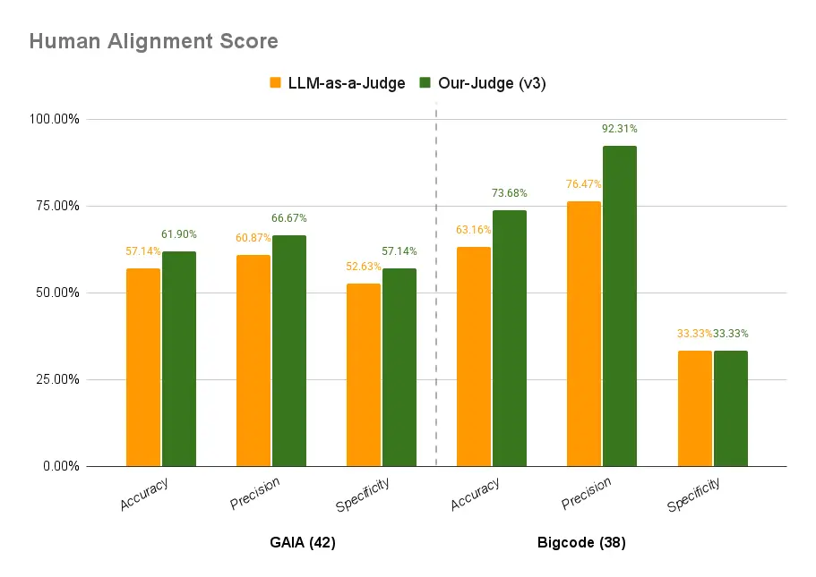

Figure 1: Performance Comparison

## 1 Introduction

##### Problem and Motivation

We propose a general-purpose, scalable, and modular Agent-as-a-Judge
evaluation framework designed to assess agentic task performance with
minimal human oversight, while maintaining robustness across diverse
domains and datasets.

Human evaluation continues to serve as the de facto standard for
determining task success in agentic systems. However, it is inherently
limited by its high cost, subjectivity, and lack of scalability posing a
critical obstacle to widespread deployment of autonomous agents in
real-world settings.

Recent advances have explored leveraging large language models (LLMs)
and autonomous agents as evaluators. Notable examples include the
LLM-as-a-Judge paradigm \[7\] and Meta’s Agent-as-a-Judge framework
\[8\]. While promising, these approaches exhibit key limitations: (1)
they operate primarily on final outputs and ignore intermediate
reasoning traces; (2) they often rely on post hoc human adjudication for
ground-truth validation; and (3) they are narrowly scoped, often bound
to specific task domains or evaluation protocols.

The following definitions will be used consistently throughout this
paper:

- •
  $`Actor`$: the agent responsible for executing a task through
  sequential reasoning and interaction.
- •
  $`Judge`$: the agent tasked with evaluating the $`Actor`$’s
  performance by analyzing both its intermediate reasoning states and
  final output artifacts.

To address these shortcomings, we formalize the evaluation setup by
introducing two core agentic roles and framing our contributions around
two central research questions:

##### Research Questions

- •
  RQ1: How can the task completion ability of Agentic Systems be
  evaluated across a wide range of domains?
- •
  RQ2: How can the quality and human-alignment of $`Judge`$, tasked with
  evaluating these agentic systems, be improved?

By addressing these questions, we aim to establish a general evaluation
framework that reduces human dependency while maintaining semantic rigor
and cross-domain applicability.

##### Contributions

The key contributions of this work are:

- •
  We present a domain-agnostic decomposition of the agent evaluation
  task, enabling step-wise reasoning over task completion without
  presupposing task-specific heuristics.
- •
  We release an open-source, modular, and extensible evaluation
  framework equipped with interface-consistent modules that can be
  independently substituted or enhanced. A concrete instantiation
  demonstrates its compatibility and generalization across multiple
  domains.
- •
  Empirical results show that our implementation consistently
  outperforms existing baselines, achieving stronger alignment with
  human evaluations (see Figure 1).

##### Proposed Approach

Our framework is inspired by how expert human evaluators decompose
complex tasks into logical subgoals and assess correctness at each step
via evidence-based reasoning.

The $`Judge`$ agent architecture incorporates multiple LLM-based and
agentic modules that collectively verify both intermediate reasoning
steps and final outputs of the $`Actor`$ agent. For our experiments, we
instantiate the $`Actor`$ using the Magentic-One agent, a
general-purpose agent capable of multi-step task execution.
Architectural and implementation details are provided in Section 3.

We evaluate our framework on two benchmark datasets, GAIA and
BigCodeBench, which focus on text-based tasks. Evaluation quality is
assessed by comparing the $`Judge`$’s verdicts against human annotations
to measure alignment and reliability.

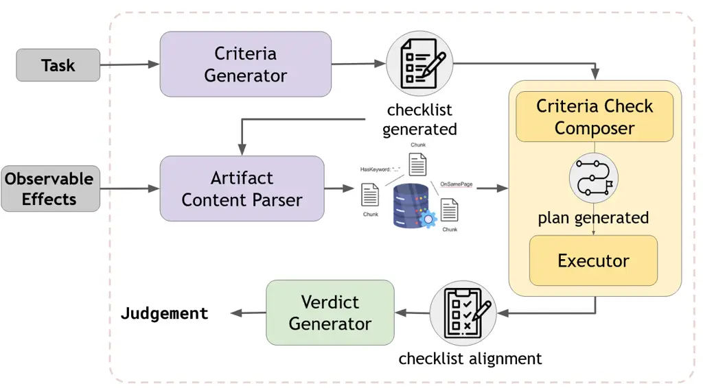

Figure 2: Proposed method overview. The input- $`Task`$ is comprised of
not only query text, but also any type of attachment and tools that
might be provided to the $`Actor`$.

## 2 Related Work

Recent research has increasingly focused on evaluating large language
models (LLMs) and autonomous agents by leveraging other LLMs or agents
as evaluators, aiming to supplement or even replace human evaluation.

##### LLM-as-a-Judge:

Several studies have shown that LLMs can serve as effective judges. For
example, MT-Bench and Chatbot Arena \[7\] use human-aligned LLMs to
score open-ended responses, showing high agreement with human
evaluations. Compass-Judger-1 \[1\] trains an open-source judge using a
mix of public and self-collected feedback data for scoring and pairwise
comparisons. Prometheus \[4\] further improves evaluation fidelity by
training on a diverse feedback dataset, achieving results comparable to
GPT-4.

While effective, these methods focus on static, text-based tasks. Our
work builds on them by expanding evaluation to more complex, step-driven
agentic behaviors.

##### Multi-LLM as Judge Evaluation:

Multi-LLM setups simulate human-like debate to enhance evaluation
quality. ChatEval \[2\] assigns roles to LLMs for collaborative judging,
while AutoArena \[6\] uses peer debate and committee voting to select
top responses. Though limited to chat tasks, these frameworks motivate
our own $`Judge`$ design, aimed at evaluating broader workflows.

##### Evaluating Agentic Systems:

Agent-as-a-Judge \[8\] introduces the idea of agent judging agents.
However, it is constrained to DevAI dataset which contains ML tasks
introduced through this paper. Moreover, this work needs a set of soft
and hard requirements for each task as an input in order to perform
evaluations, which hugely limits the extensibility of this method
towards other datasets of same domain. Our work removes this requirement
by automatically generating a set of checklist criteria agnostic to
domain or dataset.

##### Step-by-Step Evaluation:

Since Agentic Systems often operate in sequences, evaluation should
track not just final outputs but intermediate steps. LLM-Reasoners \[3\]
proposes AutoRace to assess reasoning chains like Chain of Thought and
Tree of Thought for LLMs. We adopt a similar philosophy, our $`Judge`$
agent evaluates the completeness and correctness of each step in the
$`Actor`$ agent’s process, enabling more accurate and transparent
assessments.

## 3 Method

Figure 2. gives an overview of the proposed $`Judge`$ system. The
remainder of this section describes the functional modules of the
$`Judge`$ framework in detail.

### 3.1 Criteria Generator

Given a task description, the Criteria Generator module generates a
concise list of checklist questions which must be met by the $`Actor`$
Agent to successfully complete the task. The generated checklist aims to
verify whether the agent has satisfied the “explicit” requirements
stated in the task, while minimizing assumptions.

It follows detailed prompting guidelines to ensure that each checklist
question is strictly aligned with the task. The questions are designed
to be binary ("yes" or "no") in nature and focus on a single requirement
at a time. This approach simplifies evaluation by avoiding complex,
nested questions that would otherwise require additional reasoning or
multiple steps.

To further enhance relevance, an LLM-based filtering step is applied
post-generation to remove questions that are either redundant or loosely
connected to the task goal. Figure 3 shows a comprehensive overview of
the data flow for the implementation of this module.

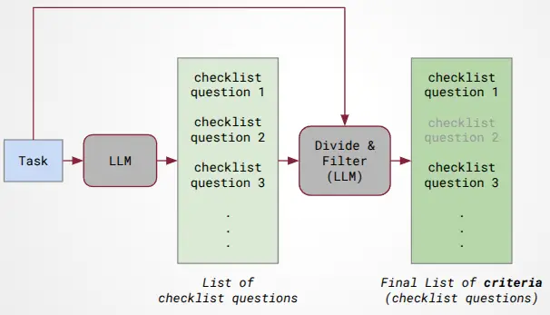

Figure 3: Architecture overview for Criteria Generator. The blue box
represents input to the module and the green box depicts output.

### 3.2 Artifact Content Parser

This module is responsible for structuring and accurately retrieving
relevant information ("proofs") from the log file generated by the
$`Actor`$. The first step is handled by the Indexer, followed by the
Retriever.

This entire pipeline is inspired by the Retrieval Augmented Generation
(RAG) approach. Figure 4 describes the overall flow.

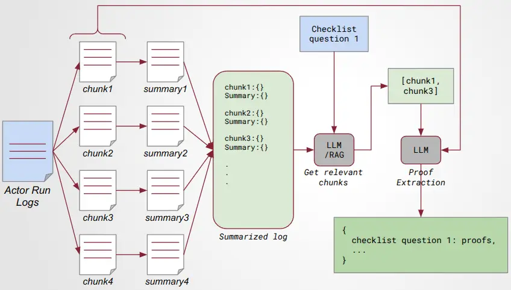

Figure 4: Architecture overview for Artifact Content Parser. The blue
box represent input to the module and the green box depicts output.

Indexer: It handles the efficient organization and structuring of log
files (with current focus on a single log file) which is generally over
2000 lines. It operates in two key steps:

1.  1.  Chunking: The Indexer begins with chunking. There are two key
        motivations for this step. First, lengthy log files generated by the
        $`Actor`$ may exceed the context window of the language model.
        Second, even if the entire content of the log fits within the
        context window, chunking improves efficiency by reducing irrelevant
        information and optimizing latency and token usage.

    We use 300-token chunks, as this configuration performs best in
    combination with a cross-encoder during retrieval.

2.  2.  Summarization: Each chunk is summarized using an LLM to serve as a
        content index, which is important given the presence of mixed
        formats such as code, HTML tags, and plain text in the log. This
        improves performance significantly compared to using the raw chunks
        directly.

The resulting summaries are passed to the next component, the Retriever.

The Retriever is responsible for identifying and extracting the relevant
proofs from the log that align with specific checklist questions. This
involves two steps:

1.  1.  Chunk Retrieval: Cross-encoder (ms-marco-MiniLM-L-6-v2) uses the
        checklist question against each generated summaries to identify the
        most relevant chunks. The relevant chunks here are chosen based on a
        set threshold.
2.  2.  Snippet Extraction: For each relevant chunk, an LLM is employed to
        extract the precise snippet from the relevant chunks that serves as
        "proof" against each checklist question. These extracted snippets
        against each checklist question are passed to the subsequent module,
        the Criteria Check Composer.

### 3.3 Criteria Check Composer (C3)

This module functions as the final integrative module responsible for
synthesizing all upstream outputs into a coherent verification strategy.
For each checklist query, C3 constructs an execution plan by referencing
the relevant $`Actor`$ logs and using LLM-based reasoning alongside
optionally using any externally provisioned computational assets such as
structured knowledge bases, tools (like web search, file explorer,
computer terminal, etc.).

These auxiliary resources may encompass annotator-derived procedural
traces (e.g., intermediate steps recorded during dataset curation),
canonical task solutions, predefined lookup tables, or any
dataset-embedded metadata intended to support interpretability or
correctness checking.

To architect the verification pipeline, C3 leverages modular perceptual
analyzers specific to each input modality or source. These submodules
facilitate the decomposition, classification, and semantic parsing of
input signals, enabling the system to instantiate a dynamic, decision
tree based action graph. This graph encodes conditional verification
pathways, allowing for fine-grained alignment between evidence sources
and checklist criteria. Figure 5 provides a schematic representation of
the system’s architecture.

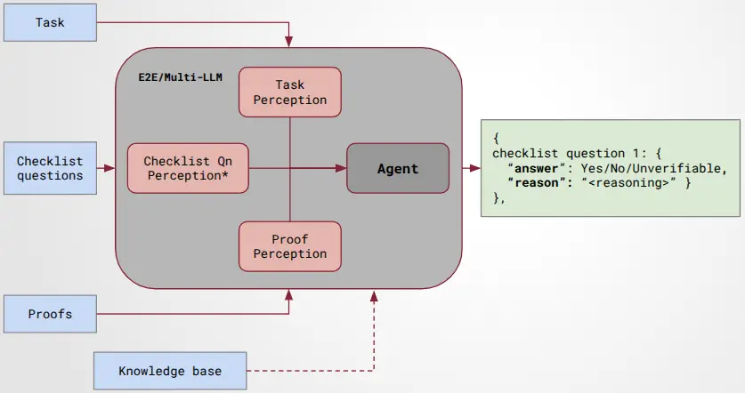

Figure 5: Architecture overview for Criteria Check Composer. The blue
boxes represent inputs to the module (with dashed arrow as an optional
input) and the green box depicts output. The dark gray box is the middle
highlights the implicit/explicit components constituting this module

##### Checklist Question Perception.

This component implements a hierarchical multi-stage classification
pipeline over checklist-style queries, leveraging large language model
(LLM) inference at each stage. At the first level, each question is
classified into one of two primary semantic categories:
$`\mathbf{factual}`$ or $`\mathbf{logical}`$. A query is labeled as
$`\mathbf{factual}`$ if its resolution necessitates incorporation of
external world knowledge or previously acquired domain understanding
that is not inferable from the execution trace or log artifacts alone.
Conversely, a $`\mathbf{logical}`$ query is one whose truth value or
correctness can be determined strictly from the internal artifacts of
task execution (e.g., function outputs, logs, or traces), potentially
requiring auxiliary symbolic tools (e.g., code interpreters,
calculators) or embedded logical reasoning mechanisms.

Subsequently, questions categorized as $`\mathbf{logical}`$ are further
disambiguated into subtypes: $`\mathbf{reasoning}`$ or
$`\mathbf{coding}`$. The $`\mathbf{reasoning}`$ class encapsulates tasks
requiring abstract inference, deductive logic, or multi-step cognitive
operations over the observed artifacts, while the $`\mathbf{coding}`$
class pertains to instances requiring programmatic analysis, code
generation, or interpretation. Class labels are deliberately designed to
be interpretable yet exhaustive within the operational scope of our task
framework. Each classification stage is independently parameterized and
executed through discrete LLM invocations to maintain modularity and
compositionality.

##### Proof Perception.

This sub-module conducts an automated verification pass to determine
whether the candidate proofs associated with each checklist item are
semantically sufficient for downstream evaluation. If the verification
yields inconclusive or incomplete justification, the module triggers an
expansion of the contextual retrieval window to incorporate broader
evidence. This decision process is implemented via an LLM-based
inference mechanism.

Conditioned on the inferred verification type, the system dispatches the
corresponding evaluation task to either a specialized language model or
a general-purpose LLM-driven agentic pipeline. As detailed in Figure 6,
verification tasks categorized as $`\mathbf{factual}`$ or
$`\mathbf{coding}`$ are processed through a modular multi-agent
architecture, Magentic-One. This framework comprises a planning agent
(Orchestrator), a code generation agent, a retrieval/surfing agent, and
a code execution environment. The planner synthesizes a verification
trajectory which is subsequently executed against the retrieved
artifacts. Conversely, $`\mathbf{reasoning}`$-type tasks are verified
via a single-step LLM inference, as they predominantly involve abstract
or logical inference chains that do not benefit from procedural
decomposition.

##### Task Perception.

Rather than constituting a discrete module, task perception functions as
an overarching conceptual layer within the C3 pipeline. Its role is to
inform verification planning by coupling checklist-based reasoning with
a nuanced, semantic interpretation of the task description. To
operationalize this, each LLM-driven sub-step is explicitly conditioned
on the task under evaluation, embedding task-level awareness into the
examination of both proofs and checklist items. This integration ensures
that verification is contextually grounded and sensitive to the
specificities of the task at hand.

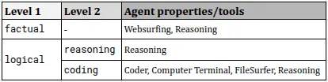

Figure 6: Checklist classes and handler of respective cases. The right
most column signifies the bare minimum capabilities and/or expertise
expected by the Agent handler

### 3.4 Verdict Generator

Finally, this module reasons with all the available information and
outputs of previous modules to come to a verdict of whether the task was
successfully completed by the $`Actor`$. For example: Given a task, list
of checklist questions with their proofs that pertain to each checklist
question, and the output from each checklist from C3, the verdict
reasoner gives a single "Yes" or "No" as the answer. Figure 7 shows the
data flow for this module.

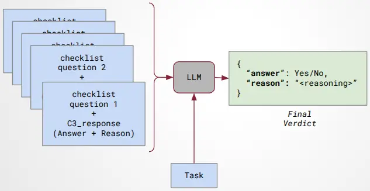

Figure 7: Architecture overview for Verdict Generator. The blue box
represent input to the module and the green box depicts output.

## 4 Experimental Setup

### 4.1 Datasets

To make a $`Judge`$ framework generalizable across multiple domains, it
is important to include a variety of datasets representing diverse
tasks. Since it is labor-intensive to annotate the $`Actor`$ results, we
need to ensure that the datasets contain Auto-Evaluation techniques or
Ground Truth to evaluate the $`Actor`$ agent. This will help us measure
of how well our $`Judge`$ is able to evaluate or align with human
evaluation.

| Metric      | GAIA (21 Pass, 21 Fail) |                     | Bigcode (28 Pass, 10 Fail) |                     |
| ----------- | ----------------------- | ------------------- | -------------------------- | ------------------- |
|             | LLM-as-a-Judge          | Our-Judge (v3)      | LLM-as-a-Judge             | Our-Judge (v3)      |
| Accuracy    | 57.14%                  | 61.90% $`\uparrow`$ | 63.16%                     | 73.68% $`\uparrow`$ |
| Precision   | 60.87%                  | 66.67% $`\uparrow`$ | 76.47%                     | 92.31% $`\uparrow`$ |
| Recall      | 60.87%                  | 66.67% $`\uparrow`$ | 100.00%                    | 92.30%              |
| Specificity | 52.63%                  | 57.14% $`\uparrow`$ | 33.33%                     | 33.33%              |

Table 1: Performance metrics of different judge models on the Inference
Dataset

#### 4.1.1 Data source

Our approach currently leverages text-only datasets such as GAIA \[5\]
and BigCodeBench \[9\]. GAIA provides general reasoning challenges
involving multi-modality and web browsing tasks, while BigCodeBench
evaluates LLMs on complex programming tasks requiring intermediate
reasoning and function calls.

All these datasets already exist and are publicly available through
GitHub or HuggingFace.

#### 4.1.2 Data splits

Since our focus is purely on evaluation, the dataset is sampled as
follows:

- •
  From GAIA, 42 out of 53 Level-1 tasks were selected, excluding those
  with multimodal attachments. A balanced distribution of $`Actor`$ runs
  was ensured across these tasks where 21 tasks were completed
  successfully and 21 were not.
- •
  From BigCodeBench, 38 tasks were selected, excluding those with
  incorrect test-cases (which would have made the evaluation
  ambiguious). 28 tasks were completed successfully and 10 were not.

### 4.2 Evaluation Method

For each dataset, three types of evaluations were considered:

1.  1.  Human Evaluation:
    - •
      If ground truth was available in the dataset, it was used to guide
      the evaluation.
    - •
      If ground truth was not available, evaluators assessed correctness
      based on available evaluation methods, such as test cases.
    - •
      In the absence of both, annotators manually verified task
      completion through direct inspection.

2.  2.  LLM as a Judge Verdict:
    - •
      A binary verdict (Yes or No) generated by GPT-4o-based LLM on the
      provided task description and final output.

3.  3.  Judge Verdict:
    - •
      A binary verdict (Yes or No) produced by our framework, given the
      task description and the corresponding log file.

To measure evaluation quality, human alignment was calculated by
constructing a confusion matrix between the human evaluation and the
verdicts generated by each method. Human alignment with the LLM as a
Judge serves as the baseline for evaluation. The human alignment score
for the $`Judge`$ verdict is compared against this baseline to assess
improvements.

### 4.3 Baselines

Due to the lack of prior research for a general agent as a judge across
domains, there are no agentic baselines to consider, we implement
LLM-as-a-Judge as the baseline. This choice stems from the hypothesis
that agentic judge, which incorporates intermediate reasoning steps,
will outperform a LLM-based judge that relies solely on final outputs.
To address the context window limitations of LLMs in LLM-as-a-Judge, we
pass only the final output of the $`Actor`$ to the LLM-as-a-Judge,
instead of verbose log files. By focusing solely on the final output, we
effectively mitigate issues caused by the excessive length of detailed
logs.

## 5 Results and Discussions

Our inital data setup lacked balanced $`Actor`$ runs due to the random
nature of sampling (see Table 2 from Appendix). We address that in our
current data setup by (1) increasing the sample size and (2) iteratively
increasing the maximum number of turns allowed for the $`Actor`$ agent.
The results for the current run can be found in Table 1. We can see that
our system consistently beats the baseline, and performs better on the
BigCodeBench dataset \[Figure 1\]. On BigCodeBench, the system seems to
high precision (92.31%). From the other metrics, it can be concluded
that the balanced dataset allowed for better visibility into the
system’s true capabilities.

### 5.1 Error Analysis

- •
  Some evaluation tasks demand more than just a binary check. For
  example, given the task -

  > "Of the authors (First M. Last) that worked on the paper ’sPie Menus
  > or Linear Menus, Which Is Better?’ in 2015, what was the title of
  > the first paper authored by the one that had authored prior papers?"

  our existing judge framework bases its evaluations on evidence
  extracted from the actor agent’s execution logs. In this instance, the
  judge assigns positive verdict essentially trusting the validity of
  those logs, even though the actor’s answer does not match the ground
  truth. To preserve a clear distinction from the Actor Agent, our
  current framework prevents the judge from solving the tasks directly.
  However, the example highlights that it is imperative for a judge
  system to perform the task itself to validate answers concretely.

- •
  The Artifact Content Parser has mainly two failure modes. First, it
  occasionally injects opinions into its output; although undesirable,
  this behavior does not really impair the Criteria Check Composer (C3)
  module’s ability to verify claims. Second, the parser sometimes
  extracts proof snippets directly from the Actor Plan. In these
  instances, C3 interprets these proofs as established evidence of that
  ‘action’ being performed and consequently generates incorrect verdict.
- •
  In some tasks that involve “role-playing” examples like:

  > “You are Van Helsing, a renowned vampire hunter. A Count of Moldova,
  > La»õcu IV, son of Costea, has tasked you with investigating the
  > village of »òirnea in neighboring Wallachia. The Count’s advisors
  > have reported that a vampire was spotted crossing the border near
  > the village, and would like you to investigate it.”

  the Content Generator module often confuses the fictional role-play
  directives with the actor agent’s actual behavior. As a result, it may
  pose verification questions that assume in-world actions rather than
  monitoring what the agent genuinely executed. For example:
  - –
    Did the AI agent travel to the village of S , irnea as instructed?
  - –
    Did the AI agent observe the vampire jumping from rooftop to
    rooftop?
  - –
    Did the AI agent attempt to chase the vampire back to its home?

  Because these queries do not focus on the agent’s logged operations,
  the system cannot accurately verify whether the agent performed them.

## 6 Conclusion

In this work, we introduced a modular, domain-agnostic framework for
evaluating agent task completion by assessing not just final outcomes,
but the reasoning steps behind them. Our Judge Agent, evaluated on GAIA
and BigCodeBench, achieved 4.76% and 10.52% higher alignment with human
judgments compared to the GPT-4o LLM-as-a-Judge baseline.

These results highlight the strength of step-wise evaluation in
capturing task completion in a more robust manner, offering a scalable
foundation for evaluating increasingly capable agentic systems.

However, the current framework is not without limitations. It does not
yet support the evaluation of multi-modal tasks, datasets, or domains.
The Criteria Generator is currently limited to generating checklist
questions for text-based tasks and does not handle tasks involving files
or attachments. Likewise, the Artifact Content Parser can process only a
single log file and does not account for multiple outputs or additional
artifacts produced during task execution.

To address these gaps, we plan to extend the framework with an
Environment Explorer module, integrated into the Criteria Check
Composer, to support inspection of file-based outputs and more complex
evaluation scenarios.

## 7 Acknowledgments

We would like to thank our mentors from University of Massachusetts
Amherst and Microsoft AI Development Acceleration Program (MAIDAP).

## References

- \[1\] Maosong Cao, Alexander Lam, Haodong Duan, Hongwei Liu, Songyang
  Zhang, and Kai Chen. 2024. [Compassjudger-1: All-in-one judge model
  helps model evaluation and
  evolution](https://arxiv.org/abs/2410.16256). _Preprint_,
  arXiv:2410.16256.
- \[2\] Chi-Min Chan, Weize Chen, Yusheng Su, Jianxuan Yu, Wei Xue,
  Shanghang Zhang, Jie Fu, and Zhiyuan Liu. 2023. [Chateval: Towards
  better llm-based evaluators through multi-agent
  debate](https://arxiv.org/abs/2308.07201). _Preprint_,
  arXiv:2308.07201.
- \[3\] Shibo Hao, Yi Gu, Haotian Luo, Tianyang Liu, Xiyan Shao, Xinyuan
  Wang, Shuhua Xie, Haodi Ma, Adithya Samavedhi, Qiyue Gao, Zhen Wang,
  and Zhiting Hu. 2024. [Llm reasoners: New evaluation, library, and
  analysis of step-by-step reasoning with large language
  models](https://arxiv.org/abs/2404.05221). _Preprint_,
  arXiv:2404.05221.
- \[4\] Seungone Kim, Jamin Shin, Yejin Cho, Joel Jang, Shayne Longpre,
  Hwaran Lee, Sangdoo Yun, Seongjin Shin, Sungdong Kim, James Thorne,
  and Minjoon Seo. 2024. [Prometheus: Inducing fine-grained evaluation
  capability in language models](https://arxiv.org/abs/2310.08491).
  _Preprint_, arXiv:2310.08491.
- \[5\] Grégoire Mialon, Clémentine Fourrier, Craig Swift, Thomas Wolf,
  Yann LeCun, and Thomas Scialom. 2023. [Gaia: a benchmark for general
  ai assistants](https://arxiv.org/abs/2311.12983). _Preprint_,
  arXiv:2311.12983.
- \[6\] Ruochen Zhao, Wenxuan Zhang, Yew Ken Chia, Weiwen Xu, Deli Zhao,
  and Lidong Bing. 2024. [Auto-arena: Automating llm evaluations with
  agent peer battles and committee
  discussions](https://arxiv.org/abs/2405.20267). _Preprint_,
  arXiv:2405.20267.
- \[7\] Lianmin Zheng, Wei-Lin Chiang, Ying Sheng, Siyuan Zhuang,
  Zhanghao Wu, Yonghao Zhuang, Zi Lin, Zhuohan Li, Dacheng Li, Eric P.
  Xing, Hao Zhang, Joseph E. Gonzalez, and Ion Stoica. 2023. [Judging
  llm-as-a-judge with mt-bench and chatbot
  arena](https://arxiv.org/abs/2306.05685). _Preprint_,
  arXiv:2306.05685.
- \[8\] Mingchen Zhuge, Changsheng Zhao, Dylan Ashley, Wenyi Wang,
  Dmitrii Khizbullin, Yunyang Xiong, Zechun Liu, Ernie Chang, Raghuraman
  Krishnamoorthi, Yuandong Tian, Yangyang Shi, Vikas Chandra, and Jürgen
  Schmidhuber. 2024. [Agent-as-a-judge: Evaluate agents with
  agents](https://arxiv.org/abs/2410.10934). _Preprint_,
  arXiv:2410.10934.
- \[9\] Terry Yue Zhuo, Minh Chien Vu, Jenny Chim, Han Hu, Wenhao Yu,
  Ratnadira Widyasari, Imam Nur Bani Yusuf, Haolan Zhan, Junda He,
  Indraneil Paul, et al. 2024. Bigcodebench: Benchmarking code
  generation with diverse function calls and complex instructions.
  _arXiv preprint arXiv:2406.15877_.

## 8 Appendix

### 8.1 Initial Data Setup and Results

We initially used the following setup to iteratively improve our
modules’ implementation by error analysis and identifying bottlenecks.

- •
  From GAIA, we randomly sampled 10 tasks for varying difficulty levels
  (1, 2, 3).
- •
  From BigCodeBench, we randomly sampled 11 tasks.

We measured the performance of our $`Judge`$ framework in terms of human
alignment and overall classification performance. As shown in Figure 8.
several Judge configurations (see Table 3 in Appendix for more details
on configurations) outperform the baseline LLM-as-a-Judge in terms of
human alignment.

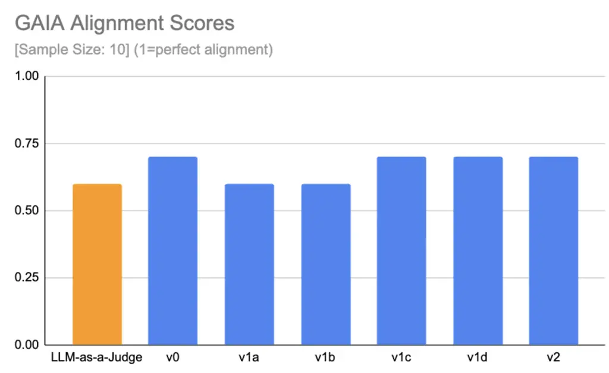

Figure 8: GAIA - Initial Data Setup - Alignment Scores

In Figure 9., we observed that none of the $`Judge`$ variants correctly
classified any true positives. While this indicates that the $`Judge`$
agents are effective at rejecting incorrect completions, it also
suggests an overly conservative behavior when it comes to crediting
correct ones. One contributing factor is the imbalance in the GAIA
samples used for Validation Setup. Only 2 out of the 10 tasks were
successfully completed by the $`Actor`$ agent. This skew may have biased
the $`Judge`$ toward negative classifications, highlighting the
importance of using balanced evaluation sets for performance assessment.

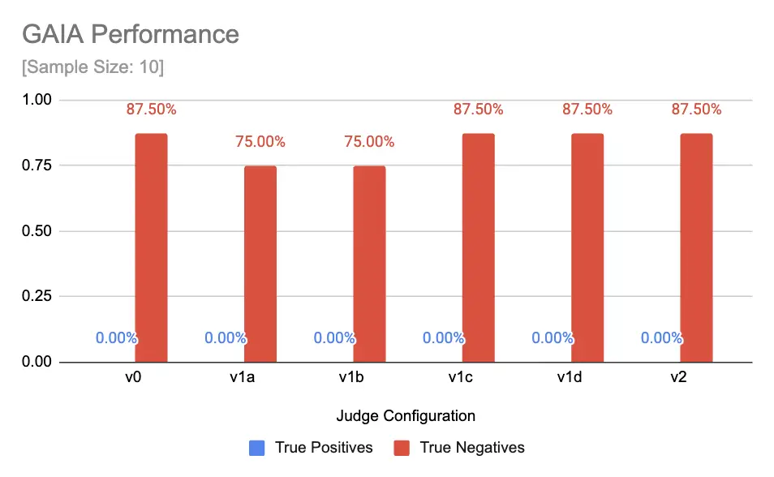

Figure 9: GAIA - Initial Data Setup - Classification Performance

In Figure 10., interestingly the LLM-as-a-Judge variant outperforms most
$`Judge`$ configurations. However, with each configuration of the
$`Judge`$, the human alignment steadily improves and version v2 exceeds
the baseline.

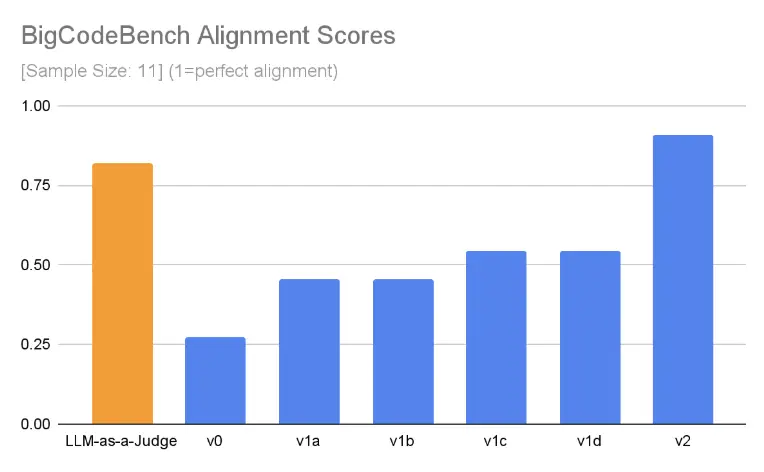

Figure 10: BigCodeBench- Initial Data Setup - Alignment Scores

In Figure 11., a similar increasing trend is observed with each
configuration of the $`Judge`$ agent. Version v0 and v1a-v1b seem to
perform poorly in identifying correct completions (true positives),
whereas versions v1c and v1d improve significantly with 75% true
positive rates. Version v2 beats all the previous versions and achieves
a perfect true positive rate of 100%.

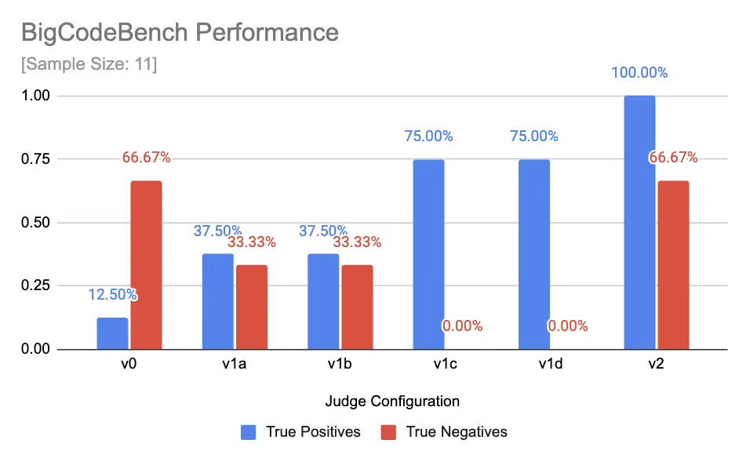

Figure 11: BigCodeBench - Initial Data Setup - Classification
Performance

In Figure 12. and Figure 13., we compared the performance of our judge
system against various underlying popular LLMs, many of which are Open
Source. The primary intent was to determine the right model to power our
judge system. While at first glance, it may seem that the Qwen 2.5 model
performed better amongst all of the tested models, on deeper inspection
of the judge logs, it was found that the Qwen model demonstrated
significant weakness in effective reasoning, producing inferior
checklist questions, as compared to Open AI’s GPT 4o.

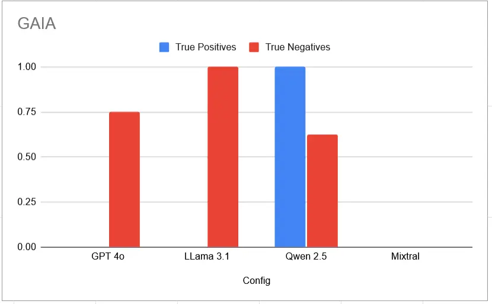

Figure 12: GAIA - Initial Data Setup - Open Source Models Comparison

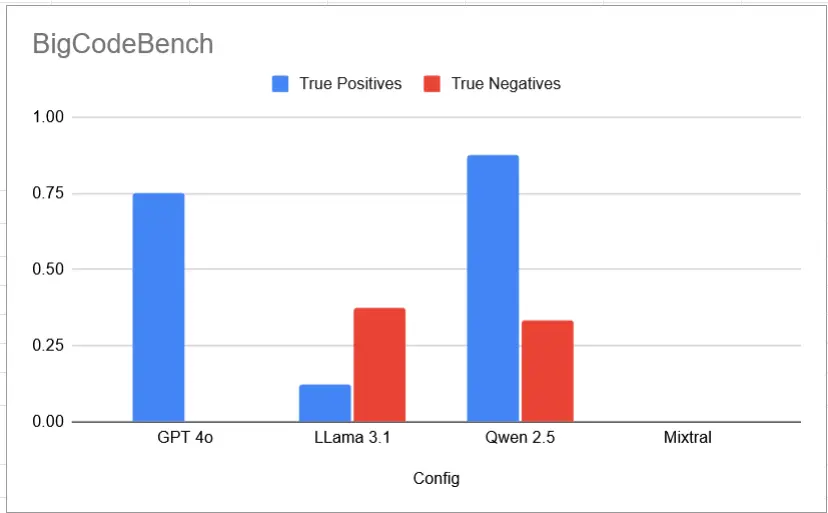

Figure 13: BigCodeBench - Initial Data Setup - Open Source Models
Comparison

| Judge          | GAIA (Actor: 2 Pass, 8 Fail) |                     |                      |                      | Bigcode (Actor: 8 Pass, 3 Fail) |                      |                      |                      |
| -------------- | ---------------------------- | ------------------- | -------------------- | -------------------- | ------------------------------- | -------------------- | -------------------- | -------------------- |
|                | Accuracy                     | Precision           | Recall               | Specificity          | Accuracy                        | Precision            | Recall               | Specificity          |
| LLM-as-a-Judge | 60.00%                       | 42.86%              | 100.00%              | 42.86%               | 81.81%                          | 81.81%               | 100.00%              | 0.00%                |
| v0             | 70.00% $`\uparrow`$          | 0.00%               | 0.00%                | 87.50% $`\uparrow`$  | 27.27%                          | 50.00%               | 12.50%               | 66.67% $`\uparrow`$  |
| LLama 3.2 v0   | 60.00%                       | 25.00%              | 50.00%               | 62.50% $`\uparrow`$  | 54.55%                          | 66.67%               | 75.00%               | 0.00%                |
| v1a            | 60.00%                       | 0.00%               | 0.00%                | 75.00% $`\uparrow`$  | 45.45%                          | 75.00%               | 37.50%               | 66.67% $`\uparrow`$  |
| v1b            | 60.00%                       | 0.00%               | 0.00%                | 75.00% $`\uparrow`$  | 45.45%                          | 75.00%               | 50.00%               | 33.33%               |
| v1c            | 70.00% $`\uparrow`$          | 0.00%               | 0.00%                | 87.50% $`\uparrow`$  | 54.55%                          | 66.67%               | 75.00%               | 0.00%                |
| v1d            | 70.00% $`\uparrow`$          | 0.00%               | 0.00%                | 87.50% $`\uparrow`$  | 54.55%                          | 66.67%               | 75.00%               | 0.00%                |
| llama 3.2 v1d  | 80.00% $`\uparrow`$          | 0.00%               | 0.00%                | 100.00% $`\uparrow`$ | 36.36%                          | 100.00% $`\uparrow`$ | 12.50%               | 100.00% $`\uparrow`$ |
| qwen v1d       | 80.00% $`\uparrow`$          | 50.00% $`\uparrow`$ | 100.00% $`\uparrow`$ | 75.00% $`\uparrow`$  | 72.73%                          | 77.78%               | 87.50%               | 33.33% $`\uparrow`$  |
| v2             | 70.00% $`\uparrow`$          | 0.00%               | 0.00%                | 87.50% $`\uparrow`$  | 90.91% $`\uparrow`$             | 88.89% $`\uparrow`$  | 100.00% $`\uparrow`$ | 66.67%               |

Table 2: Performance metrics of different judge models on the Validation
Dataset

### 8.2 Judge Version Configuration Details

| Judge Version | Description                         | Concern                                                         |
| ------------- | ----------------------------------- | --------------------------------------------------------------- |
| v0            | Initial Implementation              | Checklist has too many sanity checks                            |
| v1a           | Upgraded Criteria Generator         | Insufficient / Invalid Proof Extraction                         |
| v1b           | Upgraded Artifact Content Retriever | Verification Process Failures                                   |
| v1c           | Upgraded Criteria Check Composer    | Verdict Generation Lacking Context                              |
| v1d           | Upgraded Verdict Reasoner           | False Positives due to Improper Checklist                       |
| v2            | Upgraded Criteria Generator         | Proofs Contain Values from Irrelevant Sections of the Actor Log |
| v3            | Upgraded Indexer Retriever          |                                                                 |

Table 3: Judge Version Details

### 8.3 GAIA example

#### 8.3.1 Task

Where were the Vietnamese specimens described by Kuznetzov in
Nedoshivina’s 2010 paper eventually deposited? Just give me the city
name without abbreviations.

#### 8.3.2 Judge Evaluation

{

"verdict": "no",

"eval": \[

{

"question": "Did the agent provide a city name as the answer?",

"proofs": {

"proofs": "“‘ \\nfile_0.txt = ———- MagenticOneOrchestrator ———-\\n\\nTo
answer this request we have assembled the following team:\\n\\n…\\n-
Once the paper is found, extract the relevant sections to identify the
city in which the specimens were deposited. \\n- Cross-check any
findings to ensure the information is accurate and directly sourced from
the paper.\\n“‘\\n\\n“‘ \\nfile_6.txt =
Favorite\\nShare\\nFlag\\ntexts\\nA catalogue of type specimens of the
Tortricidae described by V. I. Kuznetzov from Vietnam and deposited in
the Zoological Institute, St. Petersburg\\n“‘",

"final_answer": "St. Petersburg"

},

"c3_response": {

"answer": "yes",

"reason": "The relevant artifact ’file_6.txt’ specifies that the
specimens described by Kuznetzov from Vietnam were deposited in the
Zoological Institute, which is located in St. Petersburg. Therefore, the
city name ’St. Petersburg’ was provided as the answer.",

"decision_path": \[

"proofs+final_answer",

"logical",

"reasoning"

\]

}

},

{

"question": "Was the city name given without any abbreviations?",

"proofs": {

"proofs": "“‘plaintext\\n———- MagenticOneOrchestrator ———-\\nThe
Vietnamese specimens described by Kuznetzov in Nedoshivina’s 2010 paper
were eventually deposited in St. Petersburg.\\n“‘",

"final_answer": "St. Petersburg"

},

"c3_response": {

"answer": "no",

"reason": "The city name provided in the relevant artifact is ’St.
Petersburg’, which is an abbreviated form of ’Saint Petersburg’, thus
not given without abbreviations.",

"decision_path": \[

"proofs",

"logical",

"reasoning"

\]

}

},

{

"question": "Did the agent identify the city where the Vietnamese
specimens described by Kuznetzov in Nedoshivina’s 2010 paper were
deposited?",

"proofs": {

"proofs": "“‘\\nA huge amount of lepidopterous material was collected by
KuzNETzov in Vietnam and all of it is now deposited in the collection of
ZISP. \\n“‘\\n",

"final_answer": "St. Petersburg"

},

"c3_response": {

"answer": "yes",

"reason": "The relevant artifact states that the material collected by
Kuznetzov in Vietnam is now deposited in the collection of ZISP. Since
ZISP is located in St. Petersburg, the answer to the checklist question
is yes, as the city where the specimens were deposited is identified as
St. Petersburg.",

"decision_path": \[

"proofs+final_answer",

"logical",

"reasoning"

\]

}

}

\]

}

### 8.4 BigCode example

#### 8.4.1 Task

from sklearn.preprocessing import StandardScaler

import seaborn as sns

import matplotlib.pyplot as plt

def task_func(df):

"""

␣␣␣␣Standardize␣numeric␣columns␣in␣a␣DataFrame␣and␣return␣the␣heatmap␣of␣the␣correlation␣matrix.␣Missing␣values␣are␣replaced␣by␣the␣column’s␣average.

␣␣␣␣Parameters:

␣␣␣␣-␣df␣(pandas.DataFrame):␣The␣pandas␣DataFrame␣to␣be␣standardized.

␣␣␣␣Returns:

␣␣␣␣-␣DataFrame:␣The␣pandas␣DataFrame␣after␣standardization.

␣␣␣␣-␣Axes:␣A␣heatmap␣of␣the␣correlation␣matrix.

␣␣␣␣Requirements:

␣␣␣␣-␣sklearn.preprocessing.StandardScaler

␣␣␣␣-␣seaborn

␣␣␣␣-␣matplotlib.pyplot

␣␣␣␣Example:

␣␣␣␣\>\>\>␣import␣pandas␣as␣pd

␣␣␣␣\>\>\>␣import␣numpy␣as␣np

␣␣␣␣\>\>\>␣df␣=␣pd.DataFrame(\[\[1,2,3\],\[4,5,6\],\[7.0,np.nan,9.0\]\],␣columns=\["c1","c2","c3"\])

␣␣␣␣\>\>\>␣standardized_df,␣heatmap␣=␣task_func(df)

␣␣␣␣\>\>\>␣print(standardized_df)

␣␣␣␣␣␣␣␣␣␣␣␣␣c1␣␣␣␣␣␣␣␣c2␣␣␣␣␣␣␣␣c3

␣␣␣␣0␣-1.224745␣-1.224745␣-1.224745

␣␣␣␣1␣␣0.000000␣␣1.224745␣␣0.000000

␣␣␣␣2␣␣1.224745␣␣0.000000␣␣1.224745

␣␣␣␣"""

#### 8.4.2 Judge Evaluation

{

"verdict": "yes",

"eval": \[

{

"question": "Was the StandardScaler from sklearn.preprocessing used to
standardize the numeric columns of the DataFrame?",

"proofs": {

"proofs": "“‘python\\nimport pandas as pd\\nfrom sklearn.preprocessing
import StandardScaler\\nimport seaborn as sns\\nimport matplotlib.pyplot
as plt\\n\\ndef task_func(df):\\n \# Replace missing values with the
column’s average\\n df_filled = df.apply(lambda col:
col.fillna(col.mean()), axis=0)\\n \\n \# Standardize numeric columns\\n
scaler = StandardScaler()\\n df_standardized =
pd.DataFrame(scaler.fit_transform(df_filled),
columns=df_filled.columns)\\n \\n \# Generate the correlation matrix\\n
corr_matrix = df_standardized.corr()\\n \\n \# Plot the heatmap\\n
plt.figure(figsize=(8, 6))\\n heat_map = sns.heatmap(corr_matrix,
annot=True, cmap=’coolwarm’, fmt=\\.2f\\)\\n plt.title(’Correlation
Matrix Heatmap’)\\n plt.show()\\n \\n return df_standardized,
heat_map\\n\\n\# Example usage\\nif \_\_name\_\_ == \\\_\_main\_\_\\:\\n
import numpy as np\\n \\n df = pd.DataFrame(\[\[1, 2, 3\], \[4, 5, 6\],
\[7.0, np.nan, 9.0\]\], columns=\[\\c1\\, \\c2\\, \\c3\\\])\\n
standardized_df, heatmap = task_func(df)\\n
print(standardized_df)\\n“‘",

"final_answer": "import pandas as pd\\nimport numpy as np\\nfrom
sklearn.preprocessing import StandardScaler\\nimport seaborn as
sns\\nimport matplotlib.pyplot as plt\\n\\ndef task_func(df):\\n \#
Replace missing values with the column’s average\\n df_filled =
df.apply(lambda col: col.fillna(col.mean()), axis=0)\\n \\n \#
Standardize numeric columns\\n scaler = StandardScaler()\\n
df_standardized = pd.DataFrame(scaler.fit_transform(df_filled),
columns=df_filled.columns)\\n \\n \# Generate the correlation matrix\\n
corr_matrix = df_standardized.corr()\\n \\n \# Plot the heatmap\\n
plt.figure(figsize=(8, 6))\\n heat_map = sns.heatmap(corr_matrix,
annot=True, cmap=’coolwarm’, fmt=\\.2f\\)\\n plt.title(’Correlation
Matrix Heatmap’)\\n plt.show()\\n \\n return df_standardized,
heat_map\\n\\n\# Example usage\\nif \_\_name\_\_ == \\\_\_main\_\_\\:\\n
df = pd.DataFrame(\[\[1, 2, 3\], \[4, 5, 6\], \[7.0, np.nan, 9.0\]\],
columns=\[\\c1\\, \\c2\\, \\c3\\\])\\n standardized_df, heatmap =
task_func(df)\\n print(standardized_df)"

},

"c3_response": {

"answer": "yes",

"reason": "The relevant artifact shows that the StandardScaler from
sklearn.preprocessing is instantiated and used to fit and transform the
numeric columns of the DataFrame. This standardization process
normalizes the columns to have a mean of 0 and a standard deviation of
1, as required by the checklist question.",

"decision_path": \[

"proofs",

"logical",

"reasoning"

\]

}

},

{

"question": "Were missing values in the DataFrame replaced with the
column’s average?",

"proofs": {

"proofs": "“‘python\\n\# Replace missing values with the column’s
average\\ndf_filled = df.apply(lambda col: col.fillna(col.mean()),
axis=0)\\n“‘",

"final_answer": "import pandas as pd\\nimport numpy as np\\nfrom
sklearn.preprocessing import StandardScaler\\nimport seaborn as
sns\\nimport matplotlib.pyplot as plt\\n\\ndef task_func(df):\\n \#
Replace missing values with the column’s average\\n df_filled =
df.apply(lambda col: col.fillna(col.mean()), axis=0)\\n \\n \#
Standardize numeric columns\\n scaler = StandardScaler()\\n
df_standardized = pd.DataFrame(scaler.fit_transform(df_filled),
columns=df_filled.columns)\\n \\n \# Generate the correlation matrix\\n
corr_matrix = df_standardized.corr()\\n \\n \# Plot the heatmap\\n
plt.figure(figsize=(8, 6))\\n heat_map = sns.heatmap(corr_matrix,
annot=True, cmap=’coolwarm’, fmt=\\.2f\\)\\n plt.title(’Correlation
Matrix Heatmap’)\\n plt.show()\\n \\n return df_standardized,
heat_map\\n\\n\# Example usage\\nif \_\_name\_\_ == \\\_\_main\_\_\\:\\n
df = pd.DataFrame(\[\[1, 2, 3\], \[4, 5, 6\], \[7.0, np.nan, 9.0\]\],
columns=\[\\c1\\, \\c2\\, \\c3\\\])\\n standardized_df, heatmap =
task_func(df)\\n print(standardized_df)"

},

"c3_response": {

"answer": "yes",

"reason": "The relevant artifact shows that missing values in the
DataFrame are replaced using the lambda function
‘col.fillna(col.mean())‘, which fills in missing values with the
column’s average (mean). This aligns with the checklist requirement.",

"decision_path": \[

"proofs",

"logical",

"reasoning"

\]

}

},

{

"question": "Was a heatmap of the correlation matrix generated using
seaborn?",

"proofs": {

"proofs": "“‘python\\nimport pandas as pd\\nfrom sklearn.preprocessing
import StandardScaler\\nimport seaborn as sns\\nimport matplotlib.pyplot
as plt\\n\\ndef task_func(df):\\n \# Replace missing values with the
column’s average\\n df_filled = df.apply(lambda col:
col.fillna(col.mean()), axis=0)\\n \\n \# Standardize numeric columns\\n
scaler = StandardScaler()\\n df_standardized =
pd.DataFrame(scaler.fit_transform(df_filled),
columns=df_filled.columns)\\n \\n \# Generate the correlation matrix\\n
corr_matrix = df_standardized.corr()\\n \\n \# Plot the heatmap\\n
plt.figure(figsize=(8, 6))\\n heat_map = sns.heatmap(corr_matrix,
annot=True, cmap=’coolwarm’, fmt=\\.2f\\)\\n plt.title(’Correlation
Matrix Heatmap’)\\n plt.show()\\n \\n return df_standardized,
heat_map\\n\\n\# Example usage\\nif \_\_name\_\_ == \\\_\_main\_\_\\:\\n
import numpy as np\\n \\n df = pd.DataFrame(\[\[1, 2, 3\], \[4, 5, 6\],
\[7.0, np.nan, 9.0\]\], columns=\[\\c1\\, \\c2\\, \\c3\\\])\\n
standardized_df, heatmap = task_func(df)\\n
print(standardized_df)\\n“‘",

"final_answer": "import pandas as pd\\nimport numpy as np\\nfrom
sklearn.preprocessing import StandardScaler\\nimport seaborn as
sns\\nimport matplotlib.pyplot as plt\\n\\ndef task_func(df):\\n \#
Replace missing values with the column’s average\\n df_filled =
df.apply(lambda col: col.fillna(col.mean()), axis=0)\\n \\n \#
Standardize numeric columns\\n scaler = StandardScaler()\\n
df_standardized = pd.DataFrame(scaler.fit_transform(df_filled),
columns=df_filled.columns)\\n \\n \# Generate the correlation matrix\\n
corr_matrix = df_standardized.corr()\\n \\n \# Plot the heatmap\\n
plt.figure(figsize=(8, 6))\\n heat_map = sns.heatmap(corr_matrix,
annot=True, cmap=’coolwarm’, fmt=\\.2f\\)\\n plt.title(’Correlation
Matrix Heatmap’)\\n plt.show()\\n \\n return df_standardized,
heat_map\\n\\n\# Example usage\\nif \_\_name\_\_ == \\\_\_main\_\_\\:\\n
df = pd.DataFrame(\[\[1, 2, 3\], \[4, 5, 6\], \[7.0, np.nan, 9.0\]\],
columns=\[\\c1\\, \\c2\\, \\c3\\\])\\n standardized_df, heatmap =
task_func(df)\\n print(standardized_df)"

},

"c3_response": {

"answer": "yes",

"reason": "The relevant artifact shows that a heatmap of the correlation
matrix is generated using seaborn. The heatmap is created with
sns.heatmap() using the correlation matrix, and the plt.show() function
is called to display it.",

"decision_path": \[

"proofs",

"logical",

"reasoning"

\]

}

},

{

"question": "Was matplotlib.pyplot used to display the heatmap?",

"proofs": {

"proofs": "“‘python\\n\# Plot the heatmap\\nplt.figure(figsize=(8,
6))\\nheat_map = sns.heatmap(corr_matrix, annot=True, cmap=’coolwarm’,
fmt=\\.2f\\)\\nplt.title(’Correlation Matrix
Heatmap’)\\nplt.show()\\n“‘",

"final_answer": "import pandas as pd\\nimport numpy as np\\nfrom
sklearn.preprocessing import StandardScaler\\nimport seaborn as
sns\\nimport matplotlib.pyplot as plt\\n\\ndef task_func(df):\\n \#
Replace missing values with the column’s average\\n df_filled =
df.apply(lambda col: col.fillna(col.mean()), axis=0)\\n \\n \#
Standardize numeric columns\\n scaler = StandardScaler()\\n
df_standardized = pd.DataFrame(scaler.fit_transform(df_filled),
columns=df_filled.columns)\\n \\n \# Generate the correlation matrix\\n
corr_matrix = df_standardized.corr()\\n \\n \# Plot the heatmap\\n
plt.figure(figsize=(8, 6))\\n heat_map = sns.heatmap(corr_matrix,
annot=True, cmap=’coolwarm’, fmt=\\.2f\\)\\n plt.title(’Correlation
Matrix Heatmap’)\\n plt.show()\\n \\n return df_standardized,
heat_map\\n\\n\# Example usage\\nif \_\_name\_\_ == \\\_\_main\_\_\\:\\n
df = pd.DataFrame(\[\[1, 2, 3\], \[4, 5, 6\], \[7.0, np.nan, 9.0\]\],
columns=\[\\c1\\, \\c2\\, \\c3\\\])\\n standardized_df, heatmap =
task_func(df)\\n print(standardized_df)"

},

"c3_response": {

"answer": "yes",

"reason": "matplotlib.pyplot was used to display the heatmap as
indicated by the call to plt.show() following the seaborn heatmap
creation, which utilizes matplotlib’s plotting capabilities.",

"decision_path": \[

"proofs",

"logical",

"reasoning"

\]

}

},

{

"question": "Did the function return both the standardized DataFrame and
the Axes of the heatmap?",

"proofs": {

"proofs": "“‘python\\ndef task_func(df):\\n \# Replace missing values
with the column’s average\\n df_filled = df.apply(lambda col:
col.fillna(col.mean()), axis=0)\\n \\n \# Standardize numeric columns\\n
scaler = StandardScaler()\\n df_standardized =
pd.DataFrame(scaler.fit_transform(df_filled),
columns=df_filled.columns)\\n \\n \# Generate the correlation matrix\\n
corr_matrix = df_standardized.corr()\\n \\n \# Plot the heatmap\\n
plt.figure(figsize=(8, 6))\\n heat_map = sns.heatmap(corr_matrix,
annot=True, cmap=’coolwarm’, fmt=\\.2f\\)\\n plt.title(’Correlation
Matrix Heatmap’)\\n plt.show()\\n \\n return df_standardized,
heat_map\\n\\n\# Example usage\\nif \_\_name\_\_ == \\\_\_main\_\_\\:\\n
import numpy as np\\n \\n df = pd.DataFrame(\[\[1, 2, 3\], \[4, 5, 6\],
\[7.0, np.nan, 9.0\]\], columns=\[\\c1\\, \\c2\\, \\c3\\\])\\n
standardized_df, heatmap = task_func(df)\\n
print(standardized_df)\\n“‘",

"final_answer": "import pandas as pd\\nimport numpy as np\\nfrom
sklearn.preprocessing import StandardScaler\\nimport seaborn as
sns\\nimport matplotlib.pyplot as plt\\n\\ndef task_func(df):\\n \#
Replace missing values with the column’s average\\n df_filled =
df.apply(lambda col: col.fillna(col.mean()), axis=0)\\n \\n \#
Standardize numeric columns\\n scaler = StandardScaler()\\n
df_standardized = pd.DataFrame(scaler.fit_transform(df_filled),
columns=df_filled.columns)\\n \\n \# Generate the correlation matrix\\n
corr_matrix = df_standardized.corr()\\n \\n \# Plot the heatmap\\n
plt.figure(figsize=(8, 6))\\n heat_map = sns.heatmap(corr_matrix,
annot=True, cmap=’coolwarm’, fmt=\\.2f\\)\\n plt.title(’Correlation
Matrix Heatmap’)\\n plt.show()\\n \\n return df_standardized,
heat_map\\n\\n\# Example usage\\nif \_\_name\_\_ == \\\_\_main\_\_\\:\\n
df = pd.DataFrame(\[\[1, 2, 3\], \[4, 5, 6\], \[7.0, np.nan, 9.0\]\],
columns=\[\\c1\\, \\c2\\, \\c3\\\])\\n standardized_df, heatmap =
task_func(df)\\n print(standardized_df)"

},

"c3_response": {

"answer": "yes",

"reason": "The function ’task_func’ returns both the standardized
DataFrame and the Axes of the heatmap as indicated by ’return
df_standardized, heat_map’. The standardized DataFrame is created using
the StandardScaler from sklearn after filling missing values, and the
heatmap is generated using seaborn and is returned as ’heat_map’, which
are the correct outputs according to the checklist question’s
requirements.",

"decision_path": \[

"proofs",

"logical",

"reasoning"

\]

}

}

\]

}
