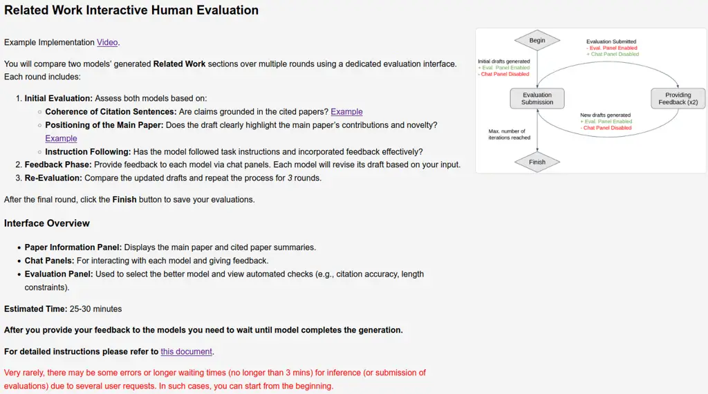
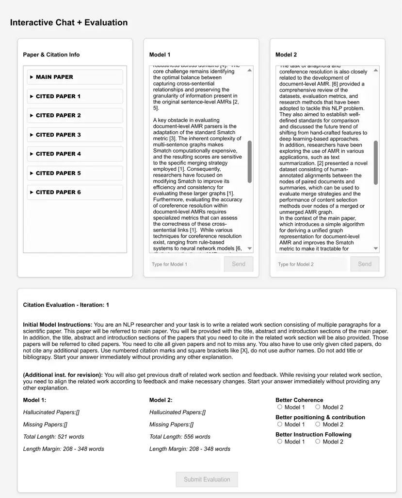

# Expert Preference-based Evaluation of Automated Related Work Generation

Furkan Şahinuç Affiliation: Ubiquitous Knowledge Processing Lab (UKP
Lab)Department of Computer Science and Hessian Center for AI
(hessian.AI)Technical University of Darmstadt Affiliation: Konrad Zuse
School of Excellence in Learning and Intelligent Systems
(ELIZA)[www.ukp.tu-darmstadt.de](https://www.ukp.tu-darmstadt.de)   
Subhabrata Dutta Affiliation: Ubiquitous Knowledge Processing Lab (UKP
Lab)Department of Computer Science and Hessian Center for AI
(hessian.AI)Technical University of Darmstadt    Iryna Gurevych
Affiliation: Ubiquitous Knowledge Processing Lab (UKP Lab)Department of
Computer Science and Hessian Center for AI (hessian.AI)Technical
University of Darmstadt Affiliation: Konrad Zuse School of Excellence in
Learning and Intelligent Systems
(ELIZA)[www.ukp.tu-darmstadt.de](https://www.ukp.tu-darmstadt.de)

###### Abstract

Expert domain writing, such as scientific writing, typically demands
extensive domain knowledge. Although large language models (LLMs) show
promising potential in this task, evaluating the quality of
automatically generated scientific writing is a crucial open issue, as
it requires knowledge of domain-specific criteria and the ability to
discern expert preferences. Conventional automatic evaluation metrics
and LLM-as-a-judge systems, primarily designed for mainstream NLP tasks,
are insufficient to grasp expert preferences and domain-specific quality
standards. To address this gap and support realistic human-AI
collaborative writing, we focus on related work generation, one of the
most challenging scientific tasks, as an exemplar. We propose GREP, a
multi-turn evaluation framework that integrates classical related work
evaluation criteria with expert-specific preferences. GREP decomposes
the evaluation into smaller fine-grained dimensions. This localized
evaluation is further augmented with contrastive examples to provide
detailed contextual guidance for the evaluation dimensions. Empirical
investigation reveals that GREP is able to assess the quality of related
work sections in a much more robust manner compared to standard LLM
judges, reflects natural scenarios of scientific writing, and bears a
strong correlation with the assessment of human experts. We also observe
that generations from state-of-the-art LLMs struggle to satisfy
validation constraints of a suitable related work section. We make our
code¹¹ 1 GitHub:
[UKPLab/arxiv2025-expert-eval-rw](https://github.com/UKPLab/arxiv2025-expert-eval-rw)
and data²² 2 Data:
[TUdatalib](https://tudatalib.ulb.tu-darmstadt.de/handle/tudatalib/4700)
publicly available.

## 1 Introduction

With the advent of Large Language Models (LLMs) and Large Reasoning
Models (LRMs), there has been an increasing attempt to incorporate AI
assistance in expert domain problems, such as scientific writing
Salvagno et al. (2023); Wang et al. (2024d); Lin (2025). As opposed to
commonplace text generation tasks Dong et al. (2022), such tasks require
vast domain knowledge Evans and Bart (1995). The AI agent should reason
over novel information in relation to the domain knowledge Wen and Zhang
(2024) and should cater to the preferences of a human expert in a
meaningful way Dutta et al. (2025); Gao et al. (2024); Aroca-Ouellette
et al. (2025). This phenomenon is also valid while evaluating generated
artifacts, as assessing generated text has long been challenging
Gehrmann et al. (2023) due to the possibility of numerous valid
generations differing in surface-level lexicons (similarly, incorrect
generations sharing similar lexical traits with a correct one). Unlike
tasks with formally verifiable answers, such as mathematical reasoning
Hendrycks et al. (2021) and code Chen et al. (2021a), this difficulty
increases in scientific writing, which often requires expert judgment
rather than simple or automatic verification.

Figure 1: Illustrative description of GREP. Generated related work
drafts are evaluated by dedicated modules that consider hard and soft
constraints. Oracle with access to the gold RW section defines the
preferences over soft constraints. Natural language feedback is
generated based on the evaluation report to guide the generator LLM in
producing the revised draft in the next iteration. Step numbers indicate
the direction of the loop.

Leveraging LLMs’ natural language understanding, the LLM-as-a-judge
paradigm Liu et al. (2023b); Zheng et al. (2023) has emerged as a
partial solution by scoring or comparing candidate generations. However,
our own experiments, along with several recent investigations Gao et al.
(2025); Li et al. (2024); Szymanski et al. (2025), highlight the key
limitations of these judge models: pretraining biases, inability to
perform domain-grounded reasoning, misalignment with expert preferences,
and lack of transparency in judgment. Such frameworks lack the knowledge
of what to judge and how to judge especially for scientific writing
tasks.

In this work, we focus on a critical component of the scientific writing
pipeline: generating the Related Work (RW) section of a paper given a
list of relevant papers to be cited. Following Dutta et al. (2025), we
adopt the view that RW generation requires collaboration between the AI
agent and the human expert, and subsequently, the utility of the
solution should reflect the expert’s preferences. This leads to our main
research question: How can we evaluate an LLM’s ability to generate and
refine a related work section? We embed this evaluation in a multi-turn
generation setup, where the generator (i.e., system under evaluation)
iteratively refines the generated draft upon feedback from the
evaluation of the prior iteration.

Contributions and findings. To this end, we initially construct a novel
RW generation dataset with rich contextual information by addressing the
limitations³³ 3 Typically providing only Titles and Abstracts; we
include Introduction sections collected from heterogeneous sources. of
the previous datasets (C1). We introduce a fine-grained RW evaluation
rubric (C2) where hard constraints (i.e., requirements for being a valid
RW section) complement soft constraints (i.e., reflecting human
preferences over multiple valid RW sections, e.g., emphasis on certain
cited papers). We design GREP (Granular Related-work Evaluation based on
Preferences), a multi-turn evaluation system (see Figure 1 for outlined
operation) to assess both the quality of generated RW sections and the
generator’s ability to incorporate evaluation feedback (C3). We provide
two variants of GREP to enhance accessibility for the community:
PreciseGREP which uses proprietary LLM judges (higher cost, higher
accuracy) and OpenGREP, a cost-efficient version, which relies on open
weight models. GREP unifies both deterministically verifiable criteria
and criteria requiring deeper natural language understanding. For the
latter, motivated by the limitations of existing LLM-as-a-judge systems,
we redesign the evaluation based on two principles: i) Localized
judgment, where we specify the precise evaluation context (e.g., whether
a citation context aligns with the cited paper) rather than holistic
evaluation, addressing the what to judge problem. Decomposition of the
complex evaluation task into multiple simpler, semi-objective tests
improves transparency of GREP. ii) Manipulated contrastive examples,
supplied in context to inform the model of the judgment distribution,
addressing the how to judge problem. We validate GREP via an expert
study (C4): 16 domain experts are asked to independently evaluate
LLM-generated RW sections in a pairwise manner with multi-turn
interactions and select the winning RW generators. While specialized
SoTA LLMs deliver subpar matching with expert judgments (e.g., 53% match
in citation faithfulness), assessments from PreciseGREP and OpenGREP
provide judgments that are closely similar to experts (e.g., 78% and 66%
matching in citation faithfulness). Finally, we use GREP to shed light
on frontier LLMs’ capability to generate RW sections. They struggle to
coherently cite prior work (F1) – the best performing model, o3-mini,
could only do it 20% of the time. Improvement upon explicit feedback is
rare; failure modes can be associated with i) struggling to keep track
of multiple improvement aspects presented in the feedback, ii)
introducing inconsistent edits that worsen pre-feedback quality, and
iii) inability to incorporate even simple preference-based instructions
like adjusting the length of the generated RW section (F2). A severe
decline in quality is observed when user preferences are allowed to
change dynamically. (F3), e.g., introducing new papers or section
organization midway through interaction.

## 2 Related Work

Automated Related Work generation. Before the LLM era, citation text or
RW generation tasks were mainly framed as summarization task, addressed
by different model architectures designed around specific input-output
configurations Yasunaga et al. (2019); Xing et al. (2020); Lu et al.
(2020); Luu et al. (2021); Ge et al. (2021); Li et al. (2022); Liu et
al. (2023a); Chen et al. (2021b); Chen et al. (2022). The flexibility of
LLMs in performing complex tasks has enabled the use of diverse inputs,
such as citation intent or citation spans Arita et al. (2022); Jung et
al. (2022); Martin-Boyle et al. (2024); Şahinuç et al. (2024); Li and
Ouyang (2025). This capability is not limited to the use of different
input configurations, but has also led to the development of agentic or
tool-augmented pipelines to implement different steps in the literature
review writing process such as paper retrieval and outline of ideas Shi
et al. (2023); Wang et al. (2024d); Agarwal et al. (2025); Liang et al.
(2025); Wang et al. (2025); Liu et al. (2025a). Furthermore, recent
frameworks for human-AI collaboration leveraging natural language
interactions have also been proposed for related work generation Shao et
al. (2026). However, these works (1) do not leverage required
information from cited papers to provide sufficient context to generate
comprehensive RW sections and (2) their evaluation schemes do not
consider expert preferences that are required to distinguish
high-quality RWs containing domain-specific nuances, such as the
position of the paper among the previous literature or the emphasis of
each cited paper. In contrast, we use introduction sections of cited
papers to extend to the context and, we consider expert preferences in
both the generation and evaluation phases.

Evaluation of AI-generated content. Evaluating natural language
generation is inherently challenging Gehrmann et al. (2023),
particularly for tasks with multiple valid outputs requiring expert
domain knowledge, such as RW generation Li and Ouyang (2024); Şahinuç et
al. (2024). Traditional metrics like ROUGE Lin (2004) and BERTScore
Zhang et al. (2020) are unable to consider expert domain requirements
Nimah et al. (2023). LLM-as-a-judge methods have been proposed as a
remedy due to their potential to serve as a flexible and versatile
evaluation system Liu et al. (2023b); Zheng et al. (2023). However, LLM
evaluators have been shown to lack robust performance Gao et al. (2025);
Li et al. (2024); Szymanski et al. (2025) as they can show bias towards
specific positions in comparisons Wang et al. (2024b) or prefer longer
responses Zheng et al. (2023). To better align with human judgments,
checklist-based evaluation systems have been proposed to assess whether
models meet task-specific criteria Pereira et al. (2024); Lee et al.
(2025); Que et al. (2024); Li et al. (2025). However, such checklists
(machine-generated or human-curated) are designed for task-level
applicability, whereas expert tasks demand unique, instance-specific
criteria reflecting individual expert preferences. Moreover, framing
checklist evaluation as a binary QA task Qin et al. (2024) is
insufficient, since it lacks the required context for iterative
co-construction. Jourdan et al. (2025) also suggest that LLM-as-a-judge
should be complemented with domain-specific metrics for scientific
tasks. Unlike previous work, we implement instance-specific evaluation
grounded in expert preferences, providing LLMs with detailed guidance on
how each aspect should be addressed. With similar motivation,
Chakrabarty et al. (2025) train reward models for writing quality
assessment, mainly focusing on creative writing such as literary fiction
and marketing.

To sum up, our work is the first of its kind to 1) conceptualize and
develop automated RW evaluation as an expert domain task with
domain-specific utilities, and 2) develop text generation evaluation
techniques beyond LLM-as-a-judge systems that can effectively address
their limitations.

## 3 Methodology

### 3.1 Dataset

Previous studies focusing on RW section or citation text generation have
utilized abstracts, metadata, citation intent or example citation
sentences as the primary sources of context for cited papers Li and
Ouyang (2024). However, these materials fall short to provide sufficient
information to disclose the relations between papers. To fill this gap,
we build a dataset with extended context from the papers.

For citing (main) papers, we use the open-license subset of the
unarXive Saier et al. (2023) as main source and complement with
OARelatedWork⁴⁴ 4 Despite claiming full cited paper text coverage, only
a limited subset does; manual curation may still be needed. Docekal et
al. (2024) (title, abstract, introduction, and related work). We
selected Natural Language Processing (NLP) and Computer Vision (CV)
papers published in top-tier venues to (1) increase data quality, (2)
maintain the feasibility of subsequent expert study, which is a common
practice among previous work Xing et al. (2020); Ge et al. (2021); Li et
al. (2022), and (3) ensure broader coverage and improve the
generalizability. To ensure data quality, several stages of the
pipeline, especially aggregating a complete set of cited papers from
heterogeneous sources, is carefully curated by manual effort. The final
dataset contains 50 main papers with an average of 13.50 cited papers
each, totaling 725 papers. Further details of dataset construction are
provided in Appendix A.

### 3.2 Evaluation criteria

We highlight that we define a set of hard and soft constraints (Dutta et
al., 2025) for evaluating the generated RW sections based on previous
theoretical work focusing on how to write a good related work section or
conduct a literature review Randolph (2009); Jaidka et al. (2013);
Teevan (2023). Hard constraints represent the essential requirements
that the generated text must satisfy to be qualified as a valid RW
section. Soft constraints define the grounds for an author’s preferences
among multiple valid drafts. We use gold RW sections as a proxy for
author preferences for soft constraint evaluation. We note that gold RW
sections serve as observable examples of a specific expert’s stylistic
and structural preferences within a given context, not a reference for
the uniquely optimal output. Alternative but equally valid outputs can
still be integrated to GREP by modifying the soft constraint
specifications. The hard constraints are as follows:

Citation Verification: To verify the citations, we compute the fraction
of papers (from the provided list of papers) not cited in the generated
RW as Missing Ratio and the fraction of cited ones not in the original
list as Hallucination Ratio.

Faithfulness: We define the faithfulness as a factual alignment between
each generated citation sentence and corresponding cited paper. A
citation is faithful only if all claims are fully supported by the
source; any unsupported or contradictory statements constitute a
violation. Since factual errors in RW sections undermine reliability, we
treat faithfulness as a hard constraint. We formulate this as an NLI
(natural language inference) problem, following previous works that have
adopted similar approaches focusing on summarization Scirè et al.
(2024), factual consistency Zha et al. (2023); Honovich et al. (2022),
and text generation with citations Gao et al. (2023). Details of the
faithfulness ratio calculation are given in Appendix B.1.

Positioning Existence: One of the essential functions of the RW sections
is to differentiate the presented work from previous studies. We use the
term “positioning” to refer to how authors situate their work within the
existing research landscape, highlighting contributions that distinguish
it from others as a signal of novelty. Since RW sections should not be
pure summaries of previous works, we evaluate whether generated RW
sections include statements highlighting the positioning of the main
paper in the literature. Further details and example statements can be
found in Appendix B.2.

Since expert preferences in scientific writing encapsulate numerous
features, it is not feasible to incorporate every one of them.
Therefore, we design our soft constraints to focus on aspects that are
(1) explicitly specifiable, (2) measurable, and (3) controllable within
an automated evaluation loop. These criteria cover both structural
features and how experts contextualize previous work when framing their
contributions. In short, our design represents a tractable step toward
modeling expert-informed evaluation criteria. The following are the soft
constraints we consider:

Length: Depending on the type of a paper (e.g., long/short research
papers, surveys) and the author preferences, the length of RW sections
varies. We check whether the number of tokens in the generated RW
section falls in an interval within a tolerance ratio around the number
of tokens in the gold RW sections. Details of tolerance ratio and the
length evaluation are provided in Appendix B.3.

Citation Emphasis: In RW sections, some papers are discussed in detail,
while others are briefly mentioned and included in group citations. We
measure how much content is allocated for each citation. For each
citation, we define the allocated content as the sentences including the
corresponding citations and the follow-up sentences that do not contain
any other citation and do not start a new paragraph. We calculate the
ratio between the number of tokens in the allocated content and the
total number of tokens in the generated RW section. Then, we compare
this ratio for the generated draft and the gold RW section. Similar to
the length constraint, we check whether the emphasis score for the
generated draft is within the desired interval constructed by gold paper
values with a tolerance ratio. Finally, we average individual citation
emphasis values to get an overall score for a generated RW section. The
process is explained algorithmically in Appendix B.4.

Positioning Type: Similar to other soft constraints, the expression of
contribution and positioning of the paper depends on the author’s
writing preferences. We consider two types of expressions: (1) the
contribution and the position of the paper are provided in each
paragraph in accordance with the corresponding subject matter of the
paragraph, (2) the contribution and the position of the paper are
emphasized in the final paragraph by addressing the points mentioned in
all previous paragraphs. We use a joint prompting strategy, detecting
both the existence and type of an expression. If it exists, we check
that the predicted type is the same as the type specified in the prompt
during generation.

Positioning Ratio: It is possible that individual paragraphs may
partially satisfy the expected type of expression. If the positioning
type is each paragraph emphasis, we check whether each paragraph
includes a contribution expression. For the other, we check whether the
final paragraph addresses the points of each earlier paragraph while
emphasizing the contribution or positioning. Then, we calculate the
ratio of positively evaluated paragraphs.

### 3.3 Evaluation framework

Faithfulness and positioning related criteria require natural language
understanding. Language models are a natural choice in such cases.
However, our preliminary experiments show that applying vanilla
zero-shot LLM-as-a-judge remains insufficient for expert domain
evaluations. We identify the main reason as the absence of context
information indicating a specific evaluation criterion and what it means
to satisfy (or not) that⁵⁵ 5 While few-shot examples are known to
improve performance, they cannot be incorporated when using an
end-to-end judge due to context-length constraints.. For each possible
outcome of a specific evaluation, we include an example along with a
reasoning component that explains the expected outcome. Since finding
failing examples for specific aspects is non-trivial, we generate
synthetic examples using LLMs prompted to make deliberate mistakes
(authors manually check these instances). We present our examples in
Appendix B.5 for each LLM-based evaluation.

GREP employs an iterative algorithm where generation and evaluation are
interleaved, simulating multi-turn human-AI interaction. Henceforth, we
call the LLM under evaluation as generator. Given the details (title,
abstract, and introduction) of the main and cited papers and the task
prompt, the generator comes up with a draft that is evaluated against
the adopted criteria. Evaluation scores and justifications are
aggregated into an evaluation report, which is then converted into a
proxy natural language feedback. This feedback guides the generation of
the next draft to better align with expert preferences. Figure 1 shows
the complete pipeline, and Appendix B.6 presents the full algorithm.

## 4 Experiments

| Model     | Faithfulness | Pos. Type | Pos. Ratio |
| --------- | ------------ | --------- | ---------- |
| GPT-4o    | 0.82         | 0.94      | 0.92       |
| o3-mini   | 0.70         | 1.00      | 1.00       |
| Llama 3.3 | 0.72         | 0.92      | 1.00       |
| Gemma 3   | 0.80         | 0.96      | 0.88       |

Table 1: Accuracy of preliminary evaluations. The best results for
corresponding task are in bold. Positioning existence is jointly
implemented with positioning type.

Selecting evaluator LLMs. Toward implementing LLM-based evaluation of
faithfulness and positioning, we experiment with four SoTA LLMs: GPT-4o
(2024-11-20) OpenAI (2024), o3-mini (2025-01-31) OpenAI (2025), Gemma 3
(27b) GemmaTeam (2025), and Llama 3.3 Instruct (70b) Grattafiori et al.
(2024). We create meta-evaluation benchmarks consisting of 50 samples
for each criterion: faithfulness, positioning type, and positioning
ratio. To make each benchmark balanced, we synthetically generate data
instances by mismatching cited papers and citation sentences for
faithfulness evaluation and rewriting related works in our dataset
according to specific positioning styles (per-paragraph positioning,
aggregate positioning, no positioning) via GPT-4o. The final instances
and labels are manually verified. Evaluations are repeated three times
with a temperature of $`0.8`$, and the final decision is made by
majority voting to increase robustness. We provide the prompts in
Appendix C.1. We report the preliminary results in Table 1, indicating a
clear gap between the proprietary and open models. Subsequently, in
PreciseGREP, we use GPT-4o and o3-mini for faithfulness and positioning
evaluations, respectively. In OpenGREP, we use Gemma 3 for faithfulness
and positioning type, while Llama 3.3 for positioning ratio.

Domain expert evaluation. After model selection, we conduct an expert
evaluation study to validate GREP’s judgments. Human experts interact
with a pair of generator models simultaneously. Both models use the same
main paper and cited papers to generate RW sections. At each iteration,
the experts evaluate the generated drafts in terms of faithfulness,
positioning, and feedback (instruction) following capabilities, and
provide independent feedback to each model. Since the objective of GREP
is not to measure absolute conformity to a single RW section, but to
evaluate controllability and responsiveness to expert feedback, no
reference gold RW sections are provided. Each expert shapes their own RW
section independently. Since our dataset includes multiple domains, we
conducted expert evaluation separately across domains. This design
choice helps to validate the generalization capabilities of GREP. 16
senior PhD students and postdoctoral researchers (10 NLP, 6 CV), with
10.9 avg. published papers, participated in our study.

As baselines, we select three open models with sufficient context
length, Self-Taught Evaluator (STE)⁶⁶ 6
[Self-taught-evaluator-llama3.1-70B](https://huggingface.co/facebook/Self-taught-evaluator-llama3.1-70B),
DeepSeek-GRM⁷⁷ 7
[DeepSeek-GRM-16B](https://huggingface.co/BBQGOD/DeepSeek-GRM-16B), and
Nemotron⁸⁸ 8
[Llama-3_3-Nemotron-Super-49B-GenRM](https://huggingface.co/nvidia/Llama-3_3-Nemotron-Super-49B-GenRM)
representing strong recent reward models adopted in LLM-as-a-Judge
systems Wang et al. (2024a); Wang et al. (2024c); Chen et al. (2026);
Liu et al. (2025b); Whitehouse et al. (2026); Saha et al. (2025). We
compute (for each criterion) the fraction of matching judgments between
the expert and an evaluation framework (two variants of GREP and
baselines). We provide further implementation details in Appendix E.

RW Generator evaluation. After validating GREP in expert evaluation, we
finally use it in the RW generation pipeline for five iterations. We
first evaluate 10 LLMs of varying scales and families on a subset of our
data as generators by OpenGREP: GPT-4o-mini, GPT-4o, o3-mini, Gemma 3
(27b), Llama 3.3 Instruct (70b), Deepseek-R1 (70b) Guo et al. (2025),
Mistral (7b) Jiang et al. (2023), Phi-4 (14b) Abdin et al. (2024), Qwen
2.5 (72b) Yang et al. (2025b), and Qwen 3 (30b) Yang et al. (2025a). To
minimize costs for proprietary evaluators, four of these models
(selected via systematic sampling from all models, ranked by average
scores) are evaluated using PreciseGREP: o3-mini, GPT-4o, Llama 3.3, and
Gemma 3. Further details and prompts are given in Appendix C.2 and D.1.

Figure 2: Overall PreciseGREP results with four generator LLMs. Scores
for each criterion are averaged across RW sections. Faithfulness is the
hardest test to pass, while all models deliver perfect scores for
Positioning Existence.

Figure 3: Adaptability to new paper introduction evaluated by
PreciseGREP. Missing paper increases at the point of new paper
introduction (3rd iteration), implying the inability to accommodate new
information.

Figure 4: Adaptability to style change evaluated by PreciseGREP.
Positioning type and ratio-based score drops at the point of change (3rd
iteration), and models struggle to acquire original performance even
after repeated feedback.

## 5 Results

|             |            |      |      |           |      |      |
| ----------- | ---------- | ---- | ---- | --------- | ---- | ---- |
| Framework   | NLP Domain |      |      | CV Domain |      |      |
|             | F          | P    | Fb   | F         | P    | Fb   |
| STE         | 0.53       | 0.63 | 0.47 | 0.44      | 0.39 | 0.39 |
| DS-GRM      | 0.66       | 0.63 | 0.50 | 0.67      | 0.50 | 0.67 |
| Nemotron    | 0.41       | 0.53 | 0.28 | 0.44      | 0.28 | 0.44 |
| OpenGREP    | 0.66       | 0.66 | 0.67 | 0.67      | 0.72 | 0.67 |
| PreciseGREP | 0.78       | 0.75 | 0.69 | 0.72      | 0.72 | 0.67 |

Table 2: Match rate with expert judgments. F: Faithfulness, P:
Positioning, Fb: Feedback

Expert evaluation across domains. Table 2 shows the accuracy of GREP
variants and baselines across domains. In NLP (primary) domain, we
observe that both variants of GREP clearly outperform judge models. The
weak performance of the baselines to detect the presence (or lack) of
faithfulness indicates the lack of domain-specific deep reasoning
ability in specialized judge models. Evaluating the general feedback
following capabilities is more challenging than well-defined, decomposed
evaluation aspects, possibly due to the lack of context of human
cognitive factors. While the OpenGREP lags behind the proprietary one,
it is still moderately aligned with expert judgment. Though GREP is
designed to deliver cardinal scores, it closely matches the ordinal
expert judgment, implying the robustness of GREP as an evaluation
framework.

To validate domain generalization, we repeated the same experiment with
CV experts and papers. CV domain results are consistent with the NLP
domain, as OpenGREP and PreciseGREP continue to outperform the
baselines. Furthermore, we observe that baseline models fluctuate
considerably, while GREP is more robust across domain changes. This
shows that GREP is a reliable framework generalizable across varying
domains.

Upon validating GREP’s evaluation robustness via experts across
different domains, we now test how existing LLMs fare in different hard
and soft constraint satisfaction for RW generation, and how well they
adapt to dynamic user preferences. As GREP is reliable for both domains,
we present results jointly. Due to space constraints, results from
OpenGREP are in Appendix D.2.

Hard constraint satisfaction. Figure 2 summarizes the results for
different evaluation criteria across iterations. Three overall
observations can be made: 1) for very few papers, all the hard
constraints are met in the first iteration, signifying that even the
best current models lack the ability to reason and write a valid RW
section on their own, 2) citation faithfulness is the hardest test to
pass, i.e., LLMs are limited in their ability to deeply reason with
scientific papers and 3) central to human-AI collaboration, using
feedback to improve hard constraint satisfaction is generally lacking
and varies from model to model (see Appendix D.4 for improvement trends
of each model). Within the scope of our dataset, o3-mini is generally
best in terms of passing the hard constraints⁹⁹ 9 Possibly due to its
STEM-focused training as a reasoning model:
https://openai.com/index/openai-o3-mini/ : no imaginary citation, no RW
section without positioning statements, and not missing any papers to
cite in more than 70% cases. In the first iteration, o3-mini fares in
the faithfulness test significantly better than other models (all
accurate citations in 20% of the generated drafts as opposed to 10% by
Llama-3.3). This difference quickly diminishes with feedback: while rest
of the models do not improve, o3-mini starts failing more frequently.
Feedback is most helpful for correcting hallucinated citations. GPT-4o
generally improves better than other models with feedback, across all
four criteria. Across all four models, failing to cite the provided
papers is more common than hallucinating non-existent ones. Similar
patterns are evident in the evaluation of OpenGREP: while Deepseek-R1
and GPT-4o-mini are great at generating coherent citations, they fail to
cite all provided papers a significant amount of time; GPT-4o, Qwen 3
and 2.5 demonstrate the exact opposite behavior.

Soft constraint performance. Due to the overgeneration tendency of
LLMs Singhal et al. (2024), lengths of the generated RW sections
typically overshoot in the first iteration. o3-mini emerges as the best
model to follow the feedback and adjust the length accordingly. The rest
of the models struggle to revise the generated draft’s length according
to explicit instructions. Gemma 3 stands out for consistent improvement
across iterations for citation emphasis. However, there is a large gap
in incorporating author preferences to adjust allocated citation content
across all the models. Similar to the positioning existence, all models
almost perfectly reflect the expected positioning type consistently.
This pattern carries over to the individual evaluation of the
paragraphs, except Llama 3.3.

Adaptability to new paper introduction. We investigate the effects of
adding new papers during the interaction to simulate a realistic
human-AI interaction. We start the generation without providing 25%
(remainders rounded) of the cited papers. Then, we introduce the
held-out papers at the start of the third iteration. Results are
presented in Figure 3. Failing due to missing citations peaks at the
third iteration, implying that models cannot integrate the new content
mid-interaction properly, except for o3-mini. With feedback, all models
bounce back. Interestingly, dynamically introducing papers helps all
models to satisfy citation emphasis constraint better than the static
variant. The increasing trend, particularly with Gemma 3, indicates that
the gradual introduction of papers can facilitate better emphasis
alignment. The remaining evaluation aspects mostly stay the same.

Dynamic style change request. In this setup, we change the expected
positioning expression types starting from the third iteration. The
evaluation results are provided in Figure 4. Similar to experiments with
introduction of new papers, we observe that the LLMs cannot immediately
adapt to the style changes of the authors: positioning type and
positioning ratio show a significant decline after the third iteration.
Although performance increases with feedback, two iterations after style
changes seem not sufficient to restore the initial performance.
Furthermore, this setup also shows that our evaluation schemes are
capable of detecting LLM failures against changing user preferences in a
realistic simulation of human-AI interaction for an expert domain task.
We provide full numeric results along with additional details on our
experimental settings in Appendix D.3.

Error Analysis. To complement our evaluations, we analyze the errors
made by generator models and discuss potential solutions. We first
observe that LLMs can struggle to follow specified citation rules.
Incorrect citation formats (e.g., author-year instead of numeric) cause
parsing errors in citation sentences, which negatively affect missing
paper and faithfulness measurements. In the feedback setting, as the
number of items requiring correction increases, LLMs may overlook some
items, or modifying one feature can sometimes deteriorate another one.
This pattern has also been reported by Dutta et al. (2025). One solution
can be dividing feedback into smaller actions and applying step-by-step
updates. However, this approach introduces a trade-off between the
quality of generated content and the increased number of LLM calls,
resulting in additional financial and computational costs.

## 6 Conclusion

In this work, we introduce GREP, a comprehensive evaluation framework
for RW generation, designed to bridge current gaps in evaluating
automated solutions in expert domains. It consists of multiple modules,
each specialized in a different aspect of the task based on expert
preferences, providing greater granularity in interpreting evaluation
and improving subsequent generations. Demonstrating robust
generalization across domains, GREP offers a reliable evaluation
framework applicable to diverse research communities beyond NLP,
available in both a high-precision proprietary and a cost-efficient
open-source variant. GREP simulates human-AI collaboration in scientific
writing with dynamically evolving human preferences. The outputs of the
modules can serve as faithful proxies for human judgment in assessing
LLM performance, reducing the cost of human-in-the-loop experimentation.

## Limitations

While LLM-driven evaluations in GREP are susceptible to errors due to a
lack of domain-grounded reasoning, this is a known challenge across
LLM-based evaluation frameworks and motivates our use of multiple
specialized modules and contrastive few-shot examples to mitigate
potential errors. Our framework also shows strong alignment with human
expert judgments and consistent performance across both OpenGREP and
PreciseGREP variants provide empirical support for its reliability.

We prioritize dataset quality and evaluation diversity over scale, as
very large datasets incur significant LLM call costs (Appendix D.3) and
manual curation overhead. Our dataset is carefully constructed to
provide sufficient instances for observing LLM capabilities on RW
generation while comprising multiple domains. Immediate future work can
involve incorporating search agents that look for relevant papers and
evaluate their combined performance. Furthermore, nuanced, stylistic
author preferences (e.g., active vs passive voice, stressing certain
concepts, etc.) can be explored.

## Acknowledgments

This work has been funded by the LOEWE Distinguished Chair “Ubiquitous
Knowledge Processing", LOEWE initiative, Hesse, Germany (Grant Number:
LOEWE/4a//519/05/00.002(0002)/81). This work was also funded by the
“Modeling Task-oriented Dialogues Grounded in Scientific Literature"
project in partnership with Amazon Alexa. We gratefully acknowledge the
support of Microsoft with a grant for access to OpenAI GPT models via
the Azure cloud (Accelerate Foundation Model Academic Research). Furkan
Şahinuç is supported by the Konrad Zuse School of Excellence in Learning
and Intelligent Systems ([ELIZA](https://eliza.school/)) through the
DAAD programme Konrad Zuse Schools of Excellence in Artificial
Intelligence, sponsored by the Federal Ministry of Education and
Research.

## References

- Abdin et al. (2024) M. Abdin, J. Aneja, H. Behl, S. Bubeck, R.
  Eldan, S. Gunasekar, M. Harrison, R. J. Hewett, M. Javaheripi, P.
  Kauffmann, J. R. Lee, Y. T. Lee, Y. Li, W. Liu, C. C. T. Mendes, A.
  Nguyen, E. Price, G. de Rosa, O. Saarikivi, A. Salim, S. Shah, X.
  Wang, R. Ward, Y. Wu, D. Yu, C. Zhang, and Y. Zhang Phi-4 technical
  report. External Links: 2412.08905,
  [Link](https://arxiv.org/abs/2412.08905) Cited by: §4.
- Agarwal et al. (2025) S. Agarwal, G. Sahu, A. Puri, I. H.
  Laradji, K. D. Dvijotham, J. Stanley, L. Charlin, and C. Pal LitLLMs,
  LLMs for literature review: are we there yet?. Transactions on Machine
  Learning Research. External Links: ISSN 2835-8856,
  [Link](https://openreview.net/forum?id=heeJqQXKg7) Cited by: §2.
- Arita et al. (2022) A. Arita, H. Sugiyama, K. Dohsaka, R. Tanaka,
  and H. Taira Citation sentence generation leveraging the content of
  cited papers. In Proceedings of the Third Workshop on Scholarly
  Document Processing, Gyeongju, Republic of Korea, pp. 170–174.
  External Links: [Link](https://aclanthology.org/2022.sdp-1.19) Cited
  by: §2.
- Aroca-Ouellette et al. (2025) S. Aroca-Ouellette, N. Mackraz, B.
  Theobald, and K. Metcalf Aligning LLMs by predicting preferences from
  user writing samples. In Forty-second International Conference on
  Machine Learning, External Links:
  [Link](https://openreview.net/forum?id=eUMGCipgtE) Cited by: §1.
- Chakrabarty et al. (2025) T. Chakrabarty, P. Laban, and C. Wu AI-slop
  to AI-polish? aligning language models through edit-based writing
  rewards and test-time computation. In Second Conference on Language
  Modeling, External Links:
  [Link](https://openreview.net/forum?id=jeDYcjuZIV) Cited by: §2.
- Chen et al. (2021a) M. Chen, J. Tworek, H. Jun, Q. Yuan, H. P. de
  Oliveira Pinto, J. Kaplan, H. Edwards, Y. Burda, N. Joseph, G.
  Brockman, A. Ray, R. Puri, G. Krueger, M. Petrov, H. Khlaaf, G.
  Sastry, P. Mishkin, B. Chan, S. Gray, N. Ryder, M. Pavlov, A.
  Power, L. Kaiser, M. Bavarian, C. Winter, P. Tillet, F. P. Such, D.
  Cummings, M. Plappert, F. Chantzis, E. Barnes, A. Herbert-Voss, W. H.
  Guss, A. Nichol, A. Paino, N. Tezak, J. Tang, I. Babuschkin, S.
  Balaji, S. Jain, W. Saunders, C. Hesse, A. N. Carr, J. Leike, J.
  Achiam, V. Misra, E. Morikawa, A. Radford, M. Knight, M. Brundage, M.
  Murati, K. Mayer, P. Welinder, B. McGrew, D. Amodei, S. McCandlish, I.
  Sutskever, and W. Zaremba Evaluating large language models trained on
  code. External Links: 2107.03374,
  [Link](https://arxiv.org/abs/2107.03374) Cited by: §1.
- Chen et al. (2026) X. Chen, G. Li, Z. Wang, B. Jin, C. Qian, Y.
  Wang, H. WANG, Y. Zhang, D. Zhang, T. Zhang, H. Tong, and H. Ji RM-r1:
  reward modeling as reasoning. In Fourteenth International Conference
  on Learning Representations, External Links:
  [Link](https://openreview.net/forum?id=1ZqJ6jj75q) Cited by: §4.
- Chen et al. (2022) X. Chen, H. Alamro, M. Li, S. Gao, R. Yan, X. Gao,
  and X. Zhang Target-aware abstractive related work generation with
  contrastive learning. In Proceedings of the 45th International ACM
  SIGIR Conference on Research and Development in Information Retrieval,
  SIGIR ’22, New York, NY, USA, pp. 373–383. External Links:
  [Link](https://doi.org/10.1145/3477495.3532065),
  [Document](https://dx.doi.org/10.1145/3477495.3532065) Cited by: §2.
- Chen et al. (2021b) X. Chen, H. Alamro, M. Li, S. Gao, X. Zhang, D.
  Zhao, and R. Yan Capturing relations between scientific papers: an
  abstractive model for related work section generation. In Proceedings
  of the 59th Annual Meeting of the Association for Computational
  Linguistics and the 11th International Joint Conference on Natural
  Language Processing (Volume 1: Long Papers), Online, pp. 6068–6077.
  External Links: [Link](https://aclanthology.org/2021.acl-long.473),
  [Document](https://dx.doi.org/10.18653/v1/2021.acl-long.473) Cited by:
  §2.
- Docekal et al. (2024) M. Docekal, M. Fajcik, and P. Smrz
  OARelatedWork: a large-scale dataset of related work sections with
  full-texts from open access sources. External Links: 2405.01930,
  [Link](https://arxiv.org/abs/2405.01930) Cited by: Appendix A, §3.1.
- Dong et al. (2022) C. Dong, Y. Li, H. Gong, M. Chen, J. Li, Y. Shen,
  and M. Yang A survey of natural language generation. ACM Comput. Surv.
  55 (8). External Links: ISSN 0360-0300,
  [Link](https://doi.org/10.1145/3554727),
  [Document](https://dx.doi.org/10.1145/3554727) Cited by: §1.
- Dutta et al. (2025) S. Dutta, T. Kaufmann, G. Glavaš, I. Habernal, K.
  Kersting, F. Kreuter, M. Mezini, I. Gurevych, E. Hüllermeier, and H.
  Schütze Problem solving through human-ai preference-based cooperation.
  Computational Linguistics, pp. 1–35. External Links: ISSN 0891-2017,
  [Document](https://dx.doi.org/10.1162/coli.a.19),
  [Link](https://doi.org/10.1162/coli.a.19),
  https://direct.mit.edu/coli/article-pdf/doi/10.1162/coli.a.19/2539252/coli.a.19.pdf
  Cited by: §1, §1, §3.2, §5.
- Evans and Bart (1995) K. M. Evans and W. M. Bart An investigation of
  the importance of domain-specific knowledge for writing proficiency.
  Psychological Reports 76 (2), pp. 355–365. External Links:
  [Document](https://dx.doi.org/10.2466/pr0.1995.76.2.355),
  [Link](https://doi.org/10.2466/pr0.1995.76.2.355) Cited by: §1.
- Gao et al. (2024) G. Gao, A. Taymanov, E. Salinas, P. Mineiro, and D.
  Misra Aligning llm agents by learning latent preference from user
  edits. In Advances in Neural Information Processing Systems, A.
  Globerson, L. Mackey, D. Belgrave, A. Fan, U. Paquet, J. Tomczak,
  and C. Zhang (Eds.), Vol. 37, pp. 136873–136896. External Links:
  [Link](https://proceedings.neurips.cc/paper_files/paper/2024/file/f75744612447126da06767daecce1a84-Paper-Conference.pdf)
  Cited by: §1.
- Gao et al. (2025) M. Gao, X. Hu, X. Yin, J. Ruan, X. Pu, and X. Wan
  LLM-based NLG evaluation: current status and challenges. Computational
  Linguistics 51, pp. 661–687. External Links:
  [Link](https://aclanthology.org/2025.cl-2.9/),
  [Document](https://dx.doi.org/10.1162/coli%5Fa%5F00561) Cited by: §1,
  §2.
- Gao et al. (2023) T. Gao, H. Yen, J. Yu, and D. Chen Enabling large
  language models to generate text with citations. In Proceedings of the
  2023 Conference on Empirical Methods in Natural Language
  Processing, H. Bouamor, J. Pino, and K. Bali (Eds.), Singapore,
  pp. 6465–6488. External Links:
  [Link](https://aclanthology.org/2023.emnlp-main.398/),
  [Document](https://dx.doi.org/10.18653/v1/2023.emnlp-main.398) Cited
  by: §3.2.
- Ge et al. (2021) Y. Ge, L. Dinh, X. Liu, J. Su, Z. Lu, A. Wang, and J.
  Diesner BACO: a background knowledge- and content-based framework for
  citing sentence generation. In Proceedings of the 59th Annual Meeting
  of the Association for Computational Linguistics and the 11th
  International Joint Conference on Natural Language Processing (Volume
  1: Long Papers), Online, pp. 1466–1478. External Links:
  [Link](https://aclanthology.org/2021.acl-long.116),
  [Document](https://dx.doi.org/10.18653/v1/2021.acl-long.116) Cited by:
  §2, §3.1.
- Gehrmann et al. (2023) S. Gehrmann, E. Clark, and T. Sellam Repairing
  the cracked foundation: A survey of obstacles in evaluation practices
  for generated text. Journal of Artificial Intelligence Research 77,
  pp. 103–166. External Links:
  [Document](https://dx.doi.org/10.1613/JAIR.1.13715) Cited by: §1, §2.
- GemmaTeam (2025) GemmaTeam Gemma 3 technical report. External Links:
  2503.19786, [Link](https://arxiv.org/abs/2503.19786) Cited by: §4.
- Grattafiori et al. (2024) A. Grattafiori, A. Dubey, A. Jauhri, A.
  Pandey, A. Kadian, et al. The llama 3 herd of models. External Links:
  2407.21783, [Link](https://arxiv.org/abs/2407.21783) Cited by: §4.
- Guo et al. (2025) D. Guo, D. Yang, H. Zhang, et al. DeepSeek-r1
  incentivizes reasoning in llms through reinforcement learning. Nature
  645, pp. 633–638. External Links:
  [Link](https://doi.org/10.1038/s41586-025-09422-z),
  [Document](https://dx.doi.org/10.1038/s41586-025-09422-z) Cited by:
  §4.
- Hendrycks et al. (2021) D. Hendrycks, C. Burns, S. Kadavath, A.
  Arora, S. Basart, E. Tang, D. Song, and J. Steinhardt Measuring
  mathematical problem solving with the math dataset. In Proceedings of
  the Neural Information Processing Systems Track on Datasets and
  Benchmarks, J. Vanschoren and S. Yeung (Eds.), Vol. 1, pp. . External
  Links:
  [Link](https://datasets-benchmarks-proceedings.neurips.cc/paper_files/paper/2021/file/be83ab3ecd0db773eb2dc1b0a17836a1-Paper-round2.pdf)
  Cited by: §1.
- Herbrich et al. (2006) R. Herbrich, T. Minka, and T. Graepel
  TrueSkill™: a bayesian skill rating system. In Advances in Neural
  Information Processing Systems, B. Schölkopf, J. Platt, and T. Hoffman
  (Eds.), Vol. 19, pp. . External Links:
  [Link](https://proceedings.neurips.cc/paper_files/paper/2006/file/f44ee263952e65b3610b8ba51229d1f9-Paper.pdf)
  Cited by: Appendix E.
- Honovich et al. (2022) O. Honovich, R. Aharoni, J. Herzig, H.
  Taitelbaum, D. Kukliansy, V. Cohen, T. Scialom, I. Szpektor, A.
  Hassidim, and Y. Matias TRUE: re-evaluating factual consistency
  evaluation. In Proceedings of the 2022 Conference of the North
  American Chapter of the Association for Computational Linguistics:
  Human Language Technologies, M. Carpuat, M. de Marneffe, and I. V.
  Meza Ruiz (Eds.), Seattle, United States, pp. 3905–3920. External
  Links: [Link](https://aclanthology.org/2022.naacl-main.287/),
  [Document](https://dx.doi.org/10.18653/v1/2022.naacl-main.287) Cited
  by: §3.2.
- Jaidka et al. (2013) K. Jaidka, C. Khoo, and J. Na Deconstructing
  human literature reviews – a framework for multi-document
  summarization. In Proceedings of the 14th European Workshop on Natural
  Language Generation, A. Gatt and H. Saggion (Eds.), Sofia, Bulgaria,
  pp. 125–135. External Links:
  [Link](https://aclanthology.org/W13-2116/) Cited by: §3.2.
- Jiang et al. (2023) A. Q. Jiang, A. Sablayrolles, A. Mensch, C.
  Bamford, D. S. Chaplot, D. de las Casas, F. Bressand, G. Lengyel, G.
  Lample, L. Saulnier, L. R. Lavaud, M. Lachaux, P. Stock, T. L.
  Scao, T. Lavril, T. Wang, T. Lacroix, and W. E. Sayed Mistral 7b.
  External Links: 2310.06825, [Link](https://arxiv.org/abs/2310.06825)
  Cited by: §4.
- Jourdan et al. (2025) L. Jourdan, N. Hernandez, F. Boudin, and R.
  Dufour Identifying reliable evaluation metrics for scientific text
  revision. In Proceedings of the 63rd Annual Meeting of the Association
  for Computational Linguistics (Volume 1: Long Papers), W. Che, J.
  Nabende, E. Shutova, and M. T. Pilehvar (Eds.), Vienna, Austria,
  pp. 6731–6756. External Links:
  [Link](https://aclanthology.org/2025.acl-long.335/) Cited by: §2.
- Jung et al. (2022) S. Jung, T. Lin, C. Liao, S. Yuan, and C. Sun
  Intent-controllable citation text generation. Mathematics 10 (10).
  External Links: [Link](https://www.mdpi.com/2227-7390/10/10/1763),
  [Document](https://dx.doi.org/10.3390/math10101763) Cited by: §2.
- Lee et al. (2025) Y. Lee, J. Kim, J. Kim, H. Cho, J. Kang, P. Kang,
  and N. Kim CheckEval: a reliable LLM-as-a-judge framework for
  evaluating text generation using checklists. In Proceedings of the
  2025 Conference on Empirical Methods in Natural Language Processing,
  Suzhou, China, pp. 15771–15798. External Links:
  [Link](https://aclanthology.org/2025.emnlp-main.796/),
  [Document](https://dx.doi.org/10.18653/v1/2025.emnlp-main.796) Cited
  by: §2.
- Li et al. (2025) M. Li, H. Li, and C. Tan HypoEval: hypothesis-guided
  evaluation for natural language generation. External Links:
  2504.07174, [Link](https://arxiv.org/abs/2504.07174) Cited by: §2.
- Li et al. (2022) X. Li, B. Mandal, and J. Ouyang CORWA: a
  citation-oriented related work annotation dataset. In Proceedings of
  the 2022 Conference of the North American Chapter of the Association
  for Computational Linguistics: Human Language Technologies, Seattle,
  United States, pp. 5426–5440. External Links:
  [Link](https://aclanthology.org/2022.naacl-main.397),
  [Document](https://dx.doi.org/10.18653/v1/2022.naacl-main.397) Cited
  by: §2, §3.1.
- Li and Ouyang (2024) X. Li and J. Ouyang Related work and citation
  text generation: a survey. In Proceedings of the 2024 Conference on
  Empirical Methods in Natural Language Processing, Y. Al-Onaizan, M.
  Bansal, and Y. Chen (Eds.), Miami, Florida, USA, pp. 13846–13864.
  External Links: [Link](https://aclanthology.org/2024.emnlp-main.767/),
  [Document](https://dx.doi.org/10.18653/v1/2024.emnlp-main.767) Cited
  by: §2, §3.1.
- Li and Ouyang (2025) X. Li and J. Ouyang Explaining relationships
  among research papers. In Proceedings of the 31st International
  Conference on Computational Linguistics, O. Rambow, L. Wanner, M.
  Apidianaki, H. Al-Khalifa, B. D. Eugenio, and S. Schockaert (Eds.),
  Abu Dhabi, UAE, pp. 1080–1105. External Links:
  [Link](https://aclanthology.org/2025.coling-main.73/) Cited by: §2.
- Li et al. (2024) Z. Li, X. Xu, T. Shen, C. Xu, J. Gu, Y. Lai, C. Tao,
  and S. Ma Leveraging large language models for NLG evaluation:
  advances and challenges. In Proceedings of the 2024 Conference on
  Empirical Methods in Natural Language Processing, Y. Al-Onaizan, M.
  Bansal, and Y. Chen (Eds.), Miami, Florida, USA, pp. 16028–16045.
  External Links: [Link](https://aclanthology.org/2024.emnlp-main.896/),
  [Document](https://dx.doi.org/10.18653/v1/2024.emnlp-main.896) Cited
  by: §1, §2.
- Liang et al. (2025) X. Liang, J. Yang, Y. Wang, C. Tang, Z. Zheng, S.
  Song, Z. Lin, Y. Yang, S. Niu, H. Wang, B. Tang, F. Xiong, K. Mao,
  and Z. li SurveyX: academic survey automation via large language
  models. External Links: 2502.14776,
  [Link](https://arxiv.org/abs/2502.14776) Cited by: §2.
- Lin (2004) C. Lin ROUGE: a package for automatic evaluation of
  summaries. In Text Summarization Branches Out, Barcelona, Spain,
  pp. 74–81. External Links: [Link](https://aclanthology.org/W04-1013)
  Cited by: §2.
- Lin (2025) Z. Lin Techniques for supercharging academic writing with
  generative ai. Nature biomedical engineering 9 (4), pp. 426–431.
  External Links:
  [Document](https://dx.doi.org/10.1038/s41551-024-01185-8),
  [Link](https://doi.org/10.1038/s41551-024-01185-8) Cited by: §1.
- Liu et al. (2023a) J. Liu, Q. Zhang, C. Shi, U. Naseem, S. Wang, L.
  Hu, and I. Tsang Causal intervention for abstractive related work
  generation. In Findings of the Association for Computational
  Linguistics: EMNLP 2023, H. Bouamor, J. Pino, and K. Bali (Eds.),
  Singapore, pp. 2148–2159. External Links:
  [Link](https://aclanthology.org/2023.findings-emnlp.141/),
  [Document](https://dx.doi.org/10.18653/v1/2023.findings-emnlp.141)
  Cited by: §2.
- Liu et al. (2025a) X. Liu, R. Song, X. Wang, and X. Chen Select, read,
  and write: a multi-agent framework of full-text-based related work
  generation. In Findings of the Association for Computational
  Linguistics: ACL 2025, Vienna, Austria, pp. 7009–7028. External Links:
  [Link](https://aclanthology.org/2025.findings-acl.366/),
  [Document](https://dx.doi.org/10.18653/v1/2025.findings-acl.366) Cited
  by: §2.
- Liu et al. (2023b) Y. Liu, D. Iter, Y. Xu, S. Wang, R. Xu, and C. Zhu
  G-eval: NLG evaluation using gpt-4 with better human alignment. In
  Proceedings of the 2023 Conference on Empirical Methods in Natural
  Language Processing, H. Bouamor, J. Pino, and K. Bali (Eds.),
  Singapore, pp. 2511–2522. External Links:
  [Link](https://aclanthology.org/2023.emnlp-main.153/),
  [Document](https://dx.doi.org/10.18653/v1/2023.emnlp-main.153) Cited
  by: §1, §2.
- Liu et al. (2025b) Z. Liu, P. Wang, R. Xu, S. Ma, C. Ruan, P. Li, Y.
  Liu, and Y. Wu Inference-time scaling for generalist reward modeling.
  External Links: 2504.02495, [Link](https://arxiv.org/abs/2504.02495)
  Cited by: §4.
- Lo et al. (2020) K. Lo, L. L. Wang, M. Neumann, R. Kinney, and D. Weld
  S2ORC: the semantic scholar open research corpus. In Proceedings of
  the 58th Annual Meeting of the Association for Computational
  Linguistics, Online, pp. 4969–4983. External Links:
  [Link](https://www.aclweb.org/anthology/2020.acl-main.447),
  [Document](https://dx.doi.org/10.18653/v1/2020.acl-main.447) Cited by:
  Appendix A.
- Lu et al. (2020) Y. Lu, Y. Dong, and L. Charlin Multi-XScience: a
  large-scale dataset for extreme multi-document summarization of
  scientific articles. In Proceedings of the 2020 Conference on
  Empirical Methods in Natural Language Processing (EMNLP), Online,
  pp. 8068–8074. External Links:
  [Link](https://aclanthology.org/2020.emnlp-main.648),
  [Document](https://dx.doi.org/10.18653/v1/2020.emnlp-main.648) Cited
  by: §2.
- Luu et al. (2021) K. Luu, X. Wu, R. Koncel-Kedziorski, K. Lo, I.
  Cachola, and N. A. Smith Explaining relationships between scientific
  documents. In Proceedings of the 59th Annual Meeting of the
  Association for Computational Linguistics and the 11th International
  Joint Conference on Natural Language Processing (Volume 1: Long
  Papers), Online, pp. 2130–2144. External Links:
  [Link](https://aclanthology.org/2021.acl-long.166),
  [Document](https://dx.doi.org/10.18653/v1/2021.acl-long.166) Cited by:
  §2.
- Martin-Boyle et al. (2024) A. Martin-Boyle, A. Tyagi, M. A. Hearst,
  and D. Kang Shallow synthesis of knowledge in gpt-generated texts: a
  case study in automatic related work composition. External Links:
  2402.12255, [Link](https://arxiv.org/abs/2402.12255) Cited by: §2.
- Nimah et al. (2023) I. Nimah, M. Fang, V. Menkovski, and M.
  Pechenizkiy NLG evaluation metrics beyond correlation analysis: an
  empirical metric preference checklist. In Proceedings of the 61st
  Annual Meeting of the Association for Computational Linguistics
  (Volume 1: Long Papers), A. Rogers, J. Boyd-Graber, and N. Okazaki
  (Eds.), Toronto, Canada, pp. 1240–1266. External Links:
  [Link](https://aclanthology.org/2023.acl-long.69/),
  [Document](https://dx.doi.org/10.18653/v1/2023.acl-long.69) Cited by:
  §2.
- OpenAI (2024) OpenAI GPT-4o system card. External Links: 2410.21276,
  [Link](https://arxiv.org/abs/2410.21276) Cited by: §4.
- OpenAI (2025) OpenAI OpenAI o3-mini. Note:
  [https://openai.com/index/openai-o3-mini/](https://openai.com/index/openai-o3-mini/)Accessed:
  2025-06-27 Cited by: §4.
- Pereira et al. (2024) J. Pereira, A. Assumpcao, and R. Lotufo
  Check-eval: a checklist-based approach for evaluating text quality.
  External Links: 2407.14467, [Link](https://arxiv.org/abs/2407.14467)
  Cited by: §2.
- Phelps et al. (2015) A. S. Phelps, D. M. Naeger, J. L. Courtier, J. W.
  Lambert, P. A. Marcovici, J. E. Villanueva-Meyer, and J. D. MacKenzie
  Pairwise comparison versus likert scale for biomedical image
  assessment. American Journal of Roentgenology 204 (1), pp. 8–14.
  External Links: [Document](https://dx.doi.org/10.2214/AJR.14.13022),
  [Link](https://doi.org/10.2214/AJR.14.13022) Cited by: Appendix E.
- Qin et al. (2024) Y. Qin, K. Song, Y. Hu, W. Yao, S. Cho, X. Wang, X.
  Wu, F. Liu, P. Liu, and D. Yu InFoBench: evaluating instruction
  following ability in large language models. In Findings of the
  Association for Computational Linguistics: ACL 2024, L. Ku, A.
  Martins, and V. Srikumar (Eds.), Bangkok, Thailand, pp. 13025–13048.
  External Links:
  [Link](https://aclanthology.org/2024.findings-acl.772/),
  [Document](https://dx.doi.org/10.18653/v1/2024.findings-acl.772) Cited
  by: §2.
- Que et al. (2024) H. Que, F. Duan, L. He, Y. Mou, W. Zhou, J. Liu, W.
  Rong, Z. M. Wang, J. Yang, G. Zhang, J. Peng, Z. Zhang, S. Zhang,
  and K. Chen HelloBench: evaluating long text generation capabilities
  of large language models. External Links: 2409.16191,
  [Link](https://arxiv.org/abs/2409.16191) Cited by: §2.
- Randolph (2009) J. Randolph A guide to writing the dissertation
  literature review. Practical Assessment, Research, and Evaluation 14.
  External Links:
  [Link](https://openpublishing.library.umass.edu/pare/article/id/1516/),
  [Document](https://dx.doi.org/10.7275/b0az-8t74) Cited by: §3.2.
- Saha et al. (2025) S. Saha, X. Li, M. Ghazvininejad, J. E. Weston,
  and T. Wang Learning to plan & reason for evaluation with
  thinking-LLM-as-a-judge. In Forty-second International Conference on
  Machine Learning, External Links:
  [Link](https://openreview.net/forum?id=PNRznmmWP7) Cited by: §4.
- Şahinuç et al. (2024) F. Şahinuç, I. Kuznetsov, Y. Hou, and I.
  Gurevych Systematic task exploration with LLMs: a study in citation
  text generation. In Proceedings of the 62nd Annual Meeting of the
  Association for Computational Linguistics (Volume 1: Long Papers), L.
  Ku, A. Martins, and V. Srikumar (Eds.), Bangkok, Thailand,
  pp. 4832–4855. External Links:
  [Link](https://aclanthology.org/2024.acl-long.265/),
  [Document](https://dx.doi.org/10.18653/v1/2024.acl-long.265) Cited by:
  §2, §2.
- Saier et al. (2023) T. Saier, J. Krause, and M. Färber unarXive 2022:
  All arXiv Publications Pre-Processed for NLP, Including Structured
  Full-Text and Citation Network. In 2023 ACM/IEEE Joint Conference on
  Digital Libraries (JCDL), Los Alamitos, CA, USA, pp. 66–70. External
  Links: [Document](https://dx.doi.org/10.1109/JCDL57899.2023.00020)
  Cited by: §3.1.
- Salvagno et al. (2023) M. Salvagno, F. S. Taccone, and A. G. Gerli Can
  artificial intelligence help for scientific writing?. Critical care 27
  (1), pp. 75. External Links:
  [Document](https://dx.doi.org/10.1186/s13054-023-04380-2),
  [Link](https://doi.org/10.1186/s13054-023-04380-2) Cited by: §1.
- Scirè et al. (2024) A. Scirè, K. Ghonim, and R. Navigli FENICE:
  factuality evaluation of summarization based on natural language
  inference and claim extraction. In Findings of the Association for
  Computational Linguistics: ACL 2024, L. Ku, A. Martins, and V.
  Srikumar (Eds.), Bangkok, Thailand, pp. 14148–14161. External Links:
  [Link](https://aclanthology.org/2024.findings-acl.841/),
  [Document](https://dx.doi.org/10.18653/v1/2024.findings-acl.841) Cited
  by: §3.2.
- Shao et al. (2026) Y. Shao, V. Samuel, Y. Jiang, J. Yang, and D. Yang
  Collaborative gym: a framework for enabling and evaluating human-agent
  collaboration. In Fourteenth International Conference on Learning
  Representations, External Links:
  [Link](https://openreview.net/forum?id=GDYueXtKXT) Cited by: §2.
- Shi et al. (2023) Z. Shi, S. Gao, Z. Zhang, X. Chen, Z. Chen, P. Ren,
  and Z. Ren Towards a unified framework for reference retrieval and
  related work generation. In Findings of the Association for
  Computational Linguistics: EMNLP 2023, H. Bouamor, J. Pino, and K.
  Bali (Eds.), Singapore, pp. 5785–5799. External Links:
  [Link](https://aclanthology.org/2023.findings-emnlp.385/),
  [Document](https://dx.doi.org/10.18653/v1/2023.findings-emnlp.385)
  Cited by: §2.
- Singhal et al. (2024) P. Singhal, T. Goyal, J. Xu, and G. Durrett A
  long way to go: investigating length correlations in RLHF. In First
  Conference on Language Modeling, External Links:
  [Link](https://openreview.net/forum?id=G8LaO1P0xv) Cited by: §5.
- Szymanski et al. (2025) A. Szymanski, N. Ziems, H. A.
  Eicher-Miller, T. J. Li, M. Jiang, and R. A. Metoyer Limitations of
  the llm-as-a-judge approach for evaluating llm outputs in expert
  knowledge tasks. In Proceedings of the 30th International Conference
  on Intelligent User Interfaces, IUI ’25, New York, NY, USA,
  pp. 952–966. External Links: ISBN 9798400713064,
  [Link](https://doi.org/10.1145/3708359.3712091),
  [Document](https://dx.doi.org/10.1145/3708359.3712091) Cited by: §1,
  §2.
- Teevan (2023) J. Teevan A formula for academic papers: related work.
  Note:
  [https://slowsearching.blogspot.com/2014/11/a-formula-for-academic-papers-related.html](https://slowsearching.blogspot.com/2014/11/a-formula-for-academic-papers-related.html)Accessed:
  2025-05-19 Cited by: §3.2.
- Wang et al. (2024a) H. Wang, W. Xiong, T. Xie, H. Zhao, and T. Zhang
  Interpretable preferences via multi-objective reward modeling and
  mixture-of-experts. In Findings of the Association for Computational
  Linguistics: EMNLP 2024, Miami, Florida, USA, pp. 10582–10592.
  External Links:
  [Link](https://aclanthology.org/2024.findings-emnlp.620/),
  [Document](https://dx.doi.org/10.18653/v1/2024.findings-emnlp.620)
  Cited by: §4.
- Wang et al. (2024b) P. Wang, L. Li, L. Chen, Z. Cai, D. Zhu, B.
  Lin, Y. Cao, L. Kong, Q. Liu, T. Liu, and Z. Sui Large language models
  are not fair evaluators. In Proceedings of the 62nd Annual Meeting of
  the Association for Computational Linguistics (Volume 1: Long
  Papers), L. Ku, A. Martins, and V. Srikumar (Eds.), Bangkok, Thailand,
  pp. 9440–9450. External Links:
  [Link](https://aclanthology.org/2024.acl-long.511/),
  [Document](https://dx.doi.org/10.18653/v1/2024.acl-long.511) Cited by:
  §2.
- Wang et al. (2024c) T. Wang, I. Kulikov, O. Golovneva, P. Yu, W.
  Yuan, J. Dwivedi-Yu, R. Y. Pang, M. Fazel-Zarandi, J. Weston, and X.
  Li Self-taught evaluators. External Links: 2408.02666,
  [Link](https://arxiv.org/abs/2408.02666) Cited by: §4.
- Wang et al. (2024d) Y. Wang, Q. Guo, W. Yao, H. Zhang, X. Zhang, Z.
  Wu, M. Zhang, X. Dai, M. Zhang, Q. Wen, W. Ye, S. Zhang, and Y. Zhang
  AutoSurvey: large language models can automatically write surveys. In
  Advances in Neural Information Processing Systems, A. Globerson, L.
  Mackey, D. Belgrave, A. Fan, U. Paquet, J. Tomczak, and C. Zhang
  (Eds.), Vol. 37, pp. 115119–115145. External Links:
  [Link](https://proceedings.neurips.cc/paper_files/paper/2024/file/d07a9fc7da2e2ec0574c38d5f504d105-Paper-Conference.pdf)
  Cited by: §1, §2.
- Wang et al. (2025) Y. Wang, X. Ma, P. Nie, H. Zeng, Z. Lyu, Y.
  Zhang, B. Schneider, Y. Lu, X. Yue, and W. Chen ScholarCopilot:
  training large language models for academic writing with accurate
  citations. External Links: 2504.00824,
  [Link](https://arxiv.org/abs/2504.00824) Cited by: §2.
- Wen and Zhang (2024) B. Wen and X. Zhang Enhancing reasoning to adapt
  large language models for domain-specific applications. In Adaptive
  Foundation Models: Evolving AI for Personalized and Efficient
  Learning, External Links:
  [Link](https://openreview.net/forum?id=F8rniHIK3H) Cited by: §1.
- Whitehouse et al. (2026) C. Whitehouse, T. Wang, P. Yu, X. Li, J. E.
  Weston, I. Kulikov, and S. Saha J1: incentivizing thinking in
  LLM-as-a-judge via reinforcement learning. In Fourteenth International
  Conference on Learning Representations, External Links:
  [Link](https://openreview.net/forum?id=dnJEHl6DI1) Cited by: §4.
- Xing et al. (2020) X. Xing, X. Fan, and X. Wan Automatic generation of
  citation texts in scholarly papers: a pilot study. In Proceedings of
  the 58th Annual Meeting of the Association for Computational
  Linguistics, Online, pp. 6181–6190. External Links:
  [Link](https://aclanthology.org/2020.acl-main.550),
  [Document](https://dx.doi.org/10.18653/v1/2020.acl-main.550) Cited by:
  §2, §3.1.
- Yang et al. (2025a) A. Yang, A. Li, B. Yang, B. Zhang, B. Hui, B.
  Zheng, B. Yu, C. Gao, C. Huang, C. Lv, C. Zheng, D. Liu, F. Zhou, F.
  Huang, F. Hu, H. Ge, H. Wei, H. Lin, J. Tang, J. Yang, J. Tu, J.
  Zhang, J. Yang, J. Yang, J. Zhou, J. Zhou, J. Lin, K. Dang, K. Bao, K.
  Yang, L. Yu, L. Deng, M. Li, M. Xue, M. Li, P. Zhang, P. Wang, Q.
  Zhu, R. Men, R. Gao, S. Liu, S. Luo, T. Li, T. Tang, W. Yin, X.
  Ren, X. Wang, X. Zhang, X. Ren, Y. Fan, Y. Su, Y. Zhang, Y. Zhang, Y.
  Wan, Y. Liu, Z. Wang, Z. Cui, Z. Zhang, Z. Zhou, and Z. Qiu Qwen3
  technical report. External Links: 2505.09388,
  [Link](https://arxiv.org/abs/2505.09388) Cited by: §4.
- Yang et al. (2025b) A. Yang, B. Yang, B. Zhang, B. Hui, B. Zheng, B.
  Yu, C. Li, D. Liu, F. Huang, H. Wei, H. Lin, J. Yang, J. Tu, J.
  Zhang, J. Yang, J. Yang, J. Zhou, J. Lin, K. Dang, K. Lu, K. Bao, K.
  Yang, L. Yu, M. Li, M. Xue, P. Zhang, Q. Zhu, R. Men, R. Lin, T.
  Li, T. Tang, T. Xia, X. Ren, X. Ren, Y. Fan, Y. Su, Y. Zhang, Y.
  Wan, Y. Liu, Z. Cui, Z. Zhang, and Z. Qiu Qwen2.5 technical report.
  External Links: 2412.15115, [Link](https://arxiv.org/abs/2412.15115)
  Cited by: §4.
- Yasunaga et al. (2019) M. Yasunaga, J. Kasai, R. Zhang, A. R.
  Fabbri, I. Li, D. Friedman, and D. R. Radev ScisummNet: a large
  annotated corpus and content-impact models for scientific paper
  summarization with citation networks. In Proceedings of the AAAI
  Conference on Artificial Intelligence, Vol. 33, pp. 7386–7393.
  External Links:
  [Link](https://ojs.aaai.org/index.php/AAAI/article/view/4727),
  [Document](https://dx.doi.org/10.1609/aaai.v33i01.33017386) Cited by:
  §2.
- Zha et al. (2023) Y. Zha, Y. Yang, R. Li, and Z. Hu AlignScore:
  evaluating factual consistency with a unified alignment function. In
  Proceedings of the 61st Annual Meeting of the Association for
  Computational Linguistics (Volume 1: Long Papers), A. Rogers, J.
  Boyd-Graber, and N. Okazaki (Eds.), Toronto, Canada, pp. 11328–11348.
  External Links: [Link](https://aclanthology.org/2023.acl-long.634/),
  [Document](https://dx.doi.org/10.18653/v1/2023.acl-long.634) Cited by:
  §3.2.
- Zhang et al. (2020) T. Zhang, V. Kishore, F. Wu, K. Q. Weinberger,
  and Y. Artzi BERTScore: evaluating text generation with BERT. In
  International Conference on Learning Representations, External Links:
  [Link](https://openreview.net/forum?id=SkeHuCVFDr) Cited by: §2.
- Zheng et al. (2023) L. Zheng, W. Chiang, Y. Sheng, S. Zhuang, Z.
  Wu, Y. Zhuang, Z. Lin, Z. Li, D. Li, E. Xing, H. Zhang, J. E.
  Gonzalez, and I. Stoica Judging llm-as-a-judge with mt-bench and
  chatbot arena. In Advances in Neural Information Processing
  Systems, A. Oh, T. Naumann, A. Globerson, K. Saenko, M. Hardt, and S.
  Levine (Eds.), Vol. 36, pp. 46595–46623. External Links:
  [Link](https://proceedings.neurips.cc/paper_files/paper/2023/file/91f18a1287b398d378ef22505bf41832-Paper-Datasets_and_Benchmarks.pdf)
  Cited by: §1, §2.

## Appendix A Dataset

To generate high quality RW sections, the models should have access to a
complete set of cited paper information. However, content retrieval for
cited papers is a remarkably challenging task because all cited papers
cannot be accessed from a single common source. We first start with the
S2ORC Lo et al. (2020) and OARelatedWork Docekal et al. (2024) dataset
that provides the required content for 57% of the cited papers. For the
rest, content is collected from the PDFs (retrieved via URLs from
metadata) using S2ORC parser tool¹⁰¹⁰ 10
https://github.com/allenai/s2orc-doc2json. Any parsing problems are
corrected manually. In addition, we exclude any cited paper that lacks
open-license from the related work sections. Text segments associated
with the removed citations are also deleted. If the removed citations
are critical for the related work section or the remaining content after
removal became too short, we drop the citing paper altogether from the
dataset.

## Appendix B Evaluation Methodology

$`R^{Gold}`$: Gold RW section  
$`R^{Gen}`$: Generated RW section  
$`t`$: Tolerance threshold ratio

1: $`eval=[]`$

2: $`emp=\{0,0,..0\}`$

3: for $`paragraph\in R^{Gen}`$ do

4:   $`currentIds=[]`$

5:   for $`sentence\in paragraph`$ do

6:    $`citedIds=extractCitation(sentence)`$

7:    if $`citedIds\neq\emptyset`$ then

8:      // New citations in the sentence

9:      $`currentIds=citedIds`$

10:    end if

11:    if $`currentIds\neq\emptyset`$ then

12:      // No paragraph start

13:
     $`emp[currentIds]\mathrel{+}=\frac{Token(sentence)}{TotalToken}`$

14:    end if

15:   end for

16: end for

17: for $`citedId\in R^{gold}`$ do

18:   $`upper=(1+t)*emp^{gold}[id]`$

19:   $`lower=(1-t)*emp^{gold}[id]`$

20:   if $`emp[citedId]\in[lower,upper]`$ then

21:    $`eval[citedId]=1`$

22:   else

23:    $`eval[citedId]=0`$

24:   end if

25: end for

26: return $`mean(eval)`$

Algorithm 1 Citation Emphasis Evaluation

### B.1 Faithfulness

We consider each citation element while checking the faithfulness of the
citation sentences. We use the abstract and introduction sections of the
cited papers as reference points to be compared with the citation
sentences. If there are multiple citations in the sentence, we do not
evaluate all citations at once. Instead, a separate evaluation is
performed for each cited paper using its specific citation number.
Finally, we calculate the positive outcome ratio in all evaluated
sentence-paper pairs. A valid RW section should have a perfect (i.e.,
1.0) score. Therefore, we report the average ratio of outcomes that are
equal to $`1.0`$ (i.e., passing the faithfulness hard constraint).

### B.2 Positioning

Although there is no single way to position a paper in the literature,
there are some common patterns used in RW sections to clearly emphasize
the differences of the work, such as "Although prior research does
\[X\], our work addresses \[Y\], providing \[new insight / practical
solution / improvement\]." or "In this work, we fill the gap \[X\] by
doing \[Y, Z\], unlike previous work." While our contrastive few-shot
examples implicitly incorporate such patterns, we avoid providing
explicit instructions that enforce a specific template to minimize
potential bias.

### B.3 Length

The length evaluation function is given as follows.

```math
f_{L}(x)=\begin{cases}1&\text{if }x\in[(1-t)*T,(1+t)*T]\\
0&\text{otherwise}\end{cases}
```

where $`t\in(0,1)`$ is the tolerance ratio and $`T`$ is the number of
tokens in gold related work section. In Figure 5, we experiment with
different tolerance ratio values with the RW sections generated by
o3-mini. As expected, small tolerance ratios cause oscillations between
too long and too short RW sections, resulting in very low length pass
rates. In contrast, large tolerance ratios pass the length constraint
most of the time due to loose control mechanism, making it difficult to
assess whether LLMs were actually generating sections of similar length
to the reference. Values around $`0.25`$ allow us to detect meaningful
deviations across iterations and between different LLMs. Therefore,
$`0.25`$ tolerance ratio is used in the main experiments.

Figure 5: Length constraint average pass rate for generated RW sections
in different iterations with varying tolerance ratio values. Low and
high tolerance values lead to converge both ends, respectively,
preventing to observe the effect of provided feedback across iterations.

### B.4 Citation Emphasis

We provide an algorithmic representation of citation emphasis evaluation
in Algorithm 1. Following the same reasoning as the length criteria, the
tolerance ratio is set to $`0.25`$.

### B.5 Contrastive Few-shot Examples

We provide contrastive few-shot examples that we use in our evaluation
setup in Tables 5 and 6 for faithfulness evaluation, Tables 7, 8, and 9
for positioning type evaluation, Tables 10 and 11 for
contribution-positioning ratio evaluation.

Dataset: $`D=\{(C_{i},\{R_{i,j}\}_{j=1}^{n_{i}},y_{i})\}_{i=1}^{N}`$  
// $`C_{i}=(T_{i}^{c},A_{i}^{c},I_{i}^{c})`$: Citing paper $`i`$  
// $`R_{i,j}=(T_{i,j}^{r},A_{i,j}^{r},I_{i,j}^{r})`$: Cited papers in
$`C_{i}`$  
// $`y_{i}`$: Related work section of the citing paper $`C_{i}`$  
// $`T`$: Title, $`A`$: Abstract, $`I`$: Intro.

1: for $`i\in{1,..,N}`$ do

2:   for $`k\in{1,..,K}`$ do

3:    if $`k==1`$ then

4:      $`\hat{y}_{i}^{k}`$ =
$`\text{genDraft}(x,C_{i},\{R_{i,j}\}_{j=1}^{n_{i}})`$

5:    else

6:      $`\hat{y}_{i}^{k}`$
=$`\text{genDraft}(x,\hat{y}_{i}^{k-1},f^{k-1},C_{i},\{R_{i,j}\}_{j=1}^{n_{i}})`$

7:    end if

8:    for each evalModule $`m\in M`$ do

9:      $`e_{m}^{k},j_{m}^{k}`$ =
$`\text{evalModule}_{m}(\hat{y}_{i}^{k})`$

10:    end for

11:    $`e_{M}^{k},j_{M}^{k}`$ =
$`\text{aggregate}(\{e_{m}^{k}\}_{m\in M},\{j_{m}^{k}\}_{m\in M})`$

12:    $`f^{k}`$ = $`\text{genFeedback}(e_{M}^{k},j_{M}^{k})`$

13:   end for

14: end for

15: return $`\{\hat{y}_{i}^{K}\}_{i=1}^{N}`$

Algorithm 2 Pipeline

### B.6 Evaluation Framework

We provide the algorithmic representation of GREP in Algorithm 2.

## Appendix C Prompts

### C.1 Evaluation Prompts

We present the prompts we used in the evaluation stages of GREP in
Tables 15 for the faithfulness evaluation, 16 for the positioning type,
and 17 - 18 for the positioning ratio.

### C.2 Generation Prompts

We present the prompts we used in the generation stages of GREP in
Tables 12 and 13 for draft generation, Table 14 for feedback generation.

## Appendix D Experimental Details

### D.1 Pipeline Configurations

We use the vLLM framework¹¹¹¹ 11 https://docs.vllm.ai/en/stable/ to run
open-weight LLMs locally with 4-bit quantization on a single NVIDIA A100
GPU with 80GB memory. For the OpenAI models, we used API version
`2025-03-01-preview`. We set the temperature value to 0.8 for all
models, except o3-mini, which does not support temperature adjustment.
The remaining model parameters were left at their respective default
values.

We use the structured output feature of the vLLM and API libraries to
facilitate parsing of LLM outputs for evaluation. We leverage JSON
schema as the response format where reasoning and evaluation verdict are
two output components. To parse citation sentences, we utilize
`en_core_sci_sm` model from the ScispaCy library¹²¹² 12
https://allenai.github.io/scispacy/.

### D.2 Open Evaluators

We report our evaluation results obtained with OpenGREP in Table 3 for
hard constraints and Table 4 for soft constraints. Scores are averages
across papers. We report full pipeline results without any new paper
introduction or style changes. For PreciseGREP experiments we sampled
four models to create a comprehensive benchmark that represents a range
of different performances across different model families, such as
reasoning and instruction-tuned models, within cost constraints.

|             |                     |     |     |     |     |                |     |     |     |     |              |     |     |     |     |                       |     |     |     |     |
| ----------- | ------------------- | --- | --- | --- | --- | -------------- | --- | --- | --- | --- | ------------ | --- | --- | --- | --- | --------------------- | --- | --- | --- | --- |
| Hard Const. | Hallucinated Papers |     |     |     |     | Missing Papers |     |     |     |     | Faithfulness |     |     |     |     | Positioning Existence |     |     |     |     |
| Deepseek-R1 | 1.0                 | 1.0 | 1.0 | 1.0 | 1.0 | 0.3            | 0.7 | 0.5 | 0.9 | 0.7 | 0.6          | 0.8 | 0.7 | 0.8 | 0.8 | 1.0                   | 1.0 | 1.0 | 1.0 | 1.0 |
| Gemma 3     | 0.8                 | 1.0 | 1.0 | 1.0 | 1.0 | 0.7            | 0.5 | 0.7 | 0.8 | 0.6 | 0.1          | 0.1 | 0.3 | 0.3 | 0.5 | 1.0                   | 1.0 | 1.0 | 1.0 | 1.0 |
| GPT-4o-mini | 1.0                 | 1.0 | 1.0 | 1.0 | 1.0 | 0.5            | 0.5 | 0.8 | 0.7 | 0.6 | 0.9          | 0.8 | 0.7 | 0.6 | 0.7 | 1.0                   | 1.0 | 1.0 | 1.0 | 1.0 |
| GPT-4o      | 1.0                 | 1.0 | 1.0 | 1.0 | 1.0 | 0.9            | 0.9 | 1.0 | 1.0 | 1.0 | 0.4          | 0.3 | 0.4 | 0.4 | 0.4 | 1.0                   | 1.0 | 1.0 | 1.0 | 1.0 |
| Llama 3.3   | 0.7                 | 0.8 | 0.8 | 0.9 | 0.9 | 1.0            | 0.9 | 0.9 | 1.0 | 0.9 | 0.1          | 0.1 | 0.0 | 0.0 | 0.0 | 1.0                   | 1.0 | 1.0 | 1.0 | 1.0 |
| Mistral     | 0.8                 | 0.7 | 0.9 | 0.9 | 0.9 | 0.3            | 0.5 | 0.2 | 0.3 | 0.3 | 0.1          | 0.1 | 0.1 | 0.1 | 0.1 | 1.0                   | 1.0 | 1.0 | 1.0 | 1.0 |
| o3-mini     | 1.0                 | 1.0 | 1.0 | 1.0 | 1.0 | 0.9            | 0.8 | 0.9 | 0.9 | 0.9 | 0.4          | 0.4 | 0.5 | 0.5 | 0.4 | 1.0                   | 1.0 | 1.0 | 1.0 | 1.0 |
| Phi 4       | 1.0                 | 1.0 | 1.0 | 1.0 | 1.0 | 0.4            | 0.5 | 0.6 | 0.6 | 0.6 | 0.2          | 0.6 | 0.5 | 0.5 | 0.5 | 1.0                   | 1.0 | 1.0 | 1.0 | 1.0 |
| Qwen 3      | 1.0                 | 1.0 | 1.0 | 1.0 | 1.0 | 0.7            | 0.7 | 0.9 | 0.5 | 1.0 | 0.1          | 0.2 | 0.1 | 0.2 | 0.0 | 1.0                   | 1.0 | 1.0 | 1.0 | 1.0 |
| Qwen 2.5    | 1.0                 | 1.0 | 1.0 | 1.0 | 1.0 | 0.5            | 0.6 | 0.5 | 0.4 | 0.7 | 0.2          | 0.4 | 0.2 | 0.3 | 0.3 | 1.0                   | 1.0 | 1.0 | 1.0 | 1.0 |

Table 3: Performance of different LLM generators in terms of the hard
constraint passing rate, evaluated by OpenGREP. While DeepSeek-R1 and
GPT-4o-mini come as the best models in terms of citation faithfulness,
they frequently fail to cite papers from the provided list.

| Soft Const. | Length |     |     |     |     | Citation Emphasis |      |      |      |      | Positioning Type |     |     |     |     | Positioning Ratio |      |      |      |      |
| ----------- | ------ | --- | --- | --- | --- | ----------------- | ---- | ---- | ---- | ---- | ---------------- | --- | --- | --- | --- | ----------------- | ---- | ---- | ---- | ---- |
| Deepseek-R1 | 0.3    | 0.4 | 0.6 | 0.5 | 0.4 | 0.16              | 0.27 | 0.22 | 0.25 | 0.27 | 0.8              | 0.7 | 1.0 | 0.8 | 0.8 | 0.59              | 0.45 | 0.63 | 0.44 | 0.65 |
| Gemma 3     | 0.0    | 0.0 | 0.2 | 0.1 | 0.2 | 0.29              | 0.34 | 0.27 | 0.32 | 0.34 | 1.0              | 1.0 | 0.8 | 1.0 | 0.8 | 1.0               | 1.0  | 0.78 | 1.0  | 0.76 |
| GPT-4o-mini | 0.0    | 0.2 | 0.0 | 0.0 | 0.0 | 0.23              | 0.23 | 0.24 | 0.26 | 0.20 | 1.0              | 1.0 | 0.8 | 0.8 | 0.9 | 0.98              | 0.98 | 0.76 | 0.80 | 0.90 |
| GPT-4o      | 0.0    | 0.1 | 0.0 | 0.1 | 0.1 | 0.27              | 0.16 | 0.20 | 0.21 | 0.23 | 0.9              | 0.8 | 0.8 | 0.9 | 0.9 | 0.90              | 0.80 | 0.80 | 0.89 | 0.89 |
| Llama 3.3   | 0.0    | 0.3 | 0.3 | 0.1 | 0.3 | 0.13              | 0.18 | 0.25 | 0.21 | 0.23 | 0.7              | 0.8 | 0.9 | 0.9 | 0.9 | 0.60              | 0.66 | 0.78 | 0.82 | 0.77 |
| Mistral     | 0.4    | 0.0 | 0.1 | 0.0 | 0.3 | 0.13              | 0.14 | 0.14 | 0.10 | 0.11 | 0.5              | 0.8 | 0.8 | 0.5 | 0.5 | 0.36              | 0.61 | 0.53 | 0.39 | 0.42 |
| o3-mini     | 0.0    | 0.8 | 0.7 | 0.8 | 0.7 | 0.24              | 0.21 | 0.21 | 0.16 | 0.12 | 0.9              | 0.8 | 0.9 | 0.9 | 0.8 | 0.90              | 0.77 | 0.90 | 0.9  | 0.8  |
| Phi 4       | 0.0    | 0.3 | 0.2 | 0.2 | 0.4 | 0.06              | 0.12 | 0.08 | 0.20 | 0.18 | 0.9              | 0.8 | 0.8 | 0.7 | 0.9 | 0.63              | 0.57 | 0.42 | 0.32 | 0.51 |
| Qwen 3      | 0.1    | 0.4 | 0.5 | 0.3 | 0.3 | 0.19              | 0.27 | 0.23 | 0.36 | 0.29 | 0.9              | 1.0 | 0.9 | 0.9 | 0.9 | 0.9               | 1.0  | 0.87 | 0.9  | 0.9  |
| Qwen 2.5    | 0.0    | 0.1 | 0.0 | 0.1 | 0.0 | 0.17              | 0.16 | 0.21 | 0.22 | 0.23 | 1.0              | 1.0 | 1.0 | 0.9 | 0.9 | 0.78              | 0.85 | 0.88 | 0.81 | 0.87 |

Table 4: Performance of different LLM generators in terms of the soft
constraint satisfaction, evaluated by OpenGREP. While DeepSeek-R1 and
GPT-4o-mini performed great in terms of hard constraints, their soft
constraint satisfaction is poor, indicating their inability to take user
feedback into account.

### D.3 Full Results

As shown in the main results, we opt for the GPT-4o and o3-mini models
for LLM supported evaluation dimensions due to their superiority over
other models. In our preliminary pipeline experiments, we notice that
the faithfulness ratio is the most expensive part of the evaluation. For
a single check, it takes 3 abstract + introduction pairs (2 as few-shot
examples and 1 for the evaluated citation sentence). In addition, we
repeat the checks three times to make a robust evaluation. The total
number of evaluations for a single related work section is directly
proportional to the number of citations in the related work document. If
a sentence includes multiple citations, we implement our evaluation with
each respective citation’s abstract and introduction. Finally,
completion of a single paper takes 5 iterations. This results in a
significant cost to evaluate a single generator for a single paper. The
overall cost multipliers are as follows:

```math
N_{ev\_rep}\times|C|\times N_{iter}\times|D|\times N_{runs}\times N_{generator}\times N_{exp\_type}
```

where $`N_{ev\_rep}`$, $`|C|`$, $`N_{iter}`$, $`|D|`$, $`N_{runs}`$,
$`N_{generator}`$, $`N_{exp\_type}`$ stand for the number of repeated
evaluations, the cardinality of the citation set, the number of
iterations, the cardinality of the dataset, the number of pipeline runs
for a generator, the number of generator models, and the number of
experiment types (e.g., full pipeline, introduction of new paper, style
changes), respectively. This setup can easily climb up to 5 digit costs.
Therefore, we implemented our multiple runs on a smaller subset of
papers (10 instances) to diminish estimated cost. We provide the mean
and standard deviation of different runs in Tables 19 - 30.

The hard constraint pass ratio for hallucinated and missing papers is
quite high in general but not consistently perfect. For length and
citation emphasis, almost all LLMs except o3-mini perform poorly. This
fluctuation leads to higher standard deviations. On the other hand, in
the LLM based evaluations, we observe lower standard deviation values.
The generator behavior is also consistent across different experiment
types (e.g., first two iterations before the simulated user inference).
After having certainty in different run results, we present full dataset
results in main text.

### D.4 Performance Changes Over Iterations

In Figures 6, 7, and 8, we demonstrate the performance changes across
iterations.

Figure 6: Improvements per iteration in hard constraint passing rates
and soft constraint passing, evaluated by PreciseGREP.

Figure 7: Improvements per iteration, with new papers added on 3rd
iteration, in hard constraint passing rates and soft constraint passing,
evaluated by PreciseGREP.

Figure 8: Improvements per iteration, with style change introduced on
3rd iteration, in hard constraint passing rates and soft constraint
passing, evaluated by PreciseGREP.

## Appendix E Expert Evaluation

Human experts interact with models for three iterations, resulting in a
total of 48 expert judgments (16 experts $`\times`$ 3 iterations) for
each criterion: citation faithfulness, positioning, and instruction
following.

The pairwise comparative strategy is adopted to minimize cognitive
burden on participants and subjective direct scoring Phelps et al.
(2015). Since the number of comparisons increases quadratically
($`O(n^{2})`$) with the number of models, it is not possible to make a
complete set of comparisons. Instead, we use the TrueSkill™ algorithm
Herbrich et al. (2006) to dynamically rank the generator models based on
expert selections and find the most informative comparison pairs.

For PreciseGREP and OpenGREP, we evaluate both drafts at each iteration
and select the higher-scoring one as the better model. For baselines, we
selected either higher scoring ones or selection among pairwise
comparison depending on the structure of the baseline models. We utilize
the improvement between consecutive iterations as a measure of
feedback-following.

Before starting the expert evaluation, we provide participants with a
detailed instruction document outlining the user study to participants.
This document includes introduction of chat and evaluation panels,
explanation of evaluation aspects (e.g., faithfulness, positioning, and
feedback following). Screenshot of instructions are provided in Figure 9. Each evaluation aspect is complemented with an example to clarify the
points that experts should focus on. To reduce the cognitive load, we
provide missing and hallucinated paper information along with length
evaluation for each generated draft. In addition, we include an
instructional video that demonstrates how to interact with the
evaluation interface. We present an example visual from the evaluation
page in Figure 10.



Figure 9: Expert Evaluation: Instruction to experts



Figure 10: Expert Evaluation: Interactive chat and evaluation panels

To measure the alignment with expert selections, we use the scores of
the corresponding evaluation modules (i.e., faithfulness, positioning)
for the drafts produced by each model at each iteration and select the
highest scoring one. Since we do not have an evaluation module that
directly overlaps with the general feedback following, we approach the
problem from a relative improvement perspective. Since expert
instruction or feedback to the model is meant to improve the current
status of the draft, we compute improvement by measuring score
differences between consecutive iterations. For each evaluation module,
we determine which model shows greater improvement. The model that
achieves more improvements across modules is considered to have followed
feedback more effectively. On the other hand, the Self-taught Evaluator
is trained to implement pairwise evaluation. We provide the model with
generator drafts for each iteration along with explanations
corresponding evaluation perspective. Since the model directly select
one of the drafts, no additional processing is needed.

|                                                                                                                                                                                                                                                                                                                                                                                                                                                                                                                                                                                                                                                                                                                                                                                                                                                                                                                                                                                                                                                                                                                                                                                                                                                                                                                                                                                                                                                                                                                                                                                                                                                                                                                                                                                                                                                                                                                                                                                                                                                                                                                                                                                                                                                                                                                                                                                                                                                                                                                                                                                                                                                                                                                                                                                                                                                                                                                                                                                                                                                                                                                                                                                                                                                                                                                                                                                                                                                                                                                                                                                                                                                                                                                                                                                                                                                                                                                                                                                                                                                                                                                                                                                                                                                                                                                                                                                                                                                             |
| ----------------------------------------------------------------------------------------------------------------------------------------------------------------------------------------------------------------------------------------------------------------------------------------------------------------------------------------------------------------------------------------------------------------------------------------------------------------------------------------------------------------------------------------------------------------------------------------------------------------------------------------------------------------------------------------------------------------------------------------------------------------------------------------------------------------------------------------------------------------------------------------------------------------------------------------------------------------------------------------------------------------------------------------------------------------------------------------------------------------------------------------------------------------------------------------------------------------------------------------------------------------------------------------------------------------------------------------------------------------------------------------------------------------------------------------------------------------------------------------------------------------------------------------------------------------------------------------------------------------------------------------------------------------------------------------------------------------------------------------------------------------------------------------------------------------------------------------------------------------------------------------------------------------------------------------------------------------------------------------------------------------------------------------------------------------------------------------------------------------------------------------------------------------------------------------------------------------------------------------------------------------------------------------------------------------------------------------------------------------------------------------------------------------------------------------------------------------------------------------------------------------------------------------------------------------------------------------------------------------------------------------------------------------------------------------------------------------------------------------------------------------------------------------------------------------------------------------------------------------------------------------------------------------------------------------------------------------------------------------------------------------------------------------------------------------------------------------------------------------------------------------------------------------------------------------------------------------------------------------------------------------------------------------------------------------------------------------------------------------------------------------------------------------------------------------------------------------------------------------------------------------------------------------------------------------------------------------------------------------------------------------------------------------------------------------------------------------------------------------------------------------------------------------------------------------------------------------------------------------------------------------------------------------------------------------------------------------------------------------------------------------------------------------------------------------------------------------------------------------------------------------------------------------------------------------------------------------------------------------------------------------------------------------------------------------------------------------------------------------------------------------------------------------------------------------------------------- |
| Example 1:                                                                                                                                                                                                                                                                                                                                                                                                                                                                                                                                                                                                                                                                                                                                                                                                                                                                                                                                                                                                                                                                                                                                                                                                                                                                                                                                                                                                                                                                                                                                                                                                                                                                                                                                                                                                                                                                                                                                                                                                                                                                                                                                                                                                                                                                                                                                                                                                                                                                                                                                                                                                                                                                                                                                                                                                                                                                                                                                                                                                                                                                                                                                                                                                                                                                                                                                                                                                                                                                                                                                                                                                                                                                                                                                                                                                                                                                                                                                                                                                                                                                                                                                                                                                                                                                                                                                                                                                                                                  |
| PAPER CONTEXT: Neural Architecture Search methods are effective but often use complex algorithms to come up with the best architecture. We propose an approach with three basic steps that is conceptually much simpler. First we train N random architectures to generate N (architecture, validation accuracy) pairs and use them to train a regression model that predicts accuracy based on the architecture. Next, we use this regression model to predict the validation accuracies of a large number of random architectures. Finally, we train the top-K predicted architectures and deploy the model with the best validation result. While this approach seems simple, it is more than 20× as sample efficient as Regularized Evolution on the NASBench-101 benchmark and can compete on ImageNet with more complex approaches based on weight sharing, such as ProxylessNAS. The original Neural Architecture Search (NAS) methods have resulted in improved accuracy but they came at a high computational cost \[27, 20, 19\] . Recent advances have reduced this cost significantly \[15, 9, 26, 4, 18, 5, 2, 17, 24, 23, 3\] , but many of them require nontrivial specialized implementations. For example, weight sharing introduces additional complexity into the search process, and must be carefully tuned to get good results. With an infinite compute budget, a naive approach to architecture search would be to sample tens or hundreds of thousands of random architectures, train and evaluate each one, and then select the architectures with the best validation set accuracies for deployment; this is a straightforward application of the ubiquitous random search heuristic. However, the computational requirements of this approach makes it infeasible in practice. For example, to exhaustively train and evaluate each of the 400,000 architectures in the NASBench \[25\] search space, it would take roughly 25 years of TPU training time. Only a small number of companies and corporate research labs can afford this much compute, and it is far out of reach for most ML practitioners. One way to alleviate this is to identify a small subset of promising models. If we can do this with a reasonably high recall (most models selected are indeed of high quality) then we can train and validate just this limited set of models to reliably select a good one for deployment. To achieve this, the proposed Neural Predictor uses the following steps to perform an architecture search: (1) Build a predictor by training N random architectures to obtain N (architecture, validation accuracy) pairs. Use this data to train a regression model. (2) Quality prediction using the regression model over a large set of random architectures. Select the K most promising architectures for final validation. (3) Final validation of the top K architectures by training them. Then we select the model with the highest validation accuracy to deploy. The workflow is illustrated in Figure 1 . In this setup, the first step is a traditional regression problem where we first generate a dataset of N samples to train on. The second step can be carried out efficiently because evaluating a model using the predictor is cheap. The third step is nothing more than traditional validation where we only evaluate a well curated set of K models. While the method outlined above might seem straightforward, it is very effective: The Neural Predictor strongly outperforms random search on NASBench-101. It is also about 22.83 times more sample-efficient than Regularized Evolution, the best performing method in the NASBench-101 paper. The Neural Predictor can easily handle different search spaces. In addition to NASBench-101, we evaluated it on the ProxylessNAS \[4\] search space and found that the predicted architecture is as accurate as Proxyless-NAS and clearly better than random search. The architecture selection process uses two of the most ubiquitous tools from the ML toolbox: random sampling and supervised learning. In contrast, many existing NAS approaches rely on reinforcement learning, weight sharing, or Bayesian optimization. The most computationally intensive components of the proposed method (training N models in step 1 and K models in step 3) are highly parallelizable when sufficient computation resources are available. |
| CITATION SENTENCE: Additionally, simple predictors that regress on features extracted from architectures, such as textual encoding schemes or direct structural descriptions, have been found effective for performance approximation, enabling significant sample efficiency improvements \[9\]\[10\].                                                                                                                                                                                                                                                                                                                                                                                                                                                                                                                                                                                                                                                                                                                                                                                                                                                                                                                                                                                                                                                                                                                                                                                                                                                                                                                                                                                                                                                                                                                                                                                                                                                                                                                                                                                                                                                                                                                                                                                                                                                                                                                                                                                                                                                                                                                                                                                                                                                                                                                                                                                                                                                                                                                                                                                                                                                                                                                                                                                                                                                                                                                                                                                                                                                                                                                                                                                                                                                                                                                                                                                                                                                                                                                                                                                                                                                                                                                                                                                                                                                                                                                                                     |
|                                                                                                                                                                                                                                                                                                                                                                                                                                                                                                                                                                                                                                                                                                                                                                                                                                                                                                                                                                                                                                                                                                                                                                                                                                                                                                                                                                                                                                                                                                                                                                                                                                                                                                                                                                                                                                                                                                                                                                                                                                                                                                                                                                                                                                                                                                                                                                                                                                                                                                                                                                                                                                                                                                                                                                                                                                                                                                                                                                                                                                                                                                                                                                                                                                                                                                                                                                                                                                                                                                                                                                                                                                                                                                                                                                                                                                                                                                                                                                                                                                                                                                                                                                                                                                                                                                                                                                                                                                                             |
| CITED PAPER: 10                                                                                                                                                                                                                                                                                                                                                                                                                                                                                                                                                                                                                                                                                                                                                                                                                                                                                                                                                                                                                                                                                                                                                                                                                                                                                                                                                                                                                                                                                                                                                                                                                                                                                                                                                                                                                                                                                                                                                                                                                                                                                                                                                                                                                                                                                                                                                                                                                                                                                                                                                                                                                                                                                                                                                                                                                                                                                                                                                                                                                                                                                                                                                                                                                                                                                                                                                                                                                                                                                                                                                                                                                                                                                                                                                                                                                                                                                                                                                                                                                                                                                                                                                                                                                                                                                                                                                                                                                                             |
|                                                                                                                                                                                                                                                                                                                                                                                                                                                                                                                                                                                                                                                                                                                                                                                                                                                                                                                                                                                                                                                                                                                                                                                                                                                                                                                                                                                                                                                                                                                                                                                                                                                                                                                                                                                                                                                                                                                                                                                                                                                                                                                                                                                                                                                                                                                                                                                                                                                                                                                                                                                                                                                                                                                                                                                                                                                                                                                                                                                                                                                                                                                                                                                                                                                                                                                                                                                                                                                                                                                                                                                                                                                                                                                                                                                                                                                                                                                                                                                                                                                                                                                                                                                                                                                                                                                                                                                                                                                             |
| REASONING: The context discusses the effectiveness of a Neural Predictor method that uses regression modeling to predict validation accuracy based on architecture features, achieving significant sample efficiency improvements over traditional approaches. The citation sentence aligns with the context in pointing out the effectiveness of simple predictors for performance approximation, which correlates with the regression steps described in the Neural Predictor method. Therefore, the citation sentence is entailed by the context and follows from it. Therefore, the answer should be "yes".                                                                                                                                                                                                                                                                                                                                                                                                                                                                                                                                                                                                                                                                                                                                                                                                                                                                                                                                                                                                                                                                                                                                                                                                                                                                                                                                                                                                                                                                                                                                                                                                                                                                                                                                                                                                                                                                                                                                                                                                                                                                                                                                                                                                                                                                                                                                                                                                                                                                                                                                                                                                                                                                                                                                                                                                                                                                                                                                                                                                                                                                                                                                                                                                                                                                                                                                                                                                                                                                                                                                                                                                                                                                                                                                                                                                                                             |
|                                                                                                                                                                                                                                                                                                                                                                                                                                                                                                                                                                                                                                                                                                                                                                                                                                                                                                                                                                                                                                                                                                                                                                                                                                                                                                                                                                                                                                                                                                                                                                                                                                                                                                                                                                                                                                                                                                                                                                                                                                                                                                                                                                                                                                                                                                                                                                                                                                                                                                                                                                                                                                                                                                                                                                                                                                                                                                                                                                                                                                                                                                                                                                                                                                                                                                                                                                                                                                                                                                                                                                                                                                                                                                                                                                                                                                                                                                                                                                                                                                                                                                                                                                                                                                                                                                                                                                                                                                                             |
| ANSWER: Yes                                                                                                                                                                                                                                                                                                                                                                                                                                                                                                                                                                                                                                                                                                                                                                                                                                                                                                                                                                                                                                                                                                                                                                                                                                                                                                                                                                                                                                                                                                                                                                                                                                                                                                                                                                                                                                                                                                                                                                                                                                                                                                                                                                                                                                                                                                                                                                                                                                                                                                                                                                                                                                                                                                                                                                                                                                                                                                                                                                                                                                                                                                                                                                                                                                                                                                                                                                                                                                                                                                                                                                                                                                                                                                                                                                                                                                                                                                                                                                                                                                                                                                                                                                                                                                                                                                                                                                                                                                                 |

Table 5: Contrastive few-shot first example (positive) for faithfulness
evaluation

|                                                                                                                                                                                                                                                                                                                                                                                                                                                                                                                                                                                                                                                                                                                                                                                                                                                                                                                                                                                                                                                                                                                                                                                                                                                                                                                                                                                                                                                                                                                                                                                                                                                                                                                                                                                                                                                                                                                                                                                                                                                                                                                                                                                                                                                                                                                                                                                                                                                                                                                                                                                                                                                                                                                                                                                                                                                                                                                                                                                                                                                                                                                                                                                                                                                                             |
| --------------------------------------------------------------------------------------------------------------------------------------------------------------------------------------------------------------------------------------------------------------------------------------------------------------------------------------------------------------------------------------------------------------------------------------------------------------------------------------------------------------------------------------------------------------------------------------------------------------------------------------------------------------------------------------------------------------------------------------------------------------------------------------------------------------------------------------------------------------------------------------------------------------------------------------------------------------------------------------------------------------------------------------------------------------------------------------------------------------------------------------------------------------------------------------------------------------------------------------------------------------------------------------------------------------------------------------------------------------------------------------------------------------------------------------------------------------------------------------------------------------------------------------------------------------------------------------------------------------------------------------------------------------------------------------------------------------------------------------------------------------------------------------------------------------------------------------------------------------------------------------------------------------------------------------------------------------------------------------------------------------------------------------------------------------------------------------------------------------------------------------------------------------------------------------------------------------------------------------------------------------------------------------------------------------------------------------------------------------------------------------------------------------------------------------------------------------------------------------------------------------------------------------------------------------------------------------------------------------------------------------------------------------------------------------------------------------------------------------------------------------------------------------------------------------------------------------------------------------------------------------------------------------------------------------------------------------------------------------------------------------------------------------------------------------------------------------------------------------------------------------------------------------------------------------------------------------------------------------------------------------------------- |
| Example 2:                                                                                                                                                                                                                                                                                                                                                                                                                                                                                                                                                                                                                                                                                                                                                                                                                                                                                                                                                                                                                                                                                                                                                                                                                                                                                                                                                                                                                                                                                                                                                                                                                                                                                                                                                                                                                                                                                                                                                                                                                                                                                                                                                                                                                                                                                                                                                                                                                                                                                                                                                                                                                                                                                                                                                                                                                                                                                                                                                                                                                                                                                                                                                                                                                                                                  |
| PAPER CONTEXT: We present a dialogue generation model that directly captures the variability in possible responses to a given input, which reduces the boring output issue of deterministic dialogue models. Experiments show that our model generates more diverse outputs than baseline models, and also generates more consistently acceptable output than sampling from a deterministic encoder-decoder model. The task of open-domain dialogue generation is an area of active development, with neural sequence-to-sequence models dominating the recently published literature (Shang et al., 2015; Vinyals and Le, 2015; Li et al., 2016b,a; Serban et al., 2016). Most previously published models train to minimise the negative log-likelihood of the training data, and then at generation time either perform beam search to find the output Y which maximises P (Y \|input) (Shang et al., 2015; Vinyals and Le, 2015; Serban et al., 2016 ) (ML decoding), or sample from the resulting distribution (Serban et al., 2016). A notorious issue with ML decoding is that this tends to generate short, boring responses to a wide range of inputs, such as "I don’t know". These responses are common in the training data, and can be replies to a wide range of inputs (Li et al., 2016a; Serban et al., 2016) . In addition, shorter responses typically have higher likelihoods, and so wide beam sizes often result in very short responses (Tu et al., 2017; Belz, 2007) . To resolve this problem, Li et al. (2016a) propose instead using maximum mutual information with a length boost as a decoding objective, and report more interesting generated responses. Further, natural dialogue is not deterministic; for example, the replies to "What’s your name and where do you come from?" will vary from person to person. Li et al. (2016b) have proposed learning representations of personas to account for interperson variation, but there can be variation even among a single person’s responses to certain questions. Recently, Serban et al. (2017) have introduced latent variables to the dialogue modelling framework, to model the underlying distribution over possible responses directly. These models have the benefit that, at generation time, we can sample a response from the distribution by first sampling an assignment of the latent variables, and then decoding deterministically. In this way, we introduce stochasticity without resorting to sampling from the decoder, which can lead to incoherent output -see Table 1 for examples. In this paper, we present a latent variable model for one-shot dialogue response, and investigate what kinds of diversity the latent variables capture. Our experiments show that our model has higher lexical as well as sentential diversity than baseline models. We also show that our model generates more acceptable diverse output than sampling from a deterministic decoder. We end by noting that all three methods proposed above to combat the ’maximum likelihood response’ are ways of decreasing the probability of the generated output, and report some preliminary results for how response probability interacts with grammaticality and interestingness. |
|                                                                                                                                                                                                                                                                                                                                                                                                                                                                                                                                                                                                                                                                                                                                                                                                                                                                                                                                                                                                                                                                                                                                                                                                                                                                                                                                                                                                                                                                                                                                                                                                                                                                                                                                                                                                                                                                                                                                                                                                                                                                                                                                                                                                                                                                                                                                                                                                                                                                                                                                                                                                                                                                                                                                                                                                                                                                                                                                                                                                                                                                                                                                                                                                                                                                             |
| CITATION SENTENCE: Natural Language Inference has emerged as an essential tool for modeling semantic relationships, with applications extending from textual entailment assessments \[11,12\] to dialogue consistency verification \[17\].                                                                                                                                                                                                                                                                                                                                                                                                                                                                                                                                                                                                                                                                                                                                                                                                                                                                                                                                                                                                                                                                                                                                                                                                                                                                                                                                                                                                                                                                                                                                                                                                                                                                                                                                                                                                                                                                                                                                                                                                                                                                                                                                                                                                                                                                                                                                                                                                                                                                                                                                                                                                                                                                                                                                                                                                                                                                                                                                                                                                                                  |
|                                                                                                                                                                                                                                                                                                                                                                                                                                                                                                                                                                                                                                                                                                                                                                                                                                                                                                                                                                                                                                                                                                                                                                                                                                                                                                                                                                                                                                                                                                                                                                                                                                                                                                                                                                                                                                                                                                                                                                                                                                                                                                                                                                                                                                                                                                                                                                                                                                                                                                                                                                                                                                                                                                                                                                                                                                                                                                                                                                                                                                                                                                                                                                                                                                                                             |
| CITED PAPER: 11                                                                                                                                                                                                                                                                                                                                                                                                                                                                                                                                                                                                                                                                                                                                                                                                                                                                                                                                                                                                                                                                                                                                                                                                                                                                                                                                                                                                                                                                                                                                                                                                                                                                                                                                                                                                                                                                                                                                                                                                                                                                                                                                                                                                                                                                                                                                                                                                                                                                                                                                                                                                                                                                                                                                                                                                                                                                                                                                                                                                                                                                                                                                                                                                                                                             |
|                                                                                                                                                                                                                                                                                                                                                                                                                                                                                                                                                                                                                                                                                                                                                                                                                                                                                                                                                                                                                                                                                                                                                                                                                                                                                                                                                                                                                                                                                                                                                                                                                                                                                                                                                                                                                                                                                                                                                                                                                                                                                                                                                                                                                                                                                                                                                                                                                                                                                                                                                                                                                                                                                                                                                                                                                                                                                                                                                                                                                                                                                                                                                                                                                                                                             |
| REASONING: The citation sentence discusses Natural Language Inference (NLI) and its applications, which is not directly related or entailed by the presented context on dialogue generation models and their improvements. The context does not specifically mention or address NLI or its use in dialogue consistency verification. As such, the hypothesis cannot be inferred or entailed from the given context. Therefore, the answer should be "no".                                                                                                                                                                                                                                                                                                                                                                                                                                                                                                                                                                                                                                                                                                                                                                                                                                                                                                                                                                                                                                                                                                                                                                                                                                                                                                                                                                                                                                                                                                                                                                                                                                                                                                                                                                                                                                                                                                                                                                                                                                                                                                                                                                                                                                                                                                                                                                                                                                                                                                                                                                                                                                                                                                                                                                                                                   |
|                                                                                                                                                                                                                                                                                                                                                                                                                                                                                                                                                                                                                                                                                                                                                                                                                                                                                                                                                                                                                                                                                                                                                                                                                                                                                                                                                                                                                                                                                                                                                                                                                                                                                                                                                                                                                                                                                                                                                                                                                                                                                                                                                                                                                                                                                                                                                                                                                                                                                                                                                                                                                                                                                                                                                                                                                                                                                                                                                                                                                                                                                                                                                                                                                                                                             |
| ANSWER: No                                                                                                                                                                                                                                                                                                                                                                                                                                                                                                                                                                                                                                                                                                                                                                                                                                                                                                                                                                                                                                                                                                                                                                                                                                                                                                                                                                                                                                                                                                                                                                                                                                                                                                                                                                                                                                                                                                                                                                                                                                                                                                                                                                                                                                                                                                                                                                                                                                                                                                                                                                                                                                                                                                                                                                                                                                                                                                                                                                                                                                                                                                                                                                                                                                                                  |

Table 6: Contrastive few-shot second example (negative) for faithfulness
evaluation

|                                                                                                                                                                                                                                                                                                                                                                                                                                                                                                                                                                                                                                                                                                                                                                                                                                                                                                                                                                                                                                                                                                                                                                                                                                                                                                                                                                                                                                                                                                                                                                                                                                                                                                                                                                                                                                                                                                                                                                                                                                                                                                                                                                                 |
| ------------------------------------------------------------------------------------------------------------------------------------------------------------------------------------------------------------------------------------------------------------------------------------------------------------------------------------------------------------------------------------------------------------------------------------------------------------------------------------------------------------------------------------------------------------------------------------------------------------------------------------------------------------------------------------------------------------------------------------------------------------------------------------------------------------------------------------------------------------------------------------------------------------------------------------------------------------------------------------------------------------------------------------------------------------------------------------------------------------------------------------------------------------------------------------------------------------------------------------------------------------------------------------------------------------------------------------------------------------------------------------------------------------------------------------------------------------------------------------------------------------------------------------------------------------------------------------------------------------------------------------------------------------------------------------------------------------------------------------------------------------------------------------------------------------------------------------------------------------------------------------------------------------------------------------------------------------------------------------------------------------------------------------------------------------------------------------------------------------------------------------------------------------------------------- |
| Example 1:                                                                                                                                                                                                                                                                                                                                                                                                                                                                                                                                                                                                                                                                                                                                                                                                                                                                                                                                                                                                                                                                                                                                                                                                                                                                                                                                                                                                                                                                                                                                                                                                                                                                                                                                                                                                                                                                                                                                                                                                                                                                                                                                                                      |
| DRAFT: Previous studies on TDMR (Task-Dataset-Metric-Result) extraction primarily rely on data sources such as NLP-progress or PapersWithCode. While these sources are popular, they lack rigorous quality control, including standardized TDM entity representation and complete publication coverage. Some efforts, such as \[1\] and \[2\], go further by extracting TDM triples and result values, and normalizing them for leaderboard construction. However, these approaches are constrained by their reliance on a closed domain, requiring extracted triples to match a pre-defined TDM taxonomy. Other studies, such as \[3\] and \[4\], only extract TDM triples without result values, thereby forgoing leaderboard construction. Meanwhile, \[6\] focuses on extracting result values, but only in the context of pre-defined TDM triples, making it similar in limitation to \[1\]. Consequently, these methods are not adaptable to the dynamic nature of emerging benchmarks, where new tasks, datasets, and metrics are frequently introduced. In a parallel research thread, scientific leaderboards have been treated as a form of scientific knowledge graphs composed of Task, Dataset, and Metric entities. Information extraction in this context has been widely studied, as seen in works such as \[5, 7, 8, 9, 10\]. These studies typically focus on linking scientific content to structured entities but often assume that the schema or triples are known in advance. In contrast to prior work, our approach addresses several critical limitations. We construct our dataset manually from publications to ensure comprehensive TDMR annotations, rather than relying on incomplete or unstandardized third-party sources. We normalize TDMR tuples for accurate leaderboard construction and propose novel experimental settings that reflect realistic, dynamic scenarios, including cold-start conditions without any pre-defined TDM taxonomy. By simultaneously constructing a scientific knowledge graph and linking publications to it in an open-domain setting, our method is inherently adaptable to the evolving research landscape. |
|                                                                                                                                                                                                                                                                                                                                                                                                                                                                                                                                                                                                                                                                                                                                                                                                                                                                                                                                                                                                                                                                                                                                                                                                                                                                                                                                                                                                                                                                                                                                                                                                                                                                                                                                                                                                                                                                                                                                                                                                                                                                                                                                                                                 |
| REASONING: The related work draft does not mention the main paper’s contributions and its position in each individual paragraph; instead, it waits until the final paragraph to outline the specific contributions of the study. The contributions are clearly summarized and detailed only in the final paragraph. Therefore, the answer should be "2".                                                                                                                                                                                                                                                                                                                                                                                                                                                                                                                                                                                                                                                                                                                                                                                                                                                                                                                                                                                                                                                                                                                                                                                                                                                                                                                                                                                                                                                                                                                                                                                                                                                                                                                                                                                                                        |
|                                                                                                                                                                                                                                                                                                                                                                                                                                                                                                                                                                                                                                                                                                                                                                                                                                                                                                                                                                                                                                                                                                                                                                                                                                                                                                                                                                                                                                                                                                                                                                                                                                                                                                                                                                                                                                                                                                                                                                                                                                                                                                                                                                                 |
| ANSWER: 2                                                                                                                                                                                                                                                                                                                                                                                                                                                                                                                                                                                                                                                                                                                                                                                                                                                                                                                                                                                                                                                                                                                                                                                                                                                                                                                                                                                                                                                                                                                                                                                                                                                                                                                                                                                                                                                                                                                                                                                                                                                                                                                                                                       |

Table 7: Contrastive few-shot first example (final paragraph
contribution) for positioning type evaluation

|                                                                                                                                                                                                                                                                                                                                                                                                                                                                                                                                                                                                                                                                                                                                                                                                                                                                                                                                                                                                                                                                                                                                                                                                                                                                                                                                                                                                                                                                                                                                                                                                                                                                                                                                                                                                                                                                                                                                                                                                                                                                                                                         |
| ----------------------------------------------------------------------------------------------------------------------------------------------------------------------------------------------------------------------------------------------------------------------------------------------------------------------------------------------------------------------------------------------------------------------------------------------------------------------------------------------------------------------------------------------------------------------------------------------------------------------------------------------------------------------------------------------------------------------------------------------------------------------------------------------------------------------------------------------------------------------------------------------------------------------------------------------------------------------------------------------------------------------------------------------------------------------------------------------------------------------------------------------------------------------------------------------------------------------------------------------------------------------------------------------------------------------------------------------------------------------------------------------------------------------------------------------------------------------------------------------------------------------------------------------------------------------------------------------------------------------------------------------------------------------------------------------------------------------------------------------------------------------------------------------------------------------------------------------------------------------------------------------------------------------------------------------------------------------------------------------------------------------------------------------------------------------------------------------------------------------- |
| Example 2:                                                                                                                                                                                                                                                                                                                                                                                                                                                                                                                                                                                                                                                                                                                                                                                                                                                                                                                                                                                                                                                                                                                                                                                                                                                                                                                                                                                                                                                                                                                                                                                                                                                                                                                                                                                                                                                                                                                                                                                                                                                                                                              |
| DRAFT: In terms of data source, previous studies use either NLP-progress or paperswithcode. These sources, however, lack rigorous quality assurance, such as standardizing TDM entities across different leaderboards and ensuring complete coverage of relevant publications. Similar to our work, \[1\] and \[2\] extract TDM triples along with the results values and apply normalization for leaderboard construction. However, both studies assume a closed domain and match extracted TDM triples to a pre-defined TDM triple taxonomy. On the other hand, some studies only partially extract TDMR tuples and do not apply normalization. For example, \[3\] and \[4\] extract TDM triples without results. Therefore, these works do not deal with leaderboard construction. In addition, \[6\] extract the results values depending on the pre-defined TDM triples. Both \[3\] and \[6\] leverage pre-defined TDM triples in an extraction process similar to \[1\]. Since these approaches require a pre-defined taxonomy of TDM triples, they are incompatible with a realistic task definition. In short, none of the previous work is adaptable to the constantly emerging benchmarks driven by new research and innovation. In this work, we address the aforementioned problems. Unlike previous work, we (1) manually construct our dataset directly from publications to ensure complete TDMR annotations, (2) apply normalization for leaderboard construction, and (3) propose different experimental settings to simulate real-world scenarios. Part of the scientific leaderboards can be viewed as a special type of scientific knowledge graph that includes three types of entities (Task, Dataset, Metric) and the relations between them, which have been the primary focus of the previous studies on information extraction from scientific literature \[5, 7, 8, 9, 10\]. Our work in the cold start scenario, in which we do not assume any pre-defined TDM triple is given, constructs such a scientific knowledge graph and links the papers to the nodes in the graph simultaneously. |
|                                                                                                                                                                                                                                                                                                                                                                                                                                                                                                                                                                                                                                                                                                                                                                                                                                                                                                                                                                                                                                                                                                                                                                                                                                                                                                                                                                                                                                                                                                                                                                                                                                                                                                                                                                                                                                                                                                                                                                                                                                                                                                                         |
| REASONING: Contributions and position of the paper in the literature are mentioned within each paragraph rather than being summarized at the end. The first paragraph discusses previous work and their limitations, then explicitly states what the current work does differently, listing three specific contributions. The second paragraph again discusses previous studies but also explains how the current work differs by constructing a knowledge graph without assuming predefined triples and linking papers to nodes. Therefore, the answer should be "1".                                                                                                                                                                                                                                                                                                                                                                                                                                                                                                                                                                                                                                                                                                                                                                                                                                                                                                                                                                                                                                                                                                                                                                                                                                                                                                                                                                                                                                                                                                                                                  |
|                                                                                                                                                                                                                                                                                                                                                                                                                                                                                                                                                                                                                                                                                                                                                                                                                                                                                                                                                                                                                                                                                                                                                                                                                                                                                                                                                                                                                                                                                                                                                                                                                                                                                                                                                                                                                                                                                                                                                                                                                                                                                                                         |
| ANSWER: 1                                                                                                                                                                                                                                                                                                                                                                                                                                                                                                                                                                                                                                                                                                                                                                                                                                                                                                                                                                                                                                                                                                                                                                                                                                                                                                                                                                                                                                                                                                                                                                                                                                                                                                                                                                                                                                                                                                                                                                                                                                                                                                               |

Table 8: Contrastive few-shot second example (each paragraph
contribution) for positioning type evaluation

|                                                                                                                                                                                                                                                                                                                                                                                                                                                                                                                                                                                                                                                                                                                                                                                                                                                                                                                                                                                                                                                                                                                                                                                                                                                                                                                                                                                                                                                                                                                                                                                                                                                                                                                                                                                                                                                                                                                                                                                                                                                                                                                                                                                                                                                                                                 |
| ----------------------------------------------------------------------------------------------------------------------------------------------------------------------------------------------------------------------------------------------------------------------------------------------------------------------------------------------------------------------------------------------------------------------------------------------------------------------------------------------------------------------------------------------------------------------------------------------------------------------------------------------------------------------------------------------------------------------------------------------------------------------------------------------------------------------------------------------------------------------------------------------------------------------------------------------------------------------------------------------------------------------------------------------------------------------------------------------------------------------------------------------------------------------------------------------------------------------------------------------------------------------------------------------------------------------------------------------------------------------------------------------------------------------------------------------------------------------------------------------------------------------------------------------------------------------------------------------------------------------------------------------------------------------------------------------------------------------------------------------------------------------------------------------------------------------------------------------------------------------------------------------------------------------------------------------------------------------------------------------------------------------------------------------------------------------------------------------------------------------------------------------------------------------------------------------------------------------------------------------------------------------------------------------- |
| Example 3:                                                                                                                                                                                                                                                                                                                                                                                                                                                                                                                                                                                                                                                                                                                                                                                                                                                                                                                                                                                                                                                                                                                                                                                                                                                                                                                                                                                                                                                                                                                                                                                                                                                                                                                                                                                                                                                                                                                                                                                                                                                                                                                                                                                                                                                                                      |
| DRAFT: Several efforts have been made to automate the extraction and organization of performance results from scientific publications. Early work by \[1\] introduced a framework, TDMS-IE, for identifying task, dataset, metric, and score tuples from NLP papers, establishing a foundation for automatic leaderboard construction. Similarly, AxCell \[2\] proposes a robust pipeline that utilizes structural analysis and novel table segmentation techniques to extract results from machine learning papers, demonstrating significant improvements over prior methods. ORKG-Leaderboards \[3\] offers a systematic approach that integrates leaderboard extraction into a knowledge graph framework, enabling machine-actionable publishing and dynamic visualization of state-of-the-art performance. TELIN \[4\] focuses on extracting leaderboard-relevant entities from PDFs using a semi-automated approach that reduces human annotation needs through targeted entity refinement. In addition to these extraction systems, several datasets and benchmarks have been introduced to facilitate the development and evaluation of leaderboard construction tools. LEGOBench \[5\] provides a large-scale benchmark derived from arXiv and PapersWithCode, and evaluates both language model-based and graph-based approaches. SciERC and its associated framework SciIE \[6\] support multi-task extraction of entities and relations, enabling construction of scientific knowledge graphs. SciREX \[7\] extends information extraction to the document level, capturing relationships that span across sections, which is critical for leaderboard generation from full papers. Other contributions include TDMSci \[8\], a specialized corpus annotated with task, dataset, and metric entities, which supports the development of more accurate extraction models. SciNLP-KG \[9\] introduces methods for extracting entity relations from NLP literature to build a knowledge graph, highlighting its potential use in leaderboard automation. Additionally, a diachronic analysis of NLP research trends by \[10\] shows the evolving influence of tasks, methods, and datasets, providing a broader context for understanding the dynamic nature of scientific benchmarks. |
|                                                                                                                                                                                                                                                                                                                                                                                                                                                                                                                                                                                                                                                                                                                                                                                                                                                                                                                                                                                                                                                                                                                                                                                                                                                                                                                                                                                                                                                                                                                                                                                                                                                                                                                                                                                                                                                                                                                                                                                                                                                                                                                                                                                                                                                                                                 |
| REASONING: The related work section draft provided does not explicitly mention or discuss the main paper’s contributions or its position. Each paragraph focuses on summarizing existing research efforts and methodologies without indicating how the current paper builds upon or differs from these works. Additionally, the final paragraph does not serve as a summary of the main paper’s contributions; instead, it continues to discuss other related works without tying them back to the current study’s advancements. Therefore, the answer should be "3".                                                                                                                                                                                                                                                                                                                                                                                                                                                                                                                                                                                                                                                                                                                                                                                                                                                                                                                                                                                                                                                                                                                                                                                                                                                                                                                                                                                                                                                                                                                                                                                                                                                                                                                           |
|                                                                                                                                                                                                                                                                                                                                                                                                                                                                                                                                                                                                                                                                                                                                                                                                                                                                                                                                                                                                                                                                                                                                                                                                                                                                                                                                                                                                                                                                                                                                                                                                                                                                                                                                                                                                                                                                                                                                                                                                                                                                                                                                                                                                                                                                                                 |
| ANSWER: 3                                                                                                                                                                                                                                                                                                                                                                                                                                                                                                                                                                                                                                                                                                                                                                                                                                                                                                                                                                                                                                                                                                                                                                                                                                                                                                                                                                                                                                                                                                                                                                                                                                                                                                                                                                                                                                                                                                                                                                                                                                                                                                                                                                                                                                                                                       |

Table 9: Contrastive few-shot third example (each paragraph
contribution) for positioning type evaluation

|                                                                                                                                                                                                                                                                                                                                                                                                                                                                                                                                                                                                                                                                                                                                                                                                                                                                                                                                                                                                                                                                                                                                                                                                                                                                                                                                                                                                                                                                                                                                                                                                                                                                                                                                                                                                                                                                                                                                                                                                                                                                                                                                                                                                                                                                                                 |
| ----------------------------------------------------------------------------------------------------------------------------------------------------------------------------------------------------------------------------------------------------------------------------------------------------------------------------------------------------------------------------------------------------------------------------------------------------------------------------------------------------------------------------------------------------------------------------------------------------------------------------------------------------------------------------------------------------------------------------------------------------------------------------------------------------------------------------------------------------------------------------------------------------------------------------------------------------------------------------------------------------------------------------------------------------------------------------------------------------------------------------------------------------------------------------------------------------------------------------------------------------------------------------------------------------------------------------------------------------------------------------------------------------------------------------------------------------------------------------------------------------------------------------------------------------------------------------------------------------------------------------------------------------------------------------------------------------------------------------------------------------------------------------------------------------------------------------------------------------------------------------------------------------------------------------------------------------------------------------------------------------------------------------------------------------------------------------------------------------------------------------------------------------------------------------------------------------------------------------------------------------------------------------------------------- |
| Example 1:                                                                                                                                                                                                                                                                                                                                                                                                                                                                                                                                                                                                                                                                                                                                                                                                                                                                                                                                                                                                                                                                                                                                                                                                                                                                                                                                                                                                                                                                                                                                                                                                                                                                                                                                                                                                                                                                                                                                                                                                                                                                                                                                                                                                                                                                                      |
| DRAFT: In terms of data source, previous studies use either NLP-progress or paperswithcode. These sources, however, lack rigorous quality assurance, such as standardizing TDM entities across different leaderboards and ensuring complete coverage of relevant publications. Similar to our work, \[1\] and \[2\] extract TDM triples along with the results values and apply normalization for leaderboard construction. However, both studies assume a closed domain and match extracted TDM triples to a pre-defined TDM triple taxonomy. On the other hand, some studies only partially extract TDMR tuples and do not apply normalization. For example, \[3\] and \[4\] extract TDM triples without results. Therefore, these works do not deal with leaderboard construction. In addition, \[6\] extract the results values depending on the pre-defined TDM triples. Both \[3\] and \[6\] leverage pre-defined TDM triples in an extraction process similar to \[1\]. Since these approaches require a pre-defined taxonomy of TDM triples, they are incompatible with a realistic task definition. In short, none of the previous work is adaptable to the constantly emerging benchmarks driven by new research and innovation. In this work, we address the aforementioned problems. Unlike previous work, we (1) manually construct our dataset directly from publications to ensure complete TDMR annotations, (2) apply normalization for leaderboard construction, and (3) propose different experimental settings to simulate real-world scenarios. Part of the scientific leaderboards can be viewed as a special type of scientific knowledge graph that includes three types of entities (Task, Dataset, Metric) and the relations between them, which have been the primary focus of the previous studies on information extraction from scientific literature \[5, 7, 8, 9, 10\]. Our work in the cold start scenario, in which we do not assume any pre-defined TDM triple is given, constructs such a scientific knowledge graph and links the papers to the nodes in the graph simultaneously.                                                                                                                                                                         |
|                                                                                                                                                                                                                                                                                                                                                                                                                                                                                                                                                                                                                                                                                                                                                                                                                                                                                                                                                                                                                                                                                                                                                                                                                                                                                                                                                                                                                                                                                                                                                                                                                                                                                                                                                                                                                                                                                                                                                                                                                                                                                                                                                                                                                                                                                                 |
| REASONING: The draft states the main paper’s contribution and how it differs from existing literature. It outlines the limitations of previous studies and then explicitly states how the current work addresses these issues through specific contributions, such as dataset construction and handling cold start scenarios without pre-defined TDM triples. Therefore, the answer should be "yes".                                                                                                                                                                                                                                                                                                                                                                                                                                                                                                                                                                                                                                                                                                                                                                                                                                                                                                                                                                                                                                                                                                                                                                                                                                                                                                                                                                                                                                                                                                                                                                                                                                                                                                                                                                                                                                                                                            |
|                                                                                                                                                                                                                                                                                                                                                                                                                                                                                                                                                                                                                                                                                                                                                                                                                                                                                                                                                                                                                                                                                                                                                                                                                                                                                                                                                                                                                                                                                                                                                                                                                                                                                                                                                                                                                                                                                                                                                                                                                                                                                                                                                                                                                                                                                                 |
| ANSWER: Yes                                                                                                                                                                                                                                                                                                                                                                                                                                                                                                                                                                                                                                                                                                                                                                                                                                                                                                                                                                                                                                                                                                                                                                                                                                                                                                                                                                                                                                                                                                                                                                                                                                                                                                                                                                                                                                                                                                                                                                                                                                                                                                                                                                                                                                                                                     |
| Example 2:                                                                                                                                                                                                                                                                                                                                                                                                                                                                                                                                                                                                                                                                                                                                                                                                                                                                                                                                                                                                                                                                                                                                                                                                                                                                                                                                                                                                                                                                                                                                                                                                                                                                                                                                                                                                                                                                                                                                                                                                                                                                                                                                                                                                                                                                                      |
| DRAFT: Several efforts have been made to automate the extraction and organization of performance results from scientific publications. Early work by \[1\] introduced a framework, TDMS-IE, for identifying task, dataset, metric, and score tuples from NLP papers, establishing a foundation for automatic leaderboard construction. Similarly, AxCell \[2\] proposes a robust pipeline that utilizes structural analysis and novel table segmentation techniques to extract results from machine learning papers, demonstrating significant improvements over prior methods. ORKG-Leaderboards \[3\] offers a systematic approach that integrates leaderboard extraction into a knowledge graph framework, enabling machine-actionable publishing and dynamic visualization of state-of-the-art performance. TELIN \[4\] focuses on extracting leaderboard-relevant entities from PDFs using a semi-automated approach that reduces human annotation needs through targeted entity refinement. In addition to these extraction systems, several datasets and benchmarks have been introduced to facilitate the development and evaluation of leaderboard construction tools. LEGOBench \[5\] provides a large-scale benchmark derived from arXiv and PapersWithCode, and evaluates both language model-based and graph-based approaches. SciERC and its associated framework SciIE \[6\] support multi-task extraction of entities and relations, enabling construction of scientific knowledge graphs. SciREX \[7\] extends information extraction to the document level, capturing relationships that span across sections, which is critical for leaderboard generation from full papers. Other contributions include TDMSci \[8\], a specialized corpus annotated with task, dataset, and metric entities, which supports the development of more accurate extraction models. SciNLP-KG \[9\] introduces methods for extracting entity relations from NLP literature to build a knowledge graph, highlighting its potential use in leaderboard automation. Additionally, a diachronic analysis of NLP research trends by \[10\] shows the evolving influence of tasks, methods, and datasets, providing a broader context for understanding the dynamic nature of scientific benchmarks. |
|                                                                                                                                                                                                                                                                                                                                                                                                                                                                                                                                                                                                                                                                                                                                                                                                                                                                                                                                                                                                                                                                                                                                                                                                                                                                                                                                                                                                                                                                                                                                                                                                                                                                                                                                                                                                                                                                                                                                                                                                                                                                                                                                                                                                                                                                                                 |
| REASONING: The draft provides a comprehensive overview of related work but does not explicitly or implicitly mention the main paper’s own contribution or how it differs from the existing literature. It talks about the efforts made but doesn’t bridge into how this work builds upon them or addresses gaps they left. It focuses solely on summarizing prior work without establishing the unique position or advancement made by the current study. Therefore, the answer should be "no".                                                                                                                                                                                                                                                                                                                                                                                                                                                                                                                                                                                                                                                                                                                                                                                                                                                                                                                                                                                                                                                                                                                                                                                                                                                                                                                                                                                                                                                                                                                                                                                                                                                                                                                                                                                                 |
|                                                                                                                                                                                                                                                                                                                                                                                                                                                                                                                                                                                                                                                                                                                                                                                                                                                                                                                                                                                                                                                                                                                                                                                                                                                                                                                                                                                                                                                                                                                                                                                                                                                                                                                                                                                                                                                                                                                                                                                                                                                                                                                                                                                                                                                                                                 |
| ANSWER: No                                                                                                                                                                                                                                                                                                                                                                                                                                                                                                                                                                                                                                                                                                                                                                                                                                                                                                                                                                                                                                                                                                                                                                                                                                                                                                                                                                                                                                                                                                                                                                                                                                                                                                                                                                                                                                                                                                                                                                                                                                                                                                                                                                                                                                                                                      |

Table 10: Contrastive few-shot examples for positioning ratio evaluation
of each paragraph.

|                                                                                                                                                                                                                                                                                                                                                                                                                                                                                                                                                                                                                                                                                                                                                                                                                                                                                      |
| ------------------------------------------------------------------------------------------------------------------------------------------------------------------------------------------------------------------------------------------------------------------------------------------------------------------------------------------------------------------------------------------------------------------------------------------------------------------------------------------------------------------------------------------------------------------------------------------------------------------------------------------------------------------------------------------------------------------------------------------------------------------------------------------------------------------------------------------------------------------------------------ |
| Example 1:                                                                                                                                                                                                                                                                                                                                                                                                                                                                                                                                                                                                                                                                                                                                                                                                                                                                           |
| CONTEXT: In a parallel research thread, scientific leaderboards have been treated as a form of scientific knowledge graphs composed of Task, Dataset, and Metric entities. Information extraction in this context has been widely studied, as seen in works such as \[5, 7, 8, 9, 10\]. These studies typically focus on linking scientific content to structured entities but often assume that the schema or triples are known in advance.                                                                                                                                                                                                                                                                                                                                                                                                                                         |
|                                                                                                                                                                                                                                                                                                                                                                                                                                                                                                                                                                                                                                                                                                                                                                                                                                                                                      |
| FINAL: In contrast to prior work, our approach addresses several critical limitations. We construct our dataset manually from publications to ensure comprehensive TDMR annotations, rather than relying on incomplete or unstandardized third-party sources. We normalize TDMR tuples for accurate leaderboard construction and propose novel experimental settings that reflect realistic, dynamic scenarios, including cold-start conditions without any pre-defined TDM taxonomy. By simultaneously constructing a scientific knowledge graph and linking publications to it in an open-domain setting, our method is inherently adaptable to the evolving research landscape.                                                                                                                                                                                                   |
|                                                                                                                                                                                                                                                                                                                                                                                                                                                                                                                                                                                                                                                                                                                                                                                                                                                                                      |
| REASONING: The context paragraph discusses prior work on scientific leaderboards as knowledge graphs with entities like Task, Dataset, and Metric (TDM). It highlights that prior studies focus on information extraction and linking to structured entities but usually assume a pre-existing schema or set of triples. The final paragraph contrasts the main paper’s contributions with this prior work by constructing a scientific knowledge graph and linking publications to it in an open-domain and adaptable manner, which directly relates to the context’s theme of schema-free extraction and linking. The final paragraph clearly positions the paper among existing literature and addresses the specific limitation mentioned in the context—i.e., the assumption of known schema—by proposing methods that work without one. Therefore, the answer should be "yes". |
|                                                                                                                                                                                                                                                                                                                                                                                                                                                                                                                                                                                                                                                                                                                                                                                                                                                                                      |
| ANSWER: Yes                                                                                                                                                                                                                                                                                                                                                                                                                                                                                                                                                                                                                                                                                                                                                                                                                                                                          |
| Example 2:                                                                                                                                                                                                                                                                                                                                                                                                                                                                                                                                                                                                                                                                                                                                                                                                                                                                           |
| CONTEXT: In a parallel research thread, scientific leaderboards have been treated as a form of scientific knowledge graphs composed of Task, Dataset, and Metric entities. Information extraction in this context has been widely studied, as seen in works such as \[5, 7, 8, 9, 10\]. These studies typically focus on linking scientific content to structured entities but often assume that the schema or triples are known in advance.                                                                                                                                                                                                                                                                                                                                                                                                                                         |
|                                                                                                                                                                                                                                                                                                                                                                                                                                                                                                                                                                                                                                                                                                                                                                                                                                                                                      |
| FINAL: Building on existing lines of research, this work explores TDMR extraction and scientific leaderboard construction. The dataset is compiled from scientific publications. The approach is designed to accommodate variations in how benchmark results are reported.                                                                                                                                                                                                                                                                                                                                                                                                                                                                                                                                                                                                           |
|                                                                                                                                                                                                                                                                                                                                                                                                                                                                                                                                                                                                                                                                                                                                                                                                                                                                                      |
| REASONING: The context paragraph discusses prior research treating scientific leaderboards as knowledge graphs with a focus on information extraction where the schema is often assumed to be known. The main point raised is that existing methods typically presume a known structure for the extracted information. While the final paragraph mentions the extraction of TDMR and the construction of leaderboards—aligning with the topic in the context—it does not explicitly address whether this work assumes a known schema or introduces any method for schema discovery or flexibility. Thus, the final paragraph does not clearly state how it handles the assumption of a known schema, which is a key point of the context paragraph. Therefore, the answer should be "no".                                                                                            |
|                                                                                                                                                                                                                                                                                                                                                                                                                                                                                                                                                                                                                                                                                                                                                                                                                                                                                      |
| ANSWER: No                                                                                                                                                                                                                                                                                                                                                                                                                                                                                                                                                                                                                                                                                                                                                                                                                                                                           |

Table 11: Contrastive few-shot examples for positioning ratio evaluation
via pairwise comparison between context related work paragraph and final
related work paragraph.

|                                                                                                                                                                                                                                                                                                                                                                                                                                                                                                                                                                                                                                                                                                                                                                                                                                              |
| -------------------------------------------------------------------------------------------------------------------------------------------------------------------------------------------------------------------------------------------------------------------------------------------------------------------------------------------------------------------------------------------------------------------------------------------------------------------------------------------------------------------------------------------------------------------------------------------------------------------------------------------------------------------------------------------------------------------------------------------------------------------------------------------------------------------------------------------- |
| SYSTEM:                                                                                                                                                                                                                                                                                                                                                                                                                                                                                                                                                                                                                                                                                                                                                                                                                                      |
| You are an NLP researcher and your task is to write a related work section consisting of multiple paragraphs for a scientific paper. This paper will be referred to main paper. You will be provided with the title, abstract and introduction sections of the main paper. In addition, the title, abstract and introduction sections of the papers that you need to cite in the related work section will be also provided. Those papers will be referred to cited papers. {contribution information} You need to cite all given papers and not to miss any. You also have to use only given cited papers, do not cite any additional papers. Use numbered citation marks and square brackets like \[X\], do not use author names. Do not add title or bibliography. Start your answer immediately without providing any other explanation. |
|                                                                                                                                                                                                                                                                                                                                                                                                                                                                                                                                                                                                                                                                                                                                                                                                                                              |
| USER:                                                                                                                                                                                                                                                                                                                                                                                                                                                                                                                                                                                                                                                                                                                                                                                                                                        |
| MAIN PAPER TITLE: {Title of main paper}                                                                                                                                                                                                                                                                                                                                                                                                                                                                                                                                                                                                                                                                                                                                                                                                      |
|                                                                                                                                                                                                                                                                                                                                                                                                                                                                                                                                                                                                                                                                                                                                                                                                                                              |
| MAIN PAPER ABSTRACT: {Abstract of main paper}                                                                                                                                                                                                                                                                                                                                                                                                                                                                                                                                                                                                                                                                                                                                                                                                |
|                                                                                                                                                                                                                                                                                                                                                                                                                                                                                                                                                                                                                                                                                                                                                                                                                                              |
| MAIN PAPER INTRODUCTION: {Introduction of main paper}                                                                                                                                                                                                                                                                                                                                                                                                                                                                                                                                                                                                                                                                                                                                                                                        |
|                                                                                                                                                                                                                                                                                                                                                                                                                                                                                                                                                                                                                                                                                                                                                                                                                                              |
| CITED PAPER \[X\] TITLE: {Title of cited paper \[X\]}                                                                                                                                                                                                                                                                                                                                                                                                                                                                                                                                                                                                                                                                                                                                                                                        |
|                                                                                                                                                                                                                                                                                                                                                                                                                                                                                                                                                                                                                                                                                                                                                                                                                                              |
| CITED PAPER \[X\] ABSTRACT: {Abstract of cited paper \[X\]}                                                                                                                                                                                                                                                                                                                                                                                                                                                                                                                                                                                                                                                                                                                                                                                  |
|                                                                                                                                                                                                                                                                                                                                                                                                                                                                                                                                                                                                                                                                                                                                                                                                                                              |
| CITED PAPER \[X\] INTRODUCTION: {Introduction of cited paper \[X\]}                                                                                                                                                                                                                                                                                                                                                                                                                                                                                                                                                                                                                                                                                                                                                                          |
|                                                                                                                                                                                                                                                                                                                                                                                                                                                                                                                                                                                                                                                                                                                                                                                                                                              |
| …                                                                                                                                                                                                                                                                                                                                                                                                                                                                                                                                                                                                                                                                                                                                                                                                                                            |

Table 12: Prompt of draft generation for first iteration

|                                                                                                                                                                                                                                                                                                                                                                                                                                                                                                                                                                                                                                                                                                                                                                                                                                                                                                                                                                                                                                                      |
| ---------------------------------------------------------------------------------------------------------------------------------------------------------------------------------------------------------------------------------------------------------------------------------------------------------------------------------------------------------------------------------------------------------------------------------------------------------------------------------------------------------------------------------------------------------------------------------------------------------------------------------------------------------------------------------------------------------------------------------------------------------------------------------------------------------------------------------------------------------------------------------------------------------------------------------------------------------------------------------------------------------------------------------------------------- |
| SYSTEM:                                                                                                                                                                                                                                                                                                                                                                                                                                                                                                                                                                                                                                                                                                                                                                                                                                                                                                                                                                                                                                              |
| You are an NLP researcher and your task is to revise a related work section consisting of multiple paragraphs for a scientific paper. This paper will be referred to main paper. You will be provided with the title, abstract and introduction sections of the main paper. In addition, the title, abstract and introduction sections of the papers that you need to cite in the related work section will be also provided. Those papers will be referred to as cited papers. {contribution information} You need to cite all given papers and not to miss any. You also have to use only given cited papers, do not cite any additional papers. Use numbered citation mark and square brackets like \[X\], do not use author names. Do not add title or bibliograpy. You will also get previous draft of related work section and feedback. While revising your related work section, you need to align the related work according to feedback and make necessary changes. Start your answer immediately without providing any other explanation. |
|                                                                                                                                                                                                                                                                                                                                                                                                                                                                                                                                                                                                                                                                                                                                                                                                                                                                                                                                                                                                                                                      |
| USER:                                                                                                                                                                                                                                                                                                                                                                                                                                                                                                                                                                                                                                                                                                                                                                                                                                                                                                                                                                                                                                                |
| MAIN PAPER TITLE: {Title of main paper}                                                                                                                                                                                                                                                                                                                                                                                                                                                                                                                                                                                                                                                                                                                                                                                                                                                                                                                                                                                                              |
|                                                                                                                                                                                                                                                                                                                                                                                                                                                                                                                                                                                                                                                                                                                                                                                                                                                                                                                                                                                                                                                      |
| MAIN PAPER ABSTRACT: {Abstract of main paper}                                                                                                                                                                                                                                                                                                                                                                                                                                                                                                                                                                                                                                                                                                                                                                                                                                                                                                                                                                                                        |
|                                                                                                                                                                                                                                                                                                                                                                                                                                                                                                                                                                                                                                                                                                                                                                                                                                                                                                                                                                                                                                                      |
| MAIN PAPER INTRODUCTION: {Introduction of main paper}                                                                                                                                                                                                                                                                                                                                                                                                                                                                                                                                                                                                                                                                                                                                                                                                                                                                                                                                                                                                |
|                                                                                                                                                                                                                                                                                                                                                                                                                                                                                                                                                                                                                                                                                                                                                                                                                                                                                                                                                                                                                                                      |
| CITED PAPER \[X\] TITLE: {Title of cited paper \[X\]}                                                                                                                                                                                                                                                                                                                                                                                                                                                                                                                                                                                                                                                                                                                                                                                                                                                                                                                                                                                                |
|                                                                                                                                                                                                                                                                                                                                                                                                                                                                                                                                                                                                                                                                                                                                                                                                                                                                                                                                                                                                                                                      |
| CITED PAPER \[X\] ABSTRACT: {Abstract of cited paper \[X\]}                                                                                                                                                                                                                                                                                                                                                                                                                                                                                                                                                                                                                                                                                                                                                                                                                                                                                                                                                                                          |
|                                                                                                                                                                                                                                                                                                                                                                                                                                                                                                                                                                                                                                                                                                                                                                                                                                                                                                                                                                                                                                                      |
| CITED PAPER \[X\] INTRODUCTION: {Introduction of cited paper \[X\]}                                                                                                                                                                                                                                                                                                                                                                                                                                                                                                                                                                                                                                                                                                                                                                                                                                                                                                                                                                                  |
|                                                                                                                                                                                                                                                                                                                                                                                                                                                                                                                                                                                                                                                                                                                                                                                                                                                                                                                                                                                                                                                      |
| …                                                                                                                                                                                                                                                                                                                                                                                                                                                                                                                                                                                                                                                                                                                                                                                                                                                                                                                                                                                                                                                    |
|                                                                                                                                                                                                                                                                                                                                                                                                                                                                                                                                                                                                                                                                                                                                                                                                                                                                                                                                                                                                                                                      |
| PREVIOUS DRAFT: {Generated draft in previous iteration}                                                                                                                                                                                                                                                                                                                                                                                                                                                                                                                                                                                                                                                                                                                                                                                                                                                                                                                                                                                              |
|                                                                                                                                                                                                                                                                                                                                                                                                                                                                                                                                                                                                                                                                                                                                                                                                                                                                                                                                                                                                                                                      |
| FEEDBACK: {Generated feedback for the previous draft}                                                                                                                                                                                                                                                                                                                                                                                                                                                                                                                                                                                                                                                                                                                                                                                                                                                                                                                                                                                                |
|                                                                                                                                                                                                                                                                                                                                                                                                                                                                                                                                                                                                                                                                                                                                                                                                                                                                                                                                                                                                                                                      |

Table 13: Prompt of draft generation after first iteration

|                                                                                                                                                                                                                                                                                                                                                                                                                                                                                                                                                                                                                                                                                                                                |
| ------------------------------------------------------------------------------------------------------------------------------------------------------------------------------------------------------------------------------------------------------------------------------------------------------------------------------------------------------------------------------------------------------------------------------------------------------------------------------------------------------------------------------------------------------------------------------------------------------------------------------------------------------------------------------------------------------------------------------ |
| SYSTEM:                                                                                                                                                                                                                                                                                                                                                                                                                                                                                                                                                                                                                                                                                                                        |
| You will receive an evaluation report about a related work section draft for a scientific paper. You task is to generate feedback based on this evaluation report. The evaluation report includes (1) missed and hallucinated paper numbers, (2) length of section, (3) evaluation of how much emphasis is placed on each cited paper, (4) sentences lacking faithfulness (5) intended contribution type and evaluation of draft’s contribution type. Your feedback should synthesize the items in report into a short concise feedback that explains what should be maintained, improved or revised in the next iteration. It should not be too wordy. Start your answer immediately without providing any other explanation. |
|                                                                                                                                                                                                                                                                                                                                                                                                                                                                                                                                                                                                                                                                                                                                |
| USER:                                                                                                                                                                                                                                                                                                                                                                                                                                                                                                                                                                                                                                                                                                                          |
| EVALUATION REPORT: {Evaluation Report}                                                                                                                                                                                                                                                                                                                                                                                                                                                                                                                                                                                                                                                                                         |
|                                                                                                                                                                                                                                                                                                                                                                                                                                                                                                                                                                                                                                                                                                                                |

Table 14: Prompt of feedback generation

|                                                                                                                                                                                                                                                                                                                                                                                                                                                                                                                                                                                                                                                                                                                                                                                                                           |
| ------------------------------------------------------------------------------------------------------------------------------------------------------------------------------------------------------------------------------------------------------------------------------------------------------------------------------------------------------------------------------------------------------------------------------------------------------------------------------------------------------------------------------------------------------------------------------------------------------------------------------------------------------------------------------------------------------------------------------------------------------------------------------------------------------------------------- |
| SYSTEM:                                                                                                                                                                                                                                                                                                                                                                                                                                                                                                                                                                                                                                                                                                                                                                                                                   |
| You will receive some content from a scientific paper, a sentence that is supposed to cite that paper and a specific citation number. Your task is to determine whether the given paper context supports (entails) the sentence for that specific citation number. In cases where more than one paper is referenced in the sentence, as long as context in which given citation number fits the paper content, it should be count as entailment as well. In multiple citation cases, the paper does not have to entail whole sentence. Some examples showing the implementation of the task will be provided. By utilizing the examples, first provide your reasoning, and then your answer. If the paper context entails the citation sentence, answer "yes". If not, answer "no". Your output should be in JSON format. |
|                                                                                                                                                                                                                                                                                                                                                                                                                                                                                                                                                                                                                                                                                                                                                                                                                           |
| USER:                                                                                                                                                                                                                                                                                                                                                                                                                                                                                                                                                                                                                                                                                                                                                                                                                     |
| $`<`$START OF EXAMPLE 1$`>`$                                                                                                                                                                                                                                                                                                                                                                                                                                                                                                                                                                                                                                                                                                                                                                                              |
| {Example 1}                                                                                                                                                                                                                                                                                                                                                                                                                                                                                                                                                                                                                                                                                                                                                                                                               |
| $`<`$END OF EXAMPLE 1$`>`$                                                                                                                                                                                                                                                                                                                                                                                                                                                                                                                                                                                                                                                                                                                                                                                                |
|                                                                                                                                                                                                                                                                                                                                                                                                                                                                                                                                                                                                                                                                                                                                                                                                                           |
| $`<`$START OF EXAMPLE 2$`>`$                                                                                                                                                                                                                                                                                                                                                                                                                                                                                                                                                                                                                                                                                                                                                                                              |
| {Example 2}                                                                                                                                                                                                                                                                                                                                                                                                                                                                                                                                                                                                                                                                                                                                                                                                               |
| $`<`$END OF EXAMPLE 2$`>`$                                                                                                                                                                                                                                                                                                                                                                                                                                                                                                                                                                                                                                                                                                                                                                                                |
|                                                                                                                                                                                                                                                                                                                                                                                                                                                                                                                                                                                                                                                                                                                                                                                                                           |
| PAPER CONTEXT: {Cited paper abstract and introduction}                                                                                                                                                                                                                                                                                                                                                                                                                                                                                                                                                                                                                                                                                                                                                                    |
|                                                                                                                                                                                                                                                                                                                                                                                                                                                                                                                                                                                                                                                                                                                                                                                                                           |
| CITATION SENTENCE: {Citation sentence}                                                                                                                                                                                                                                                                                                                                                                                                                                                                                                                                                                                                                                                                                                                                                                                    |
|                                                                                                                                                                                                                                                                                                                                                                                                                                                                                                                                                                                                                                                                                                                                                                                                                           |
| CITATION PAPER: {Number of the cited paper}                                                                                                                                                                                                                                                                                                                                                                                                                                                                                                                                                                                                                                                                                                                                                                               |

Table 15: Faithfulness: System prompts and and contrastive few-shot
examples presented in Tables 5, 6.

|                                                                                                                                                                                                                                                                                                                                                                                                                                                                                                                                                                                                                                                                                       |
| ------------------------------------------------------------------------------------------------------------------------------------------------------------------------------------------------------------------------------------------------------------------------------------------------------------------------------------------------------------------------------------------------------------------------------------------------------------------------------------------------------------------------------------------------------------------------------------------------------------------------------------------------------------------------------------- |
| SYSTEM:                                                                                                                                                                                                                                                                                                                                                                                                                                                                                                                                                                                                                                                                               |
| You will be given a related work section draft for an academic paper. Your task is to determine whether this draft (1) states the main paper’s contribution or its position among the literature in each paragraph, or (2) provides the contributions and/or position in the final paragraph as a summary, or (3) does not mention any contributions/position at all. In addition, some examples showing the implementation of the task will be provided. By utilizing the examples, first provide your reasoning, and then your answer. Your answer should be either "1" for each paragraph, "2" for final paragraph, "3" for no contribution. Your output should be in JSON format. |
|                                                                                                                                                                                                                                                                                                                                                                                                                                                                                                                                                                                                                                                                                       |
| USER:                                                                                                                                                                                                                                                                                                                                                                                                                                                                                                                                                                                                                                                                                 |
| $`<`$START OF EXAMPLE 1$`>`$                                                                                                                                                                                                                                                                                                                                                                                                                                                                                                                                                                                                                                                          |
| {Example 1}                                                                                                                                                                                                                                                                                                                                                                                                                                                                                                                                                                                                                                                                           |
| $`<`$END OF EXAMPLE 1$`>`$                                                                                                                                                                                                                                                                                                                                                                                                                                                                                                                                                                                                                                                            |
|                                                                                                                                                                                                                                                                                                                                                                                                                                                                                                                                                                                                                                                                                       |
| $`<`$START OF EXAMPLE 2$`>`$                                                                                                                                                                                                                                                                                                                                                                                                                                                                                                                                                                                                                                                          |
| {Example 2}                                                                                                                                                                                                                                                                                                                                                                                                                                                                                                                                                                                                                                                                           |
| $`<`$END OF EXAMPLE 2$`>`$                                                                                                                                                                                                                                                                                                                                                                                                                                                                                                                                                                                                                                                            |
|                                                                                                                                                                                                                                                                                                                                                                                                                                                                                                                                                                                                                                                                                       |
| $`<`$START OF EXAMPLE 3$`>`$                                                                                                                                                                                                                                                                                                                                                                                                                                                                                                                                                                                                                                                          |
| {Example 3}                                                                                                                                                                                                                                                                                                                                                                                                                                                                                                                                                                                                                                                                           |
| $`<`$END OF EXAMPLE 3$`>`$                                                                                                                                                                                                                                                                                                                                                                                                                                                                                                                                                                                                                                                            |
|                                                                                                                                                                                                                                                                                                                                                                                                                                                                                                                                                                                                                                                                                       |
| DRAFT: {Generated related work section draft}                                                                                                                                                                                                                                                                                                                                                                                                                                                                                                                                                                                                                                         |

Table 16: Positioning existence and positioning type: System prompts and
contrastive few-shot examples presented in Tables 7, 8, and 9.

|                                                                                                                                                                                                                                                                                                                                                                                                                                               |
| --------------------------------------------------------------------------------------------------------------------------------------------------------------------------------------------------------------------------------------------------------------------------------------------------------------------------------------------------------------------------------------------------------------------------------------------- |
| SYSTEM:                                                                                                                                                                                                                                                                                                                                                                                                                                       |
| Your task is to check whether the given paragraph, from a related work section draft for an academic paper, explicitly or implicitly mention the main paper’s contribution or position among existing literature. In addition, some examples showing the implementation of the task will be provided. By utilizing the examples, first provide your reasoning, and then your answer as either ÿesör n̈o.̈ Your output should be in JSON format. |
|                                                                                                                                                                                                                                                                                                                                                                                                                                               |
| USER:                                                                                                                                                                                                                                                                                                                                                                                                                                         |
| $`<`$START OF EXAMPLE 1$`>`$                                                                                                                                                                                                                                                                                                                                                                                                                  |
| {Example 1}                                                                                                                                                                                                                                                                                                                                                                                                                                   |
| $`<`$END OF EXAMPLE 1$`>`$                                                                                                                                                                                                                                                                                                                                                                                                                    |
|                                                                                                                                                                                                                                                                                                                                                                                                                                               |
| $`<`$START OF EXAMPLE 2$`>`$                                                                                                                                                                                                                                                                                                                                                                                                                  |
| {Example 2}                                                                                                                                                                                                                                                                                                                                                                                                                                   |
| $`<`$END OF EXAMPLE 2$`>`$                                                                                                                                                                                                                                                                                                                                                                                                                    |
|                                                                                                                                                                                                                                                                                                                                                                                                                                               |
| DRAFT: {Paragraph from the generated related work section draft}                                                                                                                                                                                                                                                                                                                                                                              |

Table 17: Positioning ratio: System prompts and contrastive few-shot
examples presented in Table 10 for positioning check for each paragraph.

|                                                                                                                                                                                                                                                                                                                                                                                                                                                                                                                                                                                                                                                                        |
| ---------------------------------------------------------------------------------------------------------------------------------------------------------------------------------------------------------------------------------------------------------------------------------------------------------------------------------------------------------------------------------------------------------------------------------------------------------------------------------------------------------------------------------------------------------------------------------------------------------------------------------------------------------------------- |
| SYSTEM:                                                                                                                                                                                                                                                                                                                                                                                                                                                                                                                                                                                                                                                                |
| You will be given two paragraphs, context and final, from a related work section draft for an academic paper. Your task is to check whether the final paragraph states the main paper’s contributions or its position among the literature while addressing the points from the context paragraph. In other words, you will check whether contributions in the final paragraph include the discussed points in the context paragraph. In addition, some examples showing the implementation of the task will be provided. By utilizing the examples, first provide your reasoning, and then your answer as either "yes" or "no". Your output should be in JSON format. |
|                                                                                                                                                                                                                                                                                                                                                                                                                                                                                                                                                                                                                                                                        |
| USER:                                                                                                                                                                                                                                                                                                                                                                                                                                                                                                                                                                                                                                                                  |
| $`<`$START OF EXAMPLE 1$`>`$                                                                                                                                                                                                                                                                                                                                                                                                                                                                                                                                                                                                                                           |
| {Example 1}                                                                                                                                                                                                                                                                                                                                                                                                                                                                                                                                                                                                                                                            |
| $`<`$END OF EXAMPLE 1$`>`$                                                                                                                                                                                                                                                                                                                                                                                                                                                                                                                                                                                                                                             |
|                                                                                                                                                                                                                                                                                                                                                                                                                                                                                                                                                                                                                                                                        |
| $`<`$START OF EXAMPLE 2$`>`$                                                                                                                                                                                                                                                                                                                                                                                                                                                                                                                                                                                                                                           |
| {Example 2}                                                                                                                                                                                                                                                                                                                                                                                                                                                                                                                                                                                                                                                            |
| $`<`$END OF EXAMPLE 2$`>`$                                                                                                                                                                                                                                                                                                                                                                                                                                                                                                                                                                                                                                             |
|                                                                                                                                                                                                                                                                                                                                                                                                                                                                                                                                                                                                                                                                        |
| CONTEXT: {Context paragraph from the generated related work section draft}                                                                                                                                                                                                                                                                                                                                                                                                                                                                                                                                                                                             |
|                                                                                                                                                                                                                                                                                                                                                                                                                                                                                                                                                                                                                                                                        |
| FINAL: {Final paragraph from the generated related work section draft}                                                                                                                                                                                                                                                                                                                                                                                                                                                                                                                                                                                                 |

Table 18: Positioning ratio: System prompts and contrastive few-shot
examples presented in Table 11 for positioning check for final paragraph
comparisons with every other paragraph in the related work.

| GPT-4o                | 1    |      | 2    |      | 3    |      | 4    |      | 5    |      |
| --------------------- | ---- | ---- | ---- | ---- | ---- | ---- | ---- | ---- | ---- | ---- |
| Full                  | Mean | STD  | Mean | STD  | Mean | STD  | Mean | STD  | Mean | STD  |
| Hallucinated Papers   | 0.97 | 0.05 | 0.97 | 0.05 | 1.0  | 0.0  | 1.0  | 0.0  | 1.0  | 0.0  |
| Missing Papers        | 0.93 | 0.05 | 0.87 | 0.19 | 0.87 | 0.19 | 0.97 | 0.05 | 0.90 | 0.14 |
| Length                | 0.0  | 0.0  | 0.10 | 0.09 | 0.0  | 0.0  | 0.10 | 0.09 | 0.07 | 0.09 |
| Citation Emphasis     | 0.22 | 0.14 | 0.21 | 0.15 | 0.30 | 0.16 | 0.27 | 0.12 | 0.28 | 0.17 |
| Faithfulness          | 0.79 | 0.10 | 0.72 | 0.12 | 0.70 | 0.14 | 0.71 | 0.12 | 0.73 | 0.12 |
| Positioning Existence | 1.0  | 0.0  | 1.0  | 0.0  | 1.0  | 0.0  | 1.0  | 0.0  | 1.0  | 0.0  |
| Positioning Type      | 0.93 | 0.09 | 0.97 | 0.05 | 0.93 | 0.09 | 0.93 | 0.09 | 0.93 | 0.09 |
| Positioning Ratio     | 0.93 | 0.09 | 0.97 | 0.05 | 0.93 | 0.09 | 0.93 | 0.11 | 0.93 | 0.09 |

Table 19: GPT-4o Full Pipeline results with mean and standard deviation
(STD) across iterations.

| o3-mini               | 1    |      | 2    |      | 3    |      | 4    |      | 5    |      |
| --------------------- | ---- | ---- | ---- | ---- | ---- | ---- | ---- | ---- | ---- | ---- |
| Full                  | Mean | STD  | Mean | STD  | Mean | STD  | Mean | STD  | Mean | STD  |
| Hallucinated Papers   | 1.0  | 0.0  | 1.0  | 0.0  | 1.0  | 0.0  | 1.0  | 0.0  | 1.0  | 0.0  |
| Missing Papers        | 0.97 | 0.05 | 0.83 | 0.09 | 1.0  | 0.0  | 0.77 | 0.14 | 0.97 | 0.05 |
| Length                | 0.07 | 0.05 | 0.73 | 0.28 | 0.60 | 0.33 | 0.73 | 0.28 | 0.77 | 0.24 |
| Citation Emphasis     | 0.25 | 0.12 | 0.19 | 0.15 | 0.29 | 0.16 | 0.25 | 0.14 | 0.25 | 0.13 |
| Faithfulness          | 0.80 | 0.11 | 0.80 | 0.10 | 0.78 | 0.10 | 0.80 | 0.10 | 0.78 | 0.12 |
| Positioning Existence | 1.0  | 0.0  | 1.0  | 0.0  | 1.0  | 0.0  | 1.0  | 0.0  | 1.0  | 0.0  |
| Positioning Type      | 1.0  | 0.0  | 1.0  | 0.0  | 0.97 | 0.05 | 1.0  | 0.0  | 1.0  | 0.0  |
| Positioning Ratio     | 1.0  | 0.0  | 0.99 | 0.01 | 0.96 | 0.06 | 1.0  | 0.0  | 1.0  | 0.0  |

Table 20: o3-mini Full Pipeline results with mean and standard deviation
(STD) across iterations.

| Llama 3.3             | 1    |      | 2    |      | 3    |      | 4    |      | 5    |      |
| --------------------- | ---- | ---- | ---- | ---- | ---- | ---- | ---- | ---- | ---- | ---- |
| Full                  | Mean | STD  | Mean | STD  | Mean | STD  | Mean | STD  | Mean | STD  |
| Hallucinated Papers   | 0.80 | 0.28 | 0.93 | 0.09 | 0.97 | 0.05 | 1.0  | 0.0  | 1.0  | 0.0  |
| Missing Papers        | 0.97 | 0.05 | 0.87 | 0.19 | 0.93 | 0.09 | 0.87 | 0.19 | 0.87 | 0.15 |
| Length                | 0.0  | 0.0  | 0.23 | 0.24 | 0.13 | 0.09 | 0.17 | 0.24 | 0.27 | 0.24 |
| Citation Emphasis     | 0.26 | 0.15 | 0.17 | 0.13 | 0.19 | 0.14 | 0.23 | 0.15 | 0.22 | 0.11 |
| Faithfulness          | 0.64 | 0.21 | 0.63 | 0.17 | 0.53 | 0.13 | 0.52 | 0.12 | 0.53 | 0.15 |
| Positioning Existence | 0.97 | 0.05 | 1.0  | 0.0  | 1.0  | 0.0  | 1.0  | 0.0  | 1.0  | 0.0  |
| Positioning Type      | 0.90 | 0.14 | 0.93 | 0.09 | 0.97 | 0.05 | 1.0  | 0.0  | 0.90 | 0.09 |
| Positioning Ratio     | 0.59 | 0.30 | 0.74 | 0.20 | 0.79 | 0.17 | 0.77 | 0.18 | 0.73 | 0.19 |

Table 21: Llama 3.3 Full Pipeline results with mean and standard
deviation (STD) across iterations.

| Gemma 3               | 1    |      | 2    |      | 3    |      | 4    |      | 5    |      |
| --------------------- | ---- | ---- | ---- | ---- | ---- | ---- | ---- | ---- | ---- | ---- |
| Full                  | Mean | STD  | Mean | STD  | Mean | STD  | Mean | STD  | Mean | STD  |
| Hallucinated Papers   | 0.87 | 0.14 | 0.0  | 0.0  | 0.0  | 0.0  | 0.0  | 0.0  | 0.0  | 0.0  |
| Missing Papers        | 0.70 | 0.24 | 0.67 | 0.33 | 0.63 | 0.33 | 0.53 | 0.33 | 0.63 | 0.24 |
| Length                | 0.0  | 0.0  | 0.27 | 0.24 | 0.23 | 0.24 | 0.17 | 0.09 | 0.17 | 0.14 |
| Citation Emphasis     | 0.21 | 0.09 | 0.25 | 0.11 | 0.24 | 0.11 | 0.27 | 0.11 | 0.30 | 0.11 |
| Faithfulness          | 0.62 | 0.08 | 0.66 | 0.09 | 0.67 | 0.10 | 0.69 | 0.10 | 0.69 | 0.10 |
| Positioning Existence | 1.0  | 0.0  | 1.0  | 0.0  | 1.0  | 0.0  | 1.0  | 0.0  | 1.0  | 0.0  |
| Positioning Type      | 1.0  | 0.0  | 1.0  | 0.0  | 0.97 | 0.05 | 1.0  | 0.0  | 1.0  | 0.0  |
| Positioning Ratio     | 0.97 | 0.05 | 0.96 | 0.05 | 0.95 | 0.07 | 0.95 | 0.02 | 0.99 | 0.01 |

Table 22: Gemma3 Full Pipeline results with mean and standard deviation
(STD) across iterations.

| GPT-4o                | 1    |      | 2    |      | 3    |      | 4    |      | 5    |      |
| --------------------- | ---- | ---- | ---- | ---- | ---- | ---- | ---- | ---- | ---- | ---- |
| New Paper             | Mean | STD  | Mean | STD  | Mean | STD  | Mean | STD  | Mean | STD  |
| Hallucinated Papers   | 1.0  | 0.0  | 1.0  | 0.0  | 1.0  | 0.0  | 1.0  | 0.0  | 1.0  | 0.0  |
| Missing Papers        | 0.97 | 0.05 | 0.90 | 0.14 | 0.47 | 0.28 | 0.87 | 0.14 | 0.83 | 0.14 |
| Length                | 0.0  | 0.0  | 0.10 | 0.09 | 0.03 | 0.05 | 0.03 | 0.05 | 0.03 | 0.05 |
| Citation Emphasis     | 0.18 | 0.10 | 0.20 | 0.10 | 0.22 | 0.16 | 0.31 | 0.17 | 0.28 | 0.17 |
| Faithfulness          | 0.72 | 0.13 | 0.71 | 0.10 | 0.72 | 0.12 | 0.68 | 0.15 | 0.65 | 0.15 |
| Positioning Existence | 1.0  | 0.0  | 1.0  | 0.0  | 1.0  | 0.0  | 1.0  | 0.0  | 1.0  | 0.0  |
| Positioning Type      | 0.90 | 0.14 | 0.93 | 0.09 | 0.90 | 0.14 | 0.93 | 0.09 | 0.97 | 0.05 |
| Positioning Ratio     | 0.89 | 0.14 | 0.92 | 0.10 | 0.87 | 0.16 | 0.93 | 0.09 | 0.94 | 0.07 |

Table 23: GPT-4o New Paper Pipeline results with mean and standard
deviation (STD) across iterations.

| o3-mini               | 1    |      | 2    |      | 3    |      | 4    |      | 5    |      |
| --------------------- | ---- | ---- | ---- | ---- | ---- | ---- | ---- | ---- | ---- | ---- |
| New Paper             | Mean | STD  | Mean | STD  | Mean | STD  | Mean | STD  | Mean | STD  |
| Hallucinated Papers   | 0.0  | 0.0  | 0.0  | 0.0  | 0.0  | 0.0  | 0.0  | 0.0  | 0.0  | 0.0  |
| Missing Papers        | 0.0  | 0.0  | 0.97 | 0.05 | 0.93 | 0.09 | 0.93 | 0.09 | 0.87 | 0.14 |
| Length                | 0.13 | 0.14 | 0.87 | 0.09 | 0.53 | 0.28 | 0.73 | 0.24 | 0.77 | 0.19 |
| Citation Emphasis     | 0.29 | 0.20 | 0.25 | 0.11 | 0.28 | 0.19 | 0.36 | 0.17 | 0.30 | 0.17 |
| Faithfulness          | 0.75 | 0.12 | 0.79 | 0.12 | 0.81 | 0.13 | 0.80 | 0.12 | 0.82 | 0.10 |
| Positioning Existence | 1.0  | 0.0  | 1.0  | 0.0  | 1.0  | 0.0  | 1.0  | 0.0  | 1.0  | 0.0  |
| Positioning Type      | 0.97 | 0.05 | 0.97 | 0.05 | 0.93 | 0.09 | 0.97 | 0.05 | 1.0  | 0.0  |
| Positioning Ratio     | 0.95 | 0.08 | 0.97 | 0.05 | 0.93 | 0.09 | 0.97 | 0.05 | 1.0  | 0.0  |

Table 24: o3-mini New Paper Pipeline results with mean and standard
deviation (STD) across iterations.

| Llama 3.3             | 1    |      | 2    |      | 3    |      | 4    |      | 5    |      |
| --------------------- | ---- | ---- | ---- | ---- | ---- | ---- | ---- | ---- | ---- | ---- |
| New Paper             | Mean | STD  | Mean | STD  | Mean | STD  | Mean | STD  | Mean | STD  |
| Hallucinated Papers   | 0.60 | 0.24 | 0.87 | 0.14 | 0.93 | 0.09 | 0.93 | 0.09 | 0.97 | 0.05 |
| Missing Papers        | 0.93 | 0.09 | 0.90 | 0.0  | 0.77 | 0.33 | 0.97 | 0.05 | 0.93 | 0.05 |
| Length                | 0.00 | 0.00 | 0.33 | 0.24 | 0.07 | 0.09 | 0.23 | 0.28 | 0.23 | 0.19 |
| Citation Emphasis     | 0.18 | 0.15 | 0.22 | 0.12 | 0.28 | 0.12 | 0.33 | 0.18 | 0.41 | 0.22 |
| Faithfulness          | 0.60 | 0.17 | 0.56 | 0.17 | 0.53 | 0.12 | 0.49 | 0.16 | 0.53 | 0.14 |
| Positioning Existence | 1.0  | 0.0  | 0.97 | 0.05 | 1.0  | 0.0  | 1.0  | 0.0  | 1.0  | 0.0  |
| Positioning Type      | 0.87 | 0.14 | 0.90 | 0.09 | 0.90 | 0.09 | 0.90 | 0.09 | 0.93 | 0.05 |
| Positioning Ratio     | 0.69 | 0.22 | 0.77 | 0.14 | 0.78 | 0.19 | 0.80 | 0.18 | 0.81 | 0.11 |

Table 25: Llama 3.3 New Paper Pipeline results with mean and standard
deviation (STD) across iterations.

| Gemma 3               | 1    |      | 2    |      | 3    |      | 4    |      | 5    |      |
| --------------------- | ---- | ---- | ---- | ---- | ---- | ---- | ---- | ---- | ---- | ---- |
| New Paper             | Mean | STD  | Mean | STD  | Mean | STD  | Mean | STD  | Mean | STD  |
| Hallucinated Papers   | 0.57 | 0.18 | 0.97 | 0.05 | 1.0  | 0.0  | 1.0  | 0.0  | 1.0  | 0.0  |
| Missing Papers        | 0.0  | 0.0  | 0.8  | 0.19 | 0.30 | 0.19 | 0.53 | 0.28 | 0.67 | 0.38 |
| Length                | 0.0  | 0.0  | 0.40 | 0.14 | 0.13 | 0.14 | 0.07 | 0.09 | 0.30 | 0.24 |
| Citation Emphasis     | 0.27 | 0.14 | 0.36 | 0.14 | 0.42 | 0.18 | 0.45 | 0.13 | 0.46 | 0.21 |
| Faithfulness          | 0.58 | 0.12 | 0.59 | 0.10 | 0.66 | 0.10 | 0.69 | 0.07 | 0.68 | 0.09 |
| Positioning Existence | 1.0  | 0.0  | 1.0  | 0.0  | 1.0  | 0.0  | 1.0  | 0.0  | 1.0  | 0.0  |
| Positioning Type      | 1.0  | 0.0  | 1.0  | 0.0  | 1.0  | 0.0  | 1.0  | 0.0  | 1.0  | 0.0  |
| Positioning Ratio     | 0.99 | 0.02 | 0.96 | 0.05 | 0.99 | 0.01 | 0.99 | 0.01 | 0.95 | 0.06 |

Table 26: Gemma3 New Paper Pipeline results with mean and standard
deviation (STD) across iterations.

| GPT-4o                | 1    |      | 2    |      | 3    |      | 4    |      | 5    |      |
| --------------------- | ---- | ---- | ---- | ---- | ---- | ---- | ---- | ---- | ---- | ---- |
| Style Change          | Mean | STD  | Mean | STD  | Mean | STD  | Mean | STD  | Mean | STD  |
| Hallucinated Papers   | 1.0  | 0.0  | 1.0  | 0.0  | 1.0  | 0.0  | 1.0  | 0.0  | 1.0  | 0.0  |
| Missing Papers        | 0.83 | 0.09 | 0.83 | 0.14 | 0.83 | 0.19 | 0.77 | 0.14 | 0.80 | 0.19 |
| Length                | 0.07 | 0.05 | 0.0  | 0.0  | 0.03 | 0.05 | 0.07 | 0.05 | 0.03 | 0.05 |
| Citation Emphasis     | 0.22 | 0.12 | 0.20 | 0.12 | 0.19 | 0.10 | 0.23 | 0.12 | 0.19 | 0.12 |
| Faithfulness          | 0.76 | 0.11 | 0.72 | 0.13 | 0.71 | 0.15 | 0.73 | 0.14 | 0.71 | 0.11 |
| Positioning Existence | 1.0  | 0.0  | 1.0  | 0.0  | 1.0  | 0.0  | 1.0  | 0.0  | 1.0  | 0.0  |
| Positioning Type      | 0.97 | 0.05 | 0.97 | 0.05 | 0.33 | 0.28 | 0.47 | 0.38 | 0.50 | 0.38 |
| Positioning Ratio     | 0.96 | 0.06 | 0.95 | 0.07 | 0.33 | 0.28 | 0.47 | 0.38 | 0.49 | 0.37 |

Table 27: GPT-4o Style Change Pipeline results with mean and standard
deviation (STD) across iterations.

| o3-mini               | 1    |      | 2    |      | 3    |      | 4    |      | 5    |      |
| --------------------- | ---- | ---- | ---- | ---- | ---- | ---- | ---- | ---- | ---- | ---- |
| Style Change          | Mean | STD  | Mean | STD  | Mean | STD  | Mean | STD  | Mean | STD  |
| Hallucinated Papers   | 1.0  | 0.0  | 1.0  | 0.0  | 1.0  | 0.0  | 1.0  | 0.0  | 1.0  | 0.0  |
| Missing Papers        | 0.93 | 0.14 | 0.90 | 0.14 | 0.93 | 0.09 | 0.97 | 0.05 | 0.87 | 0.19 |
| Length                | 0.03 | 0.05 | 0.70 | 0.33 | 0.53 | 0.28 | 0.67 | 0.28 | 0.63 | 0.28 |
| Citation Emphasis     | 0.27 | 0.16 | 0.30 | 0.18 | 0.23 | 0.15 | 0.20 | 0.14 | 0.23 | 0.17 |
| Faithfulness          | 0.81 | 0.08 | 0.77 | 0.16 | 0.75 | 0.10 | 0.78 | 0.06 | 0.77 | 0.11 |
| Positioning Existence | 1.0  | 0.0  | 1.0  | 0.0  | 1.0  | 0.0  | 1.0  | 0.0  | 1.0  | 0.0  |
| Positioning Type      | 1.0  | 0.0  | 1.0  | 0.0  | 0.43 | 0.38 | 0.77 | 0.24 | 0.83 | 0.19 |
| Positioning Ratio     | 0.99 | 0.01 | 0.99 | 0.01 | 0.42 | 0.37 | 0.77 | 0.24 | 0.83 | 0.19 |

Table 28: o3-mini Style Change Pipeline results with mean and standard
deviation (STD) across iterations.

| Llama 3.3             | 1    |      | 2    |      | 3    |      | 4    |      | 5    |      |
| --------------------- | ---- | ---- | ---- | ---- | ---- | ---- | ---- | ---- | ---- | ---- |
| Style Change          | Mean | STD  | Mean | STD  | Mean | STD  | Mean | STD  | Mean | STD  |
| Hallucinated Papers   | 0.80 | 0.24 | 0.83 | 0.19 | 0.90 | 0.09 | 0.93 | 0.09 | 0.97 | 0.05 |
| Missing Papers        | 0.93 | 0.09 | 0.77 | 0.28 | 0.83 | 0.14 | 0.87 | 0.14 | 0.83 | 0.24 |
| Length                | 0.07 | 0.09 | 0.30 | 0.28 | 0.20 | 0.28 | 0.10 | 0.09 | 0.27 | 0.24 |
| Citation Emphasis     | 0.23 | 0.09 | 0.18 | 0.10 | 0.28 | 0.17 | 0.25 | 0.11 | 0.20 | 0.12 |
| Faithfulness          | 0.61 | 0.18 | 0.52 | 0.16 | 0.52 | 0.17 | 0.49 | 0.13 | 0.46 | 0.13 |
| Positioning Existence | 1.0  | 0.0  | 1.0  | 0.0  | 0.97 | 0.05 | 1.0  | 0.0  | 1.0  | 0.0  |
| Positioning Type      | 0.93 | 0.09 | 0.77 | 0.19 | 0.30 | 0.33 | 0.60 | 0.33 | 0.53 | 0.47 |
| Positioning Ratio     | 0.63 | 0.19 | 0.66 | 0.22 | 0.23 | 0.25 | 0.44 | 0.32 | 0.42 | 0.37 |

Table 29: Llama 3.3 Style Change Pipeline results with mean and standard
deviation (STD) across iterations.

| Gemma 3               | 1    |      | 2    |      | 3    |      | 4    |       | 5    |      |
| --------------------- | ---- | ---- | ---- | ---- | ---- | ---- | ---- | ----- | ---- | ---- |
| Style Change          | Mean | STD  | Mean | STD  | Mean | STD  | Mean | STD   | Mean | STD  |
| Hallucinated Papers   | 0.87 | 0.05 | 0.97 | 0.05 | 1.0  | 0.0  | 1.0  | 0.0   | 1.0  | 0.0  |
| Missing Papers        | 0.77 | 0.19 | 0.57 | 0.38 | 0.67 | 0.38 | 0.69 | 0.38  | 0.73 | 0.33 |
| Length                | 0.0  | 0.0  | 0.20 | 0.19 | 0.20 | 0.24 | 0.23 | 0.33  | 0.27 | 0.14 |
| Citation Emphasis     | 0.19 | 0.10 | 0.24 | 0.09 | 0.27 | 0.13 | 0.24 | 0.14  | 0.27 | 0.15 |
| Faithfulness          | 0.64 | 0.10 | 0.65 | 0.08 | 0.67 | 0.10 | 0.67 | 0.098 | 0.67 | 0.11 |
| Positioning Existence | 1.0  | 0.0  | 1.0  | 0.0  | 1.0  | 0.0  | 1.0  | 0.0   | 1.0  | 0.0  |
| Positioning Type      | 1.0  | 0.0  | 1.0  | 0.0  | 0.03 | 0.05 | 0.60 | 0.38  | 0.73 | 0.28 |
| Positioning Ratio     | 0.94 | 0.06 | 0.96 | 0.06 | 0.03 | 0.05 | 0.56 | 0.36  | 0.70 | 0.29 |

Table 30: Gemma 3 Style Change Pipeline results with mean and standard
deviation (STD) across iterations.
