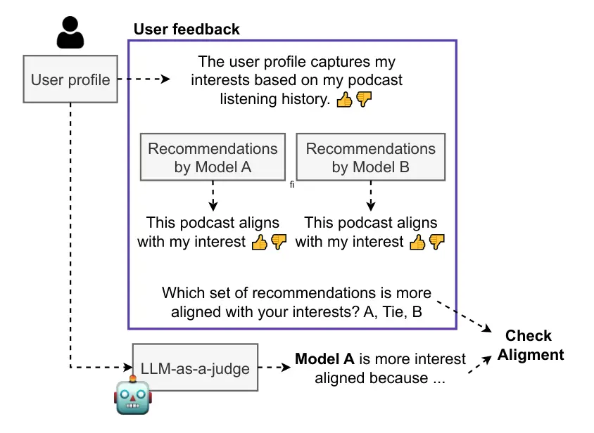
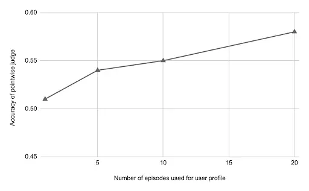

# Evaluating Podcast Recommendations with Profile-Aware LLM-as-a-Judge

Conference: Proceedings of the Nineteenth ACM Conference on Recommender
Systems; September 22–26, 2025; Prague, Czech RepublicProceedings of the
Nineteenth ACM Conference on Recommender Systems (RecSys ’25), September
22–26, 2025, Prague, Czech
RepublicDOI: [10.1145/3705328.3759305](https://doi.org/10.1145/3705328.3759305)ISBN: 979-8-4007-1364-4/2025/09CCS: Information
systems Language modelsCCS: Information systems Personalization

Francesco Fabbri ^(†)^(†)thanks: Corresponding author:
francescof@spotify.com Affiliation: Spotify, Spain , Gustavo Penha
Affiliation: Spotify, Netherlands , Edoardo D’Amico
Affiliation: Spotify, Spain , Alice Wang Affiliation: Spotify, United
States , Marco De Nadai Affiliation: Spotify, Denmark , Jackie Doremus
Affiliation: Spotify, United States , Paul Gigioli Affiliation: Spotify,
United States , Andreas Damianou Affiliation: Spotify, United Kingdom ,
Oskar Stål Affiliation: Spotify, Sweden and Mounia Lalmas
Affiliation: Spotify, United Kingdom

© rightsretained

###### Abstract.

Evaluating personalized recommendations remains a central challenge,
especially in long-form audio domains like podcasts, where traditional
offline metrics suffer from exposure bias and online methods such as A/B
testing are costly and operationally constrained. In this paper, we
propose a novel framework that leverages Large Language Models (LLMs) as
offline judges to assess the quality of podcast recommendations in a
scalable and interpretable manner. Our two-stage profile-aware approach
first constructs natural-language user profiles distilled from 90 days
of listening history. These profiles summarize both topical interests
and behavioral patterns, serving as compact, interpretable
representations of user preferences. Rather than prompting the LLM with
raw data, we use these profiles to provide high-level, semantically rich
context—enabling the LLM to reason more effectively about alignment
between a user’s interests and recommended episodes. This reduces input
complexity and improves interpretability. The LLM is then prompted to
deliver fine-grained pointwise and pairwise judgments based on the
profile-episode match. In a controlled study with 47 participants, our
profile-aware judge matched human judgments with high fidelity and
outperformed or matched a variant using raw listening histories. The
framework enables efficient, profile-aware evaluation for iterative
testing and model selection in recommender systems.

## 1. Introduction

Evaluating personalized recommender systems remains a fundamental
challenge, largely due to the limitations of offline evaluations methods
and metrics (Thomas et al., 2024). Standard metrics like hit rate and
recall are based on historical interaction data, which introduces
exposure bias: models are evaluated only on items users have previously
seen, not the full space of potential recommendations. This makes it
difficult to accurately assess a model’s true effectiveness.

These shortcomings are especially pronounced in cold-start scenarios,
such as the introduction of new features (e.g., a new podcast shelf),
where no historical interaction data exists. In such cases, offline
metrics fail, and practitioners must rely on qualitative assessments to
estimate alignment with the intended user experience before launch. At
the other extreme, A/B testing and user studies, while grounded in real
behavior, are costly, slow, and operationally constrained, limiting the
number of models that can be practically tested. As a result,
practitioners face a dilemma: fast but limited offline evaluation, or
rigorous but slow experimentation. This reveals a critical gap: _the
lack of a scalable, reliable middle ground for pre-deployment model
selection_.

Traditional evaluation methods, whether quantitative or qualitative,
also fall short in capturing true user satisfaction or explaining why a
recommendation is relevant. Crucially, they fail to determine whether a
recommendation meaningfully reflects a user’s underlying preferences.
This challenge is especially acute in the podcast domain, where the cost
of a poor recommendation is high (Jones et al., 2021); unlike short-form
content, podcasts require considerable attention. Implicit feedback,
such as stopping after ten minutes, can signal strong disinterest, mild
curiosity, or simple distraction, making interpretation highly
ambiguous.

Unlike search, where evaluation checks whether retrieved results satisfy
an explicit user query, recommendation must infer intent entirely from
behavioral traces. In search, the query serves as a content hypothesis,
a direct expression of the user’s information need. In verticals like
“music from the 80s,” the scope is often predefined by the domain or
interface. But in personalized recommendation, especially for long-form
content, no such explicit formulation of user intent exists. This
challenge is particularly acute in podcast recommendation, where user
preferences span multiple dimensions—including topic, tone, format, and
host style—and are difficult to infer from sparse interaction data. The
core evaluation task, therefore, becomes one of constructing a content
hypothesis: an interpretable approximation of what the user prefers,
inferred from past listening behavior.

We propose that this missing hypothesis can be explicitly constructed in
the form of a natural-language user profile: a structured summary of
topical interests, stylistic preferences, and behavioral patterns
distilled from listening history. These profiles provide high-level,
interpretable context that allows Large Language Models (LLMs) to reason
more effectively about whether a recommendation aligns with inferred
user intent.

LLMs offer a promising path forward for scalable, human-aligned
evaluation (Gu et al., 2025). Models like GPT-4 (Vaswani et al., 2017;
Brown et al., 2020) show high agreement with human judgments across
diverse tasks (Xu et al., 2025), and the “LLM-as-a-Judge” paradigm is
emerging as a general evaluation strategy (Ye et al., 2025). LLMs can
assess relevance in relation to user preferences (Wang et al., 2024b;
Wang et al., 2024a). However, prior work often feeds raw interaction
data to the LLM or assumes structured ground-truth signals, limiting
interpretability.

Recent work on personalized judges (Dong et al., 2024) highlights the
limitations of generic LLM-based evaluation when user context is
under-specified. This underscores the need for profile-aware prompting
strategies that encode nuanced, personalized context. We argue that
structured, profile-based representations enable more faithful alignment
evaluation, and unlock the full potential of LLMs as offline judges for
personalized systems, especially for pre-deployment settings, where
traditional online experimentation is too costly, slow, or operationally
infeasible.

### Our Approach

To address this challenge, we introduce a profile-aware LLM-as-a-Judge
framework (_Judge_ throughout the paper) for evaluating personalized
podcast episode recommendations. Central to our framework is a
natural-language profile automatically distilled from each user’s
listening history, which serves as an explicit content hypothesis
representing the user’s inferred preferences. The LLM is prompted with
this profile and candidate episode metadata to reason about alignment
along multiple dimensions, such as topic, tone, and format. The
framework supports two complementary evaluation modes:

1.  (1)
    Pointwise evaluation: the _Judge_ assesses whether an individual
    episode aligns with the user’s inferred preferences.
2.  (2)
    Pairwise evaluation: in a setup analogous to A/B testing, the
    _Judge_ compares two ranked episode lists, each from a different
    model, and select the one better aligned with the profile.

Together, these evaluation modes offer a scalable, interpretable
mechanism for judging recommendation quality, bridging the gap between
coarse offline metrics and more subjective, human-aligned assessments of
user satisfaction.

## 2. Related Work

Recent work has formalized the use of LLMs as evaluators of system
outputs, a methodology widely referred to as LLM-as-a-Judge. Originally
developed for dialogue evaluation and instruction following (Zheng
et al., 2023; Fu et al., 2024), this paradigm has since expanded across
domains, leading to structured evaluation toolkits and taxonomies (Gu
et al., 2025; Xu et al., 2025; Huang et al., 2024; Lin et al., 2025).

For instance, Zheng et al. (2023) proposed large-scale preference
datasets that surface biases related to response position and verbosity.
Fu et al. (2024) demonstrated that instruction-tuned LLMs can act as
flexible, robust scorers of generation quality. More recently, Gu et al.
(2025) surveyed key tasks, prompting strategies, and open challenges,
while Xu et al. (2025) emphasized the importance of supplying relevant
user context for reliable judgment.

Concerns about bias and misalignment have also been raised. Ye et al.
(2025) cataloged systematic biases in LLM judgments, and Sahoo et al.
(2025) propose post-hoc regression calibration techniques. Thakur et al.
(2025) highlighted gaps in alignment and prompt sensitivity across judge
models. While our work focuses on profile-based alignment, we do not
explicitly address these issues. Investigating bias mitigation and
prompt robustness is an important direction for future work.

In information retrieval, Thomas et al. (2024) showed that GPT-4 can
predict document relevance with near-human accuracy. However, applying
LLMs to recommendation introduces additional challenges: user
preferences must be inferred from behavior over time, and
recommendations lack an explicit query to ground evaluation. Our
framework addresses this by constructing natural-language profiles that
act as explicit content hypotheses: structured representations of
inferred user intent, enabling LLMs to evaluate alignment in
personalized, dynamic settings.

Related work by Dong et al. (2024) found that persona-conditioned
prompting improves evaluation in dialogue tasks. Our approach differs in
two ways: $`(i)`$ we apply LLM-based judgment to ranking in personalized
recommendation rather than conversation quality, and $`(ii)`$ our user
profiles are automatically distilled from behavioral traces, not
manually crafted.

Finally, Jones et al. (2021) highlighted a lack of scalable offline
evaluation methods for podcast recommendations. Our work directly
addresses this gap by introducing a profile-aware LLM-as-a-Judge
framework, along with open tools to support evaluation in long-form,
preference-driven media domains.

## 3. LLM-as-a-Judge for Offline Testing

Evaluating podcast recommendations poses unique challenges due to the
nuanced, multi-dimensional nature of user satisfaction. Traditional
methods typically rely on observable behavior, but in long-form audio
contexts, such signals are difficult to interpret. Implicit feedback is
sparse and often ambiguous, and standard metrics fail to capture the
richness of listener preferences. Irregular consumption patterns and the
high time cost of engagement further limit the reliability of behavioral
signals, creating significant evaluation gaps. Although prior work has
called for richer evaluation frameworks, few offer scalable solutions
for detecting recommendation misalignment (Jones et al., 2021).

To address this, we introduce a _profile-aware_ evaluation framework
that leverages LLMs as interpretable, domain-adaptive offline judges.
Rather than relying on item-level engagement signals (e.g., clicks or
listens), our approach uses structured natural-language profiles
distilled from listening history to assess how well a recommended
episode aligns with a user’s topical interests and behavioral patterns.
This bridges the gap between nuanced relevance criteria and the
scalability needs of offline evaluation, offering a practical
alternative to coarse numerical proxies.

Figure 1. LLM-as-a-Judge evaluation pipeline. The system takes as input
a user profile synthesized from listening history and two sets of
recommended episodes, and outputs rationales and binary judgments for
episode-level fit and model-level comparison.

The framework operates in two key stages: user profiling and episode
assessment. In the first stage, we generate a structured profile for
each user based on their most recent three months of listening activity.
This profile is derived from podcast metadata (including titles,
descriptions, transcripts, and topical tags) associated with episodes
and shows the user has engaged with most. The profile captures two main
dimensions:

- •
  Content preferences: topical and named-entity focus, cross-domain
  curiosity, and tendencies toward exploration or specialization
- •
  Listening patterns: habits, engagement depth, and format preferences.

These six attributes form a comprehensive user representation, which is
then used for evaluating alignment with candidate episodes (Fig. 2).

Figure 2. Profile generation prompt. The LLM receives structured
listening metadata and is prompted to produce a natural-language user
profile with interpretable dimensions (e.g., listening habits, format
preference). This profile is later used as input for evaluating
recommendation relevance.

In the second stage the _Judge_, an off-the-shelf LLM queried in
zero-shot mode (i.e., no fine-tuning or calibration), is prompted with
both the user profile and the metadata of a recommended episode. Using a
Chain-of-Thought reasoning style, the _Judge_ produces a rationale and a
binary judgment indicating whether the episode is a good fit; this
constitutes the pointwise evaluation (Wei et al., 2022). While we also
tested a multiclass version (including neutral feedback), it yielded no
substantial improvement and is omitted for brevity.

For model-level evaluation, the _Judge_ performs pairwise comparisons
between two ranked lists of episodes, each generated by a different
recommendation model, and selects the list that better matches the user
profile. This setup is designed to compare models with different
architectures but similar optimization goals. For each comparison, the
_Judge_ provides: (1) dimension-wise qualitative rationale outlining the
strengths and weaknesses of each list; and (2) a final verdict, either
preferring one model or indicating a tie when neither shows clear
superiority. To mitigate position bias, the identity tags of Model A and
Model B are randomly shuffled before each evaluation, ensuring an
unbiased and reliable comparison.

## 4. Experiments

### Setup

To evaluate the validity of our framework, referred to throughout this
section as LaaJ (_LLM-as-a-Judge_), we conduct a controlled experiment
with real users to assess whether it can serve as a reliable offline
judge on recommendation quality. The experiment involved two anonymized
models (Model A and Model B), 47 participants, and a two-stage
evaluation comparing LLM-generated judgments with human feedback per
user. Each participant first receives a personalized profile,
automatically generated from their podcast listening history.

Then, two sets of episode recommendations are generated, one for each
model, and displayed side-by-side. Each set includes 3 episodes per
model, with each episode shown alongside its show name, description,
cover image, and a playable audio segment. Through the survey interface,
users can provided structured feedback on: (1) the accuracy of their
profile; (2) how well each episode aligns with their interests; (3)
which model better matches their preferences overall.

Participants rated each item using a 5-point Likert scale: _Strongly
Disagree, Disagree, Neutral, Agree, and Strongly Agree_. To ensure
unbiased feedback, all participants were blinded to the identity of the
models. The LLM Judge was prompted using static templates, with no
fine-tuning or post-hoc calibration applied (Zhang et al., 2025).

The compared models differ in architecture: (1) Model A, which was
primarily content-based, with less sensitivity to consumption patterns,
and (2) Model B, which relied heavily on collaborative filtering
signals, with limited content-based integration. For all experiments we
used *GPT-4.1* (Achiam et al., 2023) for both the user profile generator
and the judging model. We chose it for its reported strong alignment
with human preferences, consistent performance across evaluation tasks,
and better correlation with human judgments than other LLMs (Zheng
et al., 2023; Liu et al., 2023).

### LLM Agreement & Judgment Behavior

We present a comparison between the output of the _Judge_ and the
human-annotated data. From 47 users included in the study, we collect in
total 277 pointwise human evaluations and 47 model-level comparisons
(one per user). The dataset covers 227 unique recommended episodes, with
an average of 5.89 episode annotations per user.

In our evaluation we test three different judges, including two _LaaJ_
variants, and a non-LLM one:

- •
  LaaJ-Profile (our profile-aware judge): uses a structured,
  natural-language summary of each user’s listening history, distilled
  from their top shows and episodes. Profiles serve as an interpretable
  content hypothesis, capturing topical preferences, stylistic traits,
  and behavioral patterns, to guide the LLM’s reasoning about alignment,
  without requiring access to raw interaction data.
- •
  LaaJ-History: a variant that provides the LLM with the full set of
  shows and episodes from the user’s listening history, rather than a
  distilled profile. This approach tests whether reasoning directly over
  raw behavioral traces leads to better alignment judgments, and serves
  as a baseline for evaluating the benefits of compressing user
  preferences into a structured, interpretable profile.
- •
  sBERT-Sim: a non-LLM baseline that computes cosine similarity between
  Sentence-BERT embeddings of the user profile and episode metadata.
  Episodes are marked aligned if similarity exceeds a fixed threshold
  (0.5), and model-level alignment is determined by aggregating
  episode-level scores. This serves as a simple, interpretable proxy for
  content-level user-item relevance.

| Model        | ROC-AUC | MSA (W/T/L)      | RSM    |
| ------------ | ------- | ---------------- | ------ |
| LaaJ-Profile | 0.6442  | 0.6596 (30/1/16) | 0.6667 |
| LaaJ-History | 0.6476  | 0.6170 (28/1/18) | 0.6667 |
| sBERT-Sim    | 0.4871  | 0.5106 (21/3/23) | 0.5000 |

Table 1. Performance on both episode and model evaluations of different
judges on the human-labeled dataset. “W/T/L” counts wins, ties, and
losses against the human label.

Table 1 presents results from both episode-level and model-level
evaluations. The pointwise evaluation is conducted on 277 annotated
episodes. We report the following metrics: ROC-AUC measures the accuracy
of the judges on user-episode predictions; Model Selection Agreement
(MSA) is the fraction of cases where the judge’s model preference
matches annotators’ choices; Outcome Distribution is the number of Wins,
Ties, and Losses for the judge compared to ground-truth human
annotations; and Recall of Strong Misalignment (RSM) is the proportion
of strongly misaligned recommendations flagged by the judges also
identified by annotators as clearly misaligned with user preferences.

As shown Table 1, _LaaJ-Profile_ achieves comparable ROC-AUC to
_LaaJ-History_, despite relying solely on a natural-language profile
rather than the user history. This demonstrates that a concise,
interpretable representation of user preferences can serve as an
effective content hypothesis that captures the essence of user intent.
In model-level comparisons, the profile-based variant outperforms the
history-based, underscoring the value of summarizing multi-faceted user
interests for reliable comparative judgments between recommendation
models. Additionally, both LLM-based judges correctly identify 66% of
strongly misaligned episodes (per the RSM metric), indicating
sensitivity to recommendations that conflict with user preferences.

Continuing our analysis of _LaaJ-Profile_, we examine its confusion
matrices against human annotations (Fig. 3). In episode-level
evaluation, the matrix (left) shows alignment in 75% of the cases.
However, 17% of the episodes were judged as aligned by the LLM but not
by users (representing false positives). This discrepancy reflects a
known tendency of LLMs to produce positively skewed responses (Zhu
et al., \[n. d.\]; Gallegos et al., 2024).

|     |     |
| --- | --- |
|     |     |

Figure 3. Confusion matrices comparing the profile-aware _LaaJ-Profile_
with human annotations. Columns represent LLM decisions; rows show human
relevance labels. Left: episode-level (pointwise) comparison. Right:
model-level (pairwise) comparison.

In the model-level (pairwise) evaluation, the confusion matrix (right)
reveals strong agreement between the Judge and human annotators in
preferring Model A over Model B, with 20 true positives out of 24
comparisons. However, the LLM tends to be more decisive: it registers
only one tie, in contrast to the eight ties recorded by human
annotators. This tendency may be addressed through more adaptive
in-context learning strategies or by model fine-tuning (Wang et al.,
2025).

Qualitative feedback from human annotators revealed their judgments were
influenced by factors beyond standard evaluation metrics, such as
familiarity with the show, the identity of the host, stylistic tone, and
the diversity of the recommendations. While some users preferred
narrowly focused and familiar recommendation lists, others placed higher
value on variety and novelty. These findings highlight the complex,
multi-dimensional, and inherently subjective nature of podcast
preferences in real-world settings.

### Impact of User Profiles

Fig. 4 shows that increasing the number of shows and episodes used to
generate user profiles in _LaaJ-Profile_ improves judgment accuracy,
raising alignment with human preferences by +8% from 0.51 with 5
episodes to 0.59 with 20 episodes. This emphasizes the critical role of
context richness and profile coverage in enabling the LLM to make
accurate evaluations.

Participants were asked to review their automatically generated profiles
in _LaaJ-Profile_ and evaluate how well they reflected their listening
preferences. As shown in Fig. 4, most agreed the profiles offered a
reasonable high-level summary, but views were more divided on how
accurately the profiles captured their deeper interests. Quantitative
ratings indicated the profiles were broadly representative, yet
qualitative feedback added nuance. While many users recognized that key
aspects of their listening behavior were captured, some expressed
concerns about the depth and specificity of representation. Some users
pointed to missing personal elements such as favorite hosts, limited
coverage of stylistic tone, and a narrow topical focus—often shaped by
recent listening activity.

These observations reflect the difficulty of inferring subjective
preferences from short or sparse interaction histories, as well as the
trade-off between recency and long-term interest modeling. Several
participants noted that short-term data windows sometimes failed to
reflect enduring tastes. These insights point to opportunities for
enhancing profiles by incorporating long-term behavioral signals and
more nuanced metadata.

|                                                             |
| ----------------------------------------------------------- |
|  |

Figure 4. Left: Impact of user profile length on _LaaJ_-human alignment.
On x-axis the number of episodes used to generate the profile; on y-axis
the _LaaJ_-human accuracy. Right: Human agreement on profile quality and
interest alignment. Bar chart includes two frequency distributions:
$`(i)`$ alignment with user preferences (blue);$`(ii)`$ alignment with
users’ interests (red).

## 5. Conclusions & Future Work

This paper presents a scalable framework for using LLMs as offline
judges to evaluate personalized podcast recommendations through the lens
of user preference alignment. At the core of our approach are
structured, natural-language profiles that act as explicit content
hypotheses: interpretable summaries of likely user preferences distilled
from listening history. Prompting LLMs with these profiles, rather than
raw behavioral data, enables more accurate and interpretable alignment
judgments at both episode and model levels. Our experiments show that
this profile-aware evaluation matches or exceeds the performance of
history-based alternatives.

Looking ahead, we aim to improve profile fidelity by incorporating
long-term behavior and explicit feedback (Su et al., 2025), and to
explore adaptive prompting (e.g., few-shot or in-context learning) to
enhance robustness and reduce decisiveness bias. We also plan to extend
the approach across domains and user groups to assess its
generalizability and impact at scale.

## References

- Achiam et al. (2023) Josh Achiam, Steven Adler, Sandhini Agarwal, Lama
  Ahmad, Ilge Akkaya, Florencia Leoni Aleman, Diogo Almeida, Janko
  Altenschmidt, Sam Altman, Shyamal Anadkat, et al. 2023. Gpt-4
  technical report. _arXiv preprint arXiv:2303.08774_ (2023).
- Brown et al. (2020) Tom Brown, Benjamin Mann, Nick Ryder, Melanie
  Subbiah, Jared D Kaplan, Prafulla Dhariwal, Arvind Neelakantan, Pranav
  Shyam, Girish Sastry, Amanda Askell, et al. 2020. Language models are
  few-shot learners. _Advances in neural information processing systems_
  33 (2020), 1877–1901.
- Dong et al. (2024) Yijiang River Dong, Tiancheng Hu, and Nigel
  Collier. 2024. Can LLM be a Personalized Judge?. In _Findings of the
  Association for Computational Linguistics: EMNLP 2024_. Association
  for Computational Linguistics, Miami, Florida, USA, 10126–10141.
  [doi:10.18653/v1/2024.findings-emnlp.592](https://doi.org/10.18653/v1/2024.findings-emnlp.592)
- Fu et al. (2024) Jinlan Fu, See-Kiong Ng, Zhengbao Jiang, and Pengfei
  Liu. 2024. GPTScore: Evaluate as You Desire. In _Proceedings of the
  2024 Conference of the North American Chapter of the Association for
  Computational Linguistics: HLT (Long Papers)_. Association for
  Computational Linguistics, Mexico City, Mexico, 6556–6576.
  [doi:10.18653/v1/2024.naacl-long.365](https://doi.org/10.18653/v1/2024.naacl-long.365)
- Gallegos et al. (2024) Isabel O Gallegos, Ryan A Rossi, Joe Barrow,
  Md Mehrab Tanjim, Sungchul Kim, Franck Dernoncourt, Tong Yu, Ruiyi
  Zhang, and Nesreen K Ahmed. 2024. Bias and fairness in large language
  models: A survey. _Computational Linguistics_ 50, 3 (2024), 1097–1179.
- Gu et al. (2025) Jiawei Gu, Xuhui Jiang, Zhichao Shi, Hexiang Tan,
  Xuehao Zhai, Chengjin Xu, Wei Li, Yinghan Shen, Shengjie Ma, Honghao
  Liu, Saizhuo Wang, Kun Zhang, Yuanzhuo Wang, Wen Gao, Lionel Ni, and
  Jian Guo. 2025. A Survey on LLM-as-a-Judge. _arXiv preprint
  arXiv:2411.15594_ (2025).
  [https://arxiv.org/abs/2411.15594](https://arxiv.org/abs/2411.15594)
- Huang et al. (2024) Chengkai Huang, Tong Yu, Kaige Xie, Shuai Zhang,
  Lina Yao, and Julian McAuley. 2024. Foundation models for recommender
  systems: A survey and new perspectives. _arXiv preprint
  arXiv:2402.11143_ (2024).
- Jones et al. (2021) Rosie Jones, Hamed Zamani, Markus Schedl,
  Ching-Wei Chen, Sravana Reddy, Ann Clifton, Jussi Karlgren, Helia
  Hashemi, Aasish Pappu, Zahra Nazari, Longqi Yang, Oguz Semerci, Hugues
  Bouchard, and Ben Carterette. 2021. Current Challenges and Future
  Directions in Podcast Information Access. In _Proceedings of the 44th
  International ACM SIGIR Conference on Research and Development in
  Information Retrieval_. ACM, Virtual Event, Canada, 1554–1565.
  [https://dblp.org/rec/conf/sigir/JonesZSC+21](https://dblp.org/rec/conf/sigir/JonesZSC+21)
- Lin et al. (2025) Jianghao Lin, Xinyi Dai, Yunjia Xi, Weiwen Liu, Bo
  Chen, Hao Zhang, Yong Liu, Chuhan Wu, Xiangyang Li, Chenxu Zhu,
  et al. 2025. How can recommender systems benefit from large language
  models: A survey. _ACM Transactions on Information Systems_ 43, 2
  (2025), 1–47.
- Liu et al. (2023) Yang Liu, Dan Iter, Yichong Xu, Shuohang Wang,
  Ruochen Xu, and Chenguang Zhu. 2023. G-Eval: NLG Evaluation using
  Gpt-4 with Better Human Alignment. In _Proceedings of the 2023
  Conference on Empirical Methods in Natural Language Processing_, Houda
  Bouamor, Juan Pino, and Kalika Bali (Eds.). Association for
  Computational Linguistics, Singapore, 2511–2522.
  [doi:10.18653/v1/2023.emnlp-main.153](https://doi.org/10.18653/v1/2023.emnlp-main.153)
- Sahoo et al. (2025) Aishwarya Sahoo, Jeevana Kruthi Karnuthala,
  Tushar Parmanand Budhwani, Pranchal Agarwal, Sankaran Vaidyanathan,
  Alexa Siu, Franck Dernoncourt, Jennifer Healey, Nedim Lipka, Ryan
  Rossi, Uttaran Bhattacharya, and Branislav Kveton. 2025. Quantitative
  LLM Judges. In _Proceedings of the 42nd International Conference on
  Machine Learning (ICML 2025)_.
  [https://arxiv.org/abs/2506.02945](https://arxiv.org/abs/2506.02945)
  Spotlight, to appear.
- Su et al. (2025) Kun Su, Krishna Sayana, Hubert Pham, James Pine, Yuri
  Vasilevski, Raghavendra Vasudeva, Marialena Kyriakidi, Liam Hebert,
  Ambarish Jash, Anushya Subbiah, et al. 2025. REGEN: A Dataset and
  Benchmarks with Natural Language Critiques and Narratives. _arXiv
  preprint arXiv:2503.11924_ (2025).
- Thakur et al. (2025) Aman Singh Thakur, Kartik Choudhary,
  Venkat Srinik Ramayapally, Sankaran Vaidyanathan, and Dieuwke
  Hupkes. 2025. Judging the Judges: Evaluating Alignment and
  Vulnerabilities in LLMs-as-Judges. _arXiv preprint arXiv:2406.12624_
  (2025).
  [https://arxiv.org/abs/2406.12624](https://arxiv.org/abs/2406.12624)
- Thomas et al. (2024) Paul Thomas, Seth Spielman, Nick Craswell, and
  Bhaskar Mitra. 2024. Large Language Models Can Accurately Predict
  Searcher Preferences. In _Proceedings of the 47th International ACM
  SIGIR Conference on Research and Development in Information
  Retrieval_. ACM, Washington DC, USA, 1930–1940.
  [doi:10.1145/3626772.3657707](https://doi.org/10.1145/3626772.3657707)
- Vaswani et al. (2017) Ashish Vaswani, Noam Shazeer, Niki Parmar, Jakob
  Uszkoreit, Llion Jones, Aidan N Gomez, Łukasz Kaiser, and Illia
  Polosukhin. 2017. Attention is all you need. _Advances in neural
  information processing systems_ 30 (2017).
- Wang et al. (2025) Jianling Wang, Yifan Liu, Yinghao Sun, Xuejian Ma,
  Yueqi Wang, He Ma, Zhengyang Su, Minmin Chen, Mingyan Gao, Onkar
  Dalal, et al. 2025. User Feedback Alignment for LLM-powered
  Exploration in Large-scale Recommendation Systems. _arXiv preprint
  arXiv:2504.05522_ (2025).
- Wang et al. (2024a) Jianling Wang, Haokai Lu, James Caverlee, Ed H
  Chi, and Minmin Chen. 2024a. Large language models as data augmenters
  for cold-start item recommendation. In _Companion Proceedings of the
  ACM Web Conference 2024_. 726–729.
- Wang et al. (2024b) Jianling Wang, Haokai Lu, Yifan Liu, He Ma, Yueqi
  Wang, Yang Gu, Shuzhou Zhang, Ningren Han, Shuchao Bi, Lexi Baugher,
  et al. 2024b. Llms for user interest exploration in large-scale
  recommendation systems. In _Proceedings of the 18th ACM Conference on
  Recommender Systems_. 872–877.
- Wei et al. (2022) Jason Wei, Xuezhi Wang, Dale Schuurmans, Maarten
  Bosma, Fei Xia, Ed Chi, Quoc V Le, Denny Zhou, et al. 2022.
  Chain-of-thought prompting elicits reasoning in large language models.
  _Advances in neural information processing systems_ 35 (2022),
  24824–24837.
- Xu et al. (2025) Austin Xu, Srijan Bansal, Yifei Ming, Semih Yavuz,
  and Shafiq Joty. 2025. Does Context Matter? ContextualJudgeBench for
  Evaluating LLM-based Judges in Contextual Settings. In _Proceedings of
  the 63rd Annual Meeting of the Association for Computational
  Linguistics (ACL 2025)_.
  [https://arxiv.org/abs/2503.15620](https://arxiv.org/abs/2503.15620)
  To appear.
- Ye et al. (2025) Jiayi Ye, Yanbo Wang, Yue Huang, Dongping Chen, Qihui
  Zhang, Nuno Moniz, Tian Gao, Werner Geyer, Chao Huang, Pin-Yu Chen,
  Nitesh V. Chawla, and Xiangliang Zhang. 2025. Justice or Prejudice?
  Quantifying Biases in LLM-as-a-Judge. In _Proceedings of the
  International Conference on Learning Representations (ICLR 2025)_.
  [https://openreview.net/forum?id=3GTtZFiajM](https://openreview.net/forum?id=3GTtZFiajM)
  Poster.
- Zhang et al. (2025) Weizhi Zhang, Yuanchen Bei, Liangwei Yang,
  Henry Peng Zou, Peilin Zhou, Aiwei Liu, Yinghui Li, Hao Chen, Jianling
  Wang, Yu Wang, et al. 2025. Cold-Start Recommendation towards the Era
  of Large Language Models (LLMs): A Comprehensive Survey and Roadmap.
  _arXiv preprint arXiv:2501.01945_ (2025).
- Zheng et al. (2023) Lianmin Zheng, Wei-Lin Chiang, Ying Sheng, Siyuan
  Zhuang, Zhanghao Wu, Yonghao Zhuang, Zi Lin, Zhuohan Li, Dacheng Li,
  Eric P. Xing, Hao Zhang, Joseph E. Gonzalez, and Ion Stoica. 2023.
  Judging LLM-as-a-Judge with MT-Bench and Chatbot Arena. In _Advances
  in Neural Information Processing Systems 36 (NeurIPS 2023), Datasets
  and Benchmarks Track_.
  [https://proceedings.neurips.cc/paper/91f18a1287b398d378ef22505bf41832](https://proceedings.neurips.cc/paper/91f18a1287b398d378ef22505bf41832)
- Zhu et al. (\[n. d.\]) Lianghui Zhu, Xinggang Wang, and Xinlong Wang.
  \[n. d.\]. JudgeLM: Fine-tuned Large Language Models are Scalable
  Judges. In _The Thirteenth International Conference on Learning
  Representations_.
