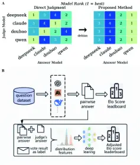
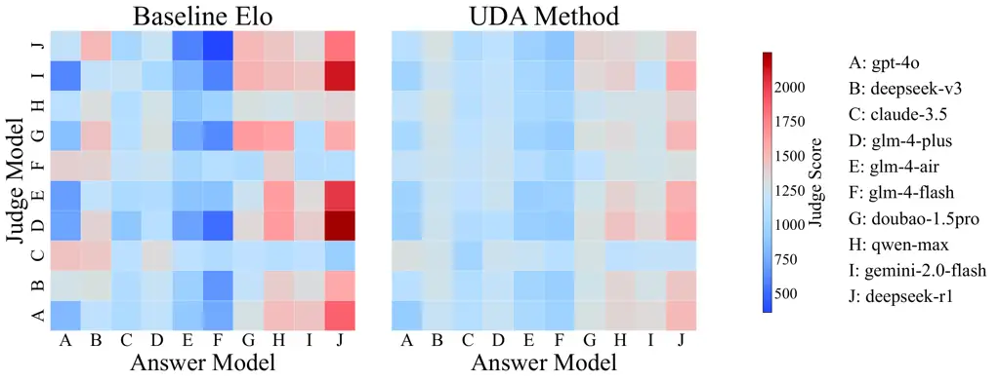

# UDA: Unsupervised Debiasing Alignment for Pair-wise LLM-as-a-Judge

Yang Zhang ^(†)^(†)thanks: Work was done when interned at Z.ai.   
Cunxiang Wang ^(†)^(†)thanks: Corresponding author.    Lindong Wu   
Wenbo Yu    Yidong Wang    Guangsheng Bao    Jie Tang³³footnotemark: 3

###### Abstract

Pairwise evaluation of Large Language Models (LLMs) is a common
paradigm, but it is prone to preference bias, where judges
systematically favor certain outputs, such as their own. This bias leads
to inconsistent and skewed rankings across different judges. To address
this, we first empirically demonstrate significant and heterogeneous
biases in cross-model evaluations. We then propose UDA (Unsupervised
Debiasing Alignment), a framework that reduces inter-judge disagreement
by dynamically adjusting the Elo rating system. For each pairwise
comparison, a compact neural network learns to adaptively set the
K-factor and refine win probabilities. Crucially, UDA operates in a
fully unsupervised manner, guided solely by the objective of minimizing
the dispersion among the Elo trajectories of all judges. This forces an
alignment towards a collective consensus, which serves as an
unsupervised proxy for a more stable and reproducible evaluation. In
addition, we provide theoretical motivation demonstrating how alignment
towards a consensus can reduce aggregate system bias. Experiments show
that UDA significantly reduces the inter-judge rating standard deviation
by up to 63.4% and improves the average correlation with human judgments
by 24.7%. Notably, UDA elevates the performance of poorly performing
judges to achieve parity with high-quality ones, fostering a more robust
and reliable evaluation ecosystem. Code and data are available at
https://anonymous.4open.science/r/62AB93CD-23B4.

¹ZhipuAI

²Peking University

³Tsinghua University

⁴Westlake University

zhang360428@stu.pku.edu.cn, wangcunxiang303@gmail.com

## Introduction

Large Language Models (LLMs) like GPT-4 and Claude-3 now drive progress
across Natural Language Processing (NLP), while their daily use in
commerce, education, and entertainment seamlessly integrates them into
everyday life (Zhao et al. 2025; Minaee et al. 2025). Rigorous
evaluation is therefore indispensable: it guides model optimization and
equips users with an empirical basis for selection, ensuring robust
deployment in the wild (Chang et al. 2023).



Figure 1: A. Some models prefer their own answers, and mitigating this
bias from using different LLMs can make the results more accurate. B.
Dynamically recalibrate, rather than naively adopts, LLM-judged scores,
using consensus among judges as the supervisory label in lieu of human
annotation.

The paradigm of ‘LLM-as-a-judge’ (Zheng et al. 2023) delegates the
evaluation to a second large model that acts as an autonomous judge: the
judge is prompted to score, rank or critique the outputs of the target
model without human labels. Yet this very mechanism introduces
systematic bias (Wang et al. 2023; Thakur et al. 2025). In this
paradigm, pairwise judgments consistently outperform pointwise scoring
in robustness and are widely adopted, for example, Zheng et al. first
established this in the LMSys Chatbot Arena (Chiang et al. 2024): GPT-4
achieved markedly higher agreement with human preferences when ranking
anonymized responses head-to-head than when assigning absolute scores.
Subsequent works (Wang et al. 2025) corroborate that pairwise ranking
reduces intra-model variance; on RewardBench, GPT-4o attains 90.5%
accuracy in pairwise mode versus 88.0% in pointwise mode, while smaller
models trend in the opposite direction. Different LLM are built and
trained in unique ways, causing them to have specific biases, such as a
preference for wordy or stylistically similar answers. This results in
varied scores and rankings. Prior works show that score disparities
exceeding 30% among LLMs on identical benchmarks (Ye et al. 2024).

Most researches (Chang et al. 2023) mainly focus on the improvement of
evaluation indicators and methods, but the studies on how to reduce the
impact of model preferences during the evaluation process are not
in-depth enough. Although recent work calibrates proprietary models
on-the-fly via prompt engineering (Zhou et al. 2024), the practice
remains ad-hoc and theoretically thin. Ensemble schemes (Wataoka et al. 2025) mitigate bias but explode in cost, and Nash-based re-ranking (Liu
et al. 2025a) scales poorly. In addition, there is relatively little
research on how to use deep learning techniques to dynamically adjust
the evaluation process, rather than just directly using the evaluation
results provided by large models, in order to reduce the bias from
different judge models.

To address these limitations, we propose UDA (Unsupervised Debiasing
Alignment), a fully automated, annotation-free framework that reconciles
heterogeneous LLM judges. UDA retains the anonymity and simplicity of
pairwise Elo tournaments but injects a learned, instance-level
correction mechanism. Concretely, for each comparison, we (i) calculate
the distributional similarity between the two answers, (ii) quantify the
judge’s preference by contrasting its own generated response with the
two candidates, and (iii) feed these continuous signals into a
lightweight neural adapter that outputs an adaptive K-factor and refined
win probability expectations. The adapter is trained to pull each
judge’s scoring trajectory towards the collective consensus of all
judges. This consensus, while not a perfect ground truth, serves as a
pragmatic, unsupervised signal to mitigate extreme idiosyncratic biases.
Because these adjustments are conditioned solely on the response
distributions, UDA is model-agnostic and requires no additional
fine-tuning.

Bias usually shifts across topics: a judge fair on one task may favor
itself on another. To verify generalisation beyond public benchmarks, we
evaluate UDA zero-shot on a newly curated Human-Annotated Transfer Set
that contains 100 open-ended prompts distinct from the training corpus.
Without any retraining, UDA still shrinks the inter-judge standard
deviation by 63.4% and boosts correlation with human preferences by
24.7%, demonstrating robust transfer to unseen domains and judges.

We first quantify the tendency of each judge to over- or under-rate its
own response. On our curated dataset, baseline Elo produces self-scores
that deviate from the average score assigned by the remaining judges by
as much as $`-`$21% (underrating) to +56% (overrating). After applying
UDA, the same deviations narrow to only $`-`$15% to +4%, indicating that
extreme self-preference is largely suppressed. Under mild assumptions,
UDA minimises the _aggregate_ bias across all judges (Theorem 1).
However, because the procedure pulls every judge toward the consensus,
exceptionally well-calibrated judges may experience a slight drop in
individual accuracy; the collective variance reduction dominates this
per-model cost. Despite the small per-model trade-off, UDA improves the
average Pearson correlation with human rankings from 0.65 to 0.81
(+25%), confirming that shrinking inter-judge disagreement also aligns
the final scores more closely with human preferences.

To the best of our knowledge, we are the first to reduce pairwise
LLM-as-a-judge preference bias in an unsupervised manner.

## Related Work

### LLM-as-a-Judge

The LLM-as-a-judge approach has been widely adopted for evaluating LLMs
due to its low cost and high efficiency (Gu et al. 2025). This method
leverages one LLM to assess the outputs of another, providing
fine-grained evaluations. For instance, OpenAI’s GPT and Anthropic’s
Claude are commonly utilized as judge models to evaluate the performance
of other LLMs. However, this approach may introduce significant bias.
Different judge models can produce varying results and rankings, as
their specific traits, differences in training data, and subjective
evaluation criteria can influence the evaluation results.

### Elo Rating System

The Elo rating system (Hunter 2004), traditionally used in chess, has
been adapted for evaluating large language models (LLMs). Chatbot Arena
(Chiang et al. 2024) introduced an Elo system that assesses chatbots
through pairwise comparisons based on user votes. This method offers a
dynamic and interactive approach to evaluation, providing a degree of
objectivity and comparability. However, it may be influenced by user
preferences and the diversity of evaluation questions. Yet, this system
still relies on user feedback and faces challenges in scalability and
scenario diversity. Gray et al. (2022) combined the ELO system with
traditional metric-based evaluations, integrating model rankings with
specific metric analyses for a more comprehensive assessment. Despite
these advancements, existing ELO evaluation systems in LLMs still
struggle with balancing the weight of different evaluation dimensions
and criteria.

### Bias in LLM-as-a-Judge

Preference bias in LLMs is a critical evaluation issue (Wataoka et al.
2025). It causes LLMs to overrate certain outputs, especially their own
output. Studies (Zheng et al. 2023; Xu et al. 2024) reveal that some
LLMs favor their own generations. This bias may step from the model’s
training data and architecture. Larger and more capable models often
show stronger self-preference. The model’s internal probabilities may
favor familiar generation styles, and alignment training artifacts could
also contribute. Panickssery et al. explored the link between
self-preference bias and self-recognition ability. As shown in Figure 2,
it reveals heterogeneous LLM preferences.

Figure 2: Pairwise answer evaluation experiments were conducted using
different large models as judges on the same Arena Hard dataset. The
figure shows that LLMs exhibit self-preferential bias: some over-rate
their own answers relative to other judges, others under-rate them. On
ArenaHard (the depicted dataset) this bias ranges from $`-`$38% to +90%,
while on our dataset it spans $`-`$21% to +56%.

Other biases also exist. Some models show position bias, preferring the
first or last option in pairwise comparisons. Model performance is
influenced by whether real names or anonymous aliases are used (Koo et
al. 2024). Large models tend to favor their own responses under
anonymity, but this self-preference decreases when real names are shown,
while smaller models’ self-preference increases.

### Mitigating LLM Judgers’ Bias

Zhou et al. (2024) tackled the bias issue in the “LLM-as-a-judge”
approach by quantifying the bias in large models’ predictive
distributions and then subtracting it to reduce the bias. However, this
method has limitations when evaluating close-source llm. Due to the
inaccessibility of predictive logic, it is difficult to calculate the
distributional differences between pre-trained and SFT models.
Consequently, it resorts to prompt engineering to model surface quality
and mitigate bias. Liu et al. (2025a) adopted a game-theoretic
perspective, framing evaluation as a three-player game and proposing a
Nash equilibrium solution. Yet, the equilibrium ratings lack scalability
and cannot be directly applied to many real-world large models. Liu et
al. (2025b) tried to optimize ELo rating systems in arena settings, they
proposed the am-ELO framework, which uses maximum likelihood estimation
(MLE) to adjust the Elo probability function by incorporating annotator
abilities, enhancing stability and accuracy from an annotation accuracy
perspective.

However, these methods either rely on inaccessible model internals,
resort to prompt engineering, or heuristics-based reranking that scales
poorly. Moreover, these methods overlook the unequal impact of
individual comparisons in scoring systems: a weaker model’s loss to a
near-equal rival is weighted identically to its loss to a markedly
stronger one, an evident flaw that undermines power when sample sizes
are small. They also ignore judge-induced distributional biases—e.g.,
inflated scores arising simply from a preference for responses
resembling their own. In contrast, our approach dynamically reweights
each pairwise outcome and incorporates distributional features to
correct for biases, using the principle of consensus alignment as a
supervisory signal in the absence of human labels.

## Method

UDA (Unsupervised Debiasing Alignment) is an annotation-free method that
reconciles a set of $`M`$ heterogeneous LLM judges, $`\mathcal{J}`$, by
dynamically adjusting the Elo update rule for a set of $`N`$ candidate
models, $`\mathcal{M}`$. Given a prompt $`x`$, a judge
$`k\in\mathcal{J}`$ expresses its raw binary preference
$`r_{ij}^{(k)}\in\{0,1\}`$ for paired responses $`(a_{i},a_{j})`$ from
models $`i,j\in\mathcal{M}`$, which in turn determines the Elo score
$`R_{i}^{(k)}\in\mathbb{R}`$ for each model under that judge. The key
idea is to treat the collective consensus ranking of all judges as a
pragmatic, unsupervised target without human labels.

### Baseline Elo Updating Rule

Baseline Elo updates judge $`k`$’s score via

```math
R_{i}^{(k)}\leftarrow R_{i}^{(k)}+K\bigl(r_{ij}^{(k)}-\hat{p}_{ij}^{(k)}\bigr),\;\hat{p}_{ij}^{(k)}=\sigma\!\bigl(R_{i}^{(k)}-R_{j}^{(k)}\bigr), \tag{1}
```

where $`\sigma(z)=1/(1+e^{-z})`$ and $`K`$ is a global constant.

### Adaptive Debiasing Network

For every pair of answers $`(a_{i},a_{j})`$ and a judge $`k`$, we
extract a feature vector $`\phi_{ij}^{(k)}`$ based on the semantic
embeddings of the answers ($`\mathbf{e}_{i},\mathbf{e}_{j}`$) and the
judge’s own generated response ($`\mathbf{e}_{k}`$). These features,
constructed without human labels, capture two key aspects: (i) the
semantic and stylistic relationship between the two answers being
compared, and (ii) the similarity of each answer to the judge’s own
output, which serves as a signal for potential self-preference bias. The
feature set includes vector operations (e.g., element-wise differences)
and scalar metrics (e.g., cosine similarity, KL-divergence). The precise
construction of the full feature vector is detailed in Algorithm 1.

A small Multilayer Perceptron (MLP)
$`f_{\theta}:\mathbb{R}^{6D+9}\rightarrow\mathbb{R}^{3}`$ then maps this
feature vector to the adaptive parameters:

```math
\bigl(K_{ij},\;s_{i},\;s_{j}\bigr)=f_{\theta}\left(\phi_{ij}^{(k)}\right), \tag{2}
```

where $`K_{ij}`$ is the _instance-level_ K-factor, and
$`s_{i},s_{j}\in(0,1)`$ are soft labels that replace the hard
$`r_{ij}^{(k)}`$ to mitigate preference noise ($`s_{i}+s_{j}=1`$ after
softmax normalization). All parameters $`\theta`$ are shared across all
judges and prompts.

### The Consensus Anchor Principle

A core challenge in unsupervised debiasing is the absence of a “golden”
reference. Our methodology is built upon a foundational principle: while
individual LLM judges are fraught with idiosyncratic biases, the
consensus derived from a diverse pool of judges can serve as a powerful
proxy for a more stable and reproducible evaluation.

This principle is motivated by our empirical findings (Figure 2). The
biases are not monolithic; they are heterogeneous. For instance, on
ArenaHard, a judge like glm-4-flash exhibits strong self-preference
(+90%), while a top-tier model like gpt-4o can paradoxically underrate
its own responses ($`-`$38%). We hypothesize that these opposing biases
tend to partially cancel each other out when aggregated.

0:  Answer embeddings
$`\mathbf{e}_{i},\mathbf{e}_{j}\in\mathbb{R}^{D}`$; Judge’s own
embedding $`\mathbf{e}_{k}\in\mathbb{R}^{D}`$

1:  Let $`\odot`$ denote the element-wise product.

2:  {Part 1: High-Dimensional Features (6 vectors)}

3:
 $`\mathbf{v}_{\text{diff},ij}\leftarrow|\mathbf{e}_{i}-\mathbf{e}_{j}|`$

4:
 $`\mathbf{v}_{\text{diff},ik}\leftarrow|\mathbf{e}_{i}-\mathbf{e}_{k}|`$
{Judge self-bias feature}

5:
 $`\mathbf{v}_{\text{diff},jk}\leftarrow|\mathbf{e}_{j}-\mathbf{e}_{k}|`$
{Judge self-bias feature}

6:
 $`n_{i}\leftarrow\|\mathbf{e}_{i}\|_{2},\;n_{j}\leftarrow\|\mathbf{e}_{j}\|_{2},\;n_{k}\leftarrow\|\mathbf{e}_{k}\|_{2}`$

7:
 $`\mathbf{v}_{\text{norm-prod},ij}\leftarrow(\mathbf{e}_{i}\odot\mathbf{e}_{j})/(n_{i}n_{j}+\epsilon)`$

8:
 $`\mathbf{v}_{\text{norm-prod},ik}\leftarrow(\mathbf{e}_{i}\odot\mathbf{e}_{k})/(n_{i}n_{k}+\epsilon)`$
{Judge self-bias feature}

9:
 $`\mathbf{v}_{\text{norm-prod},jk}\leftarrow(\mathbf{e}_{j}\odot\mathbf{e}_{k})/(n_{j}n_{k}+\epsilon)`$
{Judge self-bias feature}

10:  {Part 2: Scalar Features (9 scalars)}

11:  $`s_{ij}\leftarrow\cos(\mathbf{e}_{i},\mathbf{e}_{j})`$,  
$`s_{ik}\leftarrow\cos(\mathbf{e}_{i},\mathbf{e}_{k})`$,  
$`s_{jk}\leftarrow\cos(\mathbf{e}_{j},\mathbf{e}_{k})`$

12:
 $`\mathbf{p}_{i}\leftarrow\mathrm{softmax}(\mathbf{e}_{i}),\;\mathbf{p}_{j}\leftarrow\mathrm{softmax}(\mathbf{e}_{j}),\;\mathbf{p}_{k}\leftarrow\mathrm{softmax}(\mathbf{e}_{k})`$

13:
 $`d_{\text{KL}}^{(j,i)}\leftarrow\mathrm{KL}(\mathbf{p}_{j}\parallel\mathbf{p}_{i})`$,

 
$`d_{\text{KL}}^{(i,k)}\leftarrow\mathrm{KL}(\mathbf{p}_{i}\parallel\mathbf{p}_{k})`$,

 
$`d_{\text{KL}}^{(j,k)}\leftarrow\mathrm{KL}(\mathbf{p}_{j}\parallel\mathbf{p}_{k})`$

14:  $`\ell_{\text{diff},ij}\leftarrow|n_{i}-n_{j}|`$,  
$`\ell_{\text{diff},ik}\leftarrow|n_{i}-n_{k}|`$,  
$`\ell_{\text{diff},jk}\leftarrow|n_{j}-n_{k}|`$

15:  {Part 3: Concatenation}

16:
 $`\phi_{ij}^{(k)}\leftarrow\mathrm{concat}\bigl[\mathbf{v}_{\text{diff},ij},\mathbf{v}_{\text{diff},ik},\mathbf{v}_{\text{diff},jk},`$

17:
 $`\quad\mathbf{v}_{\text{norm-prod},ij},\mathbf{v}_{\text{norm-prod},ik},\mathbf{v}_{\text{norm-prod},jk},`$

18:
 $`\quad s_{ij},s_{ik},s_{jk},\;d_{\text{KL}}^{(j,i)},d_{\text{KL}}^{(i,k)},d_{\text{KL}}^{(j,k)},`$

19:
 $`\quad\ell_{\text{diff},ij},\ell_{\text{diff},ik},\ell_{\text{diff},jk}\bigr]`$

20:  return $`\phi_{ij}^{(k)}\in\mathbb{R}^{6D+9}`$

Algorithm 1 Feature Vector Construction ($`\phi_{ij}^{(k)}`$) for UDA

However, we acknowledge a critical limitation of this assumption: if a
majority of judges share a systemic bias (e.g., a preference for
verbosity), their consensus will reflect a “bias average” rather than a
debiased center. In such a scenario, UDA might inadvertently reinforce
this majority bias.

Therefore, UDA does not treat the consensus score, denoted as
$`\mathbf{G}`$, as an infallible ground truth. Instead, we define it as
a stabilizing proxy target. The objective of UDA is not to perfectly
replicate this consensus, but to use it as a supervisory signal to
reduce system variance. By training each judge to align with the
collective agreement, UDA effectively mitigates the extreme,
idiosyncratic preferences of any single judge. The underlying hypothesis
is that this variance reduction will enhance the overall reproducibility
and alignment with true quality, a hypothesis we validate empirically
against human judgments in our experiments.

|              |        |             |            |             |              |               |          |             |                   |             |
| ------------ | ------ | ----------- | ---------- | ----------- | ------------ | ------------- | -------- | ----------- | ----------------- | ----------- |
| Model        | gpt-4o | claude -3.5 | glm-4 -air | glm-4 -plus | glm-4 -flash | doubao-1.5pro | qwen-max | deepseek-v3 | gemini- 2.0-flash | deepseek-r1 |
| Baseline Elo | 162.0  | 154.5       | 122.6      | 99.7        | 118.2        | 170.1         | 109.0    | 149.6       | 341.9             | 157.5       |
| UDA Method   | 71.5   | 44.8        | 47.8       | 42.1        | 50.3         | 72.6          | 58.1     | 61.1        | 128.8             | 71.1        |
| Reduction%   | 55.8   | 71.0        | 61.1       | 57.8        | 57.4         | 57.3          | 46.7     | 59.2        | 62.3              | 54.9        |

|              |        |             |            |             |              |               |          |             |                   |             |
| ------------ | ------ | ----------- | ---------- | ----------- | ------------ | ------------- | -------- | ----------- | ----------------- | ----------- |
| Model        | gpt-4o | claude -3.5 | glm-4 -air | glm-4 -plus | glm-4 -flash | doubao-1.5pro | qwen-max | deepseek-v3 | gemini- 2.0-flash | deepseek-r1 |
| Baseline Elo | 310.9  | 119.3       | 91.3       | 98.6        | 161.5        | 250.1         | 182.0    | 165.6       | 131.1             | 429.1       |
| UDA Method   | 125.0  | 28.3        | 56.3       | 37.2        | 80.4         | 64.8          | 61.8     | 77.4        | 52.7              | 125.8       |
| Reduction%   | 59.8   | 76.3        | 38.3       | 62.2        | 50.2         | 74.1          | 66.0     | 53.3        | 59.8              | 70.7        |

Table 1: Inter-LLM judge score standard deviation ($`\downarrow`$) on
ArenaHard Dataset.

Table 2: Inter-LLM judge score standard deviation ($`\downarrow`$) on
Human-Annotated Transfer Set.

### Consensus-Driven Training

Let the mini-batch $`\mathcal{B}_{b}`$ contain _all_ pairwise
comparisons issued by a single judge $`k_{b}`$ in one forward pass.
After applying the adaptive update rule, we obtain a vector of per-model
Elo scores $`\mathbf{R}^{(b)}\!\in\!\mathbb{R}^{N}`$ for the batch.
Across $`B`$ such judge-homogeneous batches, we first compute the
consensus anchor using
$`\bar{\mathbf{R}}=\frac{1}{B}\sum_{b=1}^{B}\mathbf{R}^{(b)}`$ and
$`\mathbf{G}=\frac{1}{B}\sum_{b=1}^{B}\mathbf{R}^{\text{base}}_{(b)}`$.

where $`\mathbf{R}^{\text{base}}_{(b)}`$ are the scores produced by the
baseline Elo rule with fixed $`K\!=\!32`$. We use $`\mathbf{G}`$ as our
optimization target. It is important to clarify that we are aware of the
potential biases within the baseline Elo system. However, in a fully
unsupervised setting, the consensus score $`\mathbf{G}`$ represents the
most practical and accessible proxy for a stable, judge-agnostic
ranking. Our framework is designed to learn a corrective function that
maps raw comparisons to debiased outcomes, using the noisy but stable
signal from $`\mathbf{G}`$ as its guide.

The training objective is:

```math
\displaystyle\mathcal{L}(\theta)={} \displaystyle\alpha\sum_{b}\|\mathbf{R}^{(b)}-\mathbf{G}\|_{2}^{2}+\sigma\|\bar{\mathbf{R}}-\mathbf{G}\|_{2}^{2}
```

```math
\displaystyle+\beta\sum_{b}(1-\rho_{p}(\mathbf{R}^{(b)},\mathbf{G})) \tag{3}
```

with $`\rho_{p}(\cdot,\cdot)`$ the Pearson correlation. Minimising
Eq. (3) simultaneously (i) pulls each judge-specific trajectory toward
the baseline consensus, (ii) maximises the linear rank correlation with
that consensus, and (iii) enforces collective agreement across all
judges. The ultimate success of this approach is evaluated by its
ability to improve correlation with external, human-annotated ground
truth.

### Adaptive Elo Updating Rule

After training, judge $`k`$ updates its scores with

0:  responses $`a_{i},a_{j}`$, judge $`k`$, current scores
$`R_{i}^{(k)},R_{j}^{(k)}`$

 compute features $`\phi_{ij}`$ (Algorithm 1)

 $`(K_{ij},s_{i},s_{j})\leftarrow f_{\theta}(\phi_{ij})`$ {forward pass}

 $`\hat{p}_{ij}^{(k)}\leftarrow\sigma\!\bigl(R_{i}^{(k)}-R_{j}^{(k)}\bigr)`$

 update

  $`R_{i}^{(k)}\leftarrow R_{i}^{(k)}+K_{ij}\bigl(s_{i}-\hat{p}_{ij}^{(k)}\bigr)`$

  $`R_{j}^{(k)}\leftarrow R_{j}^{(k)}+K_{ij}\bigl(s_{j}-(1-\hat{p}_{ij}^{(k)})\bigr)`$

Algorithm 2 UDA Adaptive Elo Update

### Theoretical Motivation for Consensus Alignment

Our core claim is that aligning diverse judges towards a consensus
reduces aggregate system bias. To provide theoretical motivation for
this approach, we analyze a simplified, idealized model of the alignment
process.

###### Theorem 0.1 (Principle of Aggregate Bias Reduction).

Let $`R_{i}^{*}`$ be the unknown true Elo score for model $`i`$. Let
$`R_{i}^{(k)}`$ be the score assigned by judge $`k`$, which includes a
bias term $`\epsilon_{i}^{(k)}=R_{i}^{(k)}-R_{i}^{*}`$. The UDA
procedure, by optimizing each judge’s score towards the consensus, is
motivated by the principle that this reduces the total expected absolute
bias across all judges. Under an idealized linear shrinkage model of the
consensus alignment, for any model $`i`$, the expected aggregate bias
after alignment is less than or equal to the baseline aggregate bias:

```math
\sum_{k=1}^{M}\mathbb{E}\bigl[|\epsilon_{i}^{(k)}(\text{UDA})|\bigr]\leq\sum_{k=1}^{M}\mathbb{E}\bigl[|\epsilon_{i}^{(k)}(\text{base})|\bigr]
```

###### Proof Sketch (Illustrative).

We model the alignment as a direct shrinkage towards the mean, serving
as a theoretical motivation for the consensus-driven loss in Eq. (3).
Let the updated bias be a convex combination of the original bias and
the average bias:
$`\epsilon_{i}^{(k)}(\text{UDA})=\alpha\epsilon_{i}^{(k)}+(1-\alpha)\bar{\epsilon}_{i}`$.

By applying the triangle inequality and Jensen’s inequality, we can show
that the sum of absolute biases after this alignment step is bounded by
the original sum:

```math
\sum_{k=1}^{M}|\epsilon_{i}^{(k)}(\text{UDA})|\leq\sum_{k=1}^{M}\left(\alpha|\epsilon_{i}^{(k)}|+(1-\alpha)|\bar{\epsilon}_{i}|\right)\leq\sum_{k=1}^{M}|\epsilon_{i}^{(k)}|
```

This idealized model illustrates the underlying principle: while an
individual, well-calibrated judge’s accuracy might slightly decrease (a
trade-off we observe empirically), the collective variance and aggregate
bias across all judges are provably reduced. We emphasize that this is a
simplified linear model intended to provide intuition, while the full
UDA framework employs a learned non-linear function $`f_{\theta}`$ to
achieve this alignment adaptively. The full algebraic details are
provided in Appendix. ∎

Figure 3: Score stability across ten judge llms. Left: Baseline Elo.
Right: UDA. Our method markedly aligns scores across diverse LLM judges,
yielding significantly lower inter-judge variance.

## Experiments

### Experimental Setup

#### Metrics.

Inter-Judge Standard Deviation: The standard deviation of a model’s
scores across all LLM judges. Lower values signify stronger inter-judge
agreement and reduced bias, measuring UDA’s success in curbing score
dispersion. Pearson Correlation with Human Judgments: The correlation
between a method’s generated ranking and the human-annotated
ground-truth. Higher values indicate closer alignment with human
preferences. Alignment with Baseline Consensus (for analysis): The
Pearson correlation and MSE between a judge’s UDA score and the baseline
Elo consensus (mean across judges). These internal metrics verify that
our training objective successfully pulls individual judges toward a
stable collective anchor.

Datasets. We evaluate on two datasets: ArenaHard: A subset of 500
prompts from the ArenaHard benchmark, with responses from 10 diverse
LLMs (e.g., GPT-4o, DeepSeek-V3). The same 10 models act as judges,
yielding 450,000 pairwise judgments. Human-Annotated Transfer Set: A new
dataset of 100 open-ended prompts with human preference labels, designed
to test zero-shot generalization. The data pipeline is identical to
ArenaHard.

Training Details. The adapter is a 3-layer MLP trained with AdamW. We
use a learning rate scheduler and select the best model based on
validation loss. Full hyperparameters are in the Appendix.

Baselines. The main baseline is the Baseline Elo with a fixed K-factor
($`K=32`$). We compare it against our full UDA method. The Consensus
score, our optimization target, is evaluated for its correlation with
human judgments.

Figure 4: Per-model Pearson correlation ($`\uparrow`$) between the judge
scores computed with the baseline method , UDA method and consensus
result, respectively, and the human-annotated ground-truth scores.
Notably, consensus scores correlate best with human judgments; the
uniform correlation of 0.89 arises because the consensus is shared
across all judges, irrespective of individual model participation. This
validates the consensus as a robust optimization target.



Figure 5: Judge-score heat-maps on Human-Annotated Transfer Set. After
refinement with UDA, the scores judged by different LLM judges converge
markedly, yielding a visibly narrower chromatic variance within each
column of the heatmap.

### Experiment Results

#### Result on ArenaHard

##### Cross-Model Variance Reduction

Table 2 reports the per-model standard deviation of Elo scores across
ten distinct judge LLMs on ArenaHard. UDA significantly reduces the
average inter-judge standard deviation from $`158.5`$ to $`64.8`$, a
relative decrease of $`59.1\%`$. The most volatile model,
gemini-2.0-flash, exhibits the largest absolute shrinkage
($`341.9\rightarrow 128.8`$), confirming UDA’s efficacy against extreme
judge-specific bias.

##### Visual Consistency

Figure 3 displays the score trajectories under both methods. With
baseline Elo (left), divergent priors yield highly inconsistent curves
with score envelopes exceeding $`340`$ points. UDA (right) compresses
this envelope to within $`130`$ points, demonstrating the emergence of a
stable consensus. This consistent reduction in variance verifies that
UDA successfully suppresses judge-specific priors, yielding more stable
rankings across evaluators.

#### Zero-Shot Transfer to Human-Annotated Dataset

We applied the UDA adapter trained solely on ArenaHard directly to the
Human-Annotated Transfer Set without any retraining to evaluate its
zero-shot generalization.

##### Variance Reduction and Correlation with Human Judgments

Even on unseen prompts, UDA proves highly effective. As shown in
Table 2, it reduces the average inter-judge standard deviation from
$`193.95`$ to $`70.97`$, a 63.4% relative decrease. More critically,
Figure 4 shows that this increased agreement translates to better
alignment with human preferences. UDA (orange markers) consistently
outperforms the baseline (blue markers), raising the average Pearson
correlation from $`0.651`$ to $`0.812`$ (+24.7%). Notably, it elevates
even low-capacity judges (e.g. glm-4-flash) to reach near-parity with
high-quality ones (e.g. deepseek-r1) after debiasing. Furthermore, the
consensus result exhibits the strongest human correlation, validating
its use as an effective optimization objective.

##### Qualitative Heatmap Analysis.

Figure5 offers a qualitative view of the alignment by heatmaps of judge
scores. The Baseline Elo map (left) shows pronounced vertical stripes,
indicating strong, judge-induced distortions where a single judge rates
models differently from its peers. In contrast, the UDA Method (right)
yields a much smoother pattern where the columnar structure aligns more
closely with human annotations, confirming effective cross-judge
calibration and alignment with a more objective standard.

|                      |                                |                         |
| -------------------- | ------------------------------ | ----------------------- |
| Method               | Avg. Inter-Judge Std. Dev. (↓) | Human Pearson Corr. (↑) |
| Baseline Elo         | 193.95                         | 0.651                   |
| UDA (Full)           | 70.97                          | 0.812                   |
| UDA (Ablated)        | 65.64                          | 0.510                   |
| Reduction (Full UDA) | 63.4%                          | +24.7%                  |
| Reduction (Ablated)  | 66.2%                          | -21.6%                  |

Table 3: Ablation study results on the Human-Annotated Transfer Set.
Removing self-awareness features (UDA (Ablated)) further reduces score
variance but critically degrades correlation with human judgments,
highlighting their essential role in achieving meaningful alignment.

#### Ablation Study: The Critical Role of Self-Awareness Features

To isolate the contribution of our key innovation—features derived from
the judge’s own response—we conducted a critical ablation study. We
trained and evaluated a variant of UDA, hereafter referred to as UDA
(Ablated), where all features related to the judge’s own answer
embedding ($`\mathbf{e}_{k}`$) were removed from the input vector
$`\phi_{ij}^{(k)}`$. This reduced the feature space dimensionality from
4617 to 1539 and effectively rendered the model blind to the judge’s
stylistic priors. The model was trained using the same consensus-driven
objective.

The results, summarized in Table 3, reveal a fascinating trade-off. On
one hand, the ablated model achieved an even greater reduction in
inter-judge standard deviation, cutting it by 66.2% (from 193.95 to
65.64). This indicates that, when stripped of self-awareness features,
the model becomes exceptionally effective at its direct optimization
goal: forcing all judges to agree with each other.

However, this enhanced consensus came at a steep price. The average
Pearson correlation with human judgments plummeted from 0.651 (Baseline)
to 0.510 for the ablated model, a significant decrease. In contrast, the
full UDA model, equipped with self-awareness features, boosted this
correlation to 0.812.

This finding provides powerful evidence that the self-awareness features
are not merely beneficial; they are essential for grounding the
debiasing process. Without them, the consensus-driven optimization risks
converging to a ”false consensus”—a state where judges agree with each
other more strongly, but their collective judgment diverges from a
human-aligned ground truth. In essence, knowing its own stylistic
preferences allows a judge (and by extension, the UDA framework) to
properly discount them, thereby steering the collective evaluation
towards a more objective and meaningful alignment.

## Analysis and Discussion

In this section, we analyze UDA in light of recent advances in
LLM-as-a-judge calibration and contrast its empirical behavior with the
theoretical claims made in Section Method.

### Methodological Novelty in Context

UDA revises the canonical Elo update in two orthogonal directions that
jointly attack _judge-induced inconsistency_. First, baseline Elo
applies a _global_, _static_ $`K`$, implicitly assuming homoscedastic
noise. In practice, this is violated by LLM judges whose priors
correlate with their own outputs. UDA replaces the constant $`K`$ with
an _instance-adaptive_ $`K_{ij}`$ learned from human-free features that
capture both inter-answer relationships and self-preference signals.
Consequently, likely biased comparisons are down-weighted.

Second, UDA replaces the raw win label $`r_{ij}^{(k)}`$ with learned
_soft_ labels $`(s_{i},s_{j})`$ that represent a bias-corrected win
probability. This entire procedure is trained unsupervised, guided only
by minimizing dispersion among all judges’ Elo trajectories to distill a
robust latent consensus.

### Empirical Fidelity

Our experiments confirm that UDA’s consensus-driven objective
successfully translates to empirical gains. The training loss (Eq. 3)
guides the model to reduce inter-judge variance while maintaining rank
fidelity to a stable consensus anchor. As evidenced by zero-shot
transfer results (detailed in Appendix), UDA significantly improves
alignment with the baseline consensus across both Pearson correlation
and MSE metrics, confirming that the optimization effectively suppresses
judge-specific noise.

Crucially, this reduction in variance corresponds to a greater alignment
with human evaluators. UDA boosts the average Pearson correlation with
human judgments by 24.7%, democratizing evaluation by elevating weaker
judges to parity with stronger ones (Figure 4). The dramatic compression
of score variance, as visualized in Figure 3, empirically validates the
principle motivating Theorem 1: pulling scores toward a consensus
reduces system-wide variance and produces more reproducible,
judge-invariant rankings.

## Conclusion

We introduced UDA, an unsupervised, plug-and-play framework that
mitigates self-preference bias in LLM-as-a-judge by dynamically
calibrating the Elo update rule. By learning an instance-level K-factor
and soft win-probabilities from lightweight, human-free features, UDA
distills a consensus ranking that is simultaneously _judge-invariant_
and _human-aligned_. Extensive experiments on two benchmarks confirm
that UDA (i) shrinks inter-judge score dispersion by 59–63%, (ii) raises
average Pearson correlation with human labels by 25%, and (iii) elevates
low-capacity judges to parity with state-of-the-art models without
retraining. Theoretical analysis supports the bias reduction under mild
assumptions. Future work will explore richer feature spaces, weighted
consensus objectives, and sub-quadratic approximations to scale beyond
hundreds of judges. Code and data are publicly released to foster
reproducible LLM evaluation.

## Acknowledgments

This work was completed during Yang Zhang’s internship at ZhipuAI. We
would like to express sincere gratitude to the ZhipuAI data annotation
team, including Zikang Wang, Xiaohan Zhang and others, for their
diligent efforts in curating the human-annotated datasets that made this
research possible.

## References

- Chang et al. (2023) Y. Chang, X. Wang, J. Wang, Y. Wu, L. Yang, K.
  Zhu, H. Chen, X. Yi, C. Wang, Y. Wang, W. Ye, Y. Zhang, Y.
  Chang, P. S. Yu, Q. Yang, and X. Xie A survey on evaluation of large
  language models. External Links: 2307.03109,
  [Link](https://arxiv.org/abs/2307.03109) Cited by: Introduction,
  Introduction.
- Chiang et al. (2024) W. Chiang, L. Zheng, Y. Sheng, A. N.
  Angelopoulos, T. Li, D. Li, H. Zhang, B. Zhu, M. Jordan, J. E.
  Gonzalez, and I. Stoica Chatbot arena: an open platform for evaluating
  llms by human preference. External Links: 2403.04132,
  [Link](https://arxiv.org/abs/2403.04132) Cited by: Introduction, Elo
  Rating System.
- Gray et al. (2022) A. Gray, A. Rahat, T. Crick, S. Lindsay, and D.
  Wallace Using elo rating as a metric for comparative judgement in
  educational assessment. External Links: 2204.01805,
  [Link](https://arxiv.org/abs/2204.01805) Cited by: Elo Rating System.
- Gu et al. (2025) J. Gu, X. Jiang, Z. Shi, H. Tan, X. Zhai, C. Xu, W.
  Li, Y. Shen, S. Ma, H. Liu, S. Wang, K. Zhang, Y. Wang, W. Gao, L. Ni,
  and J. Guo A survey on llm-as-a-judge. External Links: 2411.15594,
  [Link](https://arxiv.org/abs/2411.15594) Cited by: LLM-as-a-Judge.
- Hunter (2004) D. R. Hunter MM algorithms for generalized Bradley-Terry
  models. The Annals of Statistics 32 (1), pp. 384 – 406. External
  Links: [Document](https://dx.doi.org/10.1214/aos/1079120141),
  [Link](https://doi.org/10.1214/aos/1079120141) Cited by: Elo Rating
  System.
- Koo et al. (2024) R. Koo, M. Lee, V. Raheja, J. I. Park, Z. M. Kim,
  and D. Kang Benchmarking cognitive biases in large language models as
  evaluators. External Links: 2309.17012,
  [Link](https://arxiv.org/abs/2309.17012) Cited by: Bias in
  LLM-as-a-Judge.
- Liu et al. (2025a) S. Liu, I. Gemp, L. Marris, G. Piliouras, N. Heess,
  and M. Lanctot Re-evaluating open-ended evaluation of large language
  models. External Links: 2502.20170,
  [Link](https://arxiv.org/abs/2502.20170) Cited by: Introduction,
  Mitigating LLM Judgers’ Bias.
- Liu et al. (2025b) Z. Liu, J. Li, Y. Zhuang, Q. Liu, S. Shen, J.
  Ouyang, M. Cheng, and S. Wang Am-elo: a stable framework for
  arena-based llm evaluation. External Links: 2505.03475,
  [Link](https://arxiv.org/abs/2505.03475) Cited by: Mitigating LLM
  Judgers’ Bias.
- Minaee et al. (2025) S. Minaee, T. Mikolov, N. Nikzad, M.
  Chenaghlu, R. Socher, X. Amatriain, and J. Gao Large language models:
  a survey. External Links: 2402.06196,
  [Link](https://arxiv.org/abs/2402.06196) Cited by: Introduction.
- Panickssery et al. (2024) A. Panickssery, S. R. Bowman, and S. Feng
  LLM evaluators recognize and favor their own generations. External
  Links: 2404.13076, [Link](https://arxiv.org/abs/2404.13076) Cited by:
  Bias in LLM-as-a-Judge.
- Thakur et al. (2025) A. S. Thakur, K. Choudhary, V. S. Ramayapally, S.
  Vaidyanathan, and D. Hupkes Judging the judges: evaluating alignment
  and vulnerabilities in llms-as-judges. External Links: 2406.12624,
  [Link](https://arxiv.org/abs/2406.12624) Cited by: Introduction.
- Wang et al. (2023) P. Wang, L. Li, L. Chen, Z. Cai, D. Zhu, B. Lin, Y.
  Cao, Q. Liu, T. Liu, and Z. Sui Large language models are not fair
  evaluators. External Links: 2305.17926,
  [Link](https://arxiv.org/abs/2305.17926) Cited by: Introduction.
- Wang et al. (2025) V. Wang, M. J. Q. Zhang, and E. Choi Improving
  llm-as-a-judge inference with the judgment distribution. External
  Links: 2503.03064, [Link](https://arxiv.org/abs/2503.03064) Cited by:
  Introduction.
- Wataoka et al. (2025) K. Wataoka, T. Takahashi, and R. Ri
  Self-preference bias in llm-as-a-judge. External Links: 2410.21819,
  [Link](https://arxiv.org/abs/2410.21819) Cited by: Introduction, Bias
  in LLM-as-a-Judge.
- Xu et al. (2024) W. Xu, G. Zhu, X. Zhao, L. Pan, L. Li, and W. Y. Wang
  Pride and prejudice: llm amplifies self-bias in self-refinement.
  External Links: 2402.11436, [Link](https://arxiv.org/abs/2402.11436)
  Cited by: Bias in LLM-as-a-Judge.
- Ye et al. (2024) J. Ye, Y. Wang, Y. Huang, D. Chen, Q. Zhang, N.
  Moniz, T. Gao, W. Geyer, C. Huang, P. Chen, N. V. Chawla, and X. Zhang
  Justice or prejudice? quantifying biases in llm-as-a-judge. External
  Links: 2410.02736, [Link](https://arxiv.org/abs/2410.02736) Cited by:
  Introduction.
- Zhao et al. (2025) W. X. Zhao, K. Zhou, J. Li, T. Tang, X. Wang, Y.
  Hou, Y. Min, B. Zhang, J. Zhang, Z. Dong, Y. Du, C. Yang, Y. Chen, Z.
  Chen, J. Jiang, R. Ren, Y. Li, X. Tang, Z. Liu, P. Liu, J. Nie, and J.
  Wen A survey of large language models. External Links: 2303.18223,
  [Link](https://arxiv.org/abs/2303.18223) Cited by: Introduction.
- Zheng et al. (2023) L. Zheng, W. Chiang, Y. Sheng, S. Zhuang, Z.
  Wu, Y. Zhuang, Z. Lin, Z. Li, D. Li, E. P. Xing, H. Zhang, J. E.
  Gonzalez, and I. Stoica Judging llm-as-a-judge with mt-bench and
  chatbot arena. External Links: 2306.05685,
  [Link](https://arxiv.org/abs/2306.05685) Cited by: Introduction, Bias
  in LLM-as-a-Judge.
- Zhou et al. (2024) H. Zhou, H. Huang, Y. Long, B. Xu, C. Zhu, H.
  Cao, M. Yang, and T. Zhao Mitigating the bias of large language model
  evaluation. External Links: 2409.16788,
  [Link](https://arxiv.org/abs/2409.16788) Cited by: Introduction,
  Mitigating LLM Judgers’ Bias.

## Appendix A Appendix

### Limitations and Future Work

##### Feature Sensitivity.

The current feature vector $`\phi_{ij}`$ relies heavily on pre-trained
BERT embeddings. While effective, this design assumes that semantic
similarity is a _sufficient_ proxy for self-preference. Future work
could incorporate _instruction-level_ features (e.g., task category,
prompt difficulty) or _meta-judge_ signals (e.g., perplexity under the
judge’s own decoding) to better disentangle intrinsic quality from
stylistic preference.

##### Objective Tradeoffs.

The consensus loss $`\mathcal{L}`$ treats all judges as _equally
informative_, which may _over-correct_ high-quality judges like GPT-4o
(Figure 4). A weighted variant that down-weights judges with
historically poor correlation could preserve _discriminative power_
while still reducing bias.

##### Scalability.

Training the adapter on 450K pairwise judgments is computationally
lightweight (8 hours on a single 4090), but the $`O(MN)`$ complexity of
the consensus loss becomes prohibitive for $`M\gg 100`$. Approximate
solutions—e.g., clustering judges into _meta-judges_—could retain
debiasing benefits at scale.

### Additional Empirical Analysis

##### Loss-driven Convergence.

Recall that the training objective (Eq. 3) enforces three complementary
desiderata: (i) _anchor alignment_ via MSE, (ii) _rank fidelity_ via
Pearson correlation, and (iii) _collective consensus_ via global MSE.
Table 4 shows the zero-shot transfer performance on the Human-Annotated
Transfer Set. UDA boosts the mean Pearson correlation with the
baseline-Elo consensus from $`0.7363`$ to $`0.8778`$ and slashes the
average squared distance to the anchor scores from $`43,152.6`$ to
$`19,452.7`$. This confirms that the loss composition successfully
suppresses judge-specific noise while maintaining fidelity to a stable,
judge-agnostic ranking.

|                  |                      |        |                    |         |
| ---------------- | -------------------- | ------ | ------------------ | ------- |
| Model            | Pearson $`\uparrow`$ |        | MSE $`\downarrow`$ |         |
|                  | baseline             | UDA    | baseline           | UDA     |
| gpt-4o           | 0.9432               | 0.9280 | 14070.3            | 13697.7 |
| deepseek-v3      | 0.9102               | 0.9868 | 11559.5            | 13369.0 |
| claude-3.5       | $`-`$0.2248          | 0.1791 | 108549.5           | 66849.0 |
| glm4-plus        | 0.9746               | 0.9614 | 59878.7            | 6080.4  |
| glm4-air         | 0.8971               | 0.9627 | 32496.8            | 9160.3  |
| glm4-flash       | 0.1865               | 0.8890 | 72145.9            | 34508.7 |
| doubao-1.5pro    | 0.9066               | 0.9906 | 25488.3            | 8438.5  |
| qwen-max         | 0.8955               | 0.9629 | 19261.0            | 22277.0 |
| gemini-2.0-flash | 0.9222               | 0.9586 | 52760.4            | 9481.8  |
| deepseek-r1      | 0.9518               | 0.9590 | 35315.3            | 10664.2 |
| Average          | 0.7363               | 0.8778 | 43152.6            | 19452.7 |

Table 4: Analysis of Alignment with Baseline Consensus. Zero-shot
transfer results on Human-Annotated Transfer Set. UDA improves average
Pearson correlation by $`+0.1415`$ and reduces average MSE by
$`23{,}699.9`$ without retraining. We adopt the baseline’s mean scores
as ground-truth supervision.

### Prompts for Answer Generation and Judging

We release _all_ prompts used to (i) elicit model answers and (ii)
prompt the LLM judges. The answer prompt and judge prompt are fixed
across models to ensure reproducibility. These prompts originate from
our empirical observations of and iterative refinements to both the
large language model’s responses and the pairwise evaluation procedure.


### Proofs

#### Complete Proof of Aggregate Bias Reduction

##### Mathematical Setup.

We analyze an idealized mathematical model of the consensus alignment
process to formally demonstrate how it reduces aggregate bias. Let
$`\mathcal{J}=\{1,2,\dots,M\}`$ be the set of judges. For a given model
$`m`$, let $`R_{m}^{*}`$ be its unknown true Elo score. When evaluated
by judge $`k\in\mathcal{J}`$, the resulting score is

```math
R_{m}^{(k)}.
```

We define the bias of judge $`k`$ for model $`m`$ as

```math
\epsilon_{m}^{(k)}=R_{m}^{(k)}-R_{m}^{*}.
```

This bias $`\epsilon_{m}^{(k)}`$ can be positive (over-rating, e.g.,
glm-4-flash) or negative (under-rating, e.g., gpt-4o), reflecting the
self-preference patterns observed in our experiments.

The baseline Elo system produces scores $`R_{m,\text{base}}^{(k)}`$ with
biases $`\epsilon_{m,\text{base}}^{(k)}`$. The UDA framework updates
these scores by pulling them towards a consensus. Let the post-alignment
score for judge $`k`$ be $`R_{m,\text{UDA}}^{(k)}`$. The objective
function in Eq. (3) effectively models the updated score as a shrinkage
towards the mean score:

```math
R_{m,\text{UDA}}^{(k)}\approx\alpha R_{m,\text{base}}^{(k)}+(1-\alpha)\bar{R}_{m,\text{base}},
```

where

```math
\bar{R}_{m,\text{base}}=\frac{1}{M}\sum_{j=1}^{M}R_{m,\text{base}}^{(j)}
```

is the average (consensus) score across all judges, and
$`\alpha\in[0,1]`$ is a parameter learned by the network that determines
the strength of this alignment. The closer a judge is to the consensus,
the larger the effective $`\alpha`$.

##### Post-Alignment Bias.

The new bias for judge $`k`$ after UDA is

```math
\epsilon_{m,\text{UDA}}^{(k)}=R_{m,\text{UDA}}^{(k)}-R_{m}^{*}.
```

Substituting
$`R_{m,\text{base}}^{(k)}=R_{m}^{*}+\epsilon_{m,\text{base}}^{(k)}`$ and
$`\bar{R}_{m,\text{base}}=R_{m}^{*}+\bar{\epsilon}_{m,\text{base}}`$
(with
$`\bar{\epsilon}_{m,\text{base}}=\frac{1}{M}\sum_{j=1}^{M}\epsilon_{m,\text{base}}^{(j)}`$),
we obtain

```math
\displaystyle\epsilon_{m,\text{UDA}}^{(k)} \displaystyle=\alpha\bigl(R_{m}^{*}+\epsilon_{m,\text{base}}^{(k)}\bigr)+(1-\alpha)\bigl(R_{m}^{*}+\bar{\epsilon}_{m,\text{base}}\bigr)-R_{m}^{*}
```

```math
\displaystyle=\alpha\epsilon_{m,\text{base}}^{(k)}+(1-\alpha)\bar{\epsilon}_{m,\text{base}}.
```

##### Aggregate Absolute Bias Reduction.

Let

```math
S_{\text{base}}=\sum_{k=1}^{M}\bigl|\epsilon_{m,\text{base}}^{(k)}\bigr|,\qquad S_{\text{UDA}}=\sum_{k=1}^{M}\bigl|\epsilon_{m,\text{UDA}}^{(k)}\bigr|
```

be the total absolute biases before and after UDA.

###### Theorem A.1.

For any set of biases $`\{\epsilon_{m,\text{base}}^{(k)}\}_{k=1}^{M}`$
and for any $`\alpha\in[0,1]`$, the total absolute bias after consensus
alignment does not increase:

```math
S_{\text{UDA}}\leq S_{\text{base}}.
```

###### Proof.

By the triangle inequality on each term of $`S_{\text{UDA}}`$,

```math
\displaystyle\bigl|\epsilon_{m,\text{UDA}}^{(k)}\bigr| \displaystyle=\bigl|\alpha\epsilon_{m,\text{base}}^{(k)}+(1-\alpha)\bar{\epsilon}_{m,\text{base}}\bigr|
```

```math
\displaystyle\leq\alpha\bigl|\epsilon_{m,\text{base}}^{(k)}\bigr|+(1-\alpha)\bigl|\bar{\epsilon}_{m,\text{base}}\bigr|.
```

Summing over all judges,

```math
\displaystyle S_{\text{UDA}} \displaystyle\leq\sum_{k=1}^{M}\Bigl(\alpha\bigl|\epsilon_{m,\text{base}}^{(k)}\bigr|+(1-\alpha)\bigl|\bar{\epsilon}_{m,\text{base}}\bigr|\Bigr)
```

```math
\displaystyle=\alpha S_{\text{base}}+(1-\alpha)M\bigl|\bar{\epsilon}_{m,\text{base}}\bigr|.
```

Applying Jensen’s inequality to the convex function $`|\cdot|`$,

```math
\bigl|\bar{\epsilon}_{m,\text{base}}\bigr|=\Bigl|\frac{1}{M}\sum_{j=1}^{M}\epsilon_{m,\text{base}}^{(j)}\Bigr|\leq\frac{1}{M}\sum_{j=1}^{M}\bigl|\epsilon_{m,\text{base}}^{(j)}\bigr|=\frac{S_{\text{base}}}{M}.
```

Substituting this bound,

```math
S_{\text{UDA}}\leq\alpha S_{\text{base}}+(1-\alpha)M\frac{S_{\text{base}}}{M}=S_{\text{base}}.
```

Hence, the total absolute bias is not increased. ∎

##### Conclusion.

The UDA procedure is guaranteed to not increase (and in practice,
strictly reduce, unless all biases are already identical) the total
absolute bias across the system of judges. By pulling extreme
outliers—both positive and negative—towards a central consensus, it
produces a more stable and less biased overall ranking, which is
validated by the significant reduction in inter-judge score standard
deviation and improved correlation with human judgments observed in our
experiments.

#### Full judge score Matrices

##### Notation.

Each row corresponds to one judge model; each column corresponds to one
answer model. Models are ordered as: gpt-4o, deepseek-v3, claude-3.5,
glm-4-plus, glm-4-air, glm-4-flash, doubao-1.5pro, qwen-max,
gemini-2.0-flash, deepseek-r1.

|       |         |             |            |            |           |             |               |          |                  |             |
| ----- | ------- | ----------- | ---------- | ---------- | --------- | ----------- | ------------- | -------- | ---------------- | ----------- |
| Judge | gpt-4o  | deepseek-v3 | claude-3.5 | glm-4-plus | glm-4-air | glm-4-flash | doubao-1.5pro | qwen-max | gemini-2.0-flash | deepseek-r1 |
| J1    | 1123.98 | 1314.97     | 1339.64    | 1092.25    | 960.67    | 726.34      | 1180.35       | 1389.14  | 1280.25          | 1592.40     |
| J2    | 1344.56 | 1507.43     | 1245.94    | 957.63     | 774.87    | 693.88      | 1254.53       | 1301.13  | 1163.73          | 1756.31     |
| J3    | 1430.04 | 1519.86     | 1504.93    | 1030.06    | 866.62    | 597.91      | 1373.22       | 983.95   | 820.78           | 1872.64     |
| J4    | 1016.41 | 1201.16     | 1196.69    | 1184.40    | 945.62    | 712.98      | 1027.81       | 1374.29  | 1702.74          | 1637.88     |
| J5    | 1073.32 | 1234.74     | 1130.96    | 1190.02    | 967.96    | 807.96      | 1062.67       | 1405.89  | 1633.85          | 1492.63     |
| J6    | 1146.40 | 1451.35     | 1133.97    | 1022.55    | 960.62    | 949.84      | 1172.75       | 1364.08  | 1321.84          | 1476.60     |
| J7    | 1156.73 | 1282.67     | 1317.72    | 1102.28    | 704.31    | 463.17      | 1250.19       | 1420.78  | 1731.67          | 1570.48     |
| J8    | 1176.31 | 1574.78     | 1384.54    | 913.84     | 790.57    | 546.31      | 1076.23       | 1453.41  | 1237.85          | 1846.17     |
| J9    | 873.45  | 1110.10     | 1411.40    | 1053.64    | 826.41    | 526.93      | 1220.16       | 1374.48  | 1991.27          | 1612.16     |
| J10   | 1006.40 | 1401.21     | 1346.90    | 911.50     | 632.07    | 383.50      | 1283.69       | 1561.84  | 1568.52          | 1904.37     |
| UDA   | 1011.84 | 1250.88     | 1407.04    | 1103.99    | 911.00    | 825.96      | 1208.18       | 1356.61  | 1379.88          | 1544.61     |
| UDA   | 1113.52 | 1323.18     | 1341.04    | 1012.35    | 872.24    | 809.57      | 1203.75       | 1363.79  | 1279.60          | 1680.96     |
| UDA   | 1216.48 | 1394.90     | 1370.49    | 1066.91    | 833.52    | 792.63      | 1277.65       | 1262.71  | 1181.19          | 1603.51     |
| UDA   | 1032.41 | 1326.42     | 1406.93    | 941.68     | 839.66    | 819.68      | 1088.63       | 1430.47  | 1549.08          | 1565.04     |
| UDA   | 1112.89 | 1311.94     | 1370.03    | 1038.88    | 759.82    | 876.91      | 1088.26       | 1392.70  | 1553.80          | 1494.76     |
| UDA   | 1158.16 | 1386.46     | 1309.95    | 1062.83    | 941.13    | 846.27      | 1149.40       | 1333.55  | 1344.87          | 1467.37     |
| UDA   | 1051.69 | 1373.38     | 1329.12    | 1038.44    | 817.83    | 676.24      | 1148.93       | 1455.43  | 1517.84          | 1591.10     |
| UDA   | 1124.66 | 1376.73     | 1354.04    | 1040.37    | 844.24    | 713.35      | 1178.46       | 1400.94  | 1290.47          | 1676.75     |
| UDA   | 979.56  | 1321.11     | 1476.07    | 1027.03    | 853.74    | 791.86      | 1207.69       | 1347.74  | 1460.67          | 1534.51     |
| UDA   | 1096.99 | 1370.99     | 1392.02    | 1028.23    | 824.30    | 663.20      | 1146.43       | 1463.64  | 1490.27          | 1523.94     |

Table 5: ArenaHard Dataset: baseline Elo (top) vs. UDA Method (bottom)

|       |         |             |            |            |           |             |               |          |                  |             |
| ----- | ------- | ----------- | ---------- | ---------- | --------- | ----------- | ------------- | -------- | ---------------- | ----------- |
| Judge | gpt-4o  | deepseek-v3 | claude-3.5 | glm-4-plus | glm-4-air | glm-4-flash | doubao-1.5pro | qwen-max | gemini-2.0-flash | deepseek-r1 |
| J1    | 820.93  | 1169.77     | 1063.86    | 1180.98    | 912.45    | 746.43      | 1289.74       | 1484.22  | 1454.52          | 1877.10     |
| J2    | 1281.40 | 1309.34     | 1078.76    | 1210.14    | 959.14    | 664.53      | 1190.17       | 1402.90  | 1326.95          | 1576.69     |
| J3    | 1459.42 | 1434.81     | 1148.82    | 1341.07    | 1154.05   | 1082.81     | 1158.53       | 1110.92  | 1158.02          | 951.53      |
| J4    | 727.93  | 1375.24     | 895.98     | 1122.83    | 710.39    | 523.17      | 1350.34       | 1641.94  | 1405.05          | 2247.13     |
| J5    | 698.44  | 1184.78     | 1060.97    | 1080.97    | 876.92    | 866.45      | 1233.04       | 1633.95  | 1344.93          | 2019.54     |
| J6    | 1387.21 | 1374.16     | 1198.25    | 1235.12    | 1020.42   | 1117.67     | 1061.98       | 1388.73  | 1103.78          | 1112.69     |
| J7    | 852.40  | 1452.30     | 1114.15    | 1309.11    | 755.75    | 613.18      | 1636.28       | 1601.80  | 1106.17          | 1558.86     |
| J8    | 1143.36 | 1324.79     | 1097.86    | 1280.63    | 893.90    | 976.86      | 1311.58       | 1276.34  | 1332.57          | 1362.10     |
| J9    | 606.89  | 1191.82     | 1212.54    | 1035.90    | 797.55    | 595.32      | 1532.11       | 1478.94  | 1432.74          | 2116.16     |
| J10   | 1197.16 | 1508.89     | 1020.43    | 1220.23    | 591.70    | 361.67      | 1506.17       | 1442.62  | 1346.96          | 1804.17     |
| UDA   | 929.83  | 1221.50     | 1105.68    | 1212.09    | 1044.76   | 976.05      | 1297.16       | 1364.22  | 1348.20          | 1500.51     |
| UDA   | 1135.44 | 1266.64     | 1095.96    | 1199.45    | 998.51    | 948.20      | 1264.47       | 1370.28  | 1283.76          | 1437.28     |
| UDA   | 1312.28 | 1272.16     | 992.62     | 1238.63    | 1208.68   | 1126.88     | 1290.37       | 1170.10  | 1199.25          | 1189.03     |
| UDA   | 958.25  | 1247.67     | 1080.86    | 1118.82    | 953.30    | 923.91      | 1318.88       | 1452.59  | 1350.77          | 1594.96     |
| UDA   | 976.49  | 1227.70     | 1160.61    | 1223.52    | 942.34    | 969.75      | 1264.26       | 1381.11  | 1306.87          | 1547.33     |
| UDA   | 1191.71 | 1246.18     | 1194.63    | 1231.78    | 1102.26   | 1004.05     | 1162.83       | 1293.45  | 1265.00          | 1307.13     |
| UDA   | 1030.98 | 1272.61     | 1156.56    | 1208.91    | 975.73    | 925.70      | 1311.05       | 1334.97  | 1266.51          | 1516.99     |
| UDA   | 1179.94 | 1300.77     | 1111.39    | 1197.34    | 1037.00   | 989.38      | 1234.67       | 1280.93  | 1279.26          | 1389.31     |
| UDA   | 986.95  | 1239.54     | 1121.67    | 1179.81    | 1017.57   | 946.45      | 1354.42       | 1394.33  | 1197.81          | 1561.45     |
| UDA   | 1124.61 | 1303.36     | 1069.66    | 1151.73    | 971.80    | 889.36      | 1381.52       | 1362.55  | 1311.55          | 1433.87     |
| Human | 1049.80 | 1284.72     | 663.97     | 1386.02    | 927.27    | 717.69      | 1329.97       | 1485.66  | 1315.73          | 1839.18     |

Table 6: Human-Annotated Transfer Set: baseline Elo (top), UDA Method
(mid), and Human score (bottom)

#### Full Judge Score Matrices for Ablation Study

We provide the complete judge-score matrices from the ablation study
conducted on the Human-Annotated Transfer Set. Each row corresponds to a
judge, and each column corresponds to a candidate model. The models are
ordered as listed in the main paper.

|                                          |         |           |            |           |          |            |            |          |              |           |
| ---------------------------------------- | ------- | --------- | ---------- | --------- | -------- | ---------- | ---------- | -------- | ------------ | --------- |
| Judge                                    | gpt-4o  | d-seek-v3 | claude-3.5 | glm4-plus | glm4-air | glm4-flash | doubao-pro | qwen-max | gemini-flash | d-seek-r1 |
| Baseline Elo Scores                      |         |           |            |           |          |            |            |          |              |           |
| J1                                       | 820.93  | 1169.77   | 1063.86    | 1180.98   | 912.45   | 746.43     | 1289.74    | 1484.22  | 1454.52      | 1877.10   |
| J2                                       | 1281.40 | 1309.34   | 1078.76    | 1210.14   | 959.14   | 664.53     | 1190.17    | 1402.90  | 1326.95      | 1576.69   |
| J3                                       | 1459.42 | 1434.81   | 1148.82    | 1341.07   | 1154.05  | 1082.81    | 1158.53    | 1110.92  | 1158.02      | 951.53    |
| J4                                       | 727.93  | 1375.24   | 895.98     | 1122.83   | 710.39   | 523.17     | 1350.34    | 1641.94  | 1405.05      | 2247.13   |
| J5                                       | 698.44  | 1184.78   | 1060.97    | 1080.97   | 876.92   | 866.45     | 1233.04    | 1633.95  | 1344.93      | 2019.54   |
| J6                                       | 1387.21 | 1374.16   | 1198.25    | 1235.12   | 1020.42  | 1117.67    | 1061.98    | 1388.73  | 1103.78      | 1112.69   |
| J7                                       | 852.40  | 1452.30   | 1114.15    | 1309.11   | 755.75   | 613.18     | 1636.28    | 1601.80  | 1106.17      | 1558.86   |
| J8                                       | 1143.36 | 1324.79   | 1097.86    | 1280.63   | 893.90   | 976.86     | 1311.58    | 1276.34  | 1332.57      | 1362.10   |
| J9                                       | 606.89  | 1191.82   | 1212.54    | 1035.90   | 797.55   | 595.32     | 1532.11    | 1478.94  | 1432.74      | 2116.16   |
| J10                                      | 1197.16 | 1508.89   | 1020.43    | 1220.23   | 591.70   | 361.67     | 1506.17    | 1442.62  | 1346.96      | 1804.17   |
| UDA (Full) Scores                        |         |           |            |           |          |            |            |          |              |           |
| J1                                       | 1141.36 | 1202.67   | 1138.28    | 1185.60   | 1107.94  | 1116.15    | 1196.94    | 1255.72  | 1311.88      | 1343.46   |
| J2                                       | 1336.81 | 1233.62   | 1150.74    | 1161.55   | 1110.13  | 1057.50    | 1180.80    | 1192.78  | 1299.93      | 1276.15   |
| J3                                       | 1377.93 | 1280.68   | 1105.90    | 1268.59   | 1148.17  | 1192.59    | 1221.75    | 1141.70  | 1215.67      | 1047.01   |
| J4                                       | 1196.71 | 1175.79   | 1084.40    | 1183.14   | 1079.98  | 1038.87    | 1235.12    | 1290.29  | 1267.97      | 1447.74   |
| J5                                       | 1076.92 | 1195.13   | 1152.85    | 1157.65   | 1079.05  | 1142.77    | 1217.09    | 1291.34  | 1271.03      | 1416.17   |
| J6                                       | 1305.32 | 1283.27   | 1193.84    | 1197.23   | 1148.34  | 1184.03    | 1158.19    | 1209.66  | 1211.69      | 1108.43   |
| J7                                       | 1144.90 | 1250.18   | 1200.55    | 1210.39   | 1083.73  | 1097.62    | 1371.63    | 1232.65  | 1094.98      | 1313.39   |
| J8                                       | 1197.07 | 1237.31   | 1183.12    | 1190.55   | 1068.54  | 1157.58    | 1232.84    | 1194.02  | 1335.07      | 1203.90   |
| J9                                       | 1100.04 | 1165.76   | 1212.91    | 1158.41   | 1160.29  | 1064.05    | 1252.41    | 1262.05  | 1136.86      | 1487.23   |
| J10                                      | 1241.42 | 1252.49   | 1124.28    | 1156.55   | 1034.83  | 1007.34    | 1323.65    | 1243.34  | 1258.30      | 1357.81   |
| UDA (Ablated) Scores – w/o Self-Features |         |           |            |           |          |            |            |          |              |           |
| J1                                       | 1102.51 | 1175.33   | 1150.11    | 1158.92   | 1021.45  | 998.64     | 1201.20    | 1308.81  | 1244.17      | 1441.86   |
| J2                                       | 1188.19 | 1210.87   | 1162.30    | 1182.25   | 1055.78  | 1010.99    | 1195.81    | 1300.15  | 1230.90      | 1403.76   |
| J3                                       | 1235.40 | 1244.11   | 1120.57    | 1211.70   | 1088.31  | 1090.25    | 1188.93    | 1255.44  | 1222.01      | 1313.28   |
| J4                                       | 1080.15 | 1221.90   | 1098.88    | 1140.33   | 999.50   | 965.87     | 1210.74    | 1340.22  | 1250.60      | 1511.81   |
| J5                                       | 1055.77 | 1180.25   | 1145.92    | 1133.19   | 1011.66  | 1022.40    | 1205.11    | 1335.98  | 1240.15      | 1469.57   |
| J6                                       | 1210.93 | 1233.50   | 1166.14    | 1190.88   | 1066.02  | 1088.71    | 1180.55    | 1280.60  | 1220.31      | 1322.36   |
| J7                                       | 1100.28 | 1255.12   | 1177.36    | 1195.40   | 1015.99  | 988.54     | 1245.33    | 1322.71  | 1199.88      | 1449.39   |
| J8                                       | 1155.61 | 1201.78   | 1160.01    | 1177.66   | 1033.47  | 1060.11    | 1199.95    | 1277.30  | 1255.13      | 1378.98   |
| J9                                       | 1044.89 | 1177.01   | 1188.45    | 1135.22   | 1050.18  | 990.56     | 1225.10    | 1318.88  | 1215.99      | 1453.72   |
| J10                                      | 1150.36 | 1241.92   | 1118.04    | 1165.01   | 1010.96  | 948.79     | 1228.69    | 1315.52  | 1255.71      | 1414.00   |

Table 7: Full judge-score matrices for Baseline Elo, the full UDA
method, and the ablated UDA variant on the Human-Annotated Transfer Set.
The ablated model shows visibly lower column-wise variance but diverges
more from human-aligned rankings.

##### Reproducibility Checklist.

Code, model checkpoints and the Human-Annotated Transfer Set are
released at

https://anonymous.4open.science/r/62AB93CD-23B4
