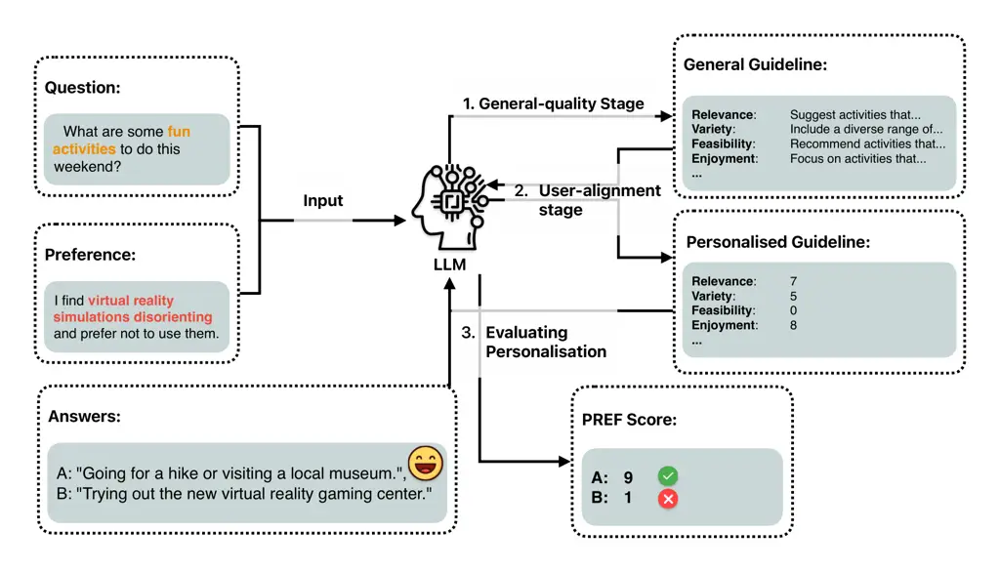
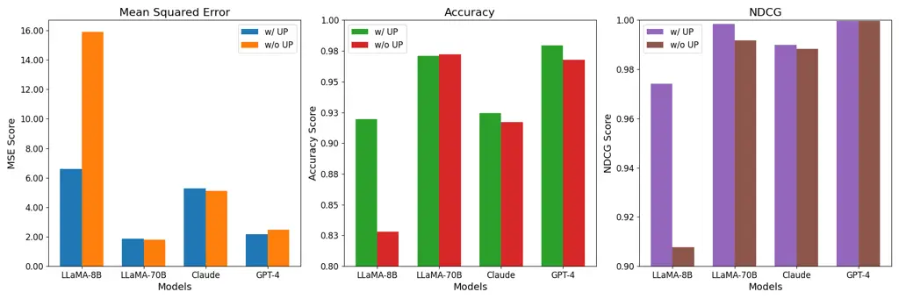

# PREF: Reference‑Free Evaluation of Personalised Text Generation in LLMs

Xiao Fu    Hossein A. Rahmani    Bin Wu    Jerome Ramos    Emine Yilmaz
   Aldo Lipani

###### Abstract

Personalised text generation is essential for user-centric information
systems, yet most evaluation methods overlook the individuality of
users. We introduce PREF, a Personalised Reference-free Evaluation
Framework that jointly measures general output quality and user-specific
alignment without requiring gold personalised references. PREF operates
in a three-step pipeline: (1) a _coverage stage_ uses a large language
model (LLM) to generate a comprehensive, query-specific guideline
covering universal criteria such as factuality, coherence, and
completeness; (2) a _preference stage_ re-ranks and selectively augments
these factors using the target user’s profile, stated or inferred
preferences, and context, producing a personalised evaluation rubric;
and (3) a _scoring stage_ applies an LLM judge to rate candidate answers
against this rubric, ensuring baseline adequacy while capturing
subjective priorities. This separation of coverage from preference
improves robustness, transparency, and reusability, and allows smaller
models to approximate the personalised quality of larger ones.
Experiments on the PrefEval benchmark, including implicit
preference-following tasks, show that PREF achieves higher accuracy,
better calibration, and closer alignment with human judgments than
strong baselines. By enabling scalable, interpretable, and user-aligned
evaluation, PREF lays the groundwork for more reliable assessment and
development of personalised language generation systems.

¹University College London (UCL)

xiao.fu.20@ucl.ac.uk, hossein.rahmani.22@ucl.ac.uk, bin.wu.23@ucl.ac.uk,
jerome.ramos.20@ucl.ac.uk, emine.yilmaz@ucl.ac.uk, aldo.lipani@ucl.ac.uk

## Introduction

Large language models (LLMs) such as GPT-3 (Brown et al. 2020) and
ChatGPT (Achiam et al. 2023) have propelled open-ended text generation
to new heights, enabling high-quality dialogue, code synthesis, and
data-to-text narration at scale. Despite these successes, _evaluating_
the outputs of such models remains an open problem. Traditional
reference-based metrics, including BLEU and ROUGE (Papineni et al. 2002;
Lin 2004), which count $`n`$-gram overlap with one or more gold
references, correlate weakly with human judgements on tasks that admit
many equally valid answers (e.g., creative writing, recommendation, and
advice). Embedding-based alternatives such as BERTScore (Zhang et al. 2020) mitigate surface mismatch by measuring semantic similarity in a
latent space, yet they still require high-quality reference texts and
ultimately reflect _generic_ rather than _user-specific_ desiderata.

A parallel line of research bypasses references altogether by treating a
strong LLM as an automatic judge. Benchmarks such as MT-Bench (Zheng
et al. 2023) and AlpacaEval (Li et al. 2023) ask GPT-4 to rate or rank
candidate answers and report impressive agreement with crowd workers.
Although this _LLM-as-a-judge_ paradigm scales cheaply and reproducibly,
its rubric is fundamentally universal—“a good answer is a good answer
for everyone”—and therefore blind to individual preferences,
constraints, or prior interactions that might radically alter a user’s
perception of quality.

Modern applications increasingly expose LLMs directly to end users who
expect outputs tailored to their tastes, goals, and contexts. Recent
work has shown that LLMs can indeed adapt to user profiles, feedback
signals, and stylistic norms (Zhang et al. 2024). However, evaluating
such _personalised_ generation is especially tricky because quality is
now user-dependent, i.e., an answer that delights one person might
frustrate another. Generic references or model-centric rubrics cannot
capture this subjective dimension.

Human evaluation remains the gold standard but is expensive,
time-consuming, and prone to annotator variance and bias—even when
detailed guidelines are provided (Van Der Lee et al. 2019). Collecting
user-aligned ratings for every system update or user cohort is therefore
impractical, hindering rapid iteration on personalised experiences.

To fill this evaluation gap, we propose PREF, a Personalised,
Reference-free Evaluation Framework that scores generated text _without_
gold personalised answers. PREF evaluates in two stages:

1.  1.  General-quality stage. A general guideline enumerates the salient
        factors to check—truthfulness, coherence, completeness,
        etc.—_explicitly ignoring_ user preferences to ensure baseline
        adequacy.
2.  2.  User-alignment stage. A personalised guideline is synthesised from
        user information (profile attributes, past dialogue, stated
        preferences) and used to weight or re-rank the general factors,
        yielding a customised rubric that reflects what _this_ user cares
        about.

The LLM then judges candidate answers against the composite rubric,
producing a scalar score without ever consulting ground-truth
references. In this way, PREF combines universal quality control with
user-centric alignment while remaining scalable and reproducible.

Our contribution can be summarised as:

- •
  We formulate a _reference-free_ evaluation protocol for personalised
  generation that jointly considers task adequacy and user alignment.
- •
  We instantiate this protocol with automatic rubric construction and
  LLM-based scoring, eliminating the need for gold references or
  repeated human ratings.
- •
  Through extensive experiments on the PrefEval benchmark, we
  demonstrate that PREF’s scores track human judgements of personalised
  quality more faithfully than existing baselines.
- •
  We show that integrating PREF during development helps smaller models
  (e.g., LLaMA-3 8B) close much of the performance gap to larger
  counterparts, facilitating cost-effective deployment.

Taken together, our findings position PREF as a practical and effective
foundation for evaluating—and ultimately improving—user-aligned language
generation systems.

## Related Work

### Foundations of Personalisation

The idea of personalisation comes from two related areas of research:

#### Explicit user modelling.

Adaptive hypermedia systems demonstrated that maintaining a
_fine-grained_ learner or reader model enables real-time adaptation of
content, sequencing, and navigation (Brusilovsky 2001). These systems
relied on explicitly encoded attributes—background knowledge, goals,
learning style—to decide what to show next.

#### Implicit preference inference.

Collaborative filtering techniques such as GroupLens showed that
preferences can be inferred from _behavioural signals_: user–item
ratings aggregated at scale allow “people who agreed in the past to
agree again” (Resnick et al. 1994).

Modern LLM personalisation strategies still trace back to this
dichotomy: _explicit_ profile conditioning versus _implicit_ signal
mining (e.g. clicks, dwell time, edits).

### Personalised Text Generation with LLMs

#### Early neural persona modelling.

The Persona-Chat framework appended vector-based speaker embeddings to
seq-to-seq dialogue models, boosting persona consistency and opening the
door to persona-aware generation (Li et al. 2016).

#### Attribute and style control.

Plug-and-Play Language Models (PPLM) pioneered gradient-based steering
of frozen GPT-2 towards user-specified attributes without expensive full
fine-tuning (Dathathri et al. 2020). Subsequent _parameter-efficient_
methods such as prefix-tuning, adapters, and LoRA attach small trainable
modules, enabled per-user or per-task specialisation with a few thousand
parameters (Li and Liang 2021).

#### Personalised RLHF and PEFT.

Reinforcement Learning from Human Feedback (RLHF) has recently been
adapted to heterogeneous user groups: Personalised-RLHF trains multiple
reward heads or preference models, each aligned with a user cluster (Li
et al. 2024). In parallel, lightweight PEFT modules distribute
personalisation across thousands of users at commodity cost (Tan et al.
2024).

#### Prompt- and profile-based conditioning.

Instead of opaque embeddings, several works propose _editable
natural-language profiles_ that the model can quote, justify, or
critique, improving scrutability in recommendation and dialogue (Ramos
et al. 2024). Soft-prompt methods such as PeaPOD blend collaborative and
individual signals into one prompt, achieving strong personalisation
with no model updates (Ramos, Wu, and Lipani 2024).

### Evaluating Personalisation in LLMs

#### Limitations of reference metrics.

Reference-based scores (BLEU, ROUGE) capture lexical overlap, and even
semantic metrics like BERTScore remain insensitive to _who_ the answer
is for. Consequently, they correlate poorly with user-perceived quality
in personalised settings.

#### LLM-as-judge approaches.

Automatic judges such as AuPEL use a strong LLM to score
_personalisation_, _relevance_, and _fluency_ jointly, removing the need
for references (Wang et al. 2023). PerSE further conditions the
evaluator on an explicit preference profile, increasing correlation with
human ratings on open-ended tasks (Wang et al. 2024).

#### Benchmark suites.

To stress-test models, several benchmarks target specific facets:

- •
  LaMP and LongLaMP evaluate short-form and long-form personalised
  generation, respectively (classification, email, reviews) (Salemi
  et al. 2023; Kumar et al. 2024).
- •
  PersonaLens simulates rich multi-session profiles and scores task
  success, personalisation, and quality via paired LLM agents (Zhao
  et al. 2025b).
- •
  PersonaMem tracks performance as user preferences _evolve_, revealing
  that most LLMs struggle with drifting personas (Jiang et al. 2025).
- •
  PersoBench focuses on persona-driven chit-chat, reporting that models
  often ignore or contradict supplied personas even with
  chain-of-thought prompting (Afzoon et al. 2024).
- •
  PrefEval probes adherence to both _explicit_ and _implicit_
  preferences in conversational QA; accuracy degrades sharply as context
  length grows (Zhao et al. 2025a).

### Positioning of This Work

Despite rapid progress, existing evaluators either (i) demand
labour-intensive human annotations, (ii) treat all users identically, or
(iii) measure only narrow aspects of quality. PREF addresses these gaps
by:

1.  1.  Constructing a _two-tier_ rubric that fuses universal quality checks
        with user-specific priorities,
2.  2.  Operating _reference-free_, ensuring scalability and
        reproducibility, and
3.  3.  Remaining model-agnostic, thereby supporting diverse backbone LLMs
        and personalisation mechanisms.

In the experiments that follow, we concentrate on open-domain question
answering and adopt the PrefEval benchmark as our primary testbed, as it
offers both explicit and implicit preference challenges that align with
PREF’s design goals.

## From Personalisation to Evaluation

Question set $`Q=\{q_{n}\}_{n=1}^{N}`$,

Preference set $`P=\{p_{n}\}_{n=1}^{N}`$,

Answer set $`A=\{a_{n}\}_{n=1}^{N}`$,

Coverage LLM $`\mathcal{M}_{\text{cov}}`$,

Preference LLM $`\mathcal{M}_{\text{pref}}`$,

Scoring LLM $`\mathcal{M}_{\text{score}}`$

Personalized scores $`S=\{s_{n}\}_{n=1}^{N}`$

Phase 1: Generate General Guidelines

for each $`q_{n}\in Q`$ do

  $`g_{n}\leftarrow\textsc{GenerateGuideline}(\mathcal{M}_{\text{cov}},q_{n})`$

$`\triangleright`$ $`g_{n}`$ lists factors
$`\{f_{n,1},\dots,f_{n,K_{n}}\}`$

end for

Phase 2: Personalize Guidelines

for each index $`n`$ from $`1`$ to $`N`$ do

  $`g^{\!*}_{n}\leftarrow\textsc{Personalize}(\mathcal{M}_{\text{pref}},q_{n},p_{n},g_{n})`$

$`\triangleright`$ Re-rank / augment factors to obtain personalized
guideline

end for

Phase 3: Score Answers

for each index $`n`$ from $`1`$ to $`N`$ do

  $`s_{n}\leftarrow\textsc{ScoreAnswer}(\mathcal{M}_{\text{score}},q_{n},p_{n},g^{\!*}_{n},a_{n})`$

end for

return $`S`$

Algorithm 1 PREF Scoring Pipeline

Figure 1: PREF at a glance. Venn diagrams illustrating (left) the
relationship between an _ideal, exhaustive_ answer and a _personalised_
answer to the same query; (centre) the relationship between an _ideal,
general_ guideline and a _user-specific_ selection (or ordering) of
factors; and (right) the practical regime adopted by PREF, where the
ranker may add extra factors to craft a personalised guideline when the
general one is incomplete.

Figure 2: The PREF scoring pipeline. A three-step process—coverage,
preference (User profiles), and scoring—maps a query $`q`$, user profile
$`p`$, and candidate answer $`a`$ to a final personalised score
$`s_{a}`$ with a real example on PrefEval.

_Personalisation_—“the act of adapting something to suit the needs of a
particular person”¹¹ 1
https://dictionary.cambridge.org/dictionary/english/personalization—is
most valuable when it operates within the affordances of the underlying
system. Kirk et al. (2024) articulate this frontier: inside a
technology’s general capabilities, personalisation occupies the zone
where users can adapt the system to their values, preferences, or
information needs. In other words, a system may support many behaviours
in principle, but only a subset will be _useful_ for a given individual
in a given context.

#### Design principles behind PREF.

Building on this view, PREF rests on two assumptions that make the
design space precise:

- •
  Assumption 1 (Unlimited attention). If users had unlimited attention
  and patience, a _single_, fully comprehensive answer would satisfy any
  query, making explicit personalisation unnecessary.
- •
  Assumption 2 (Bounded attention). In reality, attention and patience
  are scarce. Users therefore prefer answers that _foreground_
  information aligned with their personal preferences, even if this
  omits less relevant details.

Figure 1 visualises these assumptions. The left panel contrasts an
exhaustive answer with a lean, prioritised one; the centre panel
contrasts an all-purpose guideline with the subset (or ranking) that
matters to a particular user; and the right panel shows how, in
practice, the ranker may _inject_ additional factors when the general
guideline overlooks something salient. This last permission reflects a
pragmatic reality: current LLMs can miss important criteria during
coverage; allowing augmentation prevents these omissions from
propagating into the final score.

#### From principles to practice.

PREF translates the above into a modular pipeline with clear interfaces.
We denote by $`g`$ a _general_ guideline for query $`q`$ that enumerates
salient evaluation factors $`\mathcal{F}=\{f_{1},\dots,f_{n}\}`$. A
personalised guideline $`g^{\!*}`$ is then obtained by re-ordering or
re-weighting $`\mathcal{F}`$ using information from a user profile
$`p`$. Finally, a scoring component evaluates a candidate answer $`a`$
against $`g^{\!*}`$ in the context of $`(q,p)`$ to produce a scalar
$`s_{a}\in\mathbb{R}`$. Intuitively, $`g`$ ensures _coverage_ (we know
what to check) and $`g^{\!*}`$ ensures _alignment_ (we know what to
check _first_ and how much it matters).

#### Two-stage evaluation framework.

PREF operationalises this idea in two stages, followed by scoring
(Figure 2):

1.  1.  Coverage stage ($`q\!\to\!g`$). Given a query $`q`$, a _coverage
        LLM_ produces a comprehensive guideline $`g`$ that enumerates
        salient factors $`\mathcal{F}`$. Each factor can optionally include
        a short rubric or test, making $`g`$ directly actionable.²² 2
        Figure 2 shows an example of $`g`$.
2.  2.  Preference stage ($`p\!\to\!\pi`$ or $`\mathbf{w}`$). A _preference
        LLM_, conditioned on user profile $`p`$, induces an ordering $`\pi`$
        over $`\mathcal{F}`$ or a weight vector
        $`\mathbf{w}\in\mathbb{R}^{|\mathcal{F}|}_{\geq 0}`$. When the
        coverage is incomplete, the ranker may _augment_ $`\mathcal{F}`$
        with additional factors derived from $`p`$ or the query context,
        yielding $`g^{\!*}`$.
3.  3.  Scoring stage ($`a\!\mapsto\!s_{a}`$). A _scoring LLM_ assesses
        $`a`$ against $`g^{\!*}`$ in the context of $`(q,p)`$, producing a
        final personalised score $`s_{a}`$. We write
        $`s_{a}=\mathrm{Score}(a\mid q,p,g^{\!*})`$.

#### Why two stages?

Separating _coverage_ from _preference_ yields three practical
advantages:

1.  1.  Robustness to omission. Coverage is query-specific and
        model-agnostic; the preference stage can add missing but
        user-critical factors.
2.  2.  Transparency and control. The factors in $`g`$ (and their
        user-conditioned ordering in $`g^{\!*}`$) form a human-auditable
        rubric that explains _why_ a score was assigned.
3.  3.  Reusability. A single $`g`$ can support many users (varying $`p`$),
        and a single $`p`$ can be applied across related queries (varying
        $`q`$), reducing recomputation and enabling ablations.

#### Scoring behaviour and constraints.

In practice, the scorer balances universal desiderata (e.g.,
correctness, completeness, clarity) with user-specific ones (e.g.,
dietary constraints, tone, budget). The design enforces two invariants:
(i) user alignment must never _excuse_ factual errors introduced by the
model, and (ii) augmentation may not contradict the coverage factors
without justification. These guardrails help maintain reliability while
still capturing individual preferences.

Figure 2 and Algorithm 1 detail the flow. Given $`q`$, $`p`$, and a
candidate answer $`a`$:

1.  1.  A _coverage LLM_ generates $`g`$.
2.  2.  A _preference LLM_ re-ranks (and, if necessary, augments) $`g`$ to
        obtain $`g^{\!*}`$.
3.  3.  A _scoring LLM_ assesses $`a`$ against $`g^{\!*}`$ in the context of
        $`(q,p)`$, producing the personalised score $`s_{a}`$.

To simplify, we assign one backbone LLM to take all three roles.

## Experiments and Findings

### Data

To assess the performance of PREF, we adopt the PrefEval benchmark,
which supplies _question–preference–answer_ triples tailored for
personalised text generation (Zhao et al. 2025a). We focus on the
_implicit multiple‐choice_ subset of PrefEval, where the link between
user preferences and the “ideal” answer is not stated explicitly. For
instance, if a user dislikes fish, a question asking for a recommended
Japanese dish is implicitly challenging because many Japanese dishes
contain fish even though the question never mentions it. Each example
offers four candidate answers, only one of which a human annotator marks
as satisfactory.

Following common practice, we hold out 20 % of the data as a test set
and report all metrics on this split, including 200 questions, 200 user
preferences and 800 answers.

### LLMs

To probe the flexibility of PREF, we pair it with four different
backbone language models:

- •
  Claude 3 Haiku: claude-3-haiku-20240307 ,
- •
  GPT-4.1 Mini: gpt-4.1-mini,
- •
  LLaMA 3 8B: llama3-8b-instruct, and
- •
  LLaMA 3 70B: llama3-70b-instruct.

For every model, we set the sampling temperature to 0 to guarantee
deterministic generation and full reproducibility.

### Evaluating Personalisation

Figure 3: Ablation on the user-preference (UP). w/ UP: full PREF
pipeline; w/o UP: answers are scored only against the _general_
guideline from Stage one. Bars report accuracy, MSE (lower is better),
and nDCG (higher is better) on the PrefEval implicit multiple-choice
split.

| Method      | LLaMA 3 8B | LLaMA 3 70B | Claude 3 Haiku |
| ----------- | ---------- | ----------- | -------------- |
| Zero-shot   | 27         | 37          | 34             |
| Reminder    | 84         | 91          | 88             |
| PREF (ours) | 92         | 97          | 92             |

Table 1: Accuracy (%) on the PrefEval _implicit multiple-choice_ subset.
Bold numbers denote the best score for each backbone model. Zero-shot
and Reminder results are taken from the PrefEval paper (Zhao et al.
2025a).

#### Baselines and overall accuracy.

Table 1 contrasts three evaluation strategies on the PrefEval implicit
multiple-choice benchmark:

1.  1.  Zero-shot: the backbone LLM answers each question with its default
        prompt;
2.  2.  Reminder: a single sentence is prepended instructing the model to
        “consider the user’s stated preference” (as in the original PrefEval
        paper);
3.  3.  PREF: our full two-stage framework.

Across all backbones, PREF yields the highest accuracy, outperforming
the Reminder baseline by $`+3\!-\!8`$ absolute points
($`\approx 6\!-\!12\%`$ relative) and dwarfing the naïve Zero-shot
setting by more than $`+55`$ points. The consistent gain underlines two
observations: _(a)_ simply reminding a model of user preferences is
helpful but insufficient, and _(b)_ explicitly constructing and
weighting a personalised guideline—PREF’s core idea—substantially
improves evaluation quality irrespective of model scale or architecture.

| Model          | Accuracy $`\uparrow`$ | MSE $`\downarrow`$ | nDCG $`\uparrow`$ |
| -------------- | --------------------- | ------------------ | ----------------- |
| Claude 3 Haiku | 0.92                  | 5.27               | 0.9899            |
| GPT-4.1 Mini   | 0.98                  | 2.19               | 0.9996            |
| LLaMA 3 8B     | 0.92                  | 6.62               | 0.9742            |
| LLaMA 3 70B    | 0.97                  | 1.87               | 0.9980            |

Table 2: Performance on the PrefEval benchmark. Higher values are better
for Accuracy and nDCG, while lower is better for MSE. Boldface marks the
best score for each metric.

#### Beyond accuracy: MSE and nDCG.

Accuracy counts only whether the correct answer is top-ranked; it
ignores the score margin and the ordering of distractors. To obtain a
finer-grained view, we map the gold answer to a score of 10, distractors
to 0, concatenate scores across questions, and compute:

- •
  Mean-squared error (MSE): penalises large deviations from the gold
  10/0 targets; lower is better.
- •
  Normalised discounted cumulative gain (nDCG): rewards rankings that
  place the gold answer near the top; higher is better.

Table 2 reveals two trends. First, larger backbones—GPT-4.1 Mini and
LLaMA 3 70B—achieve the best accuracy _and_ the lowest MSE, confirming
that increased capacity translates into finer scoring granularity when
paired with PREF. Second, the smaller models (Claude 3 Haiku and LLaMA 3
8B) reach near-perfect nDCG despite higher MSE. They reliably rank the
correct answer first (good nDCG) but sometimes assign overly generous
scores to distractors (inflated MSE).

#### Effect of the User-alignment stage.

To isolate the contribution of Stage 2, we ablated it entirely—answers
were judged only against the general guideline. Figure 3 summarises the
impact where with and without user-preference (UP).

- •
  MSE. The second stage lowers MSE (better calibration) for LLaMA 3 8B
  and GPT-4.1 Mini. For other models (Claude 3 Haiku, LLaMA 3 70B) the
  change is marginal, suggesting that they already approximate user
  weights implicitly.
- •
  Accuracy and nDCG. Accuracy rises for every backbone except a
  negligible 0.1-point dip on LLaMA 3 70B; nDCG improves across the
  board, confirming that the personalised rubric places the correct
  answer higher in the ranking.

The second stage is therefore most valuable for smaller models,
narrowing the gap to their larger peers. Notably, LLaMA 3 8B with UP
rivals Claude 3 Haiku without UP—an attractive trade-off for
resource-constrained deployments.

#### Take-aways.

PREF’s two-tier rubric delivers three concrete benefits:

1.  1.  Robust accuracy via explicit preference integration;
2.  2.  Better calibration (lower MSE) by discouraging inflated scores on
        irrelevant answers;
3.  3.  Capacity amplification: the second stage lets inexpensive backbones
        approach the performance of much larger models, reducing serving
        cost without sacrificing user alignment.

These results highlight PREF as an effective, scalable, and
model-agnostic foundation for evaluating personalised language
generation.

### Explainability

#### Leveraging PrefEval’s answer explanations.

Unlike many personalisation benchmarks, PrefEval supplies not only a
gold (personalised) answer for each query but also a _natural-language
explanation_ describing _why_ that answer is appropriate. This
additional signal allows us to probe a different capability of PREF: its
ability to identify and prioritise the _right_ evaluation factors.

Concretely, we treat the explanation as an “oracle” preference and ask:
_Does the ranking produced by PREF (when conditioned on the user’s
preference) agree with the ranking obtained when we instead condition on
the explanation?_ Formally, let $`e`$ be the accompanying explanation
supplied by PrefEval and $`g(q)=\{f_{1},\dots,f_{n}\}`$ be the general
guideline produced in Stage 1.

We then execute four steps:

1.  1.  Preference-based ranking. Feed $`p`$ into the preference LLM to
        derive an ordering $`\pi_{p}`$ (or weight vector $`\mathbf{w}_{p}`$)
        over $`g(q)`$.
2.  2.  Explanation-based ranking. Replace $`p`$ with the explanation $`e`$
        and obtain a second ordering $`\pi_{e}`$ (or $`\mathbf{w}_{e}`$). We
        regard $`\pi_{e}`$ as an oracle since it reflects the human
        rationale behind the gold answer.
3.  3.  Compare the rankings. Measure correlation coefficients between
        $`\pi_{p}`$ and $`\pi_{e}`$ with a suitable correlation metric
        (e.g., Kendall’s $`\tau`$, Spearman’s $`\rho`$ and pearson’s $`p`$).
        High correlation indicates that the preference-conditioned rubric
        surfaces _the same_ factors humans deem decisive.

This procedure isolates the _factor-ranking_ competence of PREF: even if
the final scores differ, we can verify whether the framework attends to
the criteria that matter most for a high-quality personalised answer.

|                   | GPT-4.1 Mini | LLaMA 3 70B |
| ----------------- | ------------ | ----------- |
| Pearson $`r`$     | 0.6164       | 0.4693      |
| Spearman $`\rho`$ | 0.5906       | 0.3811      |
| Kendall $`\tau`$  | 0.5612       | 0.3532      |

Table 3: Rank–rank correlation between the factor ordering induced by
the user preference and the oracle ordering derived from PrefEval answer
explanations. Higher values indicate closer agreement.

Table 3 reports the correlation between the factor ranking produced by
PREF when conditioned on the _user preference_ and the “oracle” ranking
obtained from PrefEval’s human-written explanations. All three
coefficients—Pearson’s $`r`$, Spearman’s $`\rho`$, and Kendall’s
$`\tau`$—are _positive and statistically substantial_, confirming that
both backbones identify broadly the same criteria that humans deemed
decisive.

GPT-4.1 Mini shows the stronger alignment, achieving a Pearson $`r`$
of 0.62 and a Kendall $`\tau`$ of 0.56, whereas LLaMA 3 70B trails at
0.47 and 0.35, respectively. In practical terms, GPT-4.1 Mini not only
places the correct factors near the top but preserves their relative
ordering more faithfully. The gap suggests that, despite its larger
parameter count, LLaMA 3 70B still benefits from the second stage
(accuracy gains in Table 1) yet requires further tuning to internalise
nuanced preference cues.

Overall, the moderate–high correlations indicate that PREF’s preference
module successfully surfaces the factors humans reference when
justifying a good personalised answer, but there remains
headroom—especially for open-source models—to tighten that alignment.

### Additional Factors in Stage Two

In Stage 2, the preference model may _augment_ the general guideline.
Two concise observations:

(1) Additions are few. With GPT-4.1 Mini, we observe $`1{,}986`$ general
factors vs. $`153`$ added ($`\approx 7.7\%`$); on LLaMA 3 70B,
$`1{,}893`$ vs. $`241`$ ($`\approx 12.7\%`$). Per question, this is
$`9.93`$ general and $`0.765`$ additional factors on average. Thus,
coverage already captures most criteria; Stage 2 makes targeted fixes.

(2) Additions encode exclusions. Keyword filtering (dislike, avoid)
shows that $`25.49\%`$ of added factors (vs. $`0\%`$ general) on GPT-4.1
Mini and $`5.81\%`$ (vs. $`0.01\%`$) on LLaMA 3 70B express
user-specific “blacklists.”

Takeaway. Augmentation is _selective_ and primarily used to inject
user-dependent constraints that the preference-agnostic coverage stage
omits.

## Discussion

### What Did We Learn?

Our experiments support four overarching insights:

1.  1.  Fine-grained personalisation pays off. A factor-level rubric is
        essential. PREF boosts accuracy by $`\geq 55\%`$ over zero-shot
        answering and by $`3\%\!-\!8\%`$ over the one-line _Reminder_ cue
        (Table 1).
2.  2.  Two stages are better than one. Removing the user-preference
        degrades calibration (higher MSE) and ranking quality (lower nDCG),
        especially for the 8 B parameter model (Figure 3). Coverage alone is
        not enough.
3.  3.  Smaller models can punch above their weight. With PREF, LLaMA 3 8B
        approaches the performance of the much larger Claude 3 Haiku,
        suggesting that better evaluation—not just bigger models—can narrow
        the quality gap.
4.  4.  Ranked factors mirror human rationales. Preference-conditioned
        rankings correlate moderately to strongly with “oracle” rankings
        extracted from human explanations (Table 3), indicating that the
        framework surfaces criteria people actually use.

### Practical Take-aways

#### Model selection.

Organisations with tight latency or budget constraints can safely deploy
smaller backbones in tandem with PREF, meeting personalisation targets
while reducing inference cost.

#### Continuous evaluation.

Because PREF is reference-free, it slots naturally into CI/CD pipelines,
enabling nightly regression tests as prompts, reward models, or user
cohorts evolve.

#### Debugging and transparency.

The personalised guideline $`g^{\!*}`$ doubles as a concise,
human-readable explanation. Developers—and users—can inspect which
factors triggered a low score and adjust either the answer or the
preference weights.

### Limitations and Future Work

- •
  Evaluator reliability. The scorer is itself an LLM and therefore
  inherits potential biases or hallucinations. Hybrid setups—ensembling
  multiple judges or spot-checking with humans—are a promising next
  step.
- •
  Profile complexity. We assume structured or short natural-language
  preferences. Real-world signals are noisy, implicit, and time-varying.
  Extending Stage 2 to ingest such data remains open.
- •
  Task generality. Our study focuses on open-domain QA. Applying PREF to
  long-form summarisation, code review, or multimodal tasks may require
  richer coverage factors and new aggregation schemes.
- •
  Ethical safeguards. Personalisation can amplify filter bubbles or leak
  sensitive traits. Future work should integrate fairness tests and give
  users agency to audit or override their profiles.

## Conclusion

We presented PREF, a Personalised, Reference-free Evaluation Framework
that disentangles _coverage_ from _preference_. By first ensuring topic
completeness and then tailoring the rubric to user priorities, PREF
delivers accurate, transparent, and scalable assessment without gold
references. Experiments on the PrefEval benchmark show that PREF (i)
aligns closely with human judgements, (ii) improves calibration and
ranking quality across models, and (iii) raises the ceiling for smaller
backbones.

Code and evaluation scripts will be released upon publication. We hope
this framework accelerates research into genuinely user-centred language
generation—and into evaluation methods that keep pace with that
ambition.

## References

- Achiam et al. (2023) Achiam, J.; Adler, S.; Agarwal, S.; Ahmad, L.;
  Akkaya, I.; Aleman, F. L.; Almeida, D.; Altenschmidt, J.; Altman, S.;
  Anadkat, S.; et al. 2023. Gpt-4 technical report. _arXiv preprint
  arXiv:2303.08774_.
- Afzoon et al. (2024) Afzoon, S.; Naseem, U.; Beheshti, A.; and
  Jamali, Z. 2024. PersoBench: Benchmarking Personalized Response
  Generation in Large Language Models. _CoRR_, abs/2410.03198.
- Brown et al. (2020) Brown, T.; Mann, B.; Ryder, N.; Subbiah, M.;
  Kaplan, J. D.; Dhariwal, P.; Neelakantan, A.; Shyam, P.; Sastry, G.;
  Askell, A.; Agarwal, S.; Herbert-Voss, A.; Krueger, G.; Henighan, T.;
  Child, R.; Ramesh, A.; Ziegler, D.; Wu, J.; Winter, C.; Hesse, C.;
  Chen, M.; Sigler, E.; Litwin, M.; Gray, S.; Chess, B.; Clark, J.;
  Berner, C.; McCandlish, S.; Radford, A.; Sutskever, I.; and
  Amodei, D. 2020. Language Models are Few-Shot Learners. In Larochelle,
  H.; Ranzato, M.; Hadsell, R.; Balcan, M.; and Lin, H., eds., _Advances
  in Neural Information Processing Systems_, volume 33, 1877–1901.
  Curran Associates, Inc.
- Brusilovsky (2001) Brusilovsky, P. 2001. Adaptive hypermedia. _User
  modeling and user-adapted interaction_, 11(1): 87–110.
- Dathathri et al. (2020) Dathathri, S.; Madotto, A.; Lan, J.; Hung, J.;
  Frank, E.; Molino, P.; Yosinski, J.; and Liu, R. 2020. Plug and Play
  Language Models: A Simple Approach to Controlled Text Generation. In
  _International Conference on Learning Representations (ICLR 2020)_.
  ArXiv:1912.02164.
- Jiang et al. (2025) Jiang, B.; Hao, Z.; Cho, Y.; Li, B.; Yuan, Y.;
  Chen, S.; Ungar, L. H.; Taylor, C. J.; and Roth, D. 2025. Know Me,
  Respond to Me: Benchmarking LLMs for Dynamic User Profiling and
  Personalized Responses at Scale. _CoRR_, abs/2504.14225.
- Kirk et al. (2024) Kirk, H. R.; Vidgen, B.; Röttger, P.; and Hale,
  S. A. 2024. The benefits, risks and bounds of personalizing the
  alignment of large language models to individuals. _Nature Machine
  Intelligence_, 6(4): 383–392.
- Kumar et al. (2024) Kumar, I.; Viswanathan, S.; Yerra, S.; Salemi, A.;
  Rossi, R. A.; Dernoncourt, F.; Deilamsalehy, H.; Chen, X.; Zhang, R.;
  Agarwal, S.; Lipka, N.; Nguyen, C. V.; Nguyen, T. H.; and
  Zamani, H. 2024. LongLaMP: A Benchmark for Personalized Long-form Text
  Generation. _arXiv preprint arXiv:2407.11016_.
- Li et al. (2016) Li, J.; Galley, M.; Brockett, C.; Spithourakis, G.;
  Gao, J.; and Dolan, B. 2016. A Persona-Based Neural Conversation
  Model. In Erk, K.; and Smith, N. A., eds., _Proceedings of the 54th
  Annual Meeting of the Association for Computational Linguistics
  (Volume 1: Long Papers)_, 994–1003. Berlin, Germany: Association for
  Computational Linguistics.
- Li et al. (2023) Li, X.; Zhang, T.; Dubois, Y.; Taori, R.; Gulrajani,
  I.; Guestrin, C.; Liang, P.; and Hashimoto, T. B. 2023. AlpacaEval: An
  Automatic Evaluator of Instruction-following Models.
  https://github.com/tatsu-lab/alpaca˙eval.
- Li et al. (2024) Li, X.; Zhou, R.; Lipton, Z. C.; and Leqi, L. 2024.
  Personalized language modeling from personalized human feedback.
  _arXiv preprint arXiv:2402.05133_.
- Li and Liang (2021) Li, X. L.; and Liang, P. 2021. Prefix-Tuning:
  Optimizing Continuous Prompts for Generation. In _Proceedings of the
  59th Annual Meeting of the Association for Computational Linguistics
  (ACL–IJCNLP 2021)_, 4582–4597.
- Lin (2004) Lin, C.-Y. 2004. ROUGE: A Package for Automatic Evaluation
  of Summaries. In _Text Summarization Branches Out_, 74–81. Barcelona,
  Spain: Association for Computational Linguistics.
- Papineni et al. (2002) Papineni, K.; Roukos, S.; Ward, T.; and Zhu,
  W.-J. 2002. Bleu: a method for automatic evaluation of machine
  translation. In _Proceedings of the 40th annual meeting of the
  Association for Computational Linguistics_, 311–318.
- Ramos et al. (2024) Ramos, J.; Rahmani, H. A.; Wang, X.; Fu, X.; and
  Lipani, A. 2024. Transparent and Scrutable Recommendations Using
  Natural Language User Profiles. In _Proceedings of the 62nd Annual
  Meeting of the Association for Computational Linguistics (ACL 2024)_,
  13971–13984.
- Ramos, Wu, and Lipani (2024) Ramos, J.; Wu, B.; and Lipani, A. 2024.
  PeaPOD: Personalized Prompt Distillation for Generative
  Recommendation. _arXiv preprint arXiv:2407.05033_.
- Resnick et al. (1994) Resnick, P.; Iacovou, N.; Suchak, M.; Bergstrom,
  P.; and Riedl, J. 1994. Grouplens: An open architecture for
  collaborative filtering of netnews. In _Proceedings of the 1994 ACM
  conference on Computer supported cooperative work_, 175–186.
- Salemi et al. (2023) Salemi, A.; Mysore, S.; Bendersky, M.; and
  Zamani, H. 2023. LaMP: When Large Language Models Meet
  Personalization. _arXiv preprint arXiv:2304.11406_.
- Tan et al. (2024) Tan, Z.; Zeng, Q.; Tian, Y.; Liu, Z.; Yin, B.; and
  Jiang, M. 2024. Democratizing Large Language Models via Personalized
  Parameter-Efficient Fine-tuning. In _Proceedings of the 2024
  Conference on Empirical Methods in Natural Language Processing
  (EMNLP 2024)_. ArXiv:2402.04401.
- Van Der Lee et al. (2019) Van Der Lee, C.; Gatt, A.; Van Miltenburg,
  E.; Wubben, S.; and Krahmer, E. 2019. Best practices for the human
  evaluation of automatically generated text. In _Proceedings of the
  12th international conference on natural language generation_,
  355–368.
- Wang et al. (2024) Wang, D.; Yang, K.; Zhu, H.; Yang, X.; Cohen, A.;
  Li, L.; and Tian, Y. 2024. Learning Personalized Alignment for
  Evaluating Open-ended Text Generation. In _Proceedings of the 2024
  Conference on Empirical Methods in Natural Language Processing
  (EMNLP 2024)_, 13274–13292. Miami, USA.
- Wang et al. (2023) Wang, Y.; Jiang, J.; Zhang, M.; Li, C.; Liang, Y.;
  Mei, Q.; and Bendersky, M. 2023. Automated Evaluation of Personalized
  Text Generation using Large Language Models. _arXiv preprint
  arXiv:2310.11593_.
- Zhang et al. (2020) Zhang, T.; Kishore, V.; Wu, F.; Weinberger, K. Q.;
  and Artzi, Y. 2020. BERTScore: Evaluating Text Generation with BERT.
  In _8th International Conference on Learning Representations, ICLR
  2020, Addis Ababa, Ethiopia, April 26-30, 2020_. OpenReview.net.
- Zhang et al. (2024) Zhang, Z.; Rossi, R. A.; Kveton, B.; Shao, Y.;
  Yang, D.; Zamani, H.; Dernoncourt, F.; Barrow, J.; Yu, T.; Kim, S.;
  et al. 2024. Personalization of large language models: A survey.
  _arXiv preprint arXiv:2411.00027_.
- Zhao et al. (2025a) Zhao, S.; Hong, M.; Liu, Y.; Hazarika, D.; and
  Lin, K. 2025a. Do LLMs Recognize Your Preferences? Evaluating
  Personalized Preference Following in LLMs. In _The Thirteenth
  International Conference on Learning Representations, ICLR 2025,
  Singapore, April 24-28, 2025_. OpenReview.net.
- Zhao et al. (2025b) Zhao, Z.; Vania, C.; Kayal, S.; Khan, N.; Cohen,
  S. B.; and Yilmaz, E. 2025b. PersonaLens: A Benchmark for
  Personalization Evaluation in Conversational AI Assistants. _arXiv
  preprint arXiv:2506.09902_.
- Zheng et al. (2023) Zheng, L.; Chiang, W.; Sheng, Y.; Zhuang, S.; Wu,
  Z.; Zhuang, Y.; Lin, Z.; Li, Z.; Li, D.; Xing, E. P.; Zhang, H.;
  Gonzalez, J. E.; and Stoica, I. 2023. Judging LLM-as-a-Judge with
  MT-Bench and Chatbot Arena. In Oh, A.; Naumann, T.; Globerson, A.;
  Saenko, K.; Hardt, M.; and Levine, S., eds., _Advances in Neural
  Information Processing Systems 36: Annual Conference on Neural
  Information Processing Systems 2023, NeurIPS 2023, New Orleans, LA,
  USA, December 10 - 16, 2023_.
