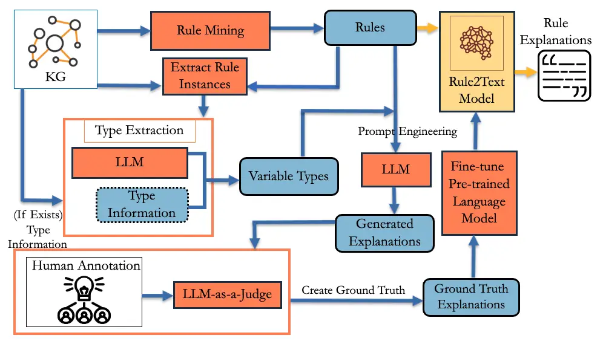

# Rule2Text: A Framework for Generating and Evaluating Natural Language Explanations of Knowledge Graph Rules

Nasim Shirvani-Mahdavi

Affiliation: University of Texas at Arlington, Arlington, Texas 76019,
USA E-mail <nasim.shirvanimahdavi2@mavs.uta.edu>    Chengkai Li

E-mail <cli@uta.edu> Affiliation: University of Texas at Arlington,
Arlington, Texas 76019, USA E-mail <nasim.shirvanimahdavi2@mavs.uta.edu>

###### Abstract

Knowledge graphs (KGs) can be enhanced through rule mining; however, the
resulting logical rules are often difficult for humans to interpret due
to their inherent complexity and the idiosyncratic labeling conventions
of individual KGs. This work presents Rule2Text, a comprehensive
framework that leverages large language models (LLMs) to generate
natural language explanations for mined logical rules, thereby improving
KG accessibility and usability. We conduct extensive experiments using
multiple datasets, including Freebase variants (FB-CVT-REV, FB+CVT-REV,
and FB15k-237) as well as the ogbl-biokg dataset, with rules mined using
AMIE 3.5.1. We systematically evaluate several LLMs across a
comprehensive range of prompting strategies, including zero-shot,
few-shot, variable type incorporation, and Chain-of-Thought reasoning.
To systematically assess models’ performance, we conduct a human
evaluation of generated explanations on correctness and clarity. To
address evaluation scalability, we develop and validate an
LLM-as-a-judge framework that demonstrates strong agreement with human
evaluators. Leveraging the best-performing model (Gemini 2.0 Flash), LLM
judge, and human-in-the-loop feedback, we construct high-quality ground
truth datasets, which we use to fine-tune the open-source Zephyr model.
Our results demonstrate significant improvements in explanation quality
after fine-tuning, with particularly strong gains in the domain-specific
dataset. Additionally, we integrate a type inference module to support
KGs lacking explicit type information. All code and data are publicly
available at
[https://github.com/idirlab/KGRule2NL](https://github.com/idirlab/KGRule2NL).

###### Keywords: 

Knowledge graphs Logical rules Natural language explanation Large
language models Interpretability

## 1 Introduction

Knowledge graphs (KGs) encode factual information as triples of the form
(subject s, predicate p, object o). They are integral to a wide range of
artificial intelligence tasks and applications \[14\]. Although
large-scale KGs (e.g., Freebase \[4\] and Wikidata \[30\]) contain a
vast number of triples, they are often incomplete, which adversely
affects their usefulness in downstream applications. However, KGs often
hold sufficient information to infer new facts \[9, 26, 11\]. For
example, if a KG indicates that a certain woman is the mother of a
child, it is quite likely that her husband is the child’s father.

Identifying logical rules—formal expressions that capture patterns and
relationships such as the example above—serves multiple critical
functions. These rules enable the inference of missing facts, facilitate
error detection in existing data, reveal underlying patterns in
large-scale datasets, and provide explanatory frameworks for automated
predictions \[19, 9\]. AMIE \[10, 3\] and AnyBURL \[18\] are among such
rule learning systems that derive Horn clauses for symbolic reasoning in
KG completion.

Despite their utility, logical rules present significant
interpretability challenges for humans, particularly non-experts who
must work with KG-based systems in domains such as healthcare and
scientific research. The difficulty stems from several factors: the
abstract nature and the complexity of logical structures, and the often
opaque entity and relation labeling conventions employed across
different KGs. For instance, as explained in \[27\], label of predicates
in the Freebase dataset follow the format /\[domain\]/\[type\]/\[label\]
(e.g., /american_football/player_rushing_statistics/team). Without
proper background knowledge of these conventions, interpreting and
validating logical rules becomes prohibitively difficult. Natural
language explanations of logical rules offer a promising solution to
bridge this interpretability gap. While predefined templates could
generate such explanations, this approach lacks scalability for the
thousands of rules typically extracted from large KGs. Recent advances
in large language models (LLMs) present an opportunity to address this
challenge through their demonstrated capabilities in natural language
generation and logical reasoning.

We present Rule2Text, a complete framework addressing this challenge
with several key contributions: (1) extensive experiments across diverse
domains from general knowledge to specialized biomedical datasets; (2)
development and validation of an LLM-as-a-judge \[34\] evaluation
framework enabling scalable quality assessment; (3) creation of
high-quality ground truth datasets for both general and domain-specific
contexts; (4) successful fine-tuning of open-source models using our
generated datasets; and (5) integration of type inference capabilities
for KGs lacking explicit entity type information. To our knowledge, this
is the first comprehensive study examining the effectiveness of LLMs for
generating natural language explanations of knowledge graph rules.

Our findings demonstrate that combining Chain-of-Thought \[31\]
prompting with variable type information yields substantial improvements
in explanation quality, with Gemini 2.0 Flash achieving the highest
correctness and clarity scores on human evaluation. Our LLM-as-a-judge
framework shows strong agreement with human annotators, enabling
scalable evaluation. Most notably, fine-tuning open-source models on our
generated datasets produces dramatic improvements in content coverage
and semantic similarity.

The remainder of this paper is organized as follows: Section 2 reviews
related work in natural language generation from logical forms.
Section 3 provides motivation and background on rule mining. Section 4
details our methodology including prompt engineering, type extraction,
and dataset creation. Section 5 describes our evaluation framework and
LLM-as-a-judge design. Section 6 presents experimental setup, Section 7
reports results across all experiments, and Section 8 concludes the
work.

## 2 Related Work

Prior work in natural language generation from logical forms, such as
Logic2Text \[6\] and SLEtoNL \[32\], generates high-fidelity text from
structured tables and sequential logic. While effective for their
specific domains, these models are limited for explaining knowledge
graph rules. They rely on input structures that are fundamentally
different from the Horn clauses we use. Furthermore, they prioritize
fluent summaries over pedagogical explanations and neglect the crucial
semantic roles of entities, types, and relations within knowledge
graphs.

Another relevant area is the encoding and translation of natural
rules \[8, 1, 33, 16\], which converts natural language rule expressions
into a formal logical format. This work aims to acquire rules from human
expertise, whereas our approach focuses on interpreting and explaining
existing rules. Similarly, Chain of Logic \[24\] improves how large
language models apply compositional rules to factual scenarios. However,
this approach also assumes the rules are already available and ready for
reasoning, which differs from our goal of providing explanations for
them.

In the broader context of KG-to-text generation, Shi et al. \[25\]
tackle the challenge of generating natural language descriptions from KG
triples while mitigating hallucinations in large-scale, open-domain
settings. While their work shares the goal of converting structured
knowledge into natural language, it focuses on factual triple
descriptions rather than rule explanations.

## 3 Motivation and Background

### 3.1 Motivation

The proliferation of complex AI systems across critical applications has
intensified demands for algorithmic transparency and explainability.
This need is particularly acute in high-stakes domains such as
healthcare, where stakeholders require clear justification for automated
decisions. KG technologies represent one such class of systems where
explainability is paramount. Logical rules extracted from KGs serve
multiple crucial functions: they enable inference of missing facts with
high probability, facilitate error detection in existing data, reveal
underlying patterns in large-scale datasets, and provide explanatory
frameworks for specific predictions \[19, 9\]. These capabilities make
rule-based reasoning an essential component of KG completion and quality
assurance workflows.

However, a significant barrier exists between the formal representation
of these rules and human comprehension. This interpretability gap stems
from several factors: the abstract nature of logical structures, the
complexity of multi-atom rules, and the often opaque entity and relation
labeling conventions employed in different knowledge graphs. For
instance, as explained in \[27\], label of predicates in the Freebase
dataset follow the format /\[domain\]/\[type\]/\[label\] (e.g.,
/american_football/player_rushing_statistics/team). This opacity
presents challenges not only for domain experts but also for technical
practitioners who must develop, debug, and maintain large-scale
knowledge graphs. The resulting comprehension burden limits the
practical utility of rule-based knowledge graph systems and impedes
their adoption in scenarios requiring human oversight or collaboration.

### 3.2 Rule Mining Algorithm

We employed AMIE 3.5.1, a well-established rule learning system in its
latest version, released in 2024, due to its comprehensive metrics for
rule evaluation as well as its proven compatibility with our chosen
benchmark datasets. In AMIE, a rule has a body (antecedent) and a head
(consequent), represented as
$`B_{1}\land B_{2}\land\ldots\land B_{n}\Rightarrow H`$ , or in
simplified form $`\overrightarrow{B}\Rightarrow H`$. The body consists
of multiple atoms $`B_{1}`$, $`\ldots`$, $`B_{n}`$, and the head $`H`$
itself is also an atom. In an atom r(h,t), which is another
representation of a triple (h, r, t), the subject and/or the object are
variables to be instantiated. The prediction of the head can be carried
out when all the body atoms can be instantiated in the KG.

For instance, consider the following simple rule extracted from the
Freebase dataset: (?a, /spaceflight/bipropellant_rocket_engine/oxidizer,
Hydrogen peroxide) $`\Rightarrow`$ (?a,
/spaceflight/rocket_engine/manufactured_by, NPO Energomash). This rule
consists of a single atom in the body and a single atom in the head. The
entities Hydrogen peroxide and NPO Energomash are constant entities,
while ?a is a variable entity that can be instantiated with entities
that satisfy the rule. For instance, in the following instantiation:
(RD-161P, /spaceflight/bipropellant_rocket_engine/oxidizer, Hydrogen
peroxide) $`\Rightarrow`$ (RD-161P,
/spaceflight/rocket_engine/manufactured_by, NPO Energomash), ?a is
replaced by RD-161P, which is a rocket engine.

In AMIE, the concept of support quantifies the amount of evidence (i.e.,
correct predictions) for each rule in the data. It is defined as the
number of distinct (subject, object) pairs in the head of all valid
instantiations of the rule in the KG. The concept of head coverage, a
proportional version of support, is the fraction of support over the
number of facts in relation r, where r is the relation in the head atom.
The standard confidence of a rule is the fraction of support over the
number of instantiations of the rule body.

## 4 Methodology

Rule2Text is an LLM-powered framework for generating natural language
explanations of logical rules extracted from KGs. The framework employs
a modular architecture where the rule mining algorithm serves as a
pluggable component, enabling integration with various KG rule
extraction methods. Since the focus of our study is on KG completion, we
utilize the AMIE algorithm to extract Horn rules as our rule mining
approach. Rule2Text addresses two core challenges in rule-to-text
generation. First, our preliminary results \[28\] show that LLMs
frequently exhibit confusion regarding variable entity types within
logical rules, necessitating a dedicated type inference module. Second,
the absence of suitable ground-truth datasets for training rule
explanation models requires a methodology for constructing high-quality
training data. To address this latter challenge, we propose a
ground-truth data generation approach detailed in Section 4.3. The
framework additionally provides comprehensive evaluation mechanisms for
assessing explanation quality and establishes a methodology for
fine-tuning LLMs for the rule explanation task.

Figure 1: Rule2Text Framework

### 4.1 Prompt Engineering

To generate natural language explanations for logical rules, we
conducted prompt engineering experiments in three phases. All
experimental materials—scripts, prompts, rules, generated explanations,
and annotated data—are available in our GitHub repository, with
preliminary results reported in our short paper \[28\]. Across all
experiments, we provided background knowledge to enhance model
understanding of dataset syntax and labels, including predicate formats
described in Section 3.1. This contextual information proved essential
for handling rules with concatenated relations, detailed in Section 6.1,
where lengthy, multi-component labels can confuse the models.

Zero-Shot & Few-Shot Prompting   In the first phase, we compared
zero-shot and few-shot prompting strategies using rules from
FB15k-237 \[5\], a subset of Freebase. Our objective was to assess how
in-context examples affect explanation quality and establish baseline
performance. The few-shot prompts included two (rule, explanation) pairs
as examples. For this phase and phase 2, we used OpenAI’s GPT-3.5
Turbo \[20\] for its optimal balance of performance, efficiency, and
cost-effectiveness. We selected 100 rules with the highest head coverage
for human evaluation, spanning diverse domains from music and media to
medicine and space. To ensure annotation quality and reduce
subjectivity, three annotators independently evaluated each rule.
Annotators were provided with both the logical rule and a concrete
instantiation to aid comprehension, along with explanations generated
using zero-shot and few-shot approaches. The evaluation metrics are
detailed in Section 5.1. As reported in Section 7, few-shot prompting
showed no significant improvement over the zero-shot baseline.

Incorporating Variable Entity Type in the Prompt   Analysis of the
generated explanations revealed persistent limitations in the model’s
ability to identify variable entity types, leading us to adopt
integration of these types in the prompt in phase 2. For instance, in
the rule ?b /time/event/instance_of_recurring_event World Series
$`\Rightarrow`$ World Series /sports/sports_championship/events ?b,
World Series, the variable ?b’s type is
/sports/sports_championship_event. For this phase, three annotators
annotated 100 rules, rules with the highest head coverage from two
large-scale Freebase datasets, 50 top rules from the FB-CVT-REV \[27\]
dataset, and 50 from the FB+CVT-REV dataset. Our findings, discussed in
Section 7, show that providing variable type information significantly
improved the model’s performance in generating accurate explanations.

Chain-of-Thought Prompting & Comparing Models   In phase 3, building on
the strong impact of incorporating variable entity types into the
prompts, we further leveraged the reasoning capabilities enabled by CoT
prompting. This prompt guides the model through five reasoning steps,
detailed in our short paper \[28\]. In this phase, we expanded our
evaluation to include two additional models, GPT-4o mini \[21\] and
Gemini 2.0 Flash \[12\], alongside GPT-3.5 Turbo. These models were
selected to provide a balanced comparison in terms of performance,
efficiency, and cost-effectiveness. Three annotators evaluated new
explanations, generated via CoT prompting by the three models, for the
same set of rules used in phase 2. As discussed in Section 7, GPT-3.5
Turbo shows improved performance compared to phase 2, while Gemini 2.0
Flash achieves the highest overall performance, followed by GPT-4o mini.

### 4.2 Variable Entity Type Extraction

As demonstrated in Section 4.1, determining the types of variable
entities poses a significant challenge for language models. Therefore, a
crucial step in our framework is providing the LLM with these entity
types. Some KGs, such as Freebase and Wikidata, include type systems
that facilitate this process. In Freebase datasets, entities can belong
to multiple types. Given a property (edge) type and its instances, there
exists an _approximate_ function that maps from the edge type to a type
shared by all subjects in the edge instances, and similarly for
objects \[27\]. Thus, knowing the property label allows us to infer the
types of entities participating in that relation. For example, consider
the rule from Section 4.1: ?b /time/event/instance_of_recurring_event
World Series. While ?b could generally be of type
/sports/sports_championship_event or /time/event, within this specific
relation, its type is /sports/sports_championship_event.

However, not all datasets include explicit type information. Therefore,
we need an approach to infer the types of variable entities. This can be
accomplished similarly to how humans learn what types of entities can
instantiate rules; by providing several examples to the model. To this
end, we extract three random instances of each rule and provide them to
the LLM, asking it to infer entity types based on the rule context and
property labels. Our results, discussed in Section 7, demonstrate that
the LLM performed this task effectively overall. The scripts for
extracting rule instances and performing type inference are available in
our GitHub repository.

### 4.3 Dataset Creation

In the prompt engineering step, we leveraged proprietary LLMs with
strong reasoning capabilities, such as Gemini 2.0 Flash. However, for
various reasons, including cost efficiency and the need to run models
locally due to data sensitivity concerns (e.g., healthcare data), we can
fine-tune open-source models such as Zephyr \[29\], which is known for
its instruction-following abilities. However, the lack of ground-truth
data presents a limitation. Therefore, we developed an approach for
ground-truth data construction for fine-tuning.

One approach would be to hire human annotators to generate natural
language explanations for logical rules. However, this approach has
several limitations. First, annotators must be experts in the field and
familiar with logical forms. Second, we would need to provide training
for each dataset, as labeling syntax varies across different KGs.
Furthermore, this approach can be costly and laborious.

To simplify and accelerate this process, we can leverage the
best-performing model, Gemini 2.0 Flash. This model demonstrates
reasonable correctness and clarity, as detailed in Section 7. We employ
it to generate natural language explanations for the desired number of
ground-truth data instances. Human annotators then evaluate these
generated explanations. If the explanations are not perfectly correct,
annotators modify them rather than writing complete explanations from
scratch.

This approach allows us to generate ground-truth data using a relatively
strong model. The resulting dataset is significantly smaller than the
complete set of rules extracted from the KG. We can then use this data
to fine-tune the open-source model. However, the limitations mentioned
above still exist. Although the task becomes easier and faster for human
annotators, this approach does not solve the problem fundamentally.

To facilitate this further, a potential solution lies in leveraging an
LLM-as-a-judge \[34\] as an evaluator. If a reliably fair and consistent
judge model can be designed, it becomes possible to automatically
evaluate rule-explanation pairs. The judge can assess these pairs, and
those receiving high correctness scores can be treated as pseudo-ground
truth for fine-tuning smaller open-source models. Additionally,
low-scoring examples can be analyzed by human annotators to identify
patterns that challenge even well-performing models like Gemini 2.0
Flash. Only these challenging instances would need human evaluation and
modification before inclusion in the ground truth data. The design of
our LLM-as-a-judge is discussed in Section 5.3.

## 5 Evaluation

### 5.1 Evaluation Metrics

To evaluate the generated explanations in experiments lacking reference
data, we employed the following metrics for human and automatic
evaluation. An upward arrow beside a metric indicates that higher values
are better for that evaluation criterion. Conversely, a downward arrow
indicates that lower values are preferred.

Correctness^(↑): Evaluation of the explanation’s accuracy on a scale
from 1 (completely incorrect) to 5 (fully correct). Correctness refers
to the explanation’s inclusion of all components of the rule, presented
in the exact logical flow specified by the rule. This metric does not
measure the readability or comprehensibility of the explanation.

Clarity^(↑): Evaluation of the explanation on a scale from 1 (very
unclear) to 5 (very clear). Clarity refers to the ease with which the
explanation can be understood and how naturally it reads. This metric
exclusively assesses the explanation, independent of the correctness of
the underlying rule.

Number of missed entities^(↓): The number of entities present in the
rule but not stated in the explanation.

Number of missed relations^(↓): The number of relations (i.e.,
predicates) present in the rule but not stated in the explanation.

Number of hallucinated entities^(↓): The number of entities absent from
the rule but incorrectly stated in the explanation.

Number of hallucinated relations^(↓): The number of relations absent
from the rule but incorrectly stated in the explanation.

Rule logicalness^(↑): Although the meaningfulness of a rule is not
directly related to the generation of explanations, we asked the
annotators to rate the rules on a scale from 1 (not logically sound) to
2 (moderately logical), and 3 (logically sound). This metric exclusively
evaluates the rule itself, without considering the explanation.

Perplexity^(↓): Given the absence of reference sentences for comparison
with the explanations in some of the experiments, as our automatic
evaluation metric, we computed perplexity \[15\] using GPT-2 \[23\].
Perplexity measures how well a language model predicts a sequence of
words, with lower values indicating more predictable and naturally
flowing text. We use this metric because it provides an automatic
assessment of the linguistic quality and naturalness of generated
explanations without requiring reference data. While it is a useful
measure of the model’s fluency and coherence, it is not an indication of
the correctness of the explanations.

### 5.2 Human Annotation

To mitigate subjectivity and bias in the human evaluation process, we
employed three expert annotators, ensuring that each data instance was
independently annotated by all three. Each annotator possessed prior
experience with logical forms and received training on the syntax of the
knowledge graphs used in this study, as well as the evaluation metrics
and assessment criteria. To further minimize potential bias, the
annotators were blinded to the source model of each explanation.
Moreover, a subset of rule-explanation pairs was randomly selected for
discussion among the annotators to review the rationale behind their
scoring decisions. This process helped identify occasional human errors
and facilitated the refinement of annotations, thereby improving the
overall quality and consistency of the evaluation scores.

### 5.3 LLM-as-a-Judge

LLMs are increasingly employed for performing evaluation tasks. The
LLM-as-a-judge paradigm \[7, 34\] presents several advantages over
traditional human-centric evaluation methods. First, it offers
significant scalability by reducing reliance on human annotators,
thereby enabling the development of large-scale benchmarks and
accelerating experimental iterations. Second, it enhances
interpretability, as LLM-based evaluators can produce both quantitative
scores and accompanying rationales that explain their judgments.

Our LLM-as-a-judge evaluation design incorporates several key
considerations to ensure reliability and reduce bias. First, the
evaluation instructions provided to the model were carefully constructed
to be unambiguous, with a strong emphasis on distinguishing evaluation
from generation. Specifically, the prompt explicitly instructs the model
to assess the quality of the given explanation, not to regenerate it.
This distinction is reinforced through structured CoT reasoning steps
that include objective, verifiable questions. For example: "Do all
variable entities stated in the rule appear in the explanation?"—a
question with a binary (yes/no) answer. A follow-up prompt then asks:
"If your answer is no, which variable entities are missing from the
explanation?" These types of questions are designed to compel the model
to compare content rather than generate a new explanation, which is
critical. As generating its own explanation may lead the model to treat
that output as a presumed ground truth—even if it is incorrect in
cases—thereby introducing bias into its evaluation.

Second, the scoring rubric was made explicit to the model, with clearly
defined criteria for each score level. For example, the prompt includes
explanations of what a score of 5 or 4 signifies in concrete terms. To
enhance in-context understanding, we employed few-shot prompting,
presenting the model with three exemplar explanations annotated with
corresponding scores to guide its interpretation. Finally, to assess the
consistency of the model’s evaluation behavior, we performed a
reliability check by prompting the model to score each explanation three
times. This allowed us to measure intra-model consistency and identify
potential variability in its assessments.

One notable form of bias associated with LLM-based evaluation is
self-enhancement bias\[34\], wherein language models tend to favor
responses they have generated themselves. To assess the presence of this
bias in our setup, we conducted a preliminary study \[28\], showing
unlike GPT-4o Mini, the best-performing model, Gemini 2.0 Flash, did not
exhibit self-enhancement bias under the given experimental conditions.
Based on these findings, we selected Gemini 2.0 Flash as the LLM judge
for all subsequent evaluations.

This design can be enhanced by incorporating a subset of human-annotated
data as ground truth. This data enables the evaluation of the judge’s
performance and facilitates the refinement of prompt engineering
strategies to improve their effectiveness. To this end, we employed 100
data instances from two large-scale datasets, FB-CVT-REV and FB+CVT-REV,
whose generated explanations were evaluated by human annotators during
phases 2 and 3 of prompt engineering. Section 7 reports the agreement
between the human judgments and those produced by the LLM judge.
Overall, the level of agreement suggests a promising direction for
adopting LLM-based evaluation in this context.

| dataset    | \# of triples | \# of rules |
| ---------- | ------------- | ----------- |
| FB15k-237  | 310,116       | 6,320       |
| FB-CVT-REV | 125,124,274   | 14,355      |
| FB+CVT-REV | 134,213,735   | 2,965       |
| ogbl-biokg | 5,088,434     | 145,114     |

Table 1: Statistics of the datasets

|           | m ent^(↓) | m rel^(↓) | h ent^(↓) | h rel^(↓) | correctness^(↑) | clarity^(↑) | logical^(↑) | perplexity^(↓) |
| --------- | --------- | --------- | --------- | --------- | --------------- | ----------- | ----------- | -------------- |
| all       | 0.10      | 0.04      | 0.29      | 0.10      | 4.36            | 4.67        | 2.36        | 36.14          |
| prompt 1  | 0.14      | 0.05      | 0.25      | 0.07      | 4.40            | 4.69        | 2.29        | 37.85          |
| prompt 2  | 0.06      | 0.03      | 0.34      | 0.12      | 4.32            | 4.64        | 2.44        | 34.36          |
| unanimous | 0.13      | 0.03      | 0.35      | 0.12      | 4.34            | 4.68        | 2.29        | 33.80          |
| majority  | 0.08      | 0.05      | 0.24      | 0.07      | 4.37            | 4.66        | 2.43        | 38.30          |

Table 2: Evaluation results on the annotated data in phase 1

## 6 Experiments

To mine the rules, we used the default settings of AMIE for optimized
performance, with minimum thresholds of 0.1 for head coverage and
standard confidence, and a maximum threshold of 3 for the number of
atoms. The remainder of this section describes the datasets used in our
study, along with the configuration details of our fine-tuning process.

### 6.1 Datasets

For our experiments, we leveraged four datasets. FB15k-237, a small
subset of the Freebase dataset, was selected as it is a widely used
benchmark for KG completion, recognized for avoiding the data leakage
issues of FB15k \[5\]. Its multi-domain coverage makes it well-suited
for extracting logical rules with diverse relations. As mentioned in
Section 4.1, this dataset was only used in the first phase of prompt
engineering to assess how in-context examples affect explanation quality
and establish baseline performance. FB-CVT-REV and FB+CVT-REV \[27\]
datasets (Statistics shown in Table 1) are large-scale variants of the
Freebase dataset designed to eliminate the data leakage issue previously
identified in FB15k. FB+CVT-REV includes mediator entities (i.e.,
Compound Value Type nodes) originally present in Freebase to represent
n-ary relations. In contrast, FB-CVT-REV converts n-ary relationships
centered on a CVT node into binary relations by concatenating the edges
that connect entities through the CVT node, a method also used in
FB15k-237. As shown in Table 1, the conversion process has resulted in a
higher number of rules in these two datasets compared to those in
FB+CVT-REV. Including these datasets facilitates the analysis of
large-scale data and the effects of mediator nodes and concatenated
relationships on the derived rules and generated explanations.

The label of a concatenated relation is formed by merging the labels of
two underlying relations. As a result, the label becomes lengthy, taking
the format of domain1/type1/label1-/domain2/type2/label2. Notably, the
domains and even types can sometimes be identical in concatenated
labels, but label1 and label2 are always distinct. This format differs
from the simpler structure of standard relations, which follow the
format of domain/type/label. Thus, this added complexity can pose a
greater challenge for LLMs in generating natural language explanations.
For instance, consider the triple (Dallas Cowboys,
/american_football/game_passing_statistics/team-/american_football/game_passing_statistics/player,
Tony Romo). Following the aforementioned format, this relation indicates
that Dallas Cowboys and Tony Romo participated in an n-ary relationship
involving additional entities, with this property representing the
result of converting the n-ary relationship to the binary format.

The fourth dataset used in our experiments is ogbl-biokg \[13\], a
well-established benchmark for KG completion tasks. This dataset was
selected due to its domain-specific nature. As outlined in the
motivation for this work, a key objective is to make prediction rules
more accessible to non-experts and domain scientists. Using a
domain-specific dataset such as ogbl-biokg allows us to better evaluate
the applicability and effectiveness of our approach.

The statistics of the ogbl-biokg dataset are presented in Table 1. This
dataset includes five types of entities: diseases, proteins, drugs, side
effects, and protein functions. In total, it contains 51 distinct
property types. Each entity in the dataset is identified by an ID that
begins with its entity type—for example, "drug_742". Unlike the Freebase
dataset, in which entities may have multiple types, each entity in
ogbl-biokg is associated with a single, unique type. This consistent
naming convention was leveraged to infer the types of variable entities
in rules, by examining rule instances as described in Section 4.2.

### 6.2 Fine-Tuning Implementation Details

As described in Section 4.3 and Section 5.3, we construct ground-truth
data for fine-tuning an LLM by combining a limited set of
human-annotated examples with an LLM-as-a-judge framework. We applied
this methodology to data from the FB-CVT-REV, FB+CVT-REV, and ogbl-biokg
datasets, resulting in the creation of two ground-truth datasets—one for
Freebase and one for ogbl-biokg. Each dataset consists of 500
rule–explanation pairs, split into 400 for training, 50 for validation,
and 50 for testing. The 100 examples that were directly annotated by
human evaluators were used exclusively for the validation and test sets.
The datasets developed in this work are publicly available via our
GitHub repository.

We selected Zephyr-7B-$`\beta`$, an instruction-tuned open-source
language model, as the model for fine-tuning. All experiments were
conducted using a single NVIDIA H100 80GB GPU. To accommodate GPU memory
constraints, we applied 4-bit quantization during fine-tuning. The
learning rate was set to 5e-5, providing a balance between convergence
speed and training stability. We used a batch size of 2 for both
training and evaluation, and both models—trained on the Freebase and
ogbl-biokg datasets—were fine-tuned for two epochs.

|                                       |             |           |           |           |           |             |             |                |
| ------------------------------------- | ----------- | --------- | --------- | --------- | --------- | ----------- | ----------- | -------------- |
|                                       | logical^(↑) | m ent^(↓) | m rel^(↓) | h ent^(↓) | h rel^(↓) | correct^(↑) | clarity^(↑) | perplexity^(↓) |
| explanation from zero-shot prompt     |             |           |           |           |           |             |             |                |
| all                                   | 2.58        | 0.06      | 0.10      | 0.22      | 0.09      | 3.94        | 4.12        | 29.05          |
| 2 atoms                               | 2.50        | 0.03      | 0.04      | 0.08      | 0.05      | 4.22        | 4.35        | 34.10          |
| 3 atoms                               | 2.62        | 0.08      | 0.13      | 0.31      | 0.12      | 3.78        | 3.99        | 26.21          |
| binary                                | 2.59        | 0.08      | 0.10      | 0.18      | 0.08      | 4.04        | 4.22        | 31.02          |
| mediator                              | 2.51        | 0.08      | 0.13      | 0.16      | 0.06      | 4.15        | 4.13        | 24.22          |
| concatenated                          | 2.60        | 0.02      | 0.08      | 0.35      | 0.15      | 3.63        | 3.91        | 27.63          |
| explanation from variable type prompt |             |           |           |           |           |             |             |                |
| all                                   | 2.58        | 0.05      | 0.07      | 0.21      | 0.13      | 4.21        | 4.19        | 33.07          |
| 2 atoms                               | 2.50        | 0.31      | 0.41      | 0.15      | 0.16      | 4.25        | 4.30        | 38.59          |
| 3 atoms                               | 2.62        | 0.07      | 0.08      | 0.24      | 0.11      | 4.18        | 4.12        | 29.97          |
| binary                                | 2.59        | 0.06      | 0.03      | 0.20      | 0.11      | 4.32        | 4.28        | 34.11          |
| mediator                              | 2.51        | 0.01      | 0.11      | 0.16      | 0.06      | 4.36        | 4.20        | 28.65          |
| concatenated                          | 2.60        | 0.05      | 0.11      | 0.25      | 0.20      | 3.88        | 3.99        | 33.33          |

Table 3: Evaluation results on the annotated data in phase 2

|              | GPT-3.5 Turbo |             |                | GPT-4o mini |             |                | Gemini 2.0 Flash |             |                |
| ------------ | ------------- | ----------- | -------------- | ----------- | ----------- | -------------- | ---------------- | ----------- | -------------- |
|              | correct^(↑)   | clarity^(↑) | perplexity^(↓) | correct^(↑) | clarity^(↑) | perplexity^(↓) | correct^(↑)      | clarity^(↑) | perplexity^(↓) |
| all          | 4.28          | 4.26        | 32.40          | 4.45        | 4.53        | 31.57          | 4.67             | 4.70        | 27.19          |
| 2 atoms      | 4.38          | 4.43        | 34.08          | 4.52        | 4.62        | 40.96          | 4.80             | 4.76        | 29.98          |
| 3 atoms      | 4.22          | 4.17        | 31.46          | 4.42        | 4.51        | 26.26          | 4.61             | 4.68        | 25.62          |
| binary       | 4.40          | 4.42        | 34.58          | 4.50        | 4.58        | 33.52          | 4.70             | 4.71        | 27.77          |
| mediator     | 4.13          | 4.07        | 26.26          | 4.24        | 4.49        | 26.82          | 4.69             | 4.63        | 26.92          |
| concatenated | 4.10          | 4.07        | 31.57          | 4.50        | 4.51        | 30.38          | 4.63             | 4.75        | 26.19          |

Table 4: Evaluation results on the annotated data in phase 3

## 7 Results

Prompt Engineering Results   In phase 1, annotators identified which
explanation better captured the rule’s semantics, preferring more
naturally worded explanations when semantic accuracy was comparable.
After selecting the better explanation, they rated it using our
evaluation metrics described in Section 5.1. We calculated averages only
for the majority-selected explanations. Table 2 presents average
measures for all annotated rules, separated by prompt type (zero-shot vs
few-shot, denoted as prompt 1 and prompt 2, respectively) and agreement
level (unanimous vs majority). The measures are abbreviated as m ent, m
rel, h ent, h rel, correctness, clarity, logical, and perplexity,
respectively. Results demonstrate that the model generates relatively
accurate and clear explanations with low perplexity. Of 100 annotated
sentences, 49 were assigned to few-shot explanations and 51 to zero-shot
explanations, with annotators reaching unanimous agreement on 48% of
rules. Missed or hallucinated elements were negligible, with most
hallucinations occurring in relation labels, particularly for
concatenated relations where the model generates additional entities or
relations to explain complex labels.

Table 3 presents the results for phase 2, averaged across all
annotators. Explanation 2, generated using the prompt including the
variable type, consistently shows higher correctness and clarity across
all categories, highlighting the importance of type information for
model comprehension. Both explanation types have minimal missing
entities and relations. However, explanation 2 also shows slightly
higher hallucination rates and increased perplexity. Rules with three
atoms and those involving concatenated relations generally receive lower
correctness and clarity scores, likely due to their increased
complexity. Interestingly, despite these lower scores, annotators rated
the rules from these two categories as more logically coherent.

Given the negligible number of hallucinated and missing entities and
relations, we evaluated the explanations in phase 3 using only
correctness, clarity, and perplexity. Table 4 presents the results.
Overall, the models exhibit trends similar to those observed in phase 2.
For example, all models perform better on shorter rules, particularly
those with only two atoms, and achieve higher performance on rules
involving only binary relations compared to those with concatenated
ones. GPT-3.5 Turbo shows improved performance with CoT prompting
compared to its performance using only variable entities. This
improvement is consistent across all categories except for rules that
include mediator nodes. GPT-4o mini is the second-best performing model
and demonstrates relatively strong performance on rules containing at
least one concatenated relation. Gemini 2.0 Flash demonstrates the best
overall performance. Its explanations are the most concise. For example,
given the rule (?a, /travel/accommodation/accommodation_type, Luxury
Resort) $`\Rightarrow`$ (?a, /travel/accommodation/price_range, High
end), GPT-4o mini generated: "If an accommodation is a Luxury Resort,
then it falls within the High end price range," whereas Gemini 2.0 Flash
produced: "Luxury resorts are in the high-end price range." However, in
rare instances, it includes remarks such as, “Note: This rule is likely
flawed.” Notably, the lowest clarity scores across all models are
observed for rules involving mediator nodes. Additionally, most models
exhibit their highest perplexity on rules with only two atoms, which is
somewhat unexpected given the simplicity of these rules.

Variable Entity Type Inference Performance   To evaluate the
effectiveness of inferring variable entity types, we removed the type
information of variable entities from the prompt—information that
originally existed in the Freebase dataset—and performed a type
inference task. Subsequently, we generated explanations for the same set
of 100 rules using the best-performing model, Gemini 2.0 Flash, and
asked annotators to assess their correctness. This experiment was
conducted exclusively on the Freebase dataset due to its high diversity
of entity types, whereas the ogbl-biokg dataset contains only five
entity types. In the majority of cases, the inferred types were highly
accurate, achieving an overall correctness score of 4.53.

However, in a few cases, the model inferred a type that was more
specific (i.e., a subtype) based on the instances it was exposed to. For
instance, consider the following rule: (?b,
/sports/competitor_competition_relationship/competitors-
/sports/competitor_competition_relationship/competition, ?f) $`\land`$
(?a, /sports/multi_event_tournament/athletic_performances-
/sports/competitor_competition_relationship/competition, ?f)
$`\Rightarrow`$ (?a,
/sports/multi_event_tournament/athletic_performances-
/sports/competitor_competition_relationship/competitors, ?b). Since the
random instances provided to the model were exclusively related to
tennis, the model inferred that the variable ?b corresponds to the type
tennis player. However, the rule itself is more general, and the correct
type for variable ?b is sports professional athlete
(/sports/pro_athlete).

LLM-as-a-Judge Performance   Since clarity represents a highly
subjective metric, our analysis concentrated on correctness assessment
in this experiment. The LLM judge received identical information to
human annotators: the rule, an instance of the rule, the list of
variable entity types, and the corresponding explanation. To evaluate
inter-rater reliability between LLM judges and human annotators, we
employed Spearman correlation for rank-order agreement and
Krippendorff’s Alpha for consensus accounting for chance agreement.
Annotator scores were averaged across multiple individuals and
represented as floating-point values, while LLM judge scores were
similarly formatted due to triple evaluation of each explanation for
consistency. Our evaluation reveals a Spearman correlation of 0.69,
suggesting reasonably strong rank-order agreement and indicating that
LLMs and humans tend to identify the same explanations as relatively
better or worse. However, Krippendorff’s Alpha of 0.59 reflects moderate
consensus when accounting for chance agreement and the ordinal nature of
ratings. This pattern suggests that while LLMs and humans show
substantial agreement on relative explanation quality rankings, they
exhibit more variability in absolute scoring, which is typical when
comparing automated and human evaluation systems. Notably, the LLM judge
consistently identified imperfect explanations, demonstrating reliable
detection of quality deficiencies. These findings indicate promising
potential for leveraging LLMs in scalable evaluation frameworks and
automated dataset generation for natural language explanation tasks.

Zephyr Performance   To evaluate explanation generation quality, we
employed three complementary automatic metrics: BLEU \[22\],
ROUGE \[17\], and METEOR \[2\], each capturing different aspects of text
quality. BLEU measures n-gram precision between generated and reference
explanations, assessing surface-level similarity and fluency. ROUGE
evaluates recall-oriented overlap, particularly useful for measuring
content coverage and informativeness of explanations. METEOR provides a
more sophisticated assessment by incorporating synonymy, stemming, and
word order, offering a more nuanced evaluation of semantic similarity.

The fine-tuning results, presented in Table 5, demonstrate substantial
improvements in explanation generation quality across both datasets,
with particularly pronounced gains on the ogbl-biokg dataset. On the
Freebase dataset, fine-tuning yielded consistent improvements across all
metrics. The ogbl-biokg dataset showed even more dramatic enhancements,
with BLEU scores improving from .38 to .55, ROUGE exhibiting the most
substantial gain from .02 to .78, and METEOR rising from .36 to .81. The
exceptionally low baseline ROUGE score (.02) on ogbl-biokg suggests the
base model struggled significantly with content overlap in biomedical
explanations, while the fine-tuned model’s performance (.78) indicates
successful domain adaptation. These results demonstrate that
domain-specific fine-tuning is particularly effective for specialized
knowledge graphs like ogbl-biokg, where technical terminology and
domain-specific reasoning patterns are crucial for generating coherent
natural language explanations.

|            | Freebase |            | ogbl-biokg |            |
| ---------- | -------- | ---------- | ---------- | ---------- |
| Metric     | Base     | fine-Tuned | Base       | fine-Tuned |
| BLEU^(↑)   | .48      | .71        | .38        | .55        |
| ROUGE^(↑)  | .10      | .33        | .02        | .78        |
| METEOR^(↑) | .44      | .66        | .36        | .81        |

Table 5: Zephyr performance on Freebase and ogbl-biokg datasets

## 8 Conclusion & Future Work

We presented Rule2Text, a comprehensive framework for generating natural
language explanations of logical rules extracted from knowledge graphs
using large language models. Through systematic experimentation across
multiple datasets and prompting strategies, we demonstrated that
Chain-of-Thought prompting combined with variable entity type
information yields the most accurate explanations, with Gemini 2.0 Flash
achieving the best performance. Our LLM-as-a-judge framework shows
promising agreement with human evaluators, enabling scalable evaluation
and ground truth dataset construction. Fine-tuning results demonstrated
substantial improvements, particularly in domain-specific contexts where
ROUGE scores improved from 0.02 to 0.78. Future research directions
include evaluating more complex rules beyond AMIE’s capabilities and
developing more sophisticated type inference mechanisms.

#### Acknowledgements

This material is based upon work supported by the National Science
Foundation under Grants TIP-2333834. We extend our gratitude to the
Texas Advanced Computing Center (TACC) for providing computing resources
for this work’s experimentation.

## References

- \[1\] Æsøy, K., Ozaki, A.: Rule Learning as Machine Translation using
  the Atomic Knowledge Bank. arXiv:2311.02765 (2023)
- \[2\] Banerjee, S., Lavie, A.: Meteor: An automatic metric for mt
  evaluation with improved correlation with human judgments. In: ACL.
  pp. 65–72 (2005)
- \[3\] Betz, P., Galárraga, L., Ott, S., Meilicke, C., Suchanek, F.,
  Stuckenschmidt, H.: PyClause-Simple and efficient rule handling for
  knowledge graphs. In: IJCAI. pp. 8610–8613 (2023)
- \[4\] Bollacker, K., Evans, C., Paritosh, P., Sturge, T., Taylor, J.:
  Freebase: a collaboratively created graph database for structuring
  human knowledge. In: SIGMOD. pp. 1247–1250 (2008)
- \[5\] Bordes, A., Usunier, N., Garcia-Durán, A., Weston, J.,
  Yakhnenko, O.: Translating embeddings for modeling multi-relational
  data. In: NeurIPS. pp. 2787–2795 (2013)
- \[6\] Chen, Z., Chen, W., Zha, H., Zhou, X., Zhang, Y., Sundaresan,
  S., Wang, W.Y.: Logic2Text: High-fidelity natural language generation
  from logical forms. arXiv:2004.14579 (2020)
- \[7\] Chiang, C.H., Lee, H.y.: Can large language models be an
  alternative to human evaluations? arXiv preprint
  arXiv:2305.01937 (2023)
- \[8\] Clark, P., Tafjord, O., Richardson, K.: Transformers as soft
  reasoners over language. arXiv preprint arXiv:2002.05867 (2020)
- \[9\] Galárraga, L., Teflioudi, C., Hose, K., Suchanek, F.M.: Fast
  Rule Mining in Ontological Knowledge Bases with AMIE$`++`$. VLDB
  24(6), 707–730 (Dec 2015)
- \[10\] Galárraga, L.A., Teflioudi, C., Hose, K., Suchanek, F.: AMIE:
  association rule mining under incomplete evidence in ontological
  knowledge bases. In: WWW. pp. 413–422 (2013)
- \[11\] Ghanbarizadeh, V., Moeinian, A., Langaroudi, Z.Y.P.,
  Mohammadagha, M., Sharifi, A.: Efficient context filtering for
  extractive question answering: A hybrid approach with semantic
  validation. Journal of Computer Science and Technology Studies 8(2),
  01–09 (2026)
- \[12\] Google DeepMind: Gemini 2.0 Flash (2024),
  [https://blog.google/technology/google-deepmind/google-gemini-ai-update-december-2024/](https://blog.google/technology/google-deepmind/google-gemini-ai-update-december-2024/)
- \[13\] Hu, W., Fey, M., Zitnik, M., Dong, Y., Ren, H., Liu, B.,
  Catasta, M., Leskovec, J.: Open graph benchmark: Datasets for machine
  learning on graphs. Advances in neural information processing systems
  33, 22118–22133 (2020)
- \[14\] Ji, S., Pan, S., Cambria, E., Marttinen, P., Philip, S.Y.: A
  survey on kgs: Representation, acquisition, and applications. TNNLS
  33(2), 494–514 (2021)
- \[15\] Jurafsky, D., Martin, J.H.: Speech and Language Processing.
  Prentice Hall (2009)
- \[16\] Kiashemshaki, K., Torkamani, M.J., Mahmoudi, N., Bilehsavar,
  M.S.: Simulating a bias mitigation scenario in large language models.
  arXiv preprint arXiv:2509.14438 (2025)
- \[17\] Lin, C.Y.: Rouge: A package for automatic evaluation of
  summaries. Technical Report SRI-TR-04-019, SRI International (2004)
- \[18\] Meilicke, C., Chekol, M.W., Betz, P., Fink, M., Stuckeschmidt,
  H.: Anytime bottom-up rule learning for large-scale KGC. VLDB 33(1),
  131–161 (2024)
- \[19\] Nakashole, N., Sozio, M., Suchanek, F.M., Theobald, M.:
  Query-time reasoning in uncertain RDF KBs with soft and hard rules.
  VLDS 884(6), 15–20 (2012)
- \[20\] OpenAI: OpenAI GPT-3.5 Turbo (2023),
  [https://openai.com/blog/gpt-3-5-turbo](https://openai.com/blog/gpt-3-5-turbo)
- \[21\] OpenAI: OpenAI GPT-4o Mini (2024),
  [https://openai.com/index/gpt-4o-mini-advancing-cost-efficient-intelligence/](https://openai.com/index/gpt-4o-mini-advancing-cost-efficient-intelligence/)
- \[22\] Papineni, K., Roukos, S., Ward, T., Zhu, W.J.: Bleu: a method
  for automatic evaluation of machine translation. In: ACL. pp.
  311–318 (2002)
- \[23\] Radford, A., Wu, J., Child, R., Luan, D., Amodei, D.,
  Sutskever, I.: Language models are unsupervised multitask learners.
  OpenAI Blog 1(8) (2019)
- \[24\] Servantez, S., Barrow, J., Hammond, K., Jain, R.: Chain of
  Logic: Rule-Based Reasoning with Large Language Models.
  arXiv:2402.10400 (2024)
- \[25\] Shi, X., Zhu, Z., Zhang, Z., Li, C.: Hallucination mitigation
  in natural language generation from large-scale open-domain knowledge
  graphs. In: EMNLP. pp. 12506–12521 (2023)
- \[26\] Shirvani-Mahdavi, N., Akrami, F., Li, C.: On Large-scale
  Evaluation of Embedding Models for Knowledge Graph Completion.
  arXiv:2504.08970 (2025)
- \[27\] Shirvani-Mahdavi, N., Akrami, F., Saeef, M.S., Shi, X., Li, C.:
  Comprehensive analysis of Freebase and dataset creation for robust
  evaluation of knowledge graph link prediction models. In: ISWC. pp.
  113–133. Springer (2023)
- \[28\] Shirvani-Mahdavi, N., Wingfield, D., Ghasemi, A., Li, C.:
  Rule2Text: Natural Language Explanation of Logical Rules in Knowledge
  Graphs. arXiv preprint arXiv:2507.23740 (2025)
- \[29\] Tunstall, L., Beeching, E., Lambert, N., Rajani, N., Rasul, K.,
  Belkada, Y., Huang, S., von Werra, L., Fourrier, C., Habib, N.,
  Sarrazin, N., Sanseviero, O., Rush, A.M., Wolf, T.: Zephyr: Direct
  Distillation of LM Alignment (2023)
- \[30\] Vrandečić, D., Krötzsch, M.: Wikidata: a free collaborative
  knowledge base. CACM 57(10), 78–85 (2014)
- \[31\] Wei, J., Wang, X., Schuurmans, D., Bosma, M., Xia, F., Chi, E.,
  Le, Q.V., Zhou, D., et al.: Chain-of-thought prompting elicits
  reasoning in large language models. NeurIPS 35, 24824–24837 (2022)
- \[32\] Wu, X., Cai, Y., Lian, Z., Leung, H.f., Wang, T.: Generating
  natural language from logic expressions with structural
  representation. TASLP 31, 1499–1510 (2023)
- \[33\] Yang, Z., Du, X., Mao, R., Ni, J., Cambria, E.: Logical
  reasoning over natural language as knowledge representation: A survey.
  arXiv:2303.12023 (2023)
- \[34\] Zheng, L., Chiang, W.L., Sheng, Y., Zhuang, S., Wu, Z., Zhuang,
  Y., Lin, Z., Li, Z., Li, D., Xing, E., et al.: Judging llm-as-a-judge
  with mt-bench and chatbot arena. NeurIPS 36, 46595–46623 (2023)
