# Dropping Just a Handful of Preferences Can Change Top Large Language Model Rankings

Jenny Y. Huang ^(†)^(†)thanks: Equal Contribution
Affiliation: Department of Electrical Engineering and Computer Science,
Massachusetts Institute of Technology Affiliation: MIT-IBM Watson AI Lab
   Yunyi Shen¹¹footnotemark: 1 Affiliation: Department of Electrical
Engineering and Computer Science, Massachusetts Institute of Technology
Affiliation: MIT-IBM Watson AI Lab    Dennis Wei Affiliation: MIT-IBM
Watson AI Lab Affiliation: IBM
Research{jhuang9,yshen99,tbroderick}@mit.edu, dwei@us.ibm.com    Tamara
Broderick Affiliation: Department of Electrical Engineering and Computer
Science, Massachusetts Institute of Technology Affiliation: MIT-IBM
Watson AI Lab

###### Abstract

We propose a method for evaluating the robustness of widely used LLM
ranking systems—variants of a Bradley–Terry model—to dropping a
worst-case very small fraction of preference data. Our approach is
computationally fast and easy to adopt. When we apply our method to
matchups from popular LLM ranking platforms, including Chatbot Arena and
derivatives, we find that the rankings of top-performing models can be
remarkably sensitive to the removal of a small fraction of preferences;
for instance, dropping just $`0.003\%`$ of human preferences can change
the top-ranked model on Chatbot Arena. Our robustness check identifies
the specific preferences most responsible for such ranking flips,
allowing for inspection of these influential preferences. We observe
that the rankings derived from MT-bench preferences are notably more
robust than those from Chatbot Arena, likely due to MT-bench’s use of
expert annotators and carefully constructed prompts. Finally, we find
that neither rankings based on crowdsourced human evaluations nor those
based on LLM-as-a-judge preferences are systematically more sensitive
than the other.

|     |
| --- |
|     |

## 1 Introduction

Open evaluation platforms like Chatbot Arena (Chiang et al., 2024b)
have, in large part due to their openness, become a gold standard for
assessing the capabilities of leading LLMs via human preference. These
open platforms are now widely used by top LLM developers and companies
(The Wall Street Journal, 2024; Bloomberg, 2025) to evaluate and design
new models and benchmarks (Grattafiori et al., 2024; Hui et al., 2024).
Such platforms rely on crowdsourced pairwise battles and human votes to
compute model rankings (Lee et al., 2023; Bai et al., 2022).

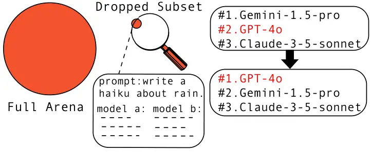

Figure 1: Our method (i) tests whether AI leaderboard rankings remain
stable upon dropping small fractions of data and (ii) pinpoints the
specific data points (e.g., preferences) that drive ranking flips.

At the heart of these preference-based evaluation pipelines is the
Bradley–Terry (BT) model (Bradley and Terry, 1952), which is widely used
to rank LLMs based on human feedback (Chiang et al., 2024b). The BT
model is also used to train reward models for RLHF (Ouyang et al., 2022;
Touvron et al., 2023; Xu et al., 2024; Sun et al., 2025) and route
queries to the most appropriate LLM or inference-time scaling strategy
(Damani et al., 2025).

A growing body of work has called into question the trustworthiness of
LLM leaderboards, showing that they are vulnerable to adversarial
attacks: a few hundred injected votes can change top rankings on Chatbot
Arena (Min et al., 2025), attackers can identify model outputs to
systematically upvote or downvote targets (Huang et al., 2025b),
LLM-judges can be easily gamed (Zheng et al., 2025; Raina et al., 2024),
and issues such as data leakage or selective reporting further undermine
leaderboard reliability (Singh et al., 2025).

In this work, we study a different type of untrustworthiness of LLM
ranking systems. That is: “Will the top rankings from LLM-evaluation
platforms change upon dropping a very small fraction of the human (or
AI) preference evaluations?” A positive answer would raise concerns
about the stability and generalizability of rankings produced by such
systems. Our notion of non-robustness differs from those of Min et al.
(2025); Huang et al. (2025b); Zhao et al. (2025) in two major respects.
First, it occurs at a different place in the process, at the data
analysis step after data has been collected (including from malicious or
apathetic users). Second, it does not require adversarial intent.

Our question posed above motivates the need for a systematic way to
assess the robustness of top rankings in BT-based evaluation systems to
worst-case data dropping. However, a brute-force combinatorial search
over all possible small subsets of data would be computationally
infeasible for large-scale platforms like Chatbot Arena. So we instead
turn to a recent line of works from statistics and theoretical computer
science that design algorithms for assessing whether data analyses are
robust to dropping a small, worst-case fraction of data points
(Broderick et al., 2020; Kuschnig et al., 2021; Moitra and Rohatgi,
2023; Freund and Hopkins, 2023; Shiffman et al., 2023; Nguyen et al.,
2024; Huang et al., 2025a; Rubinstein and Hopkins, 2025). One such
method, the Approximate Maximum Influence Perturbation (AMIP), estimates
how much a statistic of interest could change if a worst-case subset of
the data were dropped (Broderick et al., 2020). We extend these ideas to
develop a fast approximation method for assessing the robustness of
rankings from LLM evaluation systems to worst-case data-dropping.

We apply our method to assess several popular LLM ranking platforms,
including Chatbot Arena and derivatives (Chiang et al., 2024b; Zheng et
al., 2023; Miroyan et al., 2026; Vichare et al., 2025; Chou et al., 2025) and find most to be non-robust to dropping a very small fraction
of votes.

In Section 2, we formalize the setup for assessing worst-case
data-dropping robustness in BT-based ranking systems, and in Section 3
we introduce a computationally efficient method for assessing this form
of robustness in practice (Figure 1). In Section 4, we apply our
robustness assessment method to investigate the robustness of several
LLM leaderboards.

## 2 Setup

##### Human preference data.

We consider a preference-based ranking system akin to Chatbot Arena
(Chiang et al., 2024b). There are in total $`M`$ language models. Any
user can submit a prompt to be answered by a pair of language models.
Let the $`n`$th such prompt be sent to models $`i_{n}`$ and $`j_{n}`$
for $`i_{n},j_{n}\in[M]:=\{1,\ldots,M\}`$ with $`i_{n}\neq j_{n}`$. The
user then determines if the response from model $`i_{n}`$ is better than
that of model $`j_{n}`$, or is tied. Suppose there are in total $`N`$
such comparisons; the $`n`$th comparison can be seen as a tuple
$`(i_{n},j_{n},y_{n})`$, with $`y_{n}\in\{W,L,T\}`$ for whether in the
$`n`$th match, model $`i_{n}`$ is preferred over model $`j_{n}`$ (a win,
$`W`$), $`j_{n}`$ is preferred over $`i_{n}`$ (a loss, $`L`$), or the
two models are similar (a tie, $`T`$). From a collection of preference
data, the goal is to rank the language models.

Ranking with the (unweighted) Bradley–Terry model. The Bradley–Terry
(BT) model is a classical statistical model used to rank players from
binary match outcomes when there are only wins and losses,
$`y_{n}\in\{W,L\}`$. In this model, each player (e.g., language model),
$`i`$, is associated with a BT score, $`\theta_{i}`$, and the outcomes
are modeled as

```math
I_{y_{n}=W}\sim\text{Bernoulli}(\sigma(\theta_{i_{n}}-\theta_{j_{n}})), \tag{1}
```

where the sigmoid function $`\sigma(x)=1/(1+e^{-x})`$ and $`I`$ is the
indicator function. Note, since the “winning” probability depends on the
difference between two players’ scores rather than on their raw scores,
the scores are identified only up to a constant additive term. There are
different ways to avoid this identifiability problem (Wu et al., 2022).
Chatbot Arena chooses to set mixtral-8x7b-instruct-v0.1 as the reference
model, assigning it a fixed score of $`1{,}114`$. Chatbot Arena computes
the BT-scores (i.e., the estimates of
$`\bm{\theta}=(\theta_{1},\dots,\theta_{M})`$) for the unweighted
BT-model by maximum likelihood,

```math
\displaystyle\hat{\bm{\theta}}:= \displaystyle\argmax_{\bm{\theta}:\theta_{1}=0}\;\sum_{n=1}^{N}\big(I_{y_{n}=W}\log\sigma(\theta_{i_{n}}-\theta_{j_{n}})+I_{y_{n}=L}\log(1-\sigma(\theta_{i_{n}}-\theta_{j_{n}}))\big). \tag{2}
```

Finally, the rank of a model is its position in the sorted list of
models, $`(\widehat{\theta}_{(1)},\ldots,\widehat{\theta}_{(M)})`$,
ordered by their scores in descending order, so that
$`\widehat{\theta}_{(1)}`$ corresponds to the top-scoring and top-ranked
model.¹¹ 1 For ease of exposition in the main text, we assume there are
no ties. In practice, we did not observe ties in Bradley–Terry-based
point estimates. For rankings based on confidence intervals, we do
observe and handle ties; see Section A.1 for details.

Ranking with the weighted Bradley–Terry model to handle ties. The
classic BT model cannot handle ties. To handle ties, Chatbot Arena adds
weights to Equation 2, counting a tie as both a win and a loss (Chiang
et al., 2024b).²² 2 “Chatbot Arena Leaderboard Calculation
(Bradley–Terry model)” Colab
notebook:[https://colab.research.google.com/drive/1KdwokPjirkTmpO_P1WByFNFiqxWQquwH](https://colab.research.google.com/drive/1KdwokPjirkTmpO_P1WByFNFiqxWQquwH).
In the weighted BT model, one specifies a weight for wins and losses,
$`w_{WL}`$, and a weight for ties $`w_{T}`$. That is, we estimate BT
scores by maximizing the weighted likelihood,

```math
\displaystyle\hat{\bm{\theta}}:= \displaystyle\argmax_{\bm{\theta}:\theta_{1}=0}\;\sum_{n=1}^{N}\big[w_{WL}I_{y_{n}=W}\log\sigma(\theta_{i_{n}}-\theta_{j_{n}})+w_{WL}I_{y_{n}=L}\log(1-\sigma(\theta_{i_{n}}-\theta_{j_{n}}))
```

```math
\displaystyle\qquad\qquad\quad+w_{T}I_{y_{n}=T}\left\{\log\sigma(\theta_{i_{n}}-\theta_{j_{n}})+\log(1-\sigma(\theta_{i_{n}}-\theta_{j_{n}}))\right\}\big]. \tag{3}
```

As done on Chatbot Arena, we use $`w_{WL}=2`$ and $`w_{T}=1`$. This
choice can be interpreted as each win or loss counting as two matches of
the same outcome, and a tie counting as one win and one loss. They also
suggested an alternative treatment of dropping all ties and using the
unweighted BT model, which corresponds to $`w_{WL}=1`$ and $`w_{T}=0`$.

Postprocessing in Chatbot Arena. Chatbot Arena applies a linear
transformation to the learned BT scores (Chiang et al., 2024a). They use
$`\texttt{SCALE}=400`$, $`\texttt{INIT\_RATING}=1{,}000`$, and a further
shift ANCHOR_SHIFT to produce the displayed scores:

```math
\texttt{ELO}_{i}=\texttt{SCALE}\cdot\widehat{\theta}_{i}+\texttt{INIT\_RATING}+\texttt{ANCHOR\_SHIFT}.
```

The final constant (ANCHOR*SHIFT) shifts all the $`\texttt{ELO}*{i}`$
scores so that a specific reference model has a certain score. Chatbot
Arena uses mixtral-8x7b-instruct-v0.1 as the reference model, assigning
it a fixed score of $`1{,}114`$. We use the same reference model in our
analysis of Chatbot Arena; however, we assign the model a fixed score of
$`0`$ (a design choice that does not impact rankings). We note that the
affine transformation does not affect model rankings since it is
strictly monotonic and does not affect our proposed procedure since
linear transformations can commute with first-order Taylor expansion.

Setup for Data-Dropping. We study whether dropping a small fraction
$`\alpha\in(0,1)`$ (e.g., $`\alpha=0.01`$) of the preference data can
change the ordering of the estimated BT scores. Broderick et al. (2020)
define the Maximum Influence Perturbation as the largest possible change
induced in a quantity of interest by removing at most $`100\alpha\%`$ of
the data.

Let $`w_{n}`$ denote a weight on the $`n`$th data point, and collect
these into a vector $`w:=(w_{1},...,w_{N})`$. Define the weighted
estimator as

```math
\displaystyle\hat{\bm{\theta}}(w):= \displaystyle\argmax_{\bm{\theta}:\theta_{1}=0}\;\sum_{n=1}^{N}w_{n}\big[w_{WL}I_{y_{n}=W}\log\sigma(\theta_{i_{n}}-\theta_{j_{n}})+w_{WL}I_{y_{n}=L}\log(1-\sigma(\theta_{i_{n}}-\theta_{j_{n}}))
```

```math
\displaystyle\quad\quad\qquad\qquad\quad+w_{T}I_{y_{n}=T}\left\{\log\sigma(\theta_{i_{n}}-\theta_{j_{n}})+\log(1-\sigma(\theta_{i_{n}}-\theta_{j_{n}})\big)\right\}\big]. \tag{4}
```

Setting $`w=1_{N}`$ (the all-ones vector) recovers the BT scores
computed on the full data (e.g., the original arena), while setting
$`w_{n}=0`$ corresponds to dropping the $`n`$th data point (e.g., a
matchup). We define the set of all weight vectors corresponding to
dropping at most an $`\alpha`$-fraction of the data as follows.

###### Definition 1 (Feasible Drop Set).

Let
$`W_{\alpha}:=\{w\in\{0,1\}^{N}:\sum_{n=1}^{N}(1-w_{n})\leq\alpha N\}`$
be the set of all binary weight vectors indicating subsets where at most
$`100\alpha\%`$ of the data has been dropped.

We begin by considering the ordering of BT scores between a pair of
players, $`i`$ and $`j`$. Without loss of generality, we assume³³ 3 If
this assumption does not hold, the identities of $`i`$ and $`j`$ can be
swapped. that player $`i`$ has the higher estimated BT score on the full
data:

```math
\widehat{\theta}_{i}(1_{N})\geq\widehat{\theta}_{j}(1_{N}).
```

We are interested in whether this ordering can be reversed by dropping
at most an $`\alpha`$-fraction of the data.

We now extend this notion to an arena with $`M`$ players, for any
$`M\geq 2`$. Let
$`\mathcal{T}(w):=\{\widehat{\theta}_{i}(w)\}_{i=1}^{M}`$ denote the set
of BT scores under weighting $`w`$. Let
$`\rank\left[\widehat{\theta}_{i}(w);\mathcal{T}(w)\right]`$ denote the
rank of a model under the weighting $`w`$.

###### Definition 2 (Top-$`k`$ Set).

We define the top-$`k`$ set under a data weighting $`w`$ as the set of
players whose scores rank among the top $`k`$:

```math
\displaystyle\mathcal{K}_{\mathcal{T}(w)}:=\left\{i:\rank\left[\widehat{\theta}_{i}(w);\mathcal{T}(w)\right]\leq k\right\}. \tag{5}
```

###### Definition 3 (Top-$`k`$ Data-Dropping Robustness).

An arena is top-$`k`$ robust at level $`\alpha`$ if no
$`\alpha`$-fraction subset of data can be dropped to change the
top-$`k`$ set for the full data. That is,

```math
\displaystyle\left\{w\in W_{\alpha}:\mathcal{K}_{\mathcal{T}(1_{N})}\neq\mathcal{K}_{\mathcal{T}(w)}\right\}=\emptyset. \tag{6}
```

Notice that Equation 6 is nontrivial to directly verify; to check
directly, we could test out dropping all possible small-fraction subsets
of the arena, but this combinatorial operation is computationally
intractable in practice.

In Section 3, we show that verifying whether Equation 6 holds can be
reduced to checking the robustness of a series of pairwise comparisons.
Specifically, top-$`k`$ robustness as in Definition 3 can be checked by
assessing whether there exists a reweighting $`w\in W_{\alpha}`$ that
flips the ranking of a pair $`(i,j)`$ such that $`i`$ is inside and
$`j`$ is outside the top-$`k`$ set. We then can test if such flipping
can happen by: (a) using a continuous approximation of the discrete
weights $`w`$ (also known as “approximate data-dropping”) to identify a
promising candidate subset of influential preferences, (b) dropping
these, (c) recomputing the BT-based rankings, and (d) observing whether
the rankings change. We detail this procedure in Section 3.

## 3 Proposed method

Recall that our goal is to evaluate the robustness of the rankings
induced by a BT-model when a small fraction of matches (e.g.,
evaluations) is removed from the arena. To this end, we introduce a
method based on checking the robustness of pairwise BT score
differences. We provide pseudocode for our method in Algorithm 1 and
explain its steps below.

In Proposition B.1, we show that a top-$`k`$ set can be characterized by
considering a set of pairwise comparisons. This result allows us to
check top-$`k`$ robustness by checking pairwise robustness of all models
inside the top-$`k`$ set against all models outside of this set. In the
case that there does exist such a pair of models (one inside and one
outside the top-$`k`$) whose rankings flip, then the top-$`k`$ set has
changed, i.e., the arena is non-robust. In the case that there does not
exist at least one such pair of models whose rankings can be flipped
upon dropping a small fraction of preferences, then the top-$`k`$ set
remains unchanged, i.e., the arena is top-$`k`$ robust.

Given the equivalence between checking the robustness of the top-$`k`$
set and checking the robustness of the aforementioned series of pairwise
player comparisons, we propose a greedy algorithm to test whether the
top-$`k`$ set is robust to worst-case data-dropping. Namely, we test the
data-dropping robustness of all players in the top-$`k`$ set against all
players outside of the top-$`k`$ set.

Before that, we describe what it means for a given pair of player
scores, $`(\widehat{\theta}_{i}(w),\widehat{\theta}_{j}(w))`$, to be
data-dropping robust. Without loss of generality, we assume throughout
this section that player $`i`$ has the higher estimated BT score on the
full data.

Pairwise Robust. Given a pair of players, $`(i,j)`$, we say that the
scores for this pair,
$`(\widehat{\theta}_{i}(w),\widehat{\theta}_{j}(w))`$, are robust to
small-fraction data-dropping at level-$`\alpha`$ if

```math
\{w\in W_{\alpha}:\widehat{\theta}_{i}(w)<\widehat{\theta}_{j}(w)\}=\emptyset. \tag{7}
```

Top-$`k`$ Robust. Recall that an arena is top-$`k`$ robust at
level-$`\alpha`$ if there does not exist a reweighting,
$`w\in W_{\alpha}`$, such that
$`\mathcal{K}_{\mathcal{T}(1_{N})}\neq\mathcal{K}_{\mathcal{T}(w)}`$.
Using the line of logic in Proposition B.1, this is equivalent to
showing that, $`\forall\;(i,j)`$ where
$`i\in\mathcal{K}_{\mathcal{T}(w)}`$ and
$`j\notin\mathcal{K}_{\mathcal{T}(w)}`$, the pair
$`(\widehat{\theta}_{i}(w),\widehat{\theta}_{j}(w))`$ is robust. Namely,
if every comparison $`(i,j)`$ in this set of pairwise comparisons stays
the same (after reweighting), then the top-$`k`$ set also stays the same
(see Proposition B.1 for a detailed proof).

We now provide a method for checking the robustness of pairwise
comparisons.

Method for Checking Pairwise Robustness. In Equation 7, we are
interested in checking whether there exists a small fraction of
evaluations, $`w\in W_{\alpha}`$, that can be dropped to change the sign
of a difference in BT scores. Without loss of generality, we will assume
that the sign of the difference of BT scores fit to the full data is
positive (e.g.,
$`[\widehat{\theta}_{i}(1_{N})-\widehat{\theta}_{j}(1_{N})]>0`$, meaning
that model $`i`$ has a higher score than model $`j`$).

To evaluate the robustness of the sign of
$`[\widehat{\theta}_{i}(1_{N})-\widehat{\theta}_{j}(1_{N})]`$ to
dropping a small fraction of matches, we adopt a recently-developed
method from the statistics literature known as the Approximate Maximum
Influence Perturbation (Broderick et al., 2020) (see Section C.3 for a
more detailed discussion on how we adapt this method to our problem
setup). This method approximates the maximal directional change in a
statistic, e.g.,
$`[\widehat{\theta}_{i}(1_{N})-\widehat{\theta}_{j}(1_{N})]`$, that can
result from dropping a worst-case subset of data points (in our case,
evaluations) of size at most $`\lfloor\alpha N\rfloor`$. This method
allows us to sidestep running an expensive combinatorial search over all
data subsets for the worst-case subset of matches to drop, a procedure
that is computationally prohibitive for large LLM evaluation platforms
like Chatbot Arena.

The optimization problem implied by the Maximum Influence Perturbation
problem in our particular case is shown below,

```math
\displaystyle\max_{w\in W_{\alpha}}\left(\left[\widehat{\theta}_{i}(1_{N})-\widehat{\theta}_{j}(1_{N})\right]-\left[\widehat{\theta}_{i}(w)-\widehat{\theta}_{j}(w)\right]\right). \tag{8}
```

We approximate this discrete optimization problem using AMIP
approximation (Broderick et al., 2020); the idea is that, instead of
solving the optimization directly, we first approximate the effect of
dropping data by a first order Taylor expansion of the quantity
$`\widehat{\theta}_{i}(w)-\widehat{\theta}_{j}(w)`$ over data weights
$`w`$ and then solve the approximated optimization problem. In
Appendix C, we provide a review of the general AMIP approximation, then
formulate both the weighted and unweighted BT models as logistic
regressions, and finally provide an explicit form of the approximation
for both BT models.

Let the approximate solution to Equation 8 that is returned by AMIP be
denoted as $`\tilde{w}`$ (i.e., the set of data weights that are 0 at
indices of data points that AMIP chooses to drop and 1 elsewhere). For a
candidate pair of players, $`(i,j)`$, we check whether after dropping,
$`[\widehat{\theta}_{i}(\tilde{w})-\widehat{\theta}_{j}(\tilde{w})]<0`$.
In other words, we refit the BT-model upon leaving out the subset of
impactful evaluations identified by AMIP and check whether leaving out
this subset induces a sign change in the difference of BT scores for the
pair, $`(i,j)`$. We say that the BT scores for a pair of players,
$`(i,j)`$, are non-robust if the sign of the difference in scores
becomes negative upon refitting under $`\tilde{w}`$, (i.e., if
$`[\widehat{\theta}_{i}(\tilde{w})-\widehat{\theta}_{j}(\tilde{w})]<0`$).

Method for Checking Top-$`k`$ Robustness. We now describe how we can
fold our check for pairwise robustness into an overall routine for
checking for top-$`k`$ robustness.

Recall from earlier in Section 3 that we can check top-$`k`$ robustness
by checking pairwise robustness for every comparison $`(i,j)`$ where
$`i\in\mathcal{K}_{\mathcal{T}(w)}`$ and
$`j\notin\mathcal{K}_{\mathcal{T}(w)}`$. This amounts to checking the
pairwise robustness for at most $`k(M-k)`$ pairs.

Thus, we check top-$`k`$ robustness by iterating over pairs of players.
Note that, when checking the robustness of a given pair $`(i,j)`$, we
allow matches between any two models (not only $`(i,j)`$) to be dropped.
Since we only need to find one non-robust pair to render the set
non-robust, not all pairs need to be checked. To save on compute, we
take a greedy approach and start with comparing the most closely-ranked
pairs between the top-$`k`$ ranked players and the remaining $`M-k`$
players, where ‘‘closeness’’ is quantified using the absolute difference
in BT scores fit on the full data;⁴⁴ 4 The robustness of the relative
ranking of two players is correlated with the proximity of their BT
scores as seen in Figure 18. pairs with smaller BT-score gaps are more
likely to exhibit data-dropping non-robustness. Upon finding any single
pair that is pairwise non-robust at an $`\alpha`$-level, the procedure
terminates early and returns the corresponding players and the indices
of the dropped evaluations. We say that an arena is $`\alpha`$-level
top-$`k`$ robust if there does not exist a pair of players $`(i,j)`$,
where $`i\in\mathcal{K}_{\mathcal{T}(w)}`$ and
$`j\notin\mathcal{K}_{\mathcal{T}(w)}`$, that are $`\alpha`$-level
pairwise non-robust. While our method uses an approximation to identify
the influential preferences; it then performs an exact recomputation of
the Bradley–Terry scores with the identified preferences removed. As a
result, all non-robustness reported in this paper is definitive: when we
state that dropping $`100\alpha\%`$ of preferences changes the ranking,
we have explicitly verified that the ranking does in fact change upon
removal of the surfaced subset. However, the algorithm may not catch all
cases of non-robustness (i.e., false negatives are possible). See
Appendix H for an extended discussion on the possibility of false
negatives.

1:  Input: Dataset $`\mathcal{D}`$ (the collection of matches, e.g.,
preferences), rank $`k`$, drop fraction $`\alpha`$.

2:  Output: (1) A determination of whether top-$`k`$ non-robustness was
found. (2) If top-$`k`$ non-robustness is found, we additionally return
the pair of players ($`i,j`$) whose rankings flipped, the differences in
their scores pre- and post- data-dropping, and the most influential set
$`I`$.

3:  

4:  $`\triangleright`$ Fit a Bradley–Terry model on the full arena.

5:  $`\hat{\bm{\theta}}(1_{N})\leftarrow\text{FitBTModel}(\mathcal{D})`$

6:  Determine the top-$`k`$ set, $`\mathcal{K}_{\mathcal{T}(1_{N})}`$,
from $`\hat{\bm{\theta}}(1_{N})`$.

7:  

8:  $`\triangleright`$ Compute score gap for each player pair of
interest.

9:
 $`P\leftarrow\{(i,j):i\in\mathcal{K}_{\mathcal{T}(1_{N})},\,j\notin\mathcal{K}_{\mathcal{T}(1_{N})}\}`$

10:  for each $`(i,j)\in P`$ do

11:   Compute score gap
$`\hat{\Delta}(1_{N})_{ij}\leftarrow|\widehat{\theta}_{i}(1_{N})-\widehat{\theta}_{j}(1_{N})|`$

12:  end for

13:  Sort pairs $`(i,j)`$ in $`P`$ by increasing $`\Delta(1_{N})_{ij}`$

14:  

15:  $`\triangleright`$ Check pairwise robustness by choosing pairs in
order of increasing score gap.

16:  for each $`(i,j)`$ in sorted $`P`$ do

17:   $`\triangleright`$ Compute influence scores.

18:   for each datapoint (preference) $`n`$ do

19:    $`\text{IF}_{n}(i)\leftarrow`$ influence score for datapoint
$`n`$ on $`\widehat{\theta}_{i}(1_{N})`$

20:    $`\text{IF}_{n}(j)\leftarrow`$ influence score for datapoint
$`n`$ on $`\widehat{\theta}_{j}(1_{N})`$

21:    $`\Delta_{n}(i,j)\leftarrow\text{IF}_{n}(i)-\text{IF}_{n}(j)`$

22:   end for

23:   

24:   $`\triangleright`$ Identify worst-case subset by sorting influence
scores.

25:   Choose the $`\lfloor\alpha N\rfloor`$ values of
$`\Delta_{n}(i,j)`$ that are the largest in the negative direction,
assuming that
$`\widehat{\theta}_{i}(1_{N})-\widehat{\theta}_{j}(1_{N})>0`$.

26:   $`I\leftarrow`$ indices corresponding to the
$`\lfloor\alpha N\rfloor`$ most negative $`\Delta_{n}`$ values.

27:   

28:   $`\triangleright`$ Compute the AMIP-predicted score difference.

29:
  $`(\hat{\theta}_{i}(w)-\hat{\theta}_{j}(w))_{\text{AMIP}}\leftarrow(\widehat{\theta}_{i}(1_{N})-\widehat{\theta}_{j}(1_{N}))+\sum_{n\in I}\Delta_{n}`$

30:   

31:   $`\triangleright`$ Compute the exact refit for verification.

32:
  $`\hat{\bm{\theta}}(w)\leftarrow\text{FitBTModel}(\mathcal{D}_{-\alpha})`$,
where $`\mathcal{D}_{-\alpha}`$ is the set of points in $`\mathcal{D}`$
except those with indices in $`I`$

33:   Compute new difference:
$`(\widehat{\theta}_{i}(w)-\widehat{\theta}_{j}(w))`$

34:   

35:   if
$`\text{sign}((\widehat{\theta}_{i}(1_{N})-\widehat{\theta}_{j}(1_{N})))\neq\text{sign}(\widehat{\theta}_{i}(w)-\widehat{\theta}_{j}(w))`$
then

36:    return “Arena is $`\alpha`$-level top-$`k`$ non-robust”,
$`(i,j),(\widehat{\theta}_{i}(1_{N})-\widehat{\theta}_{j}(1_{N})),(\widehat{\theta}_{i}(w)-\widehat{\theta}_{j}(w)),I`$

37:   end if

38:  end for

39:  

40:  return “Arena was not found to be $`\alpha`$-level top-$`k`$
non-robust”

Algorithm 1 Our Data-dropping Robustness Check on Rankings

##### Runtime.

The above procedure is fast for assessing the robustness of
preference-based ranking systems. For example, we tested our method on
historical preference datasets released by the Chatbot Arena project and
hosted on Hugging Face (Chiang et al., 2024b). Specifically, we check
top-1 and top-5 robustness on a dataset of size around $`50{,}000`$
evaluations in under $`3`$ minutes on a personal computer equipped with
an Apple M1 Pro CPU at 3200 MHz and 16 GB of RAM.

## 4 Experiments

Our analysis reveals that 1) dropping as little as $`0.003\%`$ of the
evaluation data can flip the top-ranked model in popular LLM evaluation
platforms (Section 4.2), 2) crowdsourced human-evaluated systems are
about as non-robust as AI-evaluated systems (Section 4.3), 3) the
LLM-generated responses of the dropped evaluations appear similar in
content (Section 4.4), and 4) sensitivity depends on BT score margins
(Section F.1). Henceforth, for convenience, we use “robustness” as
shorthand for robustness of a system’s top-$`k`$ ranking to dropping a
small fraction, $`\alpha`$, of the data.

### 4.1 Data and Setup

We run our robustness check on a variety of LLM Arenas, including
Chatbot Arena (Chiang et al., 2024b), MT-bench (Zheng et al., 2023),
Search Arena (Miroyan et al., 2026), Webdev Arena (Vichare et al.,
2025), and Vision Arena (Chou et al., 2025). For more information about
each arena, see Appendix D. Our analysis relies on historical preference
datasets released by the Chatbot Arena project (Chiang et al., 2024b)
and publicly hosted on LMArena’s HuggingFace account. Each record
represents a matchup consisting of two LLMs that answer the same prompt,
the names of the two models, and the user label indicating preference
for model A, model B, or a tie. Figure 3 presents the Bradley–Terry
scores of the top-10 models on Chatbot Arena.

To compare the robustness of LLM arenas to more classical use cases of
BT models, we also run our check on two sports datasets, namely NBA
(FiveThirtyEight, 2025) and ATP tennis (Sackmann, 2024). For details on
the sports datasets, see Appendix D.

For each dataset, we assess top-$`k`$ robustness with
$`k\in\{1,3,5,10,20\}`$, extending up to the maximum number of models
present in the respective arena when fewer than $`20`$ models are
present.

### 4.2 Sensitivity of LLM Arenas

| Arena         | Evaluator (Judge) | Number Dropped   | Percentage Dropped |
| ------------- | ----------------- | ---------------- | ------------------ |
| Chatbot Arena | Human             | 2 out of 57477   | 0.00348%           |
| Vision Arena  | Human             | 28 out of 29845  | 0.0938%            |
| NBA Games     | NA                | 17 out of 109892 | 0.0155%            |
| Chatbot Arena | LLM               | 9 out of 49938   | 0.0180%            |
| Webdev Arena  | Human             | 18 out of 10501  | 0.171%             |
| Search Arena  | Human             | 61 out of 24469  | 0.253%             |
| MT-bench      | LLM               | 40 out of 2400   | 1.67%              |
| ATP Tennis    | NA                | 6 out of 278     | 2.16%              |
| MT-bench      | Human             | 92 out of 3355   | 2.74%              |

Table 1: Results of checking top-1 robustness of BT-scores on each of
the arenas, listed in ascending order of robustness (from the least to
the most robust). The “Number Dropped” column reports the number of
preferences (matches) that are sufficient to flip the first and
second-place models (players). The “Percentage Dropped” column shows
this number as a percentage of the number of total preferences in the
full arena. Datasets we found to be robust at an $`\alpha`$-level of
$`1\%`$ are colored in gray.

We find many popular LLM arenas to be incredibly sensitive to
data-dropping (see Table 1). In particular, we find that dropping just
two ($`0.003\%`$ of) evaluations is enough to change the top-ranked
model on Chatbot Arena from GPT-4-0125-preview to GPT-4-1106-preview;
see the two surfaced prompts and response pairs in Appendix F. We then
find that dropping just three ($`0.005\%`$ of) evaluations can change
one of the models in the top-5 rankings (the 5th and 6th-ranked models
changed). Surprisingly, GPT-4-1106-preview participated in the most
matchups across the entire arena and GPT-4-0125-preview also
participated in a sizable number of matchups, as shown in Figure 17,
suggesting that data-dropping sensitivity cannot be attributed to a
small sample size alone.

In addition to reporting rankings based on point-estimate BT-scores,
LMArena reports an approximate ranking based on the end points of
bootstrap confidence intervals (see LMArena (2025); Chiang et al.
(2024a); Chiang et al. (2024b)). Even with the bootstrap-based rankings,
we still find arenas to be surprisingly sensitive to worst-case
data-dropping. For instance, we surface arenas where the bootstrap-based
ranking outputs a single top-ranked model, but upon small-fraction data
dropping, the model becomes no longer the sole top-ranked model (see
Figure 7 in Section A.1). See Table 2 in Section A.1 for more details on
the sensitivity of LMArena rankings based on bootstrap confidence
intervals.

Out of the LLM arenas we analyze, MT-bench is the sole benchmark that is
robust at an $`\alpha`$-level of $`0.01`$ (see Table 1). Here, dropping
92 out of $`3{,}355`$ ($`2.74\%`$ of) evaluations changes the top model
from GPT-4 to Claude-v1. Dropping 110 ($`3.28\%`$ of) matchups can
change one of the models in the top-5 rankings (again, the 5th and 6th
ranked models changed). There are several reasons that may lead MT-bench
to be much more robust than the other LLM arenas. MT-bench consists of
80 carefully-designed multi-turn questions intended to differentiate
models on core capabilities such as math, reasoning, and writing, and
annotated by expert annotators (Zheng et al., 2023). In contrast, all
other arenas in our analysis are large-scale crowdsourced platforms,
which rely on user-submitted prompts and crowd-sourced preference
judgments.

### 4.3 Humans vs. LLM-as-a-Judge

Within arenas that used both human and LLM judges, we find neither
human-annotated nor LLM-annotated datasets to be clearly more sensitive
than the other to worst-case data-dropping (see Table 1 and Figure 2).
For Chatbot Arena, we find that the human-annotated dataset is slightly
more sensitive (required dropping fewer evaluations) for
$`k\in\{1,5,10,20\}`$ while the LLM-annotated dataset is slightly more
sensitive for $`k=3`$ (see Figure 2). In contrast, for MT-bench, the
LLM-annotated dataset is more sensitive than the human-annotated dataset
for all $`k\in\{1,3,5\}`$, perhaps due to the use of expert-human
annotators.⁵⁵ 5 We do not test $`k\in{10,20}`$, as MT-bench includes
only six models. Taken together, we cannot conclude that rankings based
on human preferences nor those based on LLM-as-a-judge preferences are
systematically more sensitive than the other.

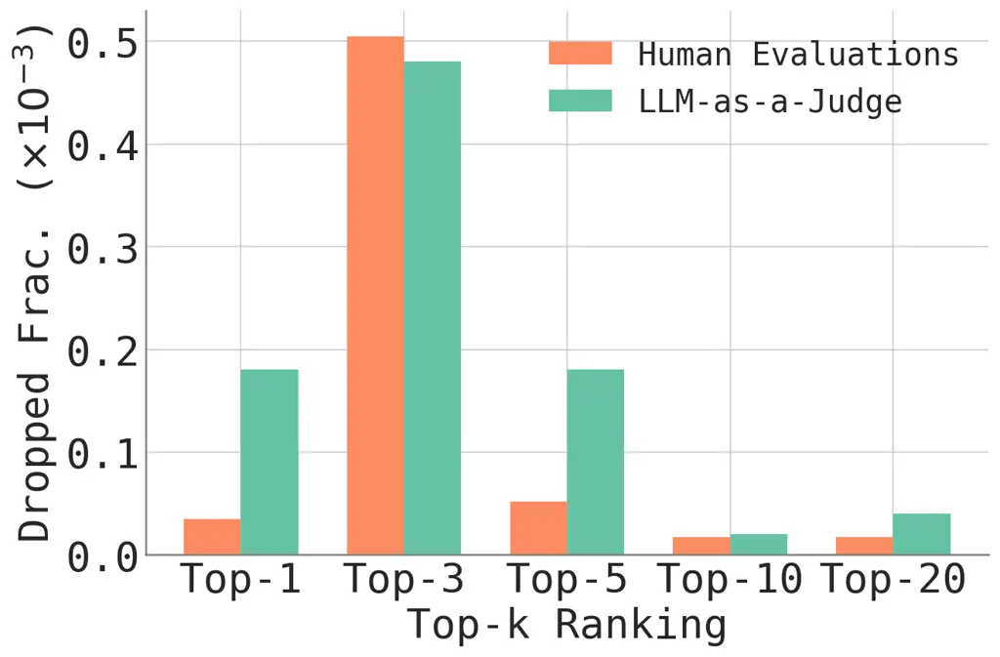

Figure 2: Each bar shows the fraction of data points dropped from
Chatbot Arena that is sufficient to demote the BT score of a model
inside the top-$`k`$ to outside of the top-$`k`$
($`k\in\{1,3,5,10,20\}`$). The orange bars correspond to human
evaluators and green bars to LLM-as-a-judge evaluators.

### 4.4 Inspecting Dropped Preferences

Our method can identify the prompts and response-pairs responsible for
changing top leaderboard rankings. On Chatbot Arena, we find that
dropping just two human evaluations suffices to flip the rankings of
GPT-4-1106-preview (originally ranked first) and GPT-4-0125-preview
(ranked second). We provide these prompts and response pairs in
Appendix F. A qualitative analysis of the prompt-response pairs (see
Appendix F) shows that the two surfaced preferences correspond to cases
that a strong judge model (GPT-5.1) identifies as atypical (i.e.,
different to what the “typical” user might prefer). In both cases,
GPT-4-1106-preview was judged to have lost against substantially
lower-ranked models: Vicuna-13b (ranked 43rd) and Stripedhyena-nous-7b
(ranked 45th). Dropping these two anomalous losses is enough to raise
GPT-4-1106-preview’s position from second to first.

## 5 Related Work

### 5.1 Vulnerabilities in AI Leaderboards

Despite its ease-of-use and widespread popularity, large-scale,
community-driven platforms like Chatbot Arena are found to be vulnerable
to adversarial attacks that can distort model rankings. Min et al.
(2025) demonstrate that Chatbot Arena is vulnerable to vote-rigging: by
injecting just a few hundred manipulated votes (out of 1.7 million),
attackers can significantly change the top model rankings. Similarly,
Huang et al. (2025b) find that an attacker can accurately identify which
model produced a response on Chatbot Arena, and use that to
systematically upvote or downvote a target model. They propose several
defenses (e.g., authentication, rate limits, malicious-vote detection)
that make the leaderboard more robust to adversarial agents. Injected
votes may be especially easy to construct on LLM-as-a-judge systems, as
recent works show that LLM judges can be gamed in systematic ways (Zheng
et al., 2025; Raina et al., 2024). Beyond vote-rigging, Singh et al.
(2025) identify other issues such as data leakage and private testing
practices that allow large, proprietary model developers to selectively
report the best-performing versions of their models on the arena. Zhao
et al. (2025) present a case study showing that model rankings can shift
when a fraction of votes comes from apathetic or arbitrary annotators.
Their analysis finds that replacing $`10\%`$ of votes with uniform
$`\{0,1\}`$ labels can move two models by up to five ranks. In contrast,
we do not alter votes but instead demonstrate that rankings can change
by removing an alarmingly small fraction ($`0.003\%`$) of the votes.
More importantly, while Zhao et al. (2025) present a case study focused
on the rankings of three specific test models, we develop a systematic
method to evaluate the robustness of BT-based ranking systems under
worst-case data dropping, which also identifies the specific
prompt–response pairs driving ranking flips. Beyond
pairwise-preference-based rankings, past works have pointed out the
fragility of LLM ranking systems based on absolute performance scores.
Perlitz et al. (2024) show that rankings derived from the Mean Win Rate
(MWR) metric (a variant of the Borda count) can be gamed to increase the
ranking of a target model by evaluating numerous models that are almost
equal to, but slightly weaker than, the target model, thereby inflating
the target model’s ranking. The authors suggest allocating more
evaluation resources for models ranked at the top of the leaderboard,
where the rankings may carry more weight. Finally, while all
pairwise-preference-based related works in this section focus on Chatbot
Arena, we extend our analysis to other domains (vision, web design,
search, and multi-turn dialogue) and find the leaderboard rankings on
these platforms to be similarly non-robust.

### 5.2 Data-dropping Robustness

A growing body of works in statistics and theoretical computer science
develops algorithms for assessing whether data analyses are robust to
dropping a small, worst-case fraction of the data (Broderick et al.,
2020; Kuschnig et al., 2021; Moitra and Rohatgi, 2023; Freund and
Hopkins, 2023; Nguyen et al., 2024; Huang et al., 2025a; Rubinstein and
Hopkins, 2025). To our knowledge, only one prior work has investigated
this question in the context of ranking systems: Shiffman et al. (2023)
study the robustness of rankings in gene set enrichment analysis,
showing that dropping just a few cells can alter the ranking of p-values
derived from the hypergeometric test. In contrast, our work examines
ranking robustness in a BT-based ranking system. While Shiffman et al.
(2023) analyze p-value rankings, we analyze preference-based rankings of
LLMs, extending AMIP (Broderick et al., 2020) to study the robustness of
BT-based ranking systems.

## 6 Discussion

Crowdsourced LLM evaluation platforms like Chatbot Arena offer a way to
rank LLMs by aggregating preferences over responses to open-ended
prompts. There is good reason that this setup has been widely-adopted:
it is easy to scale, doesn’t require expert annotators, and enables the
aggregation of many prompts and judgments across a wide range of users
(Zheng et al., 2023; Don-Yehiya et al., 2025).

In theory, this aggregation helps average out individual annotator
variability and yields a signal that is generalizable. However, in
practice, we find that model rankings can depend on just a small handful
of human (or LLM) evaluations. Thus, we encourage users of leaderboards
and benchmark contests to run our method to investigate the fragility of
crowdsourced LLM evaluation platforms before publishing results.

Sensitivity to worst-case data-dropping is often indicative of low
signal-to-noise in the underlying data (Broderick et al., 2020); to help
increase signal-to-noise, we recommend three different design-related
improvements that AI arenas could make. (1) Collect richer forms of
feedback beyond binary preferences (e.g., asking for evaluators’
confidence levels (Méndez et al., 2022).⁶⁶ 6 The weighted logistic
regression model used by Chatbot Arena can easily be extended to take in
confidence ratings on top of binary preferences. One could imagine
implementing this through encoding the confidence rating as a weight in
the Win-Counts matrix described in the “Chatbot Arena Leaderboard
Calculation (Bradley–Terry model)” Colab notebook. (2) Design more
discriminative prompts. Arenas could incorporate a prompt-filtering
system to identify and remove uninformative prompts, or create tools to
identify prompts requiring specialized knowledge in order to route them
to appropriate evaluators (Don-Yehiya et al., 2025). Chiang et al.
(2024b) perform topic-modeling of the prompts submitted to Chatbot
Arena. Their top-16 topics include “Poetry Writing Prompts” and “Movie
Recommendations and Ratings.” The subjective nature of such topics may
make differentiation between top models less meaningful. (3) Ensure
higher-quality preference annotations. Arenas could use mediators to
perform fine-grained assessments of crowdsourced responses (Don-Yehiya
et al., 2025), and categorize prompts by instruction type (e.g., factual
recall, creative generation) to promote more fine-grained model
comparisons within categories (Chia et al., 2024).

A complementary line of work on creating high-quality synthetic
benchmarks argues that separability—requiring performance gaps between
models to be wide enough for leaderboard trends to remain stable under
subsampling—should be a main design criterion (Li et al., 2025). At the
same time, our findings may suggest that apparent leaderboard
differences may be artifacts of noise in the evaluation process rather
than genuine performance gaps, which cautions against treating AI
leaderboard rankings as definitive indicators of differences in model
performance.

#### Acknowledgments

This work was supported in part by an ONR Early Career Grant, the
MIT-IBM Watson AI Lab, the NSF TRIPODS program (award DMS-2022448), a
MachineLearningApplications@CSAIL Seed Award, and the Amazon AI Research
Innovation Fellowship. We thank Hao Sun from the University of Cambridge
and Google Deepmind for helpful initial discussions and for pointers to
references.

## References

- Bai et al. (2022) Y. Bai, A. Jones, K. Ndousse, A. Askell, A. Chen, N.
  DasSarma, D. Drain, S. Fort, D. Ganguli, T. Henighan, et al. Training
  a helpful and harmless assistant with reinforcement learning from
  human feedback. arXiv preprint arXiv:2204.05862. Cited by: Figure 1.
- Belsley et al. (1980) D. A. Belsley, E. Kuh, and R. E. Welsch
  Regression diagnostics: Identifying influential data and sources of
  collinearity. John Wiley & Sons. Cited by: Appendix H.
- Bloomberg (2025) Bloomberg Before Deepseek blew up, Chatbot Arena
  announced its arrival. Note:
  [https://www.bloomberg.com/news/articles/2025-02-18/before-deepseek-blew-up-one-website-announced-its-arrival](https://www.bloomberg.com/news/articles/2025-02-18/before-deepseek-blew-up-one-website-announced-its-arrival)Accessed
  2026-1-31 Cited by: Figure 1.
- Bradley and Terry (1952) R. A. Bradley and M. E. Terry Rank analysis
  of incomplete block designs: i. The method of paired comparisons.
  Biometrika 39 (3/4), pp. 324–345. Cited by: §1.
- Broderick et al. (2020) T. Broderick, R. Giordano, and R. Meager An
  Automatic Finite-Sample Robustness Metric: When Can Dropping a Little
  Data Make a Big Difference?. arXiv preprint arXiv:2011.14999v1. Cited
  by: §A.2, §A.2, §C.1, §C.1, §C.1, §1, §2, §3, §3, §5.2, §6.
- Chia et al. (2024) Y. K. Chia, P. Hong, L. Bing, and S. Poria
  Instructeval: Towards holistic evaluation of instruction-tuned large
  language models. Proceedings of the First edition of the Workshop on
  the Scaling Behavior of Large Language Models, pp. 35–64. Cited by:
  §6.
- Chiang et al. (2024a) W. Chiang, L. Zheng, Y. Sheng, A. N.
  Angelopoulos, T. Li, D. Li, B. Zhu, H. Zhang, M. Jordan, J. E.
  Gonzalez, and I. Stoica Chatbot Arena Leaderboard Calculation
  (Bradley–Terry model). Note:
  [https://colab.research.google.com/drive/1KdwokPjirkTmpO_P1WByFNFiqxWQquwH](https://colab.research.google.com/drive/1KdwokPjirkTmpO_P1WByFNFiqxWQquwH)Accessed:
  2025-06-23 Cited by: §A.1, §2, §4.2.
- Chiang et al. (2024b) W. Chiang, L. Zheng, Y. Sheng, A. N.
  Angelopoulos, T. Li, D. Li, B. Zhu, H. Zhang, M. Jordan, J. E.
  Gonzalez, and I. Stoica Chatbot Arena: An Open Platform for Evaluating
  LLMs by Human Preference. In Forty-first International Conference on
  Machine Learning, Cited by: §A.1, Figure 1, §1, §1, §2, §2, §3, §4.1,
  §4.2, §6.
- Chou et al. (2025) C. Chou, L. Dunlap, K. Mashita, K. Mandal, T.
  Darrell, I. Stoica, J. E. Gonzalez, and W. Chiang Visionarena: 230k
  real world user-VLM conversations with preference labels. In
  Proceedings of the Computer Vision and Pattern Recognition Conference,
  pp. 3877–3887. Cited by: §1, §4.1.
- Damani et al. (2025) M. Damani, I. Shenfeld, A. Peng, A. Bobu, and J.
  Andreas Learning how hard to think: input-adaptive allocation of lm
  computation. In The Thirteenth International Conference on Learning
  Representations, Cited by: §1.
- Don-Yehiya et al. (2025) S. Don-Yehiya, B. Burtenshaw, R. Fernandez
  Astudillo, C. Osborne, M. Jaiswal, T. Kuo, W. Zhao, I. Shenfeld, A.
  Peng, M. Yurochkin, A. Kasirzadeh, Y. Huang, T. Hashimoto, Y.
  Jernite, D. Vila-Suero, O. Abend, J. Ding, S. Hooker, H. R. Kirk,
  and L. Choshen The Future of Open Human Feedback. Nature Machine
  Intelligence 7, pp. 825–835. Cited by: §6, §6.
- FiveThirtyEight (2025) FiveThirtyEight NBA-ELO dataset. Note:
  [https://github.com/fivethirtyeight/data/tree/master/nba-elo](https://github.com/fivethirtyeight/data/tree/master/nba-elo)Accessed:
  2025-09-23 Cited by: Appendix D, §4.1.
- Freund and Hopkins (2023) D. Freund and S. B. Hopkins Towards
  practical robustness auditing for linear regression. arXiv preprint
  arXiv:2307.16315. Cited by: §1, §5.2.
- Gao et al. (2023) C. Gao, Y. Shen, and A. Y. Zhang Uncertainty
  quantification in the Bradley–Terry–Luce model. Information and
  Inference: A Journal of the IMA 12 (2), pp. 1073–1140. Cited by: §A.2.
- Ghosh et al. (2020) S. Ghosh, W. Stephenson, T. D. Nguyen, S.
  Deshpande, and T. Broderick Approximate cross-validation for
  structured models. Advances in Neural Information Processing Systems
  33, pp. 8741–8752. Cited by: §C.3.
- Giordano et al. (2019) R. Giordano, M. I. Jordan, and T. Broderick A
  higher-order Swiss Army infinitesimal jackknife. arXiv preprint
  arXiv:1907.12116v1. Cited by: §C.1.
- Grattafiori et al. (2024) A. Grattafiori, A. Dubey, A. Jauhri, A.
  Pandey, A. Kadian, A. Al-Dahle, A. Letman, A. Mathur, A. Schelten, A.
  Vaughan, et al. The Llama 3 Herd of Models. arXiv preprint
  arXiv:2407.21783. Cited by: Figure 1.
- Hampel et al. (2011) F. R. Hampel, E. M. Ronchetti, P. J. Rousseeuw,
  and W. A. Stahel Robust statistics: the approach based on influence
  functions. John Wiley & Sons. Cited by: §C.1.
- Hu et al. (2024) Y. Hu, P. Hu, H. Zhao, and J. W. Ma Most Influential
  Subset Selection: Challenges, Promises, and Beyond. In Advances in
  Neural Information Processing Systems, Vol. 38. Cited by: Appendix H.
- Huang et al. (2025a) J. Y. Huang, D. R. Burt, T. D. Nguyen, Y. Shen,
  and T. Broderick Approximations to worst-case data dropping: unmasking
  failure modes. Transactions on Machine Learning Research. Cited by:
  §C.3, Appendix H, §1, §5.2.
- Huang et al. (2025b) Y. Huang, M. Nasr, A. Angelopoulos, N.
  Carlini, W. Chiang, C. A. Choquette-Choo, D. Ippolito, M.
  Jagielski, K. Lee, K. Z. Liu, I. Stoica, F. Tramer, and C. Zhang
  Exploring and mitigating adversarial manipulation of voting-based
  leaderboards. International Conference on Machine Learning 267. Cited
  by: §1, §1, §5.1.
- Hui et al. (2024) B. Hui, J. Yang, Z. Cui, J. Yang, D. Liu, L.
  Zhang, T. Liu, J. Zhang, B. Yu, K. Lu, K. Dang, Y. Fan, Y. Zhang, A.
  Yang, R. Men, F. Huang, B. Zheng, Y. Miao, S. Quan, Y. Feng, X.
  Ren, X. Ren, J. Zhou, and J. Lin Qwen2.5-Coder technical report. arXiv
  preprint arXiv:2409.12186. Cited by: Figure 1.
- Hunter (2004) D. R. Hunter MM algorithms for generalized Bradley-Terry
  models. The Annals of Statistics 32 (1), pp. 384–406. Cited by: §A.2.
- Koh and Liang (2017) P. W. Koh and P. Liang Understanding black-box
  predictions via influence functions. In International Conference on
  Machine Learning, pp. 1885–1894. Cited by: §C.1.
- Kuschnig et al. (2021) N. Kuschnig, G. Zens, and J. Crespo Cuaresma
  Hidden in plain sight: Influential sets in linear models. Technical
  report CESifo Working Paper. Cited by: Appendix H, §1, §5.2.
- Lee et al. (2023) H. Lee, S. Phatale, H. Mansoor, K. R. Lu, T.
  Mesnard, J. Ferret, C. Bishop, E. Hall, V. Carbune, and A. Rastogi
  RLAIF vs. RLHF: Scaling Reinforcement Learning from Human Feedback
  with AI Feedback. In Proceedings of Machine Learning Research, Vol. 235. Cited by: Figure 1.
- Leonard (1977) T. Leonard An alternative Bayesian approach to the
  Bradley-Terry model for paired comparisons. Biometrics, pp. 121–132.
  Cited by: §A.2.
- Li et al. (2025) X. L. Li, F. Kaiyom, E. Z. Liu, Y. Mai, P. Liang,
  and T. Hashimoto AutoBencher: Towards Declarative Benchmark
  Construction. In The Thirteenth International Conference on Learning
  Representations, Cited by: §6.
- LMArena (2025) LMArena LMArena Leaderboard. Note:
  [https://lmarena.ai/leaderboard](https://lmarena.ai/leaderboard)Accessed:
  2025-11-18 Cited by: §A.1, §A.2, §4.2.
- Méndez et al. (2022) A. E. Méndez, M. Cartwright, J. P. Bello, and O.
  Nov Eliciting confidence for improving crowdsourced audio annotations.
  Proceedings of the ACM on Human-Computer Interaction 6 (CSCW1),
  pp. 1–25. Cited by: §6.
- Min et al. (2025) R. Min, T. Pang, C. Du, Q. Liu, M. Cheng, and M. Lin
  Improving Your Model Ranking on Chatbot Arena by Vote Rigging. In
  International Conference on Machine Learning, Vol. 267. Cited by:
  Appendix E, §1, §1, §5.1.
- Miroyan et al. (2026) M. Miroyan, T. Wu, L. King, T. Li, J. Pan, X.
  Hu, W. Chiang, A. N. Angelopoulos, T. Darrell, N. Norouzi, and J. E.
  Gonzalez Search Arena: Analyzing Search-Augmented LLMs. In The
  Fourteenth International Conference on Learning Representations, Cited
  by: §1, §4.1.
- Moitra and Rohatgi (2023) A. Moitra and D. Rohatgi Provably Auditing
  Ordinary Least Squares in Low Dimensions. The 11th International
  Conference on Learning Representations. Cited by: Appendix H, §1,
  §5.2.
- Nguyen et al. (2024) T. D. Nguyen, R. Giordano, R. Meager, and T.
  Broderick Using gradients to check sensitivity of MCMC-based analyses
  to removing data. In ICML 2024 Workshop on Differentiable Almost
  Everything: Differentiable Relaxations, Algorithms, Operators, and
  Simulators, Cited by: §1, §5.2.
- Ouyang et al. (2022) L. Ouyang, J. Wu, X. Jiang, D. Almeida, C.
  Wainwright, P. Mishkin, C. Zhang, S. Agarwal, K. Slama, A. Ray, J.
  Schulman, J. Hilton, F. Kelton, L. Miller, M. Simens, A. Askell, P.
  Welinder, P. Christiano, J. Leike, and R. Lowe Training language
  models to follow instructions with human feedback. Advances in Neural
  Information Processing Systems 35, pp. 27730–27744. Cited by: §1.
- Park et al. (2023) S. M. Park, K. Georgiev, A. Ilyas, G. Leclerc,
  and A. Madry TRAK: Attributing model behavior at scale. In
  International Conference on Machine Learning, pp. 27074–27113. Cited
  by: §C.1, §C.3.
- Perlitz et al. (2024) Y. Perlitz, E. Bandel, A. Gera, O. Arviv, L. E.
  Dor, E. Shnarch, N. Slonim, M. Shmueli-Scheuer, and L. Choshen
  Efficient benchmarking (of language models). In Proceedings of the
  2024 Conference of the North American Chapter of the Association for
  Computational Linguistics: Human Language Technologies (Volume 1: Long
  Papers), pp. 2519–2536. Cited by: §5.1.
- Pregibon (1981) D. Pregibon Logistic Regression Diagnostics. The
  Annals of Statistics 9 (4). Cited by: §C.3.
- Raina et al. (2024) V. Raina, A. Liusie, and M. Gales Is
  LLM-as-a-Judge Robust? Investigating Universal Adversarial Attacks on
  Zero-shot LLM Assessment. Proceedings of the 2024 Conference on
  Empirical Methods in Natural Language Processing, pp. 7499–7517. Cited
  by: §1, §5.1.
- Rubinstein and Hopkins (2025) I. Rubinstein and S. Hopkins Robustness
  Auditing for Linear Regression: To Singularity and Beyond. The 13th
  International Conference on Learning Representations. Cited by: §1,
  §5.2.
- Sackmann (2024) J. Sackmann ATP Tennis Rankings, Results, and Stats.
  Note:
  [https://github.com/JeffSackmann/tennis_atp](https://github.com/JeffSackmann/tennis_atp)GitHub
  repository Cited by: Appendix K, Appendix D, §4.1.
- Sekhari et al. (2021) A. Sekhari, J. Acharya, G. Kamath, and A. T.
  Suresh Remember what you want to forget: Algorithms for machine
  unlearning. Advances in Neural Information Processing Systems 34,
  pp. 18075–18086. Cited by: §C.3.
- Shiffman et al. (2023) M. Shiffman, R. Giordano, and T. Broderick
  Could dropping a few cells change the takeaways from differential
  expression?. arXiv preprint arXiv:2312.06159. Cited by: §1, §5.2.
- Singh et al. (2025) S. Singh, Y. Nan, A. Wang, D. D’souza, S.
  Kapoor, A. Üstün, S. Koyejo, Y. Deng, S. Longpre, N. A. Smith, B.
  Ermis, M. Fadaee, and S. Hooker The Leaderboard Illusion. In The
  Thirty-ninth Annual Conference on Neural Information Processing
  Systems Datasets and Benchmarks Track, Cited by: §1, §5.1.
- Sun et al. (2025) H. Sun, Y. Shen, and J. Ton Rethinking reward
  modeling in preference-based large language model alignment. In The
  Thirteenth International Conference on Learning Representations, Cited
  by: §1.
- Suriyakumar and Wilson (2022) V. Suriyakumar and A. C. Wilson
  Algorithms that approximate data removal: New results and limitations.
  Advances in Neural Information Processing Systems 35, pp. 18892–18903.
  Cited by: §C.3.
- The Wall Street Journal (2024) The Wall Street Journal The UC Berkeley
  Project That Is the AI Industry’s Obsession. Note:
  [https://www.wsj.com/tech/ai/the-uc-berkeley-project-that-is-the-ai-industrys-obsession-bc68b3e3](https://www.wsj.com/tech/ai/the-uc-berkeley-project-that-is-the-ai-industrys-obsession-bc68b3e3)Accessed
  2026-01-31 Cited by: Figure 1.
- Touvron et al. (2023) H. Touvron, L. Martin, K. Stone, P. Albert, A.
  Almahairi, Y. Babaei, N. Bashlykov, S. Batra, P. Bhargava, S. Bhosale,
  et al. Llama 2: Open foundation and fine-tuned chat models. arXiv
  preprint arXiv:2307.09288. Cited by: §1.
- Vichare et al. (2025) A. Vichare, A. N. Angelopoulos, W. Chiang, K.
  Tang, and L. Manolache WebDev Arena: A Live LLM Leaderboard for Web
  App Development. Cited by: §1, §4.1.
- Wilson et al. (2020) A. Wilson, M. Kasy, and L. Mackey Approximate
  Cross-Validation: Guarantees for Model Assessment and Selection. In
  International Conference on Artificial Intelligence and Statistics,
  pp. 4530–4540. Cited by: §C.3.
- Wu et al. (2022) W. Wu, B. W. Junker, and N. Niezink Asymptotic
  comparison of identifying constraints for Bradley-Terry models. arXiv
  preprint arXiv:2205.04341. Cited by: §2.
- Xu et al. (2024) S. Xu, B. Yue, H. Zha, and G. Liu Uncertainty-aware
  Preference Alignment in Reinforcement Learning from Human Feedback. In
  ICML 2024 Workshop on Models of Human Feedback for AI Alignment, Cited
  by: §1.
- Zhao et al. (2025) W. Zhao, A. M. Rush, and T. Goyal Challenges in
  Trustworthy Human Evaluation of Chatbots. Findings of the Association
  for Computational Linguistics, pp. 3359–3365. Cited by: §1, §5.1.
- Zheng et al. (2023) L. Zheng, W. Chiang, Y. Sheng, S. Zhuang, Z.
  Wu, Y. Zhuang, Z. Lin, Z. Li, D. Li, E. Xing, H. Zhang, J. E.
  Gonzalez, and I. Stoica Judging LLM-as-a-Judge with MT-Bench and
  Chatbot Arena. Advances in Neural Information Processing Systems 36,
  pp. 46595–46623. Cited by: Appendix D, Appendix D, §F.1, §1, §4.1,
  §4.2, §6.
- Zheng et al. (2025) X. Zheng, T. Pang, C. Du, Q. Liu, J. Jiang, and M.
  Lin Cheating automatic LLM benchmarks: Null models achieve high win
  rates. The 13th International Conference on Learning Representations.
  Cited by: §1, §5.1.

## Appendix

## Appendix A Uncertainty Quantification

### A.1 Sensitivity of LLM Arena Rankings Based on Bootstrap Confidence Intervals

In addition to reporting rankings based on point-estimate BT-scores,
LMArena reports an approximate ranking based on the end points of
bootstrap confidence intervals (see LMArena (2025); Chiang et al.
(2024a); Chiang et al. (2024b)). Specifically, Chiang et al. (2024b)
computes bootstrap-confidence-interval-based rankings, which we will
henceforth refer to as bootstrap-based rankings, as

```math
\displaystyle R_{m}=1+\sum_{m^{\prime}\in[M]}\mathbf{1}\!\left\{\inf C_{m^{\prime}}>\sup C_{m}\right\}, \tag{9}
```

where $`R_{m}`$ denotes the rank and $`C_{m}`$ the bootstrap confidence
interval of model $`m`$. Under this scheme, a model’s ranking increases
by one for every other model whose lower confidence-interval endpoint
exceeds the upper endpoint of the model in question (see Equation 9). In
other words, a model, $`m`$, is ranked below all models whose
performance is significantly higher according to non-overlapping
bootstrap confidence intervals. This definition (see Equation 9) induces
a set-valued ranking: multiple models may share the same ranking
whenever their confidence intervals overlap with one another. Thus, a
bootstrap-based “rank” corresponds often to a set of statistically
indistinguishable models, rather than a single model.

In the bootstrap-based ranking setting, we follow the same notion of
top-$`k`$ robustness introduced in Definition 3. An arena is deemed
top-$`k`$ robust at level-$`\alpha`$ if no $`\alpha`$-fraction subset of
data can be dropped to change the top-$`k`$ set of models. The only
modification under the bootstrap-based ranking scheme is that each
“rank” now corresponds to a set of statistically indistinguishable
models. Thus, we regard the top-$`k`$ set as having changed whenever any
model is added to or removed from this set.

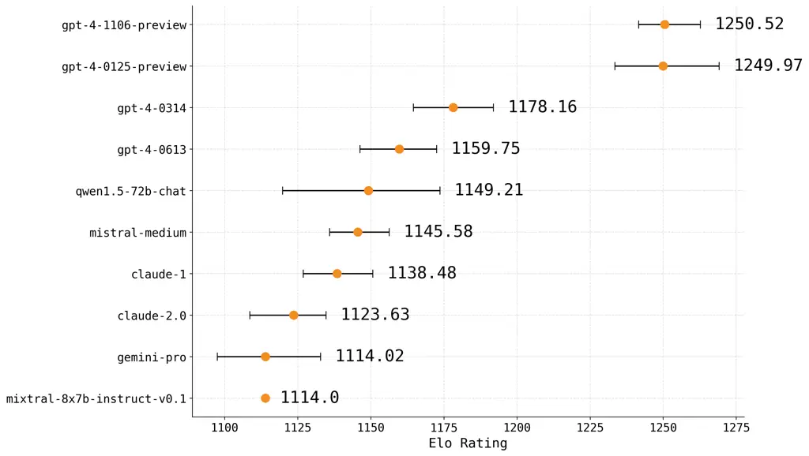

(a) Original.

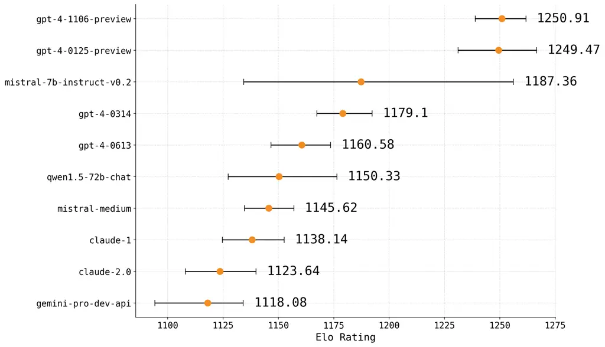

(b) Post-data-dropping.

Figure 3: 95% Bootstrap-confidence-interval-based rankings on Chatbot
Arena (Human Judge).

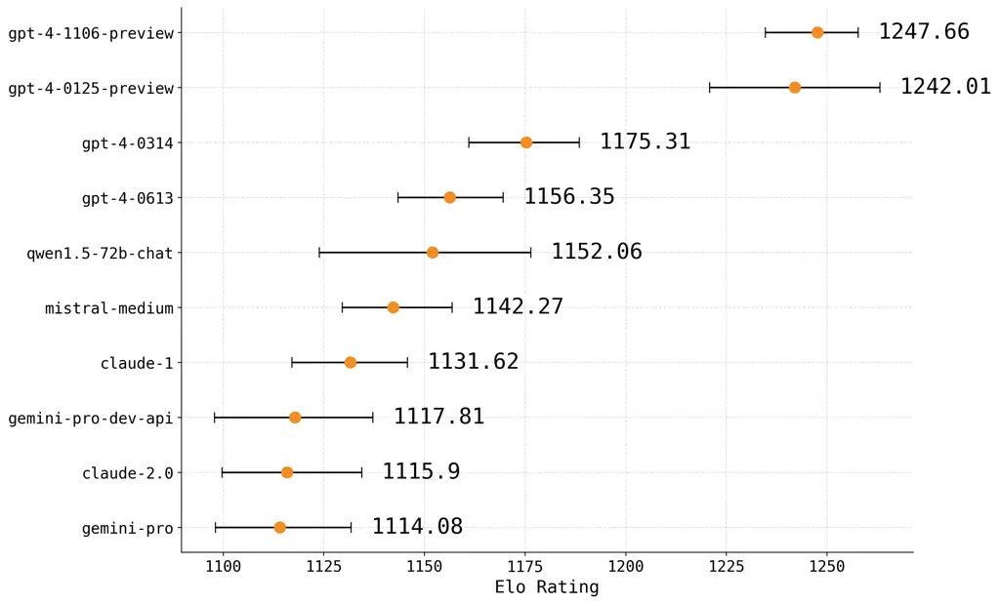

(a) Original.

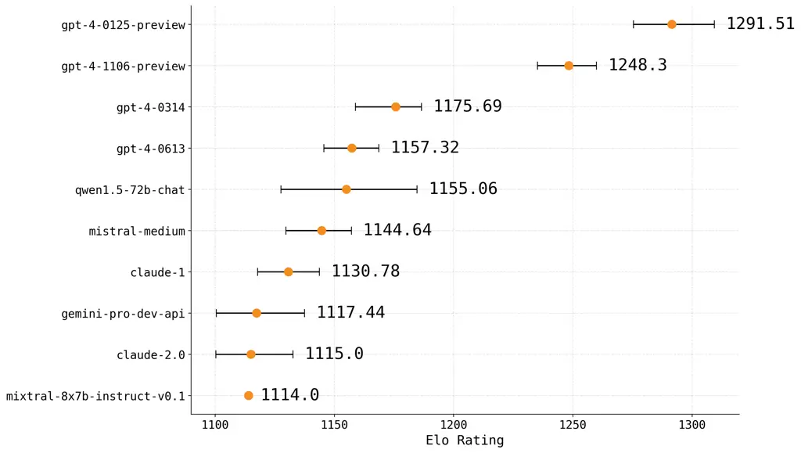

(b) Post-data-dropping.

Figure 4: 95% Bootstrap-confidence-interval-based rankings on Chatbot
Arena (LLM Judge).

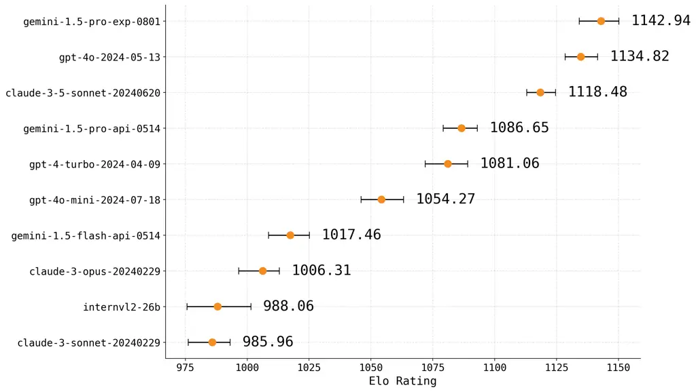

(a) Original.

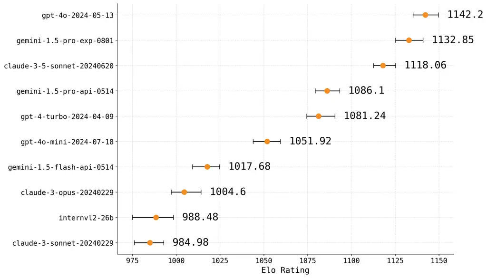

(b) Post-data-dropping.

Figure 5: 95% Bootstrap-confidence-interval-based rankings on Vision
Arena.

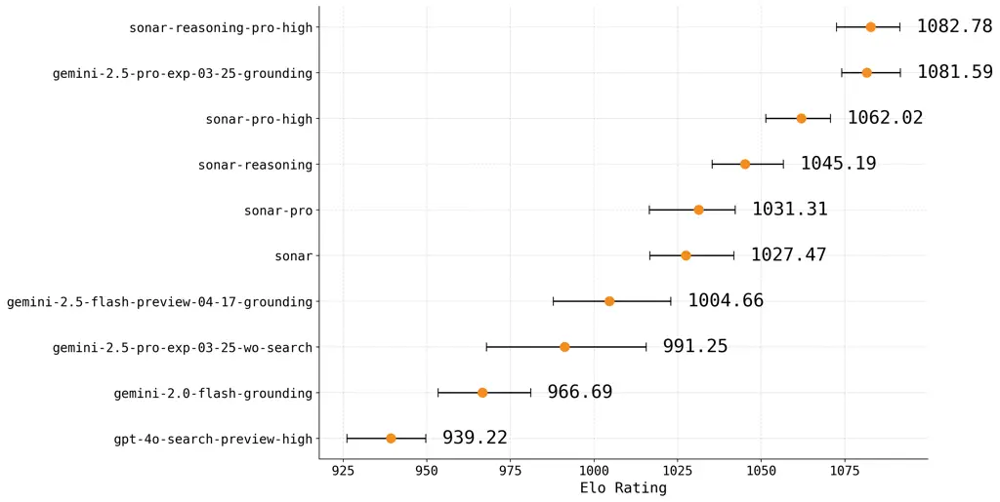

(a) Original.

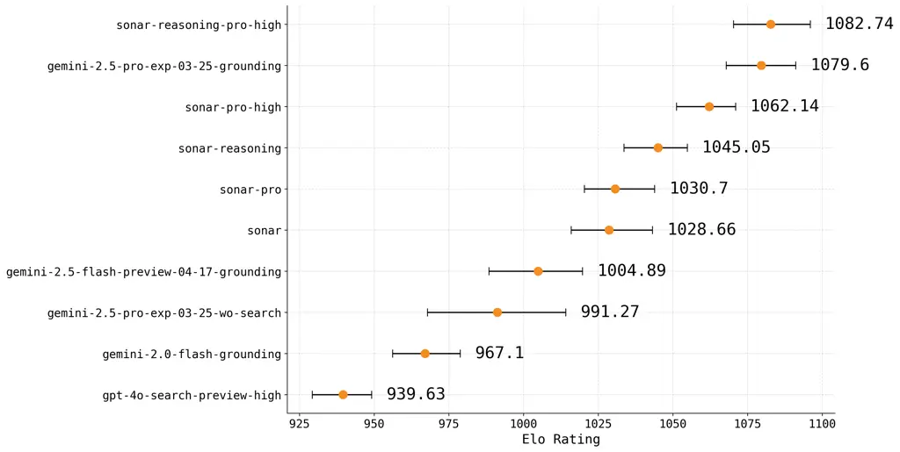

(b) Post-data-dropping.

Figure 6: 95% Bootstrap-confidence-interval-based rankings on Search
Arena.

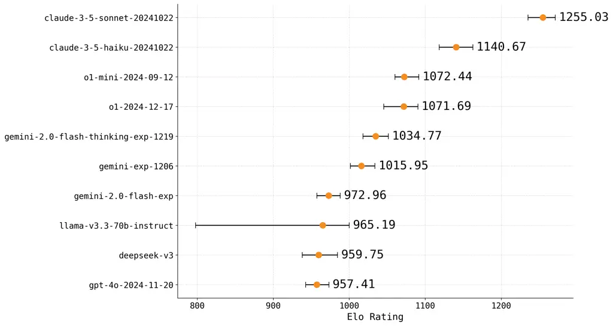

(a) Original.

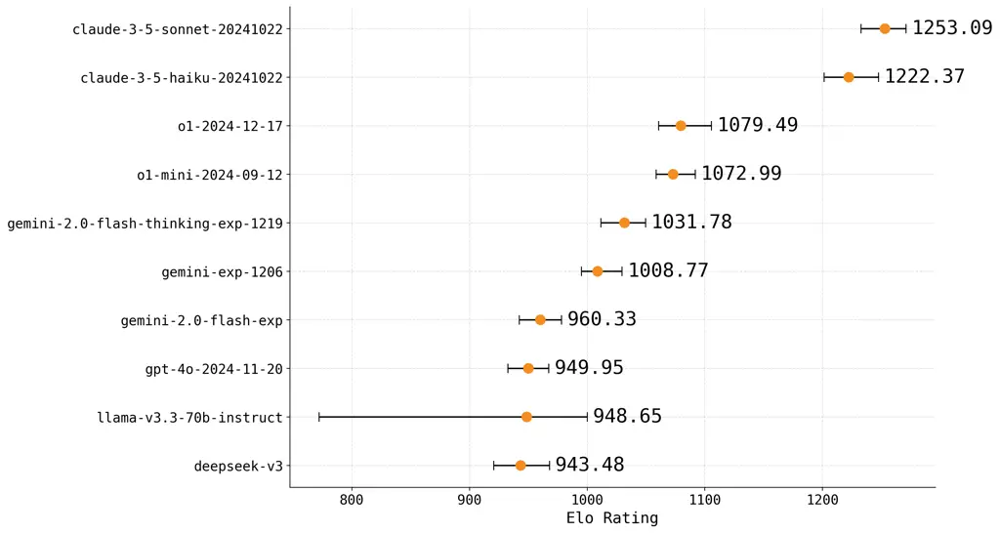

(b) Post-data-dropping.

Figure 7: 95% Bootstrap-confidence-interval-based rankings on Webdev
Arena.

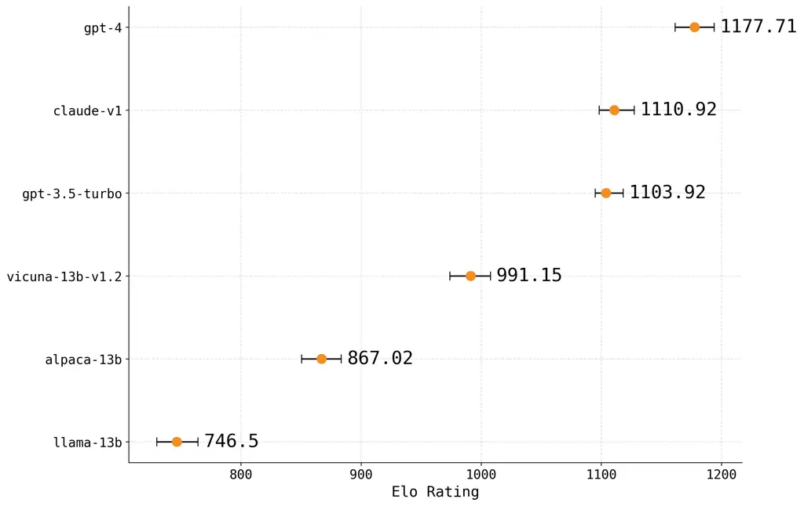

(a) Original.

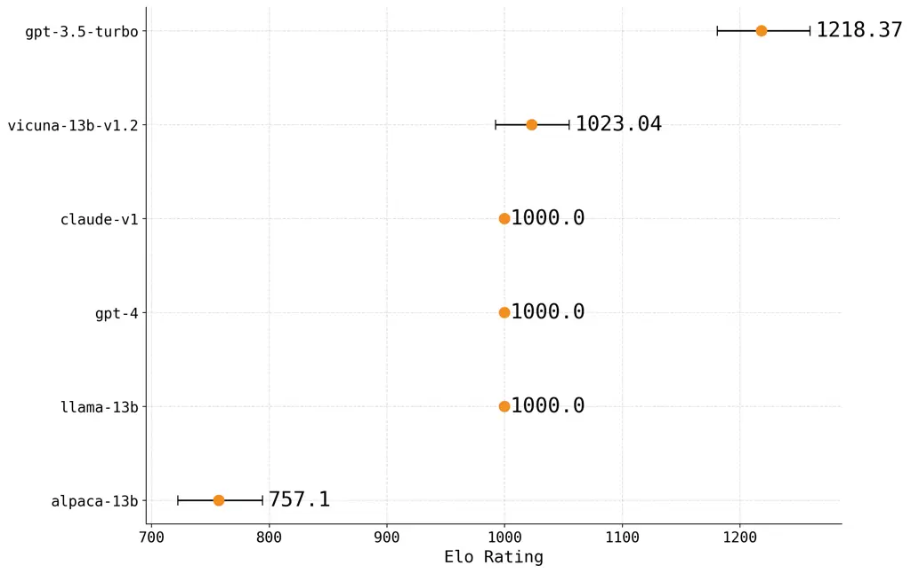

(b) Post-data-dropping.

Figure 8: 95% Bootstrap-confidence-interval-based rankings on MTBench
(Human Judge).

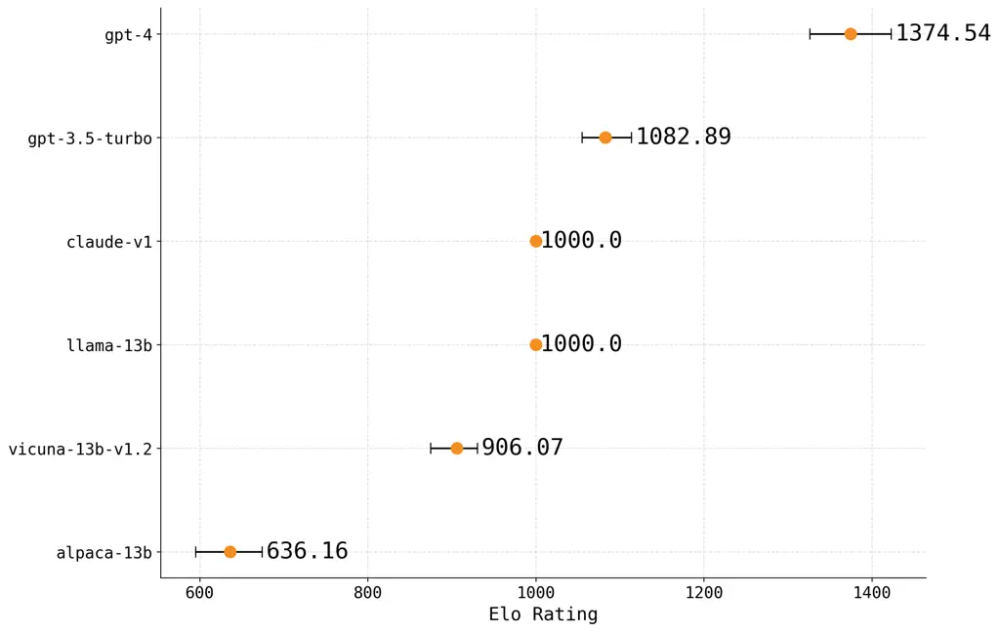

(a) Original.

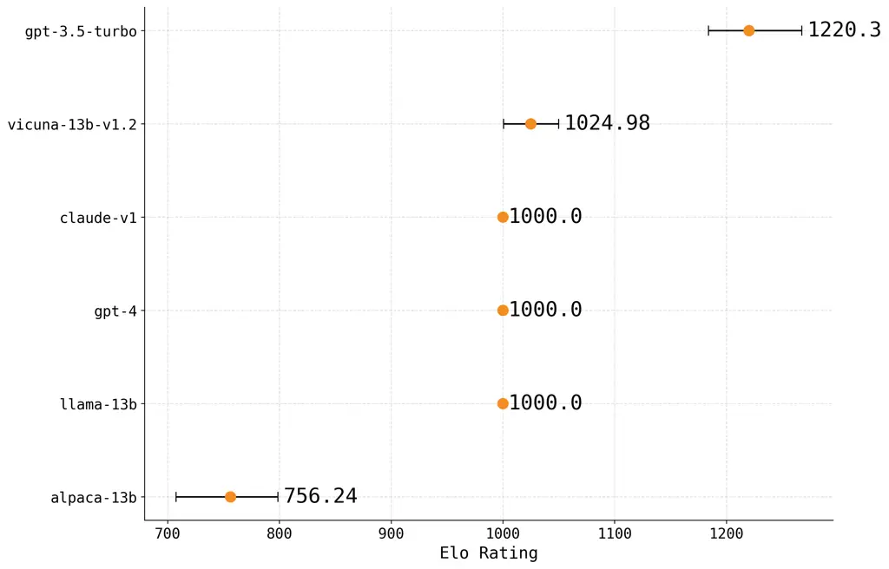

(b) Post-data-dropping.

Figure 9: 95% Bootstrap-confidence-interval-based rankings on MTBench
(LLM Judge).

| Arena         | Evaluator (Judge) | Number Dropped   | Percentage Dropped |
| ------------- | ----------------- | ---------------- | ------------------ |
| Chatbot Arena | Human             | 29 out of 57477  | 0.0510%            |
| Search Arena  | Human             | 25 out of 24469  | 0.103%             |
| Chatbot Arena | LLM               | 75 out of 49938  | 0.150%             |
| Vision Arena  | Human             | 125 out of 29845 | 0.419%             |
| Webdev Arena  | Human             | 160 out of 10501 | 1.52%              |
| MT-bench      | Human             | 92 out of 3355   | 2.74%              |
| MT-bench      | LLM               | 40 out of 2400   | 4.00%              |

Table 2: Results of checking top-1 robustness of bootstrap-based
rankings on each of the arenas, listed in ascending order of robustness
(from the least to the most robust). The “Number Dropped” column reports
the number of preferences (matches) that are sufficient to flip the
first and second-place models (players). The “Percentage Dropped” column
shows this number as a percentage of the number of total preferences in
the full arena.

To construct Table 2, we first compute the bootstrap-based rankings on
the full dataset, apply our method to identify influential preferences,
remove those preferences, and then recompute the bootstrap-based
rankings. Along with Table 2, we display the plots of the
bootstrap-based rankings for the full data and the rankings
post-data-dropping in Figures 3, 4, 5, 6, 7, 8 and 9.

Despite the bootstrap’s attempt to account for sampling uncertainty, we
continue to find many arenas to be surprisingly sensitive to worst-case
small-fraction data-dropping: the set of models ranked top-1 still
changes in many arenas after removing a very small fraction of the
arena. Across these experiments, we observe several arenas in which a
new model enters the top-1 set (Figures 3, 5 and 6) and one arena in
which a model is removed from the top-1 set (Figure 4), all from
dropping less than $`1\%`$ of preferences on the arena. We also surface
arenas where the bootstrap-based ranking outputs a single top-ranked
model, but upon small-fraction data dropping, the model becomes no
longer the sole top-ranked model (see Figure 7).

This result shows that AMIP-based non-robustness is not an artifact of
ignoring statistical uncertainty captured by confidence intervals.
Rather, even after incorporating bootstrap variability, the arenas
continue to be AMIP sensitive.

### A.2 Distinction Between Worst-case Data-dropping Sensitivity and Confidence Intervals

Confidence intervals, such as the bootstrap intervals reported on
LMArena (LMArena, 2025), do quantify a form of sensitivity of
BT-estimated rankings to variability across samples. However, the
sampling-based sensitivity that bootstrap confidence intervals capture
is conceptually different from that captured by AMIP. Bootstrap
intervals characterize how much an estimate (e.g., the BT score) varies
when data are resampled uniformly at random. In contrast, AMIP measures
the maximum change in a BT-score difference that can be induced by
removing a worst-case small fraction of the data. While frequentist (Gao
et al., 2023; Hunter, 2004) confidence interval methods are meant to
capture randomness in the data-generating process, the AMIP targets
sensitivity of a single, fixed dataset. This focus on a single sample
differs in spirit from the variability across “counterfactual worlds”
that uncertainty quantification methods are meant to measure. In this
sense, the two approaches answer complementary questions about the
stability of a sample-based conclusion: the confidence intervals measure
sampling uncertainty, while worst-case data-dropping robustness examines
whether the conclusion is driven by a very small fraction of the
observations in the sample. Although Bayesian credible intervals
(Leonard, 1977) also operate under the case of a single, fixed dataset,
past work has demonstrated that data analyses can be both statistically
significant in the Bayesian sense (credible interval does not include
zero) and still sensitive to worst-case data dropping (see Bayesian
hierarchical model case study in Section 4.4 of (Broderick et al.,
2020)). So, analogous to the frequentist case, the AMIP again represents
a different and complementary check.

These tools also differ in the statistical assumptions under which they
provide guarantees. Bootstrap-based confidence intervals rely on the
data being i.i.d. draws from a target population. Real-world preference
datasets often depart from this regime due to differences in annotators
(e.g., the same, or similar types of, annotators may annotate several
prompts on LMArena), resulting prompt-selection biases, and various
other potential context-based factors. AMIP, by contrast, does not
require an i.i.d. assumption and therefore remains valid in settings
where classical resampling tools do not apply reliably. Prior work
(Broderick et al., 2020) has demonstrated that data analyses can be
simultaneously statistically significant yet worst-case data-dropping
non-robust. In this sense, AMIP provides a complementary and practically
useful lens for assessing the generalizability of LLM leaderboard
rankings.

### A.3 Uniform Data-Dropping Experiment

To examine the contrast between worst-case data-dropping and dropping
random pairwise preferences, we conduct a uniform subsampling
experiment. For each arena, we drop $`1\%`$ of the evaluations uniformly
at random, repeat the experiment 100 times, and record the fraction of
runs in which the top-ranked model remains unchanged relative to the
full arena. For Chatbot Arena (human-judge), we additionally report
robustness at a finer scale of $`\alpha=0.1\%`$.

| Arena                       | Fraction of Trials Top-1 Robust |
| --------------------------- | ------------------------------- |
| Chatbot Arena (Human-judge) | 0.77 (0.97 at $`\alpha=0.1\%`$) |
| Vision Arena                | 1.00                            |
| NBA Games                   | 1.00                            |
| Chatbot Arena (LLM-judge)   | 1.00                            |
| Webdev Arena                | 1.00                            |
| Search Arena                | 1.00                            |
| MT-bench (LLM-judge)        | 1.00                            |
| ATP Tennis                  | 1.00                            |
| MT-bench (Human-judge)      | 1.00                            |

Table 3: Top-1 robustness of each arena under uniform-at-random
data-dropping. Each entry reports the proportion of 100 trials in which
dropping $`1\%`$ of the evaluations uniformly-at-random does not change
the top-ranked model.

The results in Table 3 highlight a key conceptual distinction between
uniform and worst-case data-dropping. Across nearly all arenas, dropping
$`1\%`$ of the evaluations uniformly at random leaves the top-ranked
model unchanged in every trial. Even Chatbot Arena (human-judge), which
is the least stable under uniform subsampling, maintains its top-ranked
model in $`77\%`$ of random $`1\%`$ deletions, a fraction that is many
magnitudes larger than the $`0.00348\%`$ of preferences required to flip
the top-ranked model when dropping the worst-case data subset. These
results show that the rankings are extremely sensitive to dropping a
worst-case small fraction of preferences, yet stable (at $`\alpha=1\%`$)
to dropping preferences chosen at random. Taken together, these
observations show that uniform and worst-case data-dropping probe
fundamentally distinct failure modes.

## Appendix B Top-k Sets Can Be Characterized By Sets of Pairwise Player Comparisons

We show in Proposition B.1 that the top-$`k`$ set can be characterized
by a set of pairwise player comparisons.

###### Proposition B.1.

Suppose we have $`M`$ real numbers,
$`\mathcal{T}(w):=\{\widehat{\theta}_{i}(w)\}_{i=1}^{M}`$. Suppose a set
$`\mathcal{S}\subset\mathcal{T}(w)`$ satisfies $`|\mathcal{S}|=k`$.
Suppose it is the case that
$`\forall\;\widehat{\theta}_{i}(w)\in\mathcal{S}`$ and
$`\forall\;\widehat{\theta}_{j}(w)\in\mathcal{T}(w)\setminus\mathcal{S}`$,
we have that $`\widehat{\theta}_{i}(w)>\widehat{\theta}_{j}(w)`$. Then,
it must be that $`\mathcal{S}`$ is the top-$`k`$ set, i.e.,
$`\mathcal{S}=\mathcal{K}_{\mathcal{T}(w)}`$.

###### Proof.

We first show that $`\mathcal{S}\subset\mathcal{K}_{\mathcal{T}(w)}`$.
Suppose that $`\widehat{\theta}_{i}(w)\in\mathcal{S}`$. By assumption,
we have that
$`\forall\;\widehat{\theta}_{j}(w)\in\mathcal{T}(w)\setminus\mathcal{S}`$,
$`\widehat{\theta}_{i}(w)>\widehat{\theta}_{j}(w)`$. Since
$`|\mathcal{T}(w)\setminus\mathcal{S}|=M-k`$, there must exist at least
$`(M-k)`$ values in $`\mathcal{T}(w)`$ that are smaller than
$`\widehat{\theta}_{i}(w)`$. This must mean that
$`\rank(\widehat{\theta}_{i}(w);\mathcal{T}(w))\leq k`$, so
$`\widehat{\theta}_{i}(w)\in\mathcal{K}_{\mathcal{T}(w)}`$ as needed.

We next show that $`\mathcal{K}_{\mathcal{T}(w)}\subset\mathcal{S}`$ by
contradiction. Suppose there exists a $`\widehat{\theta}_{j}(w)`$ such
that $`\widehat{\theta}_{j}(w)\in\mathcal{K}_{\mathcal{T}(w)}`$ but
$`\widehat{\theta}_{j}(w)\notin\mathcal{S}`$. Since
$`\widehat{\theta}_{j}(w)\notin\mathcal{S}`$, then
$`\widehat{\theta}_{j}(w)\in\mathcal{T}(w)\setminus\mathcal{S}`$. This
means that $`\forall\widehat{\theta}_{i}(w)\in\mathcal{S}`$ we have
$`\widehat{\theta}_{i}(w)>\widehat{\theta}_{j}(w)`$, and since
$`|\mathcal{S}|=k`$, this implies that
$`\rank(\widehat{\theta}_{j}(w);\mathcal{T}(w))>k`$, contradicting the
assumption $`\widehat{\theta}_{j}(w)\in\mathcal{K}_{\mathcal{T}(w)}`$. ∎

## Appendix C AMIP approximation for BT Models

### C.1 AMIP approximation of general weighted BT models

For completeness we provide here a review on general AMIP approximation
proposed by Broderick et al. (2020) to solve the optimization problem
Equation 8.

Broderick et al. (2020) propose relaxing $`w`$ to allow continuous
values and replacing the $`w`$-specific quantity of interest with a
first-order Taylor series expansion with respect to $`w`$ around
$`1_{N}`$. This first-order Taylor series expansion is known as the
influence function (IF) approximation (Hampel et al., 2011), a classic
technique from robust statistics that approximates the affect of
upweighting (or dropping) a data point on model parameters using a
first-order Taylor series approximation in data-weight space. Influence
functions have become popular tools for approximating resampling methods
(Giordano et al., 2019) and assigning value to data that a model was
trained on (Koh and Liang, 2017; Park et al., 2023). This approximation
applies to more general data analyses and quantities of interest.

In our case, this approximation amounts to replacing Equation 8 with

```math
\displaystyle\max_{w\in W_{\alpha}}\sum\nolimits_{n=1}^{N}(1-w_{n})\left(\frac{\partial\hat{\theta}_{i}(w)}{\partial w_{n}}\Big|_{w=1_{N}}-\frac{\partial\hat{\theta}_{j}(w)}{\partial w_{n}}\Big|_{w=1_{N}}\right). \tag{10}
```

Let

```math
\displaystyle L(y_{n},\theta)\coloneqq w_{WL}I_{y_{n}=W}\log\sigma(\theta_{i_{n}}-\theta_{j_{n}})+w_{WL}I_{y_{n}=L}\log(1-\sigma(\theta_{i_{n}}-\theta_{j_{n}})) \tag{11}
```

```math
\displaystyle+w_{T}I_{y_{n}=T}\big(\log\sigma(\theta_{i_{n}}-\theta_{j_{n}})+\log(1-\sigma(\theta_{i_{n}}-\theta_{j_{n}}))\big).
```

to be the likelihood for a single data point. The impact of upweighting
$`w`$ on the parameter $`\hat{\theta}_{i}(w)`$ is then given by

```math
\frac{\partial\hat{\theta}_{i}(w)}{\partial w_{n}}\Big|_{w=1_{N}}\;=\;-H_{\hat{\theta}(1_{N})}^{-1}\,\nabla_{\theta}L(y_{n},\theta)\Big|_{\theta=\hat{\theta}(1_{N})}, \tag{12}
```

where

```math
\displaystyle H_{\hat{\theta}(1_{N})}\;\coloneqq\;\frac{1}{N}\sum_{n=1}^{N}\nabla^{2}_{\theta}L(y_{n},\theta)\Big|_{\theta=\hat{\theta}(1_{N})}. \tag{13}
```

See Broderick et al. (2020, Section 2.2.2) for more details on this
derivation. In what follows we provide details on how to apply this
approximation in BT models by reformulating it as a logistic regression.

### C.2 BT models as logistic regressions

Unweighted BT. In the unweighted BT model with $`w_{W,L}=1,w_{T}=0`$,
with an abuse of data indices $`n`$, the preferences are assumed to be
generated as

```math
y_{n}\sim\text{Bernoulli}(\sigma(\theta_{i_{n}}-\theta_{j_{n}})), \tag{14}
```

We can cast this model as a logistic regression with a
specially-structured design matrix. We denote the corresponding “design”
vector of the $`n`$th comparison, $`x_{n}\in\{-1,0,1\}^{M}`$, a vector
encoding which two players are being compared. That is, if the game is
between players $`i`$ and $`j`$, then $`x_{n}`$ has a $`1`$ in the
$`i`$th element, a $`-1`$ in the $`j`$th element, and $`0`$ otherwise.
Using this structure, we can rewrite the model as a logistic regression
model with $`M-1`$ parameters corresponding to the scores of the
players, $`\bm{\theta}=(\theta_{1},\dots,\theta_{M})\in\mathbb{R}^{M}`$
with $`\theta_{1}=0`$,

```math
y_{n}\sim\text{Bernoulli}(\sigma(x_{n}^{\top}\bm{\theta})). \tag{15}
```

We fit the BT-model (i.e., estimate $`\bm{\theta}`$) by maximum
likelihood of logistic regression,

```math
\displaystyle\hat{\bm{\theta}}:= \displaystyle\argmax_{\bm{\theta}:\theta_{1}=0}\;\sum_{n=1}^{N}\big(y_{n}\log\sigma(x_{n}^{\top}\bm{\theta}) \tag{16}
```

```math
\displaystyle+(1-y_{n})\log(1-\sigma(x_{n}^{\top}\bm{\theta}))\big).
```

Weighted BT. The model actually used in e.g., ChatBot Arena that handles
tie by 1) counting every winning/loss as two games with the same outcome
and 2) couting tie as two games with opposite outcomes. This effectively
sets $`w_{W,L}=2,w_{T}=1`$. This special case can also be casted as a
logistic regression with two copy of the design matrix same as
unweighted version, $`\bm{X}_{weighted}=[\bm{X},\bm{X}]`$. That is,
suppose there are in total $`N`$ games, if the $`n`$th game is between
players $`i`$ and $`j`$, then $`x_{weighted,n}`$ as well as
$`x_{weighted,n+N}`$ has a $`1`$ in the $`i`$th element, a $`-1`$ in the
$`j`$th element, and $`0`$ otherwise. The response
$`y_{weighted,n}=I_{y_{n}=W}`$ and
$`y_{weighted,n+N}=I_{y_{n}=W}+I_{y_{n}=T}`$. I.e., in the first copy of
the game, a tie is counted as a loss and in the second copy of the game,
a tile is counted as a win while winning and losing are counted twice in
total from both copies. Then we can fit the weighted BT by maximum
likelihood of logistic regression,

```math
\displaystyle\hat{\bm{\theta}}:= \displaystyle\argmax_{\bm{\theta}:\theta_{1}=0}\;\sum_{n=1}^{2N}\big(y_{weighted,n}\log\sigma(x_{weighted,n}^{\top}\bm{\theta}) \tag{17}
```

```math
\displaystyle+(1-y_{weighted,n})\log(1-\sigma(x_{weighted,n}^{\top}\bm{\theta}))\big).
```

### C.3 Applying AMIP to BT models in logistic form

In this section we provide details on applying general Equation 12 in
our specific case of logistic regression formed BT models. We observed
that our quantity of interest $`\theta_{i}-\theta_{j}`$ is a linear
combination of effect size $`\theta_{i}`$s in logistic regression, thus
the first order Taylor expansion of this quantity can be calculated by
first order Taylor expansion of $`\theta_{i}`$s.

Let $`e_{j}`$ denote the $`j`$th standard basis vector and
$`\mathbf{X}\in\mathbb{R}^{N\times P}`$ denote the design matrix. Let
$`\widehat{p}_{n}=\sigma(\hat{\theta}^{\top}x_{n})`$ and
$`\bm{V}=\operatorname{diag}(\{\widehat{p}_{n}(1-\widehat{p}_{n})\}_{n})`$.
For logistic regression with an effect-size quantity of interest,
$`\theta_{j}`$, the formula for the influence score for the $`n`$th data
point (Pregibon, 1981) is given by

```math
\displaystyle\frac{\partial\hat{\theta}_{j}(w)}{\partial w_{n}}\Big|_{w=1_{N}}=e_{j}^{\top}(\mathbf{X}^{\top}\bm{V}\mathbf{X})^{-1}x_{n}\widehat{p}_{n}(1-\widehat{p}_{n})\left(y_{n}-\widehat{p}_{n}\right), \tag{18}
```

In addition to influence functions, our framework enables a second
data-dropping approximation known as the One-step Newton (1sN)
approximation, which approximates the effect of dropping a data point on
model parameters using a second-order Taylor expansion in parameter
space. This Newton-style update has become popular for approximating the
deletion of data in recent works on approximate cross validation (Ghosh
et al., 2020; Wilson et al., 2020) and machine unlearning (Sekhari et
al., 2021; Suriyakumar and Wilson, 2022). The 1sN is slightly more
expensive to compute than the IF approximation (as it corrects the IF
with a multiplicative correction term) but is more accurate when the
to-be-dropped data point has high a leverage score (because the
correction term involves the leverage score of a data point). Previous
works have proposed approximating the removal of a group of data points
by the sum of leave-one-out 1sN scores, in an algorithm known as the
Additive one-step Newton approximation (Huang et al., 2025a; Park et
al., 2023).

To run the AMIP and Additive one-step Newton algorithm to check pairwise
robustness between two given players, $`i`$ and $`j`$, we:

1.  1.  Fit a BT model on the entire arena.
2.  2.  Compute the _influence scores_ (Equation 18) (one-step Newton scores
        for the Additive one-step Newton algorithm) for all matches in the
        arena.
3.  3.  Identify the $`\lfloor\alpha N\rfloor`$ matchups for which the
        difference in influence scores is the largest in the negative
        direction (assuming that player $`i`$ has a higher estimated BT
        score than player $`j`$ on the full data).
4.  4.  Approximate impact of dropping these $`\lfloor\alpha N\rfloor`$
        matchups by the sum of the influence score approximations.
5.  5.  If the approximation predicts that the relative ranking between
        players $`i`$ and $`j`$ changed, then refit the model leaving out
        the identified subgroup.⁷⁷ 7 Our algorithm gives users the option to
        refit the BT model for all matchups, regardless of whether a
        predicted ranking change occurs.

These data-dropping algorithms replace a computationally intractable
combinatorial search with an algorithm that costs only

```math
O(Analysis+N\log(\alpha N)+NP^{2}+P^{3}),
```

where $`Analysis`$ represents the cost of fitting the initial
Bradley–Terry model on the original arena to compute scores.
Data-dropping approximations make identifying candidate subsets of the
arena that may induce top-$`k`$ non-robustness very fast because they
eliminate the need to retrain the BT model repeatedly on every candidate
subset. Once a candidate subset is identified, however, our method
always performs a refitting of the BT model with the identified subset
removed to verify whether the non-robustness is true. This final
verification step ensures that our method does not return false
positives.

## Appendix D Arenas

Chatbot Arena. A crowdsourced platform where users engage in
conversations with two chatbots at the same time and rate their
responses based on personal preferences (Zheng et al., 2023). We use the
arena-human-preference-55k amd chatbot-arena-llm-judges datasets. This
benchmark contains a total number of $`57{,}477`$ preferences. Figure 3
presents the BT scores of the top models in Chatbot Arena.

MT-Bench. A multi-turn question set designed to compare LLMs in
multi-turn conversation and instruction following constructed to
distinguish between models based on reasoning and mathematics (Zheng et
al., 2023). We use the mt-bench-human-judgments dataset. This benchmark
was handcrafted using $`58`$ expert-level human labelers; it contains
$`3{,}355`$ total preferences. In contrast to Chatbot Arena, labelers
are mostly graduate students, so they are considered more skilled than
average crowd workers. Figure 8 presents the BT scores of the models in
MT-bench.

Search Arena. A crowdsourced platform for search-augmented LLMs,
focusing on real-world and current events rather than static factual
questions. We conduct our analysis using historical data available on
Hugging Face: lmarena-ai/search-arena-24k. The dataset contains
$`24{,}069`$ multi-turn conversations with search-LLMs across diverse
intents, languages, and topics. Figure 6 presents the BT scores of the
top models in Search Arena.

Webdev Arena. A crowdsourced platform for LLM web development tasks,
such as building interactive applications and webpages. We conduct our
analysis using historical data available on Hugging Face:
lmarena-ai/webdev-arena-preference-10k. This dataset contains
$`10{,}000`$ user-submitted prompts. Figure 7 presents the BT scores of
the top models in Webdev Arena.

Vision Arena. A crowdsourced platform that tests vision-language models
on visual question-answering. There are a total of $`30{,}000`$ single
and multi-turn chats between users and two anonymous vision-language
models. We conduct our analysis using historical data available on
Hugging Face: lmarena-ai/VisionArena-Battle. Figure 5 presents the BT
scores of the top models in Vision Arena.

ATP Tennis. Association of Tennis Professionals (ATP) tennis records
consolidated by Sackmann (2024). Each entry represents a match from the
ATP tour, a worldwide top-tier men’s tennis tour, and consists of the
identifiers of the winning and losing players and the match-related
metadata (e.g., player rankings, name of the tournament). We focused on
the top-10 ranked players based on the 2024 season ranking and analyzed
their plays throughout four seasons, 2020-2024. To avoid the case where
dropping a small proportion of matches could drop a player’s entire
record, we focus our analysis on players who played at least 20 games.
There were in total 278 games after filtering. Figure 10 presents the BT
scores of the top models in the tennis dataset.

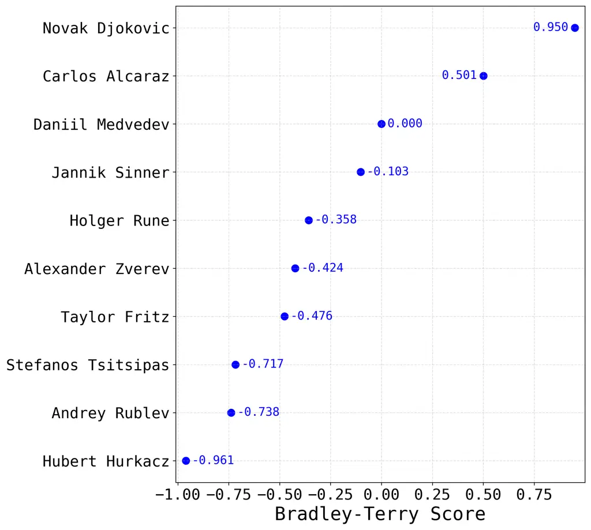

Figure 10: The top-10 player rankings in the tennis data.

NBA. Basketball games from all seasons of the National Basketball
Association (NBA), consolidated by FiveThirtyEight (2025). Each entry
represents a historical game from the National Basketball Association,
consisting of the identifiers of the two teams, the outcome of the game
(win or loss), as well as game-related metadata (e.g., Elo score of each
team, game location). To avoid the case where dropping a small
proportion of matches could drop a player’s entire record, we focus our
analysis on the top 50 teams by number of games played. There are a
total of 109,892 matchups between the 50 teams. Figure 11 presents the
BT scores of the top teams in the NBA.

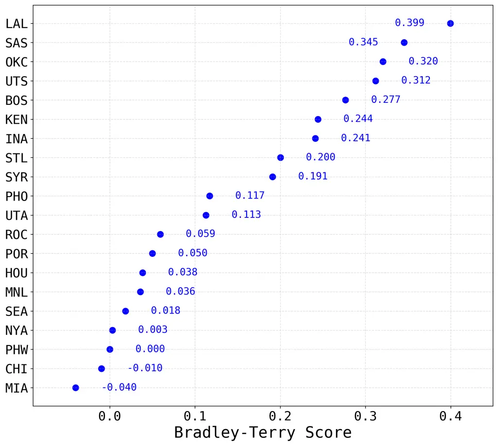

Figure 11: The top-20 team rankings in the NBA.

## Appendix E Player Involvement, Homogeneous Bars

Across all top-$`k`$ robustness experiments, $`100\%`$ of dropped
matches involved either one or both of the models whose rankings were
flipped, with $`100\%`$ belonging to one of these two cases within a
given $`k`$ (see Figure 12). There are no partial bars or mixed
compositions. Readers may ask: Why does this homogeneous pattern
consistently appear? Could this be a property of the arena data?

We investigate this by manually inspecting the dropped matchups returned
by our robustness assessing algorithm for each value of $`k`$.
Specifically, in each case, we identified the dropped matchups and
inspected which players appeared in these matchups. We summarize the
findings here:

- •
  $`k=1`$: 2 games were dropped to flip GPT-4-0125-preview (originally
  1st) and GPT-4-1106-preview (2nd). These two matches were between
  GPT-4-0125-preview and two other models, vicuna-13b (22nd) and
  stripedhyena-nous-7b (45th), with GPT-4-0125-preview losing.
- •
  $`k=3`$: 29 games were dropped to flip models gpt-4-0314 (3rd place)
  with mistral-7b-instruct-v0.2 (6th place). Games were played between
  mistral-7b-instruct-v0.2 and various other models, with
  mistral-7b-instruct-v0.2 losing all matches.
- •
  $`k=5`$: 3 games were dropped to flip models qwen1.5-72b-chat (5th
  place) with mistral-medium (6th place). All dropped matches were
  between qwen1.5-72b-chat and gpt-4-1106-preview (1st place), with
  qwen1.5-72b-chat (5th place) winning.
- •
  $`k=10`$: 1 game was dropped to flip models gemini-pro (10th) and
  mixtral-8x7b-instruct-v0.1 (11th place). The dropped match was between
  the two models, with gemini-pro winning.
- •
  $`k=20`$: 1 game was dropped to flip models gpt-3.5-turbo-0314 (20th
  place) with nous-hermes-2-mixtral-8x7b-dpo (21st place). The dropped
  match was between nous-hermes-2-mixtral-8x7b-dpo (21st place) and
  vicuna-13b (22st place), with nous-hermes-2-mixtral-8x7b-dpo losing.

The reason the involvement is always entirely either one or both
affected players is because all of the dropped matchups consist of games
played between a central model and a specific competitor (or group of
competitors) whose outcomes all favor or disfavor the specific model and
every dropped preference was a clear win or loss (no ties), aligning in
the direction required to flip the ranking. In other words, whenever a
top-$`k`$ set changed due to the demotion of a model, all dropped
matches were ones that the demoted model had originally won, and vice
versa for promotions. This structure then leads the dropped matchups to
consist entirely of evaluations that involved one or both
ranking-flipped models. This finding reveals something interesting about
the nature of the non-robustness in our analysis: small, consistent sets
of matchups are sufficient to push a model just above or below another
on the leaderboard.

For every instance where the top-$`k`$ leaderboard changes due to
dropped preferences, we find that the affected matches always involve at
least one of the models whose rank is altered (see Figure 12). This
holds true for both human-judged and LLM-judged Chatbot Arenas. While
Min et al. (2025) find that adding in a small fraction of rigged votes
can influence a target model’s ranking even when the target model is not
directly involved in the rigged votes, we are unable to find instances
where rankings were flipped by removing a small fraction of preferences
where neither of the affected models were involved.

Also, notice in Figure 12 that there are no partial bars or mixed
compositions. We investigate why this homogeneous pattern appears
consistently across bars. Inspecting dropped matchups manually, we find
that the reason why one or both flipped players are always involved in
the dropped matchups is because these matchups are always played between
the model that is flipped, call it the target model, and a specific
competitor (either the model whose ranking is flipped relative to the
target model, or another model) or group of competitors (including
models whose rankings remain unchanged), and all matchups either always
favor or disfavor the target model (see Appendix E for a more detailed
description). This finding reveals something about how non-robustness
appears in our analyses: small, consistent sets of matchups are
sufficient to push a model just above or below another on the
leaderboard.

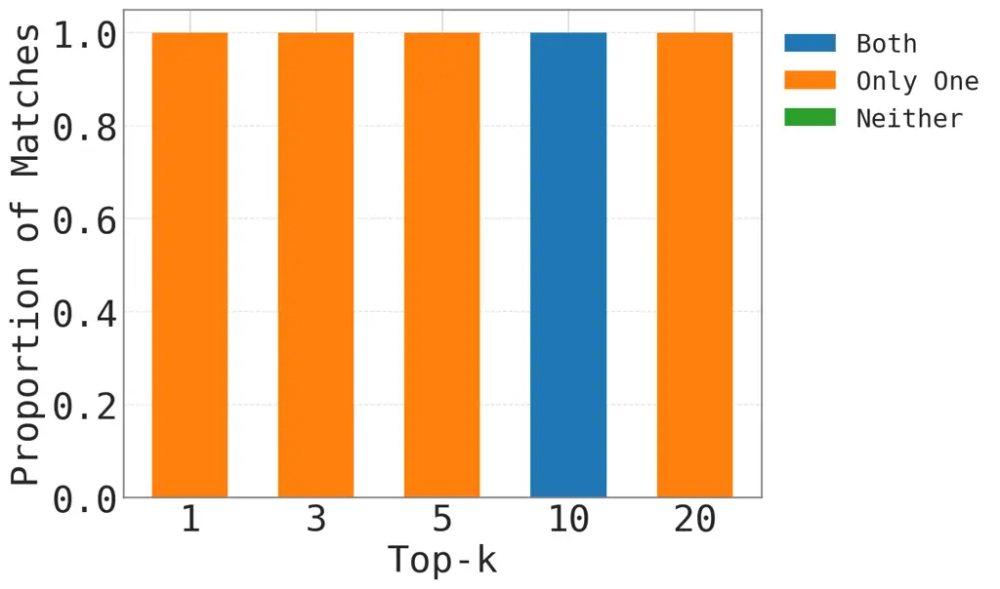

(a) Chatbot Arena (Human-Judge)

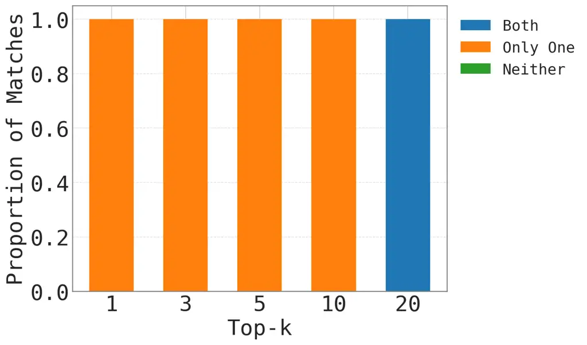

(b) Chatbot Arena (LLM-Judge)

Figure 12: Player involvement in the most influential matches whose
removal caused two models (players), one inside the top-$`k`$ positions
and one outside, to exchange places. Each bar represents the composition
of matches dropped in order to exchange the models. The proportions
indicate whether neither (green), one (orange), or both (blue) of the
affected models were involved in each dropped matchup. For Chatbot Arena
(Human-Judge) (top), the number of matches dropped for each
$`k\in\{1,3,5,10,20\}`$ is $`(2,29,3,1,1)`$, respectively. For Chatbot
Arena (LLM-Judge) (bottom), the number of matches dropped for each
$`k\in\{1,3,5,10,20\}`$ is $`(9,24,9,1,2)`$. Across all $`k`$, we find
that $`100\%`$ of flipped rankings involved matches containing at least
one of the players whose ranking changed.

## Appendix F Inspecting Dropped Preferences

Dropping just two ($`0.003\%`$ of) preferences on Chatbot Arena is
enough to change the top-ranked model on Chatbot Arena from
GPT-4-1106-preview to GPT-4-0125-preview. Below we provide the two
prompts and response pairs responsible for the ranking flip, together
with the corresponding annotation. Additionally, we note that the BT
model’s estimation procedure does not use any information about prompt
content; it depends only on the BT scores of the two models involved in
each match, which means it is possible for dropped subsets to be
non-unique.

##### Prompt 1.

“teach me how to make independent classes in python that can be call and
install through pip.”

##### Competing Models.

GPT-4-0125-preview, Vicuna-13b

##### Preferred Model.

Vicuna-13b.

##### Responses.

See Figure 13 for the complete response by GPT-4-0125-preview and
Figure 14 for the complete response by Vicuna-13b.

Figure 13: GPT-4-0125-preview: response to prompt 1.

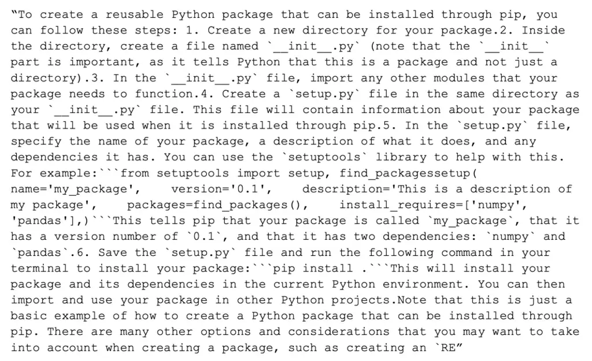

Figure 14: Vicuna-13b: response to prompt 1.

##### Prompt 2.

“name me challenging c++ projects i can add on my cv as a cs student.
give me creative ideas and dont forget im a student.”

##### Competing Models.

GPT-4-0125-preview, Stripedhyena-nous-7b

##### Preferred Model.

Stripedhyena-nous-7b.

##### Responses.

See Figure 15 for the complete response by GPT-4-0125-preview and
Figure 16 for the complete response by Stripedhyena-nous-7b.

Figure 15: GPT-4-0125-preview: response to prompt 2.

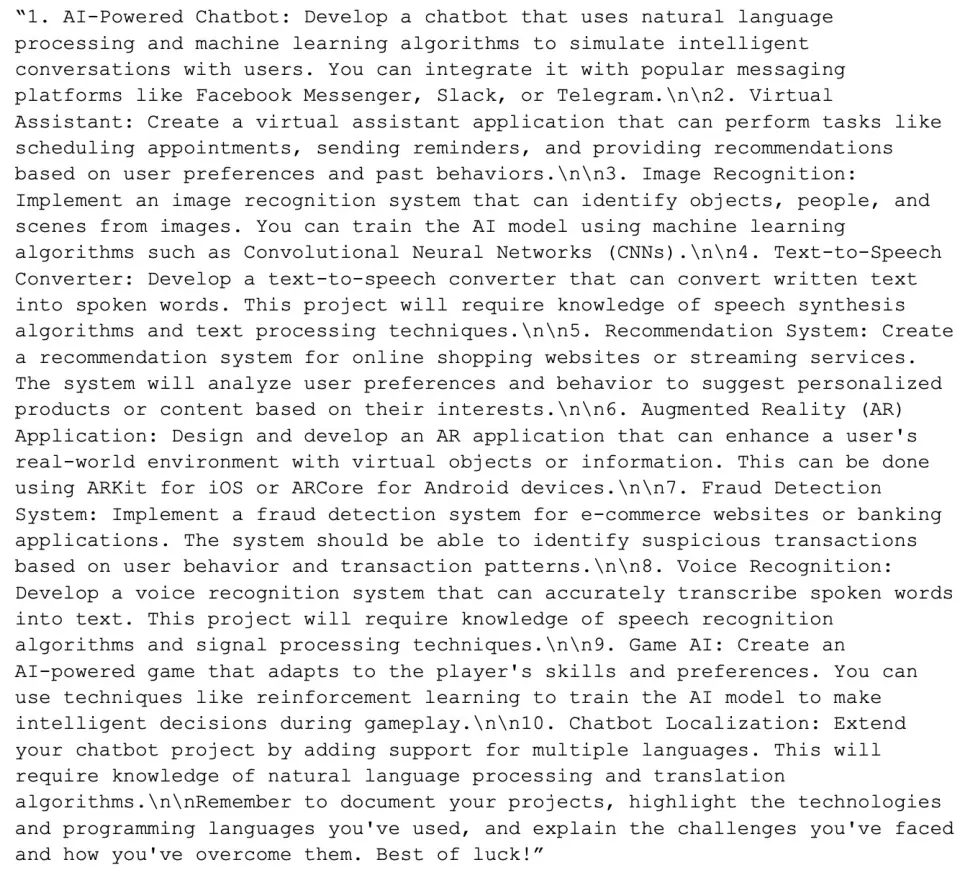

Figure 16: Stripedhyena-nous-7b: response to prompt 2.

To conduct a qualitative analysis on the response pairs, we provide a
strong judge model, GPT-5.1⁸⁸ 8 We accessed GPT-5.1 through the ChatGPT
user interface in a logged-out, incognito session., with a system prompt
requesting a summary of the two responses, their similarities and
differences, and a difficulty rating indicating how distinct the
responses are.

##### System Prompt

> Provide a summary of the following two AI-generated responses to the
> prompt: \[Insert Prompt Here\]. Then describe their main similarities
> and differences. Finally, rate on a scale from 1 (very similar) to 5
> (one response clearly better) how difficult it would be for a user to
> distinguish the two responses.
>
> Response A: \[Insert Response A here\]
>
> Response B: \[Insert Response B here\]
>
> Provide 2-3 sentences for each of the following headings: summary,
> similarities, differences, and difficulty rating.

In the following GPT-5.1 responses, Response A refers to
GPT-4-0125-preview, and Response B refers to the smaller, open-source
models, Vicuna-13b and Stripedhyena-nous-7b, respectively for prompts 1
and 2.

##### GPT-5.1-Generated Response \[for Prompt 1\]

> ##### Summary.
>
> Response A provides a detailed, step-by-step explanation of how to
> create Python classes, organize them into a package, build
> distribution files, and optionally upload the package to PyPI. It
> includes full code examples, terminal commands, and practical guidance
> for beginners. Response B offers a brief overview of how to create a
> package with init.py and setup.py, focusing mainly on local
> installation and basic configuration, and ends abruptly without deeper
> detail.
>
> ##### Similarities.
>
> Both responses explain that Python packages require an init.py file
> and a setup.py file using setuptools. They also describe how a user
> can install the finished package with pip. Each provides an example of
> what a setup.py file might look like.
>
> ##### Differences.
>
> Response A is much more comprehensive, guiding the reader through
> class creation, directory structure, building distribution files, and
> publishing to PyPI, while Response B offers only a high-level outline
> of the process. Response A includes practical, runnable examples,
> whereas Response B only sketches the idea of the setup. Response B
> also feels incomplete and omits several important steps that Response
> A covers thoroughly.
>
> ##### Difficulty Rating.
>
> On a scale of 1 to 5, where 1 means the responses are very similar and
> 5 means one is clearly better, the two responses would rate around a
> 4.5. A typical user would likely find Response A significantly more
> helpful, complete, and actionable than Response B.

##### GPT-5.1-Generated Response \[for Prompt 2\]

> ##### Summary.
>
> Response A focuses on C++-specific, systems-oriented projects such as
> memory allocators, compilers, and physics engines, emphasizing core CS
> concepts and low-level programming. Response B centers on AI- and
> application-focused ideas like chatbots, image recognition, and
> recommendation systems, many of which are not inherently tied to C++.
>
> ##### Similarities.
>
> Both responses offer lists of challenging project ideas intended to
> help a CS student strengthen their CV. They also highlight projects
> that can demonstrate technical skills and encourage documenting the
> work effectively.
>
> ##### Differences.
>
> Response A is tightly aligned with the prompt, emphasizing C++ and
> foundational CS mechanics, whereas Response B presents more general
> software and AI projects that may rely on other languages or
> frameworks. Additionally, Response A provides deeper technical
> context, while Response B takes a more high-level,
> application-oriented approach.
>
> ##### Difficulty Rating.
>
> Rating: 5 — The two responses differ clearly in focus, depth, and C++
> relevance, making them easy to distinguish. A typical user would
> quickly notice that only Response A directly addresses the C++-project
> requirement.

In both surfaced examples, GPT-5.1 judges the pair of responses to be
easy to differentiate and consistently prefers the opposite response
from the human annotator (e.g., “A typical user would likely find
Response A significantly more helpful, complete, and actionable than
Response B,” and “A typical user would quickly notice that only Response
A directly addresses the C++-project requirement.”). This makes sense,
as both matches are cases in which a much lower-scoring model is
preferred to the top-ranked model. Thus, one might interpret the
influential subsets the method identifies as “outlier” preferences,
cases where the annotator’s preference deviates from what the average
user might select.

### F.1 Sensitivity Driven by Narrow Score Margins

We find that the stability of the arena depends on the BT score margins
between models (see Figure 18). Recall from Table 1 that dropping only
two preferences is enough to change the top-ranked model. To explore the
effect of score margins, we first remove all games involving the
second-place model (GPT-4-1106-preview). The arena then becomes more
resilient, requiring dropping 38 out of $`57{,}477`$ ($`0.07\%`$)
preferences to overturn the leader. When we further remove all games
involving the 2nd through 5th place models, the leaderboard becomes
harder to perturb, but is still remarkably sensitive, requiring dropping
63 out of $`57{,}477`$ ($`0.1\%`$) preferences to flip the top model.

One possible explanation for this fragility is that top competitors are
often closely matched, making it difficult for annotators to reliably
separate their performance on the prompts submitted to the arena. This
raises the possibility that sensitivity could be reduced by that
sharpens distinctions between models (for example, through expert
annotators and curated prompts targeting challenging domains such as
mathematics, coding, and multi-turn reasoning, as in MT-Bench (Zheng et
al., 2023)).

## Appendix G Verification of AMIP-identified Subsets

For each of our nine data analyses, we can use the machinery of our
method to return a $`w`$ corresponding to a smallest data subset that
can be dropped to change the top-1 ranking. The machinery of our method
also returns an estimate (before re-running the BT model) for whether
the top-1 ranking is changed. To examine how often an identified weight
vector $`w`$ truly corresponds to a subset whose removal flips the
ranking, we report across all nine arenas the number of cases where the
estimate with the $`w`$-vector accurately reflects a change in the top
ranking over the total number of arenas tested for top-1 robustness.

In Table 4, we find that all identified $`w`$-vectors lead to a true
change in ranking. And we find that this result holds even when the
dropped subset is greater than $`\lfloor\alpha N\rfloor`$ of the data
(even though the original AMIP makes no claims to an accurate
identification of a decision-changing $`w`$ in this case). However, this
does not mean that there are no cases where AMIP fails to surface a
vector $`w`$ that leads to a change in ranking (i.e., false negatives
are possible).

| Dataset                   | AMIP-Returned Subset (Indices)                                                                                                                                                                                                                                                                                                                                                                                                                                                                                                 | Flip? |
| ------------------------- | ------------------------------------------------------------------------------------------------------------------------------------------------------------------------------------------------------------------------------------------------------------------------------------------------------------------------------------------------------------------------------------------------------------------------------------------------------------------------------------------------------------------------------ | ----- |
| Chatbot Arena             | {46592, 5156}                                                                                                                                                                                                                                                                                                                                                                                                                                                                                                                  | Yes   |
| Vision Arena              | {22176, 9686, 887, 15782, 24340, 25110, 9816, 10926, 18732, 21303, 13957, 2934, 2936, 19600, 11072, 15311, 11038, 25845, 17732, 29100, 5421, 24462, 23006, 10572, 2134, 13518, 5390, 15353}                                                                                                                                                                                                                                                                                                                                    | Yes   |
| NBA Games                 | {18819, 19717, 18818, 19762, 14523, 19763, 14522, 20900, 22132, 22133, 18305, 15756, 14383, 18304, 14382, 19716, 20135}                                                                                                                                                                                                                                                                                                                                                                                                        | Yes   |
| Chatbot Arena (LLM-judge) | {41445, 9108, 14834, 11144, 11675, 9123, 17291, 48894, 42411}                                                                                                                                                                                                                                                                                                                                                                                                                                                                  | Yes   |
| Webdev Arena              | {7164, 7539, 9112, 7711, 2089, 1815, 2414, 6542, 6446, 4883, 8753, 2889, 9272, 3553, 1512, 5933, 6992, 10387}                                                                                                                                                                                                                                                                                                                                                                                                                  | Yes   |
| Search Arena              | {22164, 12847, 12819, 21810, 11852, 19956, 9492, 15447, 11324, 16583, 12733, 10116, 21940, 15552, 9451, 12602, 21977, 11499, 12576, 10146, 12557, 11519, 15699, 9420, 12851, 18068, 12931, 11278, 13279, 11143, 11163, 21587, 9963, 13226, 9586, 20632, 13191, 9978, 13189, 12456, 11204, 17160, 13129, 18238, 18231, 10009, 13112, 15234, 11251, 20575, 13043, 10030, 11209, 9607, 20336, 15733, 22646, 12061, 11768, 12023, 10375}                                                                                           | Yes   |
| MT-bench (LLM-judge)      | {646, 587, 1290, 1741, 720, 570, 571, 72, 223, 1212, 1183, 1122, 2052, 2053, 2112, 1242, 1063, 1033, 1032, 1003, 1812, 2113, 1002, 282, 1093, 1092, 1243, 2022, 1753, 1752, 132, 103, 102, 1872, 1873, 1543, 162, 1453, 1423, 1422}                                                                                                                                                                                                                                                                                            | Yes   |
| ATP Tennis                | {236, 168, 251, 177, 202, 122}                                                                                                                                                                                                                                                                                                                                                                                                                                                                                                 | Yes   |
| MT-bench (Human-judge)    | {137, 2399, 1298, 1884, 2398, 139, 1153, 850, 391, 1111, 3181, 91, 648, 2612, 803, 802, 804, 801, 800, 348, 744, 41, 2726, 349, 2668, 608, 607, 1450, 799, 2909, 1409, 2912, 2725, 748, 2492, 1537, 160, 1536, 2911, 1534, 925, 1535, 2333, 2161, 570, 1830, 346, 2334, 745, 1408, 1191, 2332, 3055, 101, 222, 2883, 3274, 221, 2837, 219, 667, 178, 3021, 3022, 1902, 2552, 2551, 2341, 863, 1124, 1903, 2624, 2626, 2627, 1634, 898, 1744, 2510, 1745, 220, 3275, 666, 1162, 246, 1214, 1294, 1165, 64, 247, 1556, 65, 3278} | Yes   |

Table 4: For each dataset, the number of cases where the estimate with
the $`w`$-vector accurately reflects a change in the top ranking) over
the total number of arenas tested for top-1 robustness. All surfaced
$`w`$-vectors successfully flip the ranking (9/9).

## Appendix H Masking Effects and the Possibility of False Negatives

A main limitation of our approach is that while it can conclusively
identify non-robustness, it is possible that there is non-robustness
that it does not find: when our method surfaces a subset whose removal
flips the ranking, the resulting perturbation is an exact, verifiable
witness of fragility; however, when no such subset is found, we cannot
conclude that the arena is robust.

This limitation is a documented challenge in the literature on
identifying influential subsets (Hu et al., 2024; Huang et al., 2025a;
Moitra and Rohatgi, 2023). In linear models, for example, Huang et al.
(2025a) and Hu et al. (2024) show that AMIP and related additive,
first-order approximations can miss influential subsets. A key failure
mode is due to a phenomenon is known as “masking,” in which several
highly-impactful data points produce a large change to a statistic
(e.g., an estimated BT-score) when deleted jointly, yet no single point
appears influential when considered in isolation. To address masking
effects, works such as Belsley et al. (1980); Kuschnig et al. (2021);
Huang et al. (2025a) have considered using step-wise (greedy)
approaches, of removing the most influential points in sequence. The
main empirical conclusion of this paper relies on an existence proof:
namely, that several widely used evaluation datasets exhibit substantial
sensitivity to very small targeted deletions. For this reason, we do not
pursue step-wise greedy variants here, though they remain an interesting
direction for future work.

## Appendix I Non-Robustness of NBA Rankings

To assess whether fragility of Bradley–Terry (BT) rankings extends
beyond LLM arenas, we applied our method to historical NBA data. The
degree of non-robustness in NBA rankings is comparable to that observed
in Chatbot Arena: both require removing $`<0.05\%`$ of matchups to alter
the top spot. In both cases, the explanation may trace back to small
BT-score gaps at the top of the leaderboard (See Figure 11). One
plausible explanation is that the skill levels among elite NBA teams are
tightly clustered, and so any apparent differences in skill level may
not be substantive.

This non-robustness in the NBA datasets suggests a broader conclusion
that BT-based evaluation systems–whether in AI benchmarking or
sports–tend to be unstable when the margin between competitors is
narrow.

## Appendix J Additional Supporting Figures

The figures in this section provide additional insights related to our
analysis. Figure 17 shows the distribution of model appearances in
Chatbot Arena, respectively, revealing differences in evaluation density
and coverage across platforms. Figure 18 illustrates the relationship
between the robustness of model rankings and the BT score gap between
adjacent models, confirming that small score differences tend to
coincide with greater sensitivity to worst-case data-dropping.

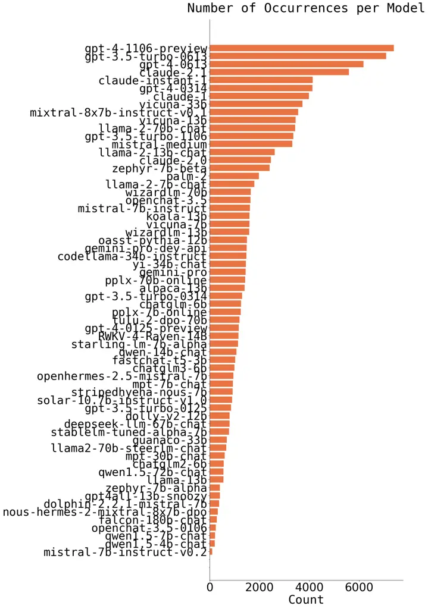

Figure 17: The number of times each model appears in a match in Chatbot
Arena. The horizontal bar chart shows how frequently each model appeared
in any match, with GPT-4 and GPT-3.5 variants being the most
represented.

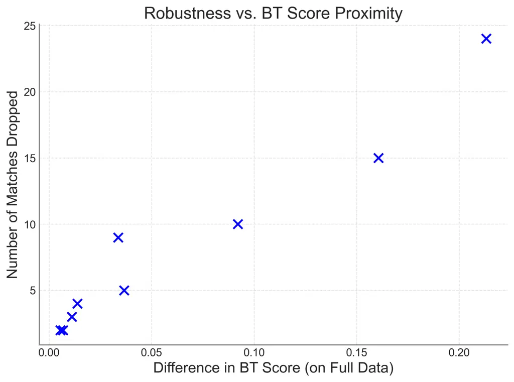

Figure 18: Robustness of results is correlated with the proximity of the
BT scores. Each point represents a pair of models whose relative
rankings flipped after dropping a small fraction of matchups. In every
case, the flip causes one model to enter the top-k rankings (for some
$`k\in\{1,3,5,10,20\}`$) while the other is demoted. These points are
taken from both human and LLM-as-a-judge evaluation platforms.

## Appendix K Large language model (LLM) use

We used LLMs for grammar checks and to polish writing, to help find
sports datasets that yielded the discovery of Sackmann (2024), and as a
judge model in the qualitative study described in Appendix F. Although
our study is about LLM rankings, we did not use LLMs as direct study
subjects.
